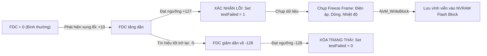

# CHUYÊN ĐỀ 04: Diagnostic Stack (UDS ISO 14229, DCM, DEM) & Memory Stack (NvM, Fee) Hands-on Tasks
## KẾ HOẠCH BÀI TẬP THỰC HÀNH TẦNG SÂU — 6 Tasks (~18 giờ)

> 📚 **Tài liệu lý thuyết đối chiếu:** [`docs/theory/04_Diagnostic_UDS_And_Memory_Stack.md`](file:///C:/Users/liem.vu/Liem.vuOD/Study_AUTOSAR-main/docs/theory/04_Diagnostic_UDS_And_Memory_Stack.md)  
> 🔧 **Mã nguồn gốc đối chiếu thực tế:**  
> • [`as/com/as.infrastructure/diagnostic/Dcm/Dcm_Dsd.c`](file:///C:/Users/liem.vu/Liem.vuOD/Study_AUTOSAR-main/as/com/as.infrastructure/diagnostic/Dcm/Dcm_Dsd.c) & [`Dcm_Dsp.c`](file:///C:/Users/liem.vu/Liem.vuOD/Study_AUTOSAR-main/as/com/as.infrastructure/diagnostic/Dcm/Dcm_Dsp.c) (DCM Dispatcher & Service Handlers)  
> • [`as/com/as.infrastructure/diagnostic/Dem/Dem.c`](file:///C:/Users/liem.vu/Liem.vuOD/Study_AUTOSAR-main/as/com/as.infrastructure/diagnostic/Dem/Dem.c) (DEM Event Manager, DTC Status Byte, Debounce FDC, Freeze Frame)  
> • [`as/com/as.infrastructure/communication/CanTp/CanTp.c`](file:///C:/Users/liem.vu/Liem.vuOD/Study_AUTOSAR-main/as/com/as.infrastructure/communication/CanTp/CanTp.c) (ISO 15765-2 Flow Control & Timing)  
> • [`as/com/as.infrastructure/memory/NvM/NvM.c`](file:///C:/Users/liem.vu/Liem.vuOD/Study_AUTOSAR-main/as/com/as.infrastructure/memory/NvM/NvM.c) & [`Fee/Fee.c`](file:///C:/Users/liem.vu/Liem.vuOD/Study_AUTOSAR-main/as/com/as.infrastructure/memory/Fee/Fee.c) (Non-Volatile Memory & Wear Leveling)  
> • [`as/com/as.infrastructure/include/MemMap.h`](file:///C:/Users/liem.vu/Liem.vuOD/Study_AUTOSAR-main/as/com/as.infrastructure/include/MemMap.h) & [`as/com/as.application/board.stm32f107vc/script/linker-app.lds`](file:///C:/Users/liem.vu/Liem.vuOD/Study_AUTOSAR-main/as/com/as.application/board.stm32f107vc/script/linker-app.lds) (Memory Allocation & Section Scripting)  
> ⏱️ **Tổng thời lượng ước tính:** ~18 giờ  

---

### 🗺️ Bảng Ma Trận Các Bài Tập Thực Hành:

| Mã Task | Tên Bài Tập Thực Hành | Độ Khó | Trọng Tâm Kiến Thức & Source Code |
| :---: | :--- | :---: | :--- |
| **Task 4.1** | **DCM — Cài Đặt Dịch Vụ 0x22 (Read DID) & 0x2E (Write DID)** | 🟡 Intermediate | Cấu hình DID 0xF190 (VIN), callback `DspUdsReadDataByIdentifier` (`Dcm_Dsp.c`) |
| **Task 4.2** | **DCM — Dịch Vụ 0x27 SecurityAccess Seed/Key & Phòng Thủ Brute-force** | 🔴 Advanced | Máy trạng thái `DspUdsSecurityAccess`, DCM323 Seed=0, Attempt Counter, Delay Timer (`Dcm_Dsp.c`) |
| **Task 4.3** | **DEM — Quản Trị 8-bit DTC Status Byte & Dịch Vụ 0x19 / 0x14** | 🟡 Intermediate | Giải mã ISO 14229-1 Status Byte, lọc lỗi `Dem_SetEventStatus`, xóa lỗi 0x14 (`Dem.c`) |
| **Task 4.4** | **DEM & NvM — Thuật Toán Lọc Rung FDC & Lưu Freeze Frame Vào Flash** | 🔴 Advanced | Fault Detection Counter (-128 to 127), `priMemFreezeFrameBuffer`, gắn `NvM_BlockIdType` (`Dem.c`, `NvM.c`) |
| **Task 4.5** | **CanTp — Chia Gói Đa Khung ISO 15765-2, Flow Control & Giám Sát Timeout** | 🔴 Advanced | First Frame, Flow Control (BS, STmin), Consecutive Frame, Timeout $N\_As, N\_Bs, N\_Cr$ (`CanTp.c`) |
| **Task 4.6** | **Memory Allocation — Cấu Hình `MemMap.h` & Sửa Linker Script Cấp Phát RAM/Flash** | 🔴 Senior/Lead | Phân vùng `.ram_fast_isr`, `.nvram_mirror`, chống tràn Stack `knl_system_stack_size` (`MemMap.h`, `.lds`) |

---

## TASK 4.1: DCM — Cài Đặt Dịch Vụ 0x22 (Read DID) & 0x2E (Write DID) (~3h)

### 🎯 Mục Tiêu:
Triển khai dịch vụ UDS 0x22 đọc số khung xe (VIN - DID `0xF190`) và 0x2E ghi cấu hình biến thể (Variant Coding - DID `0xF1A0`).

### 📂 Tệp Cần Đọc:
1. [`as/com/as.infrastructure/diagnostic/Dcm/Dcm_Dsd.c`](file:///C:/Users/liem.vu/Liem.vuOD/Study_AUTOSAR-main/as/com/as.infrastructure/diagnostic/Dcm/Dcm_Dsd.c) (Hàm `selectServiceFunction` phân luồng SID `0x22` và `0x2E`).
2. [`as/com/as.infrastructure/diagnostic/Dcm/Dcm_Dsp.c`](file:///C:/Users/liem.vu/Liem.vuOD/Study_AUTOSAR-main/as/com/as.infrastructure/diagnostic/Dcm/Dcm_Dsp.c) (Hàm `DspUdsReadDataByIdentifier` & `DspUdsWriteDataByIdentifier`).

### 💻 Mã Nguồn C Thực Hành:
Trong `Dcm_Dsp.c`, hàm `DspUdsReadDataByIdentifier` tìm kiếm DID trong cấu hình `DCM_Config.Dsp->DspDid`:

```c
/* Khai báo chuỗi số VIN 17 ký tự chuẩn VinFast */
static const uint8 VinData[17] = "VF8A1234567890VIN";

Std_ReturnType MyEcu_ReadVinDid(uint8 *dataBuffer, uint16 *dataLength) {
    if ((dataBuffer == NULL) || (dataLength == NULL)) {
        return E_NOT_OK;
    }
    memcpy(dataBuffer, VinData, 17);
    *dataLength = 17;
    return E_OK;
}
```

### 🔬 Kịch Bản Kiểm Thử Bằng Python:
```python
import socket

# Gửi UDS Request: 0x22 0xF1 0x90 (Read VIN)
req = bytes([0x22, 0xF1, 0x90])
# Giả lập gửi qua socket can hoặc ảo hóa vECU
# Kỳ vọng phản hồi: 0x62 0xF1 0x90 theo sau là 17 bytes ASCII của VIN
# Format: 62 F1 90 56 46 38 41 31 32 33 34 35 36 37 38 39 30 56 49 4E
```

### 🛠️ Tiêu Chí Thành Công:
* Khi DID tồn tại $\implies$ Trả về `0x62 [DID_High] [DID_Low] [Data_Bytes]`.
* Khi DID không tồn tại $\implies$ Trả về NRC `0x7F 0x22 0x31` (`DCM_E_REQUEST_OUT_OF_RANGE`).

---

## TASK 4.2: DCM — Dịch Vụ 0x27 SecurityAccess Seed/Key & Phòng Thủ Brute-force (~4h)

### 🎯 Mục Tiêu:
Hiện thực hóa thuật toán bảo mật Seed/Key chuẩn AUTOSAR và cơ chế chống tấn công dò khóa (Anti-Brute-Force) trực tiếp trong `as`.

### 📂 Tệp Cần Đọc:
* [`as/com/as.infrastructure/diagnostic/Dcm/Dcm_Dsp.c`](file:///C:/Users/liem.vu/Liem.vuOD/Study_AUTOSAR-main/as/com/as.infrastructure/diagnostic/Dcm/Dcm_Dsp.c#L1705-L1800) (Hàm `DspUdsSecurityAccess`).

### 🔬 Phân Tích Logic Chuẩn AUTOSAR Trong `Dcm_Dsp.c`:
1. **Yêu cầu Seed (`SubFunction & 0x01`):**
   * Kiểm tra mức bảo mật hiện tại qua `Dcm_GetSecurityLevel(&activeSecLevel)`.
   * **Quy tắc DCM323:** Nếu ECU *đã được mở khóa* ở mức yêu cầu trước đó, ECU **bắt buộc phải trả về Seed toàn số 0** (`memset(&pduTxData->SduDataPtr[2], 0, securityRow->DspSecuritySeedSize)`).
   * Nếu chưa mở khóa $\implies$ Gọi callback `securityRow->GetSeed()` để sinh mã ngẫu nhiên.
2. **Gửi Key (`SubFunction & 0x01 == 0`):**
   * Gọi `securityRow->CompareKey()` đối chiếu.
   * Nếu đúng $\implies$ Chuyển sang Security Level mới, reset bộ đếm `AttemptCounter = 0`.
   * Nếu sai $\implies$ Tăng `AttemptCounter++`. Khi vượt quá ngưỡng cấu hình (ví dụ 3 lần), kích hoạt hình phạt khóa thời gian trễ (**Delay Timer**), trả về NRC `0x36` (`DCM_E_EXCEED_NUMBER_OF_ATTEMPTS`).

### 💻 Code Thực Hành Callback:
```c
static uint32 CurrentSeedValue = 0;
static uint8 WrongAttemptCounter = 0;
static uint32 PenaltyTimerMs = 0;

Std_ReturnType Security_GetSeed(const uint8 *securityAccessDataRecord, uint8 *seed, Dcm_NegativeResponseCodeType *errorCode) {
    if (PenaltyTimerMs > 0) {
        *errorCode = 0x37; /* DCM_E_REQUIRED_TIME_DELAY_NOT_EXPIRED */
        return E_NOT_OK;
    }
    CurrentSeedValue = GetHardwareRandomNumber();
    seed[0] = (uint8)(CurrentSeedValue >> 24);
    seed[1] = (uint8)(CurrentSeedValue >> 16);
    seed[2] = (uint8)(CurrentSeedValue >> 8);
    seed[3] = (uint8)(CurrentSeedValue);
    *errorCode = 0x00; /* Positive */
    return E_OK;
}

Std_ReturnType Security_CompareKey(const uint8 *key, Dcm_NegativeResponseCodeType *errorCode) {
    uint32 receivedKey = ((uint32)key[0] << 24) | ((uint32)key[1] << 16) | ((uint32)key[2] << 8) | key[3];
    /* Thuật toán bí mật: Key = (Seed ^ 0x5A5AA5A5) + 0x1234 */
    uint32 expectedKey = (CurrentSeedValue ^ 0x5A5AA5A5UL) + 0x1234UL;

    if (receivedKey == expectedKey) {
        WrongAttemptCounter = 0;
        *errorCode = 0x00;
        return E_OK;
    } else {
        WrongAttemptCounter++;
        if (WrongAttemptCounter >= 3) {
            PenaltyTimerMs = 10000; /* Khóa 10 giây */
            *errorCode = 0x36; /* Exceeded Attempts */
        } else {
            *errorCode = 0x35; /* Invalid Key */
        }
        return E_NOT_OK;
    }
}
```

---

## TASK 4.3: DEM — Quản Trị 8-bit DTC Status Byte & Dịch Vụ 0x19 / 0x14 (~3h)

### 🎯 Mục Tiêu:
Nắm chắc cấu trúc 8-bit của **DTC Status Byte** theo ISO 14229-1 và quy trình chuyển đổi trạng thái khi có lỗi phát sinh trong [`as/com/as.infrastructure/diagnostic/Dem/Dem.c`](file:///C:/Users/liem.vu/Liem.vuOD/Study_AUTOSAR-main/as/com/as.infrastructure/diagnostic/Dem/Dem.c).

### 📂 Tệp Cần Đọc:
* [`as/com/as.infrastructure/diagnostic/Dem/Dem.c`](file:///C:/Users/liem.vu/Liem.vuOD/Study_AUTOSAR-main/as/com/as.infrastructure/diagnostic/Dem/Dem.c)
* [`as/com/as.infrastructure/include/Dem_Types.h`](file:///C:/Users/liem.vu/Liem.vuOD/Study_AUTOSAR-main/as/com/as.infrastructure/include/Dem_Types.h)

### 🔬 Giải Mã 8 Bit Của DTC Status Byte:
```text
Bit 0: testFailed                         (1 = Đang có lỗi xảy ra tại thời điểm kiểm tra)
Bit 1: testFailedThisOperationCycle       (1 = Đã từng phát sinh lỗi trong chu kỳ nổ máy này)
Bit 2: pendingDTC                         (1 = Lỗi xuất hiện trong chu kỳ hiện tại hoặc chu kỳ trước)
Bit 3: confirmedDTC                       (1 = Lỗi đã được xác nhận chắc chắn - Ghi vào Flash/Bật đèn báo)
Bit 4: testNotCompletedSinceLastClear     (1 = Chưa chạy xong bài tự kiểm tra kể từ lần xóa lỗi gần nhất)
Bit 5: testFailedSinceLastClear           (1 = Đã từng bị lỗi kể từ lần xóa lỗi gần nhất)
Bit 6: testNotCompletedThisOperationCycle (1 = Chưa chạy xong bài kiểm tra trong chu kỳ nổ máy này)
Bit 7: warningIndicatorRequested          (1 = Yêu cầu bật đèn Check Engine / Cảnh báo táp-lô)
```

### 💻 Bài Tập Thực Hành:
1. Gọi `Dem_SetEventStatus(EventId, DEM_EVENT_STATUS_FAILED)` $\implies$ Kiểm tra bit 0 bật lên 1.
2. Cho chu kỳ nổ máy hoàn tất $\implies$ Bit 3 (`confirmedDTC`) bật lên 1, status chuyển thành `0x2F` hoặc `0x2B`.
3. Gửi lệnh UDS `0x14 FF FF FF` (Clear All DTCs) $\implies$ Kiểm tra status byte được reset về `0x50` (`testNotCompletedSinceLastClear | testNotCompletedThisOperationCycle`).

---

## TASK 4.4: DEM & NvM — Thuật Toán Lọc Rung FDC & Lưu Freeze Frame Vào Flash (~4h)

### 🎯 Mục Tiêu:
Triển khai thuật toán lọc rung lỗi dựa trên biến đếm **Fault Detection Counter (FDC: -128 đến +127)** và lưu dữ liệu đóng băng **Freeze Frame** vào khối bộ nhớ NVRAM Block.

### 📂 Tệp Cần Đọc:
* [`as/com/as.infrastructure/diagnostic/Dem/Dem.c`](file:///C:/Users/liem.vu/Liem.vuOD/Study_AUTOSAR-main/as/com/as.infrastructure/diagnostic/Dem/Dem.c#L130-L190):
  * `#define DEBOUNCE_FDC_TEST_FAILED  127`
  * `#define DEBOUNCE_FDC_TEST_PASSED -128`
  * Khai báo: `static FreezeFrameRecType priMemFreezeFrameBuffer[DEM_MAX_NUMBER_FF_DATA_PRI_MEM];`
  * Liên kết NvM: `extern const NvM_BlockIdType FreezeFrameBlockId[DEM_MAX_NUMBER_FF_DATA_PRI_MEM];`

### 💻 Cơ Chế Thuật Toán Lọc Rung FDC:


### 🛠️ Tiêu Chí Thành Công:
* Khi tín hiệu chập chờn chỉ bị lỗi 2 chu kỳ rồi hết $\implies$ FDC chưa chạm ngưỡng $127 \implies$ Không kích hoạt báo sai DTC (False Positive).
* Khi lỗi tồn tại đủ lâu chạm ngưỡng $127 \implies$ Bắt trọn vẹn dữ liệu Freeze Frame và gọi `NvM_WriteBlock(FreezeFrameBlockId, ...)` an toàn.

---

## TASK 4.5: CanTp — Chia Gói Đa Khung ISO 15765-2 & Xử Lý Timeout ($N\_As, N\_Bs, N\_Cr$) (~3h)

### 🎯 Mục Tiêu:
Thấu hiểu cơ chế phân đoạn (Segmentation) và ghép gói dữ liệu dài của ngăn xếp Transport Layer trong [`as/com/as.infrastructure/communication/CanTp/CanTp.c`](file:///C:/Users/liem.vu/Liem.vuOD/Study_AUTOSAR-main/as/com/as.infrastructure/communication/CanTp/CanTp.c).

### 📂 Tệp Cần Đọc:
* [`as/com/as.infrastructure/communication/CanTp/CanTp.c`](file:///C:/Users/liem.vu/Liem.vuOD/Study_AUTOSAR-main/as/com/as.infrastructure/communication/CanTp/CanTp.c#L150-L300):
  * Hàm `sendFlowControlFrame()`
  * Hàm `handleConsecutiveFrame()`
  * Biến đếm `COUNT_DECREMENT(rxRuntime->iso15765.nextFlowControlCount)`
  * Tham số kiểm soát: `CanTpNcr`, `CanTpNbs`, `STmin`, `BlockSize (BS)`.

### 🔬 Phân Tích Logic Trong `CanTp.c`:
1. Khi bản tin UDS dài hơn 7 bytes (CAN cổ điển) hoặc 63 bytes (CAN-FD) $\implies$ Phải chia gói.
2. ECU gửi **First Frame (FF)** chứa tổng chiều dài dữ liệu (12-bit / 32-bit).
3. Phía nhận trả về **Flow Control (FC)**:
   * `FS = 0 (ContinueToSend)`: Cho phép phát tiếp.
   * `BS = 8`: Cứ sau 8 khung tin liên tiếp thì phải dừng lại chờ gói FC tiếp theo.
   * `STmin = 10`: Thời gian cách nhau tối thiểu giữa các Consecutive Frame là $10\text{ ms}$.
4. Phía gửi phát liên tiếp các **Consecutive Frame (CF)** với Sequence Number $1, 2, \dots, 15, 0, 1\dots$.
5. **Giám sát Timeout:**
   * Nếu sau khi gửi FF mà bên nhận không trả lời FC trong khoảng thời gian $N\_Bs$ ($1000\text{ ms}$) $\implies$ Hủy phiên truyền, báo lỗi `NTFRSLT_E_TIMEOUT_BS`.
   * Nếu bên nhận đang đợi CF mà quá khoảng thời gian $N\_Cr$ ($1000\text{ ms}$) không thấy $\implies$ Hủy phiên, báo lỗi `NTFRSLT_E_TIMEOUT_CR`.

---

## TASK 4.6: Memory Allocation — Cấu Hình `MemMap.h` & GNU Linker Script Cấp Phát RAM/Flash (~2.5h)

### 🎯 Mục Tiêu:
Làm chủ kỹ thuật phân bổ bộ nhớ nâng cao theo chuẩn AUTOSAR: Sử dụng `#pragma section` / `__attribute__((section(...)))` thông qua `MemMap.h` và tùy biến file Linker Script để chia phân vùng RAM tốc độ cao và kiểm soát tràn ngăn xếp tĩnh.

### 📂 Tệp Cần Đọc:
* [`as/com/as.infrastructure/include/MemMap.h`](file:///C:/Users/liem.vu/Liem.vuOD/Study_AUTOSAR-main/as/com/as.infrastructure/include/MemMap.h)
* [`as/com/as.application/board.stm32f107vc/script/linker-app.lds`](file:///C:/Users/liem.vu/Liem.vuOD/Study_AUTOSAR-main/as/com/as.application/board.stm32f107vc/script/linker-app.lds)

> ⚠️ **LƯU Ý KỸ THUẬT (TRICORE HARDWARE NOTE):**  
> Trong các câu hỏi phỏng vấn tuyển dụng tại VinFast cho vi điều khiển đa nhân **Infineon AURIX TC3xx (TriCore TC387/TC397)**:
> * **DSPR / PSPR (Data/Program Scratchpad RAM):** Là bộ nhớ RAM cục bộ của từng Core CPU với độ trễ truy xuất bằng 0 (**0-wait-state**). Kỹ sư phải dùng Linker Script đưa các hàm điều khiển ngắt dòng điện Inverter FOC và Task $1\text{ms}$ vào đây.
> * **LMURAM (Local Memory Unit RAM):** Là vùng RAM dùng chung đa nhân, bắt buộc dùng **Hardware Spinlock** chống Race Condition.  
> Trong dự án mã nguồn mở `as`, phần cứng mẫu sử dụng vi điều khiển ARM Cortex-M / STM32F107 / POSIX với trình liên kết GNU `ld`. Tuy nhiên, **nguyên lý phân vùng section qua `MemMap.h` và Linker Script là hoàn toàn tương đồng 100%**!

### 💻 Bài Tập Thực Hành:
1. **Mở tệp `linker-app.lds`**, bổ sung phân vùng nhớ RAM chuyên dụng cho ISR tốc độ cao:
   ```ld
   /* linker-app.lds */
   MEMORY
   {
       FLASH (rx)      : ORIGIN = 0x08000000, LENGTH = 256K
       RAM (rwx)       : ORIGIN = 0x20000000, LENGTH = 48K
       RAM_FAST (rwx)  : ORIGIN = 0x2000C000, LENGTH = 16K   /* Vùng RAM tốc độ cao */
   }

   SECTIONS
   {
       /* ... */
       .fast_code_section :
       {
           . = ALIGN(4);
           __fast_code_start__ = .;
           *(.fast_code*)
           __fast_code_end__ = .;
       } > RAM_FAST AT > FLASH
   }
   ```
2. **Cấu hình `MemMap.h`** để gom các hàm quan trọng vào section `.fast_code`:
   ```c
   #define BSW_START_SEC_FAST_CODE
   #include "MemMap.h"
   void Inverter_CurrentControl_Loop_ISR(void) {
       /* Code thực thi tức thời trong RAM nhanh */
   }
   #define BSW_STOP_SEC_FAST_CODE
   #include "MemMap.h"
   ```
3. **Kiểm tra file bản đồ bộ nhớ (`.map file`):** Sau khi biên dịch, kiểm tra địa chỉ hàm `Inverter_CurrentControl_Loop_ISR` xem đã nằm đúng trong dải địa chỉ `0x2000C000` của `RAM_FAST` hay chưa.
