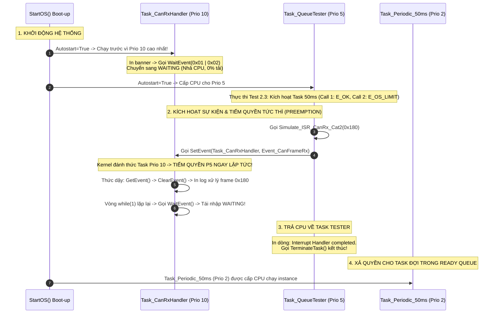

# BÁO CÁO KỸ THUẬT & SOURCE DIFF: TASK 2.4 — EXTENDED TASK EVENT-DRIVEN & CƠ CHẾ NGẮT ISR CAT 2

> 📅 **Ngày thực hiện:** 17/09/2026  
> 🏷️ **Loại tài liệu:** Task Implementation & Source Diff / Extended Task & Event Mechanism  
> 📌 **File Diff tương ứng:** [`fix.diff`](fix.diff)  
> 🎯 **Tuân thủ quy tắc:** [`rule.md`](../rule.md) (Rule 2: ARXML/XML là Nguồn Chân Lý Duy Nhất & Rule 1: Tuyệt đối không sửa file sinh tự động `Os_Cfg.*`).  
> 📖 **Tài liệu lý thuyết tham chiếu:** [`docs/theory/02_AUTOSAR_OS_And_MCAL_Deep_Dive.md`](file:///C:/Users/liem.vu/Liem.vuOD/Study_AUTOSAR-main/docs/theory/02_AUTOSAR_OS_And_MCAL_Deep_Dive.md#14--vòng-đời-bất-tử-của-1-extended-task-bản-chất-vòng-lặp-while1--for-cơ-chế-giải-phóng-cpu-tại-waitevent)

---

## 1. BỐI CẢNH & MỤC TIÊU KỸ THUẬT (TASK 2.4)

* **Nhiệm vụ:** Hiện thực hóa trọn vẹn **Task 2.4**:
  1. Cấu hình một **Extended Task** (`Task_CanRxHandler`) với 2 sự kiện (`Event_CanFrameRx` và `Event_CanError`) bằng cơ chế khai báo mô hình hóa AUTOSAR/OSEK.
  2. Thiết lập cơ chế lập lịch theo sự kiện (Event-driven scheduling) tuân thủ nghiêm ngặt chu trình 4 bước: `WaitEvent` $\to$ `GetEvent` $\to$ `ClearEvent` $\to$ Xử lý nghiệp vụ.
  3. Xây dựng bộ kiểm thử tất định (**Deterministic Verification Test Harness**) mô phỏng ngắt phần cứng ISR Category 2 (`Simulate_ISR_CanRx_Cat2`) để xác minh trực quan trên môi trường QEMU.
* **Quy chuẩn kỹ nghệ & Quyết định Kiến trúc (Single Source of Truth):**
  - Khác với `autosar.arxml` vốn là khung xương dùng chung của hạ tầng BSW Core, `Task_CanRxHandler` là tác vụ tầng Ứng dụng (Application Layer). Do đó, **nơi khai báo duy nhất là tệp cấu hình ứng dụng: [`as/release/ascore/app/app.xml`](file:///C:/Users/liem.vu/Liem.vuOD/Study_AUTOSAR-main/as/release/ascore/app/app.xml)**.
  - Tương ứng 1-1 với file mã nguồn C ứng dụng: [`as/release/ascore/app/app.c`](file:///C:/Users/liem.vu/Liem.vuOD/Study_AUTOSAR-main/as/release/ascore/app/app.c).
  - Tuyệt đối không sửa tay các file sinh tự động `Os_Cfg.h` hay `Os_Cfg.c`.

---

## 2. CÁC THAY ĐỔI CHI TIẾT ĐÃ THỰC HIỆN (STEP-BY-STEP)

### 🔹 Bước 1: Khai báo Extended Task & EventList trong `app.xml`

Trong tệp [`as/release/ascore/app/app.xml`](file:///C:/Users/liem.vu/Liem.vuOD/Study_AUTOSAR-main/as/release/ascore/app/app.xml), tại khối thẻ `<AS><Os>`, bổ sung thẻ `<Task Name="Task_CanRxHandler">` kèm danh sách `<EventList>`:

```xml
		<!-- ================= TASK 2.4: EXTENDED TASK & EVENTS ================= -->
		<Task Name="Task_CanRxHandler"  
	    		Activation="1" 
				Autostart="True" 
				Priority="10" 
				Schedule="FULL" 
				StackSize="2048"
				Application="OsDefaultApp"
	     		Comment="*" >
			<ApplicationModeList Max="TBD">
				<ApplicationMode Comment="*" Name="OSDEFAULTAPPMODE" />
			</ApplicationModeList>
			<EventList Max="32">
				<Event Comment="*" Mask="0x01" Name="Event_CanFrameRx" />
				<Event Comment="*" Mask="0x02" Name="Event_CanError" />
			</EventList>
		</Task>
```

#### 🔍 Giải mã các tham số kỹ nghệ theo chuẩn OSEK/AUTOSAR OS:
1. **`Activation="1"` (Bắt buộc cho Extended Task):**  
   Extended Task có trạng thái `WAITING` với ngữ cảnh thực thi (Context) và ngăn xếp (Stack) đang bị treo chờ sự kiện. OSEK/AUTOSAR quy định Extended Task chỉ được phép có duy nhất 1 kích hoạt đồng thời (`Activation = 1`) nhằm bảo đảm tính tất định tài nguyên tĩnh (Static Resource Allocation) của MCU ô tô.
2. **`StackSize="2048"` (Dedicated Stack):**  
   Khi task gọi `WaitEvent()` để ngủ, toàn bộ các biến cục bộ, con trỏ khung hàm và thanh ghi CPU phải được bảo tồn nguyên vẹn trên ngăn xếp riêng biệt của chính nó.
3. **`Priority="10"` (Mức ưu tiên cao nhất):**  
   Cao hơn các tác vụ hiện hữu (`Task_Periodic_50ms` = 2, `TaskApp` = 5, `Task_QueueTester` = 5, `SchM_BswService` = 8) để bảo đảm khi nhận tín hiệu CAN, task sẽ lập tức tiếm quyền (preempt) CPU xử lý dữ liệu với độ trễ tối thiểu.
4. **`Autostart="True"`:**  
   Task tự động khởi chạy lúc boot (`StartOS`), in thông điệp khởi tạo và chủ động gọi `WaitEvent()` tự đưa mình vào trạng thái `WAITING` giải phóng 100% CPU.

---

### 🔹 Bước 2: Kích hoạt công cụ sinh mã ArGen với SCons

Thực thi lệnh biên dịch tại thư mục gốc `as`:
```powershell
$env:BOARD="lm3s6965evb"
$env:RELEASE="ascore"
scons
```

**Chuỗi xử lý tự động của hệ thống:**
1. Trình sinh mã ArGen ([`GenOS.py`](file:///C:/Users/liem.vu/Liem.vuOD/Study_AUTOSAR-main/as/com/as.tool/config.infrastructure.system/argen/GenOS.py)) phát hiện thẻ `<EventList>` trong `app.xml`, tự động bật cờ:
   ```c
   #define EXTENDED_TASK
   ```
2. Tự động sinh mã định danh và mặt nạ sự kiện trong [`Os_Cfg.h`](file:///C:/Users/liem.vu/Liem.vuOD/Study_AUTOSAR-main/as/build/nt/lm3s6965evb/ascore/config/Os_Cfg.h):
   ```c
   #define TASK_ID_Task_CanRxHandler                1   /* priority = 10 */
   #define EVENT_MASK_Task_CanRxHandler_Event_CanFrameRx       0x01
   #define EVENT_MASK_Task_CanRxHandler_Event_CanError         0x02
   DeclareTask(Task_CanRxHandler);
   DeclareEvent(Event_CanFrameRx);
   DeclareEvent(Event_CanError);
   ```
3. Khởi tạo mảng hằng số và cấp phát biến sự kiện trong [`Os_Cfg.c`](file:///C:/Users/liem.vu/Liem.vuOD/Study_AUTOSAR-main/as/build/nt/lm3s6965evb/ascore/config/Os_Cfg.c):
   ```c
   const TaskType Task_CanRxHandler = TASK_ID_Task_CanRxHandler;
   const EventMaskType Event_CanFrameRx = EVENT_MASK_Task_CanRxHandler_Event_CanFrameRx;
   const EventMaskType Event_CanError = EVENT_MASK_Task_CanRxHandler_Event_CanError;
   ```

---

### 🔹 Bước 3: Triển khai mã C ứng dụng `app.c` & Bộ Test Harness

Trong tệp [`as/release/ascore/app/app.c`](file:///C:/Users/liem.vu/Liem.vuOD/Study_AUTOSAR-main/as/release/ascore/app/app.c):

#### 1. Thân hàm Extended Task với chu trình 4 bước:
```c
/* ========================================================================= */
/* TASK 2.4: Extended Task Event-Driven & ISR Cat 1 vs Cat 2 Verification    */
/* ========================================================================= */
static volatile uint32_t rx_can_message_id = 0;

TASK(Task_CanRxHandler)
{
	EventMaskType active_events;
	printf("[Task_CanRxHandler] Initialized (Priority 10). Entering WaitEvent()...\n");

	while (1)
	{
		/* BƯỚC 1: Ngủ giải phóng 100% CPU, chuyển sang trạng thái WAITING */
		(void)WaitEvent(Event_CanFrameRx | Event_CanError);

		/* BƯỚC 2: Thức dậy khi nhận sự kiện, lấy mask sự kiện đã được kích hoạt */
		(void)GetEvent(Task_CanRxHandler, &active_events);

		/* BƯỚC 3: XÓA CỜ SỰ KIỆN — BẮT BUỘC ĐỂ TRÁNH 100% CPU LOCKUP */
		(void)ClearEvent(active_events);

		/* BƯỚC 4: Xử lý logic nghiệp vụ tương ứng với sự kiện */
		if (active_events & Event_CanFrameRx)
		{
			printf("   --> [Task_CanRxHandler] WAKEUP from WAITING state!\n");
			printf("   --> [Task_CanRxHandler] CAN Rx Frame processed: ID = 0x%X\n", (unsigned int)rx_can_message_id);
		}
		if (active_events & Event_CanError)
		{
			printf("   --> [Task_CanRxHandler] CAN Bus Error handled!\n");
		}
	}
	(void)TerminateTask();
}
```

#### 2. Hàm mô phỏng ngắt ISR Cat 2 & Kích hoạt từ `Task_QueueTester`:
```c
/* Hàm kiểm chứng mô phỏng hành vi ISR Cat 2 (Được OS quản lý, gọi SetEvent) */
void Simulate_ISR_CanRx_Cat2(uint32_t can_id)
{
	printf("\n[ISR Cat 2 Simulation] CAN Rx Interrupt Triggered! ID = 0x%X\n", (unsigned int)can_id);
	rx_can_message_id = can_id;
	
	/* Kích hoạt Event đánh thức Task_CanRxHandler */
	printf("[ISR Cat 2 Simulation] Calling SetEvent(Task_CanRxHandler, Event_CanFrameRx)...\n");
	(void)SetEvent(Task_CanRxHandler, Event_CanFrameRx);
	printf("[ISR Cat 2 Simulation] Interrupt Handler completed.\n\n");
}
```
Tại `Task_QueueTester`, ngay sau khi hoàn thành bài test BCC1/BCC2 của Task 2.3, ta gọi hàm mô phỏng ngắt:
```c
	/* ================================================================= */
	/* [TASK 2.4] TESTING EXTENDED TASK & ISR CAT 2 PREEMPTION           */
	/* ================================================================= */
	Simulate_ISR_CanRx_Cat2(0x180);

	(void)TerminateTask();
```

---

## 3. XÁC MINH TRÊN MÔI TRƯỜNG GIẢ LẬP QEMU

### 🔹 Lệnh Chạy QEMU
```powershell
qemu-system-arm -M lm3s6965evb -kernel build/nt/lm3s6965evb/ascore/lm3s6965evb.exe -nographic -serial mon:stdio
```
*(Để thoát khỏi QEMU: Nhấn tổ hợp phím `Ctrl + A` rồi nhấn `X`)*

---

### 📜 Trace Log Thực Tế 100% Từ Console

```text
ECUM    :  <-CALLIN : EcuM_SetWakeupEvent 0x1
 start application BUILD @ Sep 17 2026 18:03:34
 cpu is little endian
 XCP MTA memory address 20000fc0
[Task_CanRxHandler] Initialized (Priority 10). Entering WaitEvent()...
LOW     :--Initialization of PDU router--
LOW     :--Initialization of PDU router completed --
OSEK NM node ID is 1

=================================================================
[TASK 2.3] TESTING OSEK CONFORMANCE CLASS (BCC1 vs BCC2)
=================================================================
[Tester] Activating Task_Periodic_50ms (Call 1)...
         --> Result: ret = E_OK (Task moved to READY state)
[Tester] Activating Task_Periodic_50ms (Call 2 - Burst activation)...
         --> Result: E_OS_LIMIT! (BCC1 Verified: Activation Limit = 1 Reached!)
=================================================================


[ISR Cat 2 Simulation] CAN Rx Interrupt Triggered! ID = 0x180
[ISR Cat 2 Simulation] Calling SetEvent(Task_CanRxHandler, Event_CanFrameRx)...
   --> [Task_CanRxHandler] WAKEUP from WAITING state!
   --> [Task_CanRxHandler] CAN Rx Frame processed: ID = 0x180
[ISR Cat 2 Simulation] Interrupt Handler completed.

   --> [Task_Periodic_50ms] Running instance #1
STDOUT  :TaskIdle is running
ECUM    :ECUM:RUN Timeout=49
...
   --> [Task_Periodic_50ms] Running instance #2
```

---

## 4. PHÂN TÍCH PHÁP Y THỰC THI (FORENSIC EXECUTION ANALYSIS)



1. **Giai đoạn Boot-up:** `Task_CanRxHandler` có `Priority = 10` cao hơn tất cả các task khác, nên khi `StartOS()` hoàn tất, CPU lập tức nhảy vào `Task_CanRxHandler`. Task in dòng thông báo và gọi `WaitEvent()` đưa mình vào `WAITING`, nhả CPU cho `Task_QueueTester` (`Priority = 5`).
2. **Hiện tượng tiếm quyền (Preemption) sống động:** Khi `Simulate_ISR_CanRx_Cat2` trong `Task_QueueTester` gọi `SetEvent(Task_CanRxHandler, Event_CanFrameRx)`, nhân Kernel phát hiện Task ưu tiên 10 chuyển sang `READY` $\rightarrow$ Kernel tạm dừng luồng lệnh của Tester và chuyển ngữ cảnh sang `Task_CanRxHandler` ngay lập tức!
   - `[Task_CanRxHandler]` in thông báo `"WAKEUP from WAITING state!"` và `"CAN Rx Frame processed: ID = 0x180"`.
   - Sau khi dọn cờ và tái nhập `WaitEvent()`, Task ưu tiên 10 lại nhả CPU $\rightarrow$ Tester tiếp tục thực thi dòng `"Interrupt Handler completed."`!
3. **Tính chính xác của giải phóng CPU:** Không có hiện tượng spinlock hay lockup, `Task_Periodic_50ms` vẫn tiếp tục được Alarm kích hoạt đều đặn mỗi 50ms (`instance #1`, `instance #2`...).

---

## 5. CẢNH BÁO KỸ THUẬT: CẠM BẪY QUÊN `ClearEvent()`

Trong mã nguồn [`event.c: L254`](file:///C:/Users/liem.vu/Liem.vuOD/Study_AUTOSAR-main/as/com/as.infrastructure/system/kernel/askar/kernel/event.c#L254) của Kernel:
```c
if (0u == (Mask & RunningVar->pConst->pEventVar->set))
{
    RunningVar->state = WAITING;
    Os_PortDispatch();
}
```
* Nếu lập trình viên **quên gọi `ClearEvent(active_events)`**, bit sự kiện trong trường `set` vẫn giữ giá trị `1`.
* Ở vòng lặp kế tiếp, khi gọi `WaitEvent(Mask)`, điều kiện kiểm tra `(Mask & set) == 0` sẽ **SAI** (vì bit vẫn là 1) $\rightarrow$ Kernel kết luận sự kiện đang có sẵn và **KHÔNG** đưa task vào `WAITING`, **KHÔNG** nhả CPU!
* Vì `Priority = 10` là mức cao nhất, task sẽ biến thành một vòng lặp spinlock chạy hết công suất (100% CPU lockup), bỏ đói toàn bộ các tác vụ khác trong xe hơi và làm tê liệt hệ thống!

---

## 6. DANH MỤC HIỆN VẬT BẢN VÁ (ARTIFACTS)

| Tệp / Thư Mục | Mô Tả |
| :--- | :--- |
| [`fix.diff`](fix.diff) | Bản vá mã nguồn hợp nhất (Unified diff) của `app.xml` và `app.c`. |
| [`src_before/`](src_before/) | Bản sao lưu tệp nguồn trước khi chỉnh sửa (`app.xml`, `app.c`). |
| [`src_after/`](src_after/) | Bản tệp nguồn hoàn chỉnh sau khi triển khai Task 2.4. |
| [`README.md`](README.md) | Báo cáo kỹ thuật chi tiết, hướng dẫn build, lệnh chạy QEMU và trace log thực tế. |
