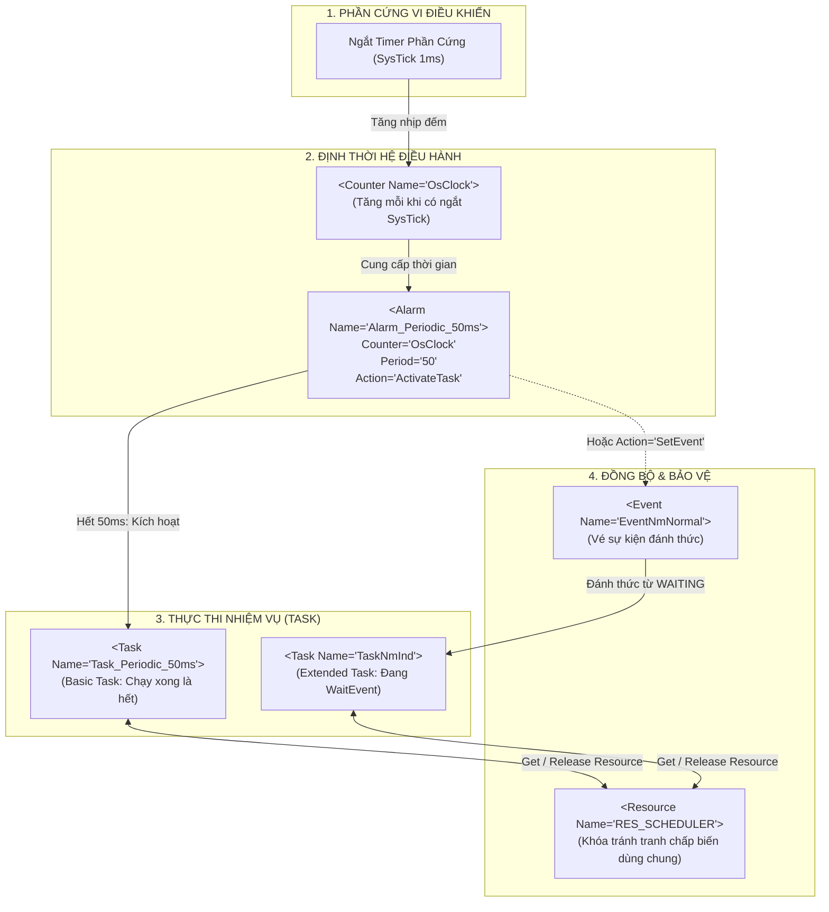
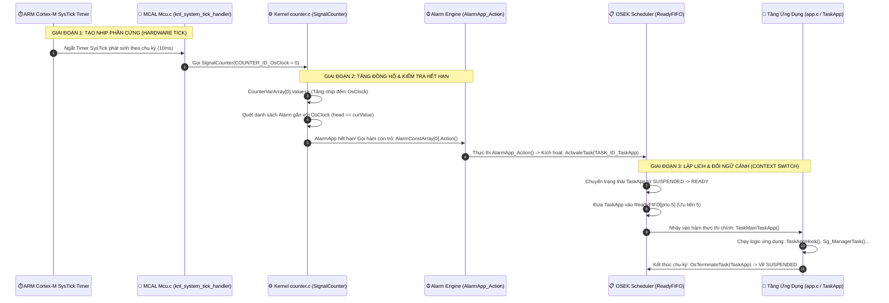

# CHUYÊN ĐỀ BỔ TRỢ 02: CẨM NANG TOÀN DIỆN VỀ ĐỌC, HIỂU & CẤU HÌNH XML / ARXML
## (Masterclass: Reading, Navigating, and Authoring XML & AUTOSAR ARXML for Embedded Engineers)

> 📌 **Vị trí tài liệu:** [`docs/supplementary_knowledge/02_XML_And_ARXML_Reading_Masterclass.md`](file:///C:/Users/liem.vu/Liem.vuOD/Study_AUTOSAR-main/docs/supplementary_knowledge/02_XML_And_ARXML_Reading_Masterclass.md)  
> 🎯 **Đối tượng mục tiêu:** Kỹ sư phần mềm nhúng (C/C++), BSW Integration Engineer chưa từng làm việc với XML hoặc cảm thấy bối rối trước các file cấu hình ARXML đồ sộ.  
> 🔧 **Mã nguồn thực hành đối chiếu:** Tệp cấu hình gốc [`as/com/as.application/common/autosar.arxml`](file:///C:/Users/liem.vu/Liem.vuOD/Study_AUTOSAR-main/as/com/as.application/common/autosar.arxml) và kho mã nguồn [`as/`](file:///C:/Users/liem.vu/Liem.vuOD/Study_AUTOSAR-main/as).  
> 📜 **Quy tắc kỹ nghệ bất biến:** [Rule 2 (`rule.md`)](file:///C:/Users/liem.vu/Liem.vuOD/Study_AUTOSAR-main/docs/hands_on_tasks/task_fix/rule.md) — *Tệp cấu hình ARXML/XML là Nguồn Chân Lý Duy Nhất (Single Source of Truth)*.

---

## 📑 MỤC LỤC CHI TIẾT

1. [Bản Chất Kỹ Nghệ: Tại Sao Ngành Ô Tô Chọn XML / ARXML?](#1-bản-chất-kỹ-nghệ-tại-sao-ngành-ô-tô-chọn-xml--arxml)
2. [Cú Pháp Căn Bản & 3 Quy Tắc Vàng Của Ngôn Ngữ XML](#2-cú-pháp-căn-bản--3-quy-tắc-vàng-của-ngôn-ngữ-xml)
3. [Mô Hình Ánh Xạ Tư Duy: XML vs C Struct / Array Cho Dân Nhúng](#3-mô-hình-ánh-xạ-tư-duy-xml-vs-c-struct--array-cho-dân-nhúng)
4. [Phân Biệt Hai Thế Giới: Standard AUTOSAR Schema 4.x vs Flat Simplified ARXML](#4-phân-biệt-hai-thế-giới-standard-autosar-schema-4x-vs-flat-simplified-arxml)
   - [4.3. Sự Thật Về `#ifdef` Trong ARXML: "Hack" Kỹ Thuật vs Chuẩn Công Nghiệp Ô Tô](#43-sự-thật-về-ifdef-trong-arxml-hack-kỹ-thuật-dự-án-vs-chuẩn-công-nghiệp-ô-tô-thực-tế)
5. [Giải Phẫu Toàn Diện Tệp `autosar.arxml` Của Dự Án Theo Từng Khối BSW](#5-giải-phẫu-toàn-diện-tệp-autosararxml-của-dự-án-theo-từng-khối-bsw)
6. [Chu Trình Sinh Mã (Code Generation Pipeline): Từ ARXML Ra Code C Thật](#6-chu-trình-sinh-mã-code-generation-pipeline-từ-arxml-ra-code-c-thật)
   - [6.2. Phẫu Thuật Thực Nghiệm: Ánh Xạ Toàn Diện Ứng Dụng Mẫu `TaskApp` (TaskApp ⟷ AlarmApp ⟷ OsClock)](#62-phẫu-thuật-thực-nghiệm-ánh-xạ-toàn-diện-ứng-dụng-mẫu-taskapp-taskapp--alarmapp--osclock)
     - [6.2.6. Cắt Nghĩa Kỹ Nghệ: "Chế Độ Ứng Dụng" (Application Mode) & "Mặt Nạ Bit" (Bitmask / `appModeMask`)](#626-cắt-nghĩa-kỹ-nghệ-chế-độ-ứng-dụng-application-mode--mặt-nạ-bit-bitmask--appmodemask)
7. [Cẩm Nang Thao Tác Trực Quan Trên VS Code: Không Bao Giờ Bị Ngợp](#7-cẩm-nang-thao-tác-trực-quan-trên-vs-code-không-bao-giờ-bị-ngợp)
8. [Checklist Sửa Đổi Cấu Hình Chuẩn OEM & Các Lỗi Kinh Điển Thường Gặp](#8-checklist-sửa-đổi-cấu-hình-chuẩn-oem--các-lỗi-kinh-điển-thường-gặp)

---

## 1. Bản Chất Kỹ Nghệ: Tại Sao Ngành Ô Tô Chọn XML / ARXML?

Nhiều kỹ sư nhúng chuyển từ môi trường IoT, bare-metal hoặc RTOS sang thường đặt câu hỏi:  
> *"Tại sao AUTOSAR không dùng JSON hay YAML cho nhẹ và dễ đọc bằng mắt người, mà lại dùng XML/ARXML vừa cồng kềnh vừa nhiều dấu đóng mở?"*

Câu trả lời nằm ở **3 yêu cầu sống còn của ngành công nghiệp ô tô**:

```
                       YÊU CẦU CỦA NGÀNH CÔNG NGHIỆP Ô TÔ
            ┌───────────────────────────┼───────────────────────────┐
            ▼                           ▼                           ▼
  [1. SCHEMA TYPE-SAFETY]     [2. TRACEABILITY CHO AN TOÀN]   [3. TÍCH HỢP ĐA CÔNG CỤ]
  Ràng buộc kiểu dữ liệu cực   Bắt buộc bởi ISO 26262          Trao đổi dữ liệu chuẩn
  kỳ khắt khe qua file .XSD    và ASPICE. Dữ liệu không        giữa OEM (VinFast, BMW)
  (chống lỗi ngầm lúc build).  được phép mơ hồ hay tự suy diễn. và Tier-1 (Bosch, Denso).
```

1. **Ràng buộc lược đồ siêu dữ liệu (XSD Schema Validation):**  
   XML đi kèm với file định nghĩa lược đồ (`.xsd`). Trước khi toolchain sinh code, nó chạy một bộ xác thực cú pháp (*XML Validator*). Nếu bạn nhập một Task có `Priority="100"` trong khi schema giới hạn tối đa là `32`, hoặc gõ sai tên thuộc tính `Actvation` thay vì `Activation`, trình biên dịch sẽ chặn đứng ngay lập tức từ bước kiểm tra schema. JSON hay YAML thuần túy không có cơ chế kiểm tra kiểu dữ liệu nghiêm ngặt ở cấp độ công nghiệp như XML.
2. **Khả năng tham chiếu chéo (Cross-referencing via REF):**  
   Trong phần mềm xe hơi, một Signal của mạng CAN ở tầng thấp nhất (`CanIf`) phải được kết nối xuyên suốt qua `PduR`, lên `Com`, rồi ánh xạ vào biến của Software Component (`Rte`). XML cho phép xây dựng các đường dẫn tham chiếu tĩnh kiểu `/AUTOSAR/EcuC/PduList/TxMsgTime` cực kỳ chính xác.
3. **Tiêu chuẩn trao đổi công nghiệp (Standardized File Exchange):**  
   OEM thiết kế hệ thống xe bằng công cụ của hãng Vector (DaVinci), sau đó xuất file ARXML gửi cho Tier-1 (Bosch, LG) sử dụng công cụ của hãng ETAS (ISOLAR) hoặc Elektrobit (Tresos). XML đảm bảo 100% hai phần mềm khác nhau đọc ra dữ liệu giống hệt nhau.

---

## 2. Cú Pháp Căn Bản & 3 Quy Tắc Vàng Của Ngôn Ngữ XML

XML thực chất chỉ là một tài liệu văn bản thuần túy được cấu trúc hóa. Một file XML chuẩn luôn bắt đầu bằng **Dòng khai báo (XML Prolog)**:
```xml
<?xml version="1.0" encoding="utf-8"?>
```
Dòng này báo cho trình phân tích biết: đây là XML phiên bản 1.0 và sử dụng bảng mã ký tự UTF-8.

Dưới dòng khai báo là cây dữ liệu tuân thủ **3 quy tắc vàng**:

```
                              CẤU TRÚC 1 PHẦN TỬ XML (ELEMENT)
               ┌── Tên thẻ mở (Start-Tag)
               │
               │         ┌── Tên thuộc tính (Attribute Name)
               │         │            ┌── Giá trị thuộc tính (Attribute Value)
               ▼         ▼            ▼
             <Task   Priority="2"  Schedule="FULL">
                 <StackSize>512</StackSize>  ◄── Nội dung con (Child Element)
             </Task>
               ▲
               └── Tên thẻ đóng (End-Tag - bắt buộc có dấu /)
```

### 🔹 Quy Tắc 1: Cặp Thẻ Mở Và Thẻ Đóng (Tags)
- Mở thẻ: `<TênThẻ>`
- Đóng thẻ: `</TênThẻ>` (bắt buộc có dấu gạch chéo `/` phía trước).
- Tên thẻ **phân biệt chữ hoa và chữ thường** (`<Task>` hoàn toàn khác với `<task>`).
- Các thẻ phải **lồng nhau hoàn hảo**, tuyệt đối không được đan chéo vi phạm cấu trúc:
  - ✅ Đúng: `<OS><TaskList></TaskList></OS>`
  - ❌ Sai (Lỗi cú pháp): `<OS><TaskList></OS></TaskList>`

### 🔹 Quy Tắc 2: Thẻ Tự Đóng (Self-Closing Tag)
Nếu một thẻ chỉ dùng để chứa các thuộc tính mà **không chứa thẻ con nào khác bên trong**, thay vì viết dài dòng `<Thẻ ...></Thẻ>`, người ta đặt dấu `/` ngay trước dấu `>` ở cuối thẻ:
```xml
<!-- Cách viết dài: -->
<Task Name="Task_Periodic_50ms" Priority="2"></Task>

<!-- Cách viết ngắn (Chuẩn mực trong ARXML): -->
<Task Name="Task_Periodic_50ms" Priority="2" />
```

### 🔹 Quy Tắc 3: Thuộc Tính (Attributes) Là Cặp Key="Value"
- Thuộc tính nằm ngay bên trong thẻ mở: `<TênThẻ ThuộcTính="GiáTrị">`.
- Giá trị thuộc tính **BẮT BUỘC phải nằm trong dấu ngoặc kép `"`** (hoặc ngoặc đơn `'`).
  - ✅ Đúng: `<Task Priority="2" />`
  - ❌ Sai: `<Task Priority=2 />` (Thiếu ngoặc kép sẽ làm bộ parser sập ngay lập tức).

### 🔹 Ký Tự Đặc Biệt (Entity References) Trong XML
Vì các dấu `<` và `&` được dùng làm cú pháp điều khiển của XML, bạn không được viết trực tiếp chúng vào văn bản mà phải dùng mã thay thế:
- `<` viết thành `&lt;` (*less than*)
- `>` viết thành `&gt;` (*greater than*)
- `&` viết thành `&amp;` (*ampersand*)
- `"` viết thành `&quot;` (*quote*)

---

## 3. Mô Hình Ánh Xạ Tư Duy: XML vs C Struct / Array Cho Dân Nhúng

Để đọc XML như người bản xứ, kỹ sư C chỉ cần ánh xạ toàn bộ thẻ XML sang các cấu trúc quen thuộc trong ngôn ngữ C:

| Khái Niệm XML | Tương Đương Trong Ngôn Ngữ C | Ví Dụ Minh Họa XML | Tương Đương Trong C |
| :--- | :--- | :--- | :--- |
| **Element chứa con** | Định nghĩa một `struct` | `<Task> ... </Task>` | `typedef struct { ... } Task_Type;` |
| **Self-Closing Tag** | Khởi tạo một biến struct cụ thể | `<Task Name="T1" Priority="2" />` | `Task_Type T1 = { .priority = 2 };` |
| **Thuộc Tính (Attribute)** | Một trường/biến thành viên của struct | `Priority="2"` | `uint8 priority = 2;` |
| **Thẻ Danh Sách (`List`)** | Một mảng tĩnh các struct | `<TaskList> ... </TaskList>` | `Task_Type TaskList[MAX_TASKS];` |
| **Thuộc Tính Tham Chiếu (`Ref`)**| Con trỏ trỏ tới struct khác | `TaskRef="Task_Periodic_50ms"` | `Task_Type* pTask = &Task_Periodic_50ms;` |

### 💡 Ví Dụ Đối Chiếu Trực Quan 1-1:

```xml
<!-- Trong file autosar.arxml -->
<OS>
  <TaskList Max="2">
    <Task Name="Task_Periodic_50ms" Priority="2" Activation="1" />
    <Task Name="Task_QueueTester"   Priority="5" Activation="3" />
  </TaskList>
</OS>
```

Đoạn XML trên có ý nghĩa logic **giống hệt 100%** đoạn mã khai báo cấu trúc mảng C sau:

```c
/* Tương đương trong tư duy lập trình C */
typedef struct {
    const char* Name;
    uint8_t Priority;
    uint8_t Activation;
} TaskConfigType;

typedef struct {
    TaskConfigType TaskList[2];
} OsConfigType;

const OsConfigType OS = {
    .TaskList = {
        [0] = { .Name = "Task_Periodic_50ms", .Priority = 2, .Activation = 1 },
        [1] = { .Name = "Task_QueueTester",   .Priority = 5, .Activation = 3 }
    }
};
```

---

## 4. Phân Biệt Hai Thế Giới: Standard AUTOSAR Schema 4.x vs Flat Simplified ARXML

Trong ngành ô tô, bạn sẽ gặp 2 kiểu định dạng XML/ARXML. Việc phân biệt rõ chúng giúp bạn không bao giờ bị bỡ ngỡ:

```
                            HAI THẾ GIỚI FILE CẤU HÌNH TRONG Ô TÔ
              ┌───────────────────────────────┴───────────────────────────────┐
              ▼                                                               ▼
  [1. STANDARD AUTOSAR 4.X ARXML]                               [2. FLAT SIMPLIFIED ARXML]
  (Dùng trong Vector DaVinci, EB Tresos)                       (Dùng trong Study_AUTOSAR - parai/as)
  - Cực kỳ dài dòng, phân cấp 7-10 tầng thư mục.                - Cấu trúc phẳng, tinh gọn, trực diện.
  - Sử dụng thẻ <SHORT-NAME> cho mọi tên thực thể.              - Dùng thuộc tính Attribute Name="xyz".
  - Một Task tốn 30-50 dòng XML.                                - Một Task gói gọn trong 1 dòng thẻ tự đóng.
```

### So Sánh Cùng Khai Báo 1 Task Hệ Điều Hành:

#### Cách 1: Chuẩn Vector DaVinci / AUTOSAR Release 4.x (Chuẩn công nghiệp)
```xml
<!-- Rất dài dòng, mỗi tham số là một thẻ riêng biệt lồng nhau -->
<AR-PACKAGES>
  <AR-PACKAGE>
    <SHORT-NAME>OsTasks</SHORT-NAME>
    <ELEMENTS>
      <OS-TASK>
        <SHORT-NAME>Task_Periodic_50ms</SHORT-NAME>
        <ACTIVATION>1</ACTIVATION>
        <PRIORITY>2</PRIORITY>
        <SCHEDULE>PREEMPTIVE</SCHEDULE>
      </OS-TASK>
    </ELEMENTS>
  </AR-PACKAGE>
</AR-PACKAGES>
```

#### Cách 2: Chuẩn Flat XML Trong Dự Án [`Study_AUTOSAR`](file:///C:/Users/liem.vu/Liem.vuOD/Study_AUTOSAR-main)
Tác giả stack `parai/as` đã thiết kế một cú pháp phẳng (Flat Schema) để kỹ sư dễ đọc, dễ viết và các script Python (`GenOS.py`) dễ dàng bóc tách dữ liệu mà không cần engine parse XML nặng nề hàng chục MB:
```xml
<!-- Tinh gọn, toàn bộ tham số nằm trong thuộc tính của 1 thẻ duy nhất -->
<OS>
  <TaskList>
    <Task Name="Task_Periodic_50ms" Priority="2" Activation="1" Schedule="FULL" />
  </TaskList>
</OS>
```
👉 **Kết luận:** File trong dự án của bạn thực chất **dễ đọc hơn chuẩn Vector DaVinci gấp 10 lần**!

### 4.3. Sự Thật Về `#ifdef` Trong ARXML: "Hack" Kỹ Thuật Dự Án vs Chuẩn Công Nghiệp Ô Tô Thực Tế

Nhiều kỹ sư khi mở [`as/com/as.application/common/autosar.arxml`](file:///C:/Users/liem.vu/Liem.vuOD/Study_AUTOSAR-main/as/com/as.application/common/autosar.arxml) sẽ giật mình nhận ra:  
> *"Tại sao một file có đuôi `.arxml` lại chứa đầy các chỉ thị tiền xử lý của ngôn ngữ C như `#ifdef USE_SMP`, `#else`, `#endif`? Đây có phải là cách viết chuẩn của ngành ô tô không, hay chuẩn thực tế mỗi ECU phải có file riêng?"*

Dưới đây là câu trả lời toàn diện bóc tách bản chất giữa **Dự án mã nguồn mở** và **Ngành công nghiệp xe hơi thực tế**:

#### 1. `#ifdef` Trong ARXML Có Đúng Chuẩn AUTOSAR Quốc Tế Không?
**HOÀN TOÀN KHÔNG!**  
- Trong chuẩn quốc tế AUTOSAR (Release 3.x, 4.x hay Adaptive), một file ARXML bắt buộc phải là **Well-formed XML 100%** và tuân thủ lược đồ XML Schema của tổ chức AUTOSAR (`AUTOSAR_4-x-x.xsd`).
- Việc chèn `#ifdef` biến file này thành **Malformed XML (cú pháp XML không hợp lệ)**. Bất kỳ công cụ chuẩn công nghiệp nào của hãng (Vector DaVinci, Elektrobit Tresos, ETAS ISOLAR, Siemens Capital VSTAR) hoặc các XML Validator chuẩn sẽ quăng lỗi **Fatal Syntax Error** ngay tại dòng `#ifdef` đầu tiên và từ chối xử lý.

#### 2. Tại Sao Dự Án Này Lại Viết Như Vậy? (The Open-Source Pragmatic Shortcut)
Tác giả stack mã nguồn mở (`parai/as`) đã sử dụng một **"mẹo kỹ thuật" (Engineering Trick/Hack)** cực kỳ thông minh nhưng phi chuẩn:
- Dự án này hỗ trợ cùng lúc hơn 10 loại bo mạch vi điều khiển khác nhau (`posix`, `lm3s6965evb`, `versatilepb`, `stm32f107vc`, `mpc56xx`...).
- Nếu làm đúng chuẩn, tác giả sẽ phải duy trì 10 thư mục riêng, mỗi thư mục chứa hàng chục file XML độc lập. Khi cần sửa một thuộc tính chung của OS, tác giả sẽ phải đi sửa ở 10 file khác nhau — cực kỳ tốn công bảo trì.
- **Giải pháp của tác giả:** Coi file `autosar.arxml` như một **File Template C-Header**. Khi bạn gõ `scons`, hàm [`PreProcess()`](file:///C:/Users/liem.vu/Liem.vuOD/Study_AUTOSAR-main/as/com/as.tool/config.infrastructure.system/building.py#L1239-L1265) sẽ gọi trình tiền xử lý của GNU C:
  ```bash
  arm-none-eabi-gcc -E --include asmconfig.h autosar.arxml.h -o autosar.arxml
  ```
  Trình tiền xử lý `gcc -E` sẽ bóc sạch toàn bộ các khối `#ifdef` dựa trên cấu hình của board bạn đang chọn, rồi ghi ra file XML sạch 100% tại [`as/build/nt/lm3s6965evb/ascore/config/autosar.arxml`](file:///C:/Users/liem.vu/Liem.vuOD/Study_AUTOSAR-main/as/build/nt/lm3s6965evb/ascore/config/autosar.arxml). Lúc này, bộ sinh mã Python [`GenOS.py`](file:///C:/Users/liem.vu/Liem.vuOD/Study_AUTOSAR-main/as/com/as.tool/config.infrastructure.system/argen/GenOS.py) mới vào đọc file sạch đó để sinh ra C code!

#### 3. Đối Chiếu Với Chuẩn Công Nghiệp (OEM / Tier-1)
> 📖 **Xem phân tích chuyên sâu & Bảng so sánh 8 tiêu chí cốt lõi:**  
> Toàn bộ kiến trúc phân định Multi-ECU độc lập, cơ chế quản lý biến thể chính quy `<VARIATION-POINT>` và bảng đối chiếu chi tiết giữa **Dự án `Study_AUTOSAR`** vs **Vector DaVinci / EB tresos** đã được hệ thống hóa đầy đủ tại:  
> 👉 [**Mục 2.4 - Chuyên Đề 05: ARXML Meta-Model, Toolchain Engineering & ECU Integration**](file:///C:/Users/liem.vu/Liem.vuOD/Study_AUTOSAR-main/docs/theory/05_Toolchain_ARXML_And_ECU_Integration.md#24-bảng-đối-chiếu-thực-chiến-arxml-chuẩn-công-nghiệp-vectoreb-multi-ecu-vs-arxml-dự-án-này-paraias).

---

## 5. Giải Phẫu Toàn Diện Tệp `autosar.arxml` Của Dự Án Theo Từng Khối BSW

File [`as/com/as.application/common/autosar.arxml`](file:///C:/Users/liem.vu/Liem.vuOD/Study_AUTOSAR-main/as/com/as.application/common/autosar.arxml) là trái tim cấu hình của toàn bộ nền tảng. Dưới đây là giải phẫu chi tiết 6 khối kiến trúc quan trọng nhất:

### 🧩 Khối 1: Hệ Điều Hành `<OS> ... </OS>` — Bản Đồ Mối Quan Hệ Giữa Các Đối Tượng

Khối `<OS>` chịu trách nhiệm định nghĩa toàn bộ Scheduler, Task, Alarm, Counter, Event, Resource, ApplicationMode và Application của AUTOSAR OS.

Khác với RTOS thông thường (FreeRTOS nơi một Task vừa chứa code vừa tự `vTaskDelay`), AUTOSAR OS **tách rời hoàn toàn** giữa bộ đếm thời gian, bộ hẹn giờ báo thức và mã thực thi của Task. Dưới đây là bức tranh toàn cảnh về cách các đối tượng này liên kết với nhau:

#### 1. Sơ Đồ Dây Chuyền Nguyên Nhân - Kết Quả (Operational Chain)

```
[Bánh răng SysTick phần cứng] ──(Ngắt mỗi 1ms)──► <Counter Name="OsClock"> (Mặt đồng hồ đếm nhịp)
                                                             │
                                        (Đếm đủ 50 nhịp) ────┘
                                                             ▼
                                               <Alarm Name="Alarm_50ms"> (Chuông báo thức)
                                                             │
                                       (Action="ActivateTask")
                                                             ▼
                                            <Task Name="Task_Periodic_50ms"> (Công nhân)
                                                             │
                                                             ▼ (Sinh mã & thực thi)
                                            TASK(Task_Periodic_50ms) { ... TerminateTask(); }
```



#### 2. Đoạn Mã XML Đại Diện Trong File `autosar.arxml`

```xml
<AUTOSAR>
<OS>
  <General Conformance="ECC1" StartupHook="StartupHook" ShutdownHook="ShutdownHook" ErrorHook="ErrorHook" />

  <!-- 1. Chế độ vận hành của ECU -->
  <ApplicationModeList Max="TBD">
    <ApplicationMode Name="OSDEFAULTAPPMODE" Comment="*" />
  </ApplicationModeList>

  <!-- 2. Phân vùng an toàn bộ nhớ (OS-Application) -->
  <ApplicationList Max="TBD">
    <Application Name="OsDefaultApp" RestartTask="SchM_Startup" Trusted="True" UseRestartTask="True" />
  </ApplicationList>
  
  <!-- 3. Danh sách các Task (Công nhân thực hiện logic) -->
  <TaskList Max="TBD">
    <!-- Basic Task: kích hoạt theo chu kỳ 50ms -->
    <Task Name="Task_Periodic_50ms" Priority="2" Activation="1" Autostart="False" 
          Schedule="FULL" StackSize="512" Cpu="0" Application="OsDefaultApp" Comment="*" />
    
    <!-- Extended Task: chờ sự kiện từ mạng CAN/LwIP -->
    <Task Name="SchM_BswService" Priority="8" Activation="1" Autostart="False" 
          Schedule="FULL" StackSize="2048" Cpu="0" Application="OsDefaultApp" Comment="*">
      <EventList>
        <Event Name="EventForLwip" Mask="0x00000001" />
      </EventList>
    </Task>
  </TaskList>

  <!-- 4. Danh sách các Alarm (Bộ hẹn giờ báo thức) -->
  <AlarmList Max="TBD">
    <Alarm Name="Alarm_Periodic_50ms" Action="ActivateTask" Task="Task_Periodic_50ms" 
           Counter="OsClock" Autostart="True" StartTime="50" Period="50" Application="OsDefaultApp" />
  </AlarmList>

  <!-- 5. Danh sách các Counter (Mặt đồng hồ đếm nhịp) -->
  <CounterList Max="TBD">
    <Counter Name="OsClock" MaxAllowed="0xFFFF" MinCycle="1" TicksPerBase="1" Application="OsDefaultApp" />
  </CounterList>

  <!-- 6. Danh sách Tài nguyên dùng chung (Khóa IPCP) -->
  <ResourceList Max="TBD">
    <Resource Name="RES_SCHEDULER" Priority="15" Application="TBD" Comment="*" />
  </ResourceList>
</OS>
```

#### 3. Bóc Tách 7 Đối Tượng & Sợi Dây "Mắt Xích" Nối Giữa Chúng

Khi đọc XML, đừng đọc từng thẻ riêng lẻ mà hãy tìm **tên thuộc tính dùng chung** để thấy sợi dây kết nối:

* 🔗 **Mắt xích 1: `Counter` $\longleftrightarrow$ `Alarm` (Đồng hồ & Chuông báo)**
  - Thẻ `<Counter Name="OsClock">` tạo ra mặt đồng hồ tăng số mỗi khi ngắt phần cứng SysTick nhảy vào hàm `SignalCounter(0)`.
  - Thẻ `<Alarm>` gắn chặt vào mặt đồng hồ đó bằng thuộc tính `Counter="OsClock"`.
  - Thuộc tính `Period="50"` bảo OS: Cứ mặt đồng hồ tăng thêm 50 nhịp thì kích hoạt Alarm 1 lần.

* 🔗 **Mắt xích 2: `Alarm` $\longleftrightarrow$ `Task` (Chuông báo & Công nhân)**
  - Thẻ `<Task Name="Task_Periodic_50ms">` khai báo công việc cần làm.
  - Thẻ `<Alarm>` kết nối trực tiếp đến Task bằng 2 thuộc tính:
    - `Action="ActivateTask"`: Khi chuông reo, OS sẽ tự động gọi hàm `ActivateTask()`.
    - `Task="Task_Periodic_50ms"`: Tên đích danh của Task cần kích hoạt.
  - 👉 **Ý nghĩa:** Task không bao giờ tự delay bằng vòng lặp; Alarm chính là cơ chế "đá" Task dậy thực thi theo chu kỳ chuẩn ô tô.

* 🔗 **Mắt xích 3: `Event` $\longleftrightarrow$ `Task` (Vé sự kiện cho Extended Task)**
  - **Basic Task (như Task 2.3):** Không có sự kiện, chạy một mạch từ đầu hàm đến cuối hàm gặp `TerminateTask()` là tự hủy khỏi CPU.
  - **Extended Task:** Có thể chủ động rơi vào trạng thái ngủ đông `WAITING` bằng hàm `WaitEvent()`.
  - Thẻ `<Event>` là chiếc "vé vào cửa". Khi ngắt mạng CAN nhận được dữ liệu, nó gọi `SetEvent(SchM_BswService, EventForLwip)` $\rightarrow$ Task đang ngủ trong hàng đợi lập tức được đánh thức chuyển sang `READY` để chiếm CPU.

* 🔗 **Mắt xích 4: `Resource` $\longleftrightarrow$ `Task` (Chìa khóa tài nguyên dùng chung)**
  - Khi nhiều Task khác độ ưu tiên cùng truy cập một vùng nhớ đệm CAN hay NvM, chúng dùng chung `<Resource Name="RES_SCHEDULER" Priority="15" />`.
  - Khi một Task gọi `GetResource(RES_SCHEDULER)`, độ ưu tiên của nó lập tức được nâng vọt lên trần ưu tiên 15 (Immediate Priority Ceiling Protocol - IPCP) $\rightarrow$ Không một Task nào khác có thể cướp quyền, triệt tiêu 100% hiện tượng nghịch đảo độ ưu tiên (Priority Inversion) và Deadlock mà không hề gây tắc nghẽn Context Switch.

* 🔗 **Mắt xích 5: `ApplicationMode` (Kịch bản khởi động xe)**
  - Một chiếc xe hơi khi bật chìa khóa có thể khởi động theo các kịch bản khác nhau: Chế độ nổ máy bình thường (`OSDEFAULTAPPMODE`), Chế độ nạp phần mềm Flash (`PROGRAMMING`), Chế độ kiểm tra xuất xưởng (`FACTORY_TEST`).
  - `ApplicationMode` quy định danh sách các Task nào được tự động chạy (`Autostart="True"`) tương ứng với từng kịch bản khi hàm `StartOS(AppMode)` được gọi trong chu trình boot.

* 🔗 **Mắt xích 6: `Application` (Phân vùng cách ly an toàn ASIL)**
  - Theo tiêu chuẩn ISO 26262, một Task giải trí màn hình (dễ lỗi) không được phép ghi đè vào RAM của Task phanh ABS hay túi khí (sống còn).
  - Thẻ `<Application Name="OsDefaultApp">` gom các Task/Alarm vào một phân vùng bộ nhớ được phần cứng MPU (*Memory Protection Unit*) bảo vệ. Nếu một Task bị tràn Stack, OS chỉ cần reset riêng Application đó thông qua `RestartTask="SchM_Startup"` mà không làm sập toàn bộ ECU của xe.

#### 4. Bảng Đối Chiếu Tư Duy: FreeRTOS vs AUTOSAR OS

| Tiêu Chí Kỹ Thuật | Cách Làm Trong FreeRTOS (Dynamic / C Code) | Cách Làm Trong AUTOSAR OS (Static / XML Schema) |
| :--- | :--- | :--- |
| **Khởi tạo Task** | Gọi `xTaskCreate()` cấp phát TCB/Stack động trong RAM | Khai báo thẻ tĩnh `<Task Name="..." StackSize="..." />` |
| **Độ ưu tiên** | Truyền biến số vào tham số của `xTaskCreate` | Khai báo thuộc tính tĩnh `Priority="2"` trong thẻ `<Task>` |
| **Chạy định kỳ 50ms** | Task tự điều khiển: `while(1) { run(); vTaskDelay(50); }` | Tách rời 2 nửa: `<Alarm Period="50">` định kỳ đánh thức `<Task>` |
| **Chờ sự kiện** | Dùng Semaphore / EventGroup động: `xSemaphoreTake()` | Khai báo thẻ `<Event>`, Task gọi API tĩnh `WaitEvent(Mask)` |
| **Bảo vệ tài nguyên** | Tạo Mutex trong RAM: `xSemaphoreCreateMutex()` | Khai báo thẻ tĩnh `<Resource>` với trần ưu tiên IPCP cố định |

---

### 🧩 Khối 2: Định Danh Gói Tin Hệ Thống `<EcuC> ... </EcuC>`
Đóng vai trò là "Tổng kho danh bạ" khai báo tất cả các PDU (Protocol Data Unit - Gói tin dữ liệu) lưu thông trong ECU:

```xml
<EcuC>
  <PduList Max="TBD">
    <Pdu Name="TxMsgTime" Size="64" Comment="*" />      <!-- Gói tin phát thời gian (64 bits = 8 bytes) -->
    <Pdu Name="RxMsgAbsInfo" Size="64" Comment="*" />   <!-- Gói tin nhận thông tin phanh ABS -->
    <Pdu Name="TxDiagP2P" Size="64" Comment="*" />      <!-- Gói tin chẩn đoán UDS Request -->
    <Pdu Name="RxDiagP2P" Size="64" Comment="*" />      <!-- Gói tin chẩn đoán UDS Response -->
  </PduList>
</EcuC>
```
👉 Mọi module phía dưới (`CanIf`, `PduR`, `Com`, `Dcm`) khi muốn gửi nhận gói tin đều phải trích dẫn tên PDU đã được đăng ký trong danh bạ `<EcuC>` này.

---

### 🧩 Khối 3: Giao Diện Mạng CAN Phần Cứng `<CanIf> ... </CanIf>`
Quy định cách thức tầng CAN Interface liên kết với Driver phần cứng MCAL và cấu hình bộ lọc phần mềm:

```xml
<CanIf>
  <ChannelList Max="TBD">
    <Channel Name="CANIF_CHL_LS" ControllerRef="CAN_CTRL_0">
      
      <!-- DANH SÁCH PDU PHÁT RA MẠNG XE (TX) -->
      <TxPduList Max="TBD">
        <Pdu Name="Time" Identifier="0x101" DataLengthCode="8" EcuCPduRef="TxMsgTime" HthRef="LS_Hth" TransmitNotifier="PduR" />
        <Pdu Name="P2P"  Identifier="0x732" DataLengthCode="8" EcuCPduRef="TxDiagP2P" HthRef="LS_Hth" TransmitNotifier="CanTp" />
      </TxPduList>

      <!-- DANH SÁCH PDU NHẬN TỪ MẠNG XE (RX) VÀ BỘ LỌC PHẦN MỀM -->
      <RxPduList Max="TBD">
        <Pdu Name="AbsInfo" Identifier="0x102" FilterMask="0x7FF" DataLengthCode="8" EcuCPduRef="RxMsgAbsInfo" HrhRef="LS_Hrh" ReceivedNotifier="PduR" />
        <Pdu Name="P2P"     Identifier="0x731" FilterMask="0x7FF" DataLengthCode="8" EcuCPduRef="RxDiagP2P"    HrhRef="LS_Hrh" ReceivedNotifier="CanTp" />
      </RxPduList>

    </Channel>
  </ChannelList>
</CanIf>
```
* **Phân tích thuộc tính cốt lõi:**
  - `Identifier="0x101"`: CAN ID vật lý xuất hiện trên đường dây điện bus CAN.
  - `FilterMask="0x7FF"`: Mặt nạ lọc phần mềm chuẩn 11-bit. `0x7FF` nghĩa là lọc chính xác 100% từng bit của CAN ID (Exact match).
  - `TransmitNotifier="PduR"`: Sau khi truyền xong, báo tin ngược lại cho module nào (`PduR` hay `CanTp`).
  - `ReceivedNotifier="CanTp"`: Khi nhận được gói tin chẩn đoán, chuyển tiếp thẳng lên bộ ghép gói đa khung `CanTp`.

---

### 🧩 Khối 4: Bộ Định Tuyến Trung Tâm `<PduR> ... </PduR>`
Đóng vai trò như một "Tổng đài bưu điện" định tuyến dữ liệu giữa các tầng:

```xml
<PduR>
  <RoutineList Max="TBD">
    <!-- Tuyến 1: Từ COM đẩy xuống CANIF để phát ra xe -->
    <Source Module="Com" Name="ComMsgTime" PduRef="TxMsgTime">
      <DestinationList>
        <Destination Module="CanIf" Name="CanIfMsgTime" PduRef="TxMsgTime" />
      </DestinationList>
    </Source>

    <!-- Tuyến 2: Từ CANIF nhận được đẩy ngược lên COM cho ứng dụng xử lý -->
    <Source Module="CanIf" Name="CanIfMsgAbs" PduRef="RxMsgAbsInfo">
      <DestinationList>
        <Destination Module="Com" Name="ComMsgAbs" PduRef="RxMsgAbsInfo" />
      </DestinationList>
    </Source>
  </RoutineList>
</PduR>
```

---

### 🧩 Khối 5: Đóng Gói Tín Hiệu Ứng Dụng `<Com> ... </Com>`
Quy định cách thức các biến dữ liệu mức ứng dụng (Signal như Vận tốc xe, Nhiệt độ pin) được bóc tách từ các bit nhị phân trong gói tin PDU 8 bytes:

```xml
<Com>
  <IPduList Max="TBD">
    <IPdu Name="AbsInfo" Direction="RECEIVE" PduRef="RxMsgAbsInfo" PduSize="8" TxMode="PERIODIC">
      <SignalList Max="TBD">
        <!-- Tín hiệu Vận tốc xe: 16 bits, bắt đầu từ bit số 7, chuẩn Big Endian -->
        <Signal Name="VehicleSpeed" Type="uint16" StartBit="7" Size="16" Endianess="BIG_ENDIAN" InitialValue="0" />
        <!-- Tín hiệu Trạng thái LED: 2 bits, bắt đầu từ bit số 39 -->
        <Signal Name="Led1Sts"      Type="uint8"  StartBit="39" Size="2" Endianess="BIG_ENDIAN" InitialValue="0" />
      </SignalList>
    </IPdu>
  </IPduList>
</Com>
```

---

### 🧩 Khối 6: Chẩn Đoán UDS `<Dcm> ... </Dcm>`
Định nghĩa bảng dịch vụ chẩn đoán tiêu chuẩn ISO 14229:

```xml
<Dcm>
  <SessionList>
    <Session Identifier="1" Name="DS" />    <!-- Default Session (0x01) -->
    <Session Identifier="2" Name="PRGS" />  <!-- Programming Session (0x02 - Nạp Flash) -->
    <Session Identifier="3" Name="EXTDS" /> <!-- Extended Session (0x03) -->
  </SessionList>

  <ServiceTable Name="ServiceTableP2P">
    <!-- Dịch vụ 0x10: Chuyển đổi phiên chẩn đoán -->
    <Service Name="DIAGNOSTIC_SESSION_CONTROL" SubFunctionSupported="True" />
    <!-- Dịch vụ 0x22: Đọc dữ liệu theo mã định danh DID -->
    <Service Name="READ_DATA_BY_IDENTIFIER" SubFunctionSupported="False" />
    <!-- Dịch vụ 0x27: Mở khóa bảo mật Security Access (Seed & Key) -->
    <Service Name="SECURITY_ACCESS" SubFunctionSupported="True" />
  </ServiceTable>
</Dcm>
```

---

## 6. Chu Trình Sinh Mã (Code Generation Pipeline): Từ ARXML Ra Code C Thật

### 6.1. Nguyên Lý Tổng Quát Sinh Mã Từ XML Sang C

Để thấy rõ mối quan hệ giữa file XML bạn sửa và code C biên dịch, hãy quan sát chu trình thực tế khi bạn gõ lệnh `scons`:

```
 [NGUỒN CHÂN LÝ]                       [CÔNG CỤ PARSER PYTHON]                [FILE SINH RA TRONG BUILD]
 autosar.arxml                         as/com/as.tool/.../argen/              build/.../config/
 
 <Task Name="Task_Periodic_50ms" ──►   GenOS.py parse các thẻ XML     ──►     Os_Cfg.h:
       Priority="2"                    bằng thư viện Python                   #define TASK_ID_Task_Periodic_50ms 4
       Activation="1" />               ElementTree / lxml
                                                                              Os_Cfg.c:
                                                                              const TaskConstType Os_TaskConst[5] = {
                                                                                  ...
                                                                                  [4] = { .prio = 2, .max_act = 1 }
                                                                              };
                                                                                           │
                                                                                           ▼
                                                                              [MÃ NGUỒN C ỨNG DỤNG]
                                                                              as/release/ascore/app/app.c
                                                                              TASK(Task_Periodic_50ms) {
                                                                                  // Viết logic tại đây
                                                                                  TerminateTask();
                                                                              }
```

* **Lý do vì sao CẤM sửa file `Os_Cfg.h` hay `Os_Cfg.c`:**  
  Bất cứ khi nào bạn chạy lệnh `scons`, script `GenOS.py` sẽ chạy lại và **ghi đè (overwrite) 100%** nội dung của các file này. Nếu bạn sửa tay trong file C sinh ra, toàn bộ công sức sẽ biến mất sau 1 lần build. Muốn đổi tham số, bạn **bắt buộc phải sửa ở file XML gốc**.

---

### 6.2. Phẫu Thuật Thực Nghiệm: Ánh Xạ Toàn Diện Ứng Dụng Mẫu `TaskApp` (TaskApp ⟷ AlarmApp ⟷ OsClock)

Để biến lý thuyết mô hình hóa thành phản xạ lập trình nhúng trực quan, chúng ta tiến hành "mổ xẻ" ứng dụng đại diện tiêu biểu nhất của kho mã nguồn: **`TaskApp`** và 2 đối tượng gắn liền mật thiết với nó là **`AlarmApp`** và **`OsClock`**.

#### 6.2.1. Tệp Cấu Hình XML Gốc
Ứng dụng `TaskApp` được mô hình hóa độc lập tại gói ứng dụng [`as/release/ascore/app/app.xml`](file:///C:/Users/liem.vu/Liem.vuOD/Study_AUTOSAR-main/as/release/ascore/app/app.xml), trong khi Counter `OsClock` được định nghĩa dùng chung tại [`as/com/as.application/common/infrastructure.xml`](file:///C:/Users/liem.vu/Liem.vuOD/Study_AUTOSAR-main/as/com/as.application/common/infrastructure.xml):

```xml
<!-- Trích từ: as/release/ascore/app/app.xml -->
<AS>
  <Os>
    <Task Name="TaskApp"  
          Activation="1" 
          Autostart="True" 
          Priority="5" 
          Schedule="FULL" 
          StackSize="2048"
          Application="OsDefaultApp"
          Comment="*" >
      <EventList Max="TBD">
        <Event Comment="*" Mask="0x01" Name="Event1" />
        <Event Comment="*" Mask="0x02" Name="Event2" />
        <Event Comment="*" Mask="0x04" Name="Event3" />
        <Event Comment="*" Mask="0x08" Name="Event4" />
        <Event Comment="*" Mask="0x10" Name="Event5" />
      </EventList>
    </Task>
    
    <Alarm Name="AlarmApp" 
           Autostart="False" 
           Period="5" 
           StartTime="5"
           Counter="OsClock"
           Action="ActivateTask"  
           Task="TaskApp"        
           Event="TBD"  
           Callback="TBD" 
           Application="OsDefaultApp"
           Comment="*" />
  </Os>
</AS>

<!-- Trích từ: as/com/as.application/common/infrastructure.xml -->
<Counter Name="OsClock" 
         MaxAllowed="0xFFFF" 
         MinCycle="1"  
         TicksPerBase="1" 
         Application="OsDefaultApp"
         Comment="*" />
```

---

#### 6.2.2. Bảng Đối Soát 1-1: Giải Phẫu Chi Tiết Thẻ `<Task Name="TaskApp">` Sang Mã Nguồn C

Từng trường (attribute/tag) trong thẻ `<Task>` được bộ sinh mã [`GenOS.py`](file:///C:/Users/liem.vu/Liem.vuOD/Study_AUTOSAR-main/as/com/as.tool/config.infrastructure.system/argen/GenOS.py) chuyển hóa chính xác vào mã nguồn C của hệ điều hành ASKAR OS:

| Thuộc Tính Trong XML | Ý Nghĩa Kỹ Nghệ Trong AUTOSAR | Ánh Xạ Vào Mã Nguồn C Sinh Ra (`Os_Cfg.h` / `Os_Cfg.c`) & Ứng Dụng (`app.c`) | Dẫn Chứng Mã Nguồn C Cụ Thể |
| :--- | :--- | :--- | :--- |
| **`Name="TaskApp"`** | Định danh độc nhất của Task trong toàn hệ thống. | • Sinh ra Macro Task ID trong `Os_Cfg.h`.<br>• Sinh ra tên chuỗi và biến hằng số trong `Os_Cfg.c`.<br>• Là tên hàm thực thi `TASK(TaskApp)` trong `app.c`. | • [`Os_Cfg.h#L51`](file:///C:/Users/liem.vu/Liem.vuOD/Study_AUTOSAR-main/as/build/nt/lm3s6965evb/ascore/config/Os_Cfg.h#L51):<br>`#define TASK_ID_TaskApp 0`<br>• [`Os_Cfg.c#L175`](file:///C:/Users/liem.vu/Liem.vuOD/Study_AUTOSAR-main/as/build/nt/lm3s6965evb/ascore/config/Os_Cfg.c#L175):<br>`/*.name =*/ "TaskApp",`<br>• [`app.c#L173`](file:///C:/Users/liem.vu/Liem.vuOD/Study_AUTOSAR-main/as/release/ascore/app/app.c#L173):<br>`TASK(TaskApp) { ... }` |
| **`Priority="5"`** | Mức ưu tiên tĩnh của Task (Số càng lớn $\rightarrow$ Ưu tiên càng cao). | Sinh ra trường `initPriority` và `runPriority` trong mảng `TaskConstArray`. Kernel cộng thêm offset `OS_PTHREAD_PRIORITY` (32) $\rightarrow$ Mức ưu tiên thực tế là 37. | • [`Os_Cfg.c#L176-L177`](file:///C:/Users/liem.vu/Liem.vuOD/Study_AUTOSAR-main/as/build/nt/lm3s6965evb/ascore/config/Os_Cfg.c#L176-L177):<br>`/*.initPriority =*/ OS_PTHREAD_PRIORITY + 5,`<br>`/*.runPriority  =*/ OS_PTHREAD_PRIORITY + 5,` |
| **`Schedule="FULL"`** | Chế độ định thời: Tiếm quyền hoàn toàn (Full Preemptive). | Khi có Task ưu tiên cao hơn (ví dụ `TaskCanIf` prio 9) sẵn sàng, OS ngắt CPU của `TaskApp` ngay lập tức để chuyển ngữ cảnh. | `Schedule="FULL"` được phản ánh thông qua logic của bộ lập lịch OSEK trong `kernel.c`, không tạo khóa non-preemptive. |
| **`Activation="1"`** | Số lần yêu cầu kích hoạt đồng thời tối đa (Multiple Activation Limit). | Nếu `Activation="1"`, khi Task đang ở trạng thái `READY` hoặc `RUNNING`, nếu gọi `ActivateTask(TaskApp)` tiếp thì OS trả về lỗi `E_OS_LIMIT`. Nếu `> 1`, OS cấp phát hàng đợi FIFO tương ứng. | • [`Os_Cfg.c#L179`](file:///C:/Users/liem.vu/Liem.vuOD/Study_AUTOSAR-main/as/build/nt/lm3s6965evb/ascore/config/Os_Cfg.c#L179):<br>`/*.maxActivation =*/ 1,` |
| **`StackSize="2048"`** | Dung lượng ngăn xếp RAM cấp phát riêng cho Task (2048 Bytes). | Vì `TaskApp` là Extended Task (có sự kiện), nó **bắt buộc phải có Dedicated Stack riêng** để lưu trạng thái CPU khi rơi vào `WAITING`. | • [`Os_Cfg.c#L38`](file:///C:/Users/liem.vu/Liem.vuOD/Study_AUTOSAR-main/as/build/nt/lm3s6965evb/ascore/config/Os_Cfg.c#L38):<br>`static uint8 TaskApp_Stack[2048];`<br>• [`Os_Cfg.c#L165-L166`](file:///C:/Users/liem.vu/Liem.vuOD/Study_AUTOSAR-main/as/build/nt/lm3s6965evb/ascore/config/Os_Cfg.c#L165-L166):<br>`/*.pStack =*/ TaskApp_Stack,`<br>`/*.stackSize =*/ sizeof(TaskApp_Stack),` |
| **`Autostart="True"`** | Yêu cầu tự động khởi động khi bật nguồn ECU (`StartOS()`). | Trong chuẩn OSEK, autostart phụ thuộc vào `ApplicationMode`. Do `app.xml` không khai báo danh sách `<ApplicationModeList>`, `GenOS.py` sinh mask mặc định bằng 0 (khởi động bằng Alarm, chi tiết tại Mục 6.2.6). | • [`Os_Cfg.c#L171`](file:///C:/Users/liem.vu/Liem.vuOD/Study_AUTOSAR-main/as/build/nt/lm3s6965evb/ascore/config/Os_Cfg.c#L171):<br>`/*.appModeMask =*/ (0),` |
| **`Application="OsDefaultApp"`** | Phân vùng an toàn bộ nhớ (OS-Application) theo ISO 26262. | Bộ sinh mã tạo hàm kiểm tra bản quyền truy cập tài nguyên (`CheckAccess`) cho riêng Task này. | • [`Os_Cfg.c#L46-L70`](file:///C:/Users/liem.vu/Liem.vuOD/Study_AUTOSAR-main/as/build/nt/lm3s6965evb/ascore/config/Os_Cfg.c#L46-L70):<br>`static boolean TaskApp_CheckAccess(...)`<br>`/*.CheckAccess =*/ TaskApp_CheckAccess,` |
| **`<EventList>`** (`Event1` đến `Event5`) | Danh sách các sự kiện bất đồng bộ gắn với Task (Biến Task thành **Extended Task**). | • Bật cờ `#define EXTENDED_TASK`.<br>• Sinh ra các macro mặt nạ sự kiện (Bitmask).<br>• Cấp phát biến lưu trữ sự kiện `TaskApp_EventVar`. | • [`Os_Cfg.h#L61-L65`](file:///C:/Users/liem.vu/Liem.vuOD/Study_AUTOSAR-main/as/build/nt/lm3s6965evb/ascore/config/Os_Cfg.h#L61-L65):<br>`#define EVENT_MASK_TaskApp_Event1 0x01`<br>`... Event5 0x10`<br>• [`Os_Cfg.c#L169`](file:///C:/Users/liem.vu/Liem.vuOD/Study_AUTOSAR-main/as/build/nt/lm3s6965evb/ascore/config/Os_Cfg.c#L169):<br>`/*.pEventVar =*/ &TaskApp_EventVar,` |

---

#### 6.2.3. Bảng Đối Soát 1-1: Giải Phẫu Chi Tiết Thẻ `<Alarm Name="AlarmApp">` Sang Mã Nguồn C

Thẻ `<Alarm>` đóng vai trò là "Bộ chuông báo thức" kích hoạt `TaskApp`:

| Thuộc Tính Trong XML | Ý Nghĩa Kỹ Nghệ Trong AUTOSAR | Ánh Xạ Vào Mã Nguồn C Sinh Ra (`Os_Cfg.h` / `Os_Cfg.c`) & Ứng Dụng (`app.c`) | Dẫn Chứng Mã Nguồn C Cụ Thể |
| :--- | :--- | :--- | :--- |
| **`Name="AlarmApp"`** | Định danh độc nhất của Alarm. | • Sinh ID hằng số trong `Os_Cfg.h`.<br>• Cấp phát phần tử trong mảng cấu hình `AlarmConstArray` và biến trạng thái `AlarmVarArray`. | • [`Os_Cfg.h#L79`](file:///C:/Users/liem.vu/Liem.vuOD/Study_AUTOSAR-main/as/build/nt/lm3s6965evb/ascore/config/Os_Cfg.h#L79):<br>`#define ALARM_ID_AlarmApp 0`<br>• [`Os_Cfg.c#L347-L348`](file:///C:/Users/liem.vu/Liem.vuOD/Study_AUTOSAR-main/as/build/nt/lm3s6965evb/ascore/config/Os_Cfg.c#L347-L348):<br>`/*.name=*/ "AlarmApp",`<br>`/*.pVar=*/ &AlarmVarArray[ALARM_ID_AlarmApp],` |
| **`Counter="OsClock"`** | Chỉ định chiếc đồng hồ đếm nhịp mà Alarm này gắn vào. | Con trỏ `pCounter` của struct Alarm được trỏ trực tiếp đến phần tử `OsClock` trong `CounterConstArray`. | • [`Os_Cfg.c#L349`](file:///C:/Users/liem.vu/Liem.vuOD/Study_AUTOSAR-main/as/build/nt/lm3s6965evb/ascore/config/Os_Cfg.c#L349):<br>`/*.pCounter=*/ &CounterConstArray[COUNTER_ID_OsClock],` |
| **`Action="ActivateTask"`** & **`Task="TaskApp"`** | Hành động khi chuông reo: Kích hoạt tác vụ `TaskApp`. | Bộ sinh mã tự động tạo một hàm wrapper gọi `ActivateTask(TASK_ID_TaskApp)` và gán con trỏ hàm vào trường `Action`. | • [`Os_Cfg.c#L331-L334`](file:///C:/Users/liem.vu/Liem.vuOD/Study_AUTOSAR-main/as/build/nt/lm3s6965evb/ascore/config/Os_Cfg.c#L331-L334):<br>`static void AlarmApp_Action(void) {`<br>`    (void)ActivateTask(TASK_ID_TaskApp);`<br>`}`<br>• [`Os_Cfg.c#L350`](file:///C:/Users/liem.vu/Liem.vuOD/Study_AUTOSAR-main/as/build/nt/lm3s6965evb/ascore/config/Os_Cfg.c#L350):<br>`/*.Action=*/ AlarmApp_Action,` |
| **`Autostart="False"`** | Không tự động đếm nhịp khi OS khởi động. | Các trường `start` và `period` khởi tạo bằng 0. Alarm sẽ được khởi động chủ động bằng C code thông qua API `OsSetRelAlarm()`. | • [`Os_Cfg.c#L352-L353`](file:///C:/Users/liem.vu/Liem.vuOD/Study_AUTOSAR-main/as/build/nt/lm3s6965evb/ascore/config/Os_Cfg.c#L352-L353):<br>`/*.start=*/ 0, /*.period=*/ 0,`<br>• [`app.c#L147`](file:///C:/Users/liem.vu/Liem.vuOD/Study_AUTOSAR-main/as/release/ascore/app/app.c#L147):<br>`OsSetRelAlarm(AlarmApp, MS2TICKS(10), MS2TICKS(5));` |

---

#### 6.2.4. Bảng Đối Soát 1-1: Giải Phẫu Chi Tiết Thẻ `<Counter Name="OsClock">` Sang Mã Nguồn C & MCAL SysTick

Counter `OsClock` là hạt nhân thời gian (Time Base) của toàn bộ hệ thống:

| Thuộc Tính Trong XML | Ý Nghĩa Kỹ Nghệ Trong AUTOSAR | Ánh Xạ Vào Mã Nguồn C Sinh Ra (`Os_Cfg.c`) & Driver MCAL (`Mcu.c`) | Dẫn Chứng Mã Nguồn C Cụ Thể |
| :--- | :--- | :--- | :--- |
| **`Name="OsClock"`** | Tên định danh của bộ đếm nhịp hệ điều hành. | Sinh ra Macro ID `#define COUNTER_ID_OsClock 0` và biến cấu trúc `CounterConstArray[0]`. | • [`Os_Cfg.h#L76`](file:///C:/Users/liem.vu/Liem.vuOD/Study_AUTOSAR-main/as/build/nt/lm3s6965evb/ascore/config/Os_Cfg.h#L76):<br>`#define COUNTER_ID_OsClock 0`<br>• [`Os_Cfg.c#L321`](file:///C:/Users/liem.vu/Liem.vuOD/Study_AUTOSAR-main/as/build/nt/lm3s6965evb/ascore/config/Os_Cfg.c#L321):<br>`/*.name=*/ "OsClock",` |
| **`MaxAllowed="0xFFFF"`** | Giá trị đếm tối đa của Counter trước khi quay đầu (Wrap-around: $65.535$). | Cấu hình giới hạn `maxallowedvalue` trong struct `base` của Counter. | • [`Os_Cfg.c#L324`](file:///C:/Users/liem.vu/Liem.vuOD/Study_AUTOSAR-main/as/build/nt/lm3s6965evb/ascore/config/Os_Cfg.c#L324):<br>`/*.maxallowedvalue=*/ 0xFFFF,` |
| **`MinCycle="1"`** | Chu kỳ nhỏ nhất được phép đặt Alarm (tránh overload CPU). | Cấu hình tham số `mincycle = 1` (Alarm phải cách nhau tối thiểu 1 tick). | • [`Os_Cfg.c#L326`](file:///C:/Users/liem.vu/Liem.vuOD/Study_AUTOSAR-main/as/build/nt/lm3s6965evb/ascore/config/Os_Cfg.c#L326):<br>`/*.mincycle=*/ 1,` |
| **`TicksPerBase="1"`** | Số xung phần cứng tương ứng với 1 đơn vị đếm của OS. | Cấu hình `ticksperbase = 1`. Cứ 1 ngắt SysTick phát sinh $\rightarrow$ `OsClock` tăng đúng 1 đơn vị. | • [`Os_Cfg.c#L325`](file:///C:/Users/liem.vu/Liem.vuOD/Study_AUTOSAR-main/as/build/nt/lm3s6965evb/ascore/config/Os_Cfg.c#L325):<br>`/*.ticksperbase=*/ 1,` |
| **MCAL Hardware Binding** | Nguồn tạo nhịp phần cứng vi điều khiển. | Ngắt ARM Cortex-M SysTick Timer được cấu hình chu kỳ và gọi hàm kernel `SignalCounter(0)`. | • [`Mcu.c#L128-L135`](file:///C:/Users/liem.vu/Liem.vuOD/Study_AUTOSAR-main/as/com/as.infrastructure/arch/lm3s/mcal/Mcu.c#L128-L135):<br>`SysTickPeriodSet(...);`<br>`void knl_system_tick_handler(void) {`<br>`    SignalCounter(0); /* 0 = OsClock */`<br>`}` |

---

#### 6.2.5. Sơ Đồ Mermaid & Chuỗi Nhân Quả Hoạt Động Runtime (`OsClock` $\rightarrow$ `AlarmApp` $\rightarrow$ `TaskApp`)

Quy trình vận hành thời gian thực giữa 3 đối tượng này diễn ra như sau:



---

#### 6.2.6. Cắt Nghĩa Kỹ Nghệ: "Chế Độ Ứng Dụng" (Application Mode) & "Mặt Nạ Bit" (Bitmask / `appModeMask`)

Một câu hỏi rất hay mà hầu như mọi kỹ sư nhúng khi mới tiếp cận OSEK/AUTOSAR OS đều thắc mắc:  
> *"Chế độ ứng dụng (Application Mode) là gì, có ý nghĩa gì? Mask (mặt nạ bit) là gì, và tại sao trong `Os_Cfg.c` lại xuất hiện biến `appModeMask`?"*

##### 1️⃣ "Chế Độ Ứng Dụng" (Application Mode / AppMode) Là Gì? Có Ý Nghĩa Gì?

* **💡 Ẩn dụ đời sống:**  
  Hãy tưởng tượng chiếc điện thoại thông minh:
  - Khi bạn bấm nút nguồn bình thường $\rightarrow$ Máy vào **Normal Mode (Chế độ bình thường)**: Mở màn hình chính, bật Wifi, 4G, Zalo, Facebook.
  - Khi máy bị lỗi phần mềm, bạn nhấn Nguồn + Giảm âm lượng $\rightarrow$ Máy vào **Recovery Mode (Chế độ cứu hộ)**: Màn hình chỉ có vài dòng chữ trắng trên nền đen, **tắt sạch** Wifi, 4G, Facebook để kỹ thuật viên nạp lại firmware hoặc xóa bộ nhớ cache.

* **🚗 Trong kỹ nghệ xe hơi thực tế:**  
  Một hộp điều khiển ECU trên xe (như VCU - Hộp điều khiển xe điện, hay BCM - Hộp thân xe) **không phải lúc nào bật nguồn cũng chạy cùng một tập hợp tác vụ như nhau**. Hệ điều hành OSEK/AUTOSAR OS chia các kịch bản khởi động thành các **Chế độ ứng dụng (Application Modes)**:
  1. **Chế độ lái bình thường (`OSDEFAULTAPPMODE`):**  
     Xe đang lăn bánh trên đường. Cần tự động bật toàn bộ: Task đọc bàn đạp ga, Task điều khiển mô-tơ, Task phanh ABS, Task bật đèn táp-lô.
  2. **Chế độ nạp phần mềm Flash (`PROGRAMMING_MODE` / Bootloader):**  
     Xe đang đỗ trong xưởng bảo dưỡng, kỹ thuật viên cắm cổng OBD-II để nạp lại firmware cho ECU. Lúc này **tuyệt đối cấm Task điều khiển mô-tơ hay Task bàn đạp ga hoạt động** (vì xe có thể vọt đi gây tai nạn chết người!). ECU chỉ khởi động duy nhất Task nhận gói tin CAN/Ethernet và Task ghi Flash.
  3. **Chế độ kiểm thử xuất xưởng (`FACTORY_TEST_MODE` / End-of-Line):**  
     ECU vừa lắp ráp xong trên dây chuyền nhà máy, cần chạy các Task tự chẩn đoán đo điện áp, đo dòng rò trước khi đóng hộp xuất xưởng.

👉 **Ý nghĩa kỹ nghệ:** Cho phép kỹ sư **dùng chung 1 bản firmware C duy nhất**, nhưng tùy theo tín hiệu phần cứng lúc bật khóa điện, hàm khởi động `StartOS(Mode)` sẽ quyết định **kịch bản Task nào được phép tự động chạy (Autostart)**.

---

##### 2️⃣ "Mask" (Mặt Nạ Bit / Bitmask) Là Gì? Tại Sao Gọi Là "Mặt Nạ"?

* **🎭 Nguồn gốc từ ngữ:**  
  Trong đời sống, **"Mặt nạ" (Mask)** là tấm bìa che kín mặt nhưng **khoét 2 lỗ ở mắt**. Tấm bìa che đi những phần ta không quan tâm, và chỉ cho phép nhìn xuyên qua đúng 2 cái lỗ đó.  
  Trong lập trình C nhúng: **Mask (Bitmask)** là một con số nhị phân (gồm các bit `0` và `1`) được áp lên một số khác để **"lọc" lấy đúng bit ta quan tâm và che (bỏ qua) tất cả các bit còn lại**.

* **🔢 Cơ chế biểu diễn nhị phân của Mask:**  
  Mỗi chế độ ứng dụng (`AppMode`) được gán cho **đúng 1 bit duy nhất** trong một biến số nguyên (`uint8` hoặc `uint16`):

```
       Bit 7   Bit 6   Bit 5   Bit 4     Bit 3                 Bit 2              Bit 1             Bit 0
Mask = [ 0 ]   [ 0 ]   [ 0 ]   [ 0 ]     [ 0 ]                 [ 0 ]              [ 0 ]             [ 1 ]
                                           ▲                     ▲                  ▲                 ▲
                                           │                     │                  │                 │
                                    FACTORY_TEST           PROGRAMMING         DIAGNOSTIC       OSDEFAULTAPPMODE
                                      (0x08)                 (0x04)              (0x02)              (0x01)
```

Giả sử hệ thống có 4 chế độ:
* `OSDEFAULTAPPMODE` = `1 << 0` = `0000 0001b` (`0x01`)
* `DIAGNOSTIC_MODE`  = `1 << 1` = `0000 0010b` (`0x02`)
* `PROGRAMMING_MODE` = `1 << 2` = `0000 0100b` (`0x04`)
* `FACTORY_TEST`     = `1 << 3` = `0000 1000b` (`0x08`)

Mỗi Task sở hữu một thuộc tính tĩnh `appModeMask` đóng vai trò là "tấm mặt nạ" quy định nó được thức dậy ở những kịch bản nào:
- Nếu Task chỉ chạy ở chế độ thường $\rightarrow$ `appModeMask = 0x01`.
- Nếu Task chạy ở cả chế độ thường LẪN chế độ chẩn đoán $\rightarrow$ Dùng phép toán Bitwise OR (`|`): `appModeMask = 0x01 | 0x02 = 0x03` (`0000 0011b`).
- Nếu Task không thuộc chế độ nào $\rightarrow$ `appModeMask = 0` (`0000 0000b` - Mặt nạ bị bịt kín 100%).

---

##### 3️⃣ Bằng Chứng Mã Nguồn: Đoạn Code "So Khớp Mặt Nạ" Trong Nhân RTOS (`task.c` & `alarm.c`)

Khi ECU khởi động, hàm `StartOS(appMode)` được gọi với chế độ hiện tại (ví dụ: `StartOS(OSDEFAULTAPPMODE)` tức `appMode = 0x01`).

Tại tệp mã nguồn nhân hệ điều hành [`as/com/as.infrastructure/system/kernel/askar/kernel/task.c`](file:///C:/Users/liem.vu/Liem.vuOD/Study_AUTOSAR-main/as/com/as.infrastructure/system/kernel/askar/kernel/task.c#L624-L627), RTOS thực hiện **phép toán Bitwise AND (`&`) để so khớp mặt nạ**:

```c
/* Trích từ: as/com/as.infrastructure/system/kernel/askar/kernel/task.c (Dòng 613 - 628) */
for(id = 0; id < TASK_NUM; id++)
{
    pTaskConst = &TaskConstArray[id];

    /* PHÉP TOÁN SO KHỚP MẶT NẠ BITWISE AND: */
    if(pTaskConst->appModeMask & appMode)
    {
        (void)ActivateTask(id);  /* <-- Khớp mặt nạ thì tự động đánh thức Task! */
    }
}
```

Tương tự, đối với Alarm tại [`as/com/as.infrastructure/system/kernel/askar/kernel/alarm.c`](file:///C:/Users/liem.vu/Liem.vuOD/Study_AUTOSAR-main/as/com/as.infrastructure/system/kernel/askar/kernel/alarm.c#L390):
```c
if(AlarmConstArray[id].appModeMask & appMode)
{
    Os_StartAlarm(id, AlarmConstArray[id].start, AlarmConstArray[id].period);
}
```

Hãy nhìn phép toán: `if (pTaskConst->appModeMask & appMode)`:
* **Trường hợp A: Đối với `Task_QueueTester`** (có khai báo `<ApplicationMode Name="OSDEFAULTAPPMODE"/>`):
  - `appModeMask` = `0x01` (`0000 0001b`).
  - Khi boot với `appMode` = `0x01` (`0000 0001b`).
  - Phép AND: `0000 0001b & 0000 0001b = 0000 0001b` (**khác 0 $\rightarrow$ Điều kiện ĐÚNG!**).
  - 👉 **Kết quả:** `Task_QueueTester` được OS tự động gọi `ActivateTask()` ngay khi vừa bật nguồn!
* **Trường hợp B: Đối với `TaskApp`:**
  - `appModeMask` = `0x00` (`0000 0000b`).
  - Khi boot với `appMode` = `0x01` (`0000 0001b`).
  - Phép AND: `0000 0000b & 0000 0001b = 0000 0000b` (**bằng 0 $\rightarrow$ Điều kiện SAI!**).
  - 👉 **Kết quả:** `TaskApp` **bị OS bỏ qua, không tự khởi động lúc boot**.

---

##### 4️⃣ Điểm Tinh Tế Kỹ Nghệ: Giải Mã `Autostart="True"` Nhưng `appModeMask = 0` Trong `TaskApp`

Từ đây, chúng ta giải mã trọn vẹn câu hỏi kinh điển về mã nguồn:  
> *"Trong `app.xml`, thuộc tính của TaskApp ghi rõ `Autostart="True"`. Tại sao khi mở `Os_Cfg.c` ra xem, trường `appModeMask` của `TaskApp` lại bằng `0` (`/*.appModeMask =*/ (0),`)?"*

1. **Thiếu thẻ con `<ApplicationModeList>` trong `app.xml`:**  
   Trong đặc tả OSEK/AUTOSAR OS, một Task chỉ được tự khởi động khi nó chỉ định rõ nó tự chạy trong **chế độ ứng dụng nào** (Application Mode). Cú pháp đầy đủ bắt buộc phải có thẻ con:
   ```xml
   <Task Name="Task_QueueTester" ... Autostart="True">
     <ApplicationModeList>
       <ApplicationMode Name="OSDEFAULTAPPMODE" />
     </ApplicationModeList>
   </Task>
   ```
   Do trong [`as/release/ascore/app/app.xml`](file:///C:/Users/liem.vu/Liem.vuOD/Study_AUTOSAR-main/as/release/ascore/app/app.xml#L4-L19) tác giả không khai báo thẻ `<ApplicationModeList>`, bộ sinh mã `GenOS.py` mặc định gán mask bằng 0.
2. **Cơ chế kích hoạt thay thế chủ động (Runtime Dynamic Hook):**  
   Tác giả không để `TaskApp` tự chạy ngẫu nhiên khi vừa bật nguồn, mà chủ động kích hoạt nó sau khi toàn bộ hệ thống BSW đã sẵn sàng.  
   Tại hàm [`SchM_StartupHook()`](file:///C:/Users/liem.vu/Liem.vuOD/Study_AUTOSAR-main/as/release/ascore/app/app.c#L145-L148) trong `app.c`:
   ```c
   void SchM_StartupHook(void)
   {
       OsSetRelAlarm(AlarmApp, MS2TICKS(10), MS2TICKS(5));
   }
   ```
   - Sau khi các module BSW khởi tạo xong (Post-OS Phase), hàm Hook `SchM_StartupHook` được gọi.
   - Hàm này kích hoạt `AlarmApp` lần đầu tiên sau 10ms (`MS2TICKS(10)`), và sau đó lặp lại định kỳ mỗi 5ms (`MS2TICKS(5)`).
   - Mỗi lần `AlarmApp` reo $\rightarrow$ `AlarmApp_Action()` được gọi $\rightarrow$ `ActivateTask(TaskApp)` được kích hoạt!

---

##### 5️⃣ Bằng Chứng Mã Nguồn Toàn Trình: Chuỗi Lệnh Lựa Chọn Kịch Bản & Kích Hoạt Task Tự Động Từ Reset Đến CPU Dispatch

Để thấy rõ cách thức hệ thống chuyển hóa từ file XML, qua bộ sinh mã Python, đến việc vi điều khiển bật nguồn và chọn kịch bản Task tự động chạy, dưới đây là chuỗi bằng chứng mã nguồn 5 mắt xích khép kín trong toàn bộ codebase:

###### 🔹 Mắt Xích 1: Toolchain Sinh Mã Dịch Chuyển Mặt Nạ Bit (`GenOS.py`)
Tại [`as/com/as.tool/config.infrastructure.system/argen/GenOS.py`](file:///C:/Users/liem.vu/Liem.vuOD/Study_AUTOSAR-main/as/com/as.tool/config.infrastructure.system/argen/GenOS.py#L180-L191), bộ sinh mã duyệt qua toàn bộ các Task và Alarm để thu thập danh sách `ApplicationModeList`:
```python
# Trích từ: as/com/as.tool/config.infrastructure.system/argen/GenOS.py (Dòng 180 - 191)
alarm_list = ScanFrom(os_list,'Alarm')
appmode = []
for id,obj in enumerate(task_list+alarm_list):
    for mode in GLGet(obj,'ApplicationModeList'):
        if(GAGet(mode,'Name') != 'OSDEFAULTAPPMODE'):
            try:
                appmode.index(GAGet(mode,'Name'))
            except ValueError:
                appmode.append(GAGet(mode,'Name'))
for id,mode in enumerate(appmode):
    fp.write('#define %s ((AppModeType)(1<<%s))\n'%(mode, id+1))
```
- `OSDEFAULTAPPMODE` được định nghĩa mặc định tại [`kernel.h`](file:///C:/Users/liem.vu/Liem.vuOD/Study_AUTOSAR-main/as/com/as.infrastructure/system/kernel/askar/include/kernel.h#L29): `#define OSDEFAULTAPPMODE ((AppModeType)1)` (tức `1 << 0` = `0x01`).
- Các chế độ khác xuất hiện trong XML sẽ được gán tự động: `1 << 1` (`0x02`), `1 << 2` (`0x04`), `1 << 3` (`0x08`)...
- Tiếp theo, hàm `AST(task)` tại dòng 338-345 tổng hợp mặt nạ bitwise OR:
```python
def AST(task):
    if(GAGet(task,'Autostart').upper() == 'TRUE'):
        cstr = '(0'
        for appmode in GLGet(task, 'ApplicationModeList'):
            cstr += ' | (%s)'%(GAGet(appmode,'Name'))
        cstr += ')'
        return cstr
    return 0
```
$\rightarrow$ Sinh ra trường `/*.appModeMask =*/ (0 | (OSDEFAULTAPPMODE)),` trong mảng `TaskConstArray` tại `Os_Cfg.c`.

###### 🔹 Mắt Xích 2: ECU State Manager (`EcuM.c`) Quyết Định Chọn Kịch Bản Trước Khi Bật OS
Khi vi điều khiển được cấp điện, hàm `main()` gọi [`EcuM_Init()`](file:///C:/Users/liem.vu/Liem.vuOD/Study_AUTOSAR-main/as/com/as.infrastructure/system/EcuM/EcuM.c#L190-L248). Tại đây, ECU State Manager kiểm tra nguyên nhân khởi động phần cứng và lựa chọn kịch bản chế độ:
```c
/* Trích từ: as/com/as.infrastructure/system/EcuM/EcuM.c (Dòng 198 - 248) */
// 1. Kiểm tra nguyên nhân thức dậy của vi điều khiển từ MCAL driver
switch (Mcu_GetResetReason()) {
case MCU_POWER_ON_RESET:
    EcuM_SetWakeupEvent(ECUM_WKSOURCE_POWER);
    break;
case MCU_SW_RESET:
    EcuM_SetWakeupEvent(ECUM_WKSOURCE_RESET);
    break;
...
}

// 2. Lựa chọn chế độ ứng dụng kịch bản (mặc định lấy cấu hình PBcfg hoặc dựa trên cờ chẩn đoán/jumper)
status = EcuM_SelectApplicationMode(EcuM_World.config->EcuMDefaultAppMode);

// 3. Đọc ra chế độ được chọn và kích nổ Hệ điều hành
status = EcuM_GetApplicationMode(&appMode);

KSM_INIT();
StartOS(appMode); /** @req EcuM2141 - Bàn giao kịch bản cho OSEK OS */
```

###### 🔹 Mắt Xích 3: Hệ Điều Hành ASKAR (`kernel.c`) Tiếp Nhận Kịch Bản
Tại [`as/com/as.infrastructure/system/kernel/askar/kernel/kernel.c`](file:///C:/Users/liem.vu/Liem.vuOD/Study_AUTOSAR-main/as/com/as.infrastructure/system/kernel/askar/kernel/kernel.c#L183-L209), hàm `StartOS(Mode)` lưu trữ chế độ và phân phối xuống các phân hệ Task và Alarm:
```c
/* Trích từ: as/com/as.infrastructure/system/kernel/askar/kernel/kernel.c (Dòng 183 - 209) */
void StartOS ( AppModeType Mode )
{
    DECLARE_SMP_PROCESSOR_ID();

    appMode = Mode; /* Lưu kịch bản tích cực vào biến toàn cục của Kernel */

    Irq_Disable();

    Os_MiscInit();
    Os_PortInit();
    Os_TaskInit(Mode);   /* <--- Chuyển kịch bản vào hàm quét khởi tạo Task */
    Os_ResourceInit();
#if (COUNTER_NUM > 0)
    Os_CounterInit();
#endif
#if (ALARM_NUM > 0)
    Os_AlarmInit(Mode);  /* <--- Chuyển kịch bản vào hàm quét khởi tạo Alarm */
#endif

    OSStartupHook();
    Sched_GetReady();
    Os_PortStartFirstDispatch(); /* <--- Bàn giao quyền điều khiển CPU */
    while(1);
}
```

###### 🔹 Mắt Xích 4: Nhân RTOS Lọc Kịch Bản Qua Phép Toán Bitwise AND (`task.c` & `alarm.c`)
Tại [`as/com/as.infrastructure/system/kernel/askar/kernel/task.c`](file:///C:/Users/liem.vu/Liem.vuOD/Study_AUTOSAR-main/as/com/as.infrastructure/system/kernel/askar/kernel/task.c#L606-L628), Kernel duyệt toàn bộ bảng cấu hình Task để so khớp mặt nạ:
```c
/* Trích từ: as/com/as.infrastructure/system/kernel/askar/kernel/task.c (Dòng 613 - 628) */
for(id=0; id < TASK_NUM; id++)
{
    pTaskConst = &TaskConstArray[id];
    pTaskVar   = &TaskVarArray[id];

    pTaskVar->state = SUSPENDED;
    pTaskVar->pConst = pTaskConst;

    /* PHÉP TOÁN QUYẾT ĐỊNH KỊCH BẢN THỰC THI: */
    if(pTaskConst->appModeMask & appMode)
    {
        (void)ActivateTask(id); /* Đánh thức Task từ SUSPENDED sang READY! */
    }
}
```
Và tương tự tại [`as/com/as.infrastructure/system/kernel/askar/kernel/alarm.c`](file:///C:/Users/liem.vu/Liem.vuOD/Study_AUTOSAR-main/as/com/as.infrastructure/system/kernel/askar/kernel/alarm.c#L383-L394):
```c
for(id=0; id < ALARM_NUM; id++)
{
    OS_STOP_ALARM(&AlarmVarArray[id]);

    if(AlarmConstArray[id].appModeMask & appMode)
    {
        (void) SetAbsAlarm(id, AlarmConstArray[id].start, AlarmConstArray[id].period);
    }
}
```

###### 🔹 Mắt Xích 5: Lập Lịch & Bàn Giao Ngữ Cảnh CPU Cho Task Đầu Tiên
- Tất cả các Task thỏa mãn `(pTaskConst->appModeMask & appMode) != 0` đã được `ActivateTask(id)` đưa vào danh sách sẵn sàng `ReadyFIFO[priority]`.
- Hàm `Sched_GetReady()` xác định Task có mức ưu tiên (`Priority`) cao nhất trong số các Task vừa được kích hoạt.
- Hàm `Os_PortStartFirstDispatch()` tải ngữ cảnh thanh ghi CPU (Register Context) và nhảy trực tiếp vào địa chỉ hàm `entry` (`TaskMain...`) của Task đó!

```
[Bật nguồn MCU] ──► EcuM_Init() ──► Chọn AppMode ──► StartOS(Mode)
                                                         │
                             ┌───────────────────────────┴───────────────────────────┐
                             ▼                                                       ▼
                Os_TaskInit(Mode)                                       Os_AlarmInit(Mode)
           if (appModeMask & Mode) != 0                            if (appModeMask & Mode) != 0
                             │                                                       │
                             ▼                                                       ▼
                ActivateTask(id)                                        SetAbsAlarm(id, start, period)
                             │
                             ▼
                    ReadyFIFO[prio]
                             │
                             ▼
               Os_PortStartFirstDispatch() ──► Task có Prio cao nhất chiếm CPU chạy!
```

---

##### 6️⃣ Giải Đáp Kỹ Nghệ: Vì Sao File XML Của Dự Án Hiện Tại Chưa Có `PROGRAMMING_MODE`?

Khi tìm kiếm trong toàn bộ các file XML của dự án (`autosar.arxml`, `infrastructure.xml`, `app.xml`), bạn sẽ nhận thấy **chỉ duy nhất** chế độ `OSDEFAULTAPPMODE` xuất hiện mà không thấy `PROGRAMMING_MODE`. Dưới đây là lý do kỹ thuật:

1. **`PROGRAMMING_MODE`, `DIAGNOSTIC_MODE` là ví dụ chuẩn công nghiệp (Industry Conceptual Reference):**  
   - Theo chuẩn quốc tế **AUTOSAR OS / OSEK VD-X OS**, một hệ điều hành **bắt buộc phải có tối thiểu một chế độ mặc định** là `OSDEFAULTAPPMODE` (giá trị `1 << 0` = `0x01`).  
   - Các chế độ như `PROGRAMMING_MODE` (chế độ nạp flash cho Bootloader) hay `DIAGNOSTIC_MODE` (chế độ chẩn đoán xe) là những chế độ nghiệp vụ tùy chọn (*User-Defined Modes*) do kiến trúc sư hệ thống OEM (Bosch, Continental, VinFast...) tự đặt tên và thêm vào khi thiết kế ECU thương mại có nhiều kịch bản hoạt động.
2. **Đặc thù của ứng dụng mẫu trong dự án này (`ascore`):**  
   - Bản build hiện tại (`ascore` trên target `lm3s6965evb`) là một ứng dụng điều khiển ECU đơn nhiệm thông thường (*Application Phase*), không phải là một dự án Dual-Boot Flash Bootloader (FBL).  
   - Vì thế tác giả chỉ khai báo đúng 1 chế độ duy nhất là `OSDEFAULTAPPMODE` để phục vụ kịch bản chạy bình thường.
3. **Bộ sinh mã & Kernel đã hoàn toàn sẵn sàng (Ready-to-Use 100%):**  
   - Cơ chế dịch bit và lọc mặt nạ trong [`GenOS.py`](file:///C:/Users/liem.vu/Liem.vuOD/Study_AUTOSAR-main/as/com/as.tool/config.infrastructure.system/argen/GenOS.py#L180-L191) và [`task.c`](file:///C:/Users/liem.vu/Liem.vuOD/Study_AUTOSAR-main/as/com/as.infrastructure/system/kernel/askar/kernel/task.c#L624) đã được lập trình tổng quát cho vô số chế độ.
   - Nếu bạn muốn đưa `PROGRAMMING_MODE` vào dự án ngay bây giờ, chỉ cần thêm vài dòng vào XML:
     ```xml
     <OS>
       <ApplicationModeList>
         <ApplicationMode Name="OSDEFAULTAPPMODE" />
         <ApplicationMode Name="PROGRAMMING_MODE" />
       </ApplicationModeList>
       
       <Task Name="TaskFlashBurner" Autostart="True" ...>
         <ApplicationModeList>
           <ApplicationMode Name="PROGRAMMING_MODE" />
         </ApplicationModeList>
       </Task>
     </OS>
     ```
     - Khi chạy `scons`, `GenOS.py` sẽ lập tức sinh ra trong `Os_Cfg.h`:  
       `#define PROGRAMMING_MODE ((AppModeType)(1<<1))` *(tức `0x02`)*  
     - Và trong `Os_Cfg.c`:  
       `/*.appModeMask =*/ (0 | (PROGRAMMING_MODE)),` *(tức `0x02`)*.  
     - Khi ECU khởi động, nếu `EcuM` gọi `StartOS(PROGRAMMING_MODE)` (giá trị `0x02`), thì `TaskFlashBurner` (`0x02 & 0x02 != 0`) sẽ tự động chạy, còn toàn bộ các Task chạy thường có mask `OSDEFAULTAPPMODE` (`0x01 & 0x02 == 0`) sẽ bị OS bỏ qua ở trạng thái `SUSPENDED`!

> 💡 **Kết luận cốt tử:**  
> Toàn bộ mối liên kết giữa file mô hình hóa XML (`app.xml`, `infrastructure.xml`), mã cấu hình sinh tự động (`Os_Cfg.h`, `Os_Cfg.c`), nhân hệ điều hành (`counter.c`, `task.c`, `alarm.c`) và tầng ứng dụng (`app.c`) là một **chuỗi mắt xích khép kín 100% nhất quán**, không có bất kỳ dòng mã thừa hay mơ hồ nào trong hệ thống!

---

## 7. Cẩm Nang Thao Tác Trực Quan Trên VS Code: Không Bao Giờ Bị Ngợp

File [`autosar.arxml`](file:///C:/Users/liem.vu/Liem.vuOD/Study_AUTOSAR-main/as/com/as.application/common/autosar.arxml) dài gần 800 dòng và chứa hàng chục module lồng nhau. Để làm việc thông minh và không bị hoa mắt, hãy áp dụng ngay 4 "vũ khí" sau trên VS Code:

### 🎯 Vũ khí 1: Phím Tắt Thu Gọn Cấu Trúc Khối (Fold Level 2)
1. Mở file `autosar.arxml`.
2. Nhấn tổ hợp phím: **`Ctrl + K`**, sau đó nhấn tiếp **`Ctrl + 2`**.
3. **Phép màu xảy ra:** Toàn bộ hàng ngàn dòng chi tiết bên trong sẽ tự động biến mất! Màn hình của bạn chỉ còn lại đúng danh mục các module lớn:
   ```xml
   <AUTOSAR>
   ▶ <OS> ... </OS>
   ▶ <EcuC> ... </EcuC>
   ▶ <Can> ... </Can>
   ▶ <CanIf> ... </CanIf>
   ▶ <Com> ... </Com>
   ▶ <Dcm> ... </Dcm>
   ▶ <NvM> ... </NvM>
   ```
4. Bạn đang làm task nào thì click vào mũi tên tam giác ▶ để mở riêng module đó ra. Làm việc xong, click thu gọn lại. Màn hình code luôn gọn gàng 100%!

### 🎯 Vũ khí 2: Phím Tắt Tự Động Thụt Lề Làm Đẹp Code (Auto-Format)
- Bất cứ khi nào copy-paste thẻ XML mới vào mà bị lệch lề, chỉ cần bấm:
  👉 **`Shift + Alt + F`** *(hoặc chuột phải $\rightarrow$ chọn **Format Document**)*.
- Extension `redhat.vscode-xml` sẽ tự động thụt lề 2 spaces chuẩn chỉ, canh thẳng hàng mọi thẻ cha - con.

### 🎯 Vũ khí 3: Sử Dụng Thanh ARXML Tree View (Extension `vscode-arxml-tree`)
- Nhìn sang thanh công cụ ngoài cùng bên trái (Activity Bar), bấm vào biểu tượng **ARXML Tree View**.
- Giao diện cây sẽ liệt kê toàn bộ các đối tượng theo tên `SHORT-NAME` hoặc `Name`. Bạn chỉ cần click đúp vào tên Task hoặc PDU là con trỏ soạn thảo tự nhảy đến dòng đó.

### 🎯 Vũ khí 4: Tìm Kiếm Nhanh Bằng Search Thẻ
- Muốn tìm nơi định nghĩa gói tin CAN ID `0x101`? Nhấn **`Ctrl + F`** và gõ: `Identifier="0x101"`.
- Muốn tìm task `Task_Periodic_50ms`? Gõ: `Name="Task_Periodic_50ms"`.

---

## 8. Checklist Sửa Đổi Cấu Hình Chuẩn OEM & Các Lỗi Kinh Điển Thường Gặp

Trước khi lưu file và chạy lệnh build `scons`, hãy kiểm tra 5 điều sau để tránh lỗi biên dịch:

### 📋 Checklist 5 Bước:
- [ ] **1. Đóng thẻ đầy đủ:** Mọi thẻ mở `<Thẻ>` đều có thẻ đóng `</Thẻ>` tương ứng, hoặc phải là thẻ tự đóng kết thúc bằng `/>`.
- [ ] **2. Dấu ngoặc kép:** Mọi giá trị thuộc tính đều được bọc trong cặp ngoặc kép `Key="Value"`. Tuyệt đối không để sót ngoặc đơn hoặc thiếu ngoặc `Key="Value`.
- [ ] **3. Tính duy nhất của tên (`Name`):** Tên Task, Alarm, PDU, Signal không được trùng nhau trong cùng một danh sách.
- [ ] **4. Khớp tham chiếu (`Ref`):** Khi một thẻ trỏ tới thẻ khác (ví dụ: `Task="Task_Periodic_50ms"` trong thẻ Alarm), hãy đảm bảo tên Task đó đã được khai báo chính xác từng chữ hoa/thường trong danh sách `<TaskList>`.
- [ ] **5. File Association:** Đảm bảo góc dưới cùng bên phải của VS Code đang hiển thị chữ **`XML`** (nếu hiện `arxml`, click vào đổi sang `XML` để bật tính năng kiểm tra lỗi và format).

### 💀 3 Lỗi Kinh Điển Thường Gặp & Cách Xử Lý:

1. **Lỗi `XML Parsing Error: mismatched tag` khi chạy SCons:**
   - *Nguyên nhân:* Mở thẻ `<TaskList>` nhưng lại gõ nhầm thẻ đóng thành `</Tasklist>` (chữ `l` viết thường).
   - *Khắc phục:* XML phân biệt chữ hoa - chữ thường tuyệt đối. Sửa lại cho khớp 100%.
2. **Lỗi `not well-formed (invalid token)`:**
   - *Nguyên nhân:* Quên đóng dấu ngoặc kép ở một thuộc tính, ví dụ: `Priority="2 Schedule="FULL"`.
   - *Khắc phục:* Rà soát các thuộc tính vừa sửa, đóng đủ ngoặc kép `Priority="2" Schedule="FULL"`.
3. **Lỗi `NameError` hoặc `KeyError` trong file Python sinh mã (`GenOS.py`):**
   - *Nguyên nhân:* Gõ sai tên thuộc tính chuẩn của schema, ví dụ gõ `Prio="2"` thay vì `Priority="2"`, khiến script Python tìm key `'Priority'` không thấy.
   - *Khắc phục:* Đối chiếu với các thẻ mẫu có sẵn trong file gốc `autosar.arxml` để copy đúng tên thuộc tính chuẩn.

---

*Tài liệu thuộc phân vùng tri thức bổ trợ chuyên sâu của dự án [`Study_AUTOSAR`](file:///C:/Users/liem.vu/Liem.vuOD/Study_AUTOSAR-main).*
