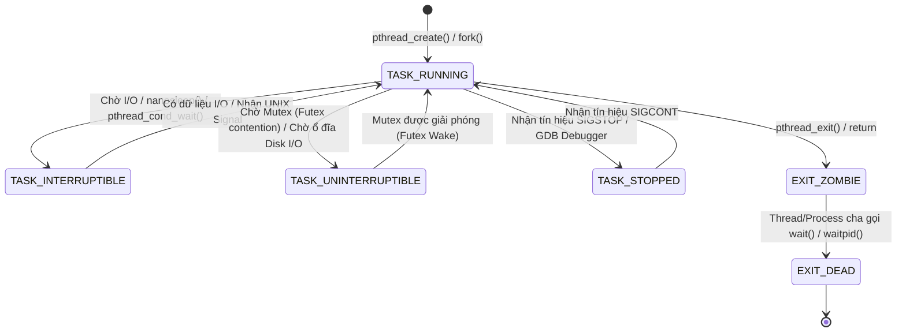
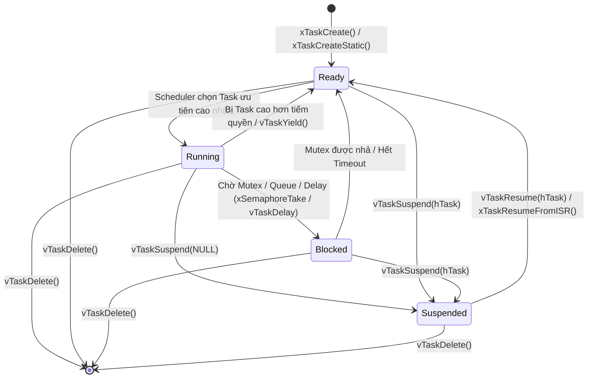
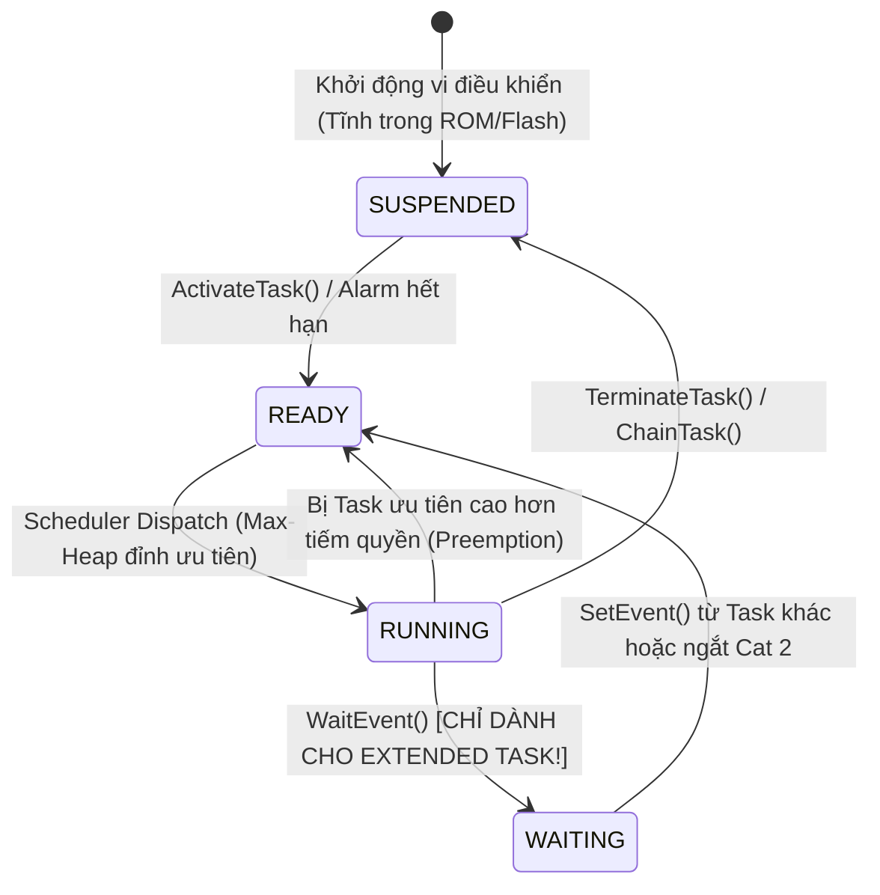

# CHUYÊN ĐỀ BỔ TRỢ 04: GIẢI MÃ TOÀN DIỆN MUTEX, SEMAPHORE (RTOS/POSIX) & RESOURCE (AUTOSAR/OSEK)
## (Masterclass: Mutex vs Semaphore vs AUTOSAR Resource — Synchronization, IPCP, Priority Inversion & Hardware Memory Anatomy)

> 📌 **Vị trí tài liệu:** [`docs/supplementary_knowledge/04_Mutex_Semaphore_vs_AUTOSAR_Resource_Deep_Dive.md`](file:///C:/Users/liem.vu/Liem.vuOD/Study_AUTOSAR-main/docs/supplementary_knowledge/04_Mutex_Semaphore_vs_AUTOSAR_Resource_Deep_Dive.md)  
> 🎯 **Đối tượng mục tiêu:** Kỹ sư nhúng (Embedded Engineers) chuyển từ FreeRTOS, VxWorks, Linux sang AUTOSAR Classic; hoặc kỹ sư đang bối rối trước các khái niệm: *Khóa nâng quyền tĩnh, Kế thừa ưu tiên động, Wait Queue trong RAM, Context Switch và Hiện tượng Deadlock / Priority Inversion*.  
> 🔧 **Mã nguồn thực nghiệm đối chiếu:**
> - AUTOSAR Kernel: [`as/com/as.infrastructure/system/kernel/askar/kernel/resource.c`](file:///C:/Users/liem.vu/Liem.vuOD/Study_AUTOSAR-main/as/com/as.infrastructure/system/kernel/askar/kernel/resource.c)
> - Bộ sinh mã ArGen: [`as/com/as.tool/config.infrastructure.system/argen/GenOS.py`](file:///C:/Users/liem.vu/Liem.vuOD/Study_AUTOSAR-main/as/com/as.tool/config.infrastructure.system/argen/GenOS.py)
> - Tầng BSW EcuM thực tế: [`as/com/as.infrastructure/system/EcuM/EcuM_Main.c`](file:///C:/Users/liem.vu/Liem.vuOD/Study_AUTOSAR-main/as/com/as.infrastructure/system/EcuM/EcuM_Main.c)
> - Tầng Mạng DoIP LwIP: [`as/com/as.infrastructure/arch/common/lwip/sys_arch.c`](file:///C:/Users/liem.vu/Liem.vuOD/Study_AUTOSAR-main/as/com/as.infrastructure/arch/common/lwip/sys_arch.c)

---

## 📑 MỤC LỤC CHI TIẾT

1. [Bản Chất Cốt Lõi: Tại Sao Phải Phân Biệt Mutex vs Semaphore?](#1-bản-chất-cốt-lõi-tại-sao-phải-phân-biệt-mutex-vs-semaphore)
   - [1.1. Mutex: Tính Sở Hữu (Ownership) & Bảo Vệ Tài Nguyên Chia Sẻ](#11-mutex-tính-sở-hữu-ownership--bảo-vệ-tài-nguyên-chia-sẻ)
   - [1.2. Semaphore: Cơ Chế Báo Hiệu (Signalling) & Giao Tiếp Bất Đồng Bộ](#12-semaphore-cơ-chế-báo-hiệu-signalling--giao-tiếp-bất-đồng-bộ)
   - [1.3. Sự Nhầm Lẫn Chết Người Giữa Binary Semaphore & Mutex](#13-sự-nhầm-lẫn-chết-người-giữa-binary-semaphore--mutex)
   - [1.3.1. Phân Tích Chuyên Sâu: "Có Phải Cứ Dùng Mutex Là Mặc Định Task Sẽ Được Nâng Quyền?"](#131-phân-tích-chuyên-sâu-có-phải-cứ-dùng-mutex-là-mặc-định-task-sẽ-được-nâng-quyền)
2. [Giải Mã Các Thuật Ngữ Hệ Điều Hành Chuyên Sâu](#2-giải-mã-các-thuật-ngữ-hệ-điều-hành-chuyên-sâu)
   - [2.0. So Sánh Các Trạng Thái Mặc Định (Default States & Behaviors) Ở 3 Hệ Thống: Linux/POSIX vs FreeRTOS vs AUTOSAR/OSEK](#20-so-sánh-các-trạng-thái-mặc-định-default-states--behaviors-ở-3-hệ-thống-linuxposix-vs-freertos-vs-autosarosek)
     - [2.0.1. Hệ Thống 1: Linux / POSIX Thread State Machine (Chi Tiết)](#201-hệ-thống-1-linux--posix-thread-state-machine-chi-tiết)
     - [2.0.2. Hệ Thống 2: FreeRTOS Task State Machine (Xác Nhận & Mổ Xẻ Trạng Thái Suspended)](#202-hệ-thống-2-freertos-task-state-machine-xác-nhận--mổ-xẻ-trạng-thái-suspended)
     - [2.0.3. Hệ Thống 3: AUTOSAR / OSEK OS Task State Machine (Basic vs Extended & IPCP)](#203-hệ-thống-3-autosar--osek-os-task-state-machine-basic-vs-extended--ipcp)
     - [2.0.4. Trạng Thái & Hành Vi Mặc Định Của Khóa (Default Locking Behaviors)](#204-trạng-thái--hành-vi-mặc-định-của-khóa-default-locking-behaviors)
     - [2.0.5. Bảng Ma Trận Tổng Hợp Trạng Thái Mặc Định Giữa 3 Hệ Thống](#205-bảng-ma-trận-tổng-hợp-trạng-thái-mặc-định-giữa-3-hệ-thống)
     - [2.0.6. Đột Phá Tư Duy Kiến Trúc: Hiện Tượng "Ping-Pong Context Switch" Trong RTOS vs "Lá Chắn Ready-Preemption" Trong OSEK](#206-đột-phá-tư-duy-kiến-trúc-hiện-tượng-ping-pong-context-switch-trong-rtos-vs-lá-chắn-ready-preemption-trong-osek)
   - [2.1. "Chặn và Đưa Luồng Vào Giấc Ngủ" (Blocking / Sleep / Wait State) Là Gì?](#21-chặn-và-đưa-luồng-vào-giấc-ngủ-blocking--sleep--wait-state-là-gì)
   - [2.2. "Hàng Đợi Chờ" (Wait Queue in RAM) Là Gì? Trong Hàng Đợi Chứa Gì?](#22-hàng-đợi-chờ-wait-queue-in-ram-là-gì-trong-hàng-đợi-chứa-gì)
   - [2.3. "Context Switch" (Chuyển Ngữ Cảnh) Dưới Tầng Phần Cứng CPU Là Gì?](#23-context-switch-chuyển-ngữ-cảnh-dưới-tầng-phần-cứng-cpu-là-gì)
3. [Đối Đầu Hai Trường Phái Giải Quyết Nghịch Đảo Độ Ưu Tiên](#3-đối-đầu-hai-trường-phái-giải-quyết-nghịch-đảo-độ-ưu-tiên)
   - [3.1. Kế Thừa Ưu Tiên Động (Dynamic Priority Inheritance - PIP) Trong FreeRTOS / POSIX](#31-kế-thừa-ưu-tiên-động-dynamic-priority-inheritance---pip-trong-freertos--posix)
   - [3.2. Khóa Nâng Quyền Tĩnh (Immediate Priority Ceiling Protocol - IPCP) Trong AUTOSAR / OSEK](#32-khóa-nâng-quyền-tĩnh-immediate-priority-ceiling-protocol---ipcp-trong-autosar--osek)
     - [3.2.1. Quy Tắc Vàng: Tại Sao Priority Ceiling CHỈ NÂNG LÊN MỨC MAX CỦA CÁC TASK DÙNG CHUNG?](#321-quy-tắc-vàng-tại-sao-priority-ceiling-chỉ-nâng-lên-mức-max-của-các-task-dùng-chung)
     - [3.2.2. Ý Nghĩa Sống Còn Về Schedulability (ISO 26262): Bài Toán Tác Vụ Cứu Mạng (Túi Khí Airbag)](#322-ý-nghĩa-sống-còn-về-schedulability-iso-26262-bài-toán-tác-vụ-cứu-mạng-túi-khí-airbag)
     - [3.2.3. Hai Ngoại Lệ Cốt Tử Trong OSEK / AUTOSAR: RES_SCHEDULER & Ngắt Phần Cứng ISR Category 2](#323-hai-ngoại-lệ-cốt-tử-trong-osek--autosar-res_scheduler--ngắt-phần-cứng-isr-category-2)
     - [3.2.4. Bằng Chứng Mã Nguồn Kernel (resource.c) & Bộ Sinh Mã (GenOS.py)](#324-bằng-chứng-mã-nguồn-kernel-resourcec--bộ-sinh-mã-genospy)
   - [3.3. Giải Mã Bí Ẩn: "Tại Sao Nói Resource Trong AUTOSAR Luôn Luôn Rảnh?"](#33-giải-mã-bí-ẩn-tại-sao-nói-resource-trong-autosar-luôn-luôn-rảnh)
4. [Các Kịch Bản Tranh Chấp Chéo Nguy Hiểm & Giải Pháp Của OSEK](#4-các-kịch-bản-tranh-chấp-chéo-nguy-hiểm--giải-pháp-của-osek)
   - [4.1. Kịch Bản 1: Nghịch Đảo Độ Ưu Tiên Không Giới Hạn (Unbounded Priority Inversion)](#41-kịch-bản-1-nghịch-đảo-độ-ưu-tiên-không-giới-hạn-unbounded-priority-inversion)
   - [4.2. Kịch Bản 2: Deadlock Kinh Điển Tranh Chấp Chéo Khóa (Deadlock AB-BA)](#42-kịch-bản-2-deadlock-kinh-điển-tranh-chấp-chéo-khóa-deadlock-ab-ba)
   - [4.3. Kịch Bản 3: Kế Thừa Ưu Tiên Bắc Cầu Nhiều Cấp (Chained / Transitive Inheritance)](#43-kịch-bản-3-kế-thừa-ưu-tiên-bắc-cầu-nhiều-cấp-chained--transitive-inheritance)
   - [4.4. Cơ Chế Triệt Tiêu Deadlock Bằng Toán Học Của AUTOSAR (Strict LIFO)](#44-cơ-chế-triệt-tiêu-deadlock-bằng-toán-học-của-autosar-strict-lifo)
5. [Bảng So Sánh Toàn Diện: Mutex vs Semaphore vs AUTOSAR Resource](#5-bảng-so-sánh-toàn-diện-mutex-vs-semaphore-vs-autosar-resource)
6. [Liên Hệ Thực Tế Với Code Base Dự Án (Case Study Gốc)](#6-liên-hệ-thực-tế-với-code-base-dự-án-case-study-gốc)

---

## 1. Bản Chất Cốt Lõi: Tại Sao Phải Phân Biệt Mutex vs Semaphore?

Trong kỹ thuật phần mềm hệ thống nhúng, hai công cụ đồng bộ hóa phổ biến nhất là **Mutex** và **Semaphore**. Dù cùng có thể dùng để hạn chế số lượng tác vụ truy cập vùng tài nguyên, **mục đích thiết kế (Design Intent) và cơ chế vận hành của chúng hoàn toàn khác nhau**.

```
                           CÔNG CỤ ĐỒNG BỘ HÓA TRUYỀN THỐNG
                         ┌─────────────────┴─────────────────┐
                         ▼                                   ▼
             [MUTEX = LOCK & KEY]                [SEMAPHORE = SIGNALLING]
             • Bảo vệ tài nguyên chia sẻ         • Giao tiếp đồng bộ bất đồng bộ
             • CÓ TÍNH SỞ HỮU (Ownership)        • KHÔNG CÓ TÍNH SỞ HỮU
             • Task nào KHÓA thì Task đó MỞ      • Task A (hoặc ISR) BÁO, Task B NHẬN
             • Giải quyết Priority Inversion     • KHÔNG giải quyết Priority Inversion
```

### 1.1. Mutex: Tính Sở Hữu (Ownership) & Bảo Vệ Tài Nguyên Chia Sẻ
- **Định nghĩa:** Mutex là viết tắt của **MUT**ual **EX**clusion (Loại trừ tương hỗ). Nó giống như **một chiếc chìa khóa duy nhất của một phòng vệ sinh công cộng**.
- **Tính sở hữu bắt buộc (Strict Ownership):**
  - Khi Task $A$ xin được Mutex (`Take / Lock`), Task $A$ trở thành **chủ sở hữu (Owner)** của Mutex đó.
  - **Chỉ duy nhất Task $A$ mới có quyền trả khóa (`Give / Unlock`)**.
  - Nếu Task $B$ (hoặc một ngắt ISR) cố tình gọi lệnh mở khóa một Mutex do Task $A$ nắm giữ, RTOS/POSIX chuẩn mực sẽ ném ra mã lỗi vi phạm quyền truy cập (ví dụ: `EPERM` trong POSIX hoặc trả về lỗi trong FreeRTOS).
- **Mục đích duy nhất:** Bảo vệ **Vùng Găng (Critical Section)** — ngăn không cho 2 tác vụ cùng đọc/ghi vào một mảng bộ đệm dữ liệu (RAM buffer), một biến trạng thái, hoặc một thanh ghi điều khiển phần cứng cùng một lúc.

### 1.2. Semaphore: Cơ Chế Báo Hiệu (Signalling) & Giao Tiếp Bất Đồng Bộ
- **Định nghĩa:** Semaphore (bắt nguồn từ hệ thống cờ hiệu đường sắt) là **một biến đếm số nguyên được bảo vệ bởi Kernel**, đi kèm 2 thao tác nguyên tử: `Wait/Take` (giảm biến đếm) và `Signal/Post/Give` (tăng biến đếm).
- **Hoàn toàn KHÔNG có tính sở hữu (No Ownership):**
  - Bất kỳ ai cũng có thể "Give" và bất kỳ ai cũng có thể "Take".
  - Một ngắt phần cứng (ISR) có thể phát tín hiệu `Give` để đánh thức một Worker Task đang chờ `Take`.
  - Task $A$ có thể `Give` để Task $B$ `Take`. Không có khái niệm "Task nào đang làm chủ Semaphore".
- **Phân loại:**
  1. **Counting Semaphore (Semaphore đếm):** Dùng để quản lý một tập hợp tài nguyên hữu hạn (ví dụ: một bộ đệm chứa tối đa 10 gói tin CAN, hoặc 5 kết nối socket khả dụng).
  2. **Binary Semaphore (Semaphore nhị phân):** Biến đếm chỉ nhận giá trị `0` hoặc `1`. Dùng chủ yếu để **đồng bộ hóa sự kiện 1-1** (Event Synchronization) giữa ngắt phần cứng và tác vụ xử lý.

### 1.3. Sự Nhầm Lẫn Chết Người Giữa Binary Semaphore & Mutex
Rất nhiều kỹ sư mới chuyển từ lập trình nhúng Bare-metal sang thường có suy nghĩ:  
> *"Binary Semaphore chỉ có giá trị 0 và 1, vậy tôi dùng nó làm khóa bảo vệ vùng nhớ chia sẻ thay cho Mutex thì có khác gì nhau?"*

**Khác biệt sống còn:**
1. **Khả năng bị mở khóa trái phép (Accidental Unlocking):**  
   Nếu dùng Binary Semaphore, nếu Task $B$ bị lỗi logic hoặc một ngắt ISR vô tình gọi `xSemaphoreGive()`, chiếc khóa bảo vệ sẽ bị bẻ gãy ngay lập tức khi Task $A$ vẫn đang ghi dở dữ liệu vào RAM $\rightarrow$ Gây vỡ dữ liệu (Data Corruption). Mutex ngăn chặn triệt để điều này nhờ kiểm tra `Owner == CurrentTask`.
2. **Thảm họa nghịch đảo độ ưu tiên (Priority Inversion Catastrophe):**  
   Vì Binary Semaphore không có khái niệm "Chủ sở hữu" (Owner), Kernel **hoàn toàn không biết phải nâng độ ưu tiên cho ai** khi có một Task ưu tiên cao hơn bị chặn! Do đó, **Binary Semaphore KHÔNG CÓ cơ chế Kế thừa độ ưu tiên (Priority Inheritance)**. Dùng Binary Semaphore để bảo vệ tài nguyên chia sẻ sẽ đẩy hệ thống vào nguy cơ treo cứng vĩnh viễn (như sự cố tàu sao Hỏa Mars Pathfinder).

---

### 1.3.1. Phân Tích Chuyên Sâu: "Có Phải Cứ Dùng Mutex Là Mặc Định Task Sẽ Được Nâng Quyền?"

> ❓ **Câu hỏi nghi vấn kỹ thuật:**  
> *"Nếu nói Binary Semaphore không thể nâng quyền vì thiếu trường Owner, vậy có phải cứ dùng Mutex thì mặc định Task đang giữ Mutex sẽ được tự động nâng độ ưu tiên?"*

**Câu trả lời chính xác theo từng hệ điều hành:**

1. **Điều kiện cần (Structural Prerequisite):**  
   ĐÚNG! Nhờ Mutex lưu trường `Owner` (ví dụ `TaskHandle_t pxMutexHolder` trong FreeRTOS), Kernel mới **CÓ ĐỦ DỮ LIỆU ĐỂ BIẾT NÂNG QUYỀN CHO AI**. Nhưng **khi nào nâng và có phải luôn luôn nâng hay không** lại phụ thuộc vào cơ chế của từng loại RTOS:

2. **Trong FreeRTOS (`xSemaphoreCreateMutex`):**
   - **Mặc định BẬT** Kế thừa ưu tiên (Priority Inheritance - PIP).
   - **NHƯNG KHÔNG PHẢI VỪA LẤY LÀ NÂNG NGAY!**
   - *Quy tắc:* Khi `Task_Low` (Priority 1) lấy Mutex, độ ưu tiên của nó **vẫn giữ nguyên là 1**.  
   - **CHỈ KHI VÀ CHỈ KHI** có một Task có ưu tiên cao hơn (`Task_High` Priority 10) đến đòi Mutex và **bị rơi vào trạng thái BLOCKED (ngủ)**, lúc này FreeRTOS Kernel mới **ĐỘNG nâng quyền** của `Task_Low` từ 1 lên 10.  
   - Nếu trong suốt thời gian `Task_Low` giữ Mutex mà không có Task cao hơn đến đòi, `Task_Low` **hoàn toàn chạy ở Priority 1 bình thường**, không hề được nâng quyền!

3. **Trong Linux / POSIX RTOS (`pthread_mutex_t`):**
   - **Mặc định KHÔNG BẬT Kế thừa ưu tiên (`PTHREAD_PRIO_NONE`)!**
   - Trong POSIX, mặc định một Mutex chỉ khóa loại trừ đơn thuần. Nếu một thread ưu tiên thấp giữ Mutex, thread ưu tiên cao đến đòi sẽ bị ngủ chờ mà thread thấp **không hề được nâng quyền**!
   - Muốn kích hoạt tính năng nâng quyền động, lập trình viên bắt buộc phải tự cấu hình bằng code:
     ```c
     pthread_mutexattr_t attr;
     pthread_mutexattr_init(&attr);
     pthread_mutexattr_setprotocol(&attr, PTHREAD_PRIO_INHERIT); /* Phải chủ động BẬT! */
     pthread_mutex_init(&my_mutex, &attr);
     ```

4. **Ngược lại, trong AUTOSAR / OSEK (`GetResource`):**
   - **NÂNG TỨC THÌ LÊN MỨC TRẦN (Immediate Priority Ceiling - IPCP)**:
   - Không cần chờ `Task_High` xuất hiện! Ngay tích tắc dòng lệnh `GetResource()` vừa chạy xong, `Task_Low` đã vọt ngay lên Priority Ceiling tĩnh. Điều này ngăn chặn mọi tranh chấp và không để bất kỳ Task nào bị đưa vào trạng thái ngủ!

---

## 2. Giải Mã Các Thuật Ngữ Hệ Điều Hành Chuyên Sâu

Để hiểu sâu sắc sự khác biệt giữa RTOS/POSIX và AUTOSAR OSEK, ta cần mổ xẻ tận gốc các khái niệm nền tảng:

### 2.0. So Sánh Các Trạng Thái Mặc Định (Default States & Behaviors) Ở 3 Hệ Thống: Linux/POSIX vs FreeRTOS vs AUTOSAR/OSEK

Trước khi đi sâu vào cơ chế chặn luồng hay chuyển ngữ cảnh, kỹ sư cần nắm chắc **hai tầng trạng thái mặc định** vận hành song hành trong mọi hệ điều hành:
1. **Máy trạng thái tác vụ mặc định (Task/Thread State Machine):** Vòng đời của một luồng thực thi trong bộ nhớ.
2. **Trạng thái & Hành vi mặc định khi vận hành khóa (Default Locking & Priority Behaviors):** Cách hệ điều hành phản ứng khi có tài nguyên chia sẻ.

---

#### 🗺️ 2.0.1. Hệ Thống 1: Linux / POSIX Thread State Machine (Chi Tiết)

Trong nhân Linux và chuẩn POSIX threads (`pthreads`), một luồng thực thi (Task/Thread struct `task_struct`) có máy trạng thái đa tầng phức tạp trong Kernel Space:



##### Sơ Đồ Chuyển Dịch Chi Tiết Của Linux Threads:
```
┌────────────────────────────────────────────────────────────────────────────────────────┐
│                        LINUX / POSIX THREAD STATE MACHINE                              │
│                                                                                        │
│                      ┌─────────────────────────────────┐                               │
│                      │          TASK_RUNNING           │ ◄──────────┐                  │
│                      │ (Đang chạy CPU / Nằm ở RunQueue)│            │                  │
│                      └──────┬───────────────────┬──────┘            │                  │
│                             │                   │                   │                  │
│    Chờ Futex / Disk I/O     │                   │ Chờ Signal / Event│                  │
│    (Không ngắt bởi Signal)  │                   │ (Có thể bị ngắt)  │                  │
│                             ▼                   ▼                   │                  │
│               ┌───────────────────────┐   ┌──────────────────────┐  │ Futex Wake /     │
│               │ TASK_UNINTERRUPTIBLE  │   │  TASK_INTERRUPTIBLE  │  │ I/O Ready /      │
│               │  (D-State: Chờ Mutex) │   │  (S-State: Ngủ nông) │  │ Signal           │
│               └───────────┬───────────┘   └──────────┬───────────┘  │                  │
│                           │                          │              │                  │
│                           └──────────────────────────┴──────────────┘                  │
│                                           │                                            │
│                      Nhận SIGSTOP         ▼            Nhận SIGCONT                    │
│                     ──────────────> ┌────────────┐ ─────────────────┘                  │
│                                     │TASK_STOPPED│                                     │
│                                     └────────────┘                                     │
│                                           │ pthread_exit()                             │
│                                           ▼                                            │
│                                     ┌────────────┐  waitpid()   ┌───────────┐          │
│                                     │EXIT_ZOMBIE │ ───────────> │ EXIT_DEAD │          │
│                                     └────────────┘              └───────────┘          │
└────────────────────────────────────────────────────────────────────────────────────────┘
```

##### Mổ Xẻ Trạng Thái & Cơ Chế Khóa Của POSIX Mutex:
1. **`TASK_RUNNING` (Running / Runnable):** Luồng đang chiếm giữ CPU hoặc đang nằm trong danh sách CFS RunQueue chờ được cấp phát timeslice.
2. **`TASK_UNINTERRUPTIBLE` (D-State — Điểm Cốt Tử Của Mutex):**
   - Khi luồng gọi `pthread_mutex_lock()` mà Mutex đang bị luồng khác chiếm giữ, Linux sử dụng cơ chế **Futex (Fast Userspace Mutex)**.
   - Thử nghiệm Fast-path (nguyên tử qua CAS trong user-space) thất bại $\to$ Luồng chuyển sang Slow-path bằng cách thực hiện system call `sys_futex()`.
   - Kernel chuyển trạng thái luồng sang **`TASK_UNINTERRUPTIBLE`** (ngủ sâu, không phản hồi với `kill -9` hay bất kỳ signal nào), gỡ luồng khỏi RunQueue và nhét vào hàng đợi Futex Waiters.
3. **Mặc Định `PTHREAD_PRIO_NONE`:** Luồng giữ Mutex **không được nâng quyền**. Luồng ưu tiên cao bị kẹt trong `TASK_UNINTERRUPTIBLE`, rất dễ bị các luồng trung bình chiếm quyền CPU dài hạn.

---

#### 🗺️ 2.0.2. Hệ Thống 2: FreeRTOS Task State Machine (Xác Nhận & Mổ Xẻ Trạng Thái Suspended)

> ❓ **Xác nhận kỹ thuật:** *"Ở FreeRTOS có trạng thái `Suspended` không?"*  
> 👉 **XÁC NHẬN CHÍNH XÁC 100%!** FreeRTOS có **đúng 4 trạng thái tác vụ cốt lõi**: `Running`, `Ready`, `Blocked`, và **`Suspended`**.



##### Sơ Đồ Chuyển Dịch Đầy Đủ 4 Trạng Thái Trong FreeRTOS:
```
┌────────────────────────────────────────────────────────────────────────────────────────┐
│                          FREERTOS COMPLETE TASK STATE MACHINE                          │
│                                                                                        │
│                          xTaskCreate()                                                 │
│                                │                                                       │
│                                ▼                                                       │
│                      ┌───────────────────┐    Scheduler Dispatch                       │
│       ┌───────────── │       READY       │ ──────────────────────┐                     │
│       │              │(pxReadyTasksLists)│ ◄──────────────────┐  │                     │
│       │              └───────────────────┘   Bị tiếm quyền    │  │                     │
│       │                        ▲                              │  │                     │
│       │                        │ Có Event / Hết Timeout       │  │                     │
│       │                        │                              │  ▼                     │
│       │              ┌───────────────────┐  xSemaphoreTake() ┌───────────────────┐     │
│       │              │      BLOCKED      │ ◄──────────────── │      RUNNING      │     │
│       │              │(pxDelayedTaskList)│   vTaskDelay()    │  (pxCurrentTCB)   │     │
│       │              └───────────────────┘                   └───────────────────┘     │
│       │ vTaskSuspend()         │ vTaskSuspend()                       │ vTaskSuspend() │
│       │                        │                                      │                │
│       ▼                        ▼                                      ▼                │
│  ┌─────────────────────────────────────────────────────────────────────────┐           │
│  │                            SUSPENDED                                    │           │
│  │                      (xSuspendedTaskList)                               │           │
│  │                                                                         │           │
│  │  • Hoàn toàn bị gỡ khỏi bộ lập lịch, Scheduler không bao giờ quét tới.  │           │
│  │  • Không tính thời gian chờ (Không có Timeout hết hạn).                 │           │
│  │  • Chỉ thức dậy khi một Task khác hoặc ISR gọi vTaskResume() tường minh!│           │
│  └─────────────────────────────────────────────────────────────────────────┘           │
│                                        │                                               │
│                                        └─────────── vTaskResume() ─────────────────────┘
│                                                     xTaskResumeFromISR()
└────────────────────────────────────────────────────────────────────────────────────────┘
```

##### Mổ Xẻ 4 Trạng Thái & Điểm Đặc Biệt Của `Suspended`:
1. **`Running`:** Tác vụ đang được lõi CPU thực thi mã lệnh (được trỏ bởi con trỏ toàn cục `pxCurrentTCB`).
2. **`Ready`:** Tác vụ đã sẵn sàng chạy, đang nằm trong mảng danh sách liên kết `pxReadyTasksLists[uxPriority]`.
3. **`Blocked` (Ngủ Chờ Có Điều Kiện / Có Hạn Thời Gian):**
   - Khi gọi `xSemaphoreTake(xMutex, xTicksToWait)` mà Mutex bị chiếm, Task bị gỡ khỏi `pxReadyTasksLists` và chuyển vào danh sách `xTasksWaitingToReceive` của Mutex.
   - **Đặc trưng cốt tử:** Luôn gắn liền với **Sự Kiện** (được nhả khóa) hoặc **Hạn Thời Gian (Timeout)**. Nếu hết thời gian `xTicksToWait` mà chưa có Mutex, Task tự động thức dậy trở lại `Ready`.
4. **`Suspended` (Đình Chỉ Hoàn Toàn / Vô Hạn Định):**
   - **Cách vào:** Gọi `vTaskSuspend(xTaskHandle)`. Nếu truyền `NULL`, Task tự đình chỉ chính nó. Bất kể Task đang ở `Running`, `Ready`, hay `Blocked`, nó đều bị kéo sang `Suspended`!
   - **Cấu trúc Kernel:** TCB được chuyển vào danh sách riêng `xSuspendedTaskList`.
   - **Khác biệt sống còn với `Blocked`:** 
     - Trạng thái `Blocked` có bộ đếm thời gian thức dậy.
     - Trạng thái `Suspended` **hoàn toàn KHÔNG CÓ timeout**. Scheduler bỏ qua 100% sự tồn tại của Task này.
     - **Cách thoát duy nhất:** Phải có một Task khác gọi `vTaskResume(xTaskHandle)` hoặc ngắt phần cứng gọi `xTaskResumeFromISR(xTaskHandle)`.
5. **Hành Vi Khóa Mặc Định Của FreeRTOS Mutex:**
   - PIP (Priority Inheritance) được bật sẵn. Khi `Task_Low` (Prio 1) lấy Mutex, nó **vẫn ở trạng thái `Running` với Prio 1**.
   - Chỉ khi `Task_High` (Prio 10) đòi Mutex $\to$ `Task_High` bị đẩy sang **`Blocked`**. Lúc này Kernel mới **động** nâng quyền `Task_Low` lên 10.

---

#### 🗺️ 2.0.3. Hệ Thống 3: AUTOSAR / OSEK OS Task State Machine (Basic vs Extended & IPCP)

Theo chuẩn quốc tế **ISO 17356-3 (OSEK/VDX OS)** và đặc tả kỹ thuật **AUTOSAR OS SWS**, máy trạng thái của hệ điều hành xe hơi được chia thành 2 phân lớp tác vụ rõ rệt:



##### Sơ Đồ Đối Chiếu Trạng Thái Basic Task vs Extended Task:
```
┌────────────────────────────────────────────────────────────────────────────────────────┐
│                     AUTOSAR / OSEK TASK STATE MACHINE (ISO 17356-3)                    │
│                                                                                        │
│                               ┌──────────────────────┐                                 │
│                               │      SUSPENDED       │ ◄────────────────┐              │
│                               │ (Thụ động trong ROM) │                  │              │
│                               └──────────┬───────────┘                  │              │
│                                          │                              │              │
│                           ActivateTask() │                              │              │
│                           Alarm Expiry   │                              │              │
│                                          ▼                              │              │
│                               ┌──────────────────────┐                  │              │
│                   ┌────────── │        READY         │ ◄─────────────┐  │              │
│                   │           │ (Max-Heap ReadyQueue)│               │  │              │
│                   │           └──────────┬───────────┘               │  │              │
│                   │                      │                           │  │              │
│                   │  Scheduler Dispatch  │                           │  │              │
│                   │                      ▼                           │  │              │
│                   │           ┌──────────────────────┐               │  │              │
│                   │           │       RUNNING        │ ──────────────┘  │              │
│                   │           │(Chiếm giữ Core CPU)  │   Bị tiếm quyền  │              │
│                   │           └──────────┬───────────┘                  │              │
│                   │                      │                              │              │
│                   │                      │ WaitEvent()                  │ TerminateTask()
│                   │                      │ [CHỈ EXTENDED TASK]          │              │
│                   │                      ▼                              │              │
│                   │           ┌──────────────────────┐                  │              │
│                   │           │       WAITING        │                  │              │
│                   │           │  (Ngủ chờ EventMask) │                  │              │
│                   │           └──────────┬───────────┘                  │              │
│                   │                      │                              │              │
│                   │                      └───────── SetEvent() ─────────┘              │
│                   │                                 (Từ Task / ISR Cat 2)              │
│                   │                                                                    │
│  ═════════════════╪══════════════════════════════════════════════════════════════════  │
│  🔍 ĐIỂM ĐẶC BIỆT CỐT TỬ CỦA RESOURCE TRONG AUTOSAR (THE IPCP MIRACLE):                 │
│                                                                                        │
│     Khi Task gọi GetResource():                                                        │
│     • KHÔNG CÓ BẤT KỲ MŨI TÊN CHUYỂN DỊCH TRẠNG THÁI NÀO!                              │
│     • Task ĐANG Ở RUNNING VẪN TIẾP TỤC Ở RUNNING 100%!                                 │
│     • Kernel chỉ gán 1 biến số nguyên: RunningVar->priority = ceilPrio.                │
│     • Tuyệt đối KHÔNG BAO GIỜ bị chuyển sang WAITING!                                  │
└────────────────────────────────────────────────────────────────────────────────────────┘
```

##### Sự Khác Biệt Kiến Trúc Giữa Basic Task & Extended Task:
1. **Basic Task (Chỉ có 3 trạng thái: `SUSPENDED`, `READY`, `RUNNING`):**
   - Không thể gọi `WaitEvent()`. Một khi đã chạy là phải chạy thẳng một mạch cho tới khi gọi `TerminateTask()` (hoặc bị tiếm quyền chuyển về `READY`).
   - Cực kỳ tiết kiệm RAM vì có thể **chia sẻ chung một vùng Stack duy nhất** với các Basic Task khác cùng nhóm!
2. **Extended Task (Đầy đủ 4 trạng thái, có thêm `WAITING`):**
   - Cho phép gọi `WaitEvent()`. Khi chưa có cờ sự kiện, Task tự giải phóng CPU chuyển sang `WAITING`.
   - Mỗi Extended Task bắt buộc phải có **vùng Stack riêng biệt**.
3. **Cơ Chế Khóa Của Resource Trong OSEK (IPCP):**
   - Khi một Task gọi `GetResource()`, **nó không bao giờ bị đưa vào `WAITING`**!
   - Vì độ ưu tiên của nó lập tức nhảy vọt lên Ceiling, các Task khác không thể chen ngang $\to$ **Không một Task nào trong toàn hệ điều hành bị rơi vào giấc ngủ vì Resource!**

---

#### 🔒 2.0.4. Trạng Thái & Hành Vi Mặc Định Của Khóa (Default Locking Behaviors)

Khi kỹ sư tạo một đối tượng khóa trong 3 hệ điều hành, hành vi mặc định diễn ra hoàn toàn trái ngược nhau:

##### A. Trong POSIX (`pthread_mutex_t` trên Linux / RTOS POSIX):
* **Thuộc tính kế thừa ưu tiên mặc định:** `PTHREAD_PRIO_NONE`.
* **Trạng thái Task giữ khóa:** **HOÀN TOÀN KHÔNG ĐƯỢC NÂNG QUYỀN!** Task giữ khóa vẫn chạy ở độ ưu tiên ban đầu.
* **Hậu quả mặc định:** Nếu một Thread ưu tiên cao đến đòi khóa, nó bị đẩy vào ngủ (`TASK_UNINTERRUPTIBLE`), trong khi Thread ưu tiên thấp vẫn chạy lề mề. Nếu có Thread ưu tiên trung bình xuất hiện, hiện tượng **Nghịch đảo ưu tiên không giới hạn (Unbounded Priority Inversion)** sẽ bùng nổ ngay lập tức!
* **Muốn khắc phục:** Kỹ sư bắt buộc phải tự viết code bật thuộc tính: `pthread_mutexattr_setprotocol(&attr, PTHREAD_PRIO_INHERIT)`.

##### B. Trong FreeRTOS (`xSemaphoreCreateMutex`):
* **Thuộc tính kế thừa ưu tiên mặc định:** Kế thừa ưu tiên động (Priority Inheritance - PIP) được **BẬT MẶC ĐỊNH**.
* **Trạng thái Task giữ khóa lúc vừa lấy xong:** **GIỮ NGUYÊN ĐỘ ƯU TIÊN BAN ĐẦU (MỨC THẤP)!**
  - Ví dụ: `Task_Low` (Priority 1) lấy Mutex thành công, độ ưu tiên của nó **vẫn là 1**.
* **Trạng thái khi có tranh chấp:**
  - `Task_High` (Priority 10) chạy tới đòi Mutex $\to$ `Task_High` bị đưa vào `Blocked` (ngủ).
  - Lúc này, FreeRTOS Kernel mới **ĐỘNG nâng quyền** `Task_Low` từ 1 lên 10 (`Task_Low->uxPriority = 10`).
  - Khi `Task_Low` nhả khóa, Kernel lại hạ quyền nó về 1 và đánh thức `Task_High`.

##### C. Trong AUTOSAR / OSEK OS (`GetResource`):
* **Thuộc tính kế thừa ưu tiên mặc định:** Giao thức trần ưu tiên tức thì (Immediate Priority Ceiling Protocol - IPCP) là **RÀNG BUỘC BẮT BUỘC 100% THEO CHUẨN ISO 17356-3**. Kỹ sư không thể tắt tính năng này!
* **Trạng thái Task giữ khóa lúc vừa lấy xong:** **LẬP TỨC NÂNG VỌT LÊN MỨC TRẦN TĨNH (CEILING PRIORITY)**!
  - Ví dụ: `Task_Low` (Priority 1) vừa gọi `GetResource(Res_SharedBuffer)` xong, Kernel gán ngay lập tức: `RunningVar->priority = 10`.
* **Trạng thái của các Task khác trong hệ thống:**
  - Vì Task đang chạy đã ở mức Priority 10, **KHÔNG MỘT TASK NÀO KHÁC CÓ THỂ CHEN NGANG ĐỂ ĐÒI RESOURCE NỮA**!
  - **Không có bất kỳ Task nào bị rơi vào trạng thái WAITING hay BLOCKED!**
* **Trạng thái của Resource:** **LUÔN LUÔN RẢNH 100% ($O(1)$)** khi có Task gọi đến nó!

---

#### 📊 2.0.5. Bảng Ma Trận Tổng Hợp Trạng Thái Mặc Định Giữa 3 Hệ Thống

| Tiêu Chí Kỹ Thuật | 💻 Linux / POSIX (`pthread_mutex_t`) | 📟 FreeRTOS (`xSemaphoreCreateMutex`) | 🚗 AUTOSAR / OSEK (`GetResource`) |
| :--- | :--- | :--- | :--- |
| **Các trạng thái tác vụ hỗ trợ** | `RUNNING`, `INTERRUPTIBLE`, `UNINTERRUPTIBLE`, `STOPPED`, `ZOMBIE` | `Ready`, `Running`, `Blocked`, **`Suspended`** | Basic: `SUSPENDED`, `READY`, `RUNNING`<br>Extended: Thêm `WAITING` |
| **Cơ chế nâng quyền mặc định** | ❌ **`PTHREAD_PRIO_NONE`** (Mặc định TẮT nâng quyền) | 🟡 **PIP (Động):** Bật mặc định nhưng chỉ nâng khi có tranh chấp | 🟢 **IPCP (Tĩnh):** Bắt buộc theo chuẩn, nâng ngay khi lấy khóa |
| **Trạng thái Task giữ khóa lúc vừa lấy** | Giữ nguyên độ ưu tiên thấp ban đầu | Giữ nguyên độ ưu tiên thấp ban đầu | 🟢 **Vọt ngay lên Ceiling Priority cao nhất** |
| **Trạng thái Task đến sau bị tranh chấp** | Chuyển sang `TASK_UNINTERRUPTIBLE` (ngủ sâu) | Chuyển sang `Blocked` (ngủ chờ) | 🟢 **KHÔNG CÓ (Không thể chen ngang để tranh chấp)** |
| **Nơi cất giữ Task bị chặn** | Hàng đợi Futex Waiters trong Linux Kernel | Mảng liên kết `xTasksWaitingToReceive` trong RAM | 🟢 **KHÔNG CÓ (Zero Wait Queue — 0 Byte RAM)** |
| **Trạng thái tài nguyên khi được gọi** | Có thể Rảnh hoặc Bận | Có thể Rảnh hoặc Bận | 🟢 **LUÔN LUÔN RẢNH 100% ($O(1)$)** |
| **Context Switch tại thời điểm lấy khóa** | Có thể nổ ra (nếu Mutex đang bận) | Có thể nổ ra (nếu Mutex đang bận) | 🟢 **0 LẦN CONTEXT SWITCH (Zero Latency)** |
| **Triết lý thiết kế** | Đa dụng (General Purpose OS) | Phản ứng thụ động (Reactive RTOS) | **Phòng ngừa chủ động (Preventive Automotive OS)** |

---

#### 💡 2.0.6. Đột Phá Tư Duy Kiến Trúc: Hiện Tượng "Ping-Pong Context Switch" Trong RTOS vs "Lá Chắn Ready-Preemption" Trong OSEK

> 🏆 **ĐỐI CHIẾU TƯ DUY KỸ THUẬT ĐỈNH CAO (SENIOR ARCHITECT PERSPECTIVE):**  
> Việc nhận ra hành vi thực thi của các dòng lệnh nằm trước điểm lấy khóa chính là chìa khóa vàng phân định đẳng cấp giữa một RTOS thông thường và một hệ điều hành ô tô thời gian thực cứng như AUTOSAR/OSEK.

---

##### 🚨 1. BẢN CHẤT TRONG RTOS (FreeRTOS / POSIX): HIỆN TƯỢNG "PING-PONG CONTEXT SWITCH" LÃNG PHÍ

```
TIMELINE TRONG FREERTOS:
Thời gian:   t0 ─────────> t1 ───────────────> t2 ───────────────> t3 ───────────────> t4 ───────────> t5
Task_Low:    [Lấy Mutex]...[Bị tiếm quyền]........................[Nâng Prio 10]......[Nhả Mutex]...
                              │                                      ▲
                     CONTEXT SWITCH #1                      CONTEXT SWITCH #2
                              ▼                                      │
Task_High:   ...............[Chuyển RUNNING] ──> [Đòi Mutex] ───────┘
                            (Chạy các lệnh trước) (Bị BLOCKED)
```

> **🔥 NGUYÊN LÝ BĂNG HOẠI HIỆU NĂNG CỦA RTOS:**
> 1. **TASK ƯU TIÊN CAO VẪN ĐƯỢC CHUYỂN TỪ `READY` SANG `RUNNING`:**  
>    KHI `Task_High` (PRIORITY 10) ĐƯỢC KÍCH HOẠT, VÌ ĐỘ ƯU TIÊN CỦA NÓ LỚN HƠN `Task_Low` (PRIORITY 1), BỘ LẬP LỊCH FREERTOS BẮT BUỘC PHẢI THỰC HIỆN **CONTEXT SWITCH LẦN 1** ĐỂ ĐƯA `Task_High` VÀO TRẠNG THÁI `RUNNING`!
> 2. **CÁC DÒNG LỆNH TRƯỚC LỆNH `take()` VẪN ĐƯỢC CPU THỰC THI:**  
>    KHI ĐÃ SANG `RUNNING`, CPU NẠP CÁC THANH GHI CỦA `Task_High` VÀ THỰC THI TOÀN BỘ CÁC DÒNG LỆNH NẰM TRƯỚC LỆNH `xSemaphoreTake()` (KHỞI TẠO BIẾN CỤC BỘ, TÍNH TOÁN SƠ BỘ, GHI LOG...).
> 3. **ĐÂM ĐẦU VÀO BỨC TƯỜNG KHÓA VÀ BỊ CHẶN NGỦ:**  
>    CHỈ ĐẾN KHI CPU CHẠY TRÚNG DÒNG LỆNH `xSemaphoreTake(xMutex)`, `Task_High` MỚI BẬT NGỬA PHÁT HIỆN RA MUTEX ĐÃ BỊ `Task_Low` CHIẾM GIỮ!
> 4. **CONTEXT SWITCH LẦN 2 (BẬT NGƯỢC TRỞ LẠI):**  
>    `Task_High` BỊ ĐẨY TỪ `RUNNING` VÀO `BLOCKED` (NGỦ CHỜ). KERNEL NÂNG ĐỘ ƯU TIÊN CỦA `Task_Low` LÊN 10 VÀ PHẢI KÍCH HOẠT TIẾP **CONTEXT SWITCH LẦN 2** ĐỂ TRÁO CON TRỎ NGĂN XẾP QUAY LẠI `Task_Low`!
> 
> $\Longrightarrow$ **HẬU QUẢ:** HỆ THỐNG PHẢI GÁNH CHỊU **2 LẦN CONTEXT SWITCH NẶNG NỀ VÀ LÃNG PHÍ** CHỈ ĐỂ CHO `Task_High` CHẠY MỘT VÀI LỆNH NGẮN NGỦI RỒI BỊ ĐẨY VÀO GIẤC NGỦ!

---

##### 🛡️ 2. BẢN CHẤT TRONG AUTOSAR / OSEK OS: "LÁ CHẮN READY-PREEMPTION" TRIỆT TIÊU 100% CONTEXT SWITCH THỪA

```
TIMELINE TRONG AUTOSAR / OSEK (IPCP):
Thời gian:   t0 ─────────────────────────────> t1 ─────────────────────────────────────> t2 ───────────> t3
Task_Low:    [GetResource() -> VỌT LÊN PRIO 10]...[Chạy thẳng một mạch vùng găng]......[ReleaseResource()]
                                                        ▲                                       │
                                                LÁ CHẮN CHẶN ĐỨNG                     CONTEXT SWITCH DUY NHẤT
                                                KHÔNG ĐỔI NGỮ CẢNH                             ▼
Task_High:   ...................................[Vào READY - KHÔNG ĐƯỢC LÊN RUNNING]...[Sang RUNNING]
                                                (Đứng yên trong ReadyQueue!)           (Tài nguyên đã rảnh!)
```

> **🔥 NGUYÊN LÝ PHÒNG NGỪA TOÀN NĂNG CỦA AUTOSAR IPCP:**
> 1. **ĐẢO CHIỀU ƯU TIÊN NGAY TỪ ĐẦU:**  
>    NGAY KHI `Task_Low` (PRIORITY 1) VỪA GỌI `GetResource()`, ĐỘ ƯU TIÊN CỦA NÓ **ĐÃ BỊ ÉP NHẢY VỌT NGAY LẬP TỨC LÊN MỨC TRẦN TĨNH (CEILING = 10)**!
> 2. **`Task_High` ĐƯỢC CHUYỂN TỪ `SUSPENDED` SANG `READY`, NHƯNG BỊ CHẶN ĐỨNG KHÔNG THỂ LÊN `RUNNING`:**  
>    KHI `Task_High` (PRIORITY 10) ĐƯỢC KÍCH HOẠT BỞI SỰ KIỆN HOẶC ALARM, KERNEL OSEK ĐƯA NÓ VÀO DANH SÁCH SẴN SÀNG CHẠY (`ReadyQueue`).  
>    TUY NHIÊN, THEO LUẬT TIẾM QUYỀN TOÁN HỌC CỦA CHUẨN ISO 17356-3:  
>    $$\text{ĐIỀU KIỆN TIẾM QUYỀN: } \mathbf{\text{Priority}(\text{Task\_High}) > \text{Priority}(\text{Task Đang Chạy})}$$  
>    TẠI THỜI ĐIỂM NÀY:  
>    $$\mathbf{10 \ngtr 10 \quad \Longrightarrow \quad KHÔNG ĐỦ ĐIỀU KIỆN TIẾM QUYỀN!}$$
> 3. **`Task_High` KHÔNG ĐƯỢC CHẠY DÙ CHỈ MỘT DÒNG LỆNH NÀO TRÊN CPU:**  
>    VÌ KHÔNG ĐƯỢC LÊN `RUNNING`, NÊN **TOÀN BỘ CÁC LỆNH NẰM TRƯỚC LỆNH `GetResource()` CỦA `Task_High` ĐỀU KHÔNG ĐƯỢC PHÉP CHẠY**! `Task_High` PHẢI ĐỨNG YÊN NGOAN NGOÃN TRONG `ReadyQueue`!
> 4. **HOÀN TOÀN KHÔNG CÓ BẤT KỲ CONTEXT SWITCH NÀO TẠI ĐIỂM TRANH CHẤP:**  
>    CPU KHÔNG CẦN LƯU THANH GHI, KHÔNG CẦN TRÁO CON TRỎ NGĂN XẾP (SP), KHÔNG XẢ BỘ ĐỆM PIPELINE! `Task_Low` TIẾP TỤC CHẠY THẲNG MỘT MẠCH 100% CÔNG SUẤT QUA VÙNG GĂNG MÀ KHÔNG HỀ BỊ GIÁN ĐOẠN!
> 5. **CHỈ CÓ DUY NHẤT 1 LẦN CONTEXT SWITCH KHI NHẢ KHÓA:**  
>    KHI `Task_Low` KẾT THÚC VÙNG GĂNG VÀ GỌI `ReleaseResource()`, ĐỘ ƯU TIÊN CỦA NÓ BỊ HẠ TỪ 10 TRỞ VỀ 1.  
>    LÚC NÀY, **DUY NHẤT 1 LẦN CONTEXT SWITCH** MỚI DIỄN RA ĐỂ CHUYỂN GIAO CPU CHO `Task_High` CHUYỂN TỪ `READY` $\to$ `RUNNING`.  
>    VÀ KHI `Task_High` CHẠY ĐẾN LỆNH `GetResource()`, RESOURCE **ĐÃ ĐƯỢC GIẢI PHÓNG HOÀN TOÀN 100%**, NÓ TIẾP TỤC LẤY KHÓA THÀNH CÔNG VỚI ĐỘ PHỨC TẠP $O(1)$ TUYỆT ĐỐI!

---

### 2.1. "Chặn và Đưa Luồng Vào Giấc Ngủ" (Blocking / Sleep / Wait State) Là Gì?
Khi một Task cố gắng lấy một tài nguyên (Mutex, Message Queue, Event) nhưng tài nguyên đó **đang bị đối tượng khác chiếm giữ**, Task không thể tiếp tục thực thi mã lệnh của nó.

Lúc này, hệ điều hành có 2 lựa chọn xử lý:
1. **Busy Waiting (Spinlock / Vòng lặp chờ rảnh):** Cho CPU chạy vòng lặp `while(locked);` liên tục. Cách này lãng phí 100% thời gian CPU và đốt nóng vi điều khiển.
2. **Blocking / Putting Task to Sleep (Chặn và đưa luồng vào giấc ngủ):**  
   - Hệ điều hành sẽ can thiệp vào bộ lập lịch (Scheduler).
   - **Kernel gỡ thẻ TCB (Task Control Block)** của Task hiện tại ra khỏi danh sách sẵn sàng chạy (`Ready List`).
   - Gán trạng thái của Task từ `RUNNING` sang `BLOCKED` (trong FreeRTOS) hoặc `WAITING` (trong AUTOSAR OSEK).
   - CPU ngừng thực thi Task này ngay lập tức và chuyển sang chạy Task khác có ích hơn. Task rơi vào giấc ngủ sâu, không tiêu tốn dù chỉ 1 chu kỳ xung nhịp CPU nào!

```
                  VÒNG ĐỜI TRẠNG THÁI KHI TASK BỊ CHẶN (BLOCKING)
   ┌─────────┐   CPU Lập Lịch    ┌─────────┐     Tài nguyên bận      ┌─────────┐
   │  READY  │ ───────────────>  │ RUNNING │ ──────────────────────> │ BLOCKED │
   │ (Sẵn s.)│ <───────────────  │ (Chạy)  │  (Gỡ TCB khỏi ReadyList)│  (Ngủ)  │
   └─────────┘    Bị tiếm quyền  └─────────┘                         └─────────┘
        ▲                                                                 │
        └─────────────────────────────────────────────────────────────────┘
                         Được đánh thức khi tài nguyên rảnh
```

---

### 2.2. "Hàng Đợi Chờ" (Wait Queue in RAM) Là Gì? Trong Hàng Đợi Chứa Gì?

> ❓ **Câu hỏi cốt tử:** *"Khi một hoặc nhiều Task bị đưa vào giấc ngủ vì tranh chấp Mutex, hệ điều hành lưu chúng ở đâu trong RAM? Cấu trúc của nó là gì và mục đích để làm gì?"*

#### Cấu Trúc Thực Tế Trong RAM Của Một Mutex Trong RTOS (Ví dụ FreeRTOS):
Trong các hệ điều hành như FreeRTOS hay POSIX, mỗi một Mutex là một biến cấu trúc đồ sộ cấp phát trong RAM (`QueueDefinition`):

```c
/* Cấu trúc bộ nhớ RAM của 1 Mutex trong RTOS truyền thống */
typedef struct QueueDefinition
{
    int8_t *pcHead;                 /* Con trỏ dữ liệu */
    TaskHandle_t pxMutexHolder;     /* 4 bytes: Con trỏ TCB trỏ vào Task đang sở hữu Mutex */
    UBaseType_t uxRecursiveCallCount;/* 4 bytes: Đếm số lần khóa đệ quy */
    
    /* ĐÂY CHÍNH LÀ HÀNG ĐỢI CHỜ (WAIT QUEUE / BLOCKED LIST) */
    List_t xTasksWaitingToReceive;  /* ~20-28 bytes RAM: Danh sách liên kết kép */
    List_t xTasksWaitingToSend;     /* ~20-28 bytes RAM: Danh sách tác vụ đợi gửi */
} xQUEUE;
```

#### Trong Hàng Đợi Chờ (`Wait Queue`) Chứa Gì?
`Wait Queue` không phải là một mảng dữ liệu nghiệp vụ, mà là một **Danh sách liên kết kép (Doubly-Linked List)** chứa các phần tử nút (`ListItem_t`). Mỗi phần tử này chứa:
1. **Con trỏ trỏ tới TCB (Task Control Block):** Xác định chính xác địa chỉ vùng nhớ của Task đang bị ngủ trong RAM.
2. **Giá trị độ ưu tiên (Priority Value):** Để sắp xếp các Task trong hàng đợi theo thứ tự từ độ ưu tiên cao nhất đến thấp nhất.

```
       CẤU TRÚC HÀNG ĐỢI CHỜ (WAIT QUEUE) TRONG RAM CỦA FREERTOS / POSIX
  ┌───────────────────────────────────────────────────────────────────────┐
  │ Mutex Struct: pxMutexHolder = Task_Low (TCB: 0x20000100)               │
  │ xTasksWaitingToReceive (Head)                                         │
  │   │                                                                   │
  │   ├──> [Node 1] ──> TCB: Task_High (Prio 10) [Đang ngủ chờ khóa]     │
  │   │      │                                                            │
  │   │      └── Next                                                     │
  │   └──> [Node 2] ──> TCB: Task_Mid  (Prio 5)  [Đang ngủ chờ khóa]     │
  └───────────────────────────────────────────────────────────────────────┘
```

#### Mục Đích Sống Còn Của Hàng Đợi Chờ:
1. **Điểm tập kết an toàn:** Giúp Kernel lưu trữ những Task bị đình chỉ mà không làm thất thoát dấu vết của chúng trong hệ thống.
2. **Đánh thức chính xác khi nhả khóa:** Khi Task chủ sở hữu gọi `Release / Give Mutex`:
   - Kernel lập tức tra cứu vào `Wait Queue` của Mutex đó.
   - Lấy Task có độ ưu tiên cao nhất ở đầu hàng đợi ra (`Task_High`).
   - Gỡ TCB của `Task_High` khỏi `Wait Queue`, gắn nó trở lại `Ready List` để CPU chuẩn bị chạy tiếp.

---

### 2.3. "Context Switch" (Chuyển Ngữ Cảnh) Dưới Tầng Phần Cứng CPU Là Gì?

> ❓ **Câu hỏi cốt tử:** *"Context Switch ở đây có phải là chuyển ngữ cảnh giữa các Task không? Điều gì thực sự diễn ra bên trong các thanh ghi phần cứng của vi điều khiển?"*

**Câu trả lời:** **CHÍNH XÁC 100%!** Context Switch (Chuyển đổi ngữ cảnh) trong hệ điều hành nhúng thời gian thực chính là **quá trình CPU tạm dừng thực thi Task $A$, cất toàn bộ trạng thái làm việc dở dang của Task $A$ vào ngăn xếp (Stack), và nạp trạng thái làm việc của Task $B$ từ ngăn xếp của nó vào các thanh ghi CPU để tiếp tục chạy Task $B$**.

#### Giải Phẫu Phần Cứng CPU (ARM Cortex-M Hardware Stack Frame):
Bên trong lõi ARM Cortex-M (ví dụ chip Stellaris `lm3s6965evb` của bài học), một tác vụ đang chạy được định nghĩa bởi trạng thái của **16 thanh ghi phần cứng (Core Registers)**:
* `R0 - R3`: Các thanh ghi tham số hàm và tính toán tạm thời.
* `R4 - R11`: Các thanh ghi lưu trữ biến cục bộ của tác vụ (Callee-saved registers).
* `R12` (IP): Thanh ghi nội bộ.
* `R13` (SP): Con trỏ ngăn xếp (Process Stack Pointer - `PSP`).
* `R14` (LR): Link Register lưu địa chỉ quay về của hàm.
* `R15` (PC): Program Counter chỉ dòng lệnh tiếp theo mà CPU sẽ thực thi.
* `xPSR`: Program Status Register chứa cờ trạng thái ALU (Zero flag, Carry flag,...).

```
          CHI PHÍ PHẦN CỨNG KHI CONTEXT SWITCH BÙNG NỔ
    ┌──────────────────────────────────────────────────────────┐
    │ Task A Đang Chạy (Running)                               │
    │   1. CPU tự động đẩy R0-R3, R12, LR, PC, xPSR vào Stack A│ (Hardware Push)
    │   2. Kernel ASM đẩy tiếp R4-R11 vào Stack A              │ (Software Push)
    │   3. Lưu con trỏ PSP của Task A vào TCB_A                │
    │   -------------------- TRÁO CON TRỎ SP ----------------- │
    │   4. Nạp con trỏ PSP của Task B từ TCB_B                 │
    │   5. Kernel ASM khôi phục R4-R11 từ Stack B              │ (Software Pop)
    │   6. CPU tự động nạp R0-R3, R12, LR, PC, xPSR từ Stack B │ (Hardware Pop)
    │ Task B Tiếp Tục Chạy (Running)                           │
    └──────────────────────────────────────────────────────────┘
```

#### Chi Phí Đắt Đỏ Của Một Context Switch:
* Tốn **từ vài chục đến hàng trăm chu kỳ xung nhịp CPU** (Clock cycles) chỉ để đọc/ghi bộ nhớ RAM Stack.
* Làm xáo trộn và mất hiệu lực bộ nhớ đệm lệnh và dữ liệu (**CPU Pipeline Flush & Cache Thrashing**).
* Gây ra hiện tượng **Jitter** (độ trễ bất định), phá hỏng tính thời gian thực cứng (Hard Real-Time) của xe hơi!

---

## 3. Đối Đầu Hai Trường Phái Giải Quyết Nghịch Đảo Độ Ưu Tiên

Nghịch đảo độ ưu tiên (Priority Inversion) là bài toán kinh điển của khoa học máy tính khi một tác vụ ưu tiên thấp gián tiếp chặn đứng một tác vụ ưu tiên cao. Hai trường phái lớn trong kỹ nghệ hệ điều hành đã đưa ra hai triết lý giải quyết hoàn toàn trái ngược nhau:

```
          TRIẾT LÝ GIẢI QUYẾT PRIORITY INVERSION
   ┌───────────────────────────────────┬───────────────────────────────────┐
   │ TRƯỜNG PHÁI FREERTOS / POSIX / RTOS│ TRƯỜNG PHÁI AUTOSAR / OSEK OS     │
   │  Dynamic Priority Inheritance     │  Immediate Priority Ceiling       │
   │               (PIP)               │               (IPCP)              │
   ├───────────────────────────────────┼───────────────────────────────────┤
   │ • Giải quyết ĐỘNG (Phản ứng)      │ • Giải quyết TĨNH (Phòng ngừa)    │
   │ • Khi nào bị kẹt mới nâng quyền   │ • Nâng quyền NGAY KHI LẤY KHÓA    │
   │ • Có chặn luồng (Blocking)        │ • KHÔNG BAO GIỜ bị chặn luồng     │
   │ • Tốn hàng đợi chờ (Wait Queue)   │ • KHÔNG CẦN hàng đợi chờ (0 Byte) │
   │ • Gây ra nhiều lần Context Switch │ • GetResource: 0 Context Switch   │
   └───────────────────────────────────┴───────────────────────────────────┘
```

---

### 3.1. Kế Thừa Ưu Tiên Động (Dynamic Priority Inheritance - PIP) Trong FreeRTOS / POSIX

* **Nguyên lý:** "Nước đến chân mới nhảy" — Hệ thống chỉ nâng quyền khi có sự cố tranh chấp thực sự xảy ra.
* **Quy trình diễn ra tại Runtime:**
  1. `Task_Low` (Priority 1) gọi `xSemaphoreTake(Mutex)`. Vì Mutex đang rảnh, `Task_Low` lấy khóa thành công. **Độ ưu tiên của `Task_Low` vẫn giữ nguyên là 1**.
  2. `Task_High` (Priority 10) bất ngờ xuất hiện và tiếm quyền CPU.
  3. `Task_High` chạy đến dòng lệnh `xSemaphoreTake(Mutex)`. Lúc này phát hiện Mutex đang bị `Task_Low` giữ.
  4. **Hành động phản ứng của RTOS:**
     - Kernel đưa `Task_High` vào **giấc ngủ** (gỡ khỏi Ready List, nhét vào `Wait Queue` của Mutex).
     - Kích hoạt **Context Switch lần 1** để trả quyền điều khiển về cho `Task_Low`.
     - Đồng thời, Kernel **ĐỘNG kế thừa độ ưu tiên**: Tạm thời tăng Priority của `Task_Low` từ `1` lên `10` (bằng với Task đang chờ nó).
  5. `Task_Low` chạy xong vùng găng với Priority 10, gọi `xSemaphoreGive(Mutex)`.
  6. **Hạ quyền:** Kernel hạ độ ưu tiên của `Task_Low` từ `10` trở về `1`, tra cứu vào `Wait Queue` đánh thức `Task_High` dậy.
  7. Kích hoạt **Context Switch lần 2** để chuyển quyền sang cho `Task_High`.

> ⚠️ **Nhược điểm chí tử của PIP:**
> - Tốn ít nhất **2 lần Context Switch** cho mỗi lần tranh chấp!
> - Kernel phải tốn bộ nhớ RAM để quản lý `Wait Queue`.
> - Dễ dẫn đến hiện tượng **Deadlock** nếu có từ 2 Mutex trở lên bị khóa chéo nhau!

---

### 3.2. Khóa Nâng Quyền Tĩnh (Immediate Priority Ceiling Protocol - IPCP) Trong AUTOSAR / OSEK

* **Nguyên lý:** "Phòng bệnh hơn chữa bệnh" — Nâng quyền ngay lập tức tại thời điểm lấy khóa, triệt tiêu mọi khả năng xảy ra tranh chấp từ trong trứng nước!
* **Tại sao gọi là "TĨNH" (Static)?**  
  Bởi vì mức trần ưu tiên (**Ceiling Priority**) được công cụ sinh mã ([`GenOS.py: L41-L51`](file:///C:/Users/liem.vu/Liem.vuOD/Study_AUTOSAR-main/as/com/as.tool/config.infrastructure.system/argen/GenOS.py#L41-L51)) tính toán tĩnh từ lúc cấu hình XML trên máy tính:
  $$\text{Ceiling Priority} = \max(\text{Priority của tất cả các Task có quyền dùng Resource này})$$
  Giá trị này được ghi chết vào mảng hằng số ROM/Flash [`Os_Cfg.c: ResourceConstArray`](file:///C:/Users/liem.vu/Liem.vuOD/Study_AUTOSAR-main/as/build/nt/lm3s6965evb/ascore/config/Os_Cfg.c#L18), CPU khi chạy **hoàn toàn không phải tính toán động bất kỳ phép so sánh phức tạp nào**!

* **Quy trình diễn ra tại Runtime ([`resource.c: L95-L103`](file:///C:/Users/liem.vu/Liem.vuOD/Study_AUTOSAR-main/as/com/as.infrastructure/system/kernel/askar/kernel/resource.c#L95-L103)):**
  1. `Task_Low` (Priority 1) gọi lệnh `GetResource(Res_SharedBuffer)`.
  2. Ngay lập tức tại thời điểm này, Kernel gán:
     ```c
     RunningVar->priority = ResourceConstArray[ResID].ceilPrio; /* Vọt ngay lên Priority 3! */
     ```
  3. **Không cần biết có ai đang tranh chấp hay không, `Task_Low` lập tức sở hữu độ ưu tiên bằng 3!**
  4. Vì `Task_Low` đã có Priority 3, bất kỳ tác vụ trung gian nào (`Task_Mid` Priority 2) hay tác vụ cạnh tranh nào (`Task_High` Priority 3) đều **KHÔNG THỂ NÀO TIẾM QUYỀN ĐƯỢC NỮA**!
  5. `Task_Low` chạy an toàn 100% trong vùng găng, không một ai có thể chen ngang.
  6. Khi gọi `ReleaseResource()`, độ ưu tiên được hạ về `1`. Lúc này Scheduler mới kiểm tra xem có ai cần chạy không và kích hoạt Context Switch.

---

#### 3.2.1. Quy Tắc Vàng: Tại Sao Priority Ceiling CHỈ NÂNG LÊN MỨC MAX CỦA CÁC TASK DÙNG CHUNG?

> ❓ **Câu hỏi kỹ nghệ bản lề:**  
> *"Trong OSEK / AUTOSAR OS, khi một Task gọi `GetResource()`, hệ điều hành sẽ nâng độ ưu tiên của nó lên mức nào? Có phải nâng lên mức cao nhất của toàn bộ hệ thống (Max System Priority) không?"*

❌ **CÂU TRẢ LỜI ĐANH THÉP: TUYỆT ĐỐI KHÔNG!**  
Theo đặc tả chuẩn mực **OSEK/VDX 2.2.3 (Mục 8.5 - Priority Ceiling Protocol)** và **AUTOSAR OS (`[SWS_Os_00052]`)**:

$$\text{CeilingPriority}(R) = \max \Big( \{ \text{Priority}(T) \mid T \text{ là Task được cấu hình có quyền truy cập } R \} \Big)$$

Hệ điều hành **CHỈ NÂNG LÊN ĐÚNG MỨC ĐỘ ƯU TIÊN CAO NHẤT TRONG SỐ CÁC TASK DÙNG CHUNG RESOURCE ĐÓ**, chứ **HOÀN TOÀN KHÔNG ĐƯỢC PHÉP NÂNG LÊN MỨC MAX CỦA TOÀN BỘ HỆ THỐNG**!

---

#### 3.2.2. Ý Nghĩa Sống Còn Về Schedulability (ISO 26262): Bài Toán Tác Vụ Cứu Mạng (Túi Khí Airbag)

Tại sao các nhà thiết kế chuẩn OSEK và AUTOSAR lại đặt ra quy tắc khắt khe này mà không "tiện tay" nâng luôn lên Max hệ thống?

Hãy phân tích bài toán an toàn xe hơi thực tế với 3 tác vụ:
* **`Task_TempSensor` (Priority 1 - Thấp nhất):** Định kỳ 100ms đọc cảm biến nhiệt độ khoang lái $\to$ Có cấu hình dùng chung `Res_SharedBuffer`.
* **`Task_HmiDisplay` (Priority 5 - Trung bình):** Hiển thị nhiệt độ lên màn hình bảng điều khiển $\to$ Có cấu hình dùng chung `Res_SharedBuffer`.
* **`Task_AirbagCrash` (Priority 10 - Tối khẩn cấp):** Nhận tín hiệu từ cảm biến va chạm gia tốc để kích nổ túi khí $\to$ **HOÀN TOÀN KHÔNG DÙNG** `Res_SharedBuffer`.

Áp dụng công thức tính trần:
$$\text{Ceiling}(\text{Res\_SharedBuffer}) = \max(\text{Prio}(Task\_TempSensor), \text{Prio}(Task\_HmiDisplay)) = \max(1, 5) = \mathbf{5}$$

```
   TRƯỜNG HỢP 1: IPCP CHUẨN OSEK/AUTOSAR (Ceiling = 5) — BẢO TOÀN TÍNH MẠNG
   Task_Temp (Prio 1) ──[GetResource]──> NÂNG LÊN PRIO 5
                                             │
   XẢY RA TAI NẠN XE HƠI! ───────────────────┼──> Task_Airbag (Prio 10) THỨC DẬY!
                                             │    Scheduler xét: 10 > 5
                                             │    ===> Task_Airbag ĐƯỢC TIẾM QUYỀN (PREEMPTION) NGAY!
                                             │    ===> TÚI KHÍ KÍCH NỔ KỊP THỜI CỨU SỐNG TÀI XẾ! 🟢
                                             ▼
   Task_Airbag xong ─────────────────────────> Trả CPU lại cho Task_Temp (Prio 5) chạy tiếp vùng găng.
   (Vì Task_Airbag KHÔNG DÙNG Res_SharedBuffer nên dữ liệu vùng găng VẪN NGUYÊN VẸN 100%!)
```

```
   TRƯỜNG HỢP 2: NẾU NÂNG MÙ QUÁNG LÊN MAX HỆ THỐNG (Prio 10) — THẢM HỌA CHÍ TỬ
   Task_Temp (Prio 1) ──[GetResource]──> NÂNG LÊN PRIO 10 (MAX HỆ THỐNG)
                                             │
   XẢY RA TAI NẠN XE HƠI! ───────────────────┼──> Task_Airbag (Prio 10) THỨC DẬY!
                                             │    Scheduler xét: 10 KHÔNG LỚN HƠN 10 (10 ≯ 10)
                                             │    ===> Task_Airbag BỊ CHẶN ĐỨNG Ở TRẠNG THÁI READY! ❌
                                             │    ===> TÚI KHÍ CHẬM NỔ DO BỊ TASK ĐỌC NHIỆT ĐỘ CẢN ĐƯỜNG!
                                             ▼    ===> TÀI XẾ GẶP NGUY HIỂM TÍNH MẠNG! 💥
```

> 🎯 **KẾT LUẬN KIẾN TRÚC:**  
> Việc chỉ nâng lên mức $\max$ của các Task dùng chung giúp hệ thống **đạt được cả 2 mục tiêu tối thượng cùng lúc**:
> 1. **Loại trừ tương hỗ và chống nghịch đảo ưu tiên:** Các Task có tranh chấp tài nguyên (Prio 1 đến 5) không bao giờ chen ngang làm hỏng dữ liệu của nhau.
> 2. **Bảo toàn khả năng lập lịch thời gian thực (Real-time Schedulability):** Các tác vụ ưu tiên cao hơn và độc lập với tài nguyên (như phanh ABS, túi khí Airbag) **vẫn giữ nguyên quyền tiếm quyền lập tức để xử lý tình huống khẩn cấp**!

---

#### 3.2.3. Hai Ngoại Lệ Cốt Tử Trong OSEK / AUTOSAR: `RES_SCHEDULER` & Ngắt Phần Cứng ISR Category 2

Mặc dù quy tắc chung là tính theo mức $\max$ của nhóm dùng chung, chuẩn OSEK và AUTOSAR OS quy định rõ **2 trường hợp đặc biệt**:

1. **Ngoại lệ 1: Resource hệ thống định nghĩa sẵn `RES_SCHEDULER` (`[SWS_Os_00054]`):**
   - Đây là Resource toàn cục có sẵn do hệ điều hành cung cấp cho mọi Task.
   - Mức trần ưu tiên của `RES_SCHEDULER` được định nghĩa là **cao nhất trong toàn bộ các Task của hệ thống** (trong mã nguồn `GenOS.py` là `PRIORITY_NUM`).
   - Khi một Task bất kỳ gọi `GetResource(RES_SCHEDULER)`, nó tạm thời trở thành Task có ưu tiên cao nhất, **khóa toàn bộ Scheduler ở cấp Task** (không Task nào khác được tiếm quyền). Thường dùng trong BSW khi chuyển trạng thái ECU (EcuM Sleep Sequence).

2. **Ngoại lệ 2: Resource dùng chung với Ngắt phần cứng (ISR Category 2 - `[SWS_Os_00053]`):**
   - Nếu một Resource được cấu hình trong XML/OIL để dùng chung giữa Task và một hoặc nhiều ISR Category 2.
   - Thì Priority Ceiling sẽ được nâng **vượt qua cấp Task, lên bằng mức ưu tiên ngắt phần cứng (Hardware Interrupt Priority Level)** của ISR Cat 2 cao nhất có quyền truy cập.
   - Khi Task gọi `GetResource()`, Kernel sẽ can thiệp vào thanh ghi mặt nạ ngắt của CPU (ví dụ thanh ghi `BASEPRI` trên ARM Cortex-M) để **che (mask) các ngắt tương ứng**, ngăn không cho ISR đó bắn vào làm sai lệch dữ liệu.

---

#### 3.2.4. Bằng Chứng Mã Nguồn Kernel (`resource.c`) & Bộ Sinh Mã (`GenOS.py`)

Trong mã nguồn thực tế của Kernel `askar` tại [`as/com/as.infrastructure/system/kernel/askar/kernel/resource.c: L83-L103`](file:///C:/Users/liem.vu/Liem.vuOD/Study_AUTOSAR-main/as/com/as.infrastructure/system/kernel/askar/kernel/resource.c#L83-L103):
```c
/* as/com/as.infrastructure/system/kernel/askar/kernel/resource.c */
#if(OS_STATUS == EXTENDED)
/* 1. Kiểm tra an toàn: Nếu Task gọi có ưu tiên tĩnh lớn hơn cả ceilPrio, báo lỗi truy cập E_OS_ACCESS */
else if((TCL_TASK == CallLevel) &&
        ( (ResourceConstArray[ResID].ceilPrio < RunningVar->pConst->initPriority) ||
        (FALSE == RunningVar->pConst->CheckAccess(ResID))) )
{
    ercd = E_OS_ACCESS;
}
#endif

if(E_OK == ercd)
{
    LOCK_KERNEL(imask);
    ResourceVarArray[ResID].prevRes = RunningVar->currentResource;
    ResourceVarArray[ResID].prevPrio = RunningVar->priority;
    RunningVar->currentResource = ResID;

    /* 2. Nâng ưu tiên của Task lên ĐÚNG mức ceilPrio của Resource đó */
    if(RunningVar->priority < ResourceConstArray[ResID].ceilPrio)
    {
        RunningVar->priority = ResourceConstArray[ResID].ceilPrio;
    }
    UNLOCK_KERNEL(imask);
}
```

Và cơ chế sinh mã tĩnh trong [`as/com/as.tool/config.infrastructure.system/argen/GenOS.py: L375-L385`](file:///C:/Users/liem.vu/Liem.vuOD/Study_AUTOSAR-main/as/com/as.tool/config.infrastructure.system/argen/GenOS.py#L375-L385):
```python
# GenOS.py sinh mảng ResourceConstArray tĩnh vào Flash:
# 1. RES_SCHEDULER: Nhận mức trần cao nhất toàn hệ thống PRIORITY_NUM
fp.write('\t\t/*.ceilPrio =*/ PRIORITY_NUM, /* RES_SCHEDULER */\n')

# 2. Resource người dùng: Nhận mức trần tính theo Priority của Resource từ cấu hình XML!
for id, res in enumerate(res_list):
    if(GAGet(res, 'Name') == 'RES_SCHEDULER'): continue
    fp.write('\t\t/*.ceilPrio =*/ OS_PTHREAD_PRIORITY + %s, /* %s */\n' % (GAGet(res, 'Priority'), GAGet(res, 'Name')))
```

---

### 3.3. Giải Mã Bí Ẩn: "Tại Sao Nói Resource Trong AUTOSAR Luôn Luôn Rảnh?"

> ❓ **Câu hỏi kinh điển của kỹ sư:**  
> *"Tại sao trong tài liệu AUTOSAR lại khẳng định: Lệnh `GetResource()` có độ phức tạp $O(1)$ tuyệt đối và Resource luôn luôn rảnh (Always Unoccupied) khi có Task gọi đến nó? Làm sao có thể đảm bảo 100% không bao giờ có 2 Task cùng gọi `GetResource()` cho một Resource?"*

#### Chứng Minh Toán Học Định Lý IPCP (Mathematical Proof of IPCP):
Giả sử ta có Resource $R$ được cấu hình dùng chung bởi 2 tác vụ: `Task_Low` (Priority 1) và `Task_High` (Priority 3).  
Mức trần ưu tiên được tính tĩnh: $\text{Ceiling}(R) = 3$.

1. **Giả thiết phản chứng:** Giả sử tồn tại một thời điểm mà `Task_High` gọi `GetResource(R)` và thấy Resource $R$ đang bị `Task_Low` chiếm giữ (nghĩa là Resource đang bận).
2. **Xét điều kiện thực thi:**
   - Để `Task_Low` chiếm giữ $R$, `Task_Low` phải chạy trước đó và đã gọi thành công `GetResource(R)`.
   - Ngay tại khoảnh khắc `Task_Low` gọi `GetResource(R)`, theo đúng luật IPCP của Kernel, độ ưu tiên hiện tại của `Task_Low` đã bị đẩy vọt lên:
     $$\text{Priority}(\text{Task\_Low}) = \text{Ceiling}(R) = 3$$
3. **Xét điều kiện tiếm quyền (Preemption Condition):**
   - Trong hệ điều hành OSEK/AUTOSAR, để `Task_High` được CPU cấp quyền chạy (chuyển từ `READY` $\rightarrow$ `RUNNING`), độ ưu tiên của `Task_High` **bắt buộc phải LỚN HƠN NGHIÊM NGẶT** độ ưu tiên của Task đang chạy trên CPU:
     $$\text{Priority}(\text{Task\_High}) > \text{Priority}(\text{Task\_Low})$$
   - Thay số vào:
     $$3 > 3 \quad \Longrightarrow \quad \text{VÔ LÝ (MÂU THUẪN TOÁN HỌC)!}$$
4. **Kết luận:**
   - Khi `Task_Low` đang nắm giữ Resource $R$, độ ưu tiên của nó là 3. `Task_High` (Priority 3) **hoàn toàn KHÔNG THỂ tiếm quyền** `Task_Low`.
   - Do không thể tiếm quyền, `Task_High` **không bao giờ có cơ hội chạy đến dòng lệnh `GetResource(R)`** trong lúc `Task_Low` đang giữ khóa!
   - `Task_High` chỉ có thể được CPU cho chạy SAU KHI `Task_Low` đã kết thúc vùng găng và gọi xong `ReleaseResource(R)` (hạ quyền về 1).
   - Mà khi `Task_Low` đã gọi `ReleaseResource(R)` rồi, thì Resource $R$ **ĐÃ ĐƯỢC GIẢI PHÓNG VÀ HOÀN TOÀN RẢNH RỖI**!

$$\mathbf{\Longrightarrow} \text{Khi bất kỳ Task nào chạy câu lệnh } \mathbf{GetResource(R)}\text{, Resource } \mathbf{R} \text{ CHẮC CHẮN 100\% ĐANG RẢNH!}$$

> 💡 **Hệ quả kiến trúc vô giá (Architectural Miracle):**
> 1. Vì Resource luôn luôn rảnh, `GetResource()` **không bao giờ phải đợi một mili-giây nào**!
> 2. `GetResource()` **không bao giờ làm Task rơi vào giấc ngủ (Never Blocks)**!
> 3. Hệ điều hành **hoàn toàn không cần tốn một byte RAM nào cho Hàng Đợi Chờ (Zero Wait Queue in RAM)**!
> 4. `GetResource()` **hoàn toàn KHÔNG GÂY RA CONTEXT SWITCH** (Task đang chạy tiếp tục chạy, chỉ đổi 1 byte `priority` trong TCB).

---

## 4. Các Kịch Bản Tranh Chấp Chéo Nguy Hiểm & Giải Pháp Của OSEK

### 4.1. Kịch Bản 1: Nghịch Đảo Độ Ưu Tiên Không Giới Hạn (Unbounded Priority Inversion)
Đây là sự cố suýt phá hủy tàu thám hiểm sao Hỏa Mars Pathfinder năm 1997 của NASA:

```
Task_High (Prio 10) ───────────────┐ (Cần Mutex, bị Block) ─────────────────► [Được Chạy]
                                   │                                                ▲
Task_Mid  (Prio 5)  ───────────────┼───────────────► [Tiếm quyền chạy vô tận] ──────┤
                                   │                      ▲                         │
Task_Low  (Prio 1)  ──► [Lấy Mutex]┴──────────────────────┴─────────────────────────┴─► [Nhả Mutex]
```
* `Task_Low` lấy Mutex chia sẻ với `Task_High`.
* `Task_High` xuất hiện, cần Mutex nên bị chặn đưa vào giấc ngủ.
* `Task_Mid` (một tác vụ hoàn toàn không liên quan đến Mutex) xuất hiện. Vì Priority 5 > 1, `Task_Mid` tiếm quyền đè bẹp `Task_Low`.
* Hậu quả: `Task_High` (ưu tiên cao nhất) bị treo gián tiếp theo thời gian chạy của `Task_Mid` (có thể kéo dài vô tận)!
* **Cách AUTOSAR IPCP hóa giải:** Ngay khi `Task_Low` lấy Resource, nó nhảy vọt lên Priority 10. `Task_Mid` (Priority 5) không bao giờ có cửa chen ngang!

---

### 4.2. Kịch Bản 2: Deadlock Kinh Điển Tranh Chấp Chéo Khóa (Deadlock AB-BA)

Xảy ra trong các hệ điều hành dùng Mutex truyền thống (FreeRTOS, Linux POSIX) khi hai tác vụ cùng tranh chấp 2 khóa chia sẻ nhưng theo **thứ tự ngược nhau**:

---

#### 🚨 1. BÓC TÁCH CHI TIẾT TỪNG BƯỚC DIỄN TIẾN TRONG RTOS (FreeRTOS / POSIX)

Giả sử hệ thống có 2 Task: `Task_Low` (Priority 1), `Task_High` (Priority 10) và 2 khóa: `Mutex_A`, `Mutex_B`.

```
          DIỄN TIẾN CỦA KỊCH BẢN DEADLOCK KINH ĐIỂN TRONG RTOS
    Thời gian                                                                Trạng thái
       │                                                                         │
       ├─ [1] Task_Low (Prio 1) đang RUNNING ──> Khóa Mutex_B THÀNH CÔNG          │ (Task_Low giữ B)
       │                                                                         │
       ├─ [2] Task_High (Prio 10) được tạo/kích hoạt!                            │
       │      Vì 10 > 1, Scheduler cho TIẾM QUYỀN (Preemption) sang Task_High   │ (Context Switch #1)
       │                                                                         │
       ├─ [3] Task_High chạy RUNNING ──────────> Khóa Mutex_A THÀNH CÔNG          │ (Task_High giữ A)
       │                                                                         │
       ├─ [4] Task_High chạy tiếp đến lệnh đòi khóa Mutex_B...                    │
       │      NHƯNG Mutex_B ĐANG BỊ Task_Low NẮM GIỮ!                            │
       │      ===> Task_High KHÔNG THỂ VỀ READY, MÀ BỊ ĐẨY VÀO TRẠNG THÁI        │
       │           [BLOCKED] (NGỦ CHỜ TRONG WAIT QUEUE CỦA MUTEX_B)!             │ (Task_High đi ngủ)
       │                                                                         │
       ├─ [5] Cơ chế Kế Thừa Ưu Tiên (PIP) của RTOS can thiệp:                   │
       │      Kernel ĐỘNG nâng Priority của Task_Low từ 1 lên 10.                │
       │      Scheduler kích hoạt chuyển ngữ cảnh quay trở lại Task_Low          │ (Context Switch #2)
       │                                                                         │
       ├─ [6] Task_Low (đang mang Prio 10) tiếp tục chạy đến lệnh đòi Mutex_A... │
       │      NHƯNG Mutex_A LẠI ĐANG BỊ Task_High NẮM GIỮ!                       │
       │      ===> Task_Low CŨNG BỊ ĐẨY VÀO TRẠNG THÁI                           │
       │           [BLOCKED] (NGỦ CHỜ TRONG WAIT QUEUE CỦA MUTEX_A)!             │ (Task_Low đi ngủ)
       │                                                                         │
       ▼                                                                         ▼
   ═════════════════════════════════════════════════════════════════════════════════
   💥 KẾT CỤC THẢM KHỐC (THE DEADLOCK TRAP):
      • Task_High ĐANG NGỦ CHỜ Task_Low NHẢ Mutex_B!
      • Task_Low  ĐANG NGỦ CHỜ Task_High NHẢ Mutex_A!
      • CẢ HAI ĐỀU ĐANG NẰM TRONG TRẠNG THÁI [BLOCKED]!
      • TRÊN CPU HOÀN TOÀN KHÔNG CÓ BẤT KỲ LUỒNG NÀO ĐỂ THỰC THI LỆNH NHẢ KHÓA!
      • HỆ THỐNG TREO CỨNG VĨNH VIỄN 100% CHO ĐẾN KHI BỊ WATCHDOG RESET!
   ═════════════════════════════════════════════════════════════════════════════════
```

---

#### ❓ 2. CÂU HỎI BẢN LỀ: TÍNH NĂNG NÂNG ĐỘ ƯU TIÊN (PRIORITY INHERITANCE) CÓ CỨU ĐƯỢC DEADLOCK KHÔNG?

> ❌ **CÂU TRẢ LỜI ĐANH THÉP: HOÀN TOÀN BẤT LỰC 100%!**
> 
> **LÝ GIẢI BẢN CHẤT KỸ NGHỆ:**
> 1. **MỤC ĐÍCH THIẾT KẾ:** Cơ chế Kế thừa độ ưu tiên (Priority Inheritance - PIP) sinh ra **CHỈ ĐỂ GIẢI QUYẾT BÀI TOÁN PRIORITY INVERSION** (ngăn chặn Task trung gian `Task_Mid` chen ngang ăn cắp thời gian CPU của `Task_Low`).
> 2. **SỰ BẤT LỰC KHI ĐỐI ĐẦU VỚI DEADLOCK:**  
>    - Ở Bước [5], Priority Inheritance quả thực đã hoạt động: Nó đã nâng thành công độ ưu tiên của `Task_Low` lên 10 để `Task_Low` chạy nhanh hơn.
>    - **TUY NHIÊN, VẤN ĐỀ KHÔNG PHẢI LÀ ĐỘ ƯU TIÊN, MÀ LÀ LOGIC TRANH CHẤP CHÉO!**
>    - Khi `Task_Low` đòi `Mutex_A` (vốn đã bị `Task_High` khóa từ trước), `Task_Low` **BẮT BUỘC PHẢI BỊ RƠI VÀO TRẠNG THÁI `BLOCKED` (NGỦ CHỜ)** theo đúng nguyên tắc bảo vệ dữ liệu!
>    - Dù bạn có nâng độ ưu tiên của `Task_Low` lên 10, 100, 1000 hay vô cực đi chăng nữa, thì **KHI MỘT TASK ĐÃ BỊ ĐƯA VÀO TRẠNG THÁI `BLOCKED`, NÓ KHÔNG THỂ CHIẾM CPU ĐỂ MÀ THỰC THI LỆNH ĐƯỢC NỮA**!
>    - Cả hai Task cùng ngủ chờ nhau $\to$ Hệ điều hành bó tay chịu trói!

---

#### 🛡️ 3. TẠI SAO AUTOSAR / OSEK OS (IPCP) TRIỆT TIÊU 100% NGUY CƠ DEADLOCK NÀY?

Dưới lăng kính của chuẩn **AUTOSAR / OSEK OS**, hiện tượng Deadlock trên là **BẤT KHẢ THI VỀ MẶT TOÁN HỌC** ngay từ bước đầu tiên:

```
KỊCH BẢN TƯƠNG TỰ DƯỚI GIAO THỨC IPCP CỦA AUTOSAR / OSEK:
1. Cấu hình XML: Resource_A và Resource_B cùng được cấp phép cho Task_Low (Prio 1) và Task_High (Prio 10).
   ===> Bộ sinh mã ArGen tính toán mức trần tĩnh:
        Ceiling(Resource_A) = 10
        Ceiling(Resource_B) = 10

2. Bước 1: Task_Low (Prio 1) đang chạy và gọi GetResource(Resource_B).
   ===> NGAY LẬP TỨC: Độ ưu tiên của Task_Low VỌT LÊN PRIORITY CEILING = 10!

3. Bước 2: Task_High (Prio 10) được kích hoạt (ActivateTask / Alarm / ISR)!
   ===> Task_High được đưa vào trạng thái READY.
   ===> NHƯNG: Theo luật tiếm quyền của OSEK: 10 không lớn hơn 10 (10 ≯ 10).
   ===> Task_High BỊ CHẶN ĐỨNG Ở TRẠNG THÁI READY, KHÔNG THỂ LÊN RUNNING!

4. BƯỚC NGOẶT QUYẾT ĐỊNH:
   Vì Task_High KHÔNG THỂ LÊN RUNNING, nó HOÀN TOÀN KHÔNG THỂ CHẠY DÒNG LỆNH KHÓA Resource_A!
   Chiếc khóa Resource_A VẪN HOÀN TOÀN RẢNH RỖI!

5. Task_Low tiếp tục chạy một mạch:
   Nó có thể lấy tiếp Resource_A: GetResource(Resource_A) thành công mỹ mãn!
   Chạy xong, Task_Low trả khóa theo đúng quy tắc LIFO:
   ReleaseResource(Resource_A);
   ReleaseResource(Resource_B); (Lúc này mới hạ quyền về 1).

6. Lúc này Task_High mới được lên RUNNING và thực hiện tuần tự:
   GetResource(Resource_A) -> GetResource(Resource_B) -> Release(B) -> Release(A).
```

> 🎯 **KẾT LUẬN TOÀN DIỆN:**  
> Trong AUTOSAR/OSEK, nhờ cơ chế **Khóa Nâng Quyền Tĩnh Tức Thì (IPCP)** kết hợp với **Quy tắc xếp chồng LIFO bắt buộc (`[SWS_Os_00093]`)**, `Task_High` **thậm chí còn không có cơ hội để mà chạm tay vào `Resource_A` trước**!  
> Deadlock bị triệt tiêu từ trong trứng nước, hệ thống đạt độ tin cậy tuyệt đối ASIL-D.

---

### 4.3. Kịch Bản 3: Kế Thừa Ưu Tiên Bắc Cầu Nhiều Cấp (Chained / Transitive Inheritance)
Trong các hệ thống phức tạp dùng Mutex động (PIP):
* Task 1 chờ Mutex A do Task 2 nắm giữ.
* Task 2 lại đang chờ Mutex B do Task 3 nắm giữ.
* Task 3 lại đang chờ Mutex C do Task 4 nắm giữ...

Hệ điều hành phải duyệt đệ quy qua một danh sách móc xích dài dằng dặc để nâng quyền cho Task 4 $\rightarrow$ Task 3 $\rightarrow$ Task 2. Quá trình này tiêu tốn thời gian biến thiên khôn lường, phá hủy tính tất định (**Non-deterministic Latency**) và làm cho việc tính toán thời gian phản hồi xấu nhất (**WCET - Worst-Case Execution Time**) trong kiểm thử an toàn xe hơi ISO 26262 trở nên bất khả thi!

---

## 5. Bảng So Sánh Toàn Diện: Mutex vs Semaphore vs AUTOSAR Resource

Dưới đây là Bảng đối soát toàn diện nhất tổng hợp mọi khía cạnh kỹ thuật giữa 3 cơ chế:

| Tiêu Chí Kỹ Thuật | Binary Semaphore (RTOS/POSIX) | Mutex (FreeRTOS / POSIX) | Resource (AUTOSAR / OSEK) |
| :--- | :--- | :--- | :--- |
| **Mục đích thiết kế chính** | Báo hiệu sự kiện (Signalling / Event) giữa Task và ISR | Loại trừ tương hỗ (Mutual Exclusion) bảo vệ dữ liệu | Điều phối vùng găng tất định cho ECU xe hơi |
| **Tính sở hữu (Ownership)** | ❌ **Không có:** Ai cũng có thể Give/Take | ✅ **Bắt buộc:** Task khóa phải là Task mở | ✅ **Bắt buộc:** Thuộc về Task đang chạy |
| **Có thể gọi từ ngắt phần cứng (ISR) không?** | ✅ **Có:** Dùng để ISR đánh thức Task | ❌ **Tuyệt đối cấm** (ISR không thể ngủ chờ) | ⚠️ Chỉ ISR Cat 2 (với Resource trần ngắt) |
| **Giao thức chống Priority Inversion** | ❌ **Không có** (Nguy cơ chết cứng hệ thống) | 🟡 **PIP (Động):** Chỉ nâng quyền khi bị tranh chấp | 🟢 **IPCP (Tĩnh):** Nâng quyền tức thì lên Ceiling |
| **Hành vi khi gọi lệnh lấy khóa** | Có thể bị chặn $\rightarrow$ Đưa Task vào giấc ngủ | Có thể bị chặn $\rightarrow$ Đưa Task vào giấc ngủ | 🟢 **Luôn luôn thành công $O(1)$, KHÔNG BAO GIỜ NGỦ** |
| **Hàng đợi chờ trong RAM (Wait Queue)** | Có (Tốn ~20–40 bytes RAM TCB list) | Có (Tốn ~40–80 bytes RAM TCB list) | 🟢 **HOÀN TOÀN KHÔNG CÓ (0 Byte RAM)** |
| **Dung lượng RAM tiêu tốn cho biến khóa** | ~16–32 Bytes | ~40–80 Bytes | 🟢 **ĐÚNG 2 BYTES (`prevPrio` + `prevRes`)** |
| **Chi phí Context Switch tại điểm lấy khóa** | Có (Ít nhất 1 lần nếu bị chặn) | Có (Ít nhất 2 lần nếu xảy ra tranh chấp) | 🟢 **0 LẦN CONTEXT SWITCH (Zero Latency)** |
| **Nguy cơ xảy ra Deadlock chéo** | Rất cao | Rất cao (nếu khóa chéo AB-BA) | 🟢 **BẰNG 0 (Triệt tiêu bởi toán học và LIFO)** |
| **Khả năng gọi `WaitEvent()` khi đang giữ khóa** | Cho phép | Cho phép | 🚫 **NGHIÊM CẤM (`[SWS_Os_00093]`)** |

---

## 6. Liên Hệ Thực Tế Với Code Base Dự Án (Case Study Gốc)

Nhìn trực tiếp vào mã nguồn của dự án này (`as/`), ta sẽ thấy toàn bộ những nguyên lý trên được thể hiện bằng code thật 100%:

### 1. Tại Sao `GetResource` Không Gây Context Switch?
Mở file [`as/com/as.infrastructure/system/kernel/askar/kernel/resource.c: L95-L103`](file:///C:/Users/liem.vu/Liem.vuOD/Study_AUTOSAR-main/as/com/as.infrastructure/system/kernel/askar/kernel/resource.c#L95-L103):
```c
/* as/com/as.infrastructure/system/kernel/askar/kernel/resource.c */
LOCK_KERNEL(imask);
ResourceVarArray[ResID].prevRes = RunningVar->currentResource;
ResourceVarArray[ResID].prevPrio = RunningVar->priority;
RunningVar->currentResource = ResID;
if(RunningVar->priority < ResourceConstArray[ResID].ceilPrio)
{
    RunningVar->priority = ResourceConstArray[ResID].ceilPrio; /* Chỉ gán lại 1 biến số nguyên! */
}
UNLOCK_KERNEL(imask);
```
* **Chứng minh:** Lệnh này chỉ thực hiện đúng một phép gán số nguyên `RunningVar->priority = ceilPrio`. **Hoàn toàn không có bất kỳ lệnh gọi Scheduler hay tráo đổi con trỏ Stack Pointer (SP) nào!** Task đang chạy vẫn tiếp tục chạy trên CPU $\rightarrow$ **0 Context Switch**!

### 2. Context Switch Thực Sự Diễn Ra Ở Đâu?
Nhìn xuống hàm `ReleaseResource` tại [`as/com/as.infrastructure/system/kernel/askar/kernel/resource.c: L180-L189`](file:///C:/Users/liem.vu/Liem.vuOD/Study_AUTOSAR-main/as/com/as.infrastructure/system/kernel/askar/kernel/resource.c#L180-L189):
```c
/* as/com/as.infrastructure/system/kernel/askar/kernel/resource.c */
RunningVar->priority = ResourceVarArray[ResID].prevPrio; /* Hạ độ ưu tiên về mức cũ */
RunningVar->currentResource = ResourceVarArray[ResID].prevRes;
ResourceVarArray[ResID].prevPrio = INVALID_PRIORITY;

/* CHÍNH TẠI ĐÂY MỚI KÍCH HOẠT LẬP LỊCH VÀ CONTEXT SWITCH */
Sched_Schedule(); 
```
* **Chứng minh:** Khi độ ưu tiên bị hạ về mức cũ, Kernel mới gọi `Sched_Schedule()`. Nếu trong lúc Task nắm giữ Resource có một Task ưu tiên cao hơn đã sẵn sàng, CPU lúc này mới thực hiện tráo đổi ngăn xếp (Task Context Switch)!

### 3. Minh Chứng BSW Thực Tế: Module EcuM Sử Dụng `RES_SCHEDULER`
Mở file [`as/com/as.infrastructure/system/EcuM/EcuM_Main.c: L315-L318`](file:///C:/Users/liem.vu/Liem.vuOD/Study_AUTOSAR-main/as/com/as.infrastructure/system/EcuM/EcuM_Main.c#L315-L318):
```c
/* Let no one else run */
#if !defined(USE_CONTIKI)
    GetResource(RES_SCHEDULER);
#endif
    set_current_state(ECUM_STATE_SLEEP);
```
EcuM không dùng Binary Semaphore, không dùng Mutex, mà dùng chính **`RES_SCHEDULER`** để nâng quyền Task EcuM lên mức cao nhất toàn hệ thống (`PRIORITY_NUM`), khóa chặt toàn bộ mọi tác vụ ứng dụng khác không cho chạy đè lên chu trình đưa ECU vào chế độ ngủ sâu!

---

> 📚 **Tài liệu liên quan mật thiết:**
> - Lý thuyết lõi AUTOSAR OS & MCAL: [`docs/theory/02_AUTOSAR_OS_And_MCAL_Deep_Dive.md`](file:///C:/Users/liem.vu/Liem.vuOD/Study_AUTOSAR-main/docs/theory/02_AUTOSAR_OS_And_MCAL_Deep_Dive.md)
> - Bài tập thực hành Task 2.5: [`docs/hands_on_tasks/02_OS_MCAL_Tasks.md`](file:///C:/Users/liem.vu/Liem.vuOD/Study_AUTOSAR-main/docs/hands_on_tasks/02_OS_MCAL_Tasks.md)
> - Lời giải thực nghiệm & trace log QEMU: [`docs/hands_on_tasks/solutions/02_OS_MCAL_Solutions.md`](file:///C:/Users/liem.vu/Liem.vuOD/Study_AUTOSAR-main/docs/hands_on_tasks/solutions/02_OS_MCAL_Solutions.md)
