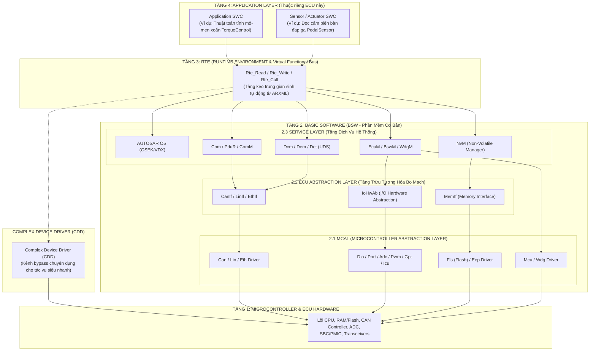
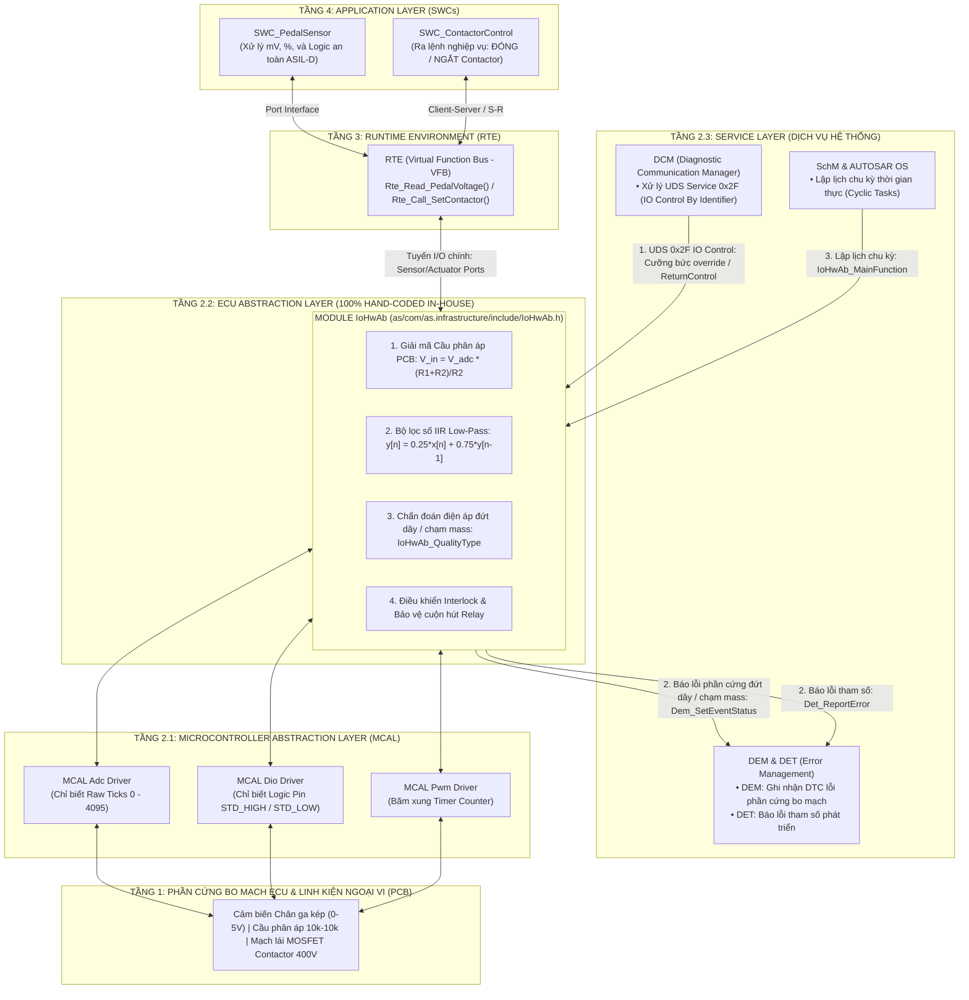
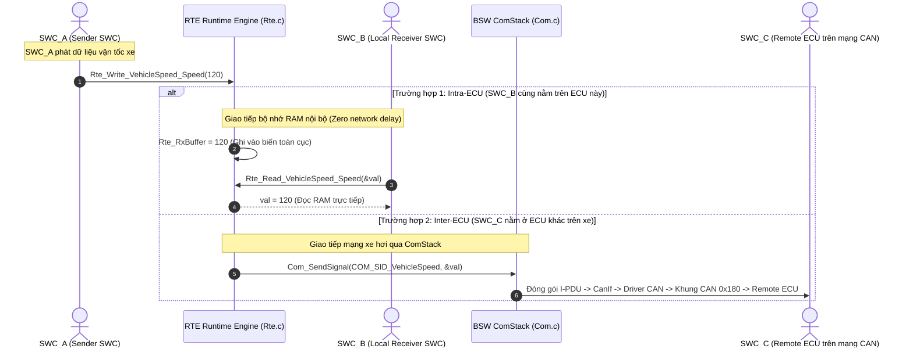

# Chuyên Đề 01: Kiến Trúc Phân Tầng Chuẩn Hóa & Triết Lý Virtual Functional Bus (VFB)
## Masterclass Phân Tích Kiến Trúc AUTOSAR Classic, 4 Tầng BSW, Cơ Chế Trừu Tượng Hóa RTE và Cấu Trúc Software Component (SWC)

> **Ngôn ngữ:** Tiếng Việt Kỹ Nghệ Chuẩn Mực  
> **Cấp độ:** Universal Learning Resource (Từ Newbie đến Expert)  
> **Tiêu chuẩn tham chiếu:** AUTOSAR Classic Platform Release 4.x / R22-11 (`AUTOSAR_EXP_LayeredSoftwareArchitecture`, `AUTOSAR_EXP_VFB`)  
> **Mã nguồn đối chiếu thực tế:** Kho mã nguồn [Study_AUTOSAR-main/as/](file:///C:/Users/liem.vu/Liem.vuOD/Study_AUTOSAR-main/as) (`com/as.infrastructure/`)  
> **Vị trí tài liệu:** [Study_AUTOSAR-main/docs/01_AUTOSAR_Layered_Architecture_And_VFB_Masterclass.md](file:///C:/Users/liem.vu/Liem.vuOD/## Mục Lục
1. [Bối Cảnh Lịch Sử & Động Lực Hình Thành Chuẩn AUTOSAR](#1)
2. [Mô Hình Kiến Trúc Phân Tầng Tổng Quan (Layered Architecture Overview)](#2)
3. [TẦNG 1: Phần Cứng Vi Điều Khiển & Bo Mạch ECU (Microcontroller & ECU Hardware Anatomy)](#3)
   - [3.0 Phân Biệt Rạch Ròi Bản Chất: ECU (Electronic Control Unit) vs MCU (Microcontroller Unit)](#30-phân-biệt-rạch-ròi-bản-chất-ecu-electronic-control-unit-vs-mcu-microcontroller-unit)
   - [3.1 Phân Rã Phần Cứng Trên Chip Vi Điều Khiển (MCU On-Chip Hardware)](#31-phân-rã-phần-cứng-trên-chip-vi-điều-khiển-mcu-on-chip-hardware)
   - [3.2 Phân Rã Phần Cứng Gắn Ngoài Trên Bo Mạch (Off-Chip Hardware on ECU Board)](#32-phân-rã-phần-cứng-gắn-ngoài-trên-bo-mạch-off-chip-hardware-on-ecu-board)
   - [3.3 Bảng Ánh Xạ Phần Cứng Thực Tế ──► Module Phần Mềm AUTOSAR](#33-bảng-ánh-xạ-phần-cứng-thực-tế--module-phần-mềm-autosar)
   - [3.4 Cơ Chế Khởi Tạo Ngoại Vi: Vi Điều Khiển (MCU) vs Máy Tính (PC) & Bản Chất Của Bootloader](#34-cơ-chế-khởi-tạo-ngoại-vi-vi-điều-khiển-mcu-vs-máy-tính-pc--bản-chất-của-bootloader)
4. [TẦNG 2: Phần Mềm Cơ Bản (Basic Software - BSW)](#4)
   - [4.1 Phân Tầng 2.1: MCAL (Microcontroller Abstraction Layer - Tầng Trừu Tượng Hóa Vi Điều Khiển)](#41-phân-tầng-21-mcal-microcontroller-abstraction-layer---tầng-trừu-tượng-hóa-vi-điều-khiển)
   - [4.2 Phân Tầng 2.2: ECU Abstraction Layer (Trừu Tượng Hóa Bo Mạch ECU)](#42-phân-tầng-22-ecu-abstraction-layer-trừu-tượng-hóa-bo-mạch-ecu)
   - [4.3 Phân Tầng 2.3: Service Layer (Hệ Thống Dịch Vụ Cấp Cao)](#43-phân-tầng-23-service-layer-hệ-thống-dịch-vụ-cấp-cao)
   - [4.4 Kênh Bypass Đặc Biệt: Complex Device Drivers (CDD)](#44-kênh-bypass-đặc-biệt-complex-device-drivers-cdd)
5. [TẦNG 3: Môi Trường Thực Thi (Runtime Environment - RTE)](#5)
   - [5.1 Đơn Vị Phát Triển Trong Chuỗi Cung Ứng Ô Tô (Who Develops?)](#51-đơn-vị-phát-triển-trong-chuỗi-cung-ứng-ô-tô-who-develops)
   - [5.2 Ý Đồ Kiến Trúc & Lý Do Ra Đời (Architectural Intent / Why RTE exists?)](#52-ý-đồ-kiến-trúc--lý-do-ra-đời-architectural-intent--why-rte-exists)
   - [5.3 Bản Chất Kỹ Thuật (RTE Thực Chất Làm Những Thao Tác Gì?)](#53-bản-chất-kỹ-thuật-rte-thực-chất-làm-những-thao-tác-gì)
   - [5.4 Dẫn Chứng Thực Tế Từ Mã Nguồn Dự Án `as`](#54-dẫn-chứng-thực-tế-từ-mã-nguồn-dự-án-as)
6. [TẦNG 4: Tầng Ứng Dụng (Application Layer & Software Components - SWC)](#6)
   - [6.1 Đơn Vị Phát Triển Trong Chuỗi Cung Ứng Ô Tô (Who Develops?)](#61-đơn-vị-phát-triển-trong-chuỗi-cung-ứng-ô-tô-who-develops)
   - [6.2 Ý Đồ Kiến Trúc & Lý Do Ra Đời (Architectural Intent / Why Application Layer exists in this shape?)](#62-ý-đồ-kiến-trúc--lý-do-ra-đời-architectural-intent--why-application-layer-exists-in-this-shape)
   - [6.3 Bản Chất Kỹ Thuật (Bên Trong Một SWC Thực Chất Có Những Gì?)](#63-bản-chất-kỹ-thuật-bên-trong-một-swc-thực-chất-có-những-gì)
   - [6.4 Dẫn Chứng Thực Tế Từ Mã Nguồn Dự Án `as`](#64-dẫn-chứng-thực-tế-từ-mã-nguồn-dự-án-as)
   - [6.5 Phân Biệt Sâu Sắc: Biến Toàn Cục (Global Variables) vs Biến Nội Bộ IRV (Inter-Runnable Variables)](#65-phân-biệt-sâu-sắc-biến-toàn-cục-global-variables-vs-biến-nội-bộ-irv-inter-runnable-variables)
7. [Bảng So Sánh Toàn Diện AUTOSAR Classic vs AUTOSAR Adaptive Platform](#7)
8. [Câu Hỏi Phỏng Vấn (Interview Questions)](#8)
9. [BỨC TRANH TỔNG HỢP HOÀN CHỈNH: TRUY VẾT DÒNG CHẢY 1 TÍNH NĂNG XUYÊN SUỐT TOÀN BỘ 4 TẦNG AUTOSAR (End-to-End Master Capstone Walkthrough)](#9)
10. [Thực Tiễn Công Nghiệp: Quy Trình Phát Triển Phần Mềm Ô Tô Tại Hãng Xe (Case Study: VinFast)](#10)
    - [10.1 Bối Cảnh Thực Tế & Chiến Lược Của OEM Xe Điện (VinFast SDV Strategy)](#101-bối-cảnh-thực-tế--chiến-lược-của-oem-xe-điện-vinfast-sdv-strategy)
    - [10.2 Bóc Tách Thực Tế Theo Từng Tầng: Mua Gì? Cấu Hình Gì? Tự Viết Gì?](#102-bóc-tách-thực-tế-theo-từng-tầng-mua-gì-cấu-hình-gì-tự-viết-gì)
    - [10.3 Chu Trình Tích Hợp & Kiểm Thử Theo Mô Hình Chữ V (V-Model Integration Workflow)](#103-chu-trình-tích-hợp--kiểm-thử-theo-mô-hình-chữ-v-v-model-integration-workflow)
    - [10.4 Bảng Ma Trận Phân Định Trách Nhiệm Toàn Diện (The VinFast AUTOSAR Responsibility Matrix)](#104-bảng-ma-trận-phân-định-trách-nhiệm-toàn-diện-the-vinfast-autosar-responsibility-matrix)
    - [10.5 Giải Mã Nghịch Lý Kỹ Thuật: 70% Công Sức Phát Triển BSW Thực Chất Là Làm Gì?](#105-giải-mã-nghịch-lý-kỹ-thuật-70-công-sức-phát-triển-bsw-thực-chất-là-làm-gì)
    - [10.6 Phân Tích Thực Chiến Job Description (JD) BSW Tại VinFast: Bạn Sẽ Làm Gì Hàng Ngày & Chiến Lược Ứng Tuyển](#106-phân-tích-thực-chiến-job-description-jd-bsw-tại-vinfast-bạn-sẽ-làm-gì-hàng-ngày--chiến-lược-ứng-tuyển)

---

## 📖 Bảng Chú Giải Thuật Ngữ (Glossary)
> 📖 **AUTOSAR** (*AUTOmotive Open System ARchitecture*): Kiến trúc hệ thống mở cho ngành ô tô, tiêu chuẩn hóa phần mềm nhúng.  
> 📖 **VFB** (*Virtual Functional Bus*): Bus chức năng ảo, cơ chế giao tiếp không phụ thuộc phần cứng ở mức thiết kế hệ thống toàn xe.  
> 📖 **RTE** (*Runtime Environment*): Môi trường thực thi, tầng phần mềm trung gian được sinh tự động trên từng hộp ECU.  
> 📖 **SWC** (*Software Component*): Thành phần phần mềm ứng dụng, chứa thuật toán điều khiển độc lập.  
> 📖 **BSW** (*Basic Software*): Phần mềm cơ bản, cung cấp các dịch vụ nền tảng (OS, mạng, bộ nhớ, chẩn đoán).  
> 📖 **MCAL** (*Microcontroller Abstraction Layer*): Tầng trừu tượng hóa vi điều khiển, giao tiếp trực tiếp với thanh ghi chip.  
> 📖 **ECU** (*Electronic Control Unit*): Hộp điều khiển điện tử trên xe, đóng vai trò một thiết bị hoàn chỉnh (gồm vỏ nhôm IP67, nguồn, transceiver, mạch công suất và MCU bên trong).  
> 📖 **MCU** (*Microcontroller Unit*): Vi điều khiển, con chip bán dẫn tích hợp CPU, RAM, Flash và ngoại vi logic — đóng vai trò trái tim/bộ não điều khiển bên trong hộp ECU.  
> 📖 **OEM** (*Original Equipment Manufacturer*): Nhà sản xuất xe gốc (Ví dụ: VinFast, Toyota, BMW).  
> 📖 **CDD** (*Complex Device Driver*): Trình điều khiển thiết bị phức tạp (Kênh bypass).  
> 📖 **PDU** (*Protocol Data Unit*): Đơn vị dữ liệu giao thức mạng.  
> 📖 **DBC** (*CAN DataBase*): Định dạng file mô tả cấu trúc mạng CAN (ID, Signals, Factor, Offset) dùng làm từ điển giải mã tín hiệu trong các công cụ như CANoe, SavvyCAN (Xem chi tiết tại [10_CAN_DBC_Format_And_Tools.md](10_CAN_DBC_Format_And_Tools.md)).

---

<a id="1"></a>
## 1. Bối Cảnh Lịch Sử & Động Lực Hình Thành Chuẩn AUTOSAR


**1.1 Vấn Nạn Phầm Mềm Đóng Trước Năm 2003 (Pre-AUTOSAR Era)**
Trước năm 2003, mỗi OEM và các nhà cung cấp Tier-1 tự phát triển kiến trúc phần mềm vi điều khiển độc quyền riêng biệt (*Proprietary Spaghetti Code*):

```
+-------------------------------------------------------------+
|               TRƯỚC NĂM 2003 (PRE-AUTOSAR)                  |
|                                                             |
|  [Thuật Toán Điều Khiển Phanh ABS / Động Cơ]                |
|       │                                                     |
|       │ (Truy cập trực tiếp thanh ghi vi điều khiển)        |
|       ▼                                                     |
|  [Thanh Ghi Phần Cứng Chip Infineon TriCore / NXP S32K]     |
|                                                             |
|  👉 HỆ QUẢ:                                                 |
|  - Khóa chặt vào nhà cung cấp chip (Vendor Lock-in).        |
|  - Đổi vi điều khiển = Viết lại 100% phần mềm từ đầu.      |
|  - Không thể tái sử dụng (Zero Reusability) giữa các dự án. |
|  - Chi phí tích hợp ECU tăng theo hàm mũ khi xe có 100+ ECU.|
+-------------------------------------------------------------+
```

**1.2 Sự Ra Đời Của Liên Minh AUTOSAR (2003)**
Liên minh AUTOSAR được thành lập với mục tiêu cốt lõi: **"Hợp tác về tiêu chuẩn, cạnh tranh về giải pháp triển khai"** (*Cooperate on standards, compete on implementation*).

Mục tiêu kỹ thuật sống còn:
1. **Tách biệt hoàn toàn Phần Cứng và Phần Mềm (Hardware/Software Decoupling):** Phần mềm thuật toán ứng dụng (*Application SWC*) hoàn toàn độc lập với phần cứng.
2. **Chuẩn hóa giao diện phân tầng (Layered Standardized APIs):** Mọi module BSW đều có API cố định.
3. **Cấu hình tĩnh dựa trên Mô Hình Dữ Liệu (Model-Driven ARXML Configuration):** Toàn bộ bộ nhớ được sinh mã C tự động trước khi biên dịch (*Compile-time Determinism*).

✅ **Best Practice:** Tách biệt triệt để Logic ứng dụng và Giao tiếp phần cứng. Đổi chip = Chỉ thay MCAL, giữ nguyên SWC.

### NÂNG CAO
Mục tiêu cốt lõi của AUTOSAR là đạt được *Hardware/Software Decoupling* và *Compile-time Determinism*.
📊 **Data / Statistics:** Một chiếc xe hiện đại có >100 ECUs và >100 triệu dòng code. Nếu không có AUTOSAR, chi phí tích hợp phần mềm sẽ tăng theo hàm mũ $O(N^2)$. Việc kiểm thử toàn bộ hệ thống cũng gần như bất khả thi do sự phụ thuộc lẫn nhau quá lớn.
🔗 **External Link:** [AUTOSAR EXP Layered Software Architecture](https://www.autosar.org/fileadmin/standards/R22-11/CP/AUTOSAR_EXP_LayeredSoftwareArchitecture.pdf)

---

<a id="2"></a>
## 2. Mô Hình Kiến Trúc Phân Tầng Tổng Quan (Layered Architecture Overview)

> 🚨 **CẢNH BÁO PHÂN BIỆT RẠCH RÒI: GÓC NHÌN TOÀN XE (VFB) VS GÓC NHÌN 1 HỘP ECU VẬT LÝ**  
> * **Góc nhìn Toàn xe (VFB - Design Time):** Trên bản vẽ thiết kế toàn xe, tất cả các SWC của xe (ABS, Động cơ, Cửa, Điều hòa...) được nối với nhau qua bus ảo VFB. Ở bước này, ta chưa cần quan tâm SWC nào nằm ở ECU nào.  
> * **Góc nhìn 1 Hộp ECU (Firmware Cực Bộ - Runtime):** Một chiếc xe có từ 50-100 hộp ECU độc lập. Mỗi hộp ECU chạy một CPU riêng và nạp một file firmware riêng. **Tầng App của ECU nào chỉ chứa code SWC của riêng ECU đó**, tuyệt đối KHÔNG chứa và không đại diện cho code của các ECU khác!


AUTOSAR Classic Platform chia phần mềm nhúng của **MỘT hộp ECU cụ thể** (Ví dụ: Hộp điều khiển truyền động VCU) thành **4 tầng chính**:



### NÂNG CAO
* **Quy tắc phân tầng nghiêm ngặt (Strict Layering Rule):** Tầng trên chỉ được gọi trực tiếp xuống tầng dưới liền kề thông qua các API chuẩn hóa.
* ❌ **Cấm gọi ngược (No Upward Call):** Tầng dưới tuyệt đối không được gọi trực tiếp hàm của tầng trên mà bắt buộc phải sử dụng cơ chế **Callback** hoặc kích hoạt **RTE Event**.
* ❌ **Cấm vượt tầng (No Layer Skipping):** Không bao giờ cho phép SWC ở Tầng 4 gọi trực tiếp xuống MCAL (Tầng 2.1) hoặc chọc trực tiếp vào thanh ghi phần cứng (Tầng 1).

---

<a id="3"></a>
## 3. TẦNG 1: Phần Cứng Vi Điều Khiển & Bo Mạch ECU (Microcontroller & ECU Hardware Anatomy)


Một hộp ECU (*Electronic Control Unit*) trên ô tô là một bo mạch điện tử tích hợp (PCB) hoàn chỉnh gồm **2 thành phần phần cứng cốt lõi**: phần cứng tích hợp bên trong con chip (*MCU On-Chip*) và các linh kiện phần cứng gắn ngoài trên mạch in (*Off-Chip ICs*).

```
+─────────────────────────────────────────────────────────────────────────────────────────────+
│                           GIẢI PHẪU PHẦN CỨNG HỘP ECU Ô TÔ THỰC TẾ                          │
│                                                                                             │
│  ┌───────────────────────────── BO MẠCH ECU (ECU PCB) ──────────────────────────────────┐  │
│  │                                                                                      │  │
│  │  ┌─────────────────────── VI ĐIỀU KHIỂN CHÍNH (MCU ON-CHIP) ──────────────────────┐  │  │
│  │  │  [Lõi CPU (Cortex-M/R, TriCore)]   [Bộ Nhớ Nội (RAM, Program/Data Flash)]      │  │  │
│  │  │  [Bộ Ngắt (NVIC / IRQ)]            [Khối An Toàn (Lockstep, ECC, MPU, Wdg nội)]│  │  │
│  │  │  [Ngoại Vi Logic (CAN Controller, SPI, UART/LIN, ADC, Timers, DMA)]            │  │  │
│  │  └───────────────────────────────────┬────────────────────────────────────────────┘  │  │
│  │                                      │ (Giao tiếp Bus nội bộ PCB: SPI, I2C, GPIO)    │  │
│  │                                      ▼                                               │  │
│  │  ┌──────────────────── CÁC THÀNH PHẦN GẮN NGOÀI (OFF-CHIP ICs) ───────────────────┐  │  │
│  │  │ • Nguồn & Quản Lý Hệ Thống: PMIC / SBC (Cấp nguồn 5V/3.3V, Watchdog ngoài)     │  │  │
│  │  │ • Bộ Thu Phát Mạng: CAN Transceiver (TJA1043), LIN Trcv, Ethernet PHY         │  │  │
│  │  │ • Bộ Nhớ Ngoài: SPI EEPROM (25LCxxx), External QSPI Flash                      │  │  │
│  │  │ • Mạch Công Suất: Smart High/Low-Side Drivers, H-Bridge (Rơ-le, Solenoid, Motor) │  │
│  │  │ • Mạch Tiền Xử Lý Cảm Biến: Analog Front End (AFE - Pin BMS), Mạch Lọc RC, Op-Amp│ │
│  │  └───────────────────────────────────┬────────────────────────────────────────────┘  │  │
│  └──────────────────────────────────────┼───────────────────────────────────────────────┘  │
│                                         ▼ (Giắc cắm Connector & Bó dây Harness)            │
│                     [ MẠNG TRUYỀN THÔNG & CƠ CẤU CHẤP HÀNH TOÀN XE ]                        │
│                 (CAN/LIN Bus, Cảm Biến Bánh Xe, Van Thủy Lực, Rơ-le Cao Áp)                 │
+─────────────────────────────────────────────────────────────────────────────────────────────+
```

#### 3.0 Phân Biệt Rạch Ròi Bản Chất: ECU (Electronic Control Unit) vs MCU (Microcontroller Unit)

Trong kỹ nghệ ô tô, **ECU** và **MCU** là hai khái niệm nền tảng thường bị người mới bắt đầu hoặc lập trình viên chuyển ngành nhầm lẫn là một. Để làm chủ kiến trúc AUTOSAR, bạn cần phân định rạch ròi sự khác biệt từ cấp độ phần cứng bán dẫn đến cấp độ hệ thống đóng hộp hoàn chỉnh trên xe hơi:

* **MCU (Microcontroller Unit — Vi Điều Khiển):** Là **MỘT CON CHIP BÁN DẪN (IC)** đơn lẻ nằm trên bo mạch PCB. Nó tích hợp nhân xử lý (CPU Core), bộ nhớ (SRAM, Flash), và các khối logic ngoại vi (CAN, ADC, SPI, Timers). MCU đóng vai trò là **"Bộ não / Trái tim"**.
* **ECU (Electronic Control Unit — Hộp Điều Khiển Điện Tử):** Là **TOÀN BỘ MỘT HỘP THIẾT BỊ HOÀN CHỈNH (Box / Module)** lắp trên xe. Một hộp ECU bao gồm: Vỏ nhôm đúc tản nhiệt chống nước (IP67/IP69K), giắc cắm bó dây điện (Harness Connector), bo mạch in (PCB), mạch nguồn (PMIC/SBC) hạ áp từ ắc-quy 12V/24V, mạch bảo vệ quá áp/chống sét (TVS/EMC), mạch thu phát vật lý (CAN/LIN Transceiver), mạch công suất điều khiển cơ cấu chấp hành (MOSFET/H-Bridge), và **trái tim MCU nằm bên trong**. ECU đóng vai trò là **"Toàn bộ cơ thể hoàn chỉnh"**.

```
┌──────────────────────────────────────────────────────────────────────────────────────────────────┐
│                            HỘP ĐIỀU KHIỂN ĐIỆN TỬ ECU (Vỏ nhôm kín IP67/IP69K)                   │
│                                                                                                  │
│   ┌────────────────────────── BO MẠCH IN PCB BÊN TRONG ──────────────────────────┐               │
│   │                                                                               │   Giắc Cắm   │
│   │  ┌───────────────────────┐           ┌─────────────────────────────────────┐  │   Dây Điện   │
│   │  │  MẠCH NGUỒN (PMIC/SBC)│           │   MẠCH CÔNG SUẤT (ACTUATOR DRIVER)  │  │   (Harness)  │
│   │  │  Hạ áp 12V -> 5V/3.3V │           │   MOSFETs, Cầu H, Rơ-le kích van    │──┼──► [Bơm ABS] │
│   │  └──────────┬────────────┘           └──────────────────▲──────────────────┘  │              │
│   │             │                                           │                     │              │
│   │             ▼                                           │ (Chân PWM/GPIO)     │              │
│   │  ┌──────────────────────────────────────────────────────┴──────────────────┐  │              │
│   │  │                     VI ĐIỀU KHIỂN MCU (Chip Silicon)                    │  │              │
│   │  │  ┌───────────────┐ ┌───────────────┐ ┌────────────────┐ ┌────────────┐  │  │              │
│   │  │  │   CPU Core    │ │   SRAM / D-TCM│ │   Flash Memory │ │ Hardware   │  │  │              │
│   │  │  │ (ARM/TriCore) │ │ (Chứa biến tạm│ │ (Chứa Firmware)│ │ Peripherals│  │  │              │
│   │  │  └───────────────┘ └───────────────┘ └────────────────┘ │(CAN/ADC/SPI│  │  │              │
│   │  └───────────────────────────────────┬─────────────────────└────────────┘──┘  │              │
│   │                                      │                                        │              │
│   │                                      ▼ (Tín hiệu logic Tx/Rx)                 │              │
│   │  ┌─────────────────────────────────────────────────────────────────────────┐  │              │
│   │  │ MẠCH THU PHÁT VẬT LÝ (TRANSCEIVERS) & BẢO VỆ CHỐNG SỐC ĐIỆN (TVS/EMC)   │──┼──► [CAN Bus] │
│   │  └─────────────────────────────────────────────────────────────────────────┘  │              │
│   └───────────────────────────────────────────────────────────────────────────────┘              │
└──────────────────────────────────────────────────────────────────────────────────────────────────┘
```

##### 📊 Bảng So Sánh Đối Chiếu Toàn Diện ECU vs MCU (8 Tiêu Chí Kỹ Thuật):

| Tiêu Chí So Sánh | MCU (Microcontroller Unit) | ECU (Electronic Control Unit) |
| :--- | :--- | :--- |
| **Bản chất vật lý** | **Linh kiện bán dẫn / Chip IC** đơn lẻ hàn trên bo mạch. | **Hộp thiết bị điện tử cơ khí hoàn chỉnh** (Sub-system Box). |
| **Kích thước & Hình thái** | Một con chip vuông kích thước $10	ext{mm} 	imes 10	ext{mm}$ đến $30	ext{mm} 	imes 30	ext{mm}$. | Một hộp kim loại/nhựa kích thước bằng bàn tay hoặc quyển sách, nặng từ $300	ext{g}$ đến vài $	ext{kg}$. |
| **Mối quan hệ cấu thành** | Là **thành phần con (Linh kiện cốt lõi)** bên trong ECU. | Là **tổng thể chứa MCU** cùng hàng trăm linh kiện phụ trợ khác (nguồn, tụ, trở, FET). |
| **Nguồn & Dòng điện** | Điện áp thấp cố định: $1.2	ext{V}, 3.3	ext{V}, 5	ext{V}$ (Dòng tiêu thụ $< 1	ext{A}$). | Điện áp ắc-quy xe: $12	ext{V}$ (xe du lịch) hoặc $24	ext{V}$ (xe tải), chịu tải từ vài Ampe tới hàng trăm Ampe. |
| **Giao tiếp ngoại vi** | Tín hiệu số logic mức thấp (UART, SPI, CAN TX/RX, PWM 3.3V). | Tín hiệu vi sai truyền xa qua giắc cắm chuyên dụng chịu nước (CAN-H/CAN-L, LIN, Automotive Ethernet). |
| **Môi trường & Tiêu chuẩn** | Đạt chuẩn độ bền bán dẫn ô tô **AEC-Q100** (Grade 0/1, $-40^\circ	ext{C}$ đến $+150^\circ	ext{C}$). | Đạt chuẩn độ bền hộp xe hơi **ISO 16750**, chuẩn chống nước/bụi **IP67/IP69K**, chống rung xóc gầm xe. |
| **Số lượng chip** | Là một con chip vật lý duy nhất. | Có thể chứa **1 MCU** (ECU thông thường) hoặc **2-3 MCU** (ECU an toàn ASIL-D như Phanh ESP gồm Main MCU + Safety Watcher MCU). |
| **Chuỗi cung ứng & Nhà sản xuất** | Các tập đoàn sản xuất bán dẫn (**Silicon Vendors**): NXP, Infineon, STMicroelectronics, Renesas, Microchip. | Các tập đoàn sản xuất linh kiện ô tô cấp 1 (**Tier-1 Suppliers**): Bosch, Continental, Denso, LG VS, Hyundai Mobis, Aptiv. |

##### 🔗 Ánh Xạ Vào Kiến Trúc Phân Tầng AUTOSAR:
* **Tầng đại diện cho MCU:** Chính là tầng **MCAL (Microcontroller Abstraction Layer)**. Các module như [`Mcu`](file:///C:/Users/liem.vu/Liem.vuOD/Study_AUTOSAR-main/as/com/as.infrastructure/arch/stm32f1/mcal/Mcu.c), [`Port`](file:///C:/Users/liem.vu/Liem.vuOD/Study_AUTOSAR-main/as/com/as.infrastructure/arch/stm32f1/mcal/Port.c), [`Dio`](file:///C:/Users/liem.vu/Liem.vuOD/Study_AUTOSAR-main/as/com/as.infrastructure/arch/stm32f1/mcal/Dio.c), [`Can`](file:///C:/Users/liem.vu/Liem.vuOD/Study_AUTOSAR-main/as/com/as.infrastructure/arch/stm32f1/mcal/Can.c) do hãng chip (NXP/Infineon/ST) viết ra để điều khiển trực tiếp thanh ghi của con chip vi điều khiển đó.
* **Tầng đại diện cho ECU:** Chính là tầng **ECU Abstraction Layer** (`CanIf`, `IoHwAb`, `WdgIf`) và **ECU State Manager ([`EcuM`](file:///C:/Users/liem.vu/Liem.vuOD/Study_AUTOSAR-main/as/com/as.infrastructure/system/EcuM/EcuM.c))**. Chúng quản lý các linh kiện gắn ngoài trên bo mạch (Transceiver ngoài, chip nguồn SBC, IC mở rộng) và quản lý chu trình bật nguồn/ngủ sâu của **toàn bộ hộp ECU** khi tài xế bật/tắt chìa khóa xe (KL15).

---

#### 3.1 Phân Rã Phần Cứng Trên Chip Vi Điều Khiển (MCU On-Chip Hardware)
Đây là các khối mạch điện tích hợp bên trong con chip Silicon, chịu sự điều khiển trực tiếp của tầng **MCAL**:
1. **Lõi Xử Lý (CPU Cores):**
   * Các kiến trúc ô tô tiêu chuẩn: ARM Cortex-M4/M7 (STM32, NXP S32K), ARM Cortex-R52 (Safety Core), Infineon TriCore AURIX (TC2xx/TC3xx/TC4xx), Renesas RH850, NXP PowerPC (MPC56xx).
   * Tần số hoạt động: từ 80 MHz đến 400 MHz (được tối ưu hóa cho độ bền nhiệt và khả năng chống nhiễu điện từ EMC).
2. **Bộ Nhớ Tích Hợp (On-Chip Embedded Memories):**
   * **Program Flash (Flash ROM):** Lưu trữ mã nhị phân thực thi (.text section), bảng vector ngắt (.isr_vector) và hằng số tĩnh (.rodata).
   * **Data Flash (NVM Flash / DFlash):** Vùng Flash chuyên dụng giả lập EEPROM để lưu thông số căn chỉnh (Calibration) và mã lỗi DTC qua tầng `Fee`.
   * **SRAM Nội (Static RAM):** Lưu trữ ngăn xếp (Stack), các biến toàn cục và trạng thái runtime (.data, .bss).
3. **Khối Truyền Thông & Ngoại Vi Logic (On-Chip Peripherals):**
   * **CAN Controller (FlexCAN / MCAN Controller):** Xử lý khung truyền CAN ở mức logic, quản lý bộ đệm Mailbox, Message RAM, tự động kiểm tra CRC và Bit-stuffing.
   * **SPI / QSPI Master/Slave:** Bus truyền thông nối tiếp đồng bộ tốc độ cao (10–50 Mbps) điều khiển các IC phụ trên bo mạch.
   * **LIN / UART / FlexRay / Ethernet MAC Controller:** Bộ điều khiển các giao thức mạng ô tô tích hợp.
   * **ADC (Analog-to-Digital Converter):** Bộ chuyển đổi tương tự-số 12-bit / 16-bit đo điện áp cảm biến, giám sát nguồn cấp, nhiệt độ bo mạch.
   * **Timer & Pulse Modules (GPT, PWM, ICU):** Tạo xung điều khiển van, đo tần số xung cảm biến tốc độ bánh xe (Wheel Speed Sensor).
   * **DMA (Direct Memory Access):** Tự động đẩy dữ liệu giữa ngoại vi (CAN/SPI/ADC) và RAM mà không chiếm dụng chu kỳ CPU.
4. **Khối An Toàn & Bảo Mật Phần Cứng (Hardware Safety & Security):**
   * **Hardware Watchdog Nội:** Đếm ngược độc lập, tự động Reset MCU nếu CPU bị treo trong vòng lặp vô tận.
   * **MPU (Memory Protection Unit):** Phân vùng bộ nhớ RAM/Flash, cấm các SWC ứng dụng truy cập trái phép vào vùng nhớ nhạy cảm của nhân OS.
   * **Lockstep Core Architecture (ISO 26262 ASIL-D):** 2 lõi CPU chạy song song cùng một tập lệnh; mạch so sánh phần cứng (*Hardware Comparator*) phát hiện sai lệch bit do xung nhiễu trong vòng 1 chu kỳ clock.
   * **ECC (Error Correcting Code):** Tự động phát hiện và sửa lỗi 1-bit, phát hiện lỗi 2-bit trên toàn bộ Flash và RAM.
   * **HSM / SHE (Hardware Security Module):** Lõi mã hóa bảo mật phần cứng độc lập xử lý Secure Boot, xác thực khóa đối xứng AES, chống can thiệp Firmware.

#### 3.2 Phân Rã Phần Cứng Gắn Ngoài Trên Bo Mạch (Off-Chip Hardware on ECU Board)
Đây là các linh kiện điện tử nằm trên mạch in PCB bên ngoài MCU, chịu sự quản lý của tầng **ECU Abstraction Layer**:
1. **Nguồn & Chip Quản Lý Hệ Thống (SBC - System Basis Chip / PMIC):**
   * Linh kiện tiêu biểu: NXP UJA1169, Infineon TLE9263.
   * Chức năng: Hạ điện áp từ 12V/24V bình ắc quy xuống 5V/3.3V/1.2V cấp cho MCU; quản lý các trạng thái năng lượng (RUN, STANDBY, SLEEP) và tích hợp Watchdog ngoài độc lập.
2. **Bộ Thu Phát Tín Hiệu Vật Lý (Physical Layer Transceivers):**
   * **CAN Transceiver (VD: TJA1043, MCP2562):** Chuyển đổi mức logic Tx/Rx 3.3V từ MCU thành điện áp vi sai $V_{CANH} - V_{CANL}$ trên cặp dây xoắn của xe. Cung cấp tính năng đánh thức hộp qua mạng (Bus Wakeup).
   * **LIN Transceiver (VD: TJA1021):** Chuyển đổi logic 3.3V thành xung 12V trên 1 dây đơn.
   * **Automotive Ethernet PHY (VD: TJA1100, DP83TC811):** Chuyển đổi giao tiếp MII/RMII thành tín hiệu mạng 100BASE-T1 trên 1 cặp dây xoắn chống nhiễu.
3. **Bộ Nhớ Phi Bốc Hơi Gắn Ngoài (External Non-Volatile Memory):**
   * Chip EEPROM ngoài (VD: 25LC256, AT24C512) qua giao tiếp SPI/I2C: Dùng khi ứng dụng cần tần suất ghi xóa liên tục (>1.000.000 lần) mà Flash nội của MCU không đáp ứng nổi.
   * External QSPI Flash: Lưu trữ dữ liệu đồ họa màn hình hiển thị (Cluster/IVI) hoặc bộ nhớ đệm cập nhật phần mềm từ xa (OTA Buffer).
4. **Mạch Công Suất Điều Khiển Cơ Cấu Chấp Hành (Smart Power Drivers):**
   * **High-Side / Low-Side Switches (VD: PROFET BTS50085):** Đóng ngắt nguồn điều khiển đèn pha, cuộn hút rơ-le, van solenoid thủy lực; có mạch tự bảo vệ quá dòng, ngắn mạch và trả về chân phản hồi chẩn đoán.
   * **H-Bridge Motor Drivers (VD: TLE9201):** Mạch cầu H đảo chiều động cơ DC (gạt mưa, khóa cửa trung tâm, nâng hạ kính).
5. **Mạch Tiền Xử Lý Cảm Biến (Signal Conditioning & Analog Front End - AFE):**
   * Mạch lọc thông thấp (RC Filter) và Diode TVS dập xung sét/xung tĩnh điện ESD từ môi trường khoang động cơ.
   * Mạch khuếch đại thuật toán (Op-Amp) đo dòng điện Shunt cực nhỏ.
   * Chip AFE chuyên dụng (VD: LTC6811, BQ79616 trong hộp BMS): Đo trực tiếp điện áp từng cell pin Li-ion (độ chính xác cỡ 1mV) và gửi về MCU qua bus SPI cách ly.

#### 3.3 Bảng Ánh Xạ Phần Cứng Thực Tế $\leftrightarrow$ Module Phần Mềm AUTOSAR

| Linh Kiện Phần Cứng Thực Tế | Vị Trí Vật Lý | Module MCAL Điều Khiển (2.1) | Module ECU Abstraction (2.2) | Module Service / Ứng Dụng (2.3 - 4) |
| :--- | :--- | :--- | :--- | :--- |
| **Lõi CPU / Clock / Power Management** | On-Chip MCU | `Mcu` | — | `EcuM` (Quản lý chu trình khởi động/tắt máy) |
| **Khối CAN Controller** | On-Chip MCU | `Can` | `CanIf` | `PduR`, `Com`, `Dcm` |
| **Chip CAN Transceiver (TJA1043)** | Off-Chip PCB | `Dio` / `Spi` | `CanTrcv` | `CanSM`, `ComM` (Quản lý trạng thái mạng) |
| **Chân GPIO điều khiển Rơ-le** | On-Chip MCU | `Dio`, `Port` | `IoHwAb` | `SWC_ActuatorControl` |
| **Khối ADC đo cảm biến** | On-Chip MCU | `Adc` | `IoHwAb` | `SWC_SensorProcessing` |
| **Chip AFE đo Cell Pin (BMS)** | Off-Chip PCB | `Spi` | `CDD_AFE` | `SWC_BMS_CellMonitor` |
| **Data Flash nội bộ** | On-Chip MCU | `Fls` | `Fee`, `MemIf` | `NvM` (Lưu trữ cấu hình / SoC Pin) |
| **Chip EEPROM ngoài qua SPI** | Off-Chip PCB | `Spi` | `Eep`, `MemIf` | `NvM` (Lưu trữ cấu hình / SoC Pin) |
| **Watchdog nội MCU** | On-Chip MCU | `Wdg` | `WdgIf` | `WdgM` (Giám sát an toàn Alive/Deadline) |
| **Chip SBC / Watchdog ngoài** | Off-Chip PCB | `Dio` / `Spi` | `Wdg_Ext` | `WdgM` (Giám sát an toàn toàn hệ thống) |

---

#### 3.4 Cơ Chế Khởi Tạo Ngoại Vi: Vi Điều Khiển (MCU) vs Máy Tính (PC) & Bản Chất Của Bootloader

> 💡 **Câu hỏi kỹ nghệ kinh điển:**  
> *"Nếu nạp trực tiếp file `ascore` vào vi điều khiển mà không có Bootloader, làm sao các ngoại vi (CAN, GPIO, Clock, ADC) chạy được? Chẳng lẽ chỉ có CPU chạy?"*

##### 1. Khác biệt cốt lõi: Máy Tính (PC) vs Vi Điều Khiển Nhúng (MCU)
* **Trên máy tính cá nhân (PC):** Bắt buộc phải có **BIOS / UEFI** (firmware của bo mạch chủ) khởi tạo phần cứng (RAM, PCIe, Chipset), sau đó mới nạp hệ điều hành Windows/Linux vào RAM để chạy.
* **Trên vi điều khiển nhúng (MCU như STM32, NXP, AURIX):** **HOÀN TOÀN KHÔNG CÓ BIOS!** 
  Sau khi cấp nguồn (Power-On Reset), phần cứng CPU tự động đọc 2 giá trị đầu tiên tại địa chỉ `0x00000000`:
  1. `SP (Stack Pointer)`: Địa chỉ đỉnh RAM để làm ngăn xếp.
  2. `PC (Program Counter)`: Địa chỉ của hàm `reset_handler` trong mã nguồn C của bạn.
  => Toàn bộ mã nguồn cấu hình phần cứng sau đó đều do chính chương trình C của bạn tự thực hiện từ con số 0.

##### 2. Tầng MCAL là "BIOS Tự Viết" Nằm Trọn Trong `ascore`
Trong kiến trúc AUTOSAR, file ứng dụng `ascore` **tự chứa đầy đủ 100% mã nguồn khởi tạo phần cứng từ con số 0** thông qua tầng MCAL và module `EcuM`:

```c
/* ========================================================================= */
/* CHU TRÌNH TỰ KHỞI TẠO NGOẠI VI TỪ CON SỐ 0 TRONG ascore (EcuM_Init)       */
/* ========================================================================= */
void EcuM_Init(void) {
    /* 1. Tự kích hoạt thạch anh ngoài (HSE) và nhân xung nhịp CPU lên 72MHz */
    Mcu_Init(&Mcu_Config);
    Mcu_InitClock(McuClockSettingConfig_0);
    while(Mcu_GetPllStatus() != MCU_PLL_LOCKED); // Chờ thạch anh khóa tần số
    Mcu_DistributePllClock();

    /* 2. Cấp nguồn xung clock và cấu hình từng chân GPIO (Chân đèn, cảm biến) */
    Port_Init(&Port_Config);

    /* 3. Tự cấu hình bộ điều khiển mạng CAN (Baudrate 500kbps, Mailbox, Filter) */
    Can_Init(&Can_Config);

    /* 4. Cấu hình bộ đọc tương tự ADC (điện áp pin) và điều tốc xung PWM */
    Adc_Init(&Adc_Config);
    Pwm_Init(&Pwm_Config);

    /* 5. Cấu hình chip nhớ Flash / EEPROM Driver */
    Fee_Init();
    Fls_Init(&Fls_Config);

    /* 6. Khởi tạo xong 100% phần cứng ngoại vi -> Mới bật Hệ điều hành OS */
    StartOS(OSDEFAULTAPPMODE);
}
```
👉 `ascore` tự nuôi sống và cấu hình 100% ngoại vi mà không cần dựa dẫm vào Bootloader!

##### 3. Bản Chất Thực Sự Của Bootloader (`asboot`) Trong Ngành Ô Tô
Bootloader sinh ra **không phải để làm nền tảng nuôi ngoại vi cho Application**, mà chỉ có duy nhất 1 nhiệm vụ: **Cứu hộ và Nạp phần mềm qua cổng CAN (UDS Reprogramming Services 0x34/0x36)**.

```
┌────────────────────────────────────────────────────────────────────────┐
│  KHI XE ĐANG VẬN HÀNH TRÊN ĐƯỜNG:                                      │
│  • asboot chỉ chạy 5ms đầu để kiểm tra mã lỗi CRC.                     │
│  • Sau đó nó TẮT HẾT ngoại vi nó từng dùng (De-initialize) và trao     │
│    100% quyền điều khiển cho ascore tự khởi tạo từ đầu!                │
│                                                                        │
│  KHI XE VÀO GARA CẦN NÂNG CẤP FIRMWARE:                                │
│  • Thợ cắm máy chẩn đoán gửi lệnh UDS -> asboot giữ quyền điều khiển,  │
│    nhận dữ liệu hex từ cổng CAN và ghi đè vào Flash của ascore.        │
└────────────────────────────────────────────────────────────────────────┘
```

##### 4. Hai Chế Độ Nạp Trong Kỹ Nghệ Ô Tô:
* **Chế độ 1: Production Mode (Chuẩn xe thật - Dual Binary):**
  * `asboot` đặt tại `0x00000000` (64KB đầu) $\rightarrow$ `ascore` đặt tại `0x00010000` (192KB sau).
  * Hỗ trợ cập nhật phần mềm không dây OTA / qua cổng CAN.
* **Chế độ 2: Standalone / Development Mode (Chế độ phát triển & debug nhanh):**
  * Đặt `ascore` ngay tại gốc `0x00000000` (sửa `linker-app.lds`).
  * Nạp trực tiếp qua mạch nạp ST-Link/J-Link hoặc chạy trong QEMU: Board thật và máy ảo vẫn chạy đủ 100% ngoại vi (CAN, GPIO, ADC, Timer), giúp kỹ sư tập trung kiểm thử logic thuật toán mà không tốn thời gian kiểm tra CRC của Bootloader.

---

<a id="4"></a>
## 4. TẦNG 2: Phần Mềm Cơ Bản (Basic Software - BSW)


BSW được chia thành **3 phân tầng con chính** và **1 kênh bypass đặc biệt**:

```
┌─────────────────────────────────────────────────────────────────────────────────────────────────┐
│                                   TẦNG 2: BASIC SOFTWARE (BSW)                                  │
│                                                                                                 │
│  ┌───────────────────────────────────────────────────────────────────────────────────────────┐  │
│  │ 2.3 SERVICE LAYER (Hệ Thống Dịch Vụ Cấp Cao - 100% Độc Lập Phần Cứng)                     │  │
│  │ • Memory Stack: NvM (Quản lý khối nhớ, CRC, Ghi bất đồng bộ, Power-Loss Safe)             │  │
│  │ • ComStack: COM, PduR (Bóc tách Signal, E2E Protection, Deadline Monitoring)              │  │
│  │ • DiagStack: DCM, DEM (Máy trạng thái UDS ISO 14229, Debounce DTC, Freeze Frame)          │  │
│  │ • System Management: AUTOSAR OS (OSEK Preemptive, PCP), EcuM, BswM, WdgM                  │  │
│  └─────────────────────────────────────────────┬─────────────────────────────────────────────┘  │
│                                                │                                                │
│  ┌─────────────────────────────────────────────┴─────────────────────────────────────────────┐  │
│  │ 2.2 ECU ABSTRACTION LAYER (Trừu Tượng Hóa Bo Mạch - Phối Hợp Đa MCAL)                     │  │
│  │ • MemIf (Gộp Fls nội & Eep ngoài), CanIf/CanTrcv (Quản lý mạng & Sleep/Wakeup)            │  │
│  │ • IoHwAb (Gom Dio + Pwm + Adc thành API nghiệp vụ: IoHwAb_SetHeadlight, IoHwAb_GetVoltage)│  │
│  └─────────────────────────────────────────────┬─────────────────────────────────────────────┘  │
│                                                │                                                │
│  ┌─────────────────────────────────────────────┴─────────────────────────────────────────────┐  │
│  │ 2.1 MCAL (Microcontroller Abstraction Layer - Driver Hạt Nhân)                            │  │
│  │ • Mcu, Wdg, Gpt, Port, Dio, Adc, Pwm, Icu, Can, Lin, Eth, Spi, Fls                        │  │
│  │ • Trực tiếp chọc thanh ghi phần cứng vi điều khiển On-Chip                                │  │
│  └───────────────────────────────────────────────────────────────────────────────────────────┘  │
│                                                                                                 │
│  ┌───────────────────────────────────────────────────────────────────────────────────────────┐  │
│  │ [CDD] COMPLEX DEVICE DRIVERS (Kênh Bypass Cho Tác Vụ Thời Gian Thực Siêu Nhanh < 10us)     │  │
│  └───────────────────────────────────────────────────────────────────────────────────────────┘  │
└─────────────────────────────────────────────────────────────────────────────────────────────────┘
```

##### 4.1 Phân Tầng 2.1: MCAL (Microcontroller Abstraction Layer - Tầng Trừu Tượng Hóa Vi Điều Khiển)

##### 1. Đơn Vị Phát Triển Trong Chuỗi Cung Ứng Ô Tô (Who Develops?):
* **Chính các hãng sản xuất chip bán dẫn (Silicon Vendors):** Infineon, NXP Semiconductors, STMicroelectronics, Renesas Electronics, Texas Instruments, Microchip.
* **Quy chuẩn bàn giao:** Khi bán chip vi điều khiển ô tô (ví dụ MCU AURIX TC3xx, S32K3, STM32F107) cho các nhà cung cấp Tier-1, hãng chip bắt buộc phải cung cấp kèm theo gói phần mềm MCAL Driver tuân thủ $100\%$ tài liệu đặc tả chuẩn hóa AUTOSAR SWS (*Software Specification*) và đạt chứng chỉ An toàn chức năng **ISO 26262 ASIL-D**.

##### 2. Ý Đồ Kiến Trúc & Lý Do Ra Đời (Architectural Intent / Why this layer exists?):
* **Vấn nạn cốt lõi:** Mỗi dòng chip vi điều khiển trên thế giới có kiến trúc thanh ghi phần cứng (*Hardware Registers*) hoàn toàn khác nhau:
  * Ví dụ, để kéo một chân đầu ra GPIO lên mức cao (Logic `1`):
    * STM32 (ARM Cortex-M) ghi vào thanh ghi `BSRR`: `GPIOx->BSRR = (1 << pin);`
    * NXP S32K ghi vào thanh ghi `PSOR`: `PORT->PSOR = (1 << pin);`
    * Infineon TriCore AURIX ghi vào thanh ghi `OMR`: `P0_OMR.U = (1 << pin);`
* **Lý do không thể lược bỏ hoặc gộp:**
  * Nếu không có MCAL mà để các tầng trên chọc trực tiếp vào thanh ghi, toàn bộ phần mềm ô tô sẽ bị khóa chặt vĩnh viễn vào một hãng chip (**Vendor Lock-in**). Khi xảy ra đứt gãy chuỗi cung ứng chip hoặc khi muốn nâng cấp sang dòng chip mới mạnh hơn, doanh nghiệp sẽ phải đập đi viết lại $100\%$ code của toàn bộ chiếc xe.
  * MCAL sinh ra như một **"Lớp vỏ bọc quy chuẩn hóa hạt nhân"**, bao bọc toàn bộ sự dị biệt phần cứng của từng con chip thành các hàm C chuẩn mực có chữ ký hàm (*API Signature*) giống hệt nhau trên toàn thế giới: `Dio_WriteChannel()`, `Can_Write()`, `Adc_ReadGroup()`, `Mcu_Init()`. Nhờ đó, các tầng bên trên hoàn toàn không cần biết CPU bên dưới là ARM, TriCore, RH850 hay PowerPC.

##### 3. Bản Chất Kỹ Thuật (MCAL Thực Chất Làm Những Thao Tác Gì?):
* Trừu tượng hóa vi điều khiển ở tầng MCAL **không phải là khái niệm trừu tượng chung chung**, mà là tập hợp các thao tác vật lý cụ thể tại cấp độ thanh ghi Memory-Mapped I/O:
  1. **Thao tác con trỏ thanh ghi phần cứng:** Ép kiểu các địa chỉ bộ nhớ vật lý của chip thành con trỏ `volatile uint32*` và thực hiện các phép toán bitmask (`OR`, `AND`, `NOT`, `SHIFT`) để ghi cấu hình hoặc đọc trạng thái của các khối silicon nội bộ.
  2. **Khởi tạo và phân phối xung nhịp (Clock & Power Tree):** Module [`Mcu`](file:///C:/Users/liem.vu/Liem.vuOD/Study_AUTOSAR-main/as/com/as.infrastructure/arch/stm32f1/mcal/Mcu.c) bật bộ dao động thạch anh ngoài (HSE/OSC), cấu hình bộ nhân tần PLL, chờ khóa tần số (`PLL Locked`), và phân phối xung nhịp đến từng bus ngoại vi (AHB/APB).
  3. **Đa hợp chân vật lý (Pin Multiplexing / PinMux):** Module [`Port`](file:///C:/Users/liem.vu/Liem.vuOD/Study_AUTOSAR-main/as/com/as.infrastructure/arch/stm32f1/mcal/Port.c) định tuyến chân chip ra chức năng mong muốn (ví dụ: chân số 42 là GPIO thường hay chân CAN TX hay chân PWM).
  4. **Bắt và phục vụ ngắt phần cứng (Hardware ISR Handler):** Nhận ngắt từ khối NVIC/Vectored Interrupt Controller của chip, lưu ngữ cảnh, xóa cờ ngắt phần cứng (`Pending Flag`), đọc bộ đệm thanh ghi và chuyển thành lời gọi **Callback** chuẩn báo lên tầng trên.
* **4 Nhóm Driver MCAL chuẩn hóa:**
  * **Microcontroller Drivers:** `Mcu` (Clock/Reset), `Wdg` (Watchdog nội chip), `Gpt` (Hardware Timer định thời micro-giây).
  * **I/O Drivers:** `Port` (Cấu hình hướng chân/PinMux), `Dio` (Đọc/ghi logic chân GPIO), `Adc` (Lấy mẫu điện áp tương tự), `Pwm` (Băm xung), `Icu` (Input Capture đo tần số/độ rộng xung).
  * **Communication Drivers:** `Can`, `Lin`, `Eth`, `Spi`, `Fr` (FlexRay).
  * **Memory Drivers:** `Fls` (Flash Driver nội chip xóa/ghi theo từng Sector).

##### 4. Dẫn Chứng Thực Tế Từ Mã Nguồn Dự Án `as`:
Khảo sát trực tiếp driver CAN của dòng chip STM32F107 trong dự án: [`as/com/as.infrastructure/arch/stm32f1/mcal/Can.c`](file:///C:/Users/liem.vu/Liem.vuOD/Study_AUTOSAR-main/as/com/as.infrastructure/arch/stm32f1/mcal/Can.c#L741-L785):

* **Chiều 1 — API Cung Cấp Cho Tầng Trên (`CanIf` gọi xuống):**
  ```c
  Can_ReturnType Can_Write(Can_Arc_HTHType hth, Can_PduType *pduInfo);
  ```
  * `CanIf` truyền vào: Handle Mailbox truyền `hth` và con trỏ `pduInfo` chứa ID mạng, độ dài `length`, và con trỏ mảng byte dữ liệu `sdu`.
* **Chiều 2 — Tiêu Thụ Tài Nguyên Thanh Ghi Chip Bên Dưới:**
  Trong thân hàm `Can_Write()`, MCAL chuyển đổi cấu trúc chuẩn AUTOSAR sang cấu trúc thanh ghi phần cứng của STM32 CAN Controller (`CanTxMsg TxMessage`):
  ```c
  /* Nạp thông tin vào cấu trúc chuẩn bị bắn ra thanh ghi */
  TxMessage.DLC = pduInfo->length;
  memcpy(TxMessage.Data, pduInfo->sdu, pduInfo->length);
  if (hohObj->CanIdType == CAN_ID_TYPE_EXTENDED) {
      TxMessage.IDE = CAN_ID_EXT;
      TxMessage.ExtId = pduInfo->id;
  } else {
      TxMessage.IDE = CAN_ID_STD;
      TxMessage.StdId = pduInfo->id;
  }
  /* Ghi trực tiếp vào thanh ghi Hardware Mailbox của STM32 CAN Controller */
  if (CAN_Transmit(canHw, &TxMessage) != CAN_NO_MB) {
      /* Bật cờ ngắt phần cứng Tx Interrupt trên thanh ghi CAN_IER */
      CAN_ITConfig(canHw, CAN_IT_TME, ENABLE);
      canUnit->stats.txSuccessCnt++;
  }
  ```
  👉 **Kết luận:** MCAL giấu kín toàn bộ thanh ghi `CAN_TI0R`, `CAN_TDT0R`, `CAN_TDL0R`, `CAN_TDH0R` của STM32, chỉ phơi ra cho `CanIf` một hàm duy nhất là `Can_Write()`.

---

#### 4.2 Phân Tầng 2.2: ECU Abstraction Layer (Trừu Tượng Hóa Bo Mạch ECU)

##### 1. Đơn Vị Phát Triển Trong Chuỗi Cung Ứng Ô Tô (Who Develops?):
* **Các nhà cung cấp linh kiện ô tô cấp 1 (Tier-1 Suppliers):** Bosch, Continental, Denso, LG Electronics Vehicle Solutions (LG VS), Hyundai Mobis, Aptiv.
* **Lý do Tier-1 phải làm:** Chính Tier-1 là đơn vị trực tiếp vẽ sơ đồ nguyên lý mạch điện (*Schematic*), chọn mua linh kiện từ các nhà sản xuất khác nhau, và bố trí thiết kế bo mạch in PCB (*Printed Circuit Board*). Hãng chip (Silicon Vendor) hoàn toàn không biết Tier-1 sẽ hàn con chip gì ngoài bo mạch nên không thể viết tầng này!

##### 2. Ý Đồ Kiến Trúc & Lý Do Ra Đời (Architectural Intent / Why this layer exists?):
* **❓ Câu hỏi 1: Tại sao không gộp ECU Abstraction vào tầng MCAL bên dưới?**
  * *Trả lời:* MCAL là tài sản độc quyền của hãng chip bán dẫn, chỉ quản lý những gì nằm **bên trong con chip silicon**. Trong khi đó, trên một bo mạch ECU thật, có hàng trăm linh kiện điện tử phụ nằm **bên ngoài chip MCU** do các hãng khác nhau sản xuất (ví dụ: MCU của STMicroelectronics, nhưng chip thu phát CAN Transceiver là của NXP, chip nguồn PMIC của Infineon, IC mở rộng GPIO của Texas Instruments). Hãng ST không bao giờ và không thể viết driver cho chip của NXP hay Infineon.
* **❓ Câu hỏi 2: Tại sao không gộp ECU Abstraction lên tầng Service Layer bên trên?**
  * *Trả lời:* Service Layer (như `COM`, `NvM`, `DCM`) có sứ mệnh sống còn là **100% Độc Lập Với Phần Cứng (Hardware-Independent)** để có thể tái sử dụng nguyên vẹn trên mọi loại xe. Nếu ta nhét code đọc chân vi điều khiển cụ thể, code kéo chân Chip Select của một bo mạch cụ thể vào Service Layer, tính độc lập đó sẽ bị phá hủy hoàn toàn.
* **❓ Câu hỏi 3: Tại sao 1 linh kiện gắn ngoài trên PCB thường cần từ 2 đến 4 driver MCAL để điều khiển?**
  * *Bản chất vật lý của bo mạch PCB:* Một linh kiện phụ gắn ngoài trên bo mạch (*Off-Chip IC*) không bao giờ vận hành chỉ với 1 đường dây tín hiệu đơn lẻ. Nó đòi hỏi sự phối hợp đồng bộ của **2 đến 4 driver MCAL khác nhau**:
    1. **Đường điều khiển nguồn & chế độ hoạt động (Control/State):** Dùng MCAL `Dio` (kéo chân Reset, Enable, Chip Select `CS`, Standby `STB`).
    2. **Đường truyền dữ liệu nghiệp vụ (Data Payload):** Dùng MCAL `Spi`, `I2c`, hoặc `Uart`.
    3. **Đường bắt sự kiện khẩn cấp (Interrupt/Event):** Dùng MCAL `Icu` hoặc ngắt ngoài `Dio` để bắt tín hiệu cảnh báo lỗi quá nhiệt, ngắn mạch hoặc sự kiện đánh thức (`Wakeup`).
    4. **Đường phản hồi tương tự (Analog Feedback):** Dùng MCAL `Adc` để đo dòng điện tiêu thụ, sụt áp hoặc nhiệt độ thực tế của IC.
  * 👉 **Ý đồ kiến trúc:** Nếu không có tầng ECU Abstraction, tầng trên sẽ phải tự kéo chân `CS`, tự bắn SPI, tự cấu hình ADC $\implies$ Code ứng dụng sẽ bị bẩn, rối rắm và phụ thuộc hoàn toàn vào phần cứng bo mạch. ECU Abstraction sinh ra để gom tất cả các driver MCAL rời rạc đó lại thành 1 API dịch vụ duy nhất!

```
           [ TẦNG 2.2: ECU ABSTRACTION (Module IoHwAb / MemIf / CanIf) ]
                                          │
        ┌─────────────────────────────────┼────────────────────────────────┐
        ▼                                 ▼                                ▼
[ MCAL Dio Driver ]               [ MCAL Spi Driver ]              [ MCAL Adc / Icu ]
(Kéo chân Chip Select / Enable)   (Truyền nhận dữ liệu Payload)    (Đo dòng phản hồi / Bắt ngắt Wakeup)
        │                                 │                                │
        └─────────────────────────────────┼────────────────────────────────┘
                                          ▼
                      [ LINH KIỆN GẮN NGOÀI TRÊN BO MẠCH PCB ]
                   (Transceiver, PMIC, External EEPROM, Smart FET)
```

##### 3. Bản Chất Kỹ Thuật (Trừu Tượng Hóa Bo Mạch Cụ Thể Là Làm Những Gì?):
* "Trừu tượng hóa bo mạch" được hiện thực hóa qua 3 nhiệm vụ kỹ thuật chuẩn mực:
  1. **Ánh Xạ Tín Hiệu Ngoại Vi Thành Đại Lượng Logic Nghiệp Vụ ([`IoHwAb`](file:///C:/Users/liem.vu/Liem.vuOD/Study_AUTOSAR-main/as/com/as.infrastructure/include/IoHwAb.h)):**
     * Bo mạch ECU có cảm biến nhiệt độ gắn ở góc mạch nối vào chân `PA1`, điện áp bàn đạp ga nối vào chân `PB0` qua mạch chia áp.
     * Thay vì bắt tầng trên gọi `Adc_ReadGroup()` và tự tính công thức điện áp $\to$ nhiệt độ, `IoHwAb` giấu kín toàn bộ sơ đồ mạch và công thức tính toán. Nó cung cấp cho tầng trên các hàm mang ý nghĩa kỹ thuật: `IoHwAb_GetPedalPosition(&percentage)` hoặc `IoHwAb_GetBoardTemperature(&tempC)`.
  2. **Trừu Tượng Hóa Bộ Nhớ Đa Thiết Bị ([`MemIf`](file:///C:/Users/liem.vu/Liem.vuOD/Study_AUTOSAR-main/as/com/as.infrastructure/memory/MemIf/MemIf.c)):**
     * Trên bo mạch, một số thông số được lưu trong Flash nội của MCU (qua `Fee` + `Fls`), trong khi các thông số khác cần lưu trên chip EEPROM ngoài qua bus SPI (qua `Ea` + `Eep` + `Spi`).
     * `MemIf` đóng vai trò là **"Bộ điều hợp thống nhất"**, gộp cả 2 nguồn nhớ vật lý thành một không gian logic duy nhất được đánh số theo `BlockNumber`. Tầng Service `NvM` chỉ cần gọi `MemIf_Write(DeviceIndex, BlockNumber, Buffer)` mà không cần quan tâm dữ liệu thực sự nằm ở đâu trên bo mạch!
  3. **Trừu Tượng Hóa Kênh Mạng & Quản Lý Trạng Thái ([`CanIf`](file:///C:/Users/liem.vu/Liem.vuOD/Study_AUTOSAR-main/as/com/as.infrastructure/communication/CanIf/CanIf.c)):**
     * Bo mạch có thể có nhiều kênh CAN vật lý (CAN1, CAN2) nối ra nhiều chip CAN Transceiver ngoài khác nhau.
     * `CanIf` gom CAN Controller (nội MCU) và CAN Transceiver (ngoài PCB) thành một thực thể quản lý duy nhất. Quản lý chế độ nguồn của mạng (`CANIF_CS_STARTED`, `CANIF_CS_SLEEP`) và định tuyến các gói tin L-PDU lên các module tầng trên (`PduR`, `CanTp`, `CanNm`).

##### 4. Dẫn Chứng Thực Tế Từ Mã Nguồn Dự Án `as`:

###### 🔹 Dẫn chứng 1 — Bộ Điều Hợp Bộ Nhớ Trong `MemIf.c`:
Khảo sát trực tiếp file [`as/com/as.infrastructure/memory/MemIf/MemIf.c`](file:///C:/Users/liem.vu/Liem.vuOD/Study_AUTOSAR-main/as/com/as.infrastructure/memory/MemIf/MemIf.c#L32-L51):

* **Chiều 1 — API Cung Cấp Cho Tầng Trên (`NvM` gọi xuống):**
  ```c
  Std_ReturnType MemIf_Read(uint8 DeviceIndex, uint16 BlockNumber, uint16 BlockOffset, uint8 *DataBufferPtr, uint16 Length);
  ```
* **Bản chất điều phối & Chiều 2 — Gọi xuống các driver phần cứng tương ứng:**
  ```c
  Std_ReturnType MemIf_Read(uint8 DeviceIndex, uint16 BlockNumber, uint16 BlockOffset, uint8 *DataBufferPtr, uint16 Length) {
  #ifdef USE_FEE
      /* Nếu dữ liệu nằm ở Flash nội của MCU -> Gọi module Flash EEPROM Emulation */
      if(FEE_INDEX == DeviceIndex) {
          return Fee_Read(BlockNumber, BlockOffset, DataBufferPtr, Length);
      }
      else
  #endif
  #ifdef USE_EA
      /* Nếu dữ liệu nằm ở chip EEPROM ngoài trên bo mạch PCB -> Gọi module EEPROM Abstraction */
      if(EA_INDEX == DeviceIndex) {
          return Ea_Read(BlockNumber, BlockOffset, DataBufferPtr, Length);
      }
      else
  #endif
      {
          return E_NOT_OK;
      }
  }
  ```
  👉 **Minh chứng rõ ràng:** Tầng `NvM` phía trên chỉ nhìn thấy một giao diện đọc duy nhất. `MemIf` tự động phân luồng dữ liệu xuống Flash nội chip hoặc chip EEPROM ngoài bo mạch tùy theo `DeviceIndex`.

###### 🔹 Dẫn chứng 2 — Định Tuyến Khung CAN Trong `CanIf.c`:
Khảo sát trực tiếp file [`as/com/as.infrastructure/communication/CanIf/CanIf.c`](file:///C:/Users/liem.vu/Liem.vuOD/Study_AUTOSAR-main/as/com/as.infrastructure/communication/CanIf/CanIf.c#L774-L823):

* **Chiều 1 — API Cung Cấp Cho Tầng Trên (`PduR` gọi xuống):**
  ```c
  Std_ReturnType CanIf_Transmit(PduIdType CanTxPduId, const PduInfoType *PduInfoPtr);
  ```
  * `PduR` chỉ truyền: Mã định danh logic `CanTxPduId` và con trỏ dữ liệu `PduInfoPtr`. `PduR` không hề biết CAN ID vật lý là gì, cũng không biết bo mạch đang dùng Mailbox phần cứng nào.
* **Bản chất xử lý trừu tượng hóa:**
  1. `CanIf` tra cứu cấu hình tĩnh: `txEntry = CanIf_FindTxPduEntry(CanTxPduId);` để lấy CAN ID thật (`txEntry->CanIfCanTxPduIdCanId`) và Mailbox phần cứng (`txEntry->CanIfCanTxPduHthRef`).
  2. Kiểm tra trạng thái nguồn của kênh mạng bo mạch: `CanIf_GetControllerMode(channel, &csMode);` (phải là `CANIF_CS_STARTED`).
* **Chiều 2 — Tiêu Thụ Tài Nguyên Tầng Dưới (Gọi xuống MCAL `Can.c`):**
  ```c
  rVal = Can_Write(txEntry->CanIfCanTxPduHthRef->CanIfHthIdSymRef, &canPdu);
  ```

###### 🔹 Dẫn chứng 3 — Bộ Trừu Tượng Hóa I/O Bo Mạch Trong `IoHwAb.h` & `IoHwAb_Types.h` (Deep-Dive Tầng Sâu):

Trong toàn bộ kiến trúc AUTOSAR BSW, **`IoHwAb` (I/O Hardware Abstraction)** là module **đặc biệt nhất và bắt buộc phải viết tay 100% (Hand-coded in-house)**. Các công cụ sinh mã tự động (như Vector DaVinci hay EB tresos) không thể tự sinh code cho `IoHwAb` vì không một công cụ nào có thể tự đoán được sơ đồ mạch điện tử PCB (Schematic) mà kỹ sư phần cứng vẽ ra!



> [!NOTE]
> #### ❓ Giải Đáp Kiến Trúc: Từ RTE Nhảy Xuống IoHwAb Không Qua Tầng Service Có Hợp Lý Không?
>
> **Khẳng định:** **HOÀN TOÀN HỢP LÝ VÀ ĐÚNG CHUẨN 100% THEO ĐẶC TẢ KIẾN TRÚC AUTOSAR CLASSIC!**
>
> 1. **Bản chất kiến trúc AUTOSAR (AUTOSAR EXP Layered Software Architecture):**
>    * Trong chuẩn AUTOSAR, **KHÔNG CÓ module nào tên là "I/O Service"** ở Service Layer đứng xen vào giữa RTE và `IoHwAb` cho các tác vụ đọc/ghi tín hiệu cảm biến hoặc điều khiển cơ cấu chấp hành thông thường.
>    * Khác với truyền thông mạng (cần `Com` và `PduR` để bóc tách byte, pack tín hiệu vào PDU) hay lưu trữ (cần `NvM` để quản lý RAM mirror, tính CRC), dữ liệu I/O gắn liền trực tiếp với sơ đồ mạch điện PCB của hộp ECU.
>    * Vì vậy, AUTOSAR quy định `IoHwAb` được mô hình hóa thành một **Sensor/Actuator Software Component** hoặc **ECU Abstraction Component**, mở trực tiếp các cổng giao tiếp chuẩn (Standardized AUTOSAR Ports: Client-Server hoặc Sender-Receiver) nối thẳng vào **RTE**.
>
> 2. **So sánh 3 tuyến dữ liệu chuẩn mực (The 3 Canonical Data Paths):**
>    * **Tuyến Truyền Thông (COM Path):** $\text{SWC} \longleftrightarrow \text{RTE} \longleftrightarrow \mathbf{Com / PduR \text{ (Service)}} \longleftrightarrow \text{CanIf} \longleftrightarrow \text{Can (MCAL)}$
>    * **Tuyến Lưu Trữ (Memory Path):** $\text{SWC} \longleftrightarrow \text{RTE} \longleftrightarrow \mathbf{NvM \text{ (Service)}} \longleftrightarrow \text{MemIf} \longleftrightarrow \text{Fee / Fls (MCAL)}$
>    * **Tuyến Ngoại Vi (I/O Path):** $\text{SWC} \longleftrightarrow \text{RTE} \longleftrightarrow \mathbf{IoHwAb \text{ (ECU Abstraction)}} \longleftrightarrow \text{Adc / Dio / Pwm (MCAL)}$  
>      *(Tuyến I/O bypass hoàn toàn Service Layer trong chu trình vận hành thời gian thực để triệt tiêu độ trễ trễ micro-giây).*
>
> 3. **Vậy Tầng Service (Service Layer) đóng vai trò gì liên quan đến `IoHwAb`?**  
>    Mặc dù không đứng giữa luồng dữ liệu chính, Tầng Service gắn kết chặt chẽ với `IoHwAb` qua **3 nhánh phối hợp ngang/chéo sống còn**:
>    * **Nhánh 1 — Chẩn đoán cưỡng bức UDS Service 0x2F (`Dcm` $\longrightarrow$ `IoHwAb`):**  
>      Khi kỹ sư cắm máy chẩn đoán Tester (OBD/UDS tool) vào xe và gửi bản tin ISO 14229 Service `0x2F` (*InputOutputControlByIdentifier*), module `Dcm` ở Service Layer sẽ gọi xuống `IoHwAb` để ép buộc phần cứng thực thi (như bật còi xe, kích mở rơ-le, khóa quạt tản nhiệt quay 100% để kiểm tra bo mạch).  
>      Dẫn chứng trực tiếp từ [`IoHwAb_Types.h`](file:///C:/Users/liem.vu/Liem.vuOD/Study_AUTOSAR-main/as/com/as.infrastructure/include/IoHwAb_Types.h#L43-L48):
>      ```c
>      /* ISO14229, IoControl (Dcm gọi xuống IoHwAb khi chạy dịch vụ UDS 0x2F) */
>      #define IOHWAB_RETURNCONTROLTOECU 0  /* Trả quyền điều khiển lại cho thuật toán SWC */
>      #define IOHWAB_RESETTODEFAULT     1  /* Reset I/O về trạng thái mặc định ban đầu */
>      #define IOHWAB_FREEZECURRENTSTATE 2  /* Đóng băng giá trị I/O ở trạng thái hiện thời */
>      #define IOHWAB_SHORTTERMADJUST    3  /* Ép I/O sang giá trị cưỡng bức tạm thời */
>      ```
>    * **Nhánh 2 — Ghi nhận lỗi phần cứng & Báo cáo sự cố (`IoHwAb` $\longrightarrow$ `Dem`, `Det`):**  
>      Khi `IoHwAb` lấy mẫu và phát hiện mạch điện bị đứt dây hoặc chập mass (`IOHWAB_ERR`), nó gọi trực tiếp `Dem_SetEventStatus()` của Service Layer để ghi nhận mã lỗi DTC và đóng băng dữ liệu Freeze Frame.  
>      Đồng thời, khi phát hiện lỗi tham số lập trình (sai Channel ID, sai dải Duty), `IoHwAb` báo cáo sang `Det` qua macro `IOHWAB_DET_REPORT_ERROR()` (trích [`IoHwAb.h`](file:///C:/Users/liem.vu/Liem.vuOD/Study_AUTOSAR-main/as/com/as.infrastructure/include/IoHwAb.h#L72-L75)).
>    * **Nhánh 3 — Lập lịch thời gian thực định kỳ (`SchM` / `AUTOSAR OS` $\longrightarrow$ `IoHwAb_MainFunction`):**  
>      Hệ điều hành `OS` và bộ điều phối BSW `SchM` thuộc Service Layer định kỳ kích hoạt hàm `IoHwAb_MainFunction()` (trích [`IoHwAb.h`](file:///C:/Users/liem.vu/Liem.vuOD/Study_AUTOSAR-main/as/com/as.infrastructure/include/IoHwAb.h#L105)) để thực hiện quét ADC liên tục, chạy bộ lọc số IIR và kiểm tra tính toàn vẹn phần cứng.

**Bảng So Sánh 3 Tầng: MCAL vs IoHwAb vs SWC:**
| Tiêu Chí Kỹ Thuật | MCAL (Drivers Cấp Thấp) | `IoHwAb` (Trừu Tượng Hóa Bo Mạch) | SWC (Thuật Toán Ứng Dụng) |
| :--- | :--- | :--- | :--- |
| **Giá trị dữ liệu xử lý** | Raw Ticks ($0 - 4095$), Pin High/Low | **Đại lượng vật lý thực tế:** $0 - 5000\text{ mV}$, $0 - 1000\text{ per mille}$, cờ chất lượng `Quality` | **Giá trị nghiệp vụ:** Vị trí chân ga $0 - 100\%$, Trạng thái xe PRND |
| **Mức độ hiểu biết phần cứng** | Chỉ hiểu thanh ghi vi điều khiển (Registers, DMA, Clock) | **Hiểu toàn bộ sơ đồ nguyên lý mạch PCB** (Điện trở cầu phân áp, thời gian nạp tụ, mạch kích relay) | **Hoàn toàn "mù" về phần cứng** (Không biết chip gì, bo mạch dùng chân nào) |
| **Khả năng tái sử dụng (Portability)**| Phụ thuộc 100% vào dòng chip (NXP / Infineon / ST) | **Phụ thuộc vào bo mạch PCB cụ thể** (Đổi bo mạch phải sửa code `IoHwAb`) | **Tái sử dụng 100% trên mọi dòng xe** (Độc lập tuyệt đối với phần cứng) |

---

##### 1. Giải Phẫu Cấu Trúc API & Struct Trực Tiếp Từ Mã Nguồn `as`:

Khảo sát trực tiếp tệp [`as/com/as.infrastructure/include/IoHwAb.h`](file:///C:/Users/liem.vu/Liem.vuOD/Study_AUTOSAR-main/as/com/as.infrastructure/include/IoHwAb.h) và [`IoHwAb_Types.h`](file:///C:/Users/liem.vu/Liem.vuOD/Study_AUTOSAR-main/as/com/as.infrastructure/include/IoHwAb_Types.h):

* **Các API chuẩn mực theo AUTOSAR SWS IoHwAb:**
  ```c
  /* Trích từ as/com/as.infrastructure/include/IoHwAb.h */
  #define IOHWAB_INIT_ID                      0x10  /* Khởi tạo module */
  #define IOHWAB_ANALOG_GET_ID                0x20  /* Đọc tín hiệu tương tự (ADC) */
  #define IOHWAB_DIGITAL_GET_ID               0x30  /* Đọc tín hiệu số (GPIO In) */
  #define IOHWAB_DIGITAL_SET_ID               0x31  /* Xuất tín hiệu số (GPIO Out) */
  #define IOHWAB_PWMDUTY_SET_ID               0x40  /* Điều khiển chu kỳ xung PWM */
  #define IOHWAB_PWMFREQUENCYANDDUTY_SET_ID   0x41  /* Đổi tần số và chu kỳ PWM */
  #define IOHWAB_CAPTURE_GET_ID               0x50  /* Đo độ rộng xung/tần số (ICU) */
  ```
* **Các kiểu dữ liệu chuẩn mực ([`IoHwAb_Types.h`](file:///C:/Users/liem.vu/Liem.vuOD/Study_AUTOSAR-main/as/com/as.infrastructure/include/IoHwAb_Types.h)):**
  ```c
  typedef uint8  IoHwAb_LevelType;         /* Mức logic: IOHWAB_LOW (0) / IOHWAB_HIGH (1) */
  typedef sint32 IoHwAb_AnalogValueType;   /* Giá trị Analog sau giải mã (mV, mA, 0.1°C) */
  typedef uint32 IoHwAb_DutyType;          /* Chu kỳ Duty: 0 đến 1000u (IOHWAB_DUTY_MAX = 1000 per mille) */

  /* Đánh giá chất lượng tín hiệu theo chuẩn chẩn đoán điện áp */
  typedef enum {
      IOHWAB_INIVAL,  /* Giá trị khởi tạo chưa sẵn sàng */
      IOHWAB_ERR,     /* Phát hiện lỗi điện tử (Chạm mass hoặc chạm nguồn) */
      IOHWAB_BAD,     /* Tín hiệu chập chờn vượt biên dung sai */
      IOHWAB_GOOD,    /* Tín hiệu hợp lệ, an toàn */
  } IoHwAb_QualityType;
  ```

---

##### 2. Ba Ví Dụ Thực Chiến Kinh Điển Kèm Mã Nguồn C Chi Tiết:

###### 📌 VÍ DỤ 1: Cảm Biến Bàn Đạp Ga Kép (VCU Dual Accelerator Pedal Sensor)
* **Bối cảnh thực tế trên xe điện (VinFast VCU):**  
  Cảm biến chân ga là linh kiện an toàn cấp độ cao nhất (**ASIL-D**). Cảm biến đưa về 2 đường điện áp độc lập ($0 - 5\text{V}$). Bo mạch ECU dùng chip MCU chạy điện áp $3.3\text{V}$, do đó trên PCB bố trí 2 mạch cầu phân áp ($R_1 = 10\,\text{k}\Omega, R_2 = 10\,\text{k}\Omega$) để hạ áp từ $5\text{V} \to 2.5\text{V}$ cấp vào chân vi điều khiển.
* **Mã nguồn C thực tế tầng `IoHwAb`:**
  ```c
  /* Tệp: as/com/as.infrastructure/system/IoHwAb/IoHwAb.c */
  #include "IoHwAb.h"
  #include "IoHwAb_Types.h"
  #include "Adc.h"

  static sint32 Filtered_Pedal_mV = 0;

  Std_ReturnType IoHwAb_Analog_Get(IoHwAb_SignalType Signal, IoHwAb_AnalogValueType *Value, IoHwAb_StatusType *Status) {
      if (Value == NULL || Status == NULL) return E_NOT_OK;

      if (Signal == IOHWAB_SIGNAL_PEDAL_MAIN) {
          /* 1. Gọi MCAL Adc đọc giá trị số thô (ADC 12-bit: 0 - 4095 Ticks) */
          Adc_ValueGroupType raw_ticks = Adc_ReadGroup_Channel(0);

          /* 2. Chuyển đổi sang điện áp tại chân MCU: V_adc = ticks * 3300mV / 4095 */
          sint32 v_mcu_mV = (sint32)((uint32)raw_ticks * 3300UL / 4095UL);

          /* 3. Áp dụng công thức cầu phân áp bo mạch: V_sensor = V_mcu * (R1 + R2) / R2 = V_mcu * 2 */
          sint32 v_sensor_mV = v_mcu_mV * 2;

          /* 4. Bộ lọc số thông thấp IIR (IIR Low-Pass Filter) triệt tiêu gai xung nhiễu điện từ EMC:
                y[n] = 0.20 * x[n] + 0.80 * y[n-1] */
          Filtered_Pedal_mV = (v_sensor_mV * 20 + Filtered_Pedal_mV * 80) / 100;
          *Value = Filtered_Pedal_mV;

          /* 5. Chẩn đoán điện tử tức thời (Electrical Diagnostic):
                Cảm biến chân ga chuẩn chỉ hoạt động trong dải 0.5V (500mV) đến 4.5V (4500mV).
                Nếu raw_ticks < 50 (~40mV) -> Đứt dây / Chạm mass (Short-to-GND).
                Nếu raw_ticks > 4000 (~3220mV) -> Chạm nguồn 5V (Short-to-VCC). */
          if (raw_ticks < 50 || raw_ticks > 4000) {
              Status->quality = IOHWAB_ERR;  /* Báo lỗi phần cứng khẩn cấp */
          } else {
              Status->quality = IOHWAB_GOOD; /* Tín hiệu sạch, hợp lệ */
          }
          return E_OK;
      }
      return E_NOT_OK;
  }
  ```
* **Tầng ứng dụng SWC tiêu thụ dữ liệu qua RTE:**
  ```c
  /* Tệp: as/com/as.application/swc/vcu/SWC_PedalSensor.c */
  void SWC_PedalSensor_Runnable_10ms(void) {
      IoHwAb_AnalogValueType pedal_mV;
      IoHwAb_StatusType status;

      /* SWC chỉ gọi hàm trừu tượng qua RTE, không biết gì về thanh ghi ADC hay điện trở 10k */
      if (IoHwAb_Analog_Get(IOHWAB_SIGNAL_PEDAL_MAIN, &pedal_mV, &status) == E_OK) {
          if (status.quality == IOHWAB_GOOD) {
              /* Quy đổi điện áp 500mV - 4500mV thành độ mở 0% - 100% */
              uint8 pedal_percent = (uint8)((pedal_mV - 500) * 100 / 4000);
              Rte_Write_PedalPosition_Percent(pedal_percent);
          } else {
              /* Lỗi phần cứng -> Cắt mô-men xoắn động cơ về 0 ngay lập tức để chống xe tự phóng đi! */
              Rte_Write_PedalPosition_Percent(0);
              Dem_SetEventStatus(DTC_PEDAL_SENSOR_CIRCUIT_FAIL, DEM_EVENT_STATUS_FAILED);
          }
      }
  }
  ```

---

###### 📌 VÍ DỤ 2: Kích Đóng Cắt Contactor Pin Cao Áp 400V (BMS High-Voltage Contactor)
* **Bối cảnh thực tế trên xe điện (VinFast BMS):**  
  Bộ pin $400\text{V}$ được nối với động cơ thông qua 3 Rơ-le công suất lớn (Contactor Chính Dương, Contactor Chính Âm, và Contactor Sạc Đệm Precharge). Ứng dụng SWC tuyệt đối **cấm không được gọi thẳng `Dio_WriteChannel()`** vì nếu đóng ngắt sai trình tự micro-giây sẽ làm nổ hồ quang điện phá hủy toàn bộ hệ thống!
* **Mã nguồn C thực tế tầng `IoHwAb`:**
  ```c
  /* Tệp: as/com/as.infrastructure/system/IoHwAb/IoHwAb_Relay.c */
  #include "IoHwAb.h"
  #include "Dio.h"

  /* Biến kiểm soát trạng thái liên động an toàn (Interlock Safety State) */
  static boolean HighVoltage_Interlock_Closed = TRUE;

  Std_ReturnType IoHwAb_Digital_Set(IoHwAb_SignalType Signal, IoHwAb_LevelType Level) {
      if (Signal == IOHWAB_SIGNAL_MAIN_CONTACTOR) {
          /* Kiểm tra điều kiện bảo vệ: Nếu nắp hộp pin bị mở (Interlock hở) -> CẤM ĐÓNG RELAY */
          if (Level == IOHWAB_HIGH && !HighVoltage_Interlock_Closed) {
              return E_NOT_OK; /* Từ chối kích hoạt vì lý do an toàn sống còn */
          }

          /* Kích chân GPIO qua MCAL Dio để điều khiển Transistor/MOSFET lái cuộn hút Relay */
          Dio_LevelType dio_level = (Level == IOHWAB_HIGH) ? STD_HIGH : STD_LOW;
          Dio_WriteChannel(DIO_PIN_CONTACTOR_POSITIVE, dio_level);
          return E_OK;
      }
      return E_NOT_OK;
  }
  ```

---

###### 📌 VÍ DỤ 3: Điều Khiển Xung PWM Quạt Làm Mát Biến Tần Inverter (Cooling Fan Control)
* **Bối cảnh thực tế:**  
  Module điều khiển nhiệt độ (Thermal Management SWC) tính toán nhiệt độ mô-tơ và phát lệnh: *"Hãy cho quạt chạy ở $65\%$ công suất"*. 
* **Mã nguồn C thực tế tầng `IoHwAb`:**
  ```c
  /* Tệp: as/com/as.infrastructure/system/IoHwAb/IoHwAb_Pwm.c */
  #include "IoHwAb.h"
  #include "Pwm.h"

  Std_ReturnType IoHwAb_PwmDuty_Set(IoHwAb_SignalType Signal, IoHwAb_DutyType Duty) {
      /* Kiểm tra thang đo phần nghìn chuẩn AUTOSAR: 0 đến 1000 (IOHWAB_DUTY_MAX) */
      if (Duty > IOHWAB_DUTY_MAX) {
          return E_NOT_OK;
      }

      if (Signal == IOHWAB_SIGNAL_COOLING_FAN) {
          /* Chuyển đổi Duty từ thang đo 0 - 1000 per mille sang giá trị thanh ghi MCAL PWM (0 - 0x8000) */
          uint16 mcal_pwm_ticks = (uint16)((uint32)Duty * 0x8000UL / 1000UL);

          /* Gọi driver MCAL PWM phần cứng băm xung Timer */
          Pwm_SetDutyCycle(PWM_CHANNEL_COOLING_FAN, mcal_pwm_ticks);
          return E_OK;
      }
      return E_NOT_OK;
  }
  ```

---

#### 4.3 Phân Tầng 2.3: Service Layer (Hệ Thống Dịch Vụ Cấp Cao)

##### 1. Đơn Vị Phát Triển Trong Chuỗi Cung Ứng Ô Tô (Who Develops?):
* **Các nhà cung cấp phần mềm công cụ BSW độc lập (Independent BSW Tool Vendors):** Vector Informatik (bộ phần mềm MICROSAR), ETAS (RTA-CAR), Elektrobit (EB tresos), hoặc cộng đồng mã nguồn mở ô tô tiêu chuẩn như Arctic Core / `parai/as`.
* **Mô hình cung cấp:** Được cung cấp dưới dạng các ngăn xếp mã nguồn C độc lập hoàn chỉnh (*Standardized C Stacks*) kết hợp với các bộ công cụ cấu hình ARXML đồ họa (Configurator GUI).

##### 2. Ý Đồ Kiến Trúc & Lý Do Ra Đời (Architectural Intent / Why this layer exists?):
* **❓ Câu hỏi cốt lõi: Tại sao không để tầng Application tự làm các việc như định thời OS, quản lý mạng CAN, hay tự ghi Flash?**
* **Lý do sinh tồn 1 — An toàn & Tính tiền định của hệ thống thời gian thực (Real-Time Determinism & Safety):**
  * Trên một chiếc xe đang chạy ở tốc độ cao, có hàng trăm tác vụ phần mềm diễn ra đồng thời: quét cảm biến va chạm mỗi 1ms, tính góc đánh lái mỗi 5ms, gửi dữ liệu lên cụm đồng hồ mỗi 50ms.
  * Nếu để từng kỹ sư ứng dụng tự tạo ngắt hoặc tự quản lý CPU, hệ thống sẽ ngay lập tức đối mặt với các lỗi chí mạng: **Deadlock (khóa chết lẫn nhau), Priority Inversion (đảo ngược quyền ưu tiên), Race Condition (tranh chấp dữ liệu), và Stack Overflow**.
  * AUTOSAR OS sinh ra với chuẩn OSEK/VDX, tích hợp cơ chế trần ưu tiên (*Priority Ceiling Protocol - PCP*) để triệt tiêu vĩnh viễn deadlock, đảm bảo các tác vụ an toàn khẩn cấp luôn luôn được ưu tiên chiếm quyền CPU đúng hạn định thời gian (*Deadline*).
* **Lý do sinh tồn 2 — Tuân thủ các tiêu chuẩn bắt buộc của ngành công nghiệp ô tô toàn cầu:**
  * Toàn bộ xe hơi xuất xưởng đều bắt buộc phải vượt qua các kỳ kiểm định chẩn đoán khí thải và chẩn đoán an toàn theo luật pháp quốc tế: **ISO 14229 (UDS)** và **ISO 15031 (OBD-II)**.
  * Service Layer tích hợp sẵn toàn bộ các máy trạng thái phức tạp này trong module `DCM` và `DEM`. Lập trình viên không phải tự code lại giao thức chẩn đoán từ đầu, tiết kiệm hàng triệu giờ kỹ sư và đảm bảo đạt chuẩn kiểm định.
* **Lý do sinh tồn 3 — Độc lập tuyệt đối với phần cứng (100% Hardware-Independent):**
  * Service Layer là tầng cao nhất của BSW. Mã nguồn của nó là **100% mã ANSI C thuần khiết**, không chứa bất kỳ câu lệnh phần cứng nào.
  * Do đó, toàn bộ ngăn xếp `COM`, `NvM`, `DCM`, `DEM` có thể bê nguyên xi sang chạy trên bất kỳ dòng vi điều khiển nào (từ chip 16-bit giá rẻ đến chip 32-bit đa lõi ASIL-D) mà không cần chỉnh sửa một dòng code nào!

##### 3. Bản Chất Kỹ Thuật (Nhiệm Vụ Cụ Thể Của 4 Ngăn Xếp Dịch Vụ Cốt Lõi):
1. **Ngăn Xếp Truyền Thông (Communication Stack — `COM`, `PduR`):**
   * *Nhiệm vụ cụ thể:* **Đóng gói / Bóc tách tín hiệu (Signal Packing & Unpacking)**. Khung truyền CAN chỉ là một mảng 8 byte vô nghĩa (`uint8 Data[8]`). `COM` có nhiệm vụ bóc tách các bit cụ thể (ví dụ: lấy từ Bit 12 đến Bit 23, nhân với hệ số `Factor = 0.1`, cộng `Offset = -40`) để tạo ra một biến C có ý nghĩa vật lý (`float Temperature = 85.5 °C`) cung cấp cho RTE và Application.
   * *Quản lý phát tin:* Hỗ trợ truyền chu kỳ (Periodic), truyền theo sự kiện (Triggered), truyền lặp lại (Direct/Repetition).
   * *Giám sát thời gian chết (Deadline Monitoring):* Nếu quá 500ms không nhận được bản tin định kỳ của hộp phanh ABS, tự động gửi cảnh báo sang DEM để báo lỗi mất kết nối mạng.
2. **Ngăn Xếp Bộ Nhớ (Memory Stack — `NvM`):**
   * *Nhiệm vụ cụ thể:* Quản lý các khối nhớ NVRAM an toàn chống mất điện đột ngột (**Power-Loss Safe Storage**).
   * *Tính toàn vẹn:* Tự động tính toán mã kiểm tra CRC (CRC16/CRC32) trước khi ghi. Khi nạp nguồn khởi động, tự động kiểm tra CRC; nếu dữ liệu Flash bị hỏng bit, tự động nạp lại giá trị mặc định từ ROM Default.
   * *Ghi bất đồng bộ (Asynchronous Queue):* Lưu yêu cầu ghi vào hàng đợi rồi trả về ngay cho ứng dụng, nhường CPU thực thi các tác vụ thời gian thực trong khi phần cứng Flash âm thầm ghi trong nền.
3. **Ngăn Xếp Chẩn Đoán (Diagnostic Stack — `DCM`, `DEM`):**
   * *`DCM` (Diagnostic Communication Manager):* Máy trạng thái ISO 14229 UDS: Quản lý phiên chẩn đoán (Diagnostic Session 0x10), kiểm soát bảo mật Seed & Key (SecurityAccess 0x27), đọc/ghi thông số xe DID (0x22 / 0x2E).
   * *`DEM` (Diagnostic Event Manager):* Quản lý bộ đếm lọc nhiễu lỗi (**Debounce Counter**: phải xuất hiện lỗi liên tiếp 10 lần mới xác nhận), chụp ảnh đóng băng trạng thái vận hành lúc xảy ra lỗi (**Freeze Frame Snapshot**: lưu vận tốc xe, điện áp ắc-quy, nhiệt độ dầu tại thời điểm lỗi), và điều khiển bật đèn báo lỗi Check Engine (MIL).
4. **Quản Lý Hệ Thống & Hệ Điều Hành (System Management — `AUTOSAR OS`, `EcuM`, `BswM`, `WdgM`):**
   * *`AUTOSAR OS`:* Bộ lập lịch đa nhiệm thời gian thực OSEK định trước (Preemptive RTOS).
   * *`EcuM / BswM`:* Quản lý chu trình sống 5 pha của xe: Khởi động (Start-up) $\rightarrow$ Vận hành (Run) $\rightarrow$ Hậu vận hành (Post-Run) $\rightarrow$ Ngủ sâu tiết kiệm điện (Go-Sleep / Low Power) $\rightarrow$ Đánh thức (Wake-up).
   * *`WdgM`:* Giám sát an toàn 3 cấp (Alive: kiểm tra tần suất chạy của Task; Deadline: kiểm tra thời gian hoàn thành tác vụ; Logical: kiểm tra luồng thực thi tuần tự của thuật toán).

##### 4. Dẫn Chứng Thực Tế Từ Mã Nguồn Dự Án `as`:
Khảo sát trực tiếp module COM trong file [`as/com/as.infrastructure/communication/Com/Com_Com.c`](file:///C:/Users/liem.vu/Liem.vuOD/Study_AUTOSAR-main/as/com/as.infrastructure/communication/Com/Com_Com.c#L39-L70):

* **Chiều 1 — API Cung Cấp Cho Tầng Trên (`RTE` gọi xuống):**
  ```c
  uint8 Com_SendSignal(Com_SignalIdType SignalId, const void *SignalDataPtr);
  ```
  * Tầng RTE chỉ cần truyền mã định danh tín hiệu logic `SignalId` và con trỏ biến giá trị cần gửi `SignalDataPtr`. RTE hoàn toàn không cần biết tín hiệu này sẽ được gửi qua CAN, LIN hay Ethernet!
* **Bản chất nghiệp vụ xử lý bóc tách & nhúng bit:**
  ```c
  uint8 Com_SendSignal(Com_SignalIdType SignalId, const void *SignalDataPtr) {
      /* 1. Tra cứu metadata của Signal từ bảng cấu hình tĩnh */
      const ComSignal_type * Signal = GET_Signal(SignalId);
      const ComIPdu_type *IPdu = GET_IPdu(Signal->ComIPduHandleId);
      Com_Arc_IPdu_type *Arc_IPdu = GET_ArcIPdu(Signal->ComIPduHandleId);

      /* 2. Nhúng dữ liệu Signal vào đúng vị trí bit trong buffer I-PDU */
      imask_t irq_state;
      Irq_Save(irq_state);
      Com_WriteSignalDataToPdu(Signal->ComHandleId, SignalDataPtr);

      /* 3. Đánh dấu bit cập nhật (Update Bit) nếu có cấu hình */
      if (Signal->ComSignalArcUseUpdateBit) {
          SETBIT(IPdu->ComIPduDataPtr, Signal->ComUpdateBitPosition);
      }

      /* 4. Nếu tín hiệu thuộc dạng Triggered -> Kích hoạt gửi ngay lập tức */
      if (Signal->ComTransferProperty == COM_TRIGGERED) {
          Arc_IPdu->Com_Arc_TxIPduTimers.ComTxIPduNumberOfRepetitionsLeft = 
              IPdu->ComTxIPdu.ComTxModeTrue.ComTxModeNumberOfRepetitions + 1;
      }
      Irq_Restore(irq_state);
      return E_OK;
  }
  ```
* **Chiều 2 — Tiêu Thụ Tài Nguyên Tầng Dưới (`PduR` gọi tiếp xuống):**
  Khi đến kỳ hạn phát tin (hoặc khi cờ Triggered bật), COM đóng gói toàn bộ mảng dữ liệu I-PDU và gọi xuống PDU Router:
  ```c
  PduR_ComTransmit(PduId, &PduInfo);
  ```
  Để `PduR` định tuyến gói tin I-PDU sang module `CanIf` của tầng ECU Abstraction bên dưới.

---

#### 4.4 Kênh Bypass Đặc Biệt: Complex Device Drivers (CDD)

```
┌────────────────────────────────────────────────────────────────────────────────────────┐
│              SƠ ĐỒ SO SÁNH LUỒNG TIÊU CHUẨN VS KÊNH BYPASS ĐẶC BIỆT (CDD)              │
├────────────────────────────────────────────────────────────────────────────────────────┤
│                                                                                        │
│   [ TẦNG 4: APPLICATION SWC ]                       [ TẦNG 4: APPLICATION SWC ]        │
│                │                                                 │                     │
│                ▼                                                 ▼                     │
│   [ TẦNG 3: RUNTIME ENVIRONMENT (RTE) ]             [ TẦNG 3: RUNTIME ENVIRONMENT ]    │
│                │                                                 │                     │
│                ▼                                                 ▼ (Rte_Call / Rte_Read│
│   [ TẦNG 2.3: BSW SERVICE LAYER ]                  ┌───────────────────────────────┐   │
│                │                                   │ 🚀 COMPLEX DEVICE DRIVER (CDD)│   │
│                ▼                                   │ • Bỏ qua BSW Service          │   │
│   [ TẦNG 2.2: ECU ABSTRACTION (IoHwAb) ]           │ • Bỏ qua IoHwAb               │   │
│                │                                   │ • Bỏ qua MCAL Driver          │   │
│                ▼                                   │ • Phản hồi siêu tốc < 10 µs   │   │
│   [ TẦNG 2.1: MCAL DRIVERS ]                       └───────────────┬───────────────┘   │
│                │                                                   │                   │
│   ═════════════╪═══════════════════════════════════════════════════╪════════════════   │
│                ▼                                                   ▼ (Thanh ghi thô)   │
│   [ TẦNG 1: NGOẠI VI MCU / BO MẠCH PCB ]            [ TẦNG 1: NGOẠI VI MCU / PCB ]     │
│       (Luồng Tiêu Chuẩn: Độ trễ ~ 1 - 5 ms)             (Luồng Bypass: Độ trễ < 10 µs) │
└────────────────────────────────────────────────────────────────────────────────────────┘
```

##### 4.4.1 Đơn Vị Phát Triển Trong Chuỗi Cung Ứng Ô Tô (Who Develops?):
* **Đội ngũ kỹ sư nhúng chuyên trách của Tier-1 hoặc OEM (In-House Embedded Software Team):** Tự tay thiết kế và lập trình riêng cho sản phẩm của mình. 
* Các bên thứ ba (hãng chip bán dẫn hoặc nhà cung cấp BSW như Vector, Elektrobit) **không bao giờ bán sẵn CDD**, vì CDD gắn liền với phần cứng độc quyền và bí quyết công nghệ riêng của từng dòng xe.

##### 4.4.2 Ý Đồ Kiến Trúc & Lý Do Ra Đời (Architectural Intent / Why CDD exists?):
* **❓ Câu hỏi cốt lõi: Tại sao một kiến trúc phân tầng chuẩn mực và nghiêm ngặt như AUTOSAR lại chủ động thiết kế một "Kênh Bypass / Cửa Hậu" (CDD) phá vỡ các quy tắc phân tầng?**
* **Lý do 1 — Giới hạn thời gian thực siêu khắt khe (Ultra-Low Latency $< 10\,\mu\text{s}$):**
  * Trong các ứng dụng điều khiển động lực học hiệu năng cao:
    * **Biến tần xe điện (EV Traction Inverter):** Thuật toán điều khiển véc-tơ không gian FOC (*Field Oriented Control*) băm xung PWM điều khiển cầu transistor MOSFET/IGBT ở tần số $20\,\text{kHz}$ (chu kỳ chỉ vỏn vẹn $50\,\mu\text{s}$). Thời gian trễ từ lúc đọc dòng điện đến lúc xuất xung bù phải nhỏ hơn $5\,\mu\text{s}$.
    * **Động cơ đốt trong (ICE):** Thời điểm kích hoạt tia lửa bugi hoặc kim phun nhiên liệu trực tiếp bắt buộc phải đồng bộ chính xác theo góc quay trục khuỷu vi sai (*Crankshaft Position*) với sai số thời gian $< 5\,\mu\text{s}$.
  * *Nếu bắt tín hiệu đi qua chuỗi phân tầng tiêu chuẩn:* `Application` $\rightarrow$ `RTE` $\rightarrow$ `IoHwAb` $\rightarrow$ `Pwm/Gpt MCAL`, độ trễ tích lũy từ các lời gọi hàm lồng nhau (*Call Overhead*), ép kiểu dữ liệu và chuyển ngữ cảnh CPU sẽ làm trễ nhịp kích xung. Hậu quả là biến tần bị nổ cầu công suất hoặc động cơ bị kích nổ sai thời điểm!
* **Lý do 2 — Ngoại vi phần cứng phi chuẩn (Non-Standardized Hardware):**
  * Nhiều cụm linh kiện chuyên biệt chưa hề có module tiêu chuẩn nào trong đặc tả AUTOSAR SWS (ví dụ: chip xử lý âm thanh DSP qua bus I2S, chip FPGA đồng xử lý thuật toán AI cho camera ADAS, chip đo điện áp cell pin cao áp chuyên dụng trong pack pin xe điện). CDD cho phép tích hợp các phần cứng này ngay lập tức mà không cần chờ hiệp hội AUTOSAR họp bàn và chuẩn hóa.

##### 4.4.3 Bản Chất Kỹ Thuật (Hai Đầu Giao Diện Của Kênh Bypass CDD):
CDD được cấp đặc quyền vượt tầng thông qua cơ chế hai đầu giao diện rõ ràng:
1. **Giao diện phía trên (Upper Interface — Hướng lên Tầng 3 RTE):**
   * Trong file ARXML, CDD được định nghĩa như một Software Component đặc biệt bằng thẻ `<COMPLEX-DEVICE-DRIVER-SW-COMPONENT-TYPE>`.
   * CDD cung cấp các Cổng giao tiếp chuẩn hóa (Ports) như Client-Server hoặc Sender-Receiver lên RTE.
   * Nhờ đó, **Application SWC ở Tầng 4 gọi vào CDD thông qua API chuẩn của RTE** (`Rte_Call_...()` hoặc `Rte_Read_...()`), hoàn toàn tuân thủ kiến trúc và không hề biết CDD đang đi đường tắt phía dưới.
2. **Giao diện phía dưới (Lower Interface — Hướng xuống Tầng 1 Phần cứng):**
   * CDD **được phép bỏ qua hoàn toàn MCAL và ECU Abstraction**.
   * CDD can thiệp trực tiếp vào thanh ghi phần cứng của CPU (Memory-Mapped I/O Registers), cấu hình DMA trực tiếp, hoặc gắn trực tiếp trình phục vụ ngắt (ISR) phần cứng để xử lý tức thời trong vài micro-giây.
3. **Giao diện bổ trợ (Side Interface — Hướng sang các dịch vụ BSW):**
   * Dù đi tắt đón đầu, CDD vẫn có thể sử dụng các dịch vụ chuẩn của BSW khi cần: ví dụ gọi `Dem_ReportErrorStatus()` để báo lỗi phần cứng hoặc gọi API của `Os` để bảo vệ vùng nhớ găng.

##### 4.4.4 Thực Tế Dự Án `as` & Cảnh Báo Kiến Trúc Trong Công Nghiệp:
* 📌 **Lưu ý đối chiếu mã nguồn dự án `as`:**
  * Trong toàn bộ kho mã nguồn nghiên cứu [`Study_AUTOSAR-main/as`](file:///C:/Users/liem.vu/Liem.vuOD/Study_AUTOSAR-main/as), tác giả **không triển khai module CDD**.
  * **Lý do:** Dự án `as` tập trung vào mô phỏng và nghiên cứu các cơ chế lõi của AUTOSAR trên các vi điều khiển tiêu chuẩn (STM32F107, LM3S6965, POSIX PC). Tất cả các bài toán trong dự án đều giải quyết trọn vẹn thông qua các ngoại vi chuẩn mực có sẵn của MCAL (`Dio.c`, `Can.c`, `Adc.c`, `Pwm.c`, `Spi.c`), không gắn với các linh kiện phi chuẩn hay cơ cấu chấp hành thời gian thực đặc thù.
* ⚠️ **Cảnh báo sống còn trong công nghiệp:** 
  * CDD là con dao hai lưỡi. Nếu lạm dụng CDD cho các tác vụ thông thường (như đọc nút bấm, bật đèn LED, nhận khung CAN thông thường), bạn sẽ phá vỡ toàn bộ cấu trúc phân tầng, làm mất khả năng tái sử dụng phần mềm và biến dự án trở lại thành mớ mã nguồn hỗn loạn ("Spaghetti Code") thời kỳ Pre-AUTOSAR.
  * 🛡️ **Quy tắc kiểm duyệt:** Trong các hãng xe lớn (VinFast, Bosch, Continental), kỹ sư **bắt buộc phải nộp văn bản giải trình kỹ thuật (Technical Justification)** chứng minh tính bất khả thi về mặt độ trễ ($< 10\,\mu\text{s}$) hoặc tính phi chuẩn của linh kiện thì Hội đồng Kiến trúc Hệ thống mới phê duyệt việc tạo module CDD!

---

### NÂNG CAO
💀 **Critical Bug / Pitfall:** Không bao giờ cho phép SWC ở Tầng 4 gọi trực tiếp xuống MCAL (Tầng 2.1). Việc này phá vỡ *Layering Architecture*. Nếu cần phản hồi siêu tốc hoặc ngoại vi đặc biệt, giải pháp duy nhất được AUTOSAR cho phép là bọc qua **CDD** và mở Port lên RTE.

🛠️ **Hands-On Exercise 1: Gọi API IoHwAb thay vì MCAL**
```c
uint16_t voltage_mv = 0;
// Gọi API của ECU Abstraction thay vì MCAL Adc_ReadGroup()
IoHwAb_GetVoltage(IoHwAbConf_Sensor_Temp, &voltage_mv);
if (voltage_mv > 3000) { 
    // Xử lý báo lỗi quá áp 
}
```

---

<a id="5"></a>
## 5. TẦNG 3: Môi Trường Thực Thi (Runtime Environment - RTE)

> 💡 **Phân tách rạch ròi kiến trúc:** VFB (*Virtual Functional Bus*) là mô hình thiết kế trừu tượng ở cấp độ toàn xe của OEM (Design-time, file XML toàn xe). Để tìm hiểu chuyên sâu về VFB, vui lòng tham khảo riêng tại [Chuyên Đề Bổ Trợ 06: Virtual Functional Bus (VFB) Deep Dive](../supplementary_knowledge/06_Virtual_Functional_Bus_VFB_Deep_Dive.md).  
> Chương này tập trung $100\%$ vào **TẦNG 3: RTE (Runtime Environment)** — mã nguồn C thực thi nội bộ trên từng hộp ECU cụ thể.

```
┌─────────────────────────────────────────────────────────────────────────────────────────────────┐
│                              TẦNG 3: RUNTIME ENVIRONMENT (RTE)                                  │
│                                                                                                 │
│  [ TẦNG 4: APPLICATION SWC ] (Chỉ gọi API quy chuẩn: Rte_Read, Rte_Write, Rte_Call, Rte_Mode)   │
│                  │                                                                              │
│  ════════════════╪════════════════════════════════════════════════════════════════════════════  │
│                  ▼                                                                              │
│  ┌───────────────────────────────────────────────────────────────────────────────────────────┐  │
│  │ 1. CỔNG GIAO TIẾP & ĐIỀU HƯỚNG DỮ LIỆU CỤC BỘ (LOCATION TRANSPARENCY)                     │  │
│  │ • Cùng ECU (Intra-ECU): Đọc/ghi trực tiếp vào biến toàn cục RAM (Zero CPU Network Overhead)│  │
│  │ • Khác ECU (Inter-ECU): Gọi xuống API ComStack: Com_SendSignal() / Com_ReceiveSignal()     │  │
│  ├───────────────────────────────────────────────────────────────────────────────────────────┤  │
│  │ 2. BẢO VỆ TOÀN VẸN ĐA NHIỆM & VÙNG GĂNG (CONCURRENCY & THREAD SAFETY)                     │  │
│  │ • Implicit Communication (Copy-in / Copy-out): Đảm bảo tính nhất quán nguyên tử (Atomic)  │  │
│  │ • Exclusive Areas: Bọc vùng găng bằng SuspendOSInterrupts() hoặc OS Resource Lock         │  │
│  ├───────────────────────────────────────────────────────────────────────────────────────────┤  │
│  │ 3. ÁNH XẠ SỰ KIỆN VÀO HÀM THỰC THI (EVENT-TO-RUNNABLE MAPPING)                            │  │
│  │ • Timing Event: OS Alarm nổ định kỳ (10ms) -> OS Task -> Kích hoạt Runnable của SWC       │  │
│  │ • Data Received Event: Nhận bản tin CAN -> Callback Com_COMCbk() -> Đánh thức Task       │  │
│  └───────────────────────────────────────────────────────────────────────────────────────────┘  │
│                  │                          │                              │                    │
│  ════════════════╪══════════════════════════╪══════════════════════════════╪══════════════════  │
│                  ▼                          ▼                              ▼                    │
│        [ BSW: ComStack / NvM ]     [ BSW: AUTOSAR OS ]           [ BSW: SchM / EcuM ]           │
└─────────────────────────────────────────────────────────────────────────────────────────────────┘
```

#### 5.1 Đơn Vị Phát Triển Trong Chuỗi Cung Ứng Ô Tô (Who Develops?):
* **Do bộ công cụ sinh mã RTE (RTE Generator) sinh tự động $100\%$ (Auto-Generated C Code):**
  * Vector Informatik (DaVinci Developer & DaVinci Configurator / RTE Generator).
  * ETAS (ISOLAR-A/B & RTA-RTE).
  * Elektrobit (EB tresos Studio & RTE Generator).
  * Nền tảng mã nguồn mở ArcCore / OpenSAR (`parai/as`): Script Python [`GenRte.py`](file:///C:/Users/liem.vu/Liem.vuOD/Study_AUTOSAR-main/as/com/as.tool/config.infrastructure.system/argen/GenRte.py).
* **Quy chuẩn bắt buộc:** Lập trình viên ứng dụng (App Engineer) và kỹ sư tích hợp BSW **tuyệt đối KHÔNG BAO GIỜ được viết tay hay sửa đổi thủ công** các file mã nguồn C của RTE (`Rte.c`, `Rte.h`, `Rte_Type.h`, `Rte_<SWC>.h`).
* **Dữ liệu đầu vào của RTE Generator:**
  1. `SwcDescription.arxml`: Khai báo các Runnable, các Port (PPort, RPort), kiểu dữ liệu (Data Types), và các sự kiện kích hoạt (Events).
  2. `EcuExtract.arxml`: Bản trích xuất kiến trúc hệ thống riêng cho hộp ECU đó, xác định SWC nào được nạp vào CPU này, Signal nào đi qua mạng CAN nào.

---

#### 5.2 Ý Đồ Kiến Trúc & Lý Do Ra Đời (Architectural Intent / Why RTE exists?):
* **❓ Câu hỏi cốt lõi: Tại sao AUTOSAR lại sinh ra tầng RTE mà không để Application SWC gọi thẳng xuống BSW hoặc để các SWC gọi trực tiếp hàm của nhau?**
* **Chuyện gì sẽ xảy ra nếu KHÔNG CÓ RTE? (4 Thảm Họa Kỹ Nghệ Ô Tô):**
  1. **Thảm họa 1 — Mất khả năng tái sử dụng (Zero Reusability) & Vendor Lock-in:**
     * *Nếu không có RTE:* SWC phải trực tiếp `#include "Com.h"`, `#include "Dio.h"`, `#include "Os.h"`. Khi chuyển sang dòng chip khác hoặc đổi nhà cung cấp BSW, toàn bộ mã nguồn thuật toán của xe bị vỡ hoàn toàn và phải viết lại từ đầu.
     * *Khi có RTE:* SWC không include bất kỳ file header BSW nào! SWC chỉ include duy nhất `Rte_<SWC>.h`. Thuật toán điều khiển trở thành **tài sản trí tuệ (IP) độc lập $100\%$**, có thể mang nạp lên xe tải, xe máy điện, hay xe hơi hạng sang mà không phải sửa 1 dòng code.
  2. **Thảm họa 2 — Phá vỡ tính độc lập vị trí (No Location Transparency):**
     * *Nếu không có RTE:* Khi `SWC_Pedal` muốn gửi giá trị chân ga cho `SWC_MotorControl`, lập trình viên phải biết chính xác hai SWC này nằm trên cùng một con chip CPU hay nằm ở hai hộp ECU khác nhau nối qua mạng CAN. Nếu ban đầu hai SWC nằm chung 1 ECU (gọi hàm trực tiếp), nhưng năm sau OEM quyết định tách ra 2 ECU khác nhau (phải gửi CAN), lập trình viên sẽ phải đập toàn bộ code SWC đi để viết lại bằng hàm gửi CAN!
     * *Khi có RTE:* SWC luôn chỉ gọi duy nhất một hàm: `Rte_Write_PedalPosition(val)`. Việc chuyển biến này qua RAM hay qua mạng CAN do RTE Generator tự động cấu hình và sinh mã.
  3. **Thảm họa 3 — Thảm họa tương tranh & Đua dữ liệu (Concurrency Hazards & Data Inconsistency):**
     * Trong hệ thống xe hơi, các thuật toán chạy trên các OS Task có độ ưu tiên khác nhau: Task phanh khẩn cấp 1ms có thể ngắt quãng Task điều hòa 100ms bất kỳ lúc nào. Nếu cả hai cùng đọc/ghi một biến toàn cục trên RAM mà không có cơ chế bảo vệ, biến dữ liệu sẽ bị "rách" (Data Torn / Race Condition), dẫn đến tính toán sai lệch gây tai nạn.
     * RTE tự động bọc vùng bảo vệ bằng **Exclusive Areas** hoặc cơ chế **Implicit Communication (Copy-in / Copy-out)** để đảm bảo an toàn đa nhiệm tuyệt đối.
  4. **Thảm họa 4 — Thiếu cơ chế kích hoạt sự kiện tiền định (Event Triggering):**
     * Tầng Application chỉ là các hàm C tính toán rời rạc (`void CruiseControl_Runnable(void)`). Nó không có khả năng tự biết khi nào Alarm 10ms của OS nổ để thức dậy, cũng không tự biết khi nào có gói tin CAN gửi tới.
     * RTE đóng vai trò là "Cầu nối kích hoạt": Lắng nghe các ngắt/sự kiện từ OS và ComStack để gọi đúng hàm Runnable của SWC đúng thời điểm.
* 👉 **Ý đồ kiến trúc:** RTE sinh ra đóng vai trò là **"Chất Keo Dán Vạn Năng" (Universal Architectural Glue)** phân khớp nối tuyệt đối ($100\%$ Decoupling) giữa Application và BSW.

---

#### 5.3 Bản Chất Kỹ Thuật (RTE Thực Chất Làm Những Thao Tác Gì?):
RTE hiện thực hóa sự trừu tượng hóa thông qua 4 cơ chế vận hành kỹ thuật chính xác:

##### 1. Cung Cấp Chuỗi API Chuẩn Hóa Theo Từng Loại Cổng (Port-Based APIs):
Tùy theo cấu hình cổng giao tiếp trong file ARXML, RTE sinh ra các hàm C có quy tắc đặt tên chuẩn mực:
* **Sender-Receiver (S/R) Interface:** Dành cho luồng dữ liệu một chiều (Data-Oriented) như vận tốc xe, điện áp pin, nhiệt độ:
  * Bên phát: `Rte_Write_<Port>_<DataName>(data)`
  * Bên thu: `Rte_Read_<Port>_<DataName>(&data)`
* **Client-Server (C/S) Interface:** Dành cho mô hình yêu cầu - phản hồi hai chiều (Operation-Oriented) như kích hoạt quy trình chẩn đoán, yêu cầu ghi bộ nhớ:
  * Gọi hàm dịch vụ: `Rte_Call_<Port>_<OperationName>(in_param, &out_param)`
  * Trả về kết quả: Thực thi trong Server Runnable.
* **Mode Switch Interface:** Thông báo chuyển đổi chế độ hệ thống (ví dụ: Chuyển từ `RUN` sang `POST_RUN` hoặc `SLEEP`):
  * Kiểm tra chế độ: `Rte_Mode_<Port>_<ModeGroup>()`
* **Parameter Interface:** Cung cấp các hằng số hiệu chuẩn (Calibration parameters) lưu trong Flash ROM:
  * Đọc hằng số: `Rte_CData_<ParameterName>()`

##### 2. Cơ Chế Điều Hướng Luồng Dữ Liệu Cục Bộ (Intra-ECU vs Inter-ECU Routing):


> [!NOTE]
> **Quy Ước Điều Hướng Của RTE Được Xác Định Từ Cấp Độ Toàn Xe (Design-time / VFB Level):**  
> Cần lưu ý rằng **tính điều hướng của RTE (cách gói tin được xử lý nội bộ bên trong RAM của ECU hay đẩy ra ngoài qua các giao thức mạng CAN, LIN, Ethernet...) được quy ước cố định $100\%$ khi phát triển toàn bộ hệ thống (Design-time)**, chứ hoàn toàn không phải do RTE tự động phán đoán lúc chương trình đang chạy (Runtime).  
> Cơ chế này được xác lập khi kiến trúc sư phân bổ các SWC lên từng hộp ECU cụ thể trong file mô tả hệ thống (System ARXML). RTE Generator sẽ sinh chết mã nguồn C (`Static Binding`): Nếu cùng ECU thì ghi thẳng vào biến RAM, nếu khác ECU thì gọi API `Com_SendSignal()` của ComStack.  
> Do mạng CAN là giao thức **hướng nội dung (Content-addressed / Broadcast)** thay vì hướng địa chỉ đối tượng, nên ngay khi RTE gọi `Com_SendSignal()`, **nhiệm vụ của RTE phía gửi đã chính thức kết thúc**. Việc khung CAN mang nội dung đó bay trên mạng, ai bắt được và bắt được thì xử lý như thế nào hoàn toàn do phần cứng và ngăn xếp BSW của các ECU liên quan trên toàn xe đảm trách.  
> 👉 *Xem phân tích chuyên sâu về triết lý thiết kế toàn xe và nguyên tắc Location Transparency tại:* [06_Virtual_Functional_Bus_VFB_Deep_Dive.md](../supplementary_knowledge/06_Virtual_Functional_Bus_VFB_Deep_Dive.md).

##### 3. Đảm Bảo An Toàn Đa Nhiệm & Vùng Găng (Concurrency & Thread Safety):
* **Explicit Communication (Truyền thông trực tiếp):** Gọi `Rte_Read()` / `Rte_Write()` lúc nào thì đọc/ghi biến lúc đó.
* **Implicit Communication (Cơ chế Copy-in / Copy-out):**
  * Khi Runnable bắt đầu chạy: RTE tạo một bản sao cục bộ (**Snapshot Copy-in**) của tất cả dữ liệu đầu vào.
  * Suốt quá trình tính toán, Runnable chỉ làm việc trên bản sao cục bộ này. Dù cho một Task ưu tiên cao hơn có chen ngang và cập nhật biến toàn cục, giá trị đang tính toán vẫn không bị thay đổi.
  * Khi Runnable hoàn tất: RTE mới sao chép toàn bộ kết quả đầu ra vào biến toàn cục (**Copy-out**).
  * 👉 **Đảm bảo tính nhất quán nguyên tử (Atomic Data Consistency)** cho các thuật toán an toàn ASIL-D.
* **Exclusive Areas (Vùng găng):**
  Khi một đoạn mã bắt buộc phải được bảo vệ chống tranh chấp, RTE bọc đoạn mã bằng API của OS:
  ```c
  Rte_Enter_ExclusiveArea_0(); /* SuspendOSInterrupts() hoặc GetResource(Res) */
  /* Vùng thao tác an toàn với dữ liệu nhạy cảm */
  Rte_Exit_ExclusiveArea_0();  /* ResumeOSInterrupts() hoặc ReleaseResource(Res) */
  ```

##### 4. Ánh Xạ Sự Kiện Vào Hàm Thực Thi (Event-to-Runnable Mapping):
* **Timing Event (Định thời):** Khi Alarm của OS đếm đủ chu kỳ $10\,\text{ms}$, OS chuyển Task sang trạng thái Ready $\rightarrow$ Task thực thi và gọi `Rte_Runnable()` $\rightarrow$ RTE gọi hàm C của SWC: `SWC_TorqueCoordinator_Runnable()`.
* **Data Received Event (Nhận dữ liệu):** Khi khung CAN đến, MCAL ngắt $\rightarrow$ `CanIf_RxIndication` $\rightarrow$ `Com_RxIndication` $\rightarrow$ Gọi hàm callback `Rte_COMCbk()` $\rightarrow$ RTE kích hoạt Task hoặc set Event để đánh thức Runnable xử lý dữ liệu.

---

#### 5.4 Dẫn Chứng Thực Tế Từ Mã Nguồn Dự Án `as`:

##### 🔹 Dẫn chứng 1 — Hiện Thực Hóa `Rte_Write` Trong `Rte_SwcTelltale.c`:
Khảo sát trực tiếp file [`as/com/as.application/swc/telltale/Rte_SwcTelltale.c`](file:///C:/Users/liem.vu/Liem.vuOD/Study_AUTOSAR-main/as/com/as.application/swc/telltale/Rte_SwcTelltale.c#L25-L35) và [L92-L102](file:///C:/Users/liem.vu/Liem.vuOD/Study_AUTOSAR-main/as/com/as.application/swc/telltale/Rte_SwcTelltale.c#L92-L102):

```c
/* Macro định nghĩa hàm Rte_Write chuẩn AUTOSAR cho từng loại đèn cảnh báo */
#define RTE_WRITE_PORT_FOR_TELLTALE(name)                                       \
    Std_ReturnType Rte_Write_Telltale_Telltale_##name##State(OnOff_T data)      \
    {                                                                           \
        Std_ReturnType ercd = E_NOT_OK;                                         \
        if(data < eTelltaleStatusMax)                                           \
        {                                                                       \
            TelltaleStatus[eTelltale##name] = data; /* Ghi trực tiếp buffer RAM */\
            ercd = E_OK;                                                        \
        }                                                                       \
        return ercd;                                                            \
    }

/* RTE sinh ra các hàm ghi trạng thái đèn TPMS, Áp suất dầu, Đèn pha... */
RTE_WRITE_PORT_FOR_TELLTALE(TPMS)
RTE_WRITE_PORT_FOR_TELLTALE(LowOil)
RTE_WRITE_PORT_FOR_TELLTALE(HighBeam)
```
* **Chiều 1 — API Cung Cấp Cho Tầng Trên (Application SWC gọi):**
  Application SWC gọi `Rte_Write_Telltale_Telltale_TPMSState(eTelltaleStatusOn)`.
* **Chiều 2 — Tiêu Thụ Tài Nguyên Tầng Dưới:**
  RTE lưu trạng thái vào mảng nội bộ `TelltaleStatus[]`. Sau đó, trong chu kỳ $5\,\text{ms}$ của `Swc_TelltaleManager()`, RTE gọi xuống driver MCAL [`Dio_WriteChannel()`](file:///C:/Users/liem.vu/Liem.vuOD/Study_AUTOSAR-main/as/com/as.infrastructure/arch/stm32f1/mcal/Dio.c) để điều khiển bóng đèn vật lý trên bo mạch:
  ```c
  for(i=0; i<eTelltaleMax; i++) {
      Dio_WriteChannel(TellatleChannel[i], TellatleLevel[TelltaleStatus[i]]);
  }
  ```

##### 🔹 Dẫn chứng 2 — Ánh Xạ OS Alarm/Task Vào Runnable Trong `rte_basic.c`:
Khảo sát trực tiếp file [`as/com/as.application/common/rte/rte_basic.c`](file:///C:/Users/liem.vu/Liem.vuOD/Study_AUTOSAR-main/as/com/as.application/common/rte/rte_basic.c#L40-L60):

```c
/* 1. Alarm của AUTOSAR OS nổ định kỳ mỗi 10ms -> Đánh thức Task */
ALARM(Alarm_Rte_Runnable)
{
    OsActivateTask(Rte_Runnable);
}

/* 2. OS Task thực thi -> RTE đứng ra phân phối gọi các Runnable của SWC */
TASK(Rte_Runnable)
{   /* Chu kỳ thực thi là 10ms */
#ifdef USE_RTE_SWC_TELLTALE
    timerTelltaleRun++;
    if(timerTelltaleRun >= 2) {
        Telltale_run();          /* Kích hoạt Runnable chu kỳ 20ms */
        timerTelltaleRun = 0;
    }
    Swc_TelltaleManager();       /* Kích hoạt Runnable chu kỳ 10ms */
#endif
#ifdef USE_RTE_SWC_GAUGE
    Gauge_Run();                 /* Kích hoạt Runnable của cụm đồng hồ công-tơ-mét */
#endif
    OsTerminateTask(Rte_Runnable);
}
```
👉 **Minh chứng rõ ràng:** Các Runnable của Application (`Telltale_run`, `Gauge_Run`) hoàn toàn không hề biết về nhân hệ điều hành `Os.h`. Chính RTE đứng ở giữa dùng `ALARM` và `TASK` của OS để điều phối và gọi tuần tự các Runnable theo đúng cam kết thời gian thực!

---

### NÂNG CAO
💀 **Critical Bug / Pitfall:** Không bao giờ bỏ qua giá trị trả về `Std_ReturnType` từ hàm `Rte_Read()`. 
Nếu một gói tin mạng CAN bị rớt trên đường truyền hoặc ECU gửi bị mất nguồn, dữ liệu trong bộ đệm nhận sẽ là dữ liệu cũ (Stale Data). Nếu không kiểm tra mã lỗi `RTE_E_TIMEOUT` hoặc `RTE_E_NEVER_RECEIVED`, thuật toán sẽ tiếp tục tính toán trên dữ liệu rác, gây ra nguy cơ mất an toàn nghiêm trọng cho xe!

```c
Std_ReturnType status;
uint16_t vehicle_speed = 0;

/* Đọc vận tốc xe qua RTE */
status = Rte_Read_RPort_VehicleSpeed_Speed(&vehicle_speed);

if (status == RTE_E_TIMEOUT) {
    /* ❌ MẤT TÍN HIỆU MẠNG: Kích hoạt trạng thái an toàn Fail-Safe */
    Trigger_LimpHomeMode();
} else if (status == RTE_E_OK) {
    /* ✅ DỮ LIỆU TƯƠI MỚI: Thực thi thuật toán bình thường */
    Control_Cruise_Algorithm(vehicle_speed);
}
```

🛠️ **Hands-On Exercise 2: Sử Dụng Client-Server Interface Qua RTE**
```c
Std_ReturnType ret;
uint8_t data_to_save[4] = {0x11, 0x22, 0x33, 0x44};

// Gọi qua RTE tới NvM (Synchronous Call)
ret = Rte_Call_RPort_NvMService_WriteBlock(data_to_save);
if (ret == E_OK) {
    // Ghi thành công
} else if (ret == E_NOT_OK) {
    // Lỗi ghi
} else if (ret == RTE_E_TIMEOUT) {
    // Quá hạn chờ dịch vụ BSW
}
```

---

<a id="6"></a>
## 6. TẦNG 4: Tầng Ứng Dụng (Application Layer & Software Components - SWC)

```
┌─────────────────────────────────────────────────────────────────────────────────────────────────┐
│                    TẦNG 4: APPLICATION LAYER & SOFTWARE COMPONENTS (SWC)                        │
│                                                                                                 │
│  ┌───────────────────────────┐  ┌───────────────────────────┐  ┌─────────────────────────────┐  │
│  │ APPLICATION SWC           │  │ SENSOR / ACTUATOR SWC     │  │ SERVICE SWC                 │  │
│  │ (Thuật toán nghiệp vụ)    │  │ (Cầu nối phần cứng ngoại vi)│ │ (Cầu nối dịch vụ BSW)       │  │
│  │ • BMS: SoC / SoH / Balanc.│  │ • PedalSensor -> IoHwAb   │  │ • Diagnostic Service SWC    │  │
│  │ • VCU: Torque Coordination│  │ • HeadlightActuator->IoHwAb│ │ • Memory Service SWC (NvM)   │  │
│  └─────────────┬─────────────┘  └─────────────┬─────────────┘  └──────────────┬──────────────┘  │
│                │ [PPort / RPort]              │ [PPort / RPort]               │ [PPort / RPort] │
│  ══════════════╪══════════════════════════════╪═══════════════════════════════╪═══════════════  │
│                ▼                              ▼                               ▼                 │
│  ┌───────────────────────────────────────────────────────────────────────────────────────────┐  │
│  │                      TẦNG 3: RUNTIME ENVIRONMENT (RTE - TẦNG BẢO VỆ)                      │  │
│  │     (Cung cấp API: Rte_Read, Rte_Write, Rte_Call, Rte_IrvRead, Rte_IrvWrite)              │  │
│  └───────────────────────────────────────────────────────────────────────────────────────────┘  │
└─────────────────────────────────────────────────────────────────────────────────────────────────┘
```

#### 6.1 Đơn Vị Phát Triển Trong Chuỗi Cung Ứng Ô Tô (Who Develops?):
* **Các Nhà sản xuất xe gốc (OEMs):** VinFast, Tesla, Toyota, BMW, Mercedes-Benz, Porsche.
* **Các Nhà cung cấp cấp 1 chuyên trách hệ thống điều khiển (Tier-1 System Specialists):** Bosch Powertrain, Continental Chassis, Denso Engine Management, LG Magna e-Powertrain.
* **Bản chất công việc:**
  * Tầng 4 là nơi tập trung **$100\%$ Tài Sản Trí Tuệ (Intellectual Property - IP) cốt lõi** và các thuật toán bí mật tạo nên sự khác biệt sống còn của thương hiệu xe:
    * Thuật toán ước lượng dung lượng pin còn lại (State of Charge - SoC) và độ chai pin (State of Health - SoH) trong hộp BMS.
    * Thuật toán phân phối mô-men xoắn giữa hai cầu (Torque Vectoring / All-Wheel Drive) trong hộp VCU.
    * Thuật toán phanh tái sinh năng lượng (Regenerative Braking).
    * Thuật toán nhận diện vật thể và phanh khẩn cấp tự động (ADAS AEB).
* **Quy trình phát triển hiện đại (Model-Based Design - MBD):**
  * Các kỹ sư thuật toán ô tô ngày nay hầu như **không lập trình code C thủ công từ con số 0**, mà họ thiết kế mô hình toán học giải thuật bằng khối đồ họa trong **MATLAB / Simulink** hoặc **dSPACE TargetLink**.
  * Sau khi kiểm thử thuật toán trên mô hình mô phỏng máy tính (Model-in-the-Loop - MiL), công cụ tự động sinh mã (**Embedded Coder**) sẽ tự động xuất ra mã nguồn C chuẩn mực tuân thủ tuyệt đối quy tắc MISRA-C và tiêu chuẩn an toàn ISO 26262 ASIL-D.
  * Mã nguồn C tự động sinh này được đóng gói gọn gàng thành các hàm Runnable của SWC (ví dụ `Swc_Telltale.c`, `Swc_BMS.c`).

---

#### 6.2 Ý Đồ Kiến Trúc & Lý Do Ra Đời (Architectural Intent / Why Application Layer exists in this shape?):
* **❓ Câu hỏi 1: Tại sao AUTOSAR lại ép buộc chia phần mềm ứng dụng thành các SWC đóng gói khép kín thay vì viết mã C tự do như lập trình nhúng truyền thống?**
  * *Vấn nạn thời kỳ Pre-AUTOSAR (Spaghetti Code):* Các file code thuật toán điều khiển bị trộn lẫn với mã đọc thanh ghi GPIO, gọi ngắt phần cứng, và chọc trực tiếp vào biến toàn cục của nhau. Hậu quả là mã nguồn trở thành một mớ bòng bong không thể kiểm thử riêng lẻ, và mỗi khi đổi phần cứng vi điều khiển thì toàn bộ thuật toán bị phá hủy.
  * *Ý đồ cứu rỗi của SWC:* AUTOSAR biến mỗi tính năng phần mềm thành một **"Hộp Đen Đóng Gói Hoàn Hảo" (Encapsulated Blackbox)**:
    1. **Cô lập dữ liệu tuyệt đối (Zero Global Variable Coupling):** Nghiêm cấm các SWC khác nhau đọc/ghi biến toàn cục của nhau. Mọi luồng dữ liệu vào/ra **bắt buộc** phải đi qua các Cổng giao tiếp quy chuẩn (Ports).
    2. **Độc lập phần cứng $100\%$ (Hardware Independence):** SWC không hề biết về thanh ghi, không biết về vi điều khiển, không biết về mạng CAN. Nó chỉ "nói chuyện" với RTE.
    3. **Hỗ trợ kiểm thử cô lập (Software-in-the-Loop - SiL):** Một SWC như `SWC_BMS_SoC` có thể được mang lên PC biên dịch và kiểm thử tự động hàng triệu kịch bản góc (Corner Cases) trước khi chiếc xe thật được sản xuất!
* **❓ Câu hỏi 2: Tại sao AUTOSAR lại phân chia thành 3 loại SWC cốt lõi (Application vs Sensor-Actuator vs Service SWC) mà không dùng 1 loại duy nhất?**
  * *Ý đồ phân định ranh giới rạch ròi giữa Thuật Toán vs Phần Cứng vs Dịch Vụ:*
    1. **Application SWC (Thuật toán thuần túy):** $100\%$ độc lập với phần cứng bo mạch và vị trí ECU. Ví dụ: Thuật toán tính quãng đường còn đi được (Distance to Empty) không dính líu gì đến chân cắm vật lý, có thể nạp vào ECU bất kỳ trên xe.
    2. **Sensor / Actuator SWC (Cầu nối phần cứng ngoại vi):** **KHÔNG ĐỘC LẬP VỊ TRÍ!** Loại SWC này **bắt buộc phải được ánh xạ vào đúng hộp ECU có chân cắm vật lý nối với cảm biến hoặc cơ cấu chấp hành** (ví dụ: hộp BCM có dây nối với đèn pha). Nhiệm vụ của nó là làm "người chuyển ngữ": lấy giá trị điện áp/dòng điện thô từ tầng `IoHwAb`, hiệu chuẩn thành đại lượng vật lý chuẩn (ví dụ $0 - 100\%$), rồi gửi qua RTE cho Application SWC.
    3. **Service SWC (Cầu nối dịch vụ BSW):** Nằm ở ranh giới giữa BSW và Application. Ví dụ: `NvM_ServiceComponent` đại diện cho ngăn xếp bộ nhớ Flash/EEPROM, cung cấp Client-Server Port để Application SWC gọi lệnh lưu thông số cấu hình qua RTE.

---

#### 6.3 Bản Chất Kỹ Thuật (Bên Trong Một SWC Thực Chất Có Những Gì?):
Một Software Component được cấu thành từ 4 thực thể kỹ thuật cơ bản:

##### 1. Cổng Giao Tiếp (Ports & Interfaces):
* **PPort (Provided Port):** Cổng cung cấp dữ liệu hoặc dịch vụ ra ngoài VFB/RTE.
* **RPort (Required Port):** Cổng nhận dữ liệu hoặc yêu cầu dịch vụ từ bên ngoài vào.
* **PRPort (Provided-Required Port):** Cổng lưỡng tính kết hợp vừa nhận vừa phát.

##### 2. Thành Phần Thực Thi Thuật Toán (Runnable Entities):
* Về bản chất ngôn ngữ C, **Runnable chính là một hàm C** (`void SWC_Name_Runnable(void)`).
* Runnable là **đơn vị thực thi nhỏ nhất** được ánh xạ vào một OS Task thông qua RTE.
* Một SWC có thể chứa một hoặc nhiều Runnable: ví dụ `Telltale_run()` chạy định kỳ 20ms và một Runnable xử lý sự kiện ngắt khẩn cấp.

##### 3. Cơ Chế Kích Hoạt (RTE Events):
* **TimingEvent:** Kích hoạt Runnable theo chu kỳ thời gian (ví dụ: 10ms, 20ms, 100ms).
* **DataReceivedEvent:** Kích hoạt Runnable ngay khi có dữ liệu mới tới cổng RPort.
* **OperationInvokedEvent:** Kích hoạt Server Runnable khi có Client gọi hàm dịch vụ qua `Rte_Call`.
* **ModeSwitchEvent:** Kích hoạt Runnable khi hệ thống chuyển trạng thái xe (ví dụ: từ chế độ Chạy sang Chế độ Ngủ).

##### 4. Biến Nội Bộ Của Thành Phần (Inter-Runnable Variables - IRV):
* Dùng khi 2 Runnable trong **CÙNG 1 SWC** cần chia sẻ dữ liệu với nhau (ví dụ: Runnable A đọc cảm biến cần chuyển giá trị sang Runnable B xử lý logic).
* **Explicit IRV:** Gọi hàm đọc ghi tường minh: `Rte_IrvWrite_<IrvName>(val)` và `Rte_IrvRead_<IrvName>()`.
* **Implicit IRV:** RTE tự động tạo biến tạm cục bộ (Snapshot Copy) trước khi Runnable chạy để ngăn ngừa xung đột dữ liệu đa nhiệm khi Runnable có độ ưu tiên cao hơn chen ngang.

---

#### 6.4 Dẫn Chứng Thực Tế Từ Mã Nguồn Dự Án `as`:
Khảo sát trực tiếp SWC điều khiển đèn cảnh báo táp-lô trong file [`as/com/as.application/swc/telltale/Swc_Telltale.c`](file:///C:/Users/liem.vu/Liem.vuOD/Study_AUTOSAR-main/as/com/as.application/swc/telltale/Swc_Telltale.c#L15-L39):

```c
/* ============================ [ INCLUDES  ] ====================================================== */
#include "Rte_Telltale.h"

/* ============================ [ FUNCTIONS ] ====================================================== */
void Telltale_run(void)
{   /* Chu kỳ thực thi là 20ms */
    Rte_Write_Telltale_AirbagState(OnOff_On);
    Rte_Write_Telltale_AutoCruiseState(OnOff_1Hz);
    Rte_Write_Telltale_HighBeamState(OnOff_3Hz);
    Rte_Write_Telltale_LowOilState(OnOff_1Hz);
    Rte_Write_Telltale_PosLampState(OnOff_2Hz);
    Rte_Write_Telltale_SeatbeltDriverState(OnOff_3Hz);
    Rte_Write_Telltale_SeatbeltPassengerState(OnOff_1Hz);
    Rte_Write_Telltale_TPMSState(OnOff_2Hz);
    Rte_Write_Telltale_TurnLeftState(OnOff_3Hz);
    Rte_Write_Telltale_TurnRightState(OnOff_3Hz);
}
```

* **Phân Tích 2 Chiều Chuẩn Mực:**
  * **Chiều 1 — Giao Tiếp Duy Nhất Lên/Xuống Qua RTE:**
    * `Swc_Telltale.c` **tuyệt đối không `#include` bất kỳ file header phần cứng nào** (`stm32f10x.h`), không include header BSW nào (`Dio.h`, `Port.h`, `Com.h`, `Os.h`).
    * Nó chỉ include duy nhất hợp đồng của RTE: `#include "Rte_Telltale.h"`.
    * Toàn bộ thuật toán điều khiển đèn cảnh báo chỉ tương tác với thế giới bên ngoài thông qua các hàm chuẩn hóa:
      `Rte_Write_Telltale_AirbagState(OnOff_On);`
      `Rte_Write_Telltale_TPMSState(OnOff_2Hz);`
  * **Chiều 2 — Tiêu Thụ Tài Nguyên Tầng Dưới:**
    * Bản thân SWC không hề biết chân vi điều khiển nào điều khiển đèn TPMS, cũng không biết đèn cảnh báo nằm trên cụm đồng hồ qua bus CAN hay đèn LED cắm trực tiếp trên bo mạch PCB.
    * Khi cần chạy, nó được OS Task kích hoạt thông qua RTE (hàm `TASK(Rte_Runnable)` trong `rte_basic.c`).
    * Dữ liệu từ `Rte_Write` được tầng RTE bên dưới chuyển tiếp xuống driver MCAL [`Dio_WriteChannel()`](file:///C:/Users/liem.vu/Liem.vuOD/Study_AUTOSAR-main/as/com/as.infrastructure/arch/stm32f1/mcal/Dio.c) hoặc đóng gói thành I-PDU qua [`Com_SendSignal()`](file:///C:/Users/liem.vu/Liem.vuOD/Study_AUTOSAR-main/as/com/as.infrastructure/communication/Com/Com_Com.c).

---

#### 6.5 Phân Biệt Sâu Sắc: Biến Toàn Cục (Global Variables) vs Biến Nội Bộ IRV (Inter-Runnable Variables)
* **Sai lầm tai hại kinh điển:** Nhiều lập trình viên C nhúng truyền thống khi chuyển sang AUTOSAR vẫn giữ thói quen khai báo biến toàn cục (`static uint8 my_shared_flag;`) để chia sẻ dữ liệu giữa các hàm Runnable.
* **Thảm họa kỹ thuật:** Nếu `Runnable_A` (chạy trên Task 10ms) đang ghi dở dang 4 byte của biến vào RAM thì bị `Runnable_B` (chạy trên Task ưu tiên cao 1ms) ngắt ngang và đọc giá trị. `Runnable_B` sẽ đọc phải giá trị nửa cũ nửa mới (**Data Inconsistency / Memory Corruption**), gây crash hệ thống!
* **Giải pháp AUTOSAR:** Bắt buộc sử dụng **Implicit IRV** thông qua RTE:
  * Khi `Runnable_A` chạy, RTE cấp cho nó một bản sao riêng biệt.
  * Mọi thao tác tính toán chỉ ghi vào bản sao.
  * Khi Runnable hoàn tất, RTE mới sao chép nguyên tử (Atomic Copy) vào bộ nhớ chung, loại trừ hoàn toàn nguy cơ tranh chấp đa nhiệm.

---

### NÂNG CAO
💀 **Critical Bug / Pitfall:** Không bao giờ dùng vòng lặp vô tận (`while(1)`) hoặc hàm trễ (`delay_ms()`) bên trong Runnable của SWC! Runnable chạy trên OS Task có giới hạn thời gian thực (Execution Budget). Nếu Runnable bị kẹt quá thời gian quy định, module giám sát thời gian [`WdgM`](file:///C:/Users/liem.vu/Liem.vuOD/Study_AUTOSAR-main/as/com/as.infrastructure/system/WdgM) sẽ phát hiện lỗi Deadline Violation và lập tức kích hoạt Reset vi điều khiển!

🛠️ **Hands-On Exercise: Chia Sẻ Dữ Liệu An Toàn Qua Explicit IRV**
```c
/* Runnable A: Đọc cảm biến nhiệt độ và cập nhật vào biến IRV */
void Sensor_Read_Runnable(void)
{
    uint8_t current_temp = 0;
    /* Đọc dữ liệu từ cổng nhận */
    Rte_Read_RPort_RawTemp_Val(&current_temp);
    
    /* Ghi an toàn vào biến liên Runnable */
    Rte_IrvWrite_Irv_MotorTemp(current_temp);
}

/* Runnable B: Kiểm soát quạt làm mát từ giá trị IRV */
void Fan_Control_Runnable(void)
{
    /* Đọc biến liên Runnable */
    uint8_t temp = Rte_IrvRead_Irv_MotorTemp();
    
    if (temp > 85) {
        Rte_Write_PPort_FanCmd_State(FAN_SPEED_HIGH);
    } else {
        Rte_Write_PPort_FanCmd_State(FAN_SPEED_NORMAL);
    }
}
```

---

<a id="7"></a>
## 7. Bảng So Sánh Toàn Diện AUTOSAR Classic vs AUTOSAR Adaptive Platform

| Tiêu Chí Kỹ Thuật | AUTOSAR Classic Platform | AUTOSAR Adaptive Platform |
|---|---|---|
| **Mục tiêu ứng dụng** | Các ECU điều khiển thời gian thực cứng: Động cơ, Phanh, BMS. | Các bộ HPC, Buồng lái số, Xe tự hành (ADAS). |
| **Phần cứng xử lý** | Vi điều khiển (MCU) 32-bit (ARM Cortex-M/R, TriCore). | Vi xử lý đa nhân (SoC) 64-bit (ARM Cortex-A, Orin). |
| **Hệ điều hành (OS)** | **OSEK/VDX OS**: Lập lịch tĩnh, không có Virtual Memory. | **POSIX OS**: Chạy trên nền Linux hoặc QNX. |
| **Kiến trúc giao tiếp** | **Signal-Based**: CAN, CAN-FD, LIN, FlexRay. | **Service-Oriented (SOA)**: SOME/IP, DDS qua Ethernet. |
| **Bộ nhớ** | **100% Cấp phát tĩnh (Static)**: Cấm dùng `malloc()`. | **Cấp phát động (Dynamic)** được phép. |
| **Ngôn ngữ** | **C (C99 / MISRA-C)**. | **C++ hiện đại (C++14/17)**. |
| **OTA Update** | Cập nhật nguyên khối Firmware qua Bootloader. | Cập nhật từng ứng dụng linh hoạt. |

---

<a id="8"></a>
## 8. Câu Hỏi Phỏng Vấn (Interview Questions & Detailed Answers)

### 🟢 LEVEL 1: NEWBIE (Fresher / Junior)

#### ❓ Câu 1: Hãy liệt kê 4 tầng cơ bản của kiến trúc AUTOSAR và nêu mục đích cốt lõi của từng tầng.
> 💡 **Gợi ý trả lời chuẩn phỏng vấn:**
> 1. **Tầng 1: Microcontroller & ECU Hardware (Phần cứng):** Con chip vi điều khiển vật lý (ARM Cortex, TriCore) và các linh kiện ngoại vi trên bo mạch (SBC, Transceiver, EEPROM ngoài).
> 2. **Tầng 2: Basic Software (BSW - Phần mềm cơ bản):** Chia làm 3 phân tầng (`MCAL` trừu tượng hóa chip, `ECU Abstraction` trừu tượng hóa bo mạch, `Service Layer` cung cấp OS/ComStack/DiagStack/MemStack) và kênh `CDD` (bypass). Nhiệm vụ: Cung cấp toàn bộ dịch vụ nền tảng độc lập phần cứng cho ứng dụng.
> 3. **Tầng 3: Runtime Environment (RTE) & VFB:** Tầng trung gian sinh mã tự động đóng vai trò cầu nối, cung cấp bộ API chuẩn hóa (`Rte_Read`, `Rte_Write`, `Rte_Call`), đảm bảo an toàn luồng (Exclusive Areas) và điều hướng dữ liệu (Intra-ECU qua RAM vs Inter-ECU qua CAN).
> 4. **Tầng 4: Application Layer (Tầng ứng dụng):** Bao gồm các Software Components (SWC) chứa thuật toán điều khiển thuần túy (tính pin BMS, điều khiển chân ga VCU). SWC hoàn toàn độc lập với vi điều khiển và có thể tái sử dụng trên bất kỳ dòng xe nào.

---

#### ❓ Câu 2: Tại sao trong các dự án AUTOSAR thực tế, kỹ sư tuyệt đối không được phép chỉnh sửa trực tiếp vào file mã nguồn do RTE sinh ra?
> 💡 **Gợi ý trả lời chuẩn phỏng vấn:**
> Có 3 lý do kỹ thuật sống còn:
> 1. **Bị ghi đè hoàn toàn (Overwritten):** RTE là mã nguồn sinh tự động từ file cấu hình ARXML. Mỗi khi có thay đổi trong hệ thống (thêm signal, đổi chu kỳ task), công cụ sinh mã (DaVinci/EB tresos) sẽ xóa sạch và gen lại toàn bộ file `Rte.c` / `Rte.h` $\rightarrow$ Mọi dòng code sửa tay sẽ mất trắng.
> 2. **Vi phạm nguyên tắc "Single Source of Truth" & Trượt chuẩn ASPICE / ISO 26262:** File ARXML là bản thiết kế hệ thống gốc duy nhất. Nếu sửa code C mà không sửa trong ARXML, thiết kế và thực thi sẽ bị sai lệch $\rightarrow$ Bị đánh trượt kiểm toán an toàn (Audit Fail).
> 3. **Gây lỗi ẩn trong nhóm (Silent Team Bugs):** Khi các thành viên trong team pull code về và bấm Generate trên máy của họ, mã nguồn sẽ bị khôi phục về trạng thái ARXML ban đầu, làm phát sinh lỗi crash không rõ nguyên nhân.

---

#### ❓ Câu 3: Hãy giải thích ý nghĩa viết tắt của các thuật ngữ cốt lõi: AUTOSAR, BSW, RTE, SWC, VFB, MCAL.
> 💡 **Gợi ý trả lời chuẩn phỏng vấn:**
> * **AUTOSAR:** *AUTOmotive Open System ARchitecture* (Kiến trúc hệ thống mở cho ngành công nghiệp ô tô).
> * **BSW:** *Basic Software* (Phần mềm cơ bản cung cấp các dịch vụ hệ điều hành, mạng, lưu trữ, chẩn đoán).
> * **RTE:** *Runtime Environment* (Môi trường thực thi trung gian sinh mã tự động trên từng ECU).
> * **SWC:** *Software Component* (Thành phần phần mềm ứng dụng chứa logic nghiệp vụ).
> * **VFB:** *Virtual Functional Bus* (Bus chức năng ảo ở mức thiết kế toàn xe).
> * **MCAL:** *Microcontroller Abstraction Layer* (Tầng trừu tượng hóa vi điều khiển, chứa các driver trực tiếp chạm thanh ghi chip).

---

### 🟡 LEVEL 2: INTERMEDIATE (1 - 3 Năm Kinh Nghiệm)

#### ❓ Câu 4: Phân biệt sự khác nhau giữa Sender-Receiver (S/R) Interface và Client-Server (C/S) Interface trong AUTOSAR RTE.
> 💡 **Gợi ý trả lời chuẩn phỏng vấn:**
> 
> | Tiêu Chí | Sender-Receiver (S/R) Interface | Client-Server (C/S) Interface |
> | :--- | :--- | :--- |
> | **Mô hình tương tác** | **Data-Oriented (Hướng dữ liệu):** Truyền nhận dữ liệu đo lường, trạng thái tín hiệu. | **Operation-Oriented (Hướng hành vi/dịch vụ):** Gọi hàm thực thi một dịch vụ cụ thể. |
> | **Quan hệ gửi - nhận** | **1-to-Many (Broadcast):** Một SWC gửi, nhiều SWC khác có thể cùng nhận. | **1-to-1 hoặc Many-to-1:** Nhiều Client có thể gọi tới 1 Server cụ thể. |
> | **Cơ chế thực thi** | **Bất đồng bộ (Asynchronous / Non-blocking):** Sender ghi dữ liệu vào buffer rồi tiếp tục chạy, không chờ Receiver. | Hỗ trợ cả **Đồng bộ (Synchronous - Client đợi Server trả về)** và **Bất đồng bộ (Asynchronous)**. |
> | **API RTE sinh ra** | `Rte_Write_<Port>_<Data>()`<br>`Rte_Read_<Port>_<Data>()` | `Rte_Call_<Port>_<Operation>()`<br>`Rte_Result_<Port>_<Operation>()` |
> | **Ví dụ thực tế** | Gửi tốc độ xe (*VehicleSpeed*), nhiệt độ pin (*BatteryTemp*). | Yêu cầu ghi bộ nhớ (`NvM_WriteBlock`), kiểm tra mã an toàn (`Dcm_GetSeed`). |

---

#### ❓ Câu 5: Chuyện gì xảy ra nếu bạn gọi một hàm MCAL trực tiếp từ một Application SWC? Điều này vi phạm nguyên tắc kiến trúc nào?
> 💡 **Gợi ý trả lời chuẩn phỏng vấn:**
> * **Hậu quả kỹ thuật:** 
>   1. Phá vỡ hoàn toàn nguyên lý **Hardware Decoupling**: SWC bị khóa chặt vào chip vi điều khiển đó (Vendor Lock-in). Khi chuyển ứng dụng sang MCU khác, toàn bộ SWC sẽ bị lỗi biên dịch.
>   2. Không thể kiểm thử mô phỏng mức phần mềm (SIL / VFB Virtual Testing trên PC) vì PC không có các thanh ghi phần cứng của chip.
>   3. Vi phạm quy chuẩn phân tầng của **ASPICE (SWE.2 Kiến trúc phần mềm & SWE.3 Thiết kế chi tiết)** $\rightarrow$ Bị đánh lỗi Critical trong quá trình Code Review.
> * **Giải pháp đúng chuẩn:** SWC phải gọi qua cổng chuẩn của RTE $\rightarrow$ RTE gọi xuống tầng **`IoHwAb` (ECU Abstraction)** hoặc **`Service Layer`**, sau đó mới xuống MCAL.

---

#### ❓ Câu 6: Trình bày vai trò và ý nghĩa của file cấu hình ARXML trong chu trình phát triển phần mềm AUTOSAR.
> 💡 **Gợi ý trả lời chuẩn phỏng vấn:**
> * **Bản chất:** ARXML (*AUTOSAR XML*) là định dạng file mô tả cấu hình hệ thống tiêu chuẩn hóa dựa trên XML Schema do hiệp hội AUTOSAR quy định.
> * **Vai trò cốt lõi:**
>   1. **Single Source of Truth:** Là hợp đồng kỹ thuật thống nhất giữa OEM (hãng xe) và Tier-1 (nhà cung cấp ECU).
>   2. **Chuyển giao thông tin phân tầng:**
>      * `System.arxml`: Mô tả toàn bộ mạng lưới xe, danh sách ECU, khung truyền CAN và tín hiệu.
>      * `SWCD.arxml` (*Software Component Description*): Mô tả cấu trúc các cổng Port, Interface, Runnables, Events của ứng dụng.
>      * `BSWMD.arxml` (*BSW Module Description*): Mô tả các tham số cấu hình của từng module BSW.
>   3. **Đầu vào của Code Generator:** Các công cụ sinh mã (Vector DaVinci, EB tresos, ArGen) đọc các file ARXML này để tự động sinh ra toàn bộ mã nguồn C tĩnh (`Rte.c`, `Os_Cfg.c`, `Com_PbCfg.c`) đảm bảo tính xác định (*Compile-time Determinism*).

---

### 🔴 LEVEL 3: EXPERT (Senior / Lead / Architect)

#### ❓ Câu 7: Trình bày sự khác biệt giữa Implicit IRV và Explicit IRV trong SWC. Tại sao trong hệ thống sử dụng Preemptive OS, Implicit IRV lại đảm bảo tính toàn vẹn dữ liệu (Data Consistency)?
> 💡 **Gợi ý trả lời chuẩn phỏng vấn:**
> * **Khái niệm IRV (*Inter-Runnable Variable*):** Là cơ chế chia sẻ dữ liệu giữa các Runnable thuộc **cùng một SWC**.
> * **Explicit IRV:** Các Runnable đọc/ghi trực tiếp vào biến dùng chung tại thời điểm gọi API `Rte_IrvRead()` / `Rte_IrvWrite()`.
>   * *Rủi ro:* Nếu Runnable A (ưu tiên thấp) đang đọc dở 4 bytes của một biến 32-bit thì bị Runnable B (ưu tiên cao) ngắt quãng (preempt) và ghi đè giá trị mới $\rightarrow$ Runnable A khi chạy tiếp sẽ đọc ra 2 byte cũ + 2 byte mới (**Lỗi xé dữ liệu - Data Tearing / Inconsistency**).
> * **Implicit IRV (Nguyên lý Copy-in / Copy-out):**
>   * Khi Runnable A bắt đầu chạy, RTE tự động chụp một bản sao cục bộ (**Snapshot copy-in**) của biến vào Stack/Local RAM của Runnable đó.
>   * Trong suốt quá trình thực thi, Runnable A chỉ thao tác trên bản sao này. Dù Runnable B có ngắt quãng và thay đổi giá trị gốc, bản sao của Runnable A vẫn hoàn toàn nguyên vẹn.
>   * Khi Runnable A kết thúc, RTE mới copy giá trị ra ngoài (**Copy-out**).
>   * 👉 **Kết luận:** Implicit IRV loại bỏ hoàn toàn hiện tượng Race Condition mà không cần lập trình viên phải tự khóa ngắt thủ công.

---

#### ❓ Câu 8: Khi một SWC gọi hàm `Rte_Write_VehicleSpeed(100)` để gửi dữ liệu cho 2 nơi: Receiver 1 (ở cùng ECU) và Receiver 2 (ở ECU khác qua CAN), hãy phân tích chi tiết chuỗi thực thi và luồng dữ liệu qua các module BSW.
> 💡 **Gợi ý trả lời chuẩn phỏng vấn:**
> 
> ```mermaid
> sequenceDiagram
>     autonumber
>     actor SWC as SWC Sender
>     participant RTE as Local RTE
>     actor R1 as Receiver 1 (Same ECU)
>     participant COM as Com Module
>     participant PDUR as PduR Module
>     participant CANIF as CanIf Module
>     participant CAN as Can Driver
>     actor R2 as Receiver 2 (Remote ECU)
> 
>     SWC->>RTE: Rte_Write_VehicleSpeed(100)
>     
>     par Nhánh 1: Intra-ECU (Nội bộ)
>         RTE->>R1: Ghi trực tiếp RAM biến toàn cục (Hoặc kích hoạt Runnable qua DataReceivedEvent)
>     and Nhánh 2: Inter-ECU (Qua mạng CAN)
>         RTE->>COM: Com_SendSignal(ComConf_Signal_VehicleSpeed, &100)
>         Note over COM: Pack 100 vào I-PDU (chèn E2E Alive Counter & CRC)
>         COM->>PDUR: PduR_ComTransmit(PduId, &PduInfo)
>         PDUR->>CANIF: CanIf_Transmit(CanTxPduId, &PduInfo)
>         CANIF->>CAN: Can_Write(Hth, &PduInfo) -> Ghi vào Mailbox phần cứng
>         CAN->>R2: Truyền vật lý qua CAN Bus -> CAN ISR -> CanIf -> PduR -> Com -> RTE -> Receiver 2
>     end
> ```
> 
> * **Giải thích:** RTE hoạt động như một bộ điều phối luồng thông minh:
>   * Với **Receiver 1 (Intra-ECU):** RTE xử lý nội bộ qua vùng nhớ RAM dùng chung (Shared RAM buffer) với thời gian thực thi gần như tức thì (~0.1 us).
>   * Với **Receiver 2 (Inter-ECU):** RTE gọi API `Com_SendSignal()`. Module `COM` đóng gói signal vào I-PDU $\rightarrow$ chuyển sang `PduR` định tuyến $\rightarrow$ chuyển sang `CanIf` kiểm tra trạng thái Controller $\rightarrow$ gọi `Can_Write()` để đưa dữ liệu vào Mailbox của chip CAN $\rightarrow$ bắn ra mạng dây CAN tới ECU từ xa.

---

#### ❓ Câu 9: Giải thích ý nghĩa của các macro trừu tượng hóa con trỏ trong `Compiler.h` (như `P2VAR`, `P2CONST`, `CONSTP2VAR`). Tại sao AUTOSAR bắt buộc dùng các macro này thay vì dùng con trỏ C thuần túy?
> 💡 **Gợi ý trả lời chuẩn phỏng vấn:**
> * **Vấn đề của con trỏ C thuần túy trong vi điều khiển nhúng:** Các dòng vi điều khiển ô tô (đặc biệt là dòng 16-bit như Freescale S12, hoặc vi điều khiển DSP có phân vùng nhớ Harvard) phân biệt các loại con trỏ: Con trỏ gần (*Near Pointer* - 16 bit), Con trỏ xa (*Far Pointer* - 24/32 bit), Con trỏ vùng nhớ ROM/Flash. Nếu viết `uint8* ptr;`, trình biên dịch có thể cấp phát sai loại con trỏ, gây lỗi tràn bộ nhớ hoặc chậm tốc độ truy cập.
> * **Giải pháp của AUTOSAR (`Compiler.h`):** Định nghĩa các macro chuẩn hóa con trỏ 3 tham số:
>   * `P2VAR(ptrtype, memclass, ptrclass)`: Con trỏ trỏ tới biến (Data Pointer to Variable).
>     * Ví dụ: `P2VAR(uint8, AUTOMATIC, BSW_APPL_DATA) ptr;`
>     * Trên GCC 32-bit: Mở rộng thành `uint8 *ptr;`
>     * Trên Tasking/Cosmic 16-bit: Mở rộng thành `uint8 far *ptr;`
>   * `P2CONST(ptrtype, memclass, ptrclass)`: Con trỏ trỏ tới hằng số trong ROM (Pointer to Constant Data).
>   * `CONSTP2VAR(...)`: Hằng con trỏ trỏ tới biến (Constant Pointer to Variable).
> * 👉 **Ý nghĩa sống còn:** Giúp toàn bộ mã nguồn BSW đạt tính **Portable 100%**, có thể biên dịch bằng bất kỳ Compiler nào (GCC, IAR, WindRiver Diab, Green Hills, Tasking) mà không cần sửa một dòng mã nguồn C nào.

---

#### ❓ Câu 10: Khi ECU chuyển từ trạng thái hoạt động bình thường (RUN) sang chế độ ngủ tiết kiệm điện (SLEEP), chuỗi module BSW nào tham gia điều phối và vai trò cụ thể của từng module là gì?
> 💡 **Gợi ý trả lời chuẩn phỏng vấn:**
> Chuỗi chuyển trạng thái Sleep được điều phối theo trình tự chuẩn:
> 1. **`BswM` (BSW Mode Manager):** Nhận sự kiện điều kiện ngủ thỏa mãn (ví dụ: Khóa điện Ignition = OFF và không có phiên UDS chẩn đoán nào đang mở) $\rightarrow$ Kích hoạt Action List chuyển Mode sang `SLEEP`.
> 2. **`Com` & `ComM`:** Module Com dừng toàn bộ việc phát các gói tin chu kỳ (`Com_IpduGroupStop`), tránh việc gửi gói tin rác làm nghẽn bus mạng.
> 3. **`NvM` (Non-Volatile Memory Manager):** `EcuM` kích hoạt lệnh `NvM_WriteAll()` để lưu toàn bộ các thông số căn chỉnh, dữ liệu Odometer, DTC và trạng thái hệ thống từ RAM xuống Flash/EEPROM.
> 4. **`CanSM` / `CanIf` / `CanTrcv`:** Chuyển bộ điều khiển CAN Controller về chế độ `SLEEP` và chuyển chip CAN Transceiver ngoài về chế độ `STANDBY/SLEEP` có bật tính năng bắt ngắt đánh thức (*Bus Wakeup Enabled*).
> 5. **`EcuM` (ECU State Manager):** Thực hiện chuỗi `EcuM_GoHalt()` hoặc `EcuM_GoPoll()` $\rightarrow$ Tắt các nguồn xung Clock ngoại vi không dùng $\rightarrow$ Gọi xuống MCAL `Mcu_SetMode(MCU_MODE_SLEEP)` để đưa CPU vào trạng thái dừng tiêu thụ dòng điện thấp (< 1mA).

---

<a id="9"></a>
## 9. BỨC TRANH TỔNG HỢP HOÀN CHỈNH: TRUY VẾT DÒNG CHẢY 1 TÍNH NĂNG XUYÊN SUỐT TOÀN BỘ 4 TẦNG AUTOSAR (End-to-End Master Capstone Walkthrough)

> 🎯 **Mục tiêu của chương kết:** Đập tan sự phân mảnh kiến thức! Thay vì nhìn 4 tầng như các khối lý thuyết rời rạc, chương này ghép nối toàn bộ các khái niệm đã học (**Hardware**, **MCAL**, **ECU Abstraction**, **Service Layer**, **RTE**, **SWC**) thành **MỘT DÒNG CHẢY LIÊN TỤC VÀ KHÉP KÍN** xuyên suốt 2 hộp ECU thực tế trong xe điện thông minh (EV).

---

### Tuyên Ngôn Bài Toán Thực Tế: Hệ Thống Truyền Động Xe Điện (EV Powertrain Control)

Xét một kịch bản điều khiển xe điện kinh điển và quan trọng bậc nhất trên ô tô:
* **Hộp ECU 1: VCU (Vehicle Control Unit — Hộp Điều Khiển Trung Tâm Xe):** Đóng vai trò "Bộ não chỉ huy". Khi tài xế nhấn chân ga xuống $75\%$, VCU đọc tín hiệu điện áp từ cảm biến bàn đạp, kiểm tra an toàn chống kẹt ga, tính toán mô-men xoắn cần thiết ($T_{\text{target}} = 300\text{ Nm}$), đóng gói vào giao thức mạng và phát tín hiệu ra bus truyền thông.
* **Đường truyền mạng vật lý:** Mạng **CAN 2.0B / CAN-FD Powertrain** tốc độ cao 500 kbps (Cặp dây xoắn vi sai $CAN\_H / CAN\_L$).
* **Hộp ECU 2: Inverter / MCU (Motor Control Unit — Hộp Biến Tần Điều Khiển Mô-Tơ Điện):** Đóng vai trò "Cơ bắp chấp hành". Hộp này nhận khung tin CAN từ VCU, giải mã kiểm tra an toàn E2E, bóc tách tín hiệu $300\text{ Nm}$, và kích hoạt thuật toán điều khiển vector không gian (FOC) băm xung PWM điều khiển 6 khóa công suất IGBT/MOSFET quay động cơ điện kéo bánh xe.

---

### Sơ Đồ Dòng Chảy Toàn Tuyến 1 Tính Năng Xuyên Suốt 4 Tầng AUTOSAR (End-to-End Master Flowchart)

Dưới đây là sơ đồ dòng chảy khép kín thể hiện từng bước biến đổi dữ liệu của 1 tính năng điều khiển duy nhất (từ lực nhấn bàn đạp ga của tài xế đến chuyển động quay của mô-tơ điện) xuyên suốt toàn bộ 4 tầng kiến trúc AUTOSAR trên cả 2 hộp ECU:

```text
========================================================================================================================
                                      HỘP ECU 1: VCU (VEHICLE CONTROL UNIT)
========================================================================================================================
[1. PHYSICAL HARDWARE]     Bàn đạp ga nhấn 75% ──► Cảm biến Hall sinh điện áp tương tự V_PPS1 = 3.25V, V_PPS2 = 1.625V
                                 │
                                 ▼ (Dẫn qua mạch lọc RC trên PCB vào chân vi điều khiển MCU: ADC0_CH3)
[2.1 MCAL ADC DRIVER]      Thanh ghi ADC0->CDR[3] chuyển đổi tương tự-số (12-bit) ──► Raw ADC Code = 2662 counts
                                 │
                                 ▼ (Adc_ReadGroup trả về buffer thô)
[2.2 ECU ABSTRACTION]      Module IoHwAb kiểm tra tương quan PPS1/PPS2 & chuyển đổi vật lý ──► Pedal_Percent = 75.0%
                                 │
                                 ▼ (Cung cấp API mức bo mạch IoHwAb_GetPedalPosition)
[3. RTE (RUN-TIME ENV)]    RTE nhận Pedal_Percent ──► Điều phối Exclusive Area & bọc hàm Rte_Read_RpPedal_Position(&pedal)
                                 │
                                 ▼ (Kích hoạt Runnable theo chu kỳ 10ms từ OS Timer)
[4. APPLICATION LAYER]     [SWC_TorqueCoordinator]: Nhận pedal=75%, chế độ lái SPORT ──► Tính toán TargetTorque = 300 Nm
                                 │
                                 ▼ (SWC gọi hàm ghi kết quả: Rte_Write_PpTargetTorque_Torque(300))
---------------------------------┼--------------------------------------------------------------------------------------
                                 │ (ĐỔI CHIỀU: TỪ TRÊN XUỐNG DƯỚI ĐỂ PHÁT RA MẠNG)
---------------------------------┼--------------------------------------------------------------------------------------
[3. RTE (LOCATION ROUTER)] RTE tra cứu VFB: Inverter nằm ở ECU khác ──► Gọi API BSW: Com_SendSignal(TargetTorque, 300)
                                 │
                                 ▼ (Chuyển tiếp giá trị vô hướng sang ComStack)
[2.3 BSW SERVICE LAYER]    • Module COM: Pack 300 Nm (factor 0.1 -> 3000 = 0x0BB8) vào Byte 2-3 của I-PDU; gắn E2E CRC-8
                           • Module PduR: Zero-copy tra bảng định tuyến tĩnh PduR_RoutingPath ──► Chuyển sang CanIf
                                 │
                                 ▼ (PduR_ComTransmit -> CanIf_Transmit)
[2.2 ECU ABSTRACTION]      Module CanIf: Gán Hardware Object Handle HTH=0, CAN ID = 0x180, DLC = 8 ──► Tạo L-PDU hoàn chỉnh
                                 │
                                 ▼ (Gọi driver vi điều khiển: Can_Write)
[2.1 MCAL CAN DRIVER]      Driver Can nạp 8 bytes vào thanh ghi Mailbox phần cứng CAN_DSR0_7 ──► Gạt cờ CAN_CMR |= TX_REQ
                                 │
                                 ▼ (CAN Controller tính CRC-15, chèn Bit Stuffing, bắn xung logic Tx)
[1. PHYSICAL HARDWARE]     Chip CAN Transceiver (TJA1043) kéo điện áp vi sai trên cặp dây xoắn: CAN_H = 3.5V, CAN_L = 1.5V
=================================│======================================================================================
                                 ▼▼▼ DÂY CÁP ĐIỆN VẬT LÝ TOÀN XE (CAN BUS DIFF PAIR: 500 kbps, Trở 120 Ohm) ▼▼▼
=================================│======================================================================================
                                 ▼
========================================================================================================================
                                      HỘP ECU 2: INVERTER (MOTOR CONTROL UNIT)
========================================================================================================================
[1. PHYSICAL HARDWARE]     CAN Transceiver Inverter nhận áp vi sai (Vdiff = 2.0V) ──► Kéo chân vi điều khiển CAN_RX xuống logic 0
                                 │
                                 ▼
[2.1 MCAL CAN DRIVER]      CAN Controller nhận trọn khung tin ──► Bật ngắt phần cứng ISR: Can_Isr_Rx()
                           Driver đọc Mailbox phần cứng ──► Gọi callback: CanIf_RxIndication(HRH_0, 0x180, 8, &RxData)
                                 │
                                 ▼
[2.2 ECU ABSTRACTION]      Module CanIf lọc Software Acceptance Filter ──► Chuyển tiếp: PduR_CanIfRxIndication()
                                 │
                                 ▼
[2.3 BSW SERVICE LAYER]    • Module PduR: Định tuyến gói tin lên COM ──► Gọi Com_RxIndication()
                           • Module COM: Kiểm tra E2E CRC-8, giải nén (Unpack) Byte 2-3 ──► Lấy lại TargetTorque = 300 Nm
                           • COM gọi hàm thông báo: Rte_COMCbk_TargetTorque()
                                 │
                                 ▼
[3. RTE (RUN-TIME ENV)]    RTE nhận sự kiện DataReceivedEvent ──► Cập nhật bộ đệm RAM nhận và đánh thức Runnable Inverter
                                 │
                                 ▼
[4. APPLICATION LAYER]     [SWC_InverterFOC]: Gọi Rte_Read_RpTargetTorque_Torque(&cmd) ──► Nhận chính xác cmd = 300 Nm!
                           Thuật toán FOC tính góc điện dòng pha d-q ──► Điều khiển PWM băm xung IGBT quay mô-tơ điện!
========================================================================================================================
```

---

> 🏆 **Đúc Kết Vàng Về Cách AUTOSAR Cô Lập Rủi Ro & Bảo Vệ Tài Sản Trí Tuệ (Core IP):**  
> Toàn bộ kiến trúc 4 tầng của AUTOSAR Classic sinh ra không phải để làm mọi thứ phức tạp hơn, mà để **cô lập các rủi ro kỹ thuật và phân tách rạch ròi trách nhiệm phát triển**:
> 1. **Thay đổi nhà sản xuất cảm biến bàn đạp ga:** $\implies$ Chỉ sửa thông số hiệu chuẩn trong **Tầng 2.2 (`IoHwAb`)**.
> 2. **Thay đổi dòng chip vi điều khiển từ NXP S32K sang Infineon TriCore:** $\implies$ Chỉ thay thế gói driver **Tầng 2.1 (MCAL)** từ hãng chip.
> 3. **Chuyển đổi giao thức truyền thông từ CAN sang Automotive Ethernet:** $\implies$ Chỉ cấu hình lại ngăn xếp mạng trong **Tầng 2.3 (ComStack)**.
> 4. **Dời vị trí tính toán mô-men xoắn từ VCU sang Inverter:** $\implies$ Chỉ cấu hình lại file ARXML để công cụ tự động sinh lại mã nguồn **Tầng 3 (RTE)**.
> 5. **Toàn bộ thuật toán điều khiển cốt lõi ở Tầng 4 (Application SWC) được giữ nguyên 100% không cần chỉnh sửa một dòng code nào!** Đây chính là sức mạnh tối thượng và giá trị thương mại hàng triệu đô-la của tiêu chuẩn AUTOSAR!

---

<a id="10"></a>
## 10. Thực Tiễn Công Nghiệp: Quy Trình Phát Triển Phần Mềm Ô Tô Tại Hãng Xe (Case Study: VinFast)

> 🎯 **Mục tiêu của chương:** Đưa kiến thức lý thuyết AUTOSAR vào môi trường sản xuất thực tế (Production Environment)! Chương này giải mã chính xác mô hình phát triển phần mềm ô tô của một hãng xe điện hiện đại (OEM) như **VinFast**: Hãng xe mua những gì từ bên thứ ba, tự cấu hình những gì, và bắt buộc phải tự viết tay (in-house hand-coded) những module nào theo từng tầng kiến trúc AUTOSAR.

---

### 10.1 Bối Cảnh Thực Tế & Chiến Lược Của OEM Xe Điện (VinFast SDV Strategy)

Trong ngành công nghiệp ô tô truyền thống, các hãng xe thường chọn giải pháp **"Mua trọn gói Hộp Đen (Black-box ECU)"** từ các nhà cung ứng Tier-1 danh tiếng (như Bosch, Continental, Denso). Với mô hình này:
* OEM chỉ đưa ra yêu cầu tính năng (Requirement Specification).
* Tier-1 tự thiết kế bo mạch, tự cấu hình BSW, tự viết thuật toán và nạp firmware đóng kín vào hộp ECU giao cho hãng xe.
* **Hạn chế chí mạng:** OEM hoàn toàn không sở hữu mã nguồn, không làm chủ dữ liệu, mỗi lần muốn cập nhật phần mềm hoặc sửa lỗi phải chờ Tier-1 hàng tháng trời với chi phí đắt đỏ, không thể triển khai cập nhật phần mềm từ xa (OTA - Over-The-Air) linh hoạt.

Nhằm làm chủ hoàn toàn công nghệ xe điện thông minh (Software-Defined Vehicle - SDV), **VinFast đã lựa chọn chiến lược Tự Chủ Phần Mềm (In-House Software Ownership)**:
1. **VinFast đóng vai trò OEM kiêm Tier-1 System Integrator:** Tự thiết kế kiến trúc điện - điện tử (EEA), tự nắm giữ toàn bộ tài sản trí tuệ (Core IP) của các hộp ECU cốt lõi (VCU, BMS, BCM).
2. **Hợp tác phân tầng có chọn lọc:** Với các hệ thống an toàn chuyên biệt phức tạp (như Radar/Camera ADAS, Hộp túi khí Airbag, Hệ thống phanh chống bó cứng ABS/ESP), VinFast hợp tác với các Tier-1 hàng đầu thế giới (Bosch, ZF, Mobileye). Nhưng với "Bộ não" xe điện (VCU) và "Trái tim" năng lượng (BMS), kỹ sư VinFast trực tiếp làm chủ từ thiết kế mạch phần cứng, tích hợp BSW đến lập trình thuật toán điều khiển.

---

### 10.2 Bóc Tách Thực Tế Theo Từng Tầng: Mua Gì? Cấu Hình Gì? Tự Viết Gì?

Bức tranh kỹ thuật dưới đây mổ xẻ chi tiết công việc thực tế của kỹ sư phần mềm nhúng ô tô (Embedded Software / BSW Engineer) tại VinFast qua từng tầng AUTOSAR:

```text
========================================================================================================================
           MA TRẬN PHÂN CHIA TRÁCH NHIỆM PHÁT TRIỂN PHẦN MỀM TẠI VINFAST (LAYER-BY-LAYER REALITY)
========================================================================================================================
[TẦNG 4: APPLICATION SWC]  │ 100% TỰ PHÁT TRIỂN NỘI BỘ (IN-HOUSE CORE IP): Thuật toán VCU, BMS, Thermal trên Simulink/C
───────────────────────────┼────────────────────────────────────────────────────────────────────────────────────────────
[TẦNG 3: RTE]              │ 100% SINH MÃ TỰ ĐỘNG (AUTO-GENERATED): Bấm nút gen từ Vector DaVinci / EB tresos
───────────────────────────┼────────────────────────────────────────────────────────────────────────────────────────────
[TẦNG 2.3: SERVICE LAYER]  │ MUA STACK CHUẨN (Vector / Elektrobit) + KỸ SƯ VINFAST CẤU HÌNH & TÍCH HỢP (Com, Diag, Mem)
───────────────────────────┼────────────────────────────────────────────────────────────────────────────────────────────
[TẦNG 2.2: ECU ABSTRACTION]│ • CanIf, LinIf: Sinh mã tự động theo cấu hình tool
                           │ • IoHwAb: 100% TỰ VIẾT TAY (HAND-CODED): Đọc ADC thô, tính cầu chia áp bo mạch, kích Relay
───────────────────────────┼────────────────────────────────────────────────────────────────────────────────────────────
[KÊNH BYPASS: CDD]         │ 100% TỰ VIẾT TAY (HAND-CODED): Inverter FOC (<10µs), BMS Battery AFE SPI, Bộ sạc OBC/DCDC
───────────────────────────┼────────────────────────────────────────────────────────────────────────────────────────────
[TẦNG 2.1: MCAL]           │ MUA / NHẬN TỪ HÃNG BÁN DẪN (NXP, Infineon) + KỸ SƯ VINFAST CẤU HÌNH (Không sửa code C)
───────────────────────────┼────────────────────────────────────────────────────────────────────────────────────────────
[TẦNG 1: HARDWARE & MCU]   │ • Vi điều khiển: Mua từ NXP, Infineon, Renesas, ST
                           │ • Bo mạch PCB: Kỹ sư VinFast tự thiết kế Schematic/Layout, gia công tại nhà máy EMS
========================================================================================================================
```

#### 1. Tầng 1: Hardware Vi Điều Khiển & Thiết Kế Bo Mạch PCB
* **Mua gì:** Mua các dòng chip vi điều khiển chuyên dụng cho ngành ô tô đạt chuẩn an toàn chức năng ISO 26262 ASIL-D:
  * **NXP Semiconductors:** Dòng **S32K3** (dùng cho VCU, Body Control, Zonal Controller) và **S32G** (dùng cho Central Gateway, xử lý dữ liệu viễn thông Telematics).
  * **Infineon Technologies:** Dòng vi điều khiển 32-bit đa nhân **AURIX™ TriCore™ TC3xx / TC4xx** (chuyên dụng cho Powertrain, biến tần Inverter điều khiển mô-tơ, hộp quản lý pin cao áp BMS).
  * **STMicroelectronics / Renesas:** Dòng Stellar hoặc RH850 cho các cụm điều khiển phụ trợ.
* **VinFast tự làm gì:** Đội ngũ kỹ sư phần cứng (Hardware Engineering) của VinFast tự vẽ sơ đồ nguyên lý (Schematic), thiết kế mạch in nhiều lớp (PCB Layout), tính toán công suất nguồn, lựa chọn chip quản lý nguồn thông minh (SBC - System Basis Chip), bố trí các mắt lọc chống sét lan truyền và xung nhiễu điện từ (EMC/EMI), thiết kế vỏ nhôm tản nhiệt đạt chuẩn kháng nước IP67/IP69K. Sau đó, VinFast đặt hàng các nhà máy sản xuất linh kiện điện tử (EMS/ODM) gia công lắp ráp bo mạch thành phẩm.

---

#### 2. Tầng 2.1: MCAL (Microcontroller Abstraction Layer)
* **Mua / Nhận từ đâu:** **Nhận bàn giao trọn gói từ chính Hãng Bán Dẫn (Semiconductor Vendor)**. Khi VinFast ký hợp đồng mua chip số lượng lớn từ NXP hoặc Infineon, nhà cung cấp chip có trách nhiệm cung cấp kèm bộ driver MCAL đã được kiểm định (Certified) đạt chuẩn **ISO 26262 ASIL-D** và tuân thủ tuyệt đối tài liệu **AUTOSAR SWS (Software Specification)**.
* **Việc kỹ sư VinFast làm:**
  * Cài đặt gói MCAL (MCAL Configuration Package) vào công cụ cấu hình phần mềm (như EB tresos Studio hoặc Vector DaVinci Configurator).
  * Cấu hình các thông số phần cứng cụ thể của xe VinFast thông qua giao diện đồ họa: Tần số nguồn xung nhịp Clock PLL, hệ số bộ chia Prescaler, tốc độ mạng CAN (500 kbps) / CAN-FD (2 Mbps - 5 Mbps), gán chức năng chân ngoại vi (Pin Multiplexing / Pinmux), kích hoạt bộ nhớ đệm DMA, nhóm kênh ADC (ADC Group).
  * ⚠️ **Nguyên tắc bất biến:** Kỹ sư VinFast **gần như không bao giờ chỉnh sửa trực tiếp vào file mã nguồn C của MCAL** (như `Can.c`, `Adc.c`). Mọi can thiệp bằng tay vào code MCAL sẽ làm mất hiệu lực chứng chỉ an toàn ASIL-D của hãng chip và tiềm ẩn nguy cơ lỗi thanh ghi phần cứng nghiêm trọng.

---

#### 3. Tầng 2.2: ECU Abstraction Layer (Đặc Biệt Là `IoHwAb`)
Tầng này phản ánh sự phân hóa kỹ thuật rõ nét nhất giữa mã nguồn sinh tự động và mã nguồn viết tay:
* **Các module giao tiếp chuẩn (`CanIf`, `LinIf`, `SpiIf`):** Mua bản quyền từ Vector/Elektrobit. Công cụ sẽ tự động sinh mã từ cấu hình mạng.
* **Module trừu tượng hóa phần cứng I/O (`IoHwAb` - I/O Hardware Abstraction):** **BẮT BUỘC KỸ SƯ BSW VINFAST PHẢI TỰ VIẾT CODE C BẰNG TAY (100% In-House Hand-Coded)!**
  * *Vì sao không thể mua hay gen tự động `IoHwAb`?* Bởi vì mỗi bo mạch ECU do VinFast thiết kế đều có sơ đồ chân độc nhất: Chân ADC nào nối với cầu chia áp $10\text{k}\Omega / 2.2\text{k}\Omega$ để đọc cảm biến chân ga? Chân ADC nào đo nhiệt độ cảm biến NTC của khối pin? Chân GPIO nào kích mạch lái Transistor để đóng mở contactor nguồn pin $400\text{V}$?
  * *Nhiệm vụ cụ thể của kỹ sư BSW:*
    1. Nhận bản vẽ sơ đồ nguyên lý mạch (Schematic) từ đội ngũ Hardware.
    2. Viết mã nguồn C cho module `IoHwAb.c`: Gọi API MCAL đọc số đếm ADC thô $\to$ Áp dụng công thức hàm truyền tuyến tính/phi tuyến để tính ra điện áp hoặc nhiệt độ thực tế $\to$ Thực hiện thuật toán lọc trung bình trượt (Moving Average Filter) khử nhiễu điện $\to$ Kiểm tra chéo ngưỡng an toàn (Safety Plausibility Check).
    3. Cung cấp chuỗi API chuẩn hóa mức bo mạch (như `IoHwAb_GetPedalPosition()`, `IoHwAb_SetMainRelayState()`) cho tầng RTE gọi.

---

#### 4. Tầng 2.3: Service Layer (Hệ Thống Dịch Vụ Cấp Cao)
* **Mua từ đâu:** Mua bản quyền trọn bộ phần mềm BSW Stack (BSW Package) từ các hãng cung cấp giải pháp AUTOSAR số một thế giới:
  * **Vector Informatik:** Gói giải pháp chuẩn công nghiệp hàng đầu (DaVinci Configurator Pro, DaVinci Developer, MICROSAR BSW).
  * **Elektrobit (EB):** Gói giải pháp EB tresos Studio, EB tresos AutoCore BSW.
* **Việc kỹ sư BSW VinFast làm: Cấu hình và Tích hợp chuyên sâu (Configuration & Integration):**
  * **Ngăn xếp mạng (ComStack):** Nhập file thiết kế mạng toàn xe VinFast (File `.dbc` hoặc `.arxml` mạng CAN/LIN/Ethernet) vào công cụ $\to$ Cấu hình chu kỳ phát gói tin, cấu hình bộ đệm PDU, ánh xạ Signal Packing, kích hoạt cơ chế an toàn **E2E Protection (Profile 1/2: CRC-8 + Alive Counter)** cho các bản tin điều khiển mô-men xoắn và phanh.
  * **Ngăn xếp chẩn đoán (DiagStack):** Cấu hình cơ sở dữ liệu mã lỗi chẩn đoán (DTC Database) trong module `Dem` theo tiêu chuẩn riêng của VinFast; cấu hình bảng dịch vụ giao thức chẩn đoán **UDS ISO 14229** trong module `Dcm` (như đọc lỗi $0x19$, đọc thông số cảm biến $0x22$ DID, kích hoạt chấp hành $0x2F$, xác thực bảo mật thuật toán Seed & Key $0x27$) để phục vụ thiết bị quét lỗi của kỹ thuật viên tại các xưởng dịch vụ VinFast.
  * **Ngăn xếp bộ nhớ (MemStack):** Cấu hình module quản lý bộ nhớ bất biến `NvM` (Non-Volatile RAM Manager) để lưu trữ các tham số sống còn của xe vào Flash/EEPROM: Số km đã chạy (Odometer), lịch sử số lần sạc xả pin, các mã lỗi DTC vĩnh viễn, mã cấu hình phiên bản xe (Variant Coding - ví dụ bản Plus vs bản Eco).
  * **Quản lý trạng thái hệ thống (`EcuM` & `BswM`):** Kỹ sư BSW VinFast trực tiếp viết các hàm **Callout, Hook và Action List**:
    * Thiết lập chuỗi khởi động (Startup Sequence) phân phối nguồn.
    * Thiết lập chuỗi đi ngủ (Go to Sleep): Khi xe tắt khóa điện, BswM điều phối tắt truyền thông CAN, ra lệnh `NvM_WriteAll()` lưu toàn bộ dữ liệu xuống Flash, đưa vi điều khiển về chế độ `Deep Sleep` (tiêu thụ dòng tĩnh $< 1\text{mA}$) để tránh cạn bình ắc quy $12\text{V}$.
    * Thiết lập cơ chế đánh thức (Wakeup Sources): Khi người dùng cắm sạc pin cao áp, mở khóa cửa từ chìa Smartkey, hoặc gửi lệnh bật điều hòa từ xa qua **Ứng dụng VinFast trên điện thoại thông minh (Telematics 4G)**, ECU lập tức bắt ngắt đánh thức và khởi động toàn bộ hệ thống trong vài chục mili-giây.

---

#### 5. Kênh Bypass: Complex Device Driver (CDD)
* **Nguồn gốc:** **100% TỰ PHÁT TRIỂN NỘI BỘ BẰNG C (In-House Hand-Coded)**.
* **Vì sao VinFast phải viết CDD?** Trong xe điện, có những tác vụ đòi hỏi tần số điều khiển siêu cao (hàng chục kHz) hoặc giao tiếp với các chip chuyên dụng mà kiến trúc BSW chuẩn hóa với độ trễ vài mili-giây không thể đáp ứng được:
  1. **CDD Biến tần Inverter (Motor Control FOC):** Kỹ sư thuật toán điều khiển động cơ của VinFast viết driver CDD chọc thẳng vào thanh ghi phần cứng Timer PWM và bộ so sánh dòng điện của chip MCU (như eTPU/GTM trên Infineon AURIX) để băm xung PWM tần số $10\text{ kHz} - 20\text{ kHz}$ với độ trễ phản hồi dưới $10\,\mu\text{s}$, điều khiển các khóa công suất IGBT/SiC quay mô-tơ mượt mà.
  2. **CDD Quản lý Cell Pin (BMS Battery AFE):** Khối pin cao áp xe điện VinFast chứa hàng trăm cell pin lithium-ion ghép nối tiếp. Kỹ sư BSW VinFast viết driver CDD giao tiếp SPI chuỗi tốc độ cao (Daisy-chain SPI) với các chip đo chuyên dụng **AFE (Analog Front End)** (như chip TI BQ79616 hoặc ADI ADBMS6815) để quét liên tục điện áp từng cell pin với độ chính xác mili-vôn.
  3. **CDD Bộ nạp sạc & Hạ áp (OBC / DCDC):** Điều khiển chuyển đổi nguồn điện cao áp $400\text{V}/800\text{V}$ sạc bình và cấp điện cho mạng $12\text{V}$.

---

#### 6. Tầng 3: Runtime Environment (RTE)
* **Nguồn gốc:** **100% SINH MÃ TỰ ĐỘNG (Auto-Generated by Toolchain)**.
* **Quy trình làm việc của kỹ sư VinFast:**
  1. Kỹ sư tích hợp (Integration Engineer) nhập toàn bộ file mô tả hệ thống (`System_Description.arxml`), file mô tả từng linh kiện phần mềm (`SWC_Description.arxml`) và cấu hình BSW vào công cụ (Vector DaVinci Developer / EB tresos).
  2. Trên giao diện đồ họa, kỹ sư thiết lập các đường nối cổng (**Assembly Connectors** giữa các SWC nội bộ, và **Delegation Connectors** nối ra BSW/CDD).
  3. Ánh xạ các hàm thực thi (**Runnables**) vào các **OS Task** tương ứng theo chu kỳ ($10\text{ms}, 20\text{ms}, 100\text{ms}$).
  4. Nhấn nút **"Generate"**: Công cụ tự động phân tích và sinh ra hàng chục file mã nguồn C (`Rte.c`, `Rte.h`, `Rte_Type.h`, `Rte_<SWC>.h`).
  * ⚠️ **Tuyệt đối cấm sửa tay file RTE:** Toàn bộ code RTE là sản phẩm của thuật toán sinh mã tự động. Nếu sửa tay, mỗi lần cập nhật file ARXML và bấm Generate lại, toàn bộ code sửa tay sẽ bị ghi đè hoàn toàn.

---

#### 7. Tầng 4: Application Layer (SWC - Software Components)
* **Nguồn gốc:** **100% TỰ PHÁT TRIỂN NỘI BỘ (In-House Core Intellectual Property)**.
* **Đây chính là "linh hồn", là tài sản trí tuệ quan trọng nhất tạo nên bản sắc và lợi thế cạnh tranh của xe VinFast:**
  * **VCU SWC (Bộ não điều khiển xe điện):**
    * *Torque Coordinator:* Thuật toán nhận lệnh bàn đạp ga, điều kiện vận hành, tính toán phân bổ mô-men xoắn tức thời.
    * *Drive Mode Selection:* Chuyển đổi linh hoạt giữa các chế độ lái Eco (tiết kiệm), Normal (êm ái), Sport (thể thao tăng tốc tức thì).
    * *Regenerative Braking (One-Pedal Drive):* Thuật toán thu hồi động năng khi nhả chân ga biến mô-tơ thành máy phát nạp ngược lại pin.
    * *Torque Vectoring & AWD Control:* Phân bổ chính xác lực kéo giữa cầu trước và cầu sau trên các dòng xe 2 cầu (VF8, VF9) nhằm chống trượt và giữ ổn định thân xe khi vào cua tốc độ cao.
  * **BMS SWC (Hệ thống quản lý pin thông minh):**
    * *SOC Estimation (State of Charge):* Thuật toán lọc Kalman mở rộng (EKF) kết hợp đo đếm Coulomb để ước lượng chính xác phần trăm pin còn lại đến từng $0.1\%$.
    * *SOH Estimation (State of Health):* Ước lượng độ chai và lão hóa của khối pin theo thời gian và số chu kỳ sạc xả.
    * *SOP (State of Power):* Tính toán công suất sạc và xả tối đa cho phép tại từng thời điểm để bảo vệ cell pin không bị quá nhiệt hoặc phồng rộp.
    * *Cell Balancing Strategy:* Điều khiển xả cân bằng điện áp giữa các cell pin để tối ưu hóa quãng đường di chuyển của xe.
  * **Thermal Management SWC:** Thuật toán điều phối van nước làm mát, bơm tuần hoàn và lốc lạnh để giữ nhiệt độ pin trong dải vàng lý tưởng ($25^\circ\text{C} - 35^\circ\text{C}$).
* **Phương pháp phát triển:** Đội ngũ kỹ sư thuật toán của VinFast chủ yếu sử dụng phương pháp **Model-Based Design (MBD)** trên **MATLAB / Simulink / Stateflow**:
  * Xây dựng mô hình toán học và logic điều khiển trên Simulink.
  * Thực hiện kiểm thử mô hình tĩnh và động (**MIL - Model-in-the-Loop**).
  * Sử dụng công cụ **Embedded Coder** để tự động sinh mã C đạt chuẩn **MISRA-C** và tuân thủ định dạng cổng Port/Runnable của AUTOSAR SWC.
  * Đóng gói mã nguồn C cùng file mô tả `SWC.arxml` bàn giao cho đội ngũ BSW Integration.

---

### 10.3 Chu Trình Tích Hợp & Kiểm Thử Theo Mô Hình Chữ V (V-Model Integration Workflow)

Quy trình phát triển và kiểm thử phần mềm cho một dòng xe mới tại VinFast tuân thủ nghiêm ngặt mô hình chữ V theo tiêu chuẩn **ASPICE** (*Automotive Software Process Improvement and Capability Determination*):

```text
  [1. Yêu Cầu Tính Năng Xe] ────────────────────────────────────────► [8. Kiểm Thử Xe Thật & Chạy Đường Thử]
           │                                                                          ▲
           ▼                                                                          │
  [2. Kiến Trúc Toàn Xe & ARXML] ───────────────────────────► [7. Thử Nghiệm Bàn Đo HIL (Hardware-in-the-Loop)]
           │                                                                          ▲
           ▼                                                                          │
  [3. Phân Rã Thiết Kế SWC & BSW] ─────────────────► [6. Hiệu Chuẩn Tham Số Xe (Calibration qua CANape/INCA)]
           │                                                                          ▲
           ▼                                                                          │
  [4. LẬP TRÌNH & CẤU HÌNH SONG SONG] ────────► [5. TÍCH HỢP RTE, COMPILE & FLASH NẠP VÀO ECU PHẦN CỨNG]
       ├── SWC Team: Simulink MBD -> Code C
       └── BSW Team: MCAL Config + IoHwAb/CDD Hand-code + BSW Stacks Config
```

1. **Giai đoạn Thiết Kế & Định Nghĩa (Design Phase):**
   * Đội ngũ System & Network Architect thiết kế toàn bộ kiến trúc mạng xe, phát hành cơ sở dữ liệu mạng (`.dbc`, `.arxml`) và tài liệu đặc tả chức năng.
2. **Giai đoạn Phát Triển Song Song (Parallel Implementation):**
   * **Nhóm Ứng Dụng (SWC Team):** Phát triển thuật toán trên Simulink $\to$ Kiểm thử MIL/SIL $\to$ Gen code SWC.
   * **Nhóm Phần Mềm Cơ Bản (BSW Team):** Cấu hình MCAL, BSW Stack trên EB tresos / DaVinci $\to$ Lập trình tay `IoHwAb` và các driver `CDD`.
3. **Giai đoạn Tích Hợp Hệ Thống (Integration & Build):**
   * Nhóm Integration nhập toàn bộ code SWC, BSW, CDD vào dự án $\to$ Kích hoạt toolchain sinh mã tầng `RTE` $\to$ Sử dụng các trình biên dịch C đạt chuẩn an toàn chức năng (**Tasking TriCore Compiler, HighTec GCC, Green Hills MULTI**) để biên dịch toàn bộ mã nguồn thành file nhị phân (`.hex` / `.srec`).
4. **Giai đoạn Kiểm Thử Đa Tầng (Verification & Validation):**
   * **HIL Testing (Hardware-in-the-Loop):** Nạp firmware vào hộp ECU thật, cắm giắc vào tủ mô phỏng HIL chuyên dụng của các hãng hàng đầu (như **dSPACE SCALEXIO** hoặc **Vector VT System**). Tủ HIL sẽ giả lập điện áp bàn đạp ga, dòng điện sạc, tín hiệu mạng CAN để kiểm thử tự động hàng nghìn kịch bản lỗi (đoản mạch, mất tín hiệu mạng, kẹt chân ga) mà không gây nguy hiểm cho người thật.
   * **Hiệu chuẩn thông số xe (Calibration):** Kết nối ECU với máy tính qua giao thức **XCP/CCP** trên phần mềm chuyên dụng **Vector CANape** hoặc **ETAS INCA**, cho phép kỹ sư tinh chỉnh trực tiếp các bảng thông số (Look-up Tables) của xe (độ nhạy chân ga, ngưỡng ngắt sạc) khi động cơ đang chạy thực tế trên bàn thử động lực học (Dyno).
   * **Nạp Flash sản xuất & Thử nghiệm đường trường (Vehicle Dyno & Road Test):** Sử dụng Bootloader đạt chuẩn chẩn đoán UDS để nạp phần mềm hoàn chỉnh vào xe thử nghiệm, chạy hàng trăm nghìn kilomet trong mọi điều kiện thời tiết khắc nghiệt (nắng nóng sa mạc, băng tuyết âm độ) trước khi xuất xưởng hàng loạt tới tay khách hàng.

---

### 10.4 Bảng Ma Trận Phân Định Trách Nhiệm Toàn Diện (The VinFast AUTOSAR Responsibility Matrix)

Bảng ma trận dưới đây đúc kết cô đọng toàn bộ trách nhiệm kỹ thuật phân bổ theo từng tầng kiến trúc AUTOSAR trong một dự án phát triển phần mềm ô tô tại VinFast:

| Tầng Kiến Trúc | Thành Phần / Module Cụ Thể | Bản Chất (Mua vs Tự Viết) | Đơn Vị Cung Cấp / Công Cụ Sử Dụng | Nhiệm Vụ Chính Của Kỹ Sư VinFast |
| :--- | :--- | :---: | :--- | :--- |
| **Tầng 1: Hardware** | Vi điều khiển (MCU) | **Mua** | NXP (S32K3/S32G), Infineon (AURIX TC3xx), ST | Lựa chọn dòng chip phù hợp tài nguyên RAM/Flash và chuẩn ASIL-D. |
| | Bo mạch ECU (PCB) | **Tự thiết kế** | Altium Designer, Cadence Allegro, Nhà máy EMS | Vẽ Schematic, thiết kế PCB Layout, mạch lọc EMC, đặt gia công bo mạch. |
| **Tầng 2.1: MCAL** | Drivers (`Can`, `Adc`, `Dio`, `Pwm`, `Port`, `Mcu`) | **Mua / Nhận từ hãng chip** | NXP MCAL Package, Infineon MCAL Package | Cài đặt vào toolchain, cấu hình Clock, PLL, Pinmux, Prescaler. Không sửa code C. |
| **Tầng 2.2: ECU Abstraction**| Giao tiếp mạng (`CanIf`, `LinIf`) | **Mua & Cấu hình** | Vector MICROSAR, EB tresos | Cấu hình ánh xạ Hardware Mailbox sang PDU, Software Filtering. |
| | **`IoHwAb` (I/O HW Abstraction)** | **100% Tự viết tay** | Viết bằng C thuần túy (In-house hand-coded) | **Đọc ADC thô, áp dụng công thức cầu phân áp PCB, lọc nhiễu, kích Relay, mở API cho RTE.** |
| **Tầng 2.3: Service Layer** | Ngăn xếp mạng (`Com`, `PduR`, `CanSM`) | **Mua & Cấu hình** | Vector DaVinci BSW, EB tresos | Import DBC/ARXML, cấu hình Signal packing, chu kỳ phát tin, E2E Protection CRC. |
| | Ngăn xếp chẩn đoán (`Dem`, `Dcm`) | **Mua & Cấu hình** | Vector DaVinci BSW, EB tresos | Cấu hình danh mục mã lỗi DTC, dữ liệu Freeze Frame, dịch vụ UDS ISO 14229. |
| | Ngăn xếp bộ nhớ (`NvM`, `Fee`/`Ea`)| **Mua & Cấu hình** | Vector DaVinci BSW, EB tresos | Cấu hình NVRAM Blocks lưu Odometer, thông số sạc, cấu hình xe Variant Coding. |
| | Hệ điều hành & Chế độ (`OS`, `EcuM`, `BswM`) | **Mua & Viết Callout** | Vector DaVinci BSW, EB tresos | Cấu hình Task OSEK; viết Action List, Callout điều phối chuỗi Boot, Sleep, Wakeup. |
| **Kênh Bypass: CDD** | Biến tần Inverter FOC, BMS Cell AFE SPI | **100% Tự viết tay** | Viết bằng C tối ưu thanh ghi (In-house hand-coded) | **Lập trình driver điều khiển trực tiếp thanh ghi Timer PWM (<10µs), quét SPI chip AFE.** |
| **Tầng 3: RTE** | Môi trường thực thi (`Rte.c`, `Rte.h`) | **100% Sinh tự động** | Vector DaVinci Developer, EB tresos Studio | Thiết kế Port Connections, ánh xạ Runnable vào Task $\to$ Bấm Generate. Cấm sửa tay. |
| **Tầng 4: Application**| **Thuật toán VCU, BMS, Thermal, Chassis** | **100% Tự phát triển (Core IP)**| MATLAB, Simulink, Stateflow, Embedded Coder | **Thiết kế thuật toán chân ga, SOC/SOH pin, phanh tái sinh, AWD $\to$ Gen code SWC C.** |
| **Kiểm Thử & Hiệu Chuẩn**| HIL Testing, Calibration, Bootloader Flashing | **Tự thực hiện** | dSPACE SCALEXIO, Vector VT System, CANape, INCA | Giả lập phần cứng trên tủ HIL; hiệu chuẩn tham số động học xe; nạp flash kiểm thử. |

---

### 10.5 Giải Mã Nghịch Lý Kỹ Thuật: 70% Công Sức Phát Triển BSW Thực Chất Là Làm Gì?

Trong ngành công nghiệp ô tô toàn cầu, một thống kê kinh điển từ các tập đoàn lớn (Vector, Bosch, Elektrobit) chỉ ra rằng: **70% - 80% công sức phát triển phần mềm nhúng ô tô dồn vào phần mềm cơ bản (BSW) và tích hợp hệ thống**, chỉ có 20% - 30% dồn vào thuật toán ứng dụng (SWC).

Nhiều kỹ sư mới vào nghề thường thắc mắc: *"Nếu các module BSW đã được hãng toolchain viết sẵn và gen tự động, vậy tại sao lại tốn đến 70% công sức? Kỹ sư BSW thực chất phải viết những code C nào và cấu hình file ARXML ra sao?"*

Dưới đây là lời giải mã kỹ thuật chi tiết:

```text
========================================================================================================================
           PHÂN BỔ 70% CÔNG SỨC PHÁT TRIỂN BSW TẠI MỘT HÃNG XE NHƯ VINFAST
========================================================================================================================
[1. CODE C VIẾT TAY (HAND-CODED)]     │ IoHwAb bo mạch, Driver CDD Inverter (<10µs), BSW Callouts, UDS 0x27/0x22, Bootloader
──────────────────────────────────────┼─────────────────────────────────────────────────────────────────────────────────
[2. LẬP TRÌNH CẤU HÌNH ARXML]         │ Multi-layer dependencies, Reconciliation DBC/ARXML mạng xe, OS Task Sizing tĩnh
──────────────────────────────────────┼─────────────────────────────────────────────────────────────────────────────────
[3. DEBUGGING & LOW-LEVEL INTEGRATION]│ Săn lỗi HardFault bằng Lauterbach TRACE32, Linker Script MemMap.h, bus CANoe
──────────────────────────────────────┼─────────────────────────────────────────────────────────────────────────────────
[4. KIỂM ĐỊNH AN TOÀN ISO 26262 ASIL] │ 100% MC/DC Code Coverage, Static Analysis MISRA-C:2012, kiểm toán ASPICE
========================================================================================================================
```

#### 1. Kỹ Sư BSW Thực Chất Phải Viết Những Dòng Code C Nào?
Mặc dù khung xương BSW do công cụ sinh ra, kỹ sư BSW bắt buộc phải **viết tay (hand-coded) hàng chục nghìn dòng code C** tại các điểm nối mà không tool nào có thể tự động hóa:
* **Tầng `IoHwAb` (100% C thuần túy):** Đọc sơ đồ nguyên lý mạch (Schematic) bo PCB VinFast $\to$ Viết code C đọc ADC thô từ MCAL $\to$ Chạy công thức cầu chia áp điện trở $\to$ Áp dụng thuật toán **lọc số thông thấp (Digital Low-Pass Filter)** hoặc **lọc trung bình trượt (Moving Average)** để triệt tiêu xung nhiễu điện từ $\to$ Viết hàm kiểm tra an toàn chéo (Plausibility Check) cho cảm biến kép $\to$ Viết hàm điều khiển GPIO/PWM kích Transistor/MOSFET đóng Contactor cao áp 400V, bơm làm mát, van nhiệt.
* **Tầng Driver Chuyên Dụng `CDD` (100% C tối ưu thanh ghi):**
  * *FOC Motor Inverter Driver:* Lập trình trực tiếp thanh ghi Timer phần cứng (như khối GTM trên Infineon AURIX), băm xung PWM tần số $10 - 20\text{ kHz}$ với độ trễ phản hồi dưới $10\,\mu\text{s}$ để điều khiển khóa công suất SiC/IGBT quay mô-tơ.
  * *BMS Battery AFE SPI Driver:* Viết driver SPI chuỗi tốc độ cao (Daisy-chain) giao tiếp với các chip đo chuyên dụng (TI BQ79616 / ADI ADBMS6815) để quét liên tục điện áp từng cell pin của khối pin cao áp.
  * *Driver chip nguồn thông minh (SBC):* Định kỳ phát xung "nuôi" Watchdog ngoại vi qua SPI; nếu trễ 1 chu kỳ thì chip SBC sẽ lập tức ngắt nguồn reset ECU.
* **BSW Callouts & Hooks (`EcuM`, `BswM`, `OS`):** Tool sinh ra các khung hàm rỗng, kỹ sư phải điền code C:
  * `EcuM_AL_DriverInitZero/One`: Khởi tạo nguồn, mạch Clock, chip SBC trước khi OS chạy.
  * `EcuM_CheckWakeup`: Xử lý ngắt bắt tín hiệu chìa khóa Smartkey, cắm sạc pin, hoặc lệnh đánh thức từ xa qua mạng 4G Telematics của App VinFast.
  * `BswM_ActionList`: Viết hàm C xử lý các bước dọn dẹp trước khi đưa ECU vào chế độ Deep Sleep ($<1\text{mA}$ chống cạn bình 12V).
  * `Os_ErrorHook`, `Os_StackOverflowHook`: Bắt lỗi tràn ngăn xếp Task hoặc Deadlock luồng.
* **Diagnostic Callbacks (`Dcm` / `Dem`):**
  * Viết thuật toán mật mã hóa (AES-128 / SHA-256) tính toán mã `Key` từ `Seed` ngẫu nhiên cho dịch vụ UDS 0x27 (Security Access).
  * Viết hàm C bóc tách số khung xe (VIN), số serial pin, Odometer cho dịch vụ UDS 0x22 (Read DID) và 0x2E (Write DID).
  * Viết hàm C cưỡng bức kích hoạt chấp hành cho dịch vụ UDS 0x2F (IO Control).
* **Firmware Flash Bootloader (Phục vụ nạp phần mềm OTA):**
  * Viết driver Flash cấp thấp: Xóa sector Flash, ghi block dữ liệu vào Flash nội/ngoại.
  * Viết thuật toán xác thực Secure Boot: Dùng chữ ký số RSA-2048 / ECC P-256 và mã băm SHA-256 để đảm bảo firmware nạp vào xe là hàng chính hãng từ VinFast.
  * Quản lý phân vùng bộ nhớ A/B Swap (Dual-bank Flash) để rollback an toàn nếu quá trình update OTA bị ngắt điện giữa chừng.

#### 2. Cấu Hình ARXML Thực Chất Là Làm Gì? Tại Sao Cực Kỳ Tốn Công?
Cấu hình ARXML trong thực tế chính là **Lập trình kiến trúc hệ thống cấp cao (Configuration-as-Code)**:
* **Hệ thống dữ liệu mạng khổng lồ:** Một chiếc xe như VF8 có hàng nghìn tín hiệu (**Signals**) qua 4 - 6 mạng CAN-FD, LIN, Automotive Ethernet. Khi đội Network Architecture cập nhật file DBC/ARXML mới, kỹ sư BSW phải tiến hành **Reconciliation (Đối chiếu & Hợp nhất cấu hình)**: Giải quyết xung đột CAN ID, ánh xạ lại hàng trăm tín hiệu mà không làm phá vỡ các tính năng cũ.
* **Tính phụ thuộc chéo dây chuyền (Multi-layer Dependencies):** Một thay đổi nhỏ ở tầng đáy sẽ kéo theo chuỗi thay đổi domino qua 5-6 tầng:
  $$\text{Đổi 1 chân ADC MCAL} \implies \text{Đổi ADC Group} \implies \text{Đổi IoHwAb} \implies \text{Đổi Port SWC} \implies \text{Đổi System Signal} \implies \text{Đổi Com PDU} \implies \text{Đổi RTE Event} \implies \text{Đổi OS Task}$$
* **Cấu hình thời gian thực (OS Scheduling & Memory Budget):**
  * Phân bổ hàng chục Runnable vào các Task $1\text{ms}, 5\text{ms}, 10\text{ms}, 20\text{ms}, 100\text{ms}$.
  * **Cấp phát tĩnh Stack Size cho từng Task:** Nếu cấu hình thiếu dù chỉ $64\text{ bytes}$ bộ nhớ ngăn xếp $\implies$ Khi xe đang chạy trên cao tốc với bus load cao, ngắt CAN ập tới gây **tràn ngăn xếp (Stack Overflow)** $\implies$ CPU sập HardFault làm xe khởi động lại đột ngột!

#### 3. "Hố Đen Thời Gian" Thực Sự: Tích Hợp, Debugging & Kiểm Định An Toàn ASIL-D
Đây chính là phần việc ngốn nhiều thời gian nhất của kỹ sư BSW:
* **Quản lý Linker Script & `MemMap.h`:** Viết file Linker Script (`.lsl` / `.ld`) phức tạp hàng nghìn dòng cho trình biên dịch Tasking / HighTec để phân bổ bộ nhớ: Vùng RAM không xóa khi reset ấm, vùng RAM cho DMA, vùng Flash cho Bootloader, vùng ROM cho Calibration.
* **Gỡ lỗi tương tác Phần cứng - Phần mềm (HW/SW Debugging):** Khi nạp code vào ECU thật mà chip bị treo:
  * Không thể dùng `printf()` để debug!
  * Bắt buộc phải gắn mạch nạp chuyên dụng (**Lauterbach TRACE32 / J-Link**) câu dây trực tiếp vào cổng JTAG/DAP của chip trên mạch xe, đọc thanh ghi CPU, đọc mã máy Assembly để truy tìm con trỏ NULL hay Task bị nghẽn.
* **Kiểm định an toàn chức năng ISO 26262 ASIL-D:** Đo kiểm **độ bao phủ mã nguồn (100% Statement, Branch, MC/DC Coverage)** trên môi trường mô phỏng và phần cứng thật; chạy phân tích tĩnh (QAC / Polyspace) đảm bảo tuân thủ nghiêm ngặt chuẩn **MISRA-C:2012**.

---

### 10.6 Phân Tích Thực Chiến Job Description (JD) BSW Tại VinFast: Bạn Sẽ Làm Gì Hàng Ngày & Chiến Lược Ứng Tuyển

Dưới đây là bức tranh đối chiếu thực tế từ các bản tin tuyển dụng kỹ sư **Basic Software Engineer** tại VinFast:

```text
========================================================================================================================
           ĐỐI CHIẾU YÊU CẦU JD VINFAST ──► CÔNG VIỆC THỰC TẾ HÀNG NGÀY CỦA KỸ SƯ BSW
========================================================================================================================
[1. DIAG SKILLS ON UDS]         ──► Cấu hình Dem/Dcm, viết callback dịch vụ 0x22 (Read DID), 0x27 (Seed/Key), 0x2F (IO Ctrl)
[2. TRICORE MEMORY ALLOCATION]  ──► Viết Linker Script (.lsl), chia RAM DSPR/PSPR 0-wait-state, LMURAM Spinlock, Dual-bank Flash
[3. ETHERNET & CAN/LIN STACK]   ──► Cấu hình ComStack CAN-FD (E2E CRC), Automotive Ethernet (SOME/IP SOA, DoIP Flash siêu tốc)
[4. INVERTER KNOW-HOW & LOW C]  ──► Lập trình CDD băm xung PWM Timer GTM (<10µs), SPI góc quay Resolver, thuật toán FOC mô-tơ
[5. INTEGRATION & DEBUG TOOLS]  ──► Soi bus CANoe/CANalyzer, hiệu chuẩn CANape (XCP), săn lỗi HardFault bằng Lauterbach TRACE32
========================================================================================================================
```

#### 1. Chi Tiết 5 Nhóm Công Việc Hàng Ngày Bạn Sẽ Được Giao Làm

##### A. Nhóm Việc 1: Chẩn Đoán Lỗi Xe Bằng Chuẩn UDS (`Diag skills on UDS`)
* Nhận bảng danh mục mã lỗi (**DTC Matrix**) từ đội thiết kế hệ thống xe VinFast.
* Dùng công cụ **Vector DaVinci Configurator** cấu hình module `Dem`: Cài đặt thuật toán lọc lỗi (Debounce counter), cấu hình dữ liệu đóng băng (**Snapshot / Freeze Frame**) lưu trữ tốc độ xe, điện áp 12V, nhiệt độ pin lúc phát sinh sự cố.
* Cấu hình module `Dcm` và **viết code C cho các hàm callback dịch vụ chẩn đoán**:
  * **Dịch vụ 0x22 (Read DID):** Viết hàm C trả về số khung xe (VIN), số serial pin, nhiệt độ động cơ cho máy chẩn đoán tại xưởng dịch vụ VinFast.
  * **Dịch vụ 0x2E (Write DID):** Viết logic ghi mã cấu hình xe (**Variant Coding** khi xuất xưởng tại Hải Phòng).
  * **Dịch vụ 0x27 (Security Access):** Viết thuật toán mật mã hóa tính toán mã `Key` từ `Seed` ngẫu nhiên để mở khóa quyền chẩn đoán cấp cao.
  * **Dịch vụ 0x2F (Input/Output Control):** Cho phép thợ kỹ thuật cưỡng bức bật quạt tản nhiệt, bóp còi hoặc bật xi-nhan kiểm tra xe.

##### B. Nhóm Việc 2: Quản Lý Phân Bổ Bộ Nhớ Chip TriCore (`Memory allocation and its knowledge with tricore`)
* Các ECU cốt lõi của VinFast (Inverter, BMS, VCU) sử dụng vi điều khiển đa nhân **Infineon AURIX™ TriCore™ TC3xx (TC387, TC397)**.
* **Nhiệm vụ cụ thể:**
  1. **Viết và chỉnh sửa Linker Script (`.lsl` / `.ld`):**
     * Quyết định hàm/biến nào chạy trên **DSPR / PSPR** (RAM cục bộ tốc độ cực cao 0-wait-state của từng Core CPU) để đáp ứng thuật toán điều khiển động cơ micro-giây.
     * Dữ liệu nào nằm ở **LMURAM (Shared RAM)** dùng chung giữa các Core kết hợp Spinlock chống tranh chấp dữ liệu.
     * Phân bổ phân vùng Flash cho cơ chế **Dual-bank A/B Swap** phục vụ cập nhật OTA an toàn.
  2. **Cấu hình `MemMap.h`:** Đặt chỉ thị `#pragma section` bao bọc mã nguồn C để trình biên dịch (Tasking / HighTec) ném code vào đúng phân vùng bộ nhớ.
  3. **Kiểm soát Stack Overflow:** Kiểm tra file bản đồ bộ nhớ (`.map file`), tính toán cấp phát Stack Size tĩnh cho từng OS Task, đảm bảo không bao giờ bị tràn ngăn xếp.

##### C. Nhóm Việc 3: Cấu Hình Ngăn Xếp Mạng CAN-FD & Automotive Ethernet (`Ethernet Autosar skills`, `CAN/LIN/ETH Stack`)
* **Nhiệm vụ cụ thể trên Vector DaVinci Configurator:**
  * **Mạng CAN-FD:** Cấu hình tốc độ baudrate $500\text{ kbps}$ / $2 - 5\text{ Mbps}$; cấu hình Signal Packing; kích hoạt cơ chế an toàn **E2E Protection (Profile 1/2: CRC-8 + Alive Counter)** cho tín hiệu chân ga và phanh.
  * **Mạng Automotive Ethernet (100BASE-T1 / 1000BASE-T1):**
    * Cấu hình driver `Eth`, `EthIf`, `TcpIp`, và `SoAd`.
    * Cấu hình giao thức **SOME/IP** phục vụ kiến trúc hướng dịch vụ (SOA).
    * Cấu hình giao thức **DoIP** (Diagnostics over IP) cho phép nạp lại toàn bộ firmware xe qua cổng mạng Ethernet trong vài phút (nhanh gấp 20 lần đường CAN).

##### D. Nhóm Việc 4: Lập Trình Driver Nhúng Tầng Thấp & Kênh Bypass Inverter (`Know how related to Inverter is a plus`)
* Nếu làm tại cụm Powertrain / Inverter xe điện VinFast:
  * **Tự viết `IoHwAb`:** Đọc bản vẽ PCB $\to$ Code C đọc ADC thô $\to$ Chuyển đổi tuyến tính $\to$ Lọc trung bình động $\to$ Cung cấp API chuẩn cho RTE.
  * **Tự viết driver `CDD` cho Biến Tần Inverter:**
    * Lập trình thanh ghi Timer phần cứng (khối **GTM** trên chip Infineon AURIX) để băm xung PWM tần số $10 - 20\text{ kHz}$.
    * Lập trình giao tiếp SPI đọc cảm biến góc quay trục mô-tơ (Resolver / Absolute Encoder) phục vụ giải thuật điều khiển vector từ thông (FOC).
    * Tích hợp mã nguồn C của giải thuật FOC vào Task ngắt chu kỳ siêu ngắn ($50\,\mu\text{s} - 100\,\mu\text{s}$).

##### E. Nhóm Việc 5: Tích Hợp Hệ Thống & Gỡ Lỗi Cấp Thấp (`Integration skills`, `Debug skills`)
* **Tích hợp phần mềm:** Ghép nối SWC + MCAL + BSW + IoHwAb/CDD $\to$ Dùng DaVinci Developer nối Port $\to$ Bấm "Generate RTE" $\to$ Gọi Compiler biên dịch ra file nhị phân `.hex` / `.srec`. Giải quyết toàn bộ lỗi xung đột Header file, trùng macro, sai prototype.
* **Gỡ lỗi trên bàn đo (Bench & HIL):**
  * **Dùng Vector CANoe:** Bắt gói tin bus mạng, giả lập các ECU khác chưa hoàn thiện (Rest-bus Simulation) để kiểm tra ECU phản hồi.
  * **Dùng Vector CANape:** Kết nối giao thức **XCP over CAN/Ethernet** để đo kiểm biến trong RAM và hiệu chuẩn bảng tham số (Look-up Table) khi xe đang chạy trên bàn Dyno.
  * **Dùng mạch nạp Lauterbach TRACE32:** Khi nạp code vào ECU thật mà chip bị treo/sập nguồn $\implies$ Cắm JTAG/DAP vào bo mạch, soi thanh ghi CPU để truy tìm con trỏ trỏ sai địa chỉ hoặc Task bị Deadlock.

---

#### 2. Chiến Lược Phỏng Vấn Kỹ Thuật Đỉnh Cao Tại VinFast

Khi phỏng vấn cho vị trí BSW Engineer tại VinFast, bạn hoàn toàn có thể tự tin trả lời theo góc nhìn của một kỹ sư đã nắm sâu kiến trúc thực chiến:

1. **Khi được hỏi về UDS & DiagStack:**
   > *"Em nắm vững luồng xử lý của DiagStack: Gói tin từ CanIf $\to$ PduR $\to$ CanTp (chia gói ISO 15765-2) $\to$ Dcm. Em hiểu cơ chế cấu hình mã lỗi DTC, Freeze Frame trong Dem, và đã nắm vững cách triển khai code C cho các callback UDS như 0x22 (Read DID), 0x2E (Write DID), và thuật toán sinh Key từ Seed của dịch vụ 0x27 Security Access."*

2. **Khi được hỏi về TriCore & Memory Allocation:**
   > *"Em hiểu kiến trúc đa nhân của dòng Infineon AURIX TC3xx. Em biết cách sử dụng Linker Script (`.lsl`) để phân bổ các hàm thời gian thực khắt khe vào vùng RAM cục bộ DSPR/PSPR 0-wait-state của từng Core, sử dụng LMURAM cho shared data kết hợp Spinlock, và dùng macro `MemMap.h` theo chuẩn AUTOSAR để định vị bộ nhớ an toàn chống tràn Stack."*

3. **Khi được hỏi về vai trò BSW tại VinFast:**
   > *"Em hiểu rất rõ mô hình phát triển phần mềm ô tô: MCAL nhận từ hãng chip (NXP/Infineon), BSW Stack mua từ Vector/Elektrobit, RTE được sinh tự động. Phần việc giá trị nhất của kỹ sư BSW VinFast là cấu hình liên kết chéo ComStack/DiagStack/MemStack/OS, viết tay 100% tầng `IoHwAb` để khớp với sơ đồ bo mạch PCB in-house, viết các driver `CDD` (như FOC Inverter <10µs, SPI đo cell pin AFE), và xử lý bài toán gỡ lỗi tích hợp cấp thấp bằng Lauterbach và CANoe."*
