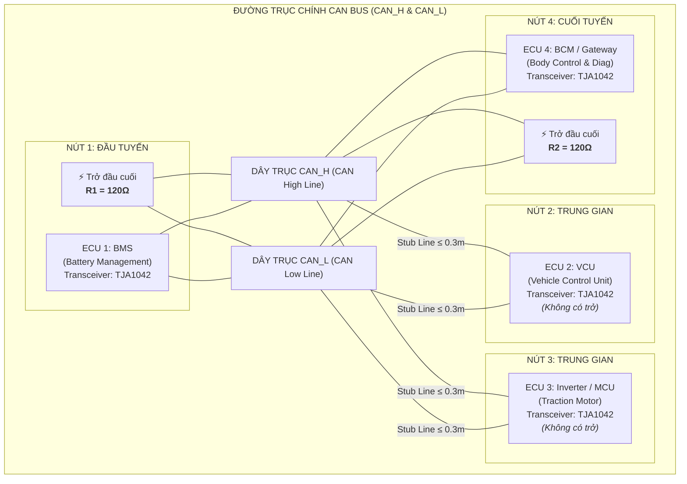
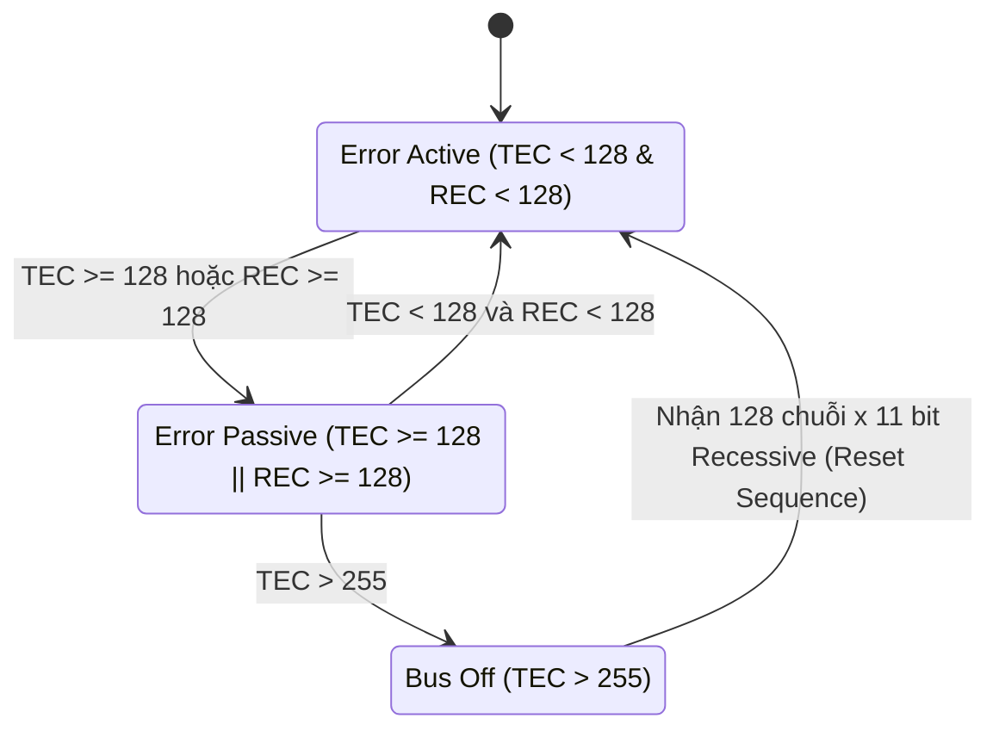
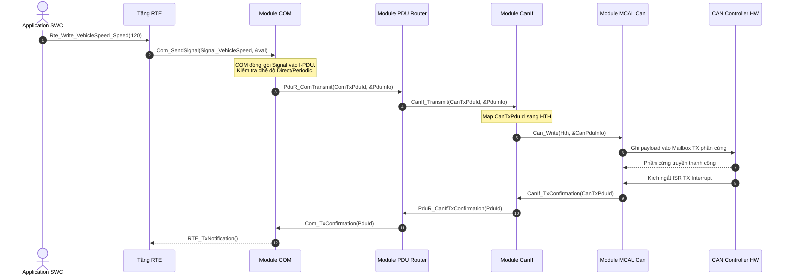
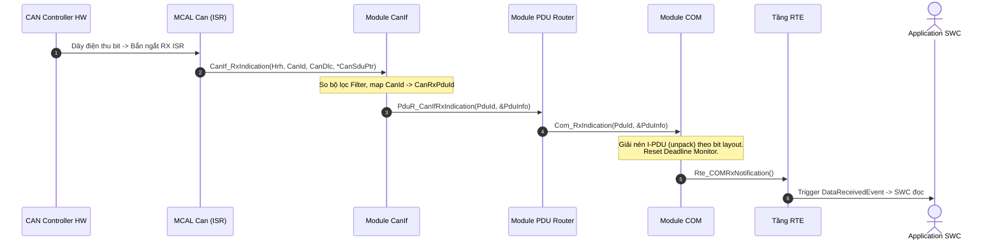

# Chuyên Đề 03: Communication Stack (ComStack) & Giao Thức CAN/CAN-FD Masterclass

> **Ngôn ngữ:** Tiếng Việt Kỹ Nghệ Chuẩn Mực  
> **Cấp độ:** 🟢 Newbie đến 🔴 Expert (Universal Learning Resource)  
> **Tiêu chuẩn tham chiếu:** AUTOSAR ComStack SWS (Release 4.x / R22-11), ISO 11898-1/2 (CAN/CAN-FD), ISO 15765-2 (DoCAN / CanTp)  
> **Mã nguồn đối chiếu thực tế:** Kho mã nguồn [`as/`](file:///C:/Users/liem.vu/Liem.vuOD/Study_AUTOSAR-main/as) (`com/as.infrastructure/communication/`)  
> **Vị trí tài liệu:** [`docs/theory/03_Communication_Stack_And_CAN_Protocol.md`](file:///C:/Users/liem.vu/Liem.vuOD/Study_AUTOSAR-main/docs/theory/03_Communication_Stack_And_CAN_Protocol.md)  

---

## Mục Lục
1. [Nền Tảng Giao Thức CAN & CAN-FD (ISO 11898 Masterclass)](#1-nền-tảng-giao-thức-can--can-fd-iso-11898-masterclass)
2. [Các Khái Niệm Dữ Liệu Cốt Lõi: Signal, Signal Group, I-PDU, N-PDU, L-PDU](#2-các-khái-niệm-dữ-liệu-cốt-lõi-signal-signal-group-i-pdu-n-pdu-l-pdu)
3. [Kiến Trúc Ngăn Xếp ComStack Chi Tiết Từng Module](#3-kiến-trúc-ngăn-xếp-comstack-chi-tiết-từng-module)
   - [3.0 Nền Tảng ComStack: Định Nghĩa, Đặc Tính & Vị Trí Kiến Trúc](#30-nền-tảng-comstack-định-nghĩa-đặc-tính--vị-trí-kiến-trúc)
   - [3.1 Quy Chuẩn & Đặc Tính Kỹ Thuật Chi Tiết Từng Module Trong ComStack](#31-quy-chuẩn--đặc-tính-kỹ-thuật-chi-tiết-từng-module-trong-comstack)
4. [Luồng Truyền Nhận Dữ Liệu End-to-End Toàn Diện (Sequence Traces)](#4-luồng-truyền-nhận-dữ-liệu-end-to-end-toàn-diện-sequence-traces)
   - [4.0 Cơ Sở Hạ Tầng Khởi Tạo: 4 Nhiệm Vụ Sống Còn Của Các Hàm _Init() Trong ComStack](#40-cơ-sở-hạ-tầng-khởi-tạo-4-nhiệm-vụ-sống-còn-của-các-hàm-_init-trong-comstack)
   - [4.1 Luồng Phát Tín Hiệu (Transmission Path: SWC ──► CAN Bus)](#41-luồng-phát-tín-hiệu-transmission-path-swc--can-bus)
   - [4.2 Luồng Thu Tín Hiệu (Reception Path: CAN Bus ──► SWC)](#42-luồng-thu-tín-hiệu-reception-path-can-bus--swc)
   - [4.3 Case Study Chuyên Sâu: Bóc Tách Chuỗi Gọi Hàm Thực Tế & Mô Hình Cấu Hình Chuẩn AUTOSAR](#43-case-study-chuyên-sâu-bóc-tách-chuỗi-gọi-hàm-thực-tế--mô-hình-cấu-hình-chuẩn-autosar-end-to-end-traces)
   - [4.4 Thuật Toán Lọc Tín Hiệu (ComFilter) & Cơ Chế Chuyển Chế Độ Truyền (Transmission Mode Selection - TMS)](#44-thuật-toán-lọc-tín-hiệu-comfilter--cơ-chế-chuyển-chế-độ-truyền-transmission-mode-selection---tms)
5. [Hiện Thực Hóa Trong Dự Án Study_AUTOSAR (Source Code & Toolchain Walkthrough)](#5-hiện-thực-hóa-trong-dự-án-study_autosar-source-code--toolchain-walkthrough)
6. [Phụ Lục Kỹ Thuật: Giải Mã Vòng Lặp for(;;) Trong StartOS(), Vòng Đời Task OSEK Và Mô Hình Polling vs Preemptive RTOS](#6-phụ-lục-kỹ-thuật-giải-mã-vòng-lặp-for-trong-startos-vòng-đời-task-osek-và-mô-hình-polling-vs-preemptive-rtos)  

---

## Bảng Hệ Thống Icon Hướng Dẫn

- 📖 **Glossary / Định nghĩa:** Giải thích thuật ngữ cốt lõi.
- 💡 **Ví dụ / Example:** Minh họa thực tế dễ hiểu.
- ⚠️ **Warning / Pitfall:** Những cạm bẫy dễ mắc phải trong dự án thực tế.
- ✅ **Best Practice:** Thực hành tốt nhất được khuyến nghị bởi chuyên gia.
- ❌ **Bad Practice:** Cách làm tồi cần tránh.
- 🎯 **Use Case:** Tình huống sử dụng cụ thể.
- 🔧 **API Reference:** Cấu trúc hàm/mã nguồn thực tế.
- 📊 **Data / Statistics:** Công thức tính toán và số liệu đo lường.
- 🛠️ **Hands-On Exercise:** Bài tập thực hành thực tế.
- 🟢🟡🔴 **Difficulty Level:** Mức độ khó của kiến thức.
- 💀 **Critical Bug:** Lỗi nghiêm trọng gây hậu quả lớn (thu hồi xe, hỏng phần cứng).

---

## 1. Nền Tảng Giao Thức CAN & CAN-FD (ISO 11898 Masterclass)

### 1.1 Tầng Vật Lý: Điện Áp Vi Sai & Trở Kháng Đầu Cuối 120Ω


#### Kiến Trúc Đường Trục Tuyến Tính (Linear Backbone Topology) 4 ECU

Mạng CAN tiêu chuẩn ISO 11898-2 bắt buộc phải được thi công dưới dạng **đường trục chính thẳng (Backbone)** nối dài từ điểm đầu đến điểm cuối xe, các ECU trung gian kết nối vào trục thông qua các nhánh rẽ ngắn (**Stub Line**):

```text
┌────────────────────────────────────────────────────────────────────────────────────────────────────────────────────────┐
│                              SƠ ĐỒ NGUYÊN LÝ MẠNG CAN BUS 4 ECU TRÊN Ô TÔ (ISO 11898-2)                                │
├────────────────────────────────────────────────────────────────────────────────────────────────────────────────────────┤
│    [NÚT ĐẦU TUYẾN]                [NÚT TRUNG GIAN 1]              [NÚT TRUNG GIAN 2]                [NÚT CUỐI TUYẾN]   │
│       ECU 1: BMS                     ECU 2: VCU                   ECU 3: INVERTER / MCU            ECU 4: BCM / GATEWAY│
│  ┌──────────────────┐           ┌──────────────────┐            ┌─────────────────────┐          ┌───────────────────┐ │
│  │ Microcontroller  │           │ Microcontroller  │            │   Microcontroller   │          │  Microcontroller  │ │
│  │ (CAN Controller) │           │ (CAN Controller) │            │  (CAN Controller)   │          │ (CAN Controller)  │ │
│  └────────┬─────────┘           └────────┬─────────┘            └──────────┬──────────┘          └─────────┬─────────┘ │
│      TxD  │  ▲ RxD                  TxD  │  ▲ RxD                      TxD │  ▲ RxD                    TxD │  ▲ RxD    │
│           ▼  │                           ▼  │                              ▼  │                            ▼  │        │
│  ┌────────┴─────────┐           ┌────────┴─────────┐            ┌──────────┴──────────┐          ┌─────────┴─────────┐ │
│  │ CAN Transceiver  │           │ CAN Transceiver  │            │   CAN Transceiver   │          │  CAN Transceiver  │ │
│  │ (ví dụ: TJA1042) │           │ (ví dụ: TJA1042) │            │   (ví dụ: TJA1042)  │          │ (ví dụ: TJA1042)  │ │
│  └───┬───────────┬──┘           └───┬───────────┬──┘            └───┬───────────┬─────┘          └───┬───────────┬───┘ │
│      │ CAN_H     │ CAN_L            │ CAN_H     │ CAN_L             │ CAN_H     │ CAN_L              │ CAN_H     │CAN_L│
│      │           │                  │           │                   │           │                    │           │     │
│      │   ┌─────┐ │                  │ (Đường    │                   │ (Đường    │                    │   ┌─────┐ │     │
│      ├───┤ 120Ω├─┤                  │  nhánh    │                   │  nhánh    │                    ├───┤ 120Ω├─┤     │
│      │   │  R1 │ │                  │  ≤ 0.3m)  │                   │  ≤ 0.3m)  │                    │   │  R2 │ │     │
│      │   └─────┘ │                  │           │                   │           │                    │   └─────┘ │     │
│══════╪═══════════╪══════════════════╪═══════════╪═══════════════════╪═══════════╪════════════════════╪═══════════╪═════│ DÂY TRỤC CAN_H
│      │           │                  │           │                   │           │                    │           │     │
│══════╪═══════════╪══════════════════╪═══════════╪═══════════════════╪═══════════╪════════════════════╪═══════════╪═════│ DÂY TRỤC CAN_L
│                                                                                                                        │
│  ◄──────────────────────────── ĐƯỜNG TRỤC CHÍNH (CAN BUS BACKBONE) ────────────────────────────────────────────────►   │
│  * Điện trở tương đương toàn bus: R_bus = R1 // R2 = 120Ω // 120Ω = 60Ω                                                │
│  * Nút trung gian (ECU 2 - VCU, ECU 3 - Inverter): TUYỆT ĐỐI KHÔNG gắn điện trở, nối qua nhánh ngắn (Stub Line ≤ 0.3m) │
└────────────────────────────────────────────────────────────────────────────────────────────────────────────────────────┘
```



#### Định Nghĩa Mức Logic: Dominant (Trội) vs Recessive (Lặn)

CAN sử dụng hai trạng thái bit có tính chất ưu tiên vật lý:

| Thông số / Trạng thái | Bit 0: Dominant (Mức Trội) | Bit 1: Recessive (Mức Lặn) |
| :--- | :--- | :--- |
| **Giá trị logic của MCU** | Chân TxD = $0\text{V}$ (Logic 0) | Chân TxD = $3.3\text{V} / 5\text{V}$ (Logic 1) |
| **Trạng thái Transistor Transceiver** | Mở (Dẫn dòng tích cực) | Đóng hoàn toàn (Thả nổi cách ly) |
| **Điện áp dây CAN_H** | $\approx 3.5\text{V}$ (Dải chuẩn: $2.75\text{V} - 4.5\text{V}$) | $\approx 2.5\text{V}$ (Dải chuẩn: $2.0\text{V} - 3.0\text{V}$) |
| **Điện áp dây CAN_L** | $\approx 1.5\text{V}$ (Dải chuẩn: $0.5\text{V} - 2.25\text{V}$) | $\approx 2.5\text{V}$ (Dải chuẩn: $2.0\text{V} - 3.0\text{V}$) |
| **Điện áp vi sai $V_{\text{diff}}$** | **$\approx +2.0\text{V}$** (Dải chuẩn: $1.5\text{V} - 3.0\text{V}$) | **$\approx 0.0\text{V}$** (Dải chuẩn: $-0.5\text{V} - +0.05\text{V}$) |
| **Dòng điện qua bus ($R_{\text{bus}} = 60\Omega$)** | Bơm dòng: $I \approx \frac{2.0\text{V}}{60\Omega} \approx 33.3\text{mA}$ | Thả nổi: $I \approx 0\text{mA}$ |
| **Ý nghĩa phân xử bus (Wired-AND)** | **Áp đảo (Thắng):** Kéo bus về mức 0 | **Nhượng bộ (Thua):** Bị mức Dominant đè |

- **Nguyên lý phân xử "Dominant đè Recessive" (Wired-AND Logic):**
  - Nếu ECU 1 (BMS) muốn phát bit 0 (kích hoạt transistor bơm dòng tạo $V_{\text{diff}} = 2\text{V}$), trong khi cùng lúc đó ECU 2 (VCU) muốn phát bit 1 (thả nổi transistor):
  - Do có dòng điện từ ECU 1 chạy qua hai trở $120\Omega$, toàn bộ đường bus lập tức có điện áp chênh lệch $V_{\text{diff}} = 2\text{V}$.
  - Lúc này, bộ thu của cả 4 ECU (kể cả ECU 2) đều đọc được bit 0. ECU 2 phát hiện mình muốn phát 1 nhưng bus lại nhận 0, lập tức nhận biết mình bị mất quyền ưu tiên (Arbitration Loss) và tự động lùi về chế độ chỉ lắng nghe mà không gây hỏng dữ liệu của ECU 1.
  - Chỉ khi **toàn bộ 4 ECU đều phát bit 1 (thả nổi)** thì bus mới đo được $V_{\text{diff}} \approx 0\text{V}$ (Recessive).

#### Ví Dụ Thực Tế Đo Dạng Sóng Trên Máy Hiện Sóng (Oscilloscope Measurement Example)

Khi kỹ sư kết nối máy hiện sóng số (Digital Storage Oscilloscope - DSO) vào mạng CAN để kiểm tra chất lượng tín hiệu (Signal Integrity), thiết lập chuẩn gồm:
- **Kênh CH1 (Đầu dò vàng):** Kẹp vào chân **CAN_H** (tham chiếu mass xe GND).
- **Kênh CH2 (Đầu dò xanh lam):** Kẹp vào chân **CAN_L** (tham chiếu mass xe GND).
- **Kênh toán học MATH (Đường màu tím):** Cấu hình hàm toán học $\text{MATH} = \text{CH1} - \text{CH2}$ để đo trực tiếp điện áp vi sai $V_{\text{diff}}$.
- **Tốc độ truyền (Baudrate):** $500\text{ kbps} \implies \text{Thời gian 1 bit (Bit Time)} = \frac{1}{500,000\text{ Hz}} = 2.0\,\mu\text{s}$.

Dưới đây là hình ảnh thực tế ghi nhận trên màn hình máy hiện sóng khi một ECU bắt đầu truyền khung dữ liệu với chuỗi bit `1 (Idle) -> 0 (SOF) -> 1 (Data) -> 0 (Data) -> 1 (Data)`:

```text
┌────────────────────────────────────────────────────────────────────────────────────────────────────────────────────────┐
│                      HÌNH ẢNH DẠNG SÓNG THỰC TẾ TRÊN MÁY HIỆN SÓNG (OSCILLOSCOPE WAVEFORM CAPTURE)                     │
├────────────────────────────────────────────────────────────────────────────────────────────────────────────────────────┤
│ Cấu hình đo: Tốc độ 500 kbps (1 Bit = 2.0 µs) │ Thang đo trục Y: 1.0V/Div │ Thang thời gian trục X: 2.0 µs/Div         │
│ Kênh CH1 (Vàng): Dây CAN_H │ Kênh CH2 (Xanh lam): Dây CAN_L │ Kênh MATH (Tím): V_diff = CAN_H - CAN_L                  │
└────────────────────────────────────────────────────────────────────────────────────────────────────────────────────────┘

 Điện áp (V)
   ▲
   │
4.0┼┄┄┄┄┄┄┄┄┄┄┄┄┄┄┄┄┄┄┄┄┄┄┄┄┄┄┄┄┄┄┄┄┄┄┄┄┄┄┄┄┄┄┄┄┄┄┄┄┄┄┄┄┄┄┄┄┄┄┄┄┄┄┄┄┄┄┄┄┄┄┄┄┄┄┄┄┄┄┄┄┄┄┄┄┄┄┄┄┄┄┄┄┄┄┄┄
   │
3.5┼               ┌───────────────────────┐                       ┌───────────────────────┐          CAN_H (CH1)
   │               │                       │                       │                       │          Mức Dominant (+3.5V)
3.0┼ - - - - - - - │ - - - - - - - - - - - │ - - - - - - - - - - - │ - - - - - - - - - - - │ - - - - 
   │   Recessive   │       Dominant        │       Recessive       │       Dominant        │  Recessive
2.5┼═══════════════╡                       ╞═══════════════════════╡                       ╞════════  CAN_H & CAN_L đè nhau
   │ (Điện áp tĩnh)│                       │    (Điện áp tĩnh)     │                       │          Mức Recessive (+2.5V)
2.0┼ - - - - - - - │ - - - - - - - - - - - │ - - - - - - - - - - - │ - - - - - - - - - - - │ - - - - 
   │               │                       │                       │                       │
1.5┼               └───────────┬───────────┘                       └───────────┬───────────┘          CAN_L (CH2)
   │                           │ Sample Point (80%)                            │                      Mức Dominant (+1.5V)
1.0┼┄┄┄┄┄┄┄┄┄┄┄┄┄┄┄┄┄┄┄┄┄┄┄┄┄┄┄┼┄┄┄┄┄┄┄┄┄┄┄┄┄┄┄┄┄┄┄┄┄┄┄┄┄┄┄┄┄┄┄┄┄┄┄┄┄┄┄┄┄┄┄┄┄┄┼┄┄┄┄┄┄┄┄┄┄┄┄┄┄┄┄┄┄┄
   │                           ▼                                               ▼
0.0┴────────────────────────────────────────────────────────────────────────────────────────────────► Thời gian (t)
   │
   │─── KÊNH TOÁN HỌC: MATH = CH1 - CH2 (ĐIỆN ÁP VI SAI V_diff) ────────────────────────────────────
   │
   ▲
2.0┼               ┌───────────────────────┐                       ┌───────────────────────┐          V_diff = +2.0V
   │               │                       │                       │                       │          (Dominant: Bit 0)
0.0┴───────────────┘                       └───────────────────────┘                       └────────► V_diff =  0.0V
   │                                                                                                  (Recessive: Bit 1)
   ├───────────────┬───────────────────────┬───────────────────────┬───────────────────────┤
   │◄── 2.0 µs ───►│◄────── 2.0 µs ───────►│◄────── 2.0 µs ───────►│◄────── 2.0 µs ───────►│
   │   Bus Rảnh    │ Bit Bắt Đầu Khung SOF │    Bit Dữ Liệu ID9    │    Bit Dữ Liệu ID8    │      Bit Kế Tiếp...
   │  Bit 1 (Lặn)  │      Bit 0 (Trội)     │      Bit 1 (Lặn)      │      Bit 0 (Trội)     │       Bit 1 (Lặn)
   │  [RECESSIVE]  │       [DOMINANT]      │      [RECESSIVE]      │       [DOMINANT]      │       [RECESSIVE]
   │ TxD = 3.3V/5V │     TxD = 0.0V (GND)  │     TxD = 3.3V/5V     │    TxD = 0.0V (GND)   │      TxD = 3.3V/5V
```

```text
┌────────────────────────────────────────────────────────────────────────────────────────────────────────────────────────┐
│                              BẢN VẼ TÁCH BIỆT DẠNG SÓNG TỪNG KÊNH TRUYỀN (CHANNEL DECOMPOSITION)                       │
├────────────────────────────────────────────────────────────────────────────────────────────────────────────────────────┤
│ 1. KÊNH CH1: DÂY CAN_H (Đo so với GND)                                                                                 │
│                                                                                                                        │
│  3.5V ────────────┐               ┌───────────────────────┐                       ┌───────────────────────┐            │
│                   │               │                       │                       │                       │            │
│  2.5V ────────────┴───────────────┘                       └───────────────────────┘                       └─────────── │
│                   │◄── 2.0 µs ───►│◄────── 2.0 µs ───────►│◄────── 2.0 µs ───────►│◄────── 2.0 µs ───────►│            │
├────────────────────────────────────────────────────────────────────────────────────────────────────────────────────────┤
│ 2. KÊNH CH2: DÂY CAN_L (Đo so với GND)                                                                                 │
│                                                                                                                        │
│  2.5V ────────────┬───────────────┐                       ┌───────────────────────┐                       ┌─────────── │
│                   │               │                       │                       │                       │            │
│  1.5V ────────────┘               └───────────────────────┘                       └───────────────────────┘            │
│                   │◄── 2.0 µs ───►│◄────── 2.0 µs ───────►│◄────── 2.0 µs ───────►│◄────── 2.0 µs ───────►│            │
├────────────────────────────────────────────────────────────────────────────────────────────────────────────────────────┤
│ 3. KÊNH TOÁN HỌC: MATH (Điện áp vi sai V_diff = CAN_H - CAN_L)                                                         │
│                                                                                                                        │
│ +2.0V ────────────┐               ┌───────────────────────┐                       ┌───────────────────────┐            │
│                   │               │                       │                       │                       │            │
│   0.0V ───────────┴───────────────┘                       └───────────────────────┘                       └─────────── │
│                   │◄── 2.0 µs ───►│◄────── 2.0 µs ───────►│◄────── 2.0 µs ───────►│◄────── 2.0 µs ───────►│            │
│                   │  Recessive 1  │      Dominant 0       │      Recessive 1      │      Dominant 0       │Recessive 1 │
└────────────────────────────────────────────────────────────────────────────────────────────────────────────────────────┘
```

##### Phân Tích Chi Tiết 4 Trạng Thái Quan Sát Được Trên Màn Hình Máy Hiện Sóng:

1. **Giai đoạn Bus Idle / Bit 1 (Recessive - Lặn):**
   - **Đặc điểm hiển thị:** Hai tia tín hiệu CH1 (CAN_H) và CH2 (CAN_L) chập đè lên nhau thành một đường thẳng duy nhất nằm tại vạch **$+2.5\text{V}$**.
   - **Tín hiệu vi sai MATH:** $V_{\text{diff}} = 2.5\text{V} - 2.5\text{V} = 0.0\text{V}$.
   - **Bản chất mạch:** Lúc này MCU phát chân TxD = $3.3\text{V}$ (hoặc $5\text{V}$), toàn bộ các transistor công suất bên trong CAN Transceiver đều ngắt dòng hoàn toàn. Bus ở trạng thái thả nổi tự do, được mạng phân áp nội bộ kéo về mức điện áp chung $+2.5\text{V}$. Không có dòng điện tiêu thụ qua tải.
2. **Giai đoạn chuyển sườn lên Bit 0 (Dominant - Trội):**
   - **Đặc điểm hiển thị:** Đúng khoảnh khắc ECU phát bit 0 (ví dụ bit SOF - Start of Frame), hai đường tín hiệu **mở rộng đối xứng nhau qua trục trung hòa $+2.5\text{V}$**:
     - Kênh CH1 (CAN_H) vọt lên đỉnh: **$+3.5\text{V}$** (tăng thêm $+1.0\text{V}$).
     - Kênh CH2 (CAN_L) tụt xuống đáy: **$+1.5\text{V}$** (giảm đi $-1.0\text{V}$).
   - **Tín hiệu vi sai MATH:** Vọt thẳng lên mức **$+2.0\text{V}$** ($3.5\text{V} - 1.5\text{V}$).
   - **Bản chất mạch:** MCU kéo chân TxD xuống $0\text{V}$ (GND). Transceiver lập tức kích hoạt hai transistor đẩy kéo (Push-Pull): một transistor nối nguồn cấp $+5\text{V}$ bơm dòng vào CAN_H, một transistor nối GND hút dòng từ CAN_L. Dòng điện khoảng $33.3\text{mA}$ chạy xuyên qua hai điện trở đầu cuối $120\Omega$, tạo ra sụt áp vi sai $+2.0\text{V}$.
   - Bộ so sánh (Comparator) tại đầu thu nhận thấy $V_{\text{diff}} = 2.0\text{V} > 0.9\text{V}$ (ngưỡng quy định ISO 11898-2) và xuất tín hiệu mức thấp ($0\text{V}$) về chân RxD cho MCU nhận diện chính xác bit 0.
3. **Đặc tính thời gian xung (Bit Timing & Sườn Xung):**
   - **Độ rộng bit (Bit Width):** Tại baudrate $500\text{ kbps}$, mỗi ô bit có chiều dài chính xác $2.0\,\mu\text{s}$ (dung sai clock thạch anh khắt khe $<\pm 0.5\%$).
   - **Thời gian sườn lên (Rise Time):** Quá trình chuyển từ Recessive sang Dominant diễn ra cực nhanh ($t_{\text{rise}} < 50\text{ns}$) nhờ có transistor chủ động bơm dòng (**Active Drive**).
   - **Thời gian sườn xuống (Fall Time):** Quá trình trở về Recessive phụ thuộc vào dòng xả tự nhiên qua điện trở kết thúc $60\Omega$ và tụ ký sinh của dây cáp (**Passive Release**), sườn xuống hơi thoai thoải hơn một chút ($t_{\text{fall}} \approx 50\text{ns} - 100\text{ns}$).
4. **Điểm lấy mẫu dữ liệu (Sample Point):**
   - Bộ thu CAN không đọc tín hiệu ở ngay đầu bit (nơi vừa chuyển trạng thái có thể còn gợn sóng ringing nhỏ).
   - Phần cứng CAN Controller tự động chờ đến vị trí **$75\% - 80\%$ của chu kỳ bit** (tương ứng thời điểm $1.5\,\mu\text{s} - 1.6\,\mu\text{s}$ tính từ đầu bit) — khi điện áp đã hoàn toàn phẳng và ổn định tuyệt đối — mới chốt giá trị bit vào thanh ghi nhận.

##### Bảng Chẩn Đoán Dị Tật Sóng (Waveform Anomalies) Thường Gặp Khi Bắt Bằng Oscilloscope:

| Hình ảnh thực tế trên Oscilloscope | Nguyên nhân lỗi phần cứng | Hậu quả kỹ thuật |
| :--- | :--- | :--- |
| **Sóng có xung nhọn dội ngược (Ringing / Overshoot $> 4.0\text{V}$)** | **Mất 1 điện trở đầu cuối** (Tổng trở đo được $120\Omega$ thay vì $60\Omega$). Sóng cao tần không được hấp thụ, dội ngược ở đầu cáp hở. | Ở $125\text{kbps}$ chạy bình thường, nhưng lên $500\text{kbps}$ hoặc CAN-FD thì rung sóng lấn vào Sample Point $\to$ Báo lỗi **Error Frame** liên tục. |
| **Biên độ vi sai thấp ($V_{\text{diff}} < 1.2\text{V}$)** | **Thừa điện trở đầu cuối** (Gắn 3 hoặc 4 trở $120\Omega$, tổng trở tụt về $40\Omega$ hoặc $30\Omega$). | Dòng tải vượt quá khả năng Transceiver, áp vi sai tụt sát ngưỡng lật trạng thái $\to$ Mất gói tin chập chờn khi xe tăng tốc hoặc nhiệt độ tăng. |
| **Đường $2.5\text{V}$ bị nâng lên $3.5\text{V}$ hoặc tụt xuống $1.5\text{V}$** | **Lệch điện áp mass (Ground Offset / Shift)** giữa các cụm ECU do dây tiếp địa khung xe bị rỉ sét hoặc lỏng ốc. | Nhờ nguyên lý vi sai, $V_{\text{diff}}$ vẫn giữ được $+2.0\text{V}$ nên xe vẫn chạy được, nhưng biên độ chịu nhiễu EMI bị thu hẹp đáng kể. |
| **CAN_H hoặc CAN_L bị ghim cứng ở $0\text{V}$ hoặc $12\text{V}$** | Chạm chập dây cáp: Short-to-GND hoặc Short-to-VBAT (chạm nguồn ắc quy). | Transceiver kích hoạt bảo vệ quá dòng, ECU rơi vào trạng thái cô lập **Bus-Off**. |

---

### NÂNG CAO

#### 1. Tại Sao Bắt Buộc Là 120Ω Và Chỉ Đặt Ở 2 Nút Xa Nhất?

1. **Trở kháng đặc tính (Characteristic Impedance $Z_0$):**
   - Dây cáp xoắn đôi dùng trong ngành ô tô có trở kháng sóng cao tần danh định xấp xỉ $Z_0 = 120\Omega$ (được quyết định bởi đường kính lõi đồng, khoảng cách giữa 2 dây và hằng số điện môi của lớp vỏ cách điện).
   - Khi tín hiệu điện áp chuyển trạng thái (sườn lên/sườn xuống chỉ vài nano giây), sóng điện từ lan truyền trên dây với vận tốc xấp xỉ $200,000\text{ km/s}$.
2. **Hiện tượng phản xạ sóng (Signal Reflection):**
   - Theo lý thuyết đường dây truyền tải (Transmission Line Theory), khi sóng điện từ chạy tới cuối đường cáp:
     - Nếu đầu cáp để **hở mạch** ($R = \infty$), toàn bộ năng lượng sóng sẽ **bị dội ngược trở lại** (tương tự sóng nước đập vào bờ tường bê tông). Sóng phản xạ dội ngược giao thoa với sóng phát tới, tạo ra các xung dao động méo dạng nghiêm trọng (**Ringing / Overshoot / Undershoot**), làm cho Transceiver đọc sai bit.
     - Nếu gắn điện trở đầu cuối **bằng đúng trở kháng đặc tính cáp ($R_{\text{term}} = Z_0 = 120\Omega$)**, toàn bộ năng lượng của sóng điện từ khi truyền tới đầu mút sẽ bị điện trở hấp thụ 100% và chuyển hóa thành nhiệt lượng siêu nhỏ ($P = I^2 R$). Hoàn toàn không còn sóng dội ngược, sườn xung vuông vắn và sắc nét.
3. **Tại sao ECU ở giữa (ECU 2 - VCU, ECU 3 - Inverter) TUYỆT ĐỐI KHÔNG ĐƯỢC gắn thêm trở?**
   - Hai điện trở $120\Omega$ ở hai đầu mút được mắc song song qua cặp dây CAN_H và CAN_L:
     $$R_{\text{bus}} = R_1 \parallel R_2 = \frac{120\Omega \times 120\Omega}{120\Omega + 120\Omega} = 60\Omega$$
   - Khi đó dòng điện vi sai mà Transceiver phải cấp ở mức Dominant là $I = \frac{2.0\text{V}}{60\Omega} \approx 33.3\text{mA}$ — hoàn toàn nằm trong vùng làm việc tối ưu và mát của chip bán dẫn.
   - **Hậu quả nếu lắp sai số lượng điện trở:**
     - **Nếu có 3 trở $120\Omega$** (gắn nhầm vào ECU 2): $R_{\text{bus}} = 120\Omega \parallel 120\Omega \parallel 120\Omega = 40\Omega$. Dòng tải tăng vọt lên $I = \frac{2.0\text{V}}{40\Omega} = 50\text{mA}$. Transceiver bị phát nhiệt lớn, sụt áp $V_{\text{diff}}$ xuống dưới $1.5\text{V}$, gây lỗi ngắt quãng (Intermittent Error).
     - **Nếu cả 4 ECU đều có trở $120\Omega$**: $R_{\text{bus}} = 30\Omega \implies I \approx 66.7\text{mA}$. Mạch bảo vệ quá dòng/quá nhiệt của Transceiver lập tức kích hoạt ngắt mạch, bus bị sập hoàn toàn (Bus-Off).
     - **Nếu chỉ có 1 trở $120\Omega$** (thiếu 1 trở đầu cuối): $R_{\text{bus}} = 120\Omega$. Đầu không có trở sinh phản xạ sóng cực mạnh. Ở tốc độ thấp $125\text{kbps}$, chu kỳ bit đủ dài ($8\mu\text{s}$) nên dao động ringing kịp lắng xuống trước thời điểm lấy mẫu (Sample Point). Tuy nhiên, khi chuyển sang tốc độ cao $500\text{kbps}$ ($2\mu\text{s}$) hoặc CAN-FD $2\text{Mbps} - 5\text{Mbps}$, dao động dội ngược trùng khớp đúng vào Sample Point, làm bộ điều khiển CAN sinh khung lỗi (**Error Frame**) liên tục.
4. **Quy tắc thiết kế đường nhánh (Stub Line Constraints):**
   - Đoạn dây dẫn nối từ đường trục chính (Backbone) vào ECU trung gian (Stub Line) là đoạn dây không có trở kết thúc.
   - Để năng lượng phản xạ trên nhánh rẽ không làm biến dạng sóng trên trục chính:
     - Độ dài nhánh rẽ: **$L_{\text{stub}} \le 0.3\text{m}$** (ở tốc độ $500\text{kbps} - 1\text{Mbps}$).
     - Tổng chiều dài cộng dồn tất cả các đường nhánh trên toàn mạng không vượt quá $3\text{m} - 5\text{m}$.
     - Khoảng cách giữa hai điểm nối rẽ nhánh liên tiếp trên trục chính tối thiểu phải từ **$0.1\text{m}$** trở lên để tránh tạo dung kháng ký sinh tập trung.

#### 2. Bảng Hướng Dẫn Đo Kiểm Chẩn Đoán Thực Tế (Troubleshooting Checklist)

Kỹ sư kiểm tra nhanh tính toàn vẹn của tầng vật lý CAN bằng đồng hồ vạn năng số (VOM/DMM) theo các bước:

| Chế độ kiểm tra | Điểm đo | Giá trị tiêu chuẩn | Chẩn đoán lỗi nếu sai lệch |
| :--- | :--- | :--- | :--- |
| **Tắt nguồn xe (Power OFF / Cọc bình rút)** | Que đỏ: **CAN_H**<br>Que đen: **CAN_L**<br>(Đo thang Ohm $\Omega$) | **$55\Omega - 65\Omega$**<br>(Danh định: $60\Omega$) | - **$110\Omega - 130\Omega$:** Thiếu 1 điện trở đầu cuối, hoặc đứt cáp giữa chừng chia cắt mạng làm đôi.<br>- **$38\Omega - 45\Omega$:** Cắm nhầm ECU thứ 3 có chứa trở $120\Omega$.<br>- **$28\Omega - 33\Omega$:** Cắm nhầm cả 4 ECU đều có trở.<br>- **$0\Omega$ (hoặc rất nhỏ):** Chập dây CAN_H với CAN_L.<br>- **$\infty$ (Hở mạch):** Đứt toàn bộ cáp hoặc mất cả 2 điện trở đầu cuối. |
| **Tắt nguồn xe (Power OFF)** | Que đỏ: **CAN_H (hoặc CAN_L)**<br>Que đen: **Chassis (Mass vỏ xe)** | **$\ge 1\text{ M}\Omega$ (Cách điện)** | - **$\approx 0\Omega$:** Dây CAN bị chạm chập vào khung xe (Short-to-GND). |
| **Bật khóa điện (IGN ON) - Bus rảnh** | Que đỏ: **CAN_H** / Que đen: **GND**<br>Que đỏ: **CAN_L** / Que đen: **GND** | **CAN_H $\approx 2.5\text{V}$**<br>**CAN_L $\approx 2.5\text{V}$**<br>($V_{\text{diff}} \approx 0\text{V}$) | - Nếu một dây vọt lên $12\text{V}$: Chạm chập nguồn ắc quy (Short-to-VBAT).<br>- Nếu tụt về $0\text{V}$: Chạm mass hoặc Transceiver hỏng. |
| **Xe hoạt động - Bus có giao tiếp** | Đo vi sai: **CAN_H so với CAN_L**<br>(Đo thang Volt DC) | **$V_{\text{diff}} \approx 1.5\text{V} - 2.5\text{V}$**<br>(Giá trị trung bình theo chu kỳ) | - Tín hiệu dao động bình thường của các khung truyền đang phát liên tục. |

---

### 1.2 Cấu Trúc Khung Truyền CAN 2.0A (11-bit) & CAN 2.0B (29-bit Extended)


#### 1. Cơ Sở Mã Hóa & Chuyên Sâu Về Cơ Chế Bit Stuffing (Nguyên Lý, Vùng Giới Hạn, Bắt Lỗi & Cải Tiến CAN-FD)

Trước khi phân tích chi tiết từng trường bit, kỹ sư cần nắm vững **Nguyên lý Mã hóa NRZ & Cơ chế Bit Stuffing** — bởi vì Bit Stuffing quyết định trực tiếp việc tại sao khung truyền có ranh giới "Vùng áp dụng Stuffing" và "Vùng miễn nhiễm", cũng như lý do chiều dài khung thực tế luôn biến thiên.

##### A. Tại Sao Mạng CAN Bắt Buộc Phải Có Bit Stuffing?
1. **CAN Không Có Dây Clock Riêng:** Khác với SPI hay I2C (sở hữu chân xung nhịp riêng như SCK/SCL để đồng bộ dữ liệu theo từng sườn xung), bus CAN chỉ sử dụng duy nhất một cặp dây vi sai (`CAN_H` và `CAN_L`) để truyền tải đồng thời cả dữ liệu lẫn tín hiệu đồng hồ.
2. **Mã Hóa NRZ (Non-Return-to-Zero):** Mạng CAN sử dụng mã hóa NRZ — bit 0 giữ điện áp Dominant liên tục, bit 1 giữ điện áp Recessive liên tục trong suốt thời gian bit. Nếu dữ liệu có chuỗi dài các bit giống nhau (ví dụ: `0x00 0x00 0x00...` gồm 64 bit 0 liên tiếp), điện áp trên đường truyền sẽ nằm bất động ở mức $V_{\text{diff}} \approx 2.0\text{V}$.
3. **Hiện tượng trôi nhịp đồng hồ (Clock Drift) & Lệch pha (Phase Loss):** Bộ dao động thạch anh trên mỗi ECU có sai số chế tạo và bị trôi tần số theo nhiệt độ môi trường xe hơi ($\pm 0.5\% - 1.58\%$). Nếu không có sườn chuyển tiếp điện áp ($0 \leftrightarrow 1$) trong thời gian dài, mạch bám pha của bộ thu không thể tự cân chỉnh lại. Điểm lấy mẫu (**Sample Point**) sẽ bị trôi dần ra khỏi chu kỳ bit, gây đọc sai dữ liệu (Bit Slip).  
   $\implies$ **Mục tiêu kỹ thuật:** Bit Stuffing cưỡng bức tạo sườn chuyển tiếp xung với chu kỳ tối đa không quá 5 bit, giúp mạch hồi tiếp pha (Resynchronization) của tất cả các bộ thu luôn khóa cứng với xung nhịp của bộ phát.

##### B. Quy Tắc Hoạt Động Phần Cứng (Bit Stuffer vs Bit De-stuffer)
- **Phía Node Phát (Transmitter - Bit Stuffer):**  
  Khi phát hiện chuỗi **5 bit cùng mức logic liên tiếp** (`00000` hoặc `11111`) trong dòng dữ liệu, phần cứng CAN Controller tự động chèn thêm **1 bit đảo chiều (Stuff Bit)** (`1` hoặc `0`) ngay sau bit thứ 5.
- **Phía Node Nhận (Receiver - Bit De-stuffer):**  
  Khi bộ thu đếm được 5 bit liên tiếp cùng mức, nó đọc bit thứ 6:
  1. Dùng sườn chuyển tiếp của bit thứ 6 để **tái đồng bộ pha (Resynchronization)**.
  2. Phần cứng **tự động loại bỏ (strip/discard) bit thứ 6 này** ra khỏi dòng dữ liệu trước khi nạp vào thanh ghi nhận và tính toán mã kiểm tra CRC.

##### C. Sơ Đồ Giải Mã Từng Bước (Bitstream Walkthrough)
```text
1. Dữ liệu gốc từ tầng trên (Application / COM):
   [ 0 ] [ 0 ] [ 0 ] [ 0 ] [ 0 ] [ 0 ] [ 0 ] [ 0 ] [ 1 ]
    └─── 5 bit 0 liên tiếp ───┘

2. Phần cứng Controller phát chèn Stuff Bit (ký hiệu (*)):
   [ 0 ] [ 0 ] [ 0 ] [ 0 ] [ 0 ]   [ 1* ]   [ 0 ] [ 0 ] [ 0 ] [ 1 ]
   └────── 5 bit gốc ──────────┘   (Stuff)  └───── các bit gốc còn lại ─────┘
                                     ▲
                          Tạo sườn xung 0 -> 1 trên dây

3. Dòng bit thực tế chạy trên cặp dây vi sai CAN_H / CAN_L:
   0 ── 0 ── 0 ── 0 ── 0 ── 1* ── 0 ── 0 ── 0 ── 1

4. Phía Controller nhận (De-stuffing):
   - Đọc 5 bit 0 -> Nhận diện chuỗi 5 bit đồng mức.
   - Đọc bit thứ 6: Là bit 1* -> Hợp lệ! Tái đồng bộ xung clock.
   - Tự động gỡ bỏ bit 1* -> Hoàn trả dữ liệu gốc chuẩn xác: 0 0 0 0 0 0 0 0 1.
```

##### D. Ranh Giới Áp Dụng: Vùng Nhồi Bit vs Vùng Miễn Nhiễm
```text
┌────────────────────────────────────────────────────────────────────────┬──────────────────────────────────┐
│                     VÙNG ÁP DỤNG BIT STUFFING                          │      VÙNG MIỄN NHIỄM STUFFING     │
│             (Bắt đầu từ SOF đến hết bit CRC thứ 15)                    │   (Tuyệt đối KHÔNG ĐƯỢC nhồi bit)│
├─────────┬───────────────────────┬───────────────┬─────────┬────────────┼───────────┬─────┬─────────┬──────┤
│   SOF   │   Arbitration Field   │ Control Field │  DATA   │  CRC Seq   │  CRC Del  │ ACK │ ACK Del │ EOF  │
│  (1 b)  │ (11/29b ID + RTR/IDE) │    (6 bit)    │ (0..8B) │  (15 bit)  │   (1 b)   │(2b) │  (1 b)  │(7 b) │
└─────────┴───────────────────────┴───────────────┴─────────┴────────────┴───────────┴─────┴─────────┴──────┘
```
**Tại sao CRC Delimiter, ACK và EOF tuyệt đối không được nhồi bit?**
- **Trường EOF (End of Frame) gồm đúng 7 bit Recessive (`1111111`):** Nếu cho phép nhồi bit, cứ sau 5 bit 1 (`11111`) bộ phát sẽ chèn 1 bit 0. Lúc đó các ECU nhận không thể phân biệt được đâu là dấu hiệu kết thúc khung truyền, đâu là dữ liệu. Chuỗi 7 bit 1 liên tiếp là ký hiệu cấu trúc tĩnh bất biến để phân giải ranh giới bản tin.
- **CRC Delimiter & ACK Delimiter (1 bit Recessive):** Đóng vai trò khoảng đệm thời gian chuyển mạch cố định, không được phép thay đổi độ dài.

##### E. Cơ Chế Phát Hiện Lỗi: Stuff Error & Lan Truyền Lỗi Toàn Mạng
Nếu trong vùng giám sát (từ SOF đến hết CRC Sequence) mà xuất hiện **6 bit liên tiếp cùng mức logic** (`000000` hoặc `111111`):
1. CAN Controller nhận diện ngay tín hiệu đường truyền bị méo dạng hoặc đứt/chập dây.
2. Bộ điều khiển kích hoạt lỗi **Stuff Error**.
3. **Cơ chế lan truyền lỗi (Error Propagation):** 
   - Node phát hiện lỗi lập tức phát ra **Active Error Flag gồm 6 bit Dominant liên tiếp (`000000`)**.
   - Chuỗi 6 bit 0 này **cố tình vi phạm trắng trợn quy tắc Bit Stuffing trên toàn đường bus**, buộc mọi ECU còn lại trên mạng cũng đồng loạt nhận diện lỗi Stuff Error và hủy bỏ ngay lập tức gói tin bị lỗi.
   - Node phát vi phạm sẽ tăng bộ đếm lỗi truyền `TEC += 8`, kích hoạt cơ chế tự cô lập lỗi ([Fault Confinement](file:///C:/Users/liem.vu/Liem.vuOD/Study_AUTOSAR-main/docs/theory/03_Communication_Stack_And_CAN_Protocol.md#L403-L448)).

##### F. Tính Toán Tải Trọng Bus Load & Chiều Dài Khung Cực Đại (Worst-Case)
Do số lượng bit nhồi phụ thuộc hoàn toàn vào nội dung dữ liệu nhị phân, độ dài thực tế của một khung truyền CAN luôn biến thiên:

Công thức ước lượng số bit nhồi cực đại (Worst-Case Stuff Bits):
$$\text{Stuff\_Bits}_{\text{max}} = \left\lfloor \frac{\text{Stuffable\_Bits} - 1}{4} \right\rfloor$$

| Thông số kỹ thuật | CAN 2.0A (Standard 11-bit) | CAN 2.0B (Extended 29-bit) |
| :--- | :---: | :---: |
| **Số bit trong vùng Stuffing (Payload 8 bytes)** | $1 + 11 + 1 + 1 + 1 + 4 + 64 + 15 = \mathbf{98\text{ bits}}$ | $1 + 11 + 1 + 1 + 18 + 1 + 1 + 1 + 4 + 64 + 15 = \mathbf{118\text{ bits}}$ |
| **Số bit nhồi cực đại ($\text{Worst-case}$)** | $\lfloor \frac{98 - 1}{4} \rfloor = \mathbf{24\text{ bits}}$ | $\lfloor \frac{118 - 1}{4} \rfloor = \mathbf{29\text{ bits}}$ |
| **Chiều dài khung danh định (Best-case, 0 stuff bit)** | **108 bits** (cộng 3 bit IFS = 111) | **128 bits** (cộng 3 bit IFS = 131) |
| **Chiều dài khung cực đại (Worst-case)** | **132 bits** (cộng 3 bit IFS = 135) | **157 bits** (cộng 3 bit IFS = 160) |
| **Độ dôi băng thông do nhồi bit** | **Tăng thêm tối đa ~22.2%** | **Tăng thêm tối đa ~22.6%** |

- **Công thức tính Bus Load chuẩn OEM:**
  $$\text{Bus Load (\%)} = \frac{\sum_{i=1}^{M} \left( \frac{\text{Frame\_Length}_i}{\text{Baudrate}} \right) \times \text{Frequency}_i}{1\text{ second}} \times 100\%$$
- **Quy tắc thiết kế OEM Tier-1:** Khi thiết kế ma trận truyền thông CAN Matrix (`.dbc` / `.arxml`), kỹ sư hệ thống **luôn luôn dùng chiều dài Worst-Case (132 đến 135 bits cho CAN 2.0A)** để tính tải bus. Bus load trung bình không được vượt quá **70%** (khuyến nghị lý tưởng từ $40\% - 60\%$), chừa lại $30\% - 40\%$ biên dự phòng an toàn cho các đợt phát Burst khẩn cấp và cơ chế tự truyền lại khi gặp nhiễu.

##### G. Hạn Chế Của Classic CAN & Cải Tiến Trong CAN-FD (Fixed Stuff Bits)
- **Hạn chế của Classic CAN (CAN 2.0):** Bit nhồi được chèn động (Dynamic Stuffing) dựa theo nội dung dữ liệu. Nếu một bit bị nhiễu điện từ lật ngược giá trị đúng ở vị trí nhồi, vị trí của các bit nhồi phía sau sẽ bị trượt lệch hàng loạt (Cascading Bit Shift), làm bộ tính CRC bị sai lệch và khiến bộ thu khó khoanh vùng lỗi.
- **Cải tiến trong CAN-FD (ISO 11898-1:2015):**
  - Trong trường CRC của CAN-FD, giao thức áp dụng **Fixed Stuff Bits (FSB)**: Các bit nhồi được đặt ở vị trí cố định theo chu kỳ 4 bit (bất kể dữ liệu là gì), xen kẽ giá trị đảo ngược so với bit trước nó.
  - CAN-FD bổ sung thêm trường **Stuff Bit Count (SBC - 3 bit modulo 8 + bit chẵn lẻ Parity)** trước trường CRC để bộ nhận kiểm tra chéo số lượng bit nhồi thực tế có khớp tuyệt đối với bộ phát hay không, triệt tiêu hoàn toàn điểm yếu trượt pha của Classic CAN.

---

#### 2. Sơ Đồ Cấu Trúc Khung Truyền Chuẩn CAN 2.0A (11-bit Identifier)
Tổng chiều dài danh định (chưa tính bit stuffing): **44 bit khung + $0..64$ bit dữ liệu = 44 đến 108 bit**.

```text
┌───────┬───────────────────────────┬─────────────────────┬──────────────┬──────────────────┬──────────────┬────────┬────────┐
│  SOF  │     ARBITRATION FIELD     │    CONTROL FIELD    │  DATA FIELD  │    CRC FIELD     │  ACK FIELD   │  EOF   │  IFS   │
│ (1 b) │         (12 bit)          │       (6 bit)       │  (0..8 Byte) │     (16 bit)     │   (2 bit)    │ (7 bit)│ (≥3 b) │
├───────┼─────────────────────┬─────┼─────┬─────┬─────────┼──────────────┼────────────┬─────┼────────┬─────┼────────┼────────┤
│  SOF  │ Base ID (ID10..ID0) │ RTR │ IDE │ r0  │ DLC(3..0│ Data 0 .. 7  │ CRC Seq    │ CRC │  ACK   │ ACK │  EOF   │  ITM   │
│  (0)  │      (11 bit)       │ (0) │ (0) │ (0) │ (4 bit) │ (0..64 bit)  │ (15 bit)   │ Del │  Slot  │ Del │(1111111│ (111)  │
│       │                     │     │     │     │         │              │            │ (1) │  (R/D) │ (1) │        │        │
└───────┴─────────────────────┴─────┴─────┴─────┴─────────┴──────────────┴────────────┴─────┴────────┴─────┴────────┴────────┘
 ◄────────────────────── VÙNG ÁP DỤNG BIT STUFFING ────────────────────────►│◄──────── VÙNG MIỄN NHIỄM STUFFING ────────►
```

#### 3. Sơ Đồ Cấu Trúc Khung Truyền Mở Rộng CAN 2.0B (29-bit Extended Identifier)
Tổng chiều dài danh định (chưa tính bit stuffing): **64 bit khung + $0..64$ bit dữ liệu = 64 đến 128 bit**.

```text
┌───────┬───────────────────────────────────────────────────────────────┬───────────────────────┬──────────────┬───────────────┬─────────────┬─────────┬─────────┐
│  SOF  │                       ARBITRATION FIELD                       │     CONTROL FIELD     │  DATA FIELD  │   CRC FIELD   │  ACK FIELD  │   EOF   │   IFS   │
│ (1 b) │                           (32 bit)                            │        (6 bit)        │ (0..8 Byte)  │   (16 bit)    │   (2 bit)   │ (7 bit) │ (≥3 b)  │
├───────┼──────────────────────┬─────┬─────┬──────────────────────┬─────┼─────┬─────┬───────────┼──────────────┼─────────┬─────┼───────┬─────┼─────────┼─────────┤
│  SOF  │ Base ID (ID28..ID18) │ SRR │ IDE │  Ext ID (ID17..ID0)  │ RTR │ r1  │ r0  │ DLC(3..0) │ Data 0 .. 7  │ CRC Seq │ CRC │  ACK  │ ACK │   EOF   │   ITM   │
│  (0)  │       (11 bit)       │ (1) │ (1) │       (18 bit)       │ (0) │ (0) │ (0) │  (4 bit)  │ (0..64 bit)  │ (15 bit)│ Del │ Slot  │ Del │(1111111)│  (111)  │
│       │                      │     │     │                      │     │     │     │           │              │         │ (1) │ (R/D) │ (1) │         │         │
└───────┴──────────────────────┴─────┴─────┴──────────────────────┴─────┴─────┴─────┴───────────┴──────────────┴─────────┴─────┴───────┴─────┴─────────┴─────────┘
 ◄───────────────────────────────────────────── VÙNG ÁP DỤNG BIT STUFFING ──────────────────────────────────────────────►│◄───── VÙNG MIỄN NHIỄM STUFFING ───────►
```

---

### NÂNG CAO

#### 1. Trường Khởi Đầu Khung: SOF (Start of Frame) — 1 Bit
- **Giá trị logic:** Luôn là **1 bit Dominant (Mức 0)** ($V_{\text{diff}} \approx 2.0\text{V}$).
- **Cơ chế phần cứng:**
  - Ở trạng thái nghỉ (Bus Idle), đường truyền liên tục ở mức Recessive (Mức 1).
  - Khi một ECU muốn truyền, nó chủ động kéo chân TxD về 0, kích hoạt Transceiver tạo ra sườn điện áp xuống (**Falling Edge: Recessive $\to$ Dominant**).
  - **Hard Synchronization (Đồng bộ cứng):** Mọi CAN Controller khác trên toàn mạng khi nhận được sườn xuống này lập tức reset bộ đếm pha nhịp nội bộ (Time Quanta counter) về phân đoạn `Sync_Seg`. Cơ chế này đảm bảo tất cả các ECU khóa cứng pha xung nhịp với node phát ngay từ bit đầu tiên.
- **Quy tắc Bit Stuffing:** Bắt đầu áp dụng ngay từ bit SOF.

#### 2. Trường Phân Xử Trọng Tài: Arbitration Field
Trường phân xử quyết định quyền ưu tiên chiếm giữ bus khi có nhiều node phát xung đột đồng thời, đồng thời mang địa chỉ nhận dạng của bản tin (Message Identifier).

| Tên Bit / Trường Bit | Khung 2.0A | Khung 2.0B | Mức Logic Chuẩn | Ý Nghĩa Chức Năng & Hành Vi Phần Cứng |
| :--- | :---: | :---: | :---: | :--- |
| **Base Identifier** | 11 bit<br>(`ID10` .. `ID0`) | 11 bit<br>(`ID28` .. `ID18`) | Tùy biến (Dominant / Recessive) | - Được truyền theo thứ tự trọng số cao trước (MSB first).<br>- **Quy định chuẩn ISO 11898:** 7 bit trọng số cao nhất (`ID10..ID4` trong 2.0A hoặc `ID28..ID22` trong 2.0B) **không được phép toàn bộ là bit 1 (Recessive)** (tức là cấm chuỗi `1111111XXXX`) để ngăn ngừa sự nhầm lẫn với cờ phân cách EOF hoặc Passive Error Flag. |
| **SRR (Substitute Remote Request)** | *Không có* | 1 bit | Luôn là **Recessive (1)** | - **Cơ chế tương thích ngược (Backward Compatibility):** Bit SRR trong 2.0B nằm ở cùng vị trí vật lý với bit `RTR` trong 2.0A.<br>- Việc cố định $SRR = 1$ đảm bảo nếu một khung chuẩn CAN 2.0A Data Frame ($RTR = 0$) và một khung mở rộng CAN 2.0B ($SRR = 1$) có cùng 11 bit Base ID ban đầu cạnh tranh bus: **Khung CAN 2.0A có bit 0 sẽ đè bẹp bit 1 của 2.0B**, giành quyền truyền trước mà không bị gián đoạn! |
| **IDE (Identifier Extension)** | 1 bit | 1 bit | 2.0A: **Dominant (0)**<br>2.0B: **Recessive (1)** | - Phân định định dạng khung.<br>- Nếu Controller nhận đọc được $IDE = 0$: Khung là Standard 11-bit, bit tiếp theo là `r0`.<br>- Nếu đọc được $IDE = 1$: Khung là Extended 29-bit, 18 bit tiếp theo là phần mở rộng `Ext ID`.<br>- Trong trường hợp cạnh tranh giữa CAN 2.0A Remote Frame ($RTR = 1, IDE = 0$) và CAN 2.0B Extended Frame ($SRR = 1, IDE = 1$): CAN 2.0A tiếp tục thắng ở bit IDE! |
| **Extended Identifier** | *Không có* | 18 bit<br>(`ID17` .. `ID0`) | Tùy biến (Dominant / Recessive) | - Mang 18 bit định danh mở rộng, kết hợp cùng 11 bit Base ID tạo thành bộ định danh 29-bit duy nhất ($2^{29}$ giá trị).<br>- Trong chuẩn xe tải thương mại **SAE J1939**, 29-bit này được bẻ nhỏ thành: Priority (3 bit), Parameter Group Number - PGN (18 bit), Source Address - SA (8 bit). |
| **RTR (Remote Transmission Request)** | 1 bit<br>(sau `ID0`) | 1 bit<br>(sau `ID0` của Ext ID) | **Dominant (0):** Data Frame<br>**Recessive (1):** Remote Frame | - **Data Frame (Bit 0):** Khung mang tải trọng dữ liệu thực tế.<br>- **Remote Frame (Bit 1):** Khung yêu cầu dữ liệu. Một ECU phát Remote Frame để yêu cầu ECU sở hữu ID tương ứng phải phản hồi lại bằng Data Frame. Do $0$ đè $1$, nếu một ECU đang gửi Data Frame trong khi ECU khác gửi Remote Frame cùng ID, Data Frame sẽ luôn chiếm ưu tiên tuyệt đối. |

#### 3. Trường Điều Khiển: Control Field — 6 Bits
Xác định các cờ đặc tính giao thức tương lai và kích thước tải trọng dữ liệu.

| Tên Bit | Khung 2.0A | Khung 2.0B | Mức Logic Chuẩn | Ý Nghĩa Chức Năng Kỹ Thuật |
| :--- | :---: | :---: | :---: | :--- |
| **IDE** | 1 bit | *Nằm ở Arbitration* | Dominant (0) | Thuộc Control Field trong 2.0A; chỉ thị không mở rộng định danh. |
| **r1 (Reserved Bit 1)** | *Không có* | 1 bit | Luôn là **Dominant (0)** | Dành riêng cho mở rộng giao thức tương lai theo chuẩn ISO. |
| **r0 (Reserved Bit 0)** | 1 bit | 1 bit | Luôn là **Dominant (0)** | - Dành riêng cho mở rộng giao thức (trong CAN-FD, bit này được dùng làm bit FDF - FD Format Indicator).<br>- **Nguyên tắc nhận:** Node phát bắt buộc phát mức 0 (Dominant). Tuy nhiên, node nhận phải được thiết kế để không báo lỗi nếu đọc thấy bit này là mức 1 (Recessive) để đảm bảo khả năng tương thích với các tiêu chuẩn tương lai. |
| **DLC (Data Length Code)** | 4 bit<br>(`DLC3`..`DLC0`) | 4 bit<br>(`DLC3`..`DLC0`) | Nhị phân 4 bit<br>($0000_2$ đến $1111_2$) | - Xác định số lượng byte dữ liệu trong Data Field từ **0 đến 8 bytes** ($0000_2 = 0\text{ byte}, \dots, 1000_2 = 8\text{ bytes}$).<br>- **Quy định CAN 2.0 Classic:** Các giá trị mã hóa từ $1001_2$ ($9$) đến $1111_2$ ($15$) vẫn chỉ được gán tải trọng tối đa là 8 bytes (không mở rộng thêm dữ liệu, chỉ CAN-FD mới dùng mã này để chỉ thị tải trọng lên đến 64 bytes). |

#### 4. Trường Dữ Liệu Tải Trọng: Data Field — 0 đến 8 Bytes (0 đến 64 Bits)
- **Độ dài tải trọng:** Đúng bằng giá trị khai báo trong trường `DLC` ($0 \le N \le 8$ bytes).
- **Khung Remote Frame ($RTR = 1$):** Trường dữ liệu này có độ dài chính xác là **0 bit** (hoàn toàn không được truyền trên bus), dù trường DLC có mang giá trị $1 \dots 8$.
- **Quy tắc thứ tự truyền tải tuần tự (Transmission Order):**  
  Theo tiêu chuẩn ISO 11898-1: **Truyền tuần tự từng byte (Byte 0 trước, đến Byte 7). Trong mỗi byte, bit có trọng số cao nhất được truyền trước (MSB First: Bit 7 $\to$ Bit 0)**.

##### A. Trực Quan Hóa Dòng Bit Chạy Trên Cặp Dây Vi Sai (On-The-Wire Serialization)
Một khung truyền CAN mang đủ tải trọng $DLC = 8$ bytes (tương đương 64 bits dữ liệu tải trọng). Dòng bit tuần tự được đẩy ra từ chân TxD của bộ điều khiển CAN theo đúng thứ tự thời gian ($t_0 \to t_{63}$):

```text
Trục thời gian truyền trên đường bus (Thời gian t tăng dần từ TRÁI sang PHẢI ──────►)

┌────────────────────────┬────────────────────────┬────────────────────────┬─── ... ───┬────────────────────────┐
│         BYTE 0         │         BYTE 1         │         BYTE 2         │           │         BYTE 7         │
│       (Bay đầu tiên)   │      (Bay thứ hai)     │      (Bay thứ ba)      │           │      (Bay cuối cùng)   │
├─┬─┬─┬─┬─┬─┬─┬──────────┼─┬─┬─┬─┬─┬─┬─┬──────────┼─┬─┬─┬─┬─┬─┬─┬──────────┼─── ... ───┼─┬─┬─┬─┬─┬─┬─┬──────────┤
│7│6│5│4│3│2│1│0 (LSB)   │7│6│5│4│3│2│1│0 (LSB)   │7│6│5│4│3│2│1│0 (LSB)   │           │7│6│5│4│3│2│1│0 (LSB)   │
│ │ │ │ │ │ │ │          │ │ │ │ │ │ │ │          │ │ │ │ │ │ │ │          │           │ │ │ │ │ │ │ │          │
▲(MSB)                   ▲(MSB)                   ▲(MSB)                   ▲           ▲(MSB)                   ▲
│                        │                        │                        │           │                        │
Bit thứ 0 của Data Field Bit thứ 8                Bit thứ 16                           Bit thứ 56               Bit thứ 63
```

> ⚠️ **Lưu ý về Bit Stuffing:**  
> Trong quá trình phần cứng đẩy tuần tự 64 bit này ra dây, nếu gặp bất kỳ chuỗi **5 bit nào cùng mức liên tiếp** (ví dụ `00000` hoặc `11111`), mạch Bit Stuffer sẽ lập tức chèn 1 bit đảo chiều vào giữa dòng bit mà không làm thay đổi thứ tự logic của các bit dữ liệu. Phía nhận sau khi gỡ bit nhồi sẽ tái tạo lại đúng 64 bit theo thứ tự này.

##### B. Ví Dụ Cụ Thể Bằng Con Số Hex Thực Tế
Giả sử ECU chuẩn bị gửi một mảng dữ liệu 8 byte:
```c
uint8 can_payload[8] = {
    0xA5,   /* Byte 0: Nhị phân = 1 0 1 0 0 1 0 1 */
    0x3C,   /* Byte 1: Nhị phân = 0 0 1 1 1 1 0 0 */
    0x00,   /* Byte 2: Nhị phân = 0 0 0 0 0 0 0 0 */
    0x00, 0x00, 0x00, 0x00,
    0x81    /* Byte 7: Nhị phân = 1 0 0 0 0 0 0 1 */
};
```
Khi quan sát bằng **Máy hiện sóng (Oscilloscope)** hoặc **Bộ phân tích logic (Logic Analyzer)**:
1. Ngay sau trường Control Field (4 bit DLC = `1000`), bus bắt đầu đón **Byte 0 (`0xA5`)**:
   - Bit đầu tiên xuất hiện trên dây là **Bit 7** = `1` (Recessive).
   - Bit tiếp theo là **Bit 6** = `0` (Dominant).
   - Tiếp tục: `1`, `0`, `0`, `1`, `0`, và kết thúc Byte 0 bằng **Bit 0** = `1`.
   - $\implies$ Dòng bit của Byte 0 trên dây: `1 -> 0 -> 1 -> 0 -> 0 -> 1 -> 0 -> 1`.
2. Sau khi phát xong bit 0 của Byte 0, bus lập tức phát tiếp **Bit 7 của Byte 1 (`0x3C`)**:
   - Dòng bit của Byte 1 trên dây: `0 -> 0 -> 1 -> 1 -> 1 -> 1 -> 0 -> 0`.
3. Cứ tuần tự như vậy cho đến **Bit 0 của Byte 7 (`0x81`)**. Sau khi phát xong bit này, phần cứng lập tức chuyển sang phát **15 bit của trường CRC Sequence**.

##### C. Ánh Xạ Phần Cứng Vi Điều Khiển: Thanh Ghi Mailbox Hoạt Động Ra Sao?
Hầu hết các vi điều khiển ô tô (ARM Cortex-M, Infineon TriCore AURIX, NXP S32K) đều có kiến trúc bộ nhớ nội bộ là **Little-Endian** (byte thấp nằm ở địa chỉ thấp). Tuy nhiên, phần cứng CAN Controller (Mailbox/FIFO) được thiết kế chuyên biệt để ánh xạ chính xác mảng byte:

- **Ví dụ trên chip STM32 (bxCAN Controller):**
  Thanh ghi Mailbox truyền (Tx Mailbox) lưu 8 byte dữ liệu vào hai thanh ghi 32-bit:
  - `CAN_TDLR` (Transmit Data Low Register — 32 bit): Chứa Byte 0, Byte 1, Byte 2, Byte 3.
  - `CAN_TDHR` (Transmit Data High Register — 32 bit): Chứa Byte 4, Byte 5, Byte 6, Byte 7.

```text
Thanh ghi CAN_TDLR (32-bit):
 31                  24 23                  16 15                   8 7                    0
┌──────────────────────┬──────────────────────┬──────────────────────┬──────────────────────┐
│        DATA 3        │        DATA 2        │        DATA 1        │        DATA 0        │
│       (Byte 3)       │       (Byte 2)       │       (Byte 1)       │       (Byte 0)       │
└──────────────────────┴──────────────────────┴──────────────────────┴──────────────────────┘
                                                                       ▲
                                                                Được truyền ĐẦU TIÊN!
```
- Khi phần cứng CAN bắt đầu truyền:
  1. Nó lấy các bit từ `DATA 0 [Bits 7..0]`, đẩy qua thanh ghi dịch (Shift Register) theo chiều từ bit 7 xuống bit 0.
  2. Tiếp tục lấy `DATA 1 [Bits 15..8]`, đẩy từ bit 15 xuống bit 8.
  3. Tuần tự đến `DATA 2`, `DATA 3`, sau đó chuyển sang thanh ghi `CAN_TDHR` để đẩy `DATA 4` đến `DATA 7`.

##### D. Vấn Đề Sống Còn Trong Ngành Xe Hơi: Endianness Của Tín Hiệu (Motorola vs Intel)
Cần phân biệt rạch ròi giữa:
- **Thứ tự bit trên dây (Bit order on wire):** Cố định theo chuẩn ISO 11898-1: Luôn là **Byte 0 đến Byte 7**, và trong mỗi byte luôn là **Bit 7 đến Bit 0**.
- **Đóng gói tín hiệu nghiệp vụ đa byte (Signal Packing):** Khi một tín hiệu lớn hơn 1 byte (ví dụ: Vận tốc xe `VehicleSpeed` 16-bit, Mô-men xoắn `TargetTorque` 12-bit) nằm vắt qua nhiều byte trong khung CAN, file mô tả mạng (`.dbc` / `.arxml`) quy định cách sắp xếp theo 2 chuẩn:
  1. **Chuẩn Intel (Little-Endian Packing):**
     - Byte chứa các bit trọng số thấp (LSB) của tín hiệu được đặt ở **Byte có chỉ số nhỏ hơn** (ví dụ Byte 0). Byte chứa các bit trọng số cao (MSB) nằm ở **Byte có chỉ số lớn hơn** (ví dụ Byte 1).
     - $\implies$ Các bit trọng số thấp (LSB) của tín hiệu sẽ bay ra bus **TRƯỚC** các bit trọng số cao.
  2. **Chuẩn Motorola (Big-Endian Packing — Chuẩn phổ biến nhất trong ô tô):**
     - Byte chứa các bit trọng số cao (MSB) của tín hiệu được đặt ở **Byte có chỉ số nhỏ hơn** (Byte 0). Byte chứa các bit trọng số thấp (LSB) nằm ở **Byte có chỉ số lớn hơn** (Byte 1).
     - $\implies$ Các bit trọng số cao (MSB) của tín hiệu sẽ bay ra bus **TRƯỚC**, các bit trọng số thấp bay ra sau.

**Bảng Đối Chiếu Thực Tế: Tín Hiệu 16-bit `EngineSpeed = 0x1234` ($4660\text{ RPM}$)**

| Tiêu Chí So Sánh | Chuẩn Motorola (Big-Endian) | Chuẩn Intel (Little-Endian) |
| :--- | :---: | :---: |
| **Phân bổ trong Byte 0** | Chứa MSB: `0x12` (`0001 0010`) | Chứa LSB: `0x34` (`0011 0100`) |
| **Phân bổ trong Byte 1** | Chứa LSB: `0x34` (`0011 0100`) | Chứa MSB: `0x12` (`0001 0010`) |
| **Thứ tự bit bay ra dây vi sai** | `0001 0010` (Byte 0) $\to$ `0011 0100` (Byte 1)<br>(Các bit hàng nghìn bay trước) | `0011 0100` (Byte 0) $\to$ `0001 0010` (Byte 1)<br>(Các bit đơn vị bay trước) |

##### E. Luồng Xử Lý Trong Kiến Trúc AUTOSAR COM Stack
Trong phần mềm AUTOSAR, kỹ sư ứng dụng không cần tự dịch chuyển từng bit trên mảng:
```text
[SWC: Application] 
       │ 
       ▼ Gửi biến uint16 EngineSpeed = 0x1234
[RTE: Rte_Write_EngineSpeed()]
       │
       ▼
[COM: Com_SendSignal(SignalId, &EngineSpeed)]
       │
       ├──► Module COM đọc cấu hình trong Com_Cfg.h (sinh ra từ autosar.arxml):
       │    - ComBitPosition: Vị trí bit bắt đầu
       │    - ComBitSize: 16
       │    - ComSignalEndianness: COM_BIG_ENDIAN (Motorola)
       │
       ├──► Hàm Com_PackSignal(): Trích xuất từng byte và đặt vào mảng I-PDU Buffer:
       │    buffer[0] = 0x12;
       │    buffer[1] = 0x34;
       │
       ▼
[PduR] ──► [CanIf] ──► [MCAL: Can_Write(Hth, &PduInfo)]
                            │
                            ▼
           MCAL ghi buffer[0..7] vào thanh ghi phần cứng Mailbox.
           Phần cứng CAN Controller tự động bắn Byte 0 trước (Bit 7 -> Bit 0) ra dây.
```

#### 5. Trường Kiểm Tra Dư Thừa Tuần Hoàn: CRC Field (Cyclic Redundancy Check) — 16 Bits
Trường kiểm tra dư thừa tuần hoàn đóng vai trò là "chốt chặn an toàn dữ liệu" (Data Integrity Gatekeeper) tối quan trọng tại tầng liên kết dữ liệu (Data Link Layer), đảm bảo tính toàn vẹn tuyệt đối của dữ liệu trước tác động của xung nhiễu điện từ công nghiệp (EMI/EMC) trong khoang động cơ.

> 💡 **Cách Hiểu Cốt Lõi Đơn Giản Nhất (The Simplified Mental Model):**  
> Nếu ví toàn bộ khung truyền CAN như một **bức thư quan trọng**:
> - Các trường đi trước (`SOF`, `Arbitration`, `Control`, `Data`) chính là **nội dung bức thư**.
> - Trường **CRC** chính là **con dấu niêm phong toán học (Mathematical Fingerprint)** được đóng ở cuối thư.
>
> ⚙️ **Bản chất dòng chảy:** CRC là một **dòng chảy tính toán liên tục trên toàn bộ các bit đi trước nó** (từ SOF đến hết Data Field) thông qua một thuật toán chia đa thức cố định. Cả bên gửi (Sender) và bên nhận (Receiver) cùng chạy song song thuật toán này trên cùng một dòng bit để tìm ra một kết quả chung và so khớp với nhau:
> - **Nếu kết quả trùng khớp ($100\%$):** Dữ liệu hoàn toàn nguyên vẹn $\implies$ Receiver chủ động kéo bus xuống $0$ ở khe `ACK Slot` (*"Tôi đã nhận đủ và đúng!"*).
> - **Nếu kết quả sai lệch:** Có bit trên đường truyền bị xung nhiễu lật ngược $\implies$ Receiver giữ im lặng (không kéo ACK) và phát cờ báo lỗi `Error Frame` để hủy bỏ bản tin hỏng ngay lập tức!
>
> 🚀 **3 Quy tắc bỏ túi của kỹ sư ô tô:**
> 1. **Tính toán song song theo thời gian thực (Zero CPU Overhead):** Không bên nào phải đợi nhận hết bản tin rồi mới gọi hàm tính; khi từng bit bay qua dây vi sai, mạch phần cứng của cả 2 bên tự động dịch và tính toán song song theo thời gian thực (On-the-fly). Khi bit Data cuối cùng vừa bay qua, mã CRC ở cả 2 đầu đã sẵn sàng ngay lập tức.
> 2. **Được tính vào CRC:** Toàn bộ dòng bit thuần từ $\text{SOF} \to \text{Arbitration} \to \text{Control} \to \text{Data}$ (ở dạng dữ liệu gốc, trước khi nhồi bit).
> 3. **Không tính vào CRC:** Các bit nhồi (`Stuff Bits`), các bit của bản thân trường CRC, ACK, EOF hay IFS.

Trường CRC có độ dài danh định cố định **16 bits**, nằm ngay sau `Data Field` (hoặc sau `Control Field` nếu $DLC = 0$) và đứng trước `ACK Field`:

```text
 ◄─────────────── CRC FIELD (16 Bits) ───────────────►
┌──────────────────────────────────────────────┬─────┐
│             CRC SEQUENCE (15 bits)           │ CRC │
│  (Mã dư kiểm tra tính toán bởi thuật toán)    │ DEL │
│    G(x) = x¹⁵ + x¹⁴ + x¹⁰ + x⁸ + x⁷ + x⁴ + x³ + 1   │ (1b)│
└──────────────────────────────────────────────┴─────┘
 ▲                                              ▲
 │                                              │
 └─ VẪN ÁP DỤNG BIT STUFFING                    └─ MIỄN NHIỄM STUFFING
    (Nếu có 5 bit cùng mức sẽ chèn bit nhồi)        (Luôn cố định là bit Recessive '1')
```

| Thành Phần | Độ Dài | Mức Logic Chuẩn | Đặc Tính & Quy Tắc Phần Cứng |
| :--- | :---: | :---: | :--- |
| **CRC Sequence** | **15 bits** | Tính toán động | - Là phần dư của phép chia đa thức modulo-2 trên toàn bộ dòng bit thuần từ SOF đến hết Data Field.<br>- **Vẫn áp dụng Bit Stuffing:** Nếu trong 15 bit này xuất hiện chuỗi 5 bit cùng mức logic, bộ nhồi bit sẽ tự động chèn thêm bit đảo dấu khi phát ra bus. |
| **CRC Delimiter** | **1 bit** | Luôn là **Recessive (1)** | - Dấu phân cách cố định và khoảng đệm thời gian (processing buffer) để phần cứng node nhận chốt kết quả so khớp CRC trước khe ACK.<br>- **Miễn nhiễm Bit Stuffing:** Tuyệt đối không nhồi bit. Nếu node nhận đọc thấy bit này là mức Dominant (0), phần cứng lập tức kích hoạt lỗi **Form Error**. |

##### A. Bản Chất Toán Học & Mạch Phần Cứng LFSR (Linear Feedback Shift Register)
Theo tiêu chuẩn quốc tế ISO 11898-1, mã CRC-15 của CAN Classic sử dụng đa thức sinh chuẩn (Generator Polynomial):
$$G(x) = x^{15} + x^{14} + x^{10} + x^8 + x^7 + x^4 + x^3 + 1$$

Khi biểu diễn dưới dạng nhị phân 16-bit (từ hệ số $x^{15}$ đến $x^0$):
$$\text{Polynomial} = \mathbf{1}\ 1000\ 1011\ 0011\ 001_2 \quad (\text{Mã Hex đầy đủ: } \mathtt{0xC599})$$
Trong mạch phần cứng thanh ghi dịch 15-bit, hệ số của số hạng bậc cao nhất $x^{15}$ được hồi tiếp qua đường phản hồi (Feedback Loop), do đó hằng số chia modulo-2 trong thanh ghi là **`0x4599`** (`100 0101 1001 1001` nhị phân).

**Sơ Đồ Mạch Phần Cứng LFSR (Linear Feedback Shift Register 15-bit) Trong Silicon CAN Controller:**
Để đáp ứng tốc độ xử lý thời gian thực ở mức baudrate cao (lên đến 1 Mbps) mà không làm tiêu tốn chu kỳ lệnh của CPU, các vi điều khiển ô tô (Infineon AURIX, NXP S32K, STM32 bxCAN/FDCAN) hiện thực hóa bộ tính CRC bằng mạch thanh ghi dịch hồi tiếp 15 flip-flop với các cổng XOR đặt tại các vị trí số mũ:

```text
               ┌────────────────────────────────────────────────────────┐
               │                        FEEDBACK                        │
               │             (NXTBIT ⊕ CRC_RG[14])                      │
               ▼                                                        │
Dòng bit vào ──⊕                                                        │
 (NXTBIT)      │                                                        │
               ├──►[RG 0]──►[RG 1]──►[RG 2]──⊕──►[RG 3]──⊕──►[RG 4]     │
               │                             ▲           ▲              │
               │                           (x³)        (x⁴)             │
               ├──►[RG 5]──►[RG 6]──⊕──►[RG 7]──⊕──►[RG 8]──►[RG 9]     │
               │                    ▲           ▲                       │
               │                  (x⁷)        (x⁸)                      │
               └──►⊕──►[RG 10]──►[RG 11]──►[RG 12]──►[RG 13]──⊕──►[RG 14]─┘
                   ▲                                           ▲
                 (x¹⁰)                                       (x¹⁴)
```

**Quy Tắc Thuật Toán Phần Cứng (ISO 11898-1):**
1. **Khởi tạo (Seed):** Trước khi bắt đầu truyền/nhận khung, thanh ghi được khởi tạo về 0: $\text{CRC\_RG} = \mathtt{0x0000}$ (15 bit 0).
2. **Quy tắc dòng bit đầu vào (Cực kỳ quan trọng):** Thuật toán tính toán liên tục trên **dòng bit thuần chưa nhồi (Un-stuffed bitstream)**. Nghĩa là:
   - Phía Transmitter: Dữ liệu từ bộ đệm $\to$ đi qua bộ tính CRC trước $\to$ sau đó mới đi qua bộ chèn bit nhồi (Bit Stuffer) để bay ra bus.
   - Phía Receiver: Tín hiệu từ dây bus $\to$ đi qua bộ gỡ bit nhồi (De-stuffer) $\to$ dòng bit thuần mới được nạp vào bộ tính CRC của Receiver.
3. **Chu kỳ dịch bit:** Với mỗi bit tiếp theo (`NXTBIT`) từ SOF đến hết Data Field:
   - $\text{CRCNXT} = \text{NXTBIT} \oplus \text{CRC\_RG}[14]$
   - Dịch toàn bộ thanh ghi sang trái 1 bit: $\text{CRC\_RG} = (\text{CRC\_RG} \ll 1) \ \& \ \mathtt{0x7FFF}$
   - Nếu $\text{CRCNXT} == 1$, thực hiện phép XOR với đa thức: $\text{CRC\_RG} = \text{CRC\_RG} \oplus \mathtt{0x4599}$
4. Sau khi nạp bit cuối cùng của Data Field, giá trị 15-bit còn lại trong thanh ghi chính là **CRC Sequence**.

##### B. Ví Dụ Cụ Thể Từng Bước Bằng Con Số Nhị Phân & Mã Hex Thực Tế
Giả sử một ECU phát một khung truyền chuẩn **CAN 2.0A** với cấu hình thực tế:
- **SOF:** `0` (1 bit Dominant)
- **Base ID:** `0x123` (11 bits nhị phân: `00100100011`)
- **RTR:** `0` (Data Frame — mang tải trọng)
- **IDE:** `0` (Standard 11-bit)
- **r0:** `0` (Bit dành riêng)
- **DLC:** `1` (4 bits nhị phân: `0001` — dữ liệu dài 1 byte)
- **Data Byte 0:** `0x55` (8 bits nhị phân: `01010101`)

**Bước 1: Tập hợp dòng bit đầu vào (Input Stream — 27 bits):**
$$\text{Bitstream} = \underbrace{0}_{\text{SOF}} \ \underbrace{00100100011}_{\text{ID = 0x123}} \ \underbrace{0}_{\text{RTR}} \ \underbrace{0}_{\text{IDE}} \ \underbrace{0}_{\text{r0}} \ \underbrace{0001}_{\text{DLC = 1}} \ \underbrace{01010101}_{\text{Data Byte 0 = 0x55}}$$
Chuỗi bit liên tục: `0 0 0 1 0 0 1 0 0 0 1 1 0 0 0 0 0 0 1 0 1 0 1 0 1 0 1` (Tổng cộng 27 bits).

**Bước 2: Bảng diễn giải trạng thái thanh ghi LFSR qua các bước dịch:**

| Chu kỳ | Bit vào (`NXTBIT`) | `CRC_RG[14]` trước dịch | `CRCNXT` (XOR) | Giá trị thanh ghi sau chu kỳ (`CRC_RG` Hex) | Ghi chú trạng thái |
| :---: | :---: | :---: | :---: | :---: | :--- |
| **Khởi tạo** | — | — | — | `0x0000` (`000 0000 0000 0000`) | Reset thanh ghi |
| **Bit 1** | `0` (SOF) | `0` | `0` | `0x0000` | Dịch 0 |
| **Bit 2** | `0` (ID10) | `0` | `0` | `0x0000` | Dịch 0 |
| **Bit 3** | `0` (ID9) | `0` | `0` | `0x0000` | Dịch 0 |
| **Bit 4** | `1` (ID8) | `0` | `1` | `0x4599` (`100 0101 1001 1001`) | XOR đa thức `0x4599` |
| **Bit 5** | `0` (ID7) | `1` | `1` | `0x4E4B` (`100 1110 0100 1011`) | XOR đa thức |
| ... | ... | ... | ... | ... | *(tiếp tục qua các bit Arbitration, Control)* |
| **Bit 26** | `0` (Data b1) | `1` | `1` | `0x32A4` (`011 0010 1010 0100`) | Bit kế cuối của Data |
| **Bit 27** | **`1` (Data b0)** | `0` | **`1`** | **`0x2363` (`010 0011 0110 0011`)** | **Bit cuối cùng của Data Field** |

- **Kết quả tính toán mã CRC Sequence (15 bits):**
  $$\text{CRC-15} = \mathtt{0x2363} \implies \mathbf{010\ 0011\ 0110\ 0011_2}$$

**Bước 3: Dòng bit phát ra dây bus:**
1. Bộ điều khiển CAN tuần tự phát 15 bit này từ bit cao xuống bit thấp (MSB $\to$ LSB):
   $$0 \to 1 \to 0 \to 0 \to 0 \to 1 \to 1 \to 0 \to 1 \to 1 \to 0 \to 0 \to 0 \to 1 \to 1$$
   *(Nếu xuất hiện 5 bit giống nhau liên tiếp trong chuỗi 15 bit này, mạch Bit Stuffer sẽ tự động chèn thêm bit nhồi trái dấu).*
2. Ngay sau bit thứ 15, node phát nhả bus về mức **Recessive (1)** trong 1 chu kỳ bit để tạo thành **CRC Delimiter**.

##### C. Cơ Chế Bắt Tay Xác Thực & 2 Kịch Bản Phản Ứng Tại Phía Receiver
Mọi ECU đang kết nối trên đường bus (Receiver Nodes) đều lắng nghe khung tin và thực hiện quy trình kiểm tra song song:

```text
[Dây Bus CAN] ──► [Bộ Gỡ Bit Nhồi: De-stuffer] ──► [Dòng bit thuần] ──► [Bộ LFSR CRC của Receiver]
```

1. **Receiver tự tính toán CRC:** Trong suốt quá trình nhận dòng bit thuần từ SOF đến hết Data Field, Receiver nạp từng bit vào bộ LFSR nội bộ của mình. Kết thúc Data Field, thanh ghi của Receiver cũng tính ra giá trị $\text{CRC}_{\text{Receiver}} = \mathtt{0x2363}$.
2. **Đối chiếu kết quả (Syndrome Check):**
   - **Phương pháp so sánh trực tiếp:** So khớp mã tự tính với 15 bit CRC Sequence nhận được từ bus: $\text{CRC}_{\text{Receiver}} \stackrel{?}{=} \text{CRC}_{\text{Transmitter}}$ ($\mathtt{0x2363} == \mathtt{0x2363}$).
   - **Phương pháp hội chứng phần cứng (Hardware LFSR Syndrome):** Receiver tiếp tục nạp luôn 15 bit CRC nhận được vào thanh ghi LFSR của mình. Theo định lý mã tuần hoàn Galois GF(2), nếu dữ liệu hoàn toàn không bị lỗi bit nào, **toàn bộ 15 flip-flop trong thanh ghi LFSR sẽ trả về giá trị số 0 tuyệt đối (`0x0000`)**!

```text
Kịch bản 1: KHÔNG CÓ LỖI (Đường truyền sạch)
Transmitter: ... DATA ... ──► [CRC: 0x2363] ──► [CRC Del: 1] ──► [ACK Slot: Phát 1]
Receiver:    Tính ra 0x2363  Trùng khớp 100%!   Kiểm tra = 1    KÉO BUS XUỐNG 0 (DOMINANT)!
                                                                ===> Khung truyền hợp lệ!

Kịch bản 2: BỊ XUNG NHIỄU SÉT / TIA LỬA ĐIỆN (EMI Bit Flip)
Nhiễu làm lật 1 bit trong Data: 0x55 (01010101) ---> thành 0x51 (01010001)
Receiver:    Tính ra CRC = 0x6FE2 != 0x2363 (LỖI CRC MISMATCH!)
Hành động:   1. Receiver CẤM BỘ PHÁT KHÔNG KÉO ACK (để yên mức 1 ở ACK Slot).
             2. Transmitter phát xong đọc về thấy ACK = 1 => Báo lỗi ACK ERROR!
             3. Sau khe ACK Delimiter, Receiver lập tức phát ACTIVE ERROR FRAME (6 bit Dominant liên tiếp)!
             4. Bản tin bị hủy trên toàn mạng, bộ đếm lỗi TEC/REC tăng lên, Transmitter tự động phát lại.
```

##### D. Tại Sao Bit CRC Delimiter (1 Bit Recessive) Lại Có Vai Trò Sống Còn?
Bit CRC Delimiter tuy chỉ dài đúng 1 chu kỳ bit nhưng là điều kiện tiên quyết đảm bảo tính ổn định của giao thức CAN:
1. **Khoảng đệm trễ xử lý (Processing & Pipeline Latency):**  
   Sau khi nhận xong bit thứ 15 của CRC Sequence, khối logic phần cứng trong CAN Controller cần một khoảng thời gian trễ nhất định để giải mã, so khớp mã CRC, và ra lệnh cho chân điều khiển Transceiver: *"Có được phép kích hoạt Transistor kéo bus xuống Dominant ở khe ACK Slot tiếp theo hay không?"*. Bit CRC Delimiter chính là khoảng thời gian nghỉ để phần cứng hoàn tất quyết định này.
2. **Khôi phục mức điện áp Bus về trạng thái chuẩn (Recessive Baseline):**  
   Bit cuối cùng của CRC Sequence hoàn toàn có thể là mức Dominant (`0`). Nếu không có Delimiter, bus sẽ ở mức 0 và trôi thẳng vào ACK Slot mà không tạo ra bất kỳ sườn xung (Edge transition) nào, gây khó khăn cho mạch đồng bộ hóa của Receiver. Delimiter buộc bus phải quay về mức Recessive (`1`).
3. **Đánh dấu kết thúc vùng Bit Stuffing:**  
   Là chốt chặn kết thúc quy tắc nhồi bit. Nếu một ECU đọc thấy bit này là mức `0` (thay vì mức `1` cố định), nó sẽ kích hoạt lỗi **Form Error** (Lỗi vi phạm định dạng khung).

##### E. Năng Lực Phát Hiện Lỗi & Tiêu Chuẩn An Toàn Chức Năng Xe Hơi (ISO 26262 ASIL-D)
Đa thức sinh $G(x)$ bậc 15 của CAN Classic được các nhà khoa học máy tính tối ưu hóa đặc biệt cho kích thước khung truyền không quá 127 bits:
- **Khoảng cách Hamming $d = 6$ (Hamming Distance):** Đảm bảo phát hiện được **$100\%$ mọi sự cố có tối đa 5 bit lỗi ngẫu nhiên bất kỳ** nằm ở bất kỳ đâu trong khung truyền ($d - 1 = 5$).
- **Phát hiện $100\%$ lỗi chùm (Burst Errors):** Mọi xung nhiễu điện áp kéo dài làm méo mó một cụm bit liên tiếp có độ dài lên tới **15 bits** đều bị phát hiện tuyệt đối $100\%$.
- **Phát hiện $100\%$ mọi số lượng bit lỗi lẻ:** Do đa thức $G(x)$ chia hết cho nhân tử $(x + 1)$, bất kể khung bị đảo 1, 3, 5, hay 7 bit lỗi... thuật toán CRC đều phát hiện được mà không có ngoại lệ.
- **Xác suất lỗi sót (Residual Error Rate):** Khi kết hợp với các cơ chế kiểm tra đồng thời của CAN (Stuff Error, Form Error, Bit Monitoring, ACK Check), xác suất để một bản tin bị hỏng lọt qua tầng kiểm tra đến phần mềm ứng dụng thấp hơn **$10^{-13}$**, đáp ứng tiêu chuẩn an toàn cao nhất **ISO 26262 ASIL-D** cho các hệ thống an toàn tính mạng như Phanh tự động (AEB/ESP), Lái trợ lực điện (EPS), và Túi khí (Airbag).

#### 6. Trường Xác Nhận: ACK Field (Acknowledgment) — 2 Bits
Cơ chế xác nhận tức thời theo thời gian thực tại tầng liên kết dữ liệu (Data Link Layer).

- **ACK Slot (1 bit):**
  - **Phía Node Truyền (Transmitter):** Node phát gửi ra **1 bit Recessive (Mức 1)** và đồng thời đọc ngược lại trạng thái điện áp thực tế trên bus tại điểm lấy mẫu (Sample Point).
  - **Phía Tất Cả Các Node Nhận (Receivers):** Mọi ECU nhận được khung tin trên bus (bất kể ID có được chấp nhận bởi Acceptance Filter hay không), miễn là tính toán mã CRC nội bộ trùng khớp 100% với CRC Sequence nhận được, sẽ **chủ động kéo bus xuống mức Dominant (Mức 0)** ngay tại thời điểm ACK Slot này.
  - **Xác lập trạng thái:**
    - Nếu Transmitter đọc về thấy mức **Dominant (0)**: Bản tin đã được ít nhất một ECU trên mạng tiếp nhận thành công mà không có lỗi bit.
    - Nếu Transmitter đọc về vẫn thấy mức **Recessive (1)**: Không có bất kỳ ECU nào kéo bus (do không có node nào nghe thấy hoặc tất cả các node nhận đều tính sai CRC). Transmitter lập tức kích hoạt lỗi **ACK Error**, tự động tăng bộ đếm lỗi truyền `TEC += 8`, và chuẩn bị phát lại khung truyền.
- **ACK Delimiter (1 bit):**
  - **Mức logic:** Luôn là **1 bit Recessive (Mức 1)**.
  - **Chức năng:** Tách biệt khe thời gian ACK Slot với phần kết thúc khung truyền.
  - **Miễn nhiễm Bit Stuffing:** Không áp dụng bit stuffing.

#### 7. Trường Kết Thúc Khung & Khoảng Cách Giữa Các Khung: EOF & IFS
- **EOF (End of Frame) — 7 Bits:**
  - Gồm **7 bit Recessive liên tiếp (`1111111`)**.
  - Báo hiệu hoàn tất quá trình truyền tải khung dữ liệu.
  - **Quy tắc bất biến:** Tuyệt đối không áp dụng Bit Stuffing. Nếu có bất kỳ bit Dominant (0) nào xuất hiện trong 7 bit này $\to$ Toàn bộ các ECU lập tức phát hiện lỗi **Form Error** (Lỗi vi phạm định dạng khung) và phát Error Frame hủy bản tin.
- **IFS (Interframe Space) — Tối thiểu 3 Bits:**
  - Khoảng cách vật lý tối thiểu ngăn cách giữa hai khung truyền liên tiếp.
  - **Intermission (ITM — 3 bits):** Gồm 3 bit Recessive (`111`). Trong 3 bit này, không node nào được phép truyền SOF. Chỉ có tín hiệu báo quá tải (**Overload Frame**) mới được phép kích hoạt trong phân đoạn này.
  - **Bus Idle (Vô hạn định):** Sau khi kết thúc 3 bit Intermission, đường bus chính thức rơi vào trạng thái rảnh. Bất kỳ ECU nào có dữ liệu cần phát đều có thể kéo bit SOF (Dominant) để bắt đầu chu kỳ phân xử mới.
  - **Suspend Transmission (8 bits Recessive bổ sung):** Dành riêng cho các node đang ở trạng thái lỗi **Error Passive**. Sau khi truyền xong một khung, node này bắt buộc phải chờ thêm 8 bit Recessive trước khi được phép gửi khung tiếp theo, trao quyền ưu tiên tuyệt đối cho các node lành mạnh (Error Active) chiếm bus trước.

---

#### 8. Bảng So Sánh Kỹ Thuật Toàn Diện Giữa CAN 2.0A & CAN 2.0B

| Tiêu Chí So Sánh | CAN 2.0A (Standard Format) | CAN 2.0B (Extended Format) |
| :--- | :---: | :---: |
| **Chuẩn ban đầu** | Bosch CAN 2.0A / ISO 11898-1 Standard | Bosch CAN 2.0B / ISO 11898-1 Extended |
| **Độ dài trường Identifier (ID)** | **11 bits** ($2^{11} = 2,048$ ID) | **29 bits** ($2^{29} \approx 5.36 \times 10^8$ ID) |
| **Bit phân định định dạng IDE** | Nằm ở Control Field, giá trị **0 (Dominant)** | Nằm ở Arbitration Field, giá trị **1 (Recessive)** |
| **Vị trí bit RTR** | Đứng ngay sau `ID0` | Đứng sau `ID0` của Extended ID |
| **Sự hiện diện của bit SRR** | *Không có* | Có, giá trị cố định **1 (Recessive)** |
| **Số bit Reserved** | 1 bit (`r0`) | 2 bit (`r1`, `r0`) |
| **Số bit cố định (Overhead - chưa tính Data)** | **44 bits** | **64 bits** (Tăng thêm 20 bit) |
| **Tổng số bit danh định (Data = 8 bytes)** | **108 bits** | **128 bits** |
| **Số bit tối đa thực tế (Worst-case Bit Stuffing)** | **~131 đến 135 bits** | **~155 đến 160 bits** |
| **Hiệu suất truyền tải hữu ích (Efficiency)** | $\frac{64\text{ bits payload}}{108\text{ bits}} \approx \mathbf{59.3\%}$ | $\frac{64\text{ bits payload}}{128\text{ bits}} \approx \mathbf{50.0\%}$ |
| **Quyền ưu tiên khi trùng 11-bit Base ID** | **Luôn THẮNG** (Do $RTR=0$ đè $SRR=1$, hoặc $IDE=0$ đè $IDE=1$) | **Luôn THUA** và lùi về chế độ nhận |
| **Ứng dụng tiêu biểu trong ô tô** | Mạng truyền động (Powertrain), Phanh/Lái (Chassis) cần tối ưu thời gian trễ và bus load | Mạng xe tải nặng (SAE J1939), Chẩn đoán UDS ISO 15765, BMS Pin xe điện cần quản trị hàng ngàn cell |

---

#### 9. 🔍 Giải Phẫu Sâu: Cơ Chế Bộ Thu Tự Động Rẽ Nhánh Máy Trạng Thái (Rx FSM) Qua Bit IDE Mà Tuyệt Đối Không Bị Nhầm Lẫn

> ❓ **Băn khoăn kỹ thuật kinh điển:**  
> *"Làm sao bộ thu CAN Controller biết được một bit trên bus là bit IDE chứ không phải bit DLC hay bit Data? Liệu bộ thu có nguy cơ bị lệch pha bit và đọc nhầm dữ liệu của CAN 2.0B thành các trường khác không?"*

##### 1. Đồng Bộ Hóa Cứng Cố Định Tuyệt Đối Tọa Độ Bit (Absolute Bit Position Tracking)
Nguyên lý sống còn của giao thức CAN là **Bộ Đếm Thời Gian Lượng Tử (Time Quanta Counter) kết hợp Máy Trạng Thái Phần Cứng (Hardware Finite State Machine - FSM)**:
* Toàn bộ các node mạng đều bắt đầu đếm nhịp bit ngay từ cạnh xuống của bit **SOF (Start of Frame = 1 bit)**.
* **11 bit tiếp theo** bắt buộc luôn luôn là **Base ID** (`ID10` $\to$ `ID0` trong 2.0A hoặc `ID28` $\to$ `ID18` trong 2.0B).
* **Bit thứ 12** luôn luôn là vị trí phân định chế độ: `RTR` trong 2.0A hoặc `SRR = 1` trong 2.0B.
* 👉 **Bit thứ 13** trên trục thời gian **CỐ ĐỊNH 100% LUÔN LÀ VỊ TRÍ CỦA BIT `IDE`!**

##### 2. Máy Trạng Thái Phần Cứng (Receiver FSM) Rẽ Nhánh Tại Bit Thứ 13:

```text
                                        [ BIT SOF (Bit 0) ]
                                                │
                                                ▼
                                    [ 11-BIT BASE ID (Bit 1..11) ]
                                                │
                                                ▼
                                    [ BIT THỨ 12: RTR / SRR ]
                                                │
                                                ▼
                              ┌──────────────────────────────────┐
                              │    LẤY MẪU TẠI BIT THỨ 13: IDE   │
                              └─────────────────┬────────────────┘
                                                │
                       ┌────────────────────────┴────────────────────────┐
                       ▼                                                 ▼
             [ IDE = 0 (Dominant) ]                            [ IDE = 1 (Recessive) ]
                       │                                                 │
            (Khung chuẩn CAN 2.0A)                           (Khung mở rộng CAN 2.0B)
                       │                                                 │
                       ▼                                                 ▼
            [ Chuyển sang CONTROL FIELD ]                     [ BẬT BỘ ĐẾM EXTENDED ID ]
            • Bit 14: Đọc Reserved bit r0                     • Đọc tiếp đúng 18 BITS nữa:
            • Bit 15..18: Đọc DLC (4 bits)                      (ID17 -> ID0)
                       │                                                 │
                       ▼                                                 ▼
            [ Đọc PAYLOAD DATA 0..8B ]                        [ Đọc RTR (Bit thứ 32) ]
                       │                                                 │
                       ▼                                                 ▼
            [ Kiểm tra CRC & ACK ]                            [ Chuyển sang CONTROL FIELD ]
                                                              • Đọc r1, r0
                                                              • Đọc DLC (4 bits)
                                                                         │
                                                                         ▼
                                                              [ Đọc PAYLOAD DATA 0..8B ]
```

##### 3. Ba Tấm Lá Chắn Phần Cứng Triệt Tiêu Hoàn Toàn Nguy Cơ Nhầm Lẫn:
1. **Khóa cứng bộ đếm (Hardware Bit Counter):** Bộ điều khiển CAN là mạch logic số tích hợp cứng trong chip (Digital Logic Gates). Khi lấy mẫu thấy `IDE = 1`, phần cứng tự động chuyển con trỏ thanh ghi sang nạp 18 bit tiếp theo vào thanh ghi mở rộng (ví dụ thanh ghi `CAN_RIDR` trên STM32 hoặc `CAN_MB_ID` trên NXP), hoàn toàn không thể nhảy cóc sang đọc DLC sớm được.
2. **Cơ chế Bit Stuffing giám sát tính toàn vẹn:** Trong suốt quá trình nhận 18 bit mở rộng, cơ chế nhồi bit (tự động loại bỏ bit nghịch đảo sau 5 bit trùng nhau) vẫn hoạt động liên tục. Nếu có bất kỳ sự lệch pha nhịp nào, máy thu sẽ lập tức phát hiện Stuff Error hoặc Form Error và hủy bỏ khung truyền.
3. **Mã kiểm tra CRC-15 bao bọc toàn bộ:** Giá trị CRC 15-bit ở cuối khung được tính toán trên toàn bộ chuỗi bit từ SOF xuyên qua Base ID, SRR, IDE, Extended ID, Control Field và Data Field. Nếu máy thu hiểu nhầm dù chỉ 1 bit duy nhất, phép tính toán lại CRC tại cuối khung sẽ bị sai lệch $100\%$, bộ thu sẽ từ chối phát bit ACK và bản tin bị loại bỏ ngay lập tức!

---

### 1.3 Cơ Chế Tranh Chấp Bus Không Phá Hủy (Bitwise Arbitration)


Cơ chế **Wired-AND**: Nhờ phần cứng vi sai, bit Dominant (0) sẽ đè bẹp bit Recessive (1). ECU nào thua lập tức chuyển sang chế độ Receiver.
> ✅ **Best Practice:** **CAN ID CÀNG NHỎ thì ĐỘ ƯU TIÊN CÀNG CAO**. Ví dụ: ID 0x010 (BMS gửi cảnh báo nhiệt độ pin) ưu tiên hơn ID 0x100 (Gateway gửi nhiệt độ điều hòa).

| Bit Vị trí | Bus State | Node A (ID: `0x5` = `0000 0000 101`) | Node B (ID: `0x6` = `0000 0000 110`) | Node C (ID: `0x7` = `0000 0000 111`) | Trạng thái phân xử |
|------------|-----------|-------------------------------------|-------------------------------------|-------------------------------------|--------------------|
| Bit 10...3 | `0` (DOM) | `0` (Dominant)                      | `0` (Dominant)                      | `0` (Dominant)                      | Cả 3 cùng gửi.     |
| Bit 2      | `1` (REC) | `1` (Recessive)                     | `1` (Recessive)                     | `1` (Recessive)                     | Cả 3 cùng gửi.     |
| **Bit 1**  | `0` (DOM) | `0` (Dominant)                      | `1` (Recessive) -> Đọc lại thấy 0   | `1` (Recessive) -> Đọc lại thấy 0   | **B, C thua!**     |
| Bit 0      | `1` (REC) | `1` (Recessive)                     | Nghe (Listen Only)                  | Nghe (Listen Only)                  | **A chiến thắng!** |

---

### NÂNG CAO

#### A. Bản Chất Mạch Phần Cứng: Tại Sao ECU Có Thể Vừa Phát Vừa Đọc Ngược Lại Cùng Lúc?
Nhiều kỹ sư thường thắc mắc: *"Làm sao một node vừa phát tín hiệu ra dây mà lại vừa đọc ngược lại trạng thái bus tại cùng một thời điểm?"*. Câu trả lời là: **Phần cứng của mọi ECU mạng CAN bắt buộc phải được thiết kế có vòng lặp đọc hồi tiếp vật lý (Hardware Loopback) hoạt động $100\%$ thời gian**.

##### 1. Cấu Trúc Khối Mạch Giữa CAN Controller và CAN Transceiver
Mỗi ECU trên xe luôn có hai thành phần phần cứng cốt lõi được nối với nhau qua **2 đường dây kỹ thuật số độc lập hoàn toàn**:
- **CAN Controller (Bộ điều khiển giao thức trong MCU):** Quản lý đóng gói khung truyền, bộ đếm lỗi TEC/REC, và logic giám sát bit (Bit Monitoring).
- **CAN Transceiver (Chip thu phát vật lý vi sai):** Ví dụ NXP TJA1051, Microchip MCP2561, TI TCAN1042.

```text
               ECU (NODE MẠNG CAN)
┌─────────────────────────────────────────────────┐
│           CAN CONTROLLER (Trong MCU)            │
│  ┌───────────────────────────────────────────┐  │
│  │       Logic So Sánh Bit Monitoring        │  │
│  │ (TxD so với RxD tại thời điểm Sample Point)│  │
│  └──────┬─────────────────────────────▲──────┘  │
│         │ TxD                         │ RxD     │
└─────────┼─────────────────────────────┼─────────┘
          │                             │
┌─────────▼─────────────────────────────┴─────────┐
│                 CAN TRANSCEIVER                 │
│  ┌────────────┐         ┌────────────────────┐  │
│  │ Mạch Lái   │         │    Bộ So Sánh      │  │
│  │ Driver     │         │    Vi Sai Thu      │  │
│  │ (Transistor│         │ (Diff Comparator)  │  │
│  │ Kéo Dây)   │         │                    │  │
│  └──────┬─────┘         └─────────────▲──────┘  │
│         │                             │         │
│         └──────────────┬──────────────┘  ◄──────┼─── VÒNG LẶP VẬT LÝ NỘI BỘ (Luôn nối liền!)
│                        ▼                        │
│                     CAN_H                       │
│                     CAN_L                       │
└────────────────────────┬────────────────────────┘
                         │
   ══════════════════════╪════════════════════════════ Cặp dây vi sai CAN Bus chia sẻ chung
```

##### 2. Nguyên Lý Vòng Lặp Phần Cứng (Hardware Loopback)
- **Nhánh phát (`TxD`):**
  - Khi Controller xuất `TxD = 0` (Dominant): Transceiver kích hoạt 2 transistor kéo `CAN_H` lên $3.5\text{V}$ và `CAN_L` xuống $1.5\text{V}$ ($V_{\text{diff}} = 2.0\text{V}$).
  - Khi Controller xuất `TxD = 1` (Recessive): Transceiver ngắt hoàn toàn 2 transistor (trạng thái trở kháng cao Hi-Z), điện trở $120\Omega$ kéo điện áp 2 dây về cân bằng $2.5\text{V}$ ($V_{\text{diff}} = 0\text{V}$).
- **Nhánh thu (`RxD`):**
  - Bộ so sánh vi sai (Differential Comparator) bên trong Transceiver **KHÔNG BAO GIỜ bị ngắt**, kể cả khi node đang tích cực phát.
  - Nó liên tục giám sát điện áp thực tế trên cặp dây vi sai và xuất kết quả ra chân `RxD` với độ trễ chỉ vài nano giây:
    - Nếu $V_{\text{diff}} \ge 0.9\text{V} \implies \text{RxD} = 0$ (Bus đang ở mức Dominant).
    - Nếu $V_{\text{diff}} \le 0.5\text{V} \implies \text{RxD} = 1$ (Bus đang ở mức Recessive).
- **Bộ giám sát Bit Monitoring trong Controller:**  
  Tại thời điểm lấy mẫu (**Sample Point** — thường ở $75\% - 80\%$ chu kỳ bit), Controller so sánh:
  $$\text{Bit vừa đẩy ra (TxD)} \stackrel{?}{=} \text{Bit thực tế đọc về (RxD)}$$
  Nhờ đó, Controller biết được chính xác bit mình gửi đi có thực sự tồn tại trên bus hay đã bị một node khác đè bẹp.

---

#### B. Tổng Hợp 8 Kịch Bản Phân Xử Bit Toàn Diện (All 8 Arbitration Scenarios)

Dựa trên nguyên lý vật lý **Wired-AND** (mức Trội Dominant 0 luôn đè bẹp mức Lặn Recessive 1), dưới đây là toàn bộ 8 kịch bản có thể diễn ra trên mạng CAN:

| Kịch Bản | Node A Phát | Node B Phát | Trạng Thái Bus | Phản Hồi Node A | Phản Hồi Node B | Kết Quả Phân Xử & Hành Động Kỹ Thuật |
| :---: | :---: | :---: | :---: | :---: | :---: | :--- |
| **1** | `0` (DOM) | `0` (DOM) | `0` (DOM) | Đọc `0` (Khớp) | Đọc `0` (Khớp) | **Hòa nhau:** Cả hai node tiếp tục giữ quyền truyền và cùng phân xử ở bit tiếp theo. |
| **2** | `1` (REC) | `1` (REC) | `1` (REC) | Đọc `1` (Khớp) | Đọc `1` (Khớp) | **Hòa nhau:** Cả hai cùng thả nổi bus, tiếp tục giữ quyền truyền sang bit tiếp theo. |
| **3** | `0` (DOM) | `1` (REC) | `0` (DOM) | Đọc `0` (Khớp) | Đọc `0` (**Lệch!**) | **Phân xử kinh điển (Node A Thắng, Node B Thua):**<br>- Node A tiếp tục phát mà không bị gián đoạn.<br>- Node B phát `1` nhưng đọc về `0` $\to$ Nhận diện thua phân xử (**Arbitration Loss**), lập tức ngắt mạch phát chuyển sang chế độ **Receiver (chỉ nghe)**, không bắn Error Frame, đợi bus rảnh mới phát lại. |
| **4** | Chuẩn 2.0A<br>(11-bit ID) | Mở rộng 2.0B<br>(29-bit ID) | Phụ thuộc bit thứ 12 & 13 | Đọc `0` (Khớp) | Đọc `0` (**Lệch!**) | **Trùng 11 bit Base ID ban đầu:**<br>- Tại bit thứ 12: Khung 2.0A Data Frame mang $RTR = 0$ (DOM), trong khi 2.0B mang $SRR = 1$ (REC) $\to$ **Khung 2.0A thắng ngay tại bit 12!**<br>- Nếu 2.0A là Remote Frame ($RTR=1$), tại bit 13: 2.0A mang $IDE = 0$ (DOM) trong khi 2.0B mang $IDE = 1$ (REC) $\to$ **Khung 2.0A lại thắng tại bit 13!**<br>$\implies$ Khung chuẩn 11-bit luôn luôn ưu tiên cao hơn khung mở rộng 29-bit khi trùng Base ID. |
| **5** | Data Frame<br>(Mang data) | Remote Frame<br>(Yêu cầu data) | `0` (DOM) tại bit RTR | Đọc `0` (Khớp) | Đọc `0` (**Lệch!**) | **Cùng CAN ID:** Sau các bit ID, đến bit thứ 12 (`RTR`):<br>- Data Frame phát $RTR = 0$ (DOM).<br>- Remote Frame phát $RTR = 1$ (REC).<br>$\implies$ **Data Frame luôn thắng!** Dữ liệu thực tế luôn được ưu tiên hơn bản tin xin dữ liệu. |
| **6** | Trùng ID, DLC & Payload Data | Trùng ID, DLC & Payload Data | Trùng $100\%$ từng bit | Đọc khớp từ đầu đến cuối | Đọc khớp từ đầu đến cuối | **Trùng lặp hoàn hảo ($100\%$):** Cả hai node phân xử hòa suốt từ SOF đến hết CRC. Đến khe ACK, cả hai cùng thả bus để lắng nghe ACK. Cả hai node đều ngỡ rằng mình đã truyền thành công đơn lẻ! Không xảy ra lỗi bus, nhưng gây lãng phí băng thông. |
| **7** | Trùng ID nhưng **KHÁC DATA** | Trùng ID nhưng **KHÁC DATA** | DOM tại bit dữ liệu khác biệt đầu tiên | Node phát `0` thấy khớp | Node phát `1` đọc về `0` (**BÁO ĐỘNG**) | **Kịch Bản Nguy Hiểm Nhất (Vi Phạm Kiến Trúc):**<br>- Cả hai node đều thắng phân xử ID và cùng bước vào `Data Field`.<br>- Đến bit dữ liệu đầu tiên mà hai node khác nhau (ví dụ Node A phát `1`, Node B phát `0`): Bus bị kéo về `0`.<br>- Theo chuẩn ISO 11898-1: **Phân xử CHỈ ĐƯỢC PHÉP TRONG ARBITRATION FIELD**. Trong Data Field, việc phát 1 đọc về 0 bị xem là **LỖI BIT (BIT ERROR)**!<br>- Node A lập tức bắn **Active Error Frame (6 bit Dominant)** phá hủy toàn bộ bản tin của cả 2 node, tăng `TEC += 8`!<br>👉 **Quy tắc thiết kế mạng ô tô:** **MỖI BẢN TIN TRÊN MẠNG CAN PHẢI CÓ MỘT CAN ID DUY NHẤT TRÊN TOÀN XE**. Tuyệt đối không gán cùng ID cho 2 ECU phát dữ liệu khác nhau. |
| **8** | `0` (DOM) | Không ai phát | `1` (REC) (**Bất thường!**) | Phát `0` đọc về `1` | — | **Sự Cố Phần Cứng Vật Lý:** Node đã bật transistor kéo Dominant mà bus vẫn trôi về Recessive $\implies$ Chắc chắn do phần cứng hỏng (chập dây bus lên nguồn, đứt chân Transceiver, sụt áp nguồn). Node lập tức báo **Bit Error**, tăng `TEC += 8` và sẽ bị cô lập vào trạng thái **Bus-Off**. |

---

#### C. Cơ Chế Đa Truy Cập CSMA/CR: Điều Gì Xảy Ra Khi Một Node Đang Truyền Mà Node Khác Muốn Gửi?

Một câu hỏi mang tính bản chất: *"8 kịch bản trên diễn ra khi 2 node cùng gửi một lúc. Vậy nếu Node A đang truyền dở bản tin mà Node B cũng muốn phát thì sao? Node B có chen ngang được không?"*.

Câu trả lời theo tiêu chuẩn ISO 11898-1:
- **Trong điều kiện hoạt động bình thường (Normal Operation): KHÔNG BAO GIỜ CÓ CHUYỆN CHEN NGANG.**
- **Trong điều kiện sự cố phần cứng (Faulty/Glitch): NÓ SẼ BỊ HỦY DIỆT NGAY LẬP TỨC bởi cơ chế quản lý lỗi của CAN.**

##### 1. Vận Hành Bình Thường: Nguyên Tắc "Lắng Nghe Trước Khi Nói" & Trạng Thái Bus Idle
Giao thức CAN hoạt động theo nguyên lý **CSMA/CR (Carrier Sense Multiple Access with Collision Resolution)**:
1. **Lắng nghe đường truyền (Carrier Sense):** Khi phần mềm ứng dụng gọi lệnh gửi (`Com_SendSignal` $\to$ `Can_Write`), bản tin được nạp vào thanh ghi **Tx Mailbox**. Phần cứng CAN Controller trước khi phát bắt buộc phải kiểm tra trạng thái vật lý của đường bus.
2. **Nếu Bus đang bận (Node A đang truyền):** Node B **tuyệt đối không được phép phát bit SOF**. Bản tin của Node B được lưu tạm trong hàng đợi Tx Mailbox. Trong suốt thời gian Node A truyền, Node B **đóng vai trò là một Node Nhận (Receiver)**: nó đồng bộ xung nhịp, kiểm tra CRC của Node A, và hỗ trợ kéo Dominant ở khe `ACK Slot` nếu Node A truyền đúng!
3. **Thời điểm vàng được phép xuất phát (Bus Idle Condition):**  
   Node B chỉ được phép kéo chân `TxD` để phát bit SOF (Start of Frame) khi và chỉ khi đường bus đã trải qua chuỗi **10 bit Recessive liên tiếp**:
   - **7 bit EOF (End of Frame):** Báo hiệu kết thúc khung truyền của Node A.
   - **3 bit ITM (Intermission):** Khoảng nghỉ bắt buộc giữa hai khung truyền.
4. **Cơ chế phân xử đồng loạt tại vạch xuất phát:**  
   Nếu trong lúc Node A đang truyền, **cả Node B và Node C** đều phát sinh dữ liệu cần gửi $\implies$ Cả hai node đều phải lịch sự xếp hàng trong Tx Mailbox. Ngay khi bit thứ 3 của ITM vừa kết thúc (bước sang mili-giây đầu tiên của trạng thái **Bus Idle**), cả Node B và Node C **sẽ cùng đồng loạt phóng bit SOF ra dây tại cùng một thời điểm!**  
   $\implies$ **Và thế là quá trình Bitwise Arbitration (8 kịch bản ở trên) lại diễn ra sòng phẳng và hoàn hảo mà không làm mất mát bất kỳ bit dữ liệu nào!**

##### 2. Vận Hành Bất Thường: Khi Một Node Lỗi Cố Tình Chen Ngang Lúc Bus Đang Bận
Giả sử có một ECU bị lỗi phần cứng (bị trôi thạch anh dao động, chip bị treo, hoặc Transceiver bị chạm chập) và cố tình kéo bus xuống Dominant (`0`) đúng lúc Node A đang truyền tải dữ liệu ở Data Field. Hệ thống phòng vệ của giao thức CAN sẽ xử lý như sau:

```text
Node A (Đang truyền chuẩn): ... [Bit 1 Recessive] ...
Node Lỗi (Chen ngang bừa): ──► Kéo bus xuống [Bit 0 Dominant]!
Bus thực tế bị kéo xuống mức 0!
```

1. **Kích hoạt tức thời 3 loại mã lỗi:**
   - **Bit Error:** Node A đang phát bit `1` mà đọc về thấy `0` ở ngoài vùng phân xử ID $\implies$ Báo lỗi Bit Error!
   - **Stuff Error:** Việc chèn ngang mức 0 bất hợp pháp dễ dàng tạo thành chuỗi **6 bit 0 liên tiếp** $\implies$ Toàn bộ các ECU đang lắng nghe trên xe đều bắt lỗi vi phạm quy tắc nhồi bit!
   - **Form Error:** Nếu node lỗi nhảy vào đè sóng đúng lúc Node A đang phát các bit cố định Recessive (như CRC Delimiter, ACK Delimiter, hoặc 7 bit EOF) $\implies$ Toàn mạng bắt lỗi sai định dạng khung!
2. **Hủy diệt bản tin rác bằng Active Error Frame:**  
   Bất kể node nào phát hiện ra các lỗi trên, nó lập tức kích hoạt bộ phát bắn ra **Active Error Frame gồm 6 bit Dominant liên tiếp (`000000`)**. Tín hiệu này cố tình phá vỡ quy tắc Bit Stuffing trên toàn bộ mạng vi sai, ép **TẤT CẢ các ECU trên xe hủy bỏ ngay lập tức gói tin đang truyền dở**, ngăn chặn hoàn toàn việc nhận dữ liệu hỏng.
3. **Cô lập kẻ phá đám (Fault Confinement — Cách Ly Y Tế):**  
   Mỗi lần gây lỗi, bộ đếm lỗi truyền `TEC` của node lỗi tăng vọt $+8$ điểm:
   - Khi $TEC > 127$: Bị giáng xuống trạng thái **Error Passive** (Bị tước quyền bắn Active Error Frame, chỉ được phát Passive Error Frame 6 bit Recessive để không phá mạng).
   - Khi $TEC > 255$: Rơi vào trạng thái **BUS-OFF (Rút phích cắm vĩnh viễn)**! Phần cứng CAN Controller của node lỗi tự động ngắt kết nối hoàn toàn khỏi đường bus, trả lại sự trong sạch và an toàn cho toàn bộ hệ thống xe hơi.

🔧 **Production Debugging: Arbitration Loss Counter (ALC)**  
Trong thực tế, khi một node có ID độ ưu tiên quá thấp, nếu bus load liên tục ở mức cao, nó sẽ vĩnh viễn không đẩy được gói tin lên bus (hiện tượng *Starvation* hay *Babbling Idiot* nếu do lỗi node khác).  
Khi đó, kỹ sư Senior sẽ cấu trúc log hệ thống đọc thanh ghi phần cứng `ALC` (Arbitration Lost Capture) của vi điều khiển CAN (vd: thanh ghi ALC trên chip NXP hoặc Infineon). Nó cho biết gói tin bị rớt chính xác ở bit thứ mấy trong chuỗi phân xử ID. Bằng cách so khớp vị trí bit này với file cấu hình mạng (.dbc hoặc .arxml), ta biết chính xác ECU nào đang "cướp" mất quyền của ECU mình, từ đó cân đối lại ma trận CAN (CAN Matrix).

---

### 1.4 Bit Timing, Điểm Lấy Mẫu (Sample Point) & Đồng Bộ Hóa


Một chu kỳ bit (*Nominal Bit Time*) được cấu tạo từ các khoảng thời gian lượng tử nhỏ gọi là *Time Quanta (tq)*, do bộ dao động hệ thống sinh ra:

```text
|<--------------------------- 1 Bit Time (100% thời gian) --------------------------->|
+-----------+---------------+-----------------------+---------------------------------+
|  Sync_Seg |    Prop_Seg   |     Phase_Seg1        |     Phase_Seg2                  |
+-----------+---------------+-----------------------+---------------------------------+
    1 tq        1 .. 8 tq           1 .. 8 tq                     1 .. 8 tq
                                                    ▲
                                                    │
                                     Sample Point (Ví dụ 80%)
```

- **Sync_Seg:** Dùng để đồng bộ xung nhịp cạnh xuống của tín hiệu.
- **Prop_Seg:** Bù đắp độ trễ lan truyền vật lý của cáp và transceiver.
- **Phase_Seg1 & Phase_Seg2:** Bù đắp sai số pha xung nhịp giữa các bộ dao động.
- **Sample Point:** Thường được thống nhất cấu hình ở mức **75% đến 87.5%**.
- **SJW (Synchronization Jump Width):** Giới hạn tối đa mà Phase Segments có thể kéo dãn/thu hẹp để duy trì đồng bộ.

### NÂNG CAO
❌ **Bad Practice trong thực tế lắp ráp tích hợp hệ thống (System Integration):**
Cấu hình hai ECU đến từ hai nhà cung cấp khác nhau giao tiếp trên cùng 1 mạng. ECU A có Sample Point = 60%, ECU B = 85%. Dù cùng Baudrate (500kbps), hệ thống vẫn chập chờn và rớt gói tin vào giữa trưa khi nhiệt độ xe tăng cao. Tại sao? Khi nóng lên, thạch anh dao động của ECU bị trôi tần số (Clock Drift). Do Sample Point lệch nhau ban đầu, việc lệch thêm do nhiệt khiến ECU A chốt nhầm bit của chu kỳ kế tiếp. ✅ **Giải pháp bắt buộc:** OEM phải yêu cầu mọi ECU trong mạng dùng chung 1 setting Bit Timing cụ thể hoặc có cơ chế dung sai chặt chẽ!

---

### 1.5 Cơ Chế Quản Lý Lỗi & Giới Hạn Lỗi (Fault Confinement)


Mỗi CAN Controller duy trì 2 bộ đếm lỗi: **TEC (Transmit Error Counter)** và **REC (Receive Error Counter)**:



1. **Error Active:** Hoạt động bình thường. Nếu phát hiện lỗi, nó phát cờ lỗi chủ động (*Active Error Flag* - 6 bit Dominant).
2. **Error Passive:** Nghi ngờ chính mình bị lỗi, không dám phát cờ Dominant phá gói tin người khác, chỉ phát *Passive Error Flag* (6 bit Recessive).
3. **Bus Off:** Cắt mạch hoàn toàn, không thể gửi hay nhận.

### NÂNG CAO
Khi xảy ra tình trạng Bus-Off do chập mạch tạm thời, phần mềm AUTOSAR phải ghi nhận lỗi này vào bộ nhớ không bay hơi (NVM) thông qua module DEM (Diagnostic Event Manager) và gọi BSW Manager phục hồi.
🔧 **API Reference: Code ví dụ quản lý Bus-Off trong MCAL CAN & CanIf**
```c
/* File: CanIf_Cbk.c (Tầng Can Interface)
 * Khi MCAL Can Driver ngắt phần cứng do TEC > 255, nó gọi CanIf_ControllerBusOff() */
void CanIf_ControllerBusOff(uint8 ControllerId) {
    /* Đặt bộ điều khiển về trạng thái STOPPED, ngăn chặn COM tiếp tục đẩy dữ liệu */
    CanIf_SetControllerMode(ControllerId, CANIF_CS_STOPPED);
    
    /* 1. Báo cáo lỗi nghiêm trọng lên DEM để lưu mã DTC (Diagnostic Trouble Code)
       cảnh báo cho người sửa xe biết mạng CAN đã từng sụp. */
    Dem_SetEventStatus(DEM_EVENT_CAN_BUSOFF_CTRL_0, DEM_EVENT_STATUS_FAILED);
    
    /* 2. Yêu cầu BswM bắt đầu quy trình Bus-Off Recovery.
       Thường là cấu hình Fast Recovery (thử reset sau 50ms) rồi Slow Recovery (sau 1000ms). */
    BswM_CanIf_CurrentBusOff(ControllerId);
}
```

---

### 1.6 Sự Tiến Hóa Lên CAN-FD (Flexible Data-Rate)


Chuẩn **CAN-FD** ra đời nhằm đáp ứng nhu cầu truyền thông dữ liệu lớn cho các hệ thống hỗ trợ lái nâng cao (ADAS) và nạp phần mềm từ xa (FOTA):
1. **Payload mở rộng:** Tăng kích thước trường Data từ tối đa 8 bytes lên tối đa **64 bytes** (hỗ trợ các bước nhảy 12, 16, 20, 24, 32, 48, 64 bytes).
2. **Bit Rate Switch (BRS):** 
   - **Arbitration Phase (Pha phân xử):** Hoạt động ở tốc độ bit tiêu chuẩn (thường là 500 kbps) để đảm bảo tính tất định của cơ chế phân xử tranh chấp bitwise trên toàn bộ chiều dài cáp mạng xe hơi.
   - **Data Phase (Pha dữ liệu):** Ngay sau khi chốt quyền kiểm soát bus, bộ điều khiển tăng tốc độ truyền xung nhịp lên **2 Mbps, 5 Mbps hoặc 8 Mbps** trong suốt thời gian phát trường Data và CRC, sau đó hạ tốc độ trở lại mức tiêu chuẩn ở trường ACK.

### NÂNG CAO
⚠️ **Pitfall tương thích ngược (Backward Compatibility):** Một nút mạng CAN chuẩn sẽ xem khung CAN-FD là một khung lỗi (Error Frame) và đánh sập bus ngay lập tức khi CAN-FD tăng tốc độ, vì chip CAN 2.0A/B không thể hiểu pha chuyển đổi tốc độ BRS.
✅ **Giải pháp:** Trong hệ thống tích hợp hỗn hợp, tất cả các transceiver của CAN cổ điển phải là loại "CAN-FD Tolerant" (ví dụ TJA1043) có chức năng tự động ngủ tạm thời khi phát hiện có khung CAN-FD, hoặc phải tách biệt mạng FD và mạng Standard hoàn toàn qua Gateway PduR.

---

### 1.7 Bảng So Sánh Toàn Diện: CAN Bus vs I2C Bus (Hardware, Protocol & Software Stack)

Trong kỹ nghệ nhúng ô tô, **CAN (Controller Area Network)** và **I2C (Inter-Integrated Circuit)** đại diện cho hai triết lý thiết kế truyền thông hoàn toàn khác biệt:
- **CAN Bus:** Là giao thức mạng truyền thông **cấp độ toàn xe (Vehicle-Level Inter-ECU Network)**, tối ưu cho môi trường công nghiệp khắc nghiệt, chống nhiễu điện từ cực cao, khoảng cách truyền xa và cam kết an toàn thời gian thực (Safety-Critical / ISO 26262 ASIL-D).
- **I2C Bus:** Là giao thức giao tiếp **nội bộ bo mạch (Intra-Board / On-Board Chip-to-Chip Bus)**, tối ưu cho việc tiết kiệm chân vi điều khiển và chi phí linh kiện để kết nối MCU với các cảm biến ngoại vi, bộ nhớ EEPROM hoặc chip RTC trên cùng một mạch in PCB.

#### 📊 Bảng Đối Chiếu Chi Tiết Kỹ Nghệ (Comprehensive Comparison Matrix)

| Nhóm Tiêu Chí | Tiêu Chí So Sánh | CAN Bus (ISO 11898-1/2) | I2C Bus (Philips / NXP UM10204) |
| :--- | :--- | :--- | :--- |
| **1. Tổng Quan & Triết Lý** | **Phạm vi ứng dụng chính** | Mạng liên ECU toàn xe (Inter-ECU Backbone: Động cơ, Pin, Phanh, Thân xe). | Giao tiếp nội bo mạch PCB (Intra-Board: Cảm biến IMU, RTC, EEPROM, AFE). |
| | **Mô hình giao tiếp** | **Multi-Master, Broadcast, Message-Oriented** (Định hướng thông điệp theo CAN ID, không có địa chỉ node cụ thể). | **Master-Slave, Address-Oriented** (Định hướng địa chỉ: Master giao tiếp điểm-điểm với từng Slave qua địa chỉ 7-bit/10-bit). |
| | **Chuẩn hóa công nghiệp** | ISO 11898-1, ISO 11898-2, AUTOSAR ComStack. | NXP I2C Specification UM10204, SMBus, PMBus. |
| **2. Tầng Vật Lý & Phần Cứng** | **Số dây tín hiệu** | **2 dây vi sai** (`CAN_H`, `CAN_L`) xoắn đôi (Twisted Pair). | **2 dây đơn (Single-Ended)**: `SDA` (Dữ liệu) và `SCL` (Xung nhịp Clock). |
| | **Cơ chế mức điện áp** | **Điện áp vi sai đối xứng** ($V_{\text{diff}} = V_{\text{CAN\_H}} - V_{\text{CAN\_L}}$):<br>• Dominant '0': $V_{\text{diff}} \approx 2.0\text{V}$ (3.5V / 1.5V)<br>• Recessive '1': $V_{\text{diff}} \approx 0.0\text{V}$ (2.5V / 2.5V). | **Mức logic tham chiếu Mass (GND)**:<br>• Mức logic 0: $0\text{V}$ (kéo xuống Mass qua MOSFET)<br>• Mức logic 1: $V_{\text{DD}}$ ($3.3\text{V}$ hoặc $5\text{V}$ qua điện trở Pull-up). |
| | **Yêu cầu linh kiện phần cứng** | **Bắt buộc có IC CAN Transceiver chuyên dụng** (TJA1042, TCAN1042...) để chuyển đổi mức logic TTL/CMOS của MCU sang mức vi sai. | **Không cần Transceiver**, tích hợp trực tiếp trong Silicon MCU và IC ngoại vi; chỉ cần 2 điện trở kéo lên nguồn ($R_{\text{pull-up}}$ 1kΩ - 10kΩ). |
| | **Trở kháng phối hợp đường truyền** | Bắt buộc 2 điện trở đầu cuối **120Ω** tại 2 đầu xa nhất của bus (tổng trở song song $60\Omega$) để triệt tiêu sóng phản xạ. | Không có trở kháng đầu cuối; chỉ dùng $R_{\text{pull-up}}$ cho Open-Drain. |
| | **Đồng bộ xung nhịp** | **Bất đồng bộ (Asynchronous)**: Không có dây clock; tự đồng bộ qua cạnh xung tín hiệu, cơ chế Bit Timing, Time Quanta, Sample Point và Resynchronization (SJW). | **Đồng bộ (Synchronous)**: Sử dụng xung nhịp clock tường minh phát liên tục trên dây `SCL` bởi Master (hỗ trợ Clock Stretching từ Slave). |
| | **Khả năng chống nhiễu (EMC/EMI)** | **Cực kỳ cao**: Nhờ đường truyền vi sai xoắn đôi, xung nhiễu điện từ trường cảm ứng đồng pha lên cả 2 dây bị triệt tiêu hoàn toàn (Common-Mode Rejection). | **Kém**: Đường truyền single-ended rất dễ bị nhiễm nhiễu xuyên âm (Crosstalk) và xung gai điện áp môi trường. |
| | **Khoảng cách truyền dẫn** | **Hàng chục mét đến 1 km** (40m @ 1 Mbps, 500m @ 125 kbps, 1km @ 50 kbps). | **Cực ngắn**: Thông thường $< 30\text{cm} - 50\text{cm}$ (giới hạn điện dung ký sinh bus $C_{\text{bus}} \le 400\text{pF}$). |
| | **Tốc độ truyền dữ liệu** | • CAN 2.0: 125 kbps - **1 Mbps**.<br>• CAN-FD: Pha Data lên tới **2 - 5 - 8 Mbps**. | • Standard-mode: **100 kbps**<br>• Fast-mode: **400 kbps**<br>• Fast-mode Plus: **1 Mbps**<br>• High-speed mode: **3.4 Mbps** (ít dùng). |
| **3. Giao Thức & Điều Khiển Bus** | **Cơ chế phân xử bus (Arbitration)** | **Bitwise Non-destructive Arbitration**: Dựa trên CAN ID; node có bit Dominant (0) thắng quyền phát, **thông điệp không bị hủy hoặc truyền lại**. | **Wired-AND Arbitration**: Chỉ áp dụng khi có nhiều Master cùng phát; Master kéo SDA xuống 0 khi Master kia thả 1 sẽ thắng. |
| | **Kiểm tra tính toàn vẹn (Integrity)** | **Cực kỳ nghiêm ngặt**: Khung CAN tích hợp trường **CRC 15-bit** (hoặc CRC 17/21-bit trong CAN-FD) với khoảng cách Hamming $d = 6$, phát hiện tới 5 bit lỗi ngẫu nhiên. | **Cơ bản**: Chỉ có 1 bit ACK/NACK sau mỗi byte dữ liệu (8 bits). Không có CRC phần cứng (trừ khi phần mềm tự thêm hoặc dùng chuẩn mở rộng SMBus PEC). |
| | **Cơ chế xử lý lỗi phần cứng (Fault Confinement)** | **Tự động & Độc lập phần cứng**: Tích hợp 2 bộ đếm TEC/REC; tự động chuyển trạng thái `Error Active` $\to$ `Error Passive` $\to$ `Bus-Off` để tự cô lập node hỏng, bảo vệ toàn mạng. | **Không có cơ chế Fault Confinement**: Nếu 1 Slave bị treo giữ chân SDA ở mức LOW (**Bus Hang / Bus Lockup**), toàn bộ mạng I2C sẽ bị tê liệt hoàn toàn. |
| | **Cơ chế xác nhận (Acknowledge)** | **Tất cả các node nhận hợp lệ trên bus** đều đồng loạt kéo chân ACK slot xuống mức Dominant '0' để xác nhận khung tin toàn vẹn. | **Chỉ duy nhất một Slave có địa chỉ trùng khớp** mới được phép kéo SDA xuống '0' ở chu kỳ xung clock thứ 9 để trả lời lời gọi của Master. |
| **4. Tầng Phần Mềm & AUTOSAR** | **Vị trí trong Kiến Trúc AUTOSAR** | Chuẩn hóa toàn diện trong **ComStack** đa tầng phức tạp:<br>`Can Driver (MCAL)` $\to$ `CanIf` $\to$ `CanTp` $\to$ `PduR` $\to$ `COM` $\to$ `CanSM` / `CanNM` $\to$ `RTE`. | Thường nằm ở tầng **MCAL (`I2c`)** phục vụ nội bộ hoặc được bọc trong **Complex Device Driver (CDD)**; không có ngăn xếp ComStack riêng. |
| | **Mô hình lập trình phần mềm** | Hướng sự kiện và tuần hoàn thời gian thực (Event-driven & Periodic Tasks qua Mailboxes HTH/HRH, Rx/Tx Interrupts, Polling MainFunctions). | Hướng giao dịch tuần tự theo trạng thái (Transaction-based State Machine): Start $\to$ Addr+W $\to$ RegAddr $\to$ Repeated Start $\to$ Addr+R $\to$ Read Data $\to$ Stop. |
| | **Tiêu chuẩn An toàn Chức năng** | Đạt chuẩn **ISO 26262 ASIL-D** cho các hệ thống an toàn tính mạng (Steering, Braking, Powertrain, Airbag). | Chủ yếu dùng ở mức **QM** (Quality Management) hoặc hỗ trợ cảm biến phụ trợ; hạn chế dùng cho đường truyền an toàn sinh mệnh. |

---

#### 🔍 Điểm Khác Biệt Kỹ Nghệ Sống Còn: Phân Tích Chuyên Sâu

##### 1. Sự Cố Treo Bus (Bus Lockup / Hang) & Khả Năng Tự Sinh Tồn
* **I2C Bus Lockup (Hiểm họa cố hữu của I2C):**  
  Do hoạt động trên cơ chế Open-Drain với điện trở kéo $R_{\text{pull-up}}$, nếu một chip Slave bị mất xung clock giữa chừng hoặc gặp lỗi phần mềm đúng lúc đang kéo đường `SDA` xuống mức `0` (LOW), đường truyền sẽ bị **ghim chặt ở mức LOW vĩnh viễn**. Vì SDA bị kéo LOW, Master không thể tạo điều kiện START hay STOP mới, dẫn đến toàn bộ bus I2C bị "chết chùm", tê liệt tất cả các cảm biến khác trên cùng bus.  
  👉 *Biện pháp khắc phục trong Driver C:* Master phải kiểm tra SDA trước khi truyền; nếu bị kẹt, Master phải tự chuyển chân SCL sang GPIO và phát thủ công 9 xung clock giả (Clock Toggling) để ép Slave nhả chân SDA, hoặc phải ngắt transistor cấp nguồn cho toàn bộ mạch I2C để Reset cứng.
* **CAN Fault Confinement (Cơ chế tự bảo vệ tuyệt hảo của CAN):**  
  Nhân silicon CAN Controller tích hợp hai bộ đếm phần cứng: Bộ đếm lỗi truyền `TEC` (*Transmit Error Counter*) và Bộ đếm lỗi nhận `REC` (*Receive Error Counter*). Nếu một ECU bị chập, nhiễu xung gai hoặc phát sai định dạng bit, TEC sẽ nhảy vọt lên:
  $$\text{Node Lỗi} \xrightarrow{\text{TEC} > 127} \text{Error Passive} \xrightarrow{\text{TEC} > 255} \text{Bus-Off}$$
  Khi rơi vào `Bus-Off`, node lỗi **tự động cắt ly hoàn toàn đường truyền khỏi bus** (transceiver ngừng kéo dòng). Nhờ vậy, bus CAN toàn xe không bao giờ bị tê liệt bởi một node gặp sự cố, đảm bảo các tính năng an toàn khác (như phanh ABS hay túi khí) tiếp tục vận hành bình thường.

##### 2. Định Hướng Thông Điệp (Message-Oriented) vs Định Hướng Địa Chỉ (Address-Oriented)
* **CAN Bus — Định hướng thông điệp:**  
  Trong mạng CAN, **không có khái niệm ECU nhận là ai hay ECU gửi là ai**. Thay vào đó, mỗi thông điệp mang một mã định danh **CAN ID (Message Identifier)** đại diện cho ý nghĩa của dữ liệu (ví dụ: `CAN ID 0x120` = Tốc độ góc bánh xe).  
  - Node phát (BMS/ABS) chỉ việc nạp dữ liệu và phát tán (Broadcast) lên mạng.
  - Mọi ECU trên xe đều nghe thấy thông điệp này. ECU nào cần (ví dụ: VCU cần tốc độ xe để tính mô-men xoắn, BCM cần tốc độ xe để khóa cửa tự động, Cụm đồng hồ ODO cần để hiển thị km/h) thì tự cài đặt **Bộ lọc phần cứng (Hardware Acceptance Filter / Mask)** để kéo dữ liệu vào RAM.
  - *Ưu điểm:* Cực kỳ linh hoạt, khi bổ sung một tính năng mới (ví dụ lắp thêm hộp ghi dữ liệu hành trình Black-box), kỹ sư chỉ cần cắm thêm ECU vào bus mà không cần sửa đổi bất kỳ dòng code nào trên các ECU phát hiện tại.
* **I2C Bus — Định hướng địa chỉ:**  
  Master bắt buộc phải biết rõ địa chỉ phần cứng cố định (Slave Address) của chip ngoại vi cần nói chuyện (ví dụ: EEPROM `AT24C08` có địa chỉ `0x50`, cảm biến nhiệt độ `TMP102` có địa chỉ `0x48`). Giao tiếp diễn ra theo mô hình hỏi - đáp điểm-điểm tuần tự. Không hỗ trợ cơ chế đa nhận Broadcast hiệu quả trên diện rộng.

##### 3. Kiến Trúc Triển Khai Phần Mềm: AUTOSAR ComStack vs I2C Driver
* **CAN trong AUTOSAR:**  
  Được chuẩn hóa thành ngăn xếp truyền thông phân tầng khổng lồ (Communication Stack - ComStack):  
  - Tầng thấp nhất là MCAL `Can` điều khiển thanh ghi Controller và Mailbox HTH/HRH.
  - Tầng `CanIf` trừu tượng hóa phần cứng và quản lý bộ lọc Frame.
  - Tầng `PduR` định tuyến gói tin giữa các stack.
  - Tầng `CanTp` xử lý phân mảnh bản tin đa khung (ISO 15765-2 DoCAN).
  - Tầng `COM` giải nén I-PDU thành từng biến Signal nghiệp vụ cung cấp trực tiếp cho Application SWC qua RTE.
  - Tầng quản trị trạng thái `CanSM` và `ComM` tự động phục hồi bus khi xảy ra sự cố `Bus-Off`.
* **I2C trong AUTOSAR:**  
  Không có một ngăn xếp "I2cStack" đồ sộ như CAN. I2C chỉ được chuẩn hóa ở mức **MCAL Driver (`I2c.h` / `I2c.c`)** để cung cấp các API giao dịch cơ bản (`I2c_SyncTransmit()`, `I2c_AsyncTransmit()`). Các tác vụ cao cấp như đọc EEPROM ngoại vi qua I2C sẽ được quản lý bởi module Memory Stack (`Eep` driver trong MCAL), hoặc được viết độc lập dưới dạng **Complex Device Driver (CDD)** để điều khiển trực tiếp các chip ngoại vi đặc thù (như AFE đo pin hoặc chip codec âm thanh).

---

#### 🎯 Quy Tắc Lựa Chọn Kỹ Nghệ (Engineering Decision Rule)

```
                              BẠN ĐANG THIẾT KẾ ĐƯỜNG TRUYỀN NÀO?
                                              │
                    ┌─────────────────────────┴─────────────────────────┐
                    ▼                                                   ▼
       LIÊN KẾT GIỮA CÁC HỘP ECU KHÁC NHAU               GIAO TIẾP NỘI BỘ TRÊN BO MẠCH PCB
           (Khoảng cách > 1 mét)                                (Khoảng cách < 30 cm)
                    │                                                   │
     Môi trường nhiều nhiễu động cơ,                     Kết nối MCU với IC phụ trợ: Cảm biến
     yêu cầu an toàn chức năng ASIL-D,                    gia tốc, RTC, EEPROM cấu hình, AFE.
     thời gian thực, Fault Confinement.                                 │
                    │                                      Ưu tiên: Ít chân GPIO (2 dây),
                    ▼                                      chi phí phần cứng rẻ, không cần Transceiver.
            CHỌN CAN / CAN-FD                                           │
                                                                        ▼
                                                                    CHỌN I2C
```

---


## 2. Các Khái Niệm Dữ Liệu Cốt Lõi: Signal, Signal Group, I-PDU, N-PDU, L-PDU

> 📖 **Tài Liệu Bổ Trợ Chuyên Sâu:**  
> Để tìm hiểu chi tiết toàn diện từ lý thuyết mô hình mạng, cơ chế đóng gói phân cấp $PDU = SDU + PCI$, giải thuật Shadow Buffer trong mã nguồn C đến các câu hỏi phỏng vấn Senior Architect, xem tài liệu:  
> 👉 [`docs/supplementary_knowledge/05_OSI_7_Layers_vs_TCP_IP_And_AUTOSAR_ComStack.md`](file:///C:/Users/liem.vu/Liem.vuOD/Study_AUTOSAR-main/docs/supplementary_knowledge/05_OSI_7_Layers_vs_TCP_IP_And_AUTOSAR_ComStack.md)


Mô hình đối chiếu dòng chảy dữ liệu giữa **Kiến trúc 4 tầng AUTOSAR** và các đơn vị dữ liệu ComStack:

```text
KIẾN TRÚC 4 TẦNG AUTOSAR              DÒNG CHẢY DỮ LIỆU & ĐƠN VỊ TƯƠNG ỨNG
┌─────────────────────────────────┐
│ 1. APPLICATION LAYER (SWC)      │ ──► [SIGNAL / SIGNAL GROUP]
│    (Chứa thuật toán nghiệp vụ)  │     Biến thuần túy: VehicleSpeed = 85, Accel_X, Y, Z
└────────────────┬────────────────┘
                 │ Rte_Write()
┌────────────────▼────────────────┐
│ 2. RUNTIME ENVIRONMENT (RTE)    │ ──► Vận chuyển Signal nguyên vẹn qua Virtual Functional Bus
└────────────────┬────────────────┘
                 │ Com_SendSignal() / Com_SendSignalGroup()
┌────────────────▼────────────────┐
│ 3. BASIC SOFTWARE (BSW)         │ ──► [I-PDU, N-PDU, L-PDU] Quá trình biến đổi cốt lõi:
│    ┌─────────────────────────┐  │     • Services Layer (COM): Pack Signal thành I-PDU
│    │ Services Layer (COM)    │  │     • Routing (PduR): Điều hướng I-PDU nguyên khối
│    ├─────────────────────────┤  │     • Transport (CanTp): Phân mảnh thành N-PDU (nếu > 8B)
│    │ ECU Abstraction (CanIf) │  │     • ECU Abstraction (CanIf): Đóng thành L-PDU (gán CAN ID)
│    ├─────────────────────────┤  │     • MCAL (Can Driver): Ghi L-PDU vào Mailbox thanh ghi
│    │ MCAL (Can Driver)       │  │
│    └─────────────────────────┘  │
└────────────────┬────────────────┘
                 │ Lái chân phần cứng vi điều khiển (TxD)
┌────────────────▼────────────────┐
│ 4. MICROCONTROLLER & HARDWARE   │ ──► [BITS ON WIRE]
│    (MCU, Transceiver, Cáp CAN)  │     CAN Controller bắn ra bit vi sai trên cặp dây CAN_H/L
└─────────────────────────────────┘
```

### NÂNG CAO

#### A. Ma Trận Đối Chiếu: 7 Tầng OSI $\leftrightarrow$ 4 Tầng Mạng $\leftrightarrow$ 4 Tầng AUTOSAR

| Khái Niệm Dữ Liệu | Thuộc Tầng Nào Trong 7 Tầng OSI? | Thuộc Tầng Nào Trong 4 Tầng Mạng? | Thuộc Tầng Nào Trong 4 Tầng AUTOSAR? | Module BSW Phụ Trách | Ý Nghĩa Kỹ Thuật Cốt Lõi |
| :--- | :--- | :--- | :--- | :--- | :--- |
| **Signal** / **Signal Group** | **Tầng 7:** Application | **Tầng 1:** Application | **Tầng 1:** Application Layer (SWC) | Application SWC | Dữ liệu vật lý ứng dụng (km/h, RPM, độ C). |
| *(Điều phối trung gian)* | **Tầng 6:** Presentation | **Tầng 1:** Application | **Tầng 2:** Runtime Environment (RTE)| RTE | Virtual Functional Bus, quản lý Shadow Buffer. |
| **I-PDU** | **Tầng 5:** Session | **Tầng 1:** Application | **Tầng 3:** BSW (*Services Layer*) | **COM Module** | Đóng gói Signal vào mảng byte, Endianness, chu kỳ truyền. |
| **I-PDU Routing** | **Tầng 3:** Network | **Tầng 3:** Internet / Network | **Tầng 3:** BSW (*Services Layer*) | **PduR (PDU Router)** | Định tuyến gói tin liên bus (CAN $\leftrightarrow$ LIN $\leftrightarrow$ Ethernet Gateway). |
| **N-PDU** | **Tầng 4 & 3:** Transport/Network | **Tầng 2:** Transport | **Tầng 3:** BSW (*Transport Layer*) | **CanTp** (ISO 15765-2) | Phân mảnh (Segmentation), ghép mảnh, kiểm soát luồng Flow Control. |
| **L-PDU** | **Tầng 2:** Data Link Layer | **Tầng 4:** Network Access | **Tầng 3:** BSW (*ECU Abstraction & MCAL*)| **CanIf** & **MCAL Can** | Gán CAN ID, DLC, kiểm tra CRC-15, phân xử bitwise arbitration, Mailbox. |
| **Bits on Wire** | **Tầng 1:** Physical Layer | **Tầng 4:** Network Access | **Tầng 4:** Microcontroller & Hardware| **CAN Transceiver** & Cáp | Mức điện áp vi sai $V_{\text{diff}}$ ($3.5\text{V} / 1.5\text{V}$), đồng bộ nhịp bit timing. |

#### B. Phân Biệt Sống Còn: Signal vs Signal Group (Bảo Vệ Tính Nhất Quán Nguyên Tử)
- **Signal:** Biến vô hướng đơn lẻ (ví dụ `VehicleSpeed`). Cập nhật độc lập qua `Rte_Write()`.
- **Signal Group:** Bảo vệ tính nhất quán thời gian thực cho các bộ cảm biến đa trục (ví dụ cảm biến con quay hồi chuyển 3 trục $X, Y, Z$ của hệ thống cân bằng điện tử ESP). Bằng cách sử dụng **Shadow Buffer (Bộ đệm bóng)** và hàm `Com_SendSignalGroup()`, toàn bộ các trục $X, Y, Z$ được sao chép sang I-PDU như một giao dịch nguyên tử (Atomic Transaction), ngăn chặn hoàn toàn rủi ro bị ngắt ISR ghi đè làm cọc cạch thời điểm lấy mẫu giữa các trục.

#### C. Knowledge Mapping: Linux SocketCAN $\to$ AUTOSAR ComStack
Nếu bạn đã quen với môi trường Linux Automotive:
- `struct can_frame` trong kernel SocketCAN tương đương hoàn toàn với `PduInfoType` ở tầng CanIf trong AUTOSAR.
- Các raw socket `socket(PF_CAN, SOCK_RAW, CAN_RAW)` đại diện cho API thao tác trực tiếp ở CanIf.
- Chức năng của `socket(PF_CAN, SOCK_DGRAM, CAN_ISOTP)` chính là module **CanTp** trong AUTOSAR (tự động phân mảnh, ghép mảnh, gửi Flow Control BS/STmin).
- Công đoạn phức tạp "bit-shifting" và masking từ DBus sang Signal (mà ở Linux bạn hay dùng `candump` kết hợp custom parser) được AUTOSAR trừu tượng hóa toàn bộ vào module **COM** bằng code C được gen tự động từ ARXML!

#### D. Cuốn "Từ Điển" Của Mạng Ô Tô: File DBC (`.dbc`) & Ma Trận Mạng (CAN Communication Matrix)

> 💡 **Bản chất cốt tử:** Khi bạn dùng phần mềm bắt gói tin (Vector CANoe, SavvyCAN, PCAN-View, Wireshark) cắm vào cổng OBD của xe, bạn sẽ chỉ thấy các chuỗi Byte Hex thô vô nghĩa chạy ào ạt:  
> `CAN ID: 0x180 | DLC: 8 | Data: C8 12 04 00 00 00 00 00`  
> Để phần mềm có thể tự động "dịch" 8 byte Hex đó thành: **SoC Pin = 100%, Điện áp = 360.2V, Dòng điện = 12.5A**, bắt buộc bạn phải nạp vào tool một tệp đặc biệt: **File `.dbc` (CAN DataBase File)**!

1. **File DBC là gì?**
   - Định dạng do hãng **Vector Informatik** sáng tạo (chuẩn phần mềm CANdb++), sau này trở thành tiêu chuẩn thực tế (*De facto standard*) của toàn bộ nền công nghiệp ô tô toàn cầu. Trong chuẩn AUTOSAR thuần túy, nội dung này được chuẩn hóa thành tệp **ARXML System Description (Communication Matrix)**.
   - File DBC lưu trữ toàn bộ "bản đồ quy ước" của chiếc xe: Danh sách các hộp ECU (`BU_`), danh sách bản tin (`BO_`), và vị trí từng tín hiệu vật lý (`SG_`) nằm ở bit số mấy, dài bao nhiêu bit, thứ tự byte Intel (Little Endian) hay Motorola (Big Endian).

2. **Công thức giải mã vật lý cốt lõi:**
   $$\text{Physical Value} = (\text{Raw Value} \times \text{Factor}) + \text{Offset}$$
   * Ví dụ tín hiệu SoC Pin: $\text{Raw Value} = 0\text{xC8} = 200$. Với $\text{Factor} = 0.5, \text{Offset} = 0 \implies \text{Physical SoC} = 200 \times 0.5 + 0 = \mathbf{100\%}$.

3. **Tầm quan trọng sống còn của File DBC:**
   - **Là "Hợp Đồng Giao Tiếp" (Communication Contract) giữa Hãng xe (OEM) và Nhà cung cấp (Tier-1):** Hãng xe (VinFast, BMW, Toyota) thiết kế mạng CAN, tạo ra file DBC và gửi cho các đối tác phụ tùng (Bosch, Denso, LG VS). Mọi ECU xuất xưởng bắt buộc phải phát/nhận đúng $100\%$ theo file DBC này.
   - **Đầu vào sinh mã tự động cho Tầng COM:** Tool cấu hình (Vector DaVinci Configurator, EB tresos) nạp file DBC/ARXML để tự động sinh ra mã nguồn C cho module `COM` ([`Com_PBcfg.c`](file:///C:/Users/liem.vu/Liem.vuOD/Study_AUTOSAR-main/as/build/nt/lm3s6965evb/ascore/config/Com_PBcfg.c)), đóng gói các hàm `Com_SendSignal()` / `Com_ReceiveSignal()`.
   - **Công cụ kiểm thử & Chẩn đoán xe:** Kỹ sư HIL Test, kỹ sư thử nghiệm xe đường trường cắm máy tính vào xe chỉ cần load file DBC là theo dõi được toàn bộ trạng thái xe trên đồ thị thời gian thực.

> 📚 **Đọc thêm tài liệu chuyên sâu & Thực hành:**
> * Toàn bộ cú pháp chi tiết file DBC (`VERSION`, `BU_`, `BO_`, `SG_`), lập trình Python giải mã với thư viện `cantools`: Xem tại 👉 [docs/theory/10_CAN_DBC_Format_And_Tools.md](file:///C:/Users/liem.vu/Liem.vuOD/Study_AUTOSAR-main/docs/theory/10_CAN_DBC_Format_And_Tools.md).
> * Hướng dẫn thực hành nạp DBC vào phần mềm **SavvyCAN** để đón frame từ ECU ảo và vẽ đồ thị tín hiệu: Xem tại 👉 [docs/hands_on_tasks/01_Architecture_VFB_Tasks.md (Bước 5)](file:///C:/Users/liem.vu/Liem.vuOD/Study_AUTOSAR-main/docs/hands_on_tasks/01_Architecture_VFB_Tasks.md#L154-L170).

---

## 3. Kiến Trúc Ngăn Xếp ComStack Chi Tiết Từng Module

### 3.0 Nền Tảng ComStack: Định Nghĩa, Đặc Tính & Vị Trí Kiến Trúc

> 💡 **Định nghĩa kỹ thuật cốt lõi:**  
> **ComStack (Communication Stack)** là toàn bộ khối phần mềm chuẩn hóa thuộc tầng **BSW (Basic Software)**, đóng vai trò là "chiếc băng chuyền 2 chiều" kết nối tầng Ứng dụng (SWC/RTE) với phần cứng mạng (CAN, LIN, Ethernet). ComStack giúp tầng Ứng dụng gửi/nhận dữ liệu hoàn toàn độc lập với phần cứng vi điều khiển và phương thức truyền thông vật lý bên dưới.

#### 1. Ba Đặc Tính Cốt Lõi Của ComStack

##### A. Luồng Dữ Liệu Hai Chiều (Bi-directional Pipeline)
ComStack là một pipeline xử lý 2 chiều đối xứng:
* **Chiều Gửi (Tx - Top-Down):** `SWC` $\to$ `RTE` $\to$ `COM` (đóng gói Signal thành I-PDU) $\to$ `PduR` (định tuyến) $\to$ `CanIf` $\to$ `MCAL Can` $\to$ Ghi thanh ghi chip đẩy ra bus.
* **Chiều Nhận (Rx - Bottom-Up):** Khung tín hiệu trên dây $\to$ `MCAL Can` (bắt ngắt ISR) $\to$ `CanIf` (lọc ID) $\to$ `PduR` $\to$ `COM` (bóc tách I-PDU thành Signal) $\to$ `RTE` $\to$ `SWC` đọc giá trị biến logic.

##### B. Ngăn Xếp Dùng Chung Cho Mọi Loại Bus (Com = Communication)
Chữ **Com** đại diện cho **Communication** tổng quát, không phải viết tắt của CAN. 
Trong kiến trúc AUTOSAR, các module tầng trên (`COM`, `PduR`) được dùng chung cho toàn bộ xe. Xuống tầng dưới, dữ liệu mới rẽ nhánh sang giao thức vật lý tương ứng:

```text
                     [ TẦNG APPLICATION (SWCs) ]
                                  │
                       [ TẦNG RTE (API VFB) ]
                                  │
     ┌────────────────────────────────────────────────────────┐
     │ TẦNG DÙNG CHUNG (BSW Services):                         │
     │   • COM   (Đóng/bóc tách Signal của toàn xe)           │
     │   • PduR  (Định tuyến PDU sang các bus đích)           │
     └───────────┬────────────────────┬───────────────────────┘
                 │ (Nhánh CAN)        │ (Nhánh LIN)          │ (Nhánh Ethernet)
                 ▼                    ▼                      ▼
           [ CanIf / CanTp ]       [ LinIf ]              [ SoAd / EthIf ]
                 │                    │                      │
           [ MCAL Can ]            [ MCAL Lin ]           [ MCAL Eth ]
                 │                    │                      │
             Mạng CAN               Mạng LIN              Mạng Ethernet
```

##### C. Phân Định Giữa Data Flow và Control/Management Flow
ComStack không chỉ truyền nhận bytes dữ liệu thô, mà còn quản lý toàn bộ vòng đời truyền thông:
* **Data Flow (Luồng dữ liệu):** Truyền/nhận PDU giữa App và Bus (`Com_SendSignal`, `CanIf_Transmit`, `Can_Write`).
* **Control Flow (Luồng điều khiển & an toàn):**
  - **Quản lý trạng thái mạng (`CanSM`, `ComM`):** Điều khiển chuyển trạng thái ECU (Wake-up, Full Communication, Silent Mode, Sleep) và xử lý phục hồi lỗi phần cứng Bus-Off.
  - **Giám sát thời gian chết (`Deadline Monitoring` trong COM):** Nếu một bản tin định kỳ bị mất quá thời gian timeout quy định, COM tự động kích hoạt callback báo lỗi cho ứng dụng để chuyển sang trạng thái an toàn (Fail-safe).

#### 2. ComStack Nằm Ở Đâu Trong Mô Hình Phân Tầng AUTOSAR?
ComStack **không phải là một tầng (layer) đơn lẻ**, mà là một **"Cột Trụ Dọc Truyền Thông" (Communication Vertical Pillar)** xuyên suốt qua cả 3 tầng con của BSW:

| Tầng AUTOSAR | Tên Phân Tầng | Vị Trí Của Các Module ComStack | Trách Nhiệm Cốt Lõi |
| :--- | :--- | :--- | :--- |
| **Layer 4** | **Application Layer (SWC)** | *Ngoại vi ComStack (Người dùng dịch vụ)* | Thực hiện thuật toán điều khiển xe (BMS tính % pin, VCU tính mô-men xoắn, BCM điều khiển đèn). |
| **Layer 3** | **RTE (Runtime Environment)** | *Cầu nối API (Virtual Functional Bus)* | Cung cấp các hàm trừu tượng như `Rte_Write_VehicleSpeed()` hoặc `Rte_Read_BatteryCurrent()`. |
| **Layer 2.3** | **BSW Services Layer** | **COM, DCM, PduR, ComM** | **COM:** Đóng/Bóc tách Signal $\leftrightarrow$ I-PDU, giám sát chu kỳ (Deadline Monitoring).<br>**DCM:** Quản lý máy trạng thái chẩn đoán ISO 14229 UDS.<br>**PduR:** Định tuyến tĩnh các khối PDU không sửa đổi dữ liệu (Zero-copy).<br>**ComM:** Quản lý chế độ truyền thông (Full Com, Silent, No Com). |
| **Layer 2.2** | **ECU Abstraction Layer** | **CanIf, CanTp, CanSM, CanTrcv** | **CanIf:** Trừu tượng hóa bộ đệm phần cứng (HTH/HRH), độc lập với vi điều khiển.<br>**CanTp:** Phân mảnh và ghép mảnh các gói tin chẩn đoán lớn (> 8 bytes) theo ISO 15765-2.<br>**CanSM:** Quản lý trạng thái mạng CAN (Start, Stop, Sleep, Bus-Off Recovery). |
| **Layer 2.1** | **MCAL Layer** | **Can Driver (MCAL Can)** | Chứa code C truy xuất trực tiếp các thanh ghi phần cứng của vi điều khiển (thanh ghi Mailbox, bộ đệm FIFO, ngắt Tx/Rx ISR). |
| **Layer 1** | **Physical Hardware** | *Phần cứng bo mạch* | Vi điều khiển silicon, Chip Transceiver (TJA1042/1043) và Cặp dây vi sai $CAN\_H / CAN\_L$. |

#### 3. Lý Do Thiết Kế: Tại Sao Cần ComStack Thay Vì Gọi Trực Tiếp Driver?

| Tiêu Chí Kỹ Thuật | Lập Trình Bare-Metal Truyền Thống | Giải Pháp Chuẩn Hóa AUTOSAR ComStack |
| :--- | :--- | :--- |
| **Độc lập phần cứng (Hardware Independence)** | ❌ Code ứng dụng chọc thẳng thanh ghi: `CAN1->sTxMailBox[0].TDLR = speed;`. Khi đổi dòng MCU (ví dụ STM32 sang NXP S32K hay Infineon AURIX), **phải viết lại toàn bộ code ứng dụng**. | ✅ Code ứng dụng chỉ gọi API RTE trừu tượng. Khi đổi MCU, **chỉ cần thay đổi duy nhất module MCAL Can Driver**. Toàn bộ ComStack và App giữ nguyên vẹn 100%. |
| **Độc lập loại bus (Network Independence)** | ❌ Code gắn cứng với CAN. Nếu tín hiệu chuyển sang Ethernet hay LIN, phải tìm và sửa đổi code ứng dụng ở nhiều nơi. | ✅ Tầng ứng dụng độc lập 100% với môi trường truyền thông. Việc tín hiệu đi ra CAN, LIN hay Ethernet do bảng định tuyến tĩnh tại **PduR** quyết định. |
| **Chuẩn hóa gói tin dài (ISO-TP Transport)** | ❌ Gói chẩn đoán UDS (ISO 14229) dài từ vài chục đến hàng nghìn byte. Tự viết thuật toán chia gói dễ lỗi tràn bộ đệm, không chuẩn hóa. | ✅ **CanTp** chuẩn hóa ISO 15765-2, tự động chia nhỏ (Segmentation), kiểm soát luồng (Flow Control) và ghép mảnh (Reassembly). |
| **Khả năng mở rộng & Sinh code tự động** | ❌ Xe có hàng nghìn tín hiệu. Viết tay các phép dịch bit (`>>`, `<<`) và hẹn giờ chu kỳ dễ gây quá tải CPU và bug ngầm. | ✅ Toàn bộ code cấu hình ComStack (`Com_Cfg.c`, `CanIf_Cfg.c`, `PduR_Cfg.c`) được **sinh tự động từ file DBC / ARXML** bằng tool cấu hình (DaVinci, EB Tresos). Không cần viết tay code đóng bit. |

#### 4. Mối Quan Hệ Giữa Phần 1, Phần 2 và Phần 3: Bức Tranh Toàn Cảnh
* **Phần 1 (Hardware & Bus Protocol):** Môi trường vật lý & Quy tắc tín hiệu trên dây điện (Điện áp vi sai, bit stuffing, 11-bit vs 29-bit ID, phân xử bus, bit IDE).
* **Phần 2 (Data Units):** Ngôn ngữ dữ liệu (Signal, Signal Group, I-PDU, N-PDU, L-PDU và cấu trúc file DBC).
* **Phần 3 (ComStack Engine):** Cỗ máy phần mềm làm cầu nối giữa Phần 2 và Phần 1:
  - Chiều gửi: Chuyển đổi biến số logic của xe thành chuỗi byte nạp vào thanh ghi chip.
  - Chiều nhận: Bắt ngắt phần cứng, lọc ID, ghép mảnh và bóc tách dữ liệu sạch giao cho ứng dụng.

---

### 3.1 Quy Chuẩn & Đặc Tính Kỹ Thuật Chi Tiết Từng Module Trong ComStack

ComStack được tổ chức theo cấu trúc phân tầng nghiêm ngặt với các trách nhiệm độc lập. Dưới đây là quy chuẩn chi tiết của từng module trong ngăn xếp truyền thông CAN, bao gồm cú pháp tiền tố API, định nghĩa, tác dụng chi tiết, mục đích thiết kế kiến trúc và danh mục các API chuẩn theo đặc tả AUTOSAR SWS (Software Specification).

---

#### 1. Module COM (AUTOSAR Communication)

* **Cú pháp tiền tố API:** `Com_*` (Ví dụ: `Com_Init`, `Com_SendSignal`, `Com_ReceiveSignal`, `Com_MainFunction_Tx`).
* **Định nghĩa:**  
  Module COM là thành phần dịch vụ truyền thông cao nhất trong tầng BSW (BSW Services Layer), nằm ngay dưới tầng RTE (Runtime Environment). COM là người quản lý toàn bộ các đối tượng dữ liệu mức tín hiệu (Signal) của ứng dụng ô tô và chịu trách nhiệm cầu nối giữa các biến logic của phần mềm ứng dụng với các khối dữ liệu truyền thông mạng (I-PDU).
* **Chi tiết tác dụng & Cơ chế hoạt động:**
  1. **Đóng gói & Bóc tách tín hiệu (Signal Packing & Unpacking):** Chuyển đổi giữa kiểu dữ liệu ứng dụng (boolean, uint8, uint16, float...) và vị trí bit cụ thể trong khung truyền I-PDU. Module COM tự động xử lý độ lệch bit (`BitPosition`), độ dài bit (`BitSize`), quy tắc bù dấu (Sign Extension) và thứ tự byte (Endianness: Big-Endian / Motorola vs Little-Endian / Intel).
  2. **Quản lý chế độ truyền phát (Transmission Modes):**
     * **Direct / Event-driven:** Kích hoạt gửi ngay lập tức khi ứng dụng cập nhật giá trị tín hiệu (`Com_SendSignal`).
     * **Periodic:** Gửi lặp lại định kỳ theo khoảng thời gian cố định (`ComTxModeTimePeriod`), được điều phối thông qua hàm chu kỳ `Com_MainFunction_Tx()`.
     * **Mixed:** Kết hợp cả phát định kỳ lẫn phát tức thì khi có sự kiện thay đổi dữ liệu đột biến.
     * **None:** Tín hiệu không tự kích hoạt truyền, dữ liệu chỉ được gửi khi một tín hiệu khác trong cùng I-PDU kích hoạt gửi.
  3. **Kiểm soát nghẽn mạng (Minimum Delay Time - MDT):** Giới hạn khoảng thời gian tối thiểu giữa hai lần phát liên tiếp của cùng một I-PDU, ngăn chặn hiện tượng ứng dụng gửi dồn dập làm nghẽn bus CAN.
  4. **Giám sát thời gian chết (Deadline Monitoring):** Theo dõi chu kỳ nhận (Rx) và phát (Tx) của các tín hiệu trọng yếu. Nếu quá thời gian quy định (`ComTimeoutFactor`) mà không nhận được bản tin cập nhật hoặc không nhận được xác nhận truyền xong, COM sẽ kích hoạt callback timeout để cảnh báo hệ thống (chuyển sang trạng thái Fail-safe).
  5. **Xử lý Update Bit (Cờ cập nhật dữ liệu):** Bật/tắt bit chỉ thị chuyên dụng trong I-PDU để bên nhận biết chính xác tín hiệu cụ thể nào đã thực sự được bên phát cập nhật dữ liệu mới.
  6. **Lọc dữ liệu tín hiệu (Signal Filtering):** Hỗ trợ lọc tín hiệu phía thu/phát dựa trên thuật toán cấu hình sẵn (như `ALWAYS`, `NEVER`, `MASKED_NEW_EQUALS_X`, `ONE_EVERY_N`...) để giảm tải xử lý cho ứng dụng.
* **Mục đích thiết kế kiến trúc:**
  * **Trừu tượng hóa hoàn toàn khái niệm khung tin mạng:** Giúp tầng ứng dụng (SWC) chỉ tập trung vào nghiệp vụ logic (đọc/ghi giá trị biến), hoàn toàn không cần biết dữ liệu được nạp vào byte thứ mấy, bit thứ mấy của khung tin CAN nào.
  * **Tối ưu hóa băng thông đường truyền:** Gom nhiều tín hiệu logic rời rạc từ các SWC khác nhau vào chung một khung truyền I-PDU duy nhất để tối ưu hóa hiệu suất sử dụng bus CAN.
* **Danh mục API chuẩn quy định:**
  * *Khởi tạo & Trạng thái:* `Com_Init()`, `Com_DeInit()`, `Com_GetStatus()`.
  * *Truyền & Nhận tín hiệu:* `Com_SendSignal()`, `Com_ReceiveSignal()`, `Com_SendSignalGroup()`, `Com_ReceiveSignalGroup()`, `Com_InvalidateSignal()`.
  * *Hàm xử lý chu kỳ (Scheduled by OS):* `Com_MainFunction_Tx()`, `Com_MainFunction_Rx()`, `Com_MainFunction_RouteSignals()`.
  * *Tương tác với tầng dưới (PduR):* `Com_TriggerTransmit()`, `Com_RxIndication()`, `Com_TxConfirmation()`, `Com_TpRxIndication()`.

---

#### 2. Module PDU Router (PduR)

* **Cú pháp tiền tố API:** `PduR_*` (Ví dụ: `PduR_Init`, `PduR_ComTransmit`, `PduR_CanIfRxIndication`, `PduR_CanTpRxIndication`).
* **Định nghĩa:**  
  Module PduR là cổng trung chuyển và định tuyến dữ liệu trung tâm trong tầng BSW Services. PduR nằm giữa các module sản sinh/tiêu thụ dữ liệu tầng trên (COM, DCM, SecOC, J1939Rm) và các module giao tiếp truyền thông tầng dưới (CanIf, CanTp, LinIf, LinTp, SoAd, FrIf, FrTp).
* **Chi tiết tác dụng & Cơ chế hoạt động:**
  1. **Định tuyến tĩnh Zero-Copy (Static Routing):** PduR hoạt động dựa trên các bảng định tuyến tĩnh (`Routing Paths`) được cấu hình và sinh mã trước từ file ARXML. Khi nhận một PDU, PduR chỉ tra cứu bảng định tuyến theo ID và chuyển tiếp trực tiếp con trỏ dữ liệu `PduInfoType*` sang module đích mà không thực hiện sao chép vùng nhớ (Zero-copy), giúp giảm thiểu tối đa độ trễ và chu kỳ CPU.
  2. **Phân luồng dữ liệu (Data Multiplexing / Demultiplexing):**
     * **Luồng tín hiệu thông thường ($\le 8$ Bytes / $\le 64$ Bytes CAN FD):** PduR định tuyến trực tiếp giữa `COM` và `CanIf`, bỏ qua hoàn toàn tầng Transport Protocol.
     * **Luồng chẩn đoán và gói tin dài (> 8 Bytes):** PduR định tuyến giữa module chẩn đoán `DCM` và module phân mảnh `CanTp`.
  3. **Hỗ trợ Đa kênh truyền (Multicast 1:N):** Cho phép một PDU từ tầng trên (ví dụ từ COM) được sao chép và phát đồng thời ra nhiều bus vật lý khác nhau (ví dụ: vừa gọi `CanIf_Transmit`, vừa gọi `LinIf_Transmit`).
  4. **Cầu nối mạng mức PDU (Gateway Routing):** PduR có khả năng nhận dữ liệu từ một bus (ví dụ: CAN Interface của mạng Body) và chuyển tiếp ngay lập tức sang một bus khác (ví dụ: CAN Interface của mạng Powertrain) mà không cần bóc tách dữ liệu lên tầng COM hay Ứng dụng.

##### Sơ Đồ Phân Nhánh Định Tuyến PduR (PduR Routing Fork Architecture):

```
                                  [ MẠNG CAN BUS ]
                                         │
                                         ▼
                               [ MCAL Can Driver ]
                                         │
                                         ▼
                            [ CAN Interface (CanIf) ]
                                         │
                                         ▼
                      ┌──────────────────────────────────────┐
                      │    PDU ROUTER (PduR) ROUTING FORK    │
                      └──────────────────┬───────────────────┘
                                         │
             ┌───────────────────────────┴───────────────────────────┐
             │ [NHÁNH 1: PDU DỮ LIỆU TÍN HIỆU]                       │ [NHÁNH 2: PDU CHẨN ĐOÁN & GÓI DÀI]
             │ Chiều dài payload: <= 8B (CAN) / <= 64B (CAN-FD)      │ Chiều dài payload: > 8B (lên tới 4095B / MBs)
             │ Gói tin kích thước cố định, phát chu kỳ / sự kiện     │ Bản tin UDS ISO 14229, nạp Bootloader, DID lớn
             │ Tuyến định tuyến: Zero-Copy trực tiếp sang COM        │ Bắt buộc phải qua Transport Protocol (CanTp)
             │                                                       │
             ▼                                                       ▼
      [ Module COM ]                                          [ Module CanTp ]
   (Signal Packing / Unpacking,                            (ISO 15765-2 DoCAN State Machine:
    Deadlines, Filtering, TMS)                             SF, FF, FC, CF Segmentation & Reassembly)
             │                                                       │
             ▼                                                       ▼
    [ Tầng RTE (VFB) ]                                        [ PDU ROUTER (PduR) ]
  (Rte_Read / Rte_Write)                                   (Chuyển tiếp buffer ghép hoàn chỉnh)
             │                                                       │
             ▼                                                       ▼
 [ APPLICATION SWC ]                                          [ Module DCM ]
(BMS, VCU, BCM, Cluster)                                  (Diagnostic Communication Manager:
                                                           UDS Services 0x22, 0x2E, 0x34, 0x36)
```

> 💡 **Bản chất kỹ nghệ của nhánh rẽ PduR (Routing Fork Rationale):**
> - **Nhánh 1 (Tín hiệu thời gian thực $\to$ `COM`):** Vì các tín hiệu điều khiển xe hơi (mô-men xoắn, góc lái, dung lượng pin) có tần số gửi rất cao (10ms – 100ms) và kích thước nhỏ ($\le 8$ Bytes), chúng được PduR định tuyến thẳng lên `COM` với độ trễ gần như bằng 0 (Zero-Copy), hoàn toàn không đi qua tầng vận chuyển phân mảnh để tiết kiệm tài nguyên vi điều khiển.
> - **Nhánh 2 (Chẩn đoán & Dữ liệu lớn $\to$ `CanTp`):** Ngược lại, các bản tin chẩn đoán UDS (ví dụ dịch vụ đọc dữ liệu $0x22$ đọc chuỗi số VIN 17 ký tự, hoặc $0x36$ nạp gói phần mềm Flash Driver vài kilobyte) vượt quá dung lượng 8 bytes của khung CAN. PduR bắt buộc phải định tuyến sang `CanTp` để thực thi chia nhỏ và ghép gói theo chuẩn **ISO 15765-2** trước khi bàn giao khối nhớ hoàn chỉnh cho `DCM`.
* **Mục đích thiết kế kiến trúc:**
  * **Tách rời tầng dịch vụ khỏi công nghệ bus vật lý:** Đảm bảo module COM hay DCM không cần biết dữ liệu của chúng sẽ được chuyển tải qua mạng CAN, LIN, FlexRay hay Ethernet.
  * **Linh hoạt thay đổi cấu trúc liên kết mạng (Network Topology):** Khi xe nâng cấp kiến trúc mạng (ví dụ chuyển một cụm cảm biến từ LIN sang CAN), kỹ sư chỉ cần cấu hình lại bảng định tuyến tại PduR mà không phải sửa đổi bất kỳ dòng code nào ở tầng ứng dụng và module COM.
* **Danh mục API chuẩn quy định:**
  * *Khởi tạo:* `PduR_Init()`, `PduR_GetVersionInfo()`.
  * *Giao diện truyền phát phía trên:* `PduR_ComTransmit()`, `PduR_DcmTransmit()`, `PduR_CancelTransmit()`.
  * *Giao diện tiếp nhận từ CanIf:* `PduR_CanIfRxIndication()`, `PduR_CanIfTxConfirmation()`, `PduR_CanIfTriggerTransmit()`.
  * *Giao diện tiếp nhận từ CanTp:* `PduR_CanTpRxIndication()`, `PduR_CanTpTxConfirmation()`, `PduR_CanTpCopyTxData()`, `PduR_CanTpCopyRxData()`, `PduR_CanTpStartOfReception()`.

---

#### 3. Module CAN Transport Protocol (CanTp - ISO 15765-2)

* **Cú pháp tiền tố API:** `CanTp_*` (Ví dụ: `CanTp_Init`, `CanTp_Transmit`, `CanTp_RxIndication`, `CanTp_MainFunction`).
* **Định nghĩa:**  
  Module CanTp là thành phần thuộc tầng ECU Abstraction Layer, hiện thực hóa toàn bộ tiêu chuẩn quốc tế **ISO 15765-2** (Road vehicles — Diagnostic communication over Controller Area Network). CanTp đóng vai trò là tầng vận chuyển (Transport Layer) có nhiệm vụ chia nhỏ và tái cấu trúc các khối dữ liệu có kích thước vượt quá giới hạn payload của một khung CAN vật lý.
* **Chi tiết tác dụng & Cơ chế hoạt động:**
  1. **Phân mảnh (Segmentation) & Ghép mảnh (Reassembly):** Cho phép truyền nhận các bản tin UDS chẩn đoán, nạp phần mềm Bootloader hoặc dữ liệu cấu hình có kích thước từ 8 bytes đến 4095 bytes (đối với CAN 2.0B) hoặc lên tới hàng Gigabytes (đối với CAN FD).
  2. **Quản lý 4 loại khung PCI (Protocol Control Information):**
     * **Single Frame (SF):** Dùng cho bản tin có độ dài nhỏ gọn vừa vặn trong 1 frame duy nhất ($\le 7$ bytes trong Classic CAN).
     * **First Frame (FF):** Khung tin đầu tiên của một chuỗi truyền dài, mang thông tin tổng độ dài dữ liệu (`Total Length`) và các byte dữ liệu khởi đầu.
     * **Flow Control (FC):** Khung điều khiển luồng do bên nhận phản hồi, chứa tham số kích thước khối (`Block Size - BS`) và thời gian cách ly tối thiểu (`Separation Time Minimum - STmin`).
     * **Consecutive Frame (CF):** Các khung nối tiếp đánh số thứ tự tuần tự (Sequence Number: $0 \to 15$ quay vòng) chở phần dữ liệu còn lại.
  3. **Kiểm soát luồng & Tránh tràn bộ đệm (Flow Control Mechanics):** Giúp bên nhận điều tiết tốc độ phát của bên gửi phù hợp với năng lực xử lý và bộ nhớ RAM khả dụng của vi điều khiển, triệt tiêu nguy cơ tràn bộ đệm.
  4. **Quản trị hệ thống Timer ISO-TP:** Giám sát liên tục các bộ đếm thời gian nghiêm ngặt ($N\_As, N\_Ar, N\_Bs, N\_Br, N\_Cs, N\_Cr$) để phát hiện tức thì sự cố treo mạng, timeout mất kết nối trong quá trình truyền gói dài.
* **Mục đích thiết kế kiến trúc:**
  * **Giải quyết giới hạn phần cứng của mạng CAN:** Khắc phục nhược điểm dung lượng frame vật lý 8 bytes của CAN cổ điển, mở đường cho việc thực thi các giao thức chẩn đoán tiêu chuẩn ô tô (ISO 14229 UDS).
  * **Cách ly độ phức tạp:** Đóng gói toàn bộ máy trạng thái cắt/ghép dữ liệu phức tạp vào một module duy nhất, cung cấp cho DCM một giao diện truyền nhận trong suốt như truyền nhận một mảng dữ liệu liền mạch.
* **Danh mục API chuẩn quy định:**
  * *Khởi tạo & Quản trị:* `CanTp_Init()`, `CanTp_Shutdown()`, `CanTp_GetVersionInfo()`.
  * *Hàm chu kỳ (Scheduled by OS):* `CanTp_MainFunction()` (xử lý máy trạng thái, kiểm tra timeout các timer).
  * *Giao diện truyền nhận dữ liệu tầng trên:* `CanTp_Transmit()`, `CanTp_CancelTransmit()`, `CanTp_CancelReceive()`, `CanTp_ChangeParameter()`.
  * *Giao diện tương tác tầng dưới (CanIf):* `CanTp_RxIndication()`, `CanTp_TxConfirmation()`.

---

#### 4. Module CAN Interface (CanIf)

* **Cú pháp tiền tố API:** `CanIf_*` (Ví dụ: `CanIf_Init`, `CanIf_Transmit`, `CanIf_RxIndication`, `CanIf_TxConfirmation`, `CanIf_SetControllerMode`).
* **Định nghĩa:**  
  Module CanIf là thành phần then chốt trong tầng ECU Abstraction Layer, nằm ngay phía trên trình điều khiển phần cứng MCAL CAN Driver. CanIf là giao diện duy nhất đại diện cho toàn bộ hệ thống phần cứng CAN của ECU đối với tất cả các module tầng trên (PduR, CanTp, CanSM, CanNm, J1939Tp).
* **Chi tiết tác dụng & Cơ chế hoạt động:**
  1. **Trừu tượng hóa tài nguyên phần cứng Mailbox:** Che giấu hoàn toàn sự khác biệt về cấu trúc phần cứng Message RAM và Mailbox của từng dòng chip vi điều khiển. CanIf chuẩn hóa tài nguyên phần cứng thành hai khái niệm trừu tượng:
     * **HTH (Hardware Transmit Handle):** Đại diện cho một Mailbox phát phần cứng (hoặc một cụm Mailbox phát).
     * **HRH (Hardware Receive Handle):** Đại diện cho một Mailbox nhận phần cứng (hoặc bộ đệm FIFO nhận).
  2. **Lọc dữ liệu phần mềm (Software Filtering):** Cung cấp cơ chế lọc ID bằng phần mềm (Mask Filtering, Range Filtering) cho các Mailbox nhận kiểu Basic CAN, bù đắp trường hợp số lượng bộ lọc phần cứng của chip không đủ để bao quát tất cả các CAN ID trên mạng xe.
  3. **Đệm dữ liệu phát (Transmit Buffering):** Quản lý bộ đệm Tx Buffer của CanIf. Khi ứng dụng yêu cầu truyền một gói tin nhưng Mailbox phần cứng của chip đang bận (Hardware Mailbox Busy), CanIf sẽ lưu tạm PDU vào bộ đệm và tự động đẩy xuống MCAL ngay khi có Mailbox trống.
  4. **Quản lý trạng thái bộ điều khiển CAN:** Phối hợp cùng module Quản lý trạng thái mạng `CanSM` để điều khiển chuyển trạng thái hoạt động của CAN Controller (`CANIF_CS_STOPPED`, `CANIF_CS_STARTED`, `CANIF_CS_SLEEP`).
  5. **Báo cáo sự kiện Bus-Off:** Tiếp nhận sự kiện Bus-Off từ MCAL Can và thông báo ngay lập tức lên `CanSM` để thực hiện thuật toán phục hồi mạng (Bus-Off Recovery Sequence).
* **Mục đích thiết kế kiến trúc:**
  * **Tạo tính độc lập phần cứng cho toàn bộ các module phía trên:** Bất kỳ module nào tầng trên (PduR, CanTp...) khi cần giao tiếp với bus CAN đều gọi thông qua CanIf, hoàn toàn không được phép chạm trực tiếp vào driver MCAL CAN.
  * **Hỗ trợ kiến trúc đa Controller và Transceiver:** Cho phép một module CanIf duy nhất quản lý đồng thời nhiều kênh CAN vật lý (CAN0, CAN1, CAN2...) và nhiều bộ thu phát Transceiver khác nhau trên cùng một bo mạch ECU.
* **Danh mục API chuẩn quy định:**
  * *Khởi tạo & Điều khiển chế độ:* `CanIf_Init()`, `CanIf_DeInit()`, `CanIf_SetControllerMode()`, `CanIf_GetControllerMode()`, `CanIf_SetPduMode()`, `CanIf_GetPduMode()`.
  * *Truyền phát dữ liệu:* `CanIf_Transmit()`, `CanIf_CancelTransmit()`.
  * *Callback từ MCAL Can:* `CanIf_TxConfirmation()`, `CanIf_RxIndication()`, `CanIf_ControllerBusOff()`, `CanIf_ControllerModeIndication()`.
* **Hộp Kỹ Nghệ Thực Chiến: Vì Sao CanIf Không Cần `#ifdef` Đa Hãng Chip & Cơ Chế Multi-Driver Dispatching:**

  > ❓ **Nghi vấn kinh điển của kỹ sư chuyển từ Bare-metal sang AUTOSAR:**  
  > *"Nếu CanIf đóng vai trò là tầng bọc (wrapper) cho các CAN driver của nhiều hãng chip khác nhau (NXP, Infineon, ST, TI, Renesas), thì mã nguồn CanIf chắc chắn phải chứa rất nhiều `#ifdef` để rẽ nhánh? Và tầng bọc này kỹ sư phải viết tay hay do tool sinh ra?"*

  **1. Nghịch lý "Rừng #ifdef" và Lời giải Chuẩn hóa SWS của AUTOSAR:**
  * Trong lập trình nhúng truyền thống (Bare-metal HAL / Non-AUTOSAR):
    * Driver STM32 viết: `HAL_CAN_Transmit(&hcan, ...)`
    * Driver NXP S32K viết: `FLEXCAN_TransferSendBlocking(CAN0, ...)`
    * Driver Infineon AURIX viết: `IfxMultican_Can_sendMessage(...)`
    * $\rightarrow$ Nếu muốn viết một thư viện dùng chung, lập trình viên buộc phải lồng ghép hàng trăm khối `#ifdef USE_NXP ... #elif USE_STM32 ...` vô cùng rối rắm, khó bảo trì và dễ sinh lỗi.
  * Trong kiến trúc AUTOSAR:
    * Tổ chức AUTOSAR ban hành bộ đặc tả kỹ thuật phần mềm **AUTOSAR SWS CAN Driver**. Bất kỳ hãng bán dẫn nào muốn chip của mình được sử dụng trên ô tô **bắt buộc phải tuân thủ 100% nguyên mẫu hàm (Prototype) và kiểu dữ liệu chuẩn**:
      ```c
      Can_ReturnType Can_Write(Can_HwHandleType Hth, const Can_PduType* PduInfo);
      Can_ReturnType Can_SetControllerMode(uint8 Controller, Can_ControllerStateType Transition);
      ```
    * Nhờ chuẩn hóa này, file mã nguồn [`CanIf.c`](file:///C:/Users/liem.vu/Liem.vuOD/Study_AUTOSAR-main/as/com/as.infrastructure/communication/CanIf/CanIf.c) thuộc tầng BSW Static Core **chỉ gọi thẳng `Can_Write()` như một hàm C thông thường**. Mã nguồn tĩnh của CanIf hoàn toàn **SẠCH BÓNG `#ifdef` của các hãng chip** và có thể dùng chung nguyên vẹn 100% cho mọi dòng vi điều khiển trên thị trường.

  **2. Kịch bản Đa Driver (Multi-Driver Scenario) — Giải Quyết Bằng Vendor Infix & Function Pointer Table:**
  * *Tình huống thực tế:* Một hộp điều khiển Gateway hoặc VCU cần quản lý đồng thời:
    * **CAN Controller 0 & 1:** Khối phần cứng On-chip FlexCAN bên trong vi điều khiển NXP S32K.
    * **CAN Controller 2:** Khối chip CAN ngoài kết nối qua bus SPI (ví dụ Microchip MCP2518FD hoặc TI TCAN4550).
  * Lúc này, hai driver không thể cùng đặt tên hàm là `Can_Write()` vì sẽ gây lỗi xung đột định danh khi Linker làm việc (Duplicate symbol).
  * *Giải pháp chuẩn AUTOSAR:* Sử dụng cơ chế tiền tố mở rộng **Vendor Infix**:
    * Driver NXP nội vi: `Can_FlexCAN_Write(...)`
    * Driver SPI ngoại vi: `Can_Mcp2518_Write(...)`
  * *Cơ chế điều phối (Dispatching) — Kỹ sư hoàn toàn KHÔNG VIẾT TAY WRAPPER:*
    1. Kỹ sư chỉ khai báo trên phần mềm cấu hình (EB tresos Studio / DaVinci Configurator): Kênh CAN0/1 gán cho Driver FlexCAN, Kênh CAN2 gán cho Driver Mcp2518.
    2. Tool cấu hình tự động sinh ra file [`CanIf_Cfg.c`](file:///C:/Users/liem.vu/Liem.vuOD/Study_AUTOSAR-main/as/build/nt/lm3s6965evb/ascore/config/CanIf_Cfg.c) chứa **Bảng con trỏ hàm (Function Pointer Dispatch Table)**:
       ```c
       /* MÃ NGUỒN DO TOOL CẤU HÌNH TỰ ĐỘNG SINH RA 100% TRONG CanIf_Cfg.c */
       const CanIf_DispatchConfigType CanIf_DriverTable[] = {
           [CAN_DRIVER_FLEXCAN] = { 
               .CanWrite = Can_FlexCAN_Write,
               .CanSetMode = Can_FlexCAN_SetControllerMode 
           },
           [CAN_DRIVER_MCP2518] = { 
               .CanWrite = Can_Mcp2518_Write,
               .CanSetMode = Can_Mcp2518_SetControllerMode 
           }
       };
       ```
    3. Lúc thực thi (Runtime), `CanIf.c` chỉ cần tra cứu bảng theo Driver Index để điều hướng gói tin với độ phức tạp $O(1)$:
       ```c
       /* CanIf thực thi điều hướng trong CanIf_Transmit(): */
       return CanIf_DriverTable[driverId].CanWrite(hth, &canPdu);
       ```
  * *Tối ưu hóa Zero-Cost khi chỉ dùng 1 Driver (Single Driver Optimization):*
    * Nếu ECU chỉ có 1 driver duy nhất (trường hợp chiếm >90% các ECU trên xe), tool cấu hình sẽ tự động bật macro tối ưu hóa trong `CanIf_Cfg.h`:
      ```c
      #define CanIf_CanWrite(Hth, PduInfo)    Can_Write(Hth, PduInfo)
      ```
    * Trình biên dịch sẽ inline trực tiếp lệnh gọi hàm `Can_Write()`, triệt tiêu hoàn toàn chi phí overhead của con trỏ hàm (tránh Pipeline Stall và gián tiếp tối ưu an toàn chức năng theo MISRA-C).

  **3. Ranh Giới 3 Phân Vùng Kiến Trúc Trong Dự Án Thực Tế:**

  | Phân Vùng | Tên File / Đối Tượng | Bản Chất & Vai Trò | Ai Chịu Trách Nhiệm? | Kỹ Sư Có Được Sửa Tay? |
  | :--- | :--- | :--- | :--- | :---: |
  | **Vùng 1: Cấu hình hệ thống (Input)** | `autosar.arxml` / `app.xml` / DBC | Chứa thông số mạng, danh sách PDU, baudrate, ánh xạ kênh CAN và driver. | Kỹ sư thiết kế cấu hình trên phần mềm đồ họa (GUI). |  **Nơi duy nhất kỹ sư làm việc** |
  | **Vùng 2: Mã cấu hình sinh ra (Generated)** | `CanIf_Cfg.c`, `CanIf_Cfg.h` | Chứa bảng ánh xạ CAN ID, bảng con trỏ hàm dispatching, mảng lọc bitmask. | Tool sinh mã tự động (`argen`, EB tresos, DaVinci). | ❌ **CẤM SỬA** (Mọi sửa đổi sẽ bị ghi đè khi build) |
  | **Vùng 3: Lõi BSW tĩnh (Static Core)** | `CanIf.c`, `CanIf.h` | Chứa máy trạng thái, logic đệm Tx/Rx, thuật toán lọc phần mềm. Độc lập 100% chip. | Nhà cung cấp BSW Stack (Vector, EB, open-source `as`). | ❌ **CẤM SỬA** (Được kiểm định chất lượng và đóng băng) |

---

#### 5. Module MCAL CAN Driver (Can Driver)

* **Cú pháp tiền tố API:** `Can_*` (Ví dụ: `Can_Init`, `Can_Write`, `Can_SetControllerMode`, `Can_MainFunction_Write`, `Can_RxIsr`).
* **Định nghĩa:**  
  Module CAN Driver là thành phần thấp nhất của ComStack, thuộc tầng Vi điều khiển (MCAL - Microcontroller Abstraction Layer). Đây là module phần mềm duy nhất trong toàn bộ ngăn xếp giao tiếp trực tiếp với các thanh ghi phần cứng (Registers/Memory-Mapped I/O) của khối điều khiển CAN Controller bên trong chip silicon.
* **Chi tiết tác dụng & Cơ chế hoạt động:**
  1. **Khởi tạo và cấu hình thanh ghi vật lý:** Cấu hình tốc độ bit (Baudrate, Prescaler, Propagation Segment, Phase Segments, Resynchronization Jump Width), thiết lập chế độ hoạt động phần cứng (Normal, Loopback, Listen-Only), khởi tạo vùng nhớ Message RAM / Mailboxes / Bộ đệm FIFO.
  2. **Ghi dữ liệu ra phần cứng (`Can_Write`):** Nhận cấu trúc `Can_PduType` từ CanIf, xác định thanh ghi Mailbox trống tương ứng với HTH, nạp định danh CAN ID, độ dài DLC và các byte dữ liệu vào thanh ghi dữ liệu của chip, sau đó kích hoạt cờ yêu cầu truyền (Transmission Request - TXRQ).
  3. **Xử lý ngắt phần cứng (Hardware ISR Dispatching):** Tiếp nhận các tín hiệu ngắt từ bộ điều khiển ngắt NVIC/GIC của vi điều khiển (ngắt nhận Rx Interrupt, ngắt phát Tx Interrupt, ngắt cảnh báo lỗi Error Interrupt, ngắt thức dậy Wakeup Interrupt) và gọi ngược lên các hàm callback của CanIf (`CanIf_RxIndication`, `CanIf_TxConfirmation`, `CanIf_ControllerBusOff`).
  4. **Giám sát trạng thái lỗi phần cứng:** Đọc trực tiếp các thanh ghi đếm lỗi phần cứng (REC - Receive Error Counter, TEC - Transmit Error Counter) để phát hiện và báo cáo các ngưỡng lỗi: Error Active, Error Passive và Bus-Off.
* **Mục đích thiết kế kiến trúc:**
  * **Trừu tượng hóa hoàn toàn kiến trúc silicon:** Đóng gói toàn bộ các đặc thù phần cứng phức tạp của vi điều khiển vào một tập API C tiêu chuẩn của AUTOSAR. Khi chuyển đổi dự án sang một vi điều khiển khác (ví dụ từ NXP S32K sang Infineon AURIX TC3xx hay STM32), chỉ cần thay đổi duy nhất module MCAL Can Driver này; toàn bộ phần mềm từ CanIf trở lên giữ nguyên vẹn 100%.
* **Danh mục API chuẩn quy định:**
  * *Khởi tạo & Quản trị:* `Can_Init()`, `Can_DeInit()`, `Can_GetVersionInfo()`.
  * *Điều khiển bộ điều khiển:* `Can_SetControllerMode()`, `Can_GetControllerMode()`, `Can_DisableControllerInterrupts()`, `Can_EnableControllerInterrupts()`.
  * *Truyền phát dữ liệu:* `Can_Write()`.
  * *Các hàm xử lý định kỳ (khi cấu hình chế độ Polling):* `Can_MainFunction_Write()`, `Can_MainFunction_Read()`, `Can_MainFunction_BusOff()`, `Can_MainFunction_Wakeup()`, `Can_MainFunction_Mode()`.
  * *Trình phục vụ ngắt phần cứng (ISR):* `Can_RxIsr()`, `Can_TxIsr()`, `Can_ErrorIsr()`.

---

## 4. Luồng Truyền Nhận Dữ Liệu End-to-End Toàn Diện (Sequence Traces)

### 4.0 Cơ Sở Hạ Tầng Khởi Tạo: 4 Nhiệm Vụ Sống Còn Của Các Hàm `_Init()` Trong ComStack

Trước khi một gói tin CAN có thể được phát đi (Tx) hay tiếp nhận (Rx), **toàn bộ các module ComStack bắt buộc phải được khởi tạo thành công**. 

Trong kỹ nghệ AUTOSAR, các file mã nguồn BSW (`Can.c`, `CanIf.c`, `PduR.c`, `Com.c`) **hoàn toàn không chứa bất kỳ giá trị CAN ID, bộ lọc mặt nạ hay chu kỳ phát cứng nào**. Thay vào đó, toàn bộ đặc tính truyền thông được mô tả trong file ARXML và được công cụ ArGen sinh ra thành các bảng cấu hình tĩnh nằm ở Flash ROM (`Can_Lcfg.c`, `CanIf_Cfg.c`, `PduR_PbCfg.c`, `Com_PbCfg.c`).

Khi hệ thống khởi động qua `EcuM_Init()` và `EcuM_StartupTwo()`, các hàm `_Init()` của ComStack đóng vai trò là chiếc cầu nối thực thi **4 nhiệm vụ sống còn**:

```text
┌──────────────────────────────────────────────────────────────────────────────────────────────────┐
│                   MÔ HÌNH 4 BƯỚC KHỞI TẠO BẮT BUỘC TRONG MỌI HÀM _INIT() CỦA COMSTACK             │
└──────────────────────────────────────────────────────────────────────────────────────────────────┘

   [ BẢNG CẤU HÌNH TỪ ARXML ]                 [ HÀM KHỞI TẠO BSW ]               [ TÁC ĐỘNG VÙNG NHỚ RAM ]
  (Nằm trong Flash / ROM tĩnh)                (Chạy 1 lần khi Boot)                 (Biến nội bộ BSW)

  1. CanIf_Config / PduR_Config   ──► Module_Init(ConfigPtr)      ──► Gán: Module_ConfigPtr = ConfigPtr; (Anchor)
  2. Cấp phát mảng tĩnh RAM       ──► Binding Buffer              ──► Gán: IPduDataPtr = RAM_Buffer; (Binding)
  3. Signal InitialValue / Timers ──► Set Initial Values          ──► Gán: PeriodTimer = 20ms; Data = 85;
  4. Máy trạng thái Module        ──► FSM Transition              ──► Gán: initRun = TRUE; State = ONLINE;
```

#### Chi Tiết 4 Nhiệm Vụ Được Cài Đặt Trong Mã Nguồn Thực Tế:

1. **Nhiệm vụ 1: Neo con trỏ cấu hình (Pointer Anchoring):**
   * **Mục đích:** Lưu con trỏ cấu hình `ConfigPtr` vào biến `static` nội bộ để toàn bộ các hàm runtime sau đó truy xuất trực tiếp bảng cấu hình với độ phức tạp $O(1)$ mà không phải truyền lại tham số.
   * **Bằng chứng mã nguồn trên đĩa:**
     - [`Can_Init(&Can_ConfigData)`](file:///C:/Users/liem.vu/Liem.vuOD/Study_AUTOSAR-main/as/com/as.infrastructure/arch/stm32f1/mcal/Can.c#L403-L413): Gán `Can_Global.config = config;` và `Can_Global.initRun = CAN_READY;` (nhận con trỏ `&Can_ConfigData` định nghĩa tại [Can_Lcfg.c: L83](file:///C:/Users/liem.vu/Liem.vuOD/Study_AUTOSAR-main/as/com/as.application/board.stm32f107vc/common/Can_Lcfg.c#L83)).
     - [`CanIf_Init(&CanIf_Config)`](file:///C:/Users/liem.vu/Liem.vuOD/Study_AUTOSAR-main/as/com/as.infrastructure/communication/CanIf/CanIf.c#L480): Gán `CanIf_ConfigPtr = ConfigPtr;` (neo mảng `CanIfRxPduConfigData` và `CanIfTxPduConfigData`).
     - [`PduR_Init(&PduR_Config)`](file:///C:/Users/liem.vu/Liem.vuOD/Study_AUTOSAR-main/as/com/as.infrastructure/communication/PduR/PduR.c#L66): Gán `PduRConfig = ConfigPtr;` (neo ma trận định tuyến `RoutingPaths[]`).
     - [`Com_Init(&ComConfiguration)`](file:///C:/Users/liem.vu/Liem.vuOD/Study_AUTOSAR-main/as/com/as.infrastructure/communication/Com/Com.c#L236): Gán `ComConfig = config;` (neo bảng `ComIPduConfig[]` và `ComSignalConfig[]`).

2. **Nhiệm vụ 2: Liên kết Bộ đệm RAM (RAM Buffer Binding) & Nguyên Tắc Bộ Nhớ Tĩnh 100%:**
   * **Nguyên lý cốt tử trong Automotive Safety (MISRA-C:2012 Rule 21.3 & ISO 26262 ASIL-D):**
     - Trong các hệ thống nhúng ô tô tiêu chuẩn cao nhất, **việc cấp phát động trên Heap (`malloc()`, `calloc()`, `free()`) bị NGHIÊM CẤM TUYỆT ĐỐI** nhằm loại bỏ triệt để nguy cơ phân mảnh bộ nhớ (Memory Fragmentation), rò rỉ RAM (Memory Leak), và tính bất định về thời gian thực thi (Non-deterministic timing).
     - Toàn bộ các struct sinh ra từ file ARXML (`*_Cfg.c`, `*_PBcfg.c`, `*_Lcfg.c`) đều là biến `const` (chỉ đọc, nằm ở Flash ROM). Do đó, **100% bộ đệm truyền nhận dữ liệu (I-PDU Buffers, RingBuffer FIFOs, State Containers) BẮT BUỘC phải được cấp phát TĨNH (Statically Allocated) tại thời điểm Compile-time** trong phân vùng RAM `.bss` hoặc `.data`.
   * **Chiến lược phân bổ kiến trúc bộ đệm trong AUTOSAR Classic:**
     - *Nhóm 1 - Network-Dependent Buffers (Sinh thẳng vào file Config `*_PbCfg.c`):* Áp dụng cho các tầng mà kích thước và số lượng bộ đệm phụ thuộc trực tiếp vào ma trận mạng CAN trong ARXML (điển hình: COM và PduR Gateway).
     - *Nhóm 2 - Generic Pre-compiled Buffers (Khai báo `static` trong BSW `*.c`, kích thước chốt qua `*_Cfg.h`):* Áp dụng cho các tầng có thuật toán hàng đợi đệm generic (CanIf RingBuffer, CanTp multi-frame session, MCAL Can controller data), kích thước tối đa được cấu hình hóa qua macro trong Header sinh mã.
   * **Bằng chứng mã nguồn thực tế & vị trí khai báo mảng tĩnh qua từng tầng trong ComStack:**
     - **Tầng Truyền thông COM ([communication/Com/Com.c](file:///C:/Users/liem.vu/Liem.vuOD/Study_AUTOSAR-main/as/com/as.infrastructure/communication/Com/Com.c)):**
       * *Mảng RAM tĩnh được sinh ra:* Trong file cấu hình sinh mã [`as/build/nt/stm32f107vc/ascore/config/Com_PbCfg.c: L136-L139`](file:///C:/Users/liem.vu/Liem.vuOD/Study_AUTOSAR-main/as/build/nt/stm32f107vc/ascore/config/Com_PbCfg.c#L136-L139), trình CodeGen đọc ARXML và sinh trực tiếp các mảng RAM tĩnh:
         ```c
         static uint8 RxMsgAbsInfo_IPduBuffer[8];
         static uint8 TxMsgBmsStatus_IPduBuffer[8];
         ```
       * *Mảng trạng thái runtime trong RAM:* [`Com_PbCfg.c: L529 & L562`](file:///C:/Users/liem.vu/Liem.vuOD/Study_AUTOSAR-main/as/build/nt/stm32f107vc/ascore/config/Com_PbCfg.c#L529):
         `static Com_Arc_IPdu_type Com_Arc_IPdu[];` (quản lý timer truyền chu kỳ) và `Com_Arc_Signal_type Com_Arc_Signal[];` (lưu cờ cập nhật tín hiệu).
       * *Liên kết cấu hình ROM sang RAM:* [`Com_PbCfg.c: L505`](file:///C:/Users/liem.vu/Liem.vuOD/Study_AUTOSAR-main/as/build/nt/stm32f107vc/ascore/config/Com_PbCfg.c#L505):
         `.ComIPduDataPtr = TxMsgBmsStatus_IPduBuffer,`
       * *Hành vi khởi tạo:* Trong [`Com_Init: L274`](file:///C:/Users/liem.vu/Liem.vuOD/Study_AUTOSAR-main/as/com/as.infrastructure/communication/Com/Com.c#L274), con trỏ `IPdu->ComIPduDataPtr` được nạp giá trị byte mặc định `ComTxIPduUnusedAreasDefault` bằng lệnh:
         `memset((void *)IPdu->ComIPduDataPtr, IPdu->ComTxIPdu.ComTxIPduUnusedAreasDefault, IPdu->ComIPduSize);`
     - **Tầng CAN Interface ([communication/CanIf/CanIf.c](file:///C:/Users/liem.vu/Liem.vuOD/Study_AUTOSAR-main/as/com/as.infrastructure/communication/CanIf/CanIf.c)):**
       * *Kích thước chốt từ Config Header:* [`as/build/nt/stm32f107vc/ascore/config/CanIf_Cfg.h: L27-L28`](file:///C:/Users/liem.vu/Liem.vuOD/Study_AUTOSAR-main/as/build/nt/stm32f107vc/ascore/config/CanIf_Cfg.h#L27-L28):
         `#define CANIF_RX_FIFO_SIZE 32` và `#define CANIF_TX_FIFO_SIZE 32`.
       * *Khai báo mảng RAM tĩnh bằng Macro:* [`CanIf.c: L141-L143`](file:///C:/Users/liem.vu/Liem.vuOD/Study_AUTOSAR-main/as/com/as.infrastructure/communication/CanIf/CanIf.c#L141-L143):
         `RB_DECLARE(canifRx, CanIf_RxPduType, CANIF_RX_FIFO_SIZE);`
         `RB_DECLARE(canifTx, CanIf_TxPduType, CANIF_TX_FIFO_SIZE);`
         `RB_DECLARE(canifTxInd, PduIdType, CANIF_TX_FIFO_SIZE);`
       * *Cơ chế bung mảng RAM:* Trong [`ringbuffer.h: L24-L38`](file:///C:/Users/liem.vu/Liem.vuOD/Study_AUTOSAR-main/as/com/as.infrastructure/libraries/ringbuffer/ringbuffer.h#L24-L38), macro trên bung thành:
         `static CanIf_RxPduType rbBuf_canifRx[32];`
         với mỗi phần tử `CanIf_RxPduType` chứa `uint32 canid`, `uint16 hrh`, `uint8 dlc`, `uint8 data[8]` ([CanIf.c: L98-L103](file:///C:/Users/liem.vu/Liem.vuOD/Study_AUTOSAR-main/as/com/as.infrastructure/communication/CanIf/CanIf.c#L98-L103)), chiếm cố định đúng $32 \times 16 = 512$ bytes RAM `.bss`.
       * *Hành vi khởi tạo:* Trong [`CanIf_Init: L496-L498`](file:///C:/Users/liem.vu/Liem.vuOD/Study_AUTOSAR-main/as/com/as.infrastructure/communication/CanIf/CanIf.c#L496-L498), các con trỏ quản lý RingBuffer được gán: `RB_INIT(canifRx); RB_INIT(canifTx); RB_INIT(canifTxInd);`, đồng thời mảng trạng thái kênh `CanIf_Global.channelData[i]` được đưa về `CANIF_CS_STOPPED` ([CanIf.c: L484](file:///C:/Users/liem.vu/Liem.vuOD/Study_AUTOSAR-main/as/com/as.infrastructure/communication/CanIf/CanIf.c#L484)).
     - **Tầng CAN Transport Layer ([communication/CanTp/CanTp.c](file:///C:/Users/liem.vu/Liem.vuOD/Study_AUTOSAR-main/as/com/as.infrastructure/communication/CanTp/CanTp.c)):**
       * *Kích thước chốt từ Config Header:* [`as/build/nt/stm32f107vc/ascore/config/CanTp_Cfg.h: L23`](file:///C:/Users/liem.vu/Liem.vuOD/Study_AUTOSAR-main/as/build/nt/stm32f107vc/ascore/config/CanTp_Cfg.h#L23):
         `#define CANTP_NSDU_RUNTIME_LIST_SIZE 4` (cho phép tối đa 4 phiên ghép nối đồng thời).
       * *Khai báo mảng RAM tĩnh:* [`CanTp.c: L213-L217`](file:///C:/Users/liem.vu/Liem.vuOD/Study_AUTOSAR-main/as/com/as.infrastructure/communication/CanTp/CanTp.c#L213-L217):
         ```c
         typedef struct {
             boolean initRun;
             CanTp_StateType internalState;
             CanTp_ChannelPrivateType runtimeDataList[CANTP_NSDU_RUNTIME_LIST_SIZE];
         } CanTp_RunTimeDataType;
         static CanTp_RunTimeDataType CanTpRunTimeData;
         ```
         Mỗi kênh trong `runtimeDataList[4]` sở hữu sẵn một bộ đệm SDU tạm thời trong RAM: `CanIfSduType canFrameBuffer;` $\rightarrow$ `uint8 data[8];` ([CanTp.c: L177 & L206](file:///C:/Users/liem.vu/Liem.vuOD/Study_AUTOSAR-main/as/com/as.infrastructure/communication/CanTp/CanTp.c#L177)) và con trỏ `pdurBuffer` trỏ tới RAM của DCM.
       * *Hành vi khởi tạo:* Trong [`CanTp_Init: L1107-L1120`](file:///C:/Users/liem.vu/Liem.vuOD/Study_AUTOSAR-main/as/com/as.infrastructure/communication/CanTp/CanTp.c#L1107-L1120), hàm liên kết kênh ROM sang RAM:
         `runtimeData = &CanTpRunTimeData.runtimeDataList[txConfigParams->CanTpTxChannel];`
         và reset các con đếm: `pdurBufferCount = 0; transferCount = 0; transferTotal = 0;` ([CanTp.c: L333-L335](file:///C:/Users/liem.vu/Liem.vuOD/Study_AUTOSAR-main/as/com/as.infrastructure/communication/CanTp/CanTp.c#L333-L335)).
     - **Tầng MCAL CAN ([arch/stm32f1/mcal/Can.c](file:///C:/Users/liem.vu/Liem.vuOD/Study_AUTOSAR-main/as/com/as.infrastructure/arch/stm32f1/mcal/Can.c)):**
       * *Bản chất của HTH, HTHs, HRH, HOH (Trừu tượng hóa Silicon Mailbox):*
         - **HOH (Hardware Object Handle):** Là định danh đối tượng phần cứng CAN tổng quát, trừu tượng hóa các hộp thư phần cứng (**Hardware Mailboxes**) hoặc bộ đệm **Receive FIFO** của bộ điều khiển CAN (CAN Controller Silicon). Cấu trúc HOH được định nghĩa tại [`Can_Cfg.h: L101-L121`](file:///C:/Users/liem.vu/Liem.vuOD/Study_AUTOSAR-main/as/com/as.application/board.stm32f107vc/common/Can_Cfg.h#L101-L121).
         - **HTH (Hardware Transmit Handle):** Là định danh đối tượng phần cứng dùng riêng cho tác vụ **PHÁT (Transmit)** dữ liệu. HTH đại diện cho các Transmit Mailbox phần cứng (ví dụ STM32F107 bxCAN có 3 Transmit Mailbox: `Tx Mailbox 0, 1, 2`).
         - **HTHs (viết hoa HTHS):** Là dạng số nhiều trong tiếng Anh của HTH (**Hardware Transmit Handles**). Trong mã nguồn BSW (ArcCore/AS), số lượng các HTH được định nghĩa bằng macro enum `NUM_OF_HTHS` (**Number of HTHs**) tại [`Can_Cfg.h: L65`](file:///C:/Users/liem.vu/Liem.vuOD/Study_AUTOSAR-main/as/com/as.application/board.stm32f107vc/common/Can_Cfg.h#L65).
         - **HRH (Hardware Receive Handle):** Là định danh đối tượng phần cứng dùng cho tác vụ **NHẬN (Receive)** dữ liệu, đại diện cho các Receive FIFO phần cứng (`Receive FIFO 0, 1`). Số lượng HRH được chốt bằng `NUM_OF_HRHS` tại [`Can_Cfg.h: L71`](file:///C:/Users/liem.vu/Liem.vuOD/Study_AUTOSAR-main/as/com/as.application/board.stm32f107vc/common/Can_Cfg.h#L71).
         - *Tại sao CanIf chỉ làm việc với Hth?* CanIf ở tầng trên **hoàn toàn không cần biết** thanh ghi Mailbox nào đang rảnh hay địa chỉ phần cứng `CAN_TI0R` nằm ở đâu. CanIf chỉ cần gọi `Can_Write(Hth = 0, &PduInfo)`. Driver MCAL CAN sẽ chịu trách nhiệm bóc tách Hth để tìm Mailbox rảnh và nạp frame xuống silicon.
       * *Kích thước chốt từ Config Header:* [`as/com/as.application/board.stm32f107vc/common/Can_Cfg.h: L41 & L65`](file:///C:/Users/liem.vu/Liem.vuOD/Study_AUTOSAR-main/as/com/as.application/board.stm32f107vc/common/Can_Cfg.h#L41):
         `CAN_CONTROLLER_CNT = 2` (tối đa 2 CAN controller CAN1, CAN2 trên STM32F107) và `NUM_OF_HTHS = 1`.
       * *Khai báo mảng RAM tĩnh:* [`Can.c: L141 & L162`](file:///C:/Users/liem.vu/Liem.vuOD/Study_AUTOSAR-main/as/com/as.infrastructure/arch/stm32f1/mcal/Can.c#L141):
         `Can_UnitType CanUnit[CAN_CONTROLLER_CNT];` (quản lý trạng thái `state`, cờ `lock_cnt`, số liệu thống kê `stats`).
         `Can_Arc_ObjectHOHMapType CanHTHMap[NUM_OF_HTHS];` (bảng ánh xạ HTH sang Hardware Mailbox).
       * *Hành vi khởi tạo:* Trong [`Can_Init: L423-L464`](file:///C:/Users/liem.vu/Liem.vuOD/Study_AUTOSAR-main/as/com/as.infrastructure/arch/stm32f1/mcal/Can.c#L423-L464), hàm liên kết con trỏ `canUnit = GET_PRIVATE_DATA(ctlrId);` và nạp mảng `Can_Global.CanHTHMap[hoh->CanObjectId]` để hàm phát runtime `Can_Write()` tra cứu $O(1)$.

     - **Tầng PDU Router ([communication/PduR/PduR.c](file:///C:/Users/liem.vu/Liem.vuOD/Study_AUTOSAR-main/as/com/as.infrastructure/communication/PduR/PduR.c)):**
       * *Giải Phẫu 2 Cơ Chế Routing & Triết Lý Thiết Kế AUTOSAR (Tại sao lại "đẻ ra 2 loại"?):*
         - **Bài toán thực tế trong kiến trúc ô tô:** Một chiếc xe hơi có từ 70 đến hơn 100 hộp ECU. Trong đó, hơn 80% là các **ECU nút lá đơn nhánh (Leaf Nodes)** như ECU cảm biến, đèn xe, táp-lô, BMS chỉ kết nối vào duy nhất 1 mạng CAN. Ngược lại, chỉ có số ít **ECU Cổng kết nối (Central Gateway)** kết nối đồng thời 5-8 mạng bus khác nhau (CAN 500k, CAN 125k, LIN, Ethernet).
         - **Tại sao một chiếc xe không dùng 1 bus CAN duy nhất mà xẻ thành 4-8 bus CAN độc lập? (4 Trụ Cột Phân Mạng):**
           1. *Phân vùng chức năng (Domain Partitioning & Tránh Spam):* Giảm tải bus load và CPU load. Các thiết bị không liên quan (như Gạt mưa và Hộp số) không bị "bão ngắt" (Interrupt Storm) đánh thức liên tục chỉ để đọc ID rồi vứt bỏ (Drop) frame của nhau.
           2. *Tương thích tốc độ & Giao thức (Bitrate & Protocol Compatibility):* CAN Powertrain 500 kbps không thể cắm chung một cặp dây với CAN Body 125 kbps (xung đột bit timing). Tương tự, CAN-FD (payload 64 bytes, 2-5 Mbps) không thể cắm chung bus với các nút Classic CAN cũ (8 bytes) vì sẽ gây lỗi định dạng (Form Error).
           3. *Cách ly lỗi & An toàn chức năng (Fault Containment & ASIL Isolation):* Kể cả khi 2 thiết bị *có liên quan mật thiết* (ví dụ: Hộp Động cơ gửi vận tốc xe sang Hộp Khóa cửa để auto-lock khi chạy > 20 km/h) vẫn bắt buộc phải tách ra 2 bus vật lý riêng qua Gateway. Cụm khóa cửa ở bản lề rất dễ chập mass/12V khi dây điện bị kẹp đứt; nhờ tách bus, chập điện cửa chỉ làm sập Body CAN, còn Powertrain CAN (Phanh, Lái ASIL-D) vẫn an toàn 100%.
           4. *Tối ưu hóa Bó dây & Trọng lượng (Wiring Harness Optimization):* Gom cụm cảm biến cục bộ theo vùng địa lý giúp giảm hàng chục kg dây đồng kéo về táp-lô.
         - **Cơ chế 1: Direct / Zero-Cost Routing (Dành cho ECU Nút Lá):**
           + *Lựa chọn qua ARXML:* Đặt thuộc tính `PduRZeroCostOperation = true` hoặc trong từng tuyến đặt `PduRQueueDepth = 0` (`TxBufferRef = NULL`).
           + *Bản chất thực thi:* Bộ tiền xử lý C (Preprocessor) sẽ **macro hóa toàn bộ PduR** ([`as/build/nt/stm32f107vc/ascore/config/PduR_Cfg.h: L100-L104`](file:///C:/Users/liem.vu/Liem.vuOD/Study_AUTOSAR-main/as/build/nt/stm32f107vc/ascore/config/PduR_Cfg.h#L100-L104)):
             `#define PduR_CanIfRxIndication Com_RxIndication`
             `#define PduR_ComTransmit CanIf_Transmit`
           + *Ưu điểm:* Tiêu tốn **0 byte RAM** đệm trung gian, độ trễ thực thi xấp xỉ **0 nanosecond** (không tốn chu kỳ CPU tra bảng routing, không tốn stack gọi hàm trung gian). Giúp các dòng chip vi điều khiển giá rẻ có RAM nhỏ (16KB-64KB) chạy mượt mà như mã C trần (bare-metal)!
           + *Nhược điểm:* Hoàn toàn không thể chuyển tiếp bản tin giữa các bus lệch tốc độ.
         - **Cơ chế 2: Gateway / Buffered Routing (Dành cho Central Gateway ECU):**
           + *Lựa chọn qua ARXML:* Đặt `PduRZeroCostOperation = false` và cấu hình độ sâu hàng đợi `PduRQueueDepth > 0` (`TxBufferRef != NULL`).
           + *Bản chất thực thi:* PduR cấp phát các hàng đợi FIFO tĩnh trong RAM `PduRTxBuffer_type` ([`PduR.c: L90-L130`](file:///C:/Users/liem.vu/Liem.vuOD/Study_AUTOSAR-main/as/com/as.infrastructure/communication/PduR/PduR.c#L90-L130)) và vận hành thuật toán hàng đợi qua `PduR_BufferQueue()` / `PduR_BufferDeQueue()`.
           + *Ưu điểm:* **Chống nghẽn và giải quyết triệt để lệch tốc độ mạng (Speed Mismatch)**. Khi bus CAN 500 kbps (Powertrain) bắn liên tục dữ liệu sang bus CAN 125 kbps (Body) chậm hơn, PduR sẽ đệm dữ liệu vào RAM FIFO làm "hồ điều hòa", chờ bus chậm rảnh mới đẩy đi, chống mất mát dữ liệu (Data Loss) và hỗ trợ định tuyến 1-nhiều (1-to-N Multicast).
           + *Nhược điểm:* Tốn dung lượng RAM tĩnh (`Depth * Length` bytes cho mỗi tuyến) và tăng thời gian xử lý của CPU (phải tra cứu bảng `PduRRoutingPath` và sao chép `memcpy` vào FIFO dưới sự bảo vệ của ngắt `Irq_Save`).
       * *Bảng so sánh chi tiết giữa 2 cơ chế định tuyến:*

         | Tiêu Chí So Sánh | Cơ Chế 1: Direct / Zero-Cost Routing | Cơ Chế 2: Gateway / Buffered Routing |
         | :--- | :--- | :--- |
         | **Đối tượng ECU** | Single-Bus Leaf Node (BMS, Inverter, Táp-lô, Cảm biến) | Central Gateway, Body Control Module (BCM) |
         | **Cấu hình ARXML** | `PduRZeroCostOperation = true`<br>hoặc `TxBufferRef = NULL` ([`PduR_PbCfg.c: L47`](file:///C:/Users/liem.vu/Liem.vuOD/Study_AUTOSAR-main/as/build/nt/stm32f107vc/ascore/config/PduR_PbCfg.c#L47)) | `PduRZeroCostOperation = false`<br>`PduRQueueDepth > 0` (`TxBufferRef != NULL`) |
         | **Tiêu tốn RAM** | **0 byte RAM** (Zero-Copy) | **Tốn nhiều RAM tĩnh** (FIFO hàng đợi) |
         | **Độ trễ (Latency)** | **Gần như bằng 0** (Gọi hàm trực tiếp / Macro) | **Cao hơn** (Tra cứu bảng ma trận và `memcpy` FIFO) |
         | **Xử lý lệch tốc bus**| Không hỗ trợ (Bus chậm sẽ bị tràn / drop frame) | **Rất tốt** (Hàng đợi FIFO lưu tạm an toàn) |
   * **Bảng tổng hợp đối chiếu Static RAM Map toàn ComStack:**

     | Tầng BSW | Tên Mảng RAM Tĩnh Được Khai Báo | Nơi Khai Báo Mảng RAM | Nơi Quy Định Kích Thước | Hàm Init Thực Thi Binding |
     | :--- | :--- | :--- | :--- | :--- |
     | **COM** | `TxMsgBmsStatus_IPduBuffer[8]`, `Com_Arc_IPdu[]` | [`Com_PbCfg.c: L139, L529`](file:///C:/Users/liem.vu/Liem.vuOD/Study_AUTOSAR-main/as/build/nt/stm32f107vc/ascore/config/Com_PbCfg.c#L139) | Sinh trực tiếp từ ARXML | [`Com_Init (Com.c: L274)`](file:///C:/Users/liem.vu/Liem.vuOD/Study_AUTOSAR-main/as/com/as.infrastructure/communication/Com/Com.c#L274) |
     | **CanIf** | `rbBuf_canifRx[32]`, `rbBuf_canifTx[32]` | [`CanIf.c: L141-L143`](file:///C:/Users/liem.vu/Liem.vuOD/Study_AUTOSAR-main/as/com/as.infrastructure/communication/CanIf/CanIf.c#L141-L143) | [`CanIf_Cfg.h: L27-L28`](file:///C:/Users/liem.vu/Liem.vuOD/Study_AUTOSAR-main/as/build/nt/stm32f107vc/ascore/config/CanIf_Cfg.h#L27-L28) | [`CanIf_Init (CanIf.c: L496)`](file:///C:/Users/liem.vu/Liem.vuOD/Study_AUTOSAR-main/as/com/as.infrastructure/communication/CanIf/CanIf.c#L496) |
     | **CanTp** | `CanTpRunTimeData.runtimeDataList[4]` | [`CanTp.c: L217`](file:///C:/Users/liem.vu/Liem.vuOD/Study_AUTOSAR-main/as/com/as.infrastructure/communication/CanTp/CanTp.c#L217) | [`CanTp_Cfg.h: L23`](file:///C:/Users/liem.vu/Liem.vuOD/Study_AUTOSAR-main/as/build/nt/stm32f107vc/ascore/config/CanTp_Cfg.h#L23) | [`CanTp_Init (CanTp.c: L1107)`](file:///C:/Users/liem.vu/Liem.vuOD/Study_AUTOSAR-main/as/com/as.infrastructure/communication/CanTp/CanTp.c#L1107) |
     | **MCAL CAN** | `CanUnit[2]`, `CanHTHMap[1]` | [`Can.c: L141, L162`](file:///C:/Users/liem.vu/Liem.vuOD/Study_AUTOSAR-main/as/com/as.infrastructure/arch/stm32f1/mcal/Can.c#L141) | [`Can_Cfg.h: L41, L65`](file:///C:/Users/liem.vu/Liem.vuOD/Study_AUTOSAR-main/as/com/as.application/board.stm32f107vc/common/Can_Cfg.h#L41) | [`Can_Init (Can.c: L423)`](file:///C:/Users/liem.vu/Liem.vuOD/Study_AUTOSAR-main/as/com/as.infrastructure/arch/stm32f1/mcal/Can.c#L423) |
     | **PduR** | Zero-Copy (`NULL`) hoặc `PduR_Buffer_X[]` | [`PduR_PbCfg.c: L47`](file:///C:/Users/liem.vu/Liem.vuOD/Study_AUTOSAR-main/as/build/nt/stm32f107vc/ascore/config/PduR_PbCfg.c#L47) | Ma trận định tuyến ARXML | [`PduR_Init (PduR.c: L66)`](file:///C:/Users/liem.vu/Liem.vuOD/Study_AUTOSAR-main/as/com/as.infrastructure/communication/PduR/PduR.c#L66) |

3. **Nhiệm vụ 3: Thiết lập giá trị ban đầu & Nạp thanh ghi (Initial State Setup):**
   * **Hành vi MCAL:** `Can_Init()` đọc tham số Baudrate (BRP, TS1, TS2) từ file cấu hình nạp thẳng vào thanh ghi phần cứng `CAN_BTR` và thiết lập các Hardware Filter Mask trong thanh ghi `CAN_FMR`.
   * **Hành vi COM:** `Com_Init()` duyệt toàn bộ danh sách tín hiệu, đọc trường `InitialValue` trong ARXML để nạp giá trị khởi động ban đầu (ví dụ: gán tín hiệu `BatterySoc = 85`), đồng thời nạp giá trị chu kỳ ban đầu cho các bộ đếm thời gian `ComTxModeTimePeriodTimer = 20ms`.

4. **Nhiệm vụ 4: Kích hoạt Máy trạng thái (FSM State Transition & DET Validation):**
   * **Mục đích:** Toàn bộ các API runtime của ComStack đều chứa macro kiểm tra trạng thái của Development Error Tracer (DET).
   * **Ví dụ:** Trong [`CanIf.c: L1152`](file:///C:/Users/liem.vu/Liem.vuOD/Study_AUTOSAR-main/as/com/as.infrastructure/communication/CanIf/CanIf.c#L1152), hàm nhận ngắt kiểm tra:
     ```c
     VALIDATE_NO_RV(CanIf_Global.initRun, CANIF_RXINDICATION_ID, CANIF_E_UNINIT);
     ```
     Nếu `CanIf_Init()` chưa từng chạy để đặt `CanIf_Global.initRun = TRUE`, toàn bộ frame nhận từ phần cứng sẽ bị DET phát hiện lỗi chưa khởi tạo và drop ngay lập tức!

---

### 4.1 Luồng Phát Tín Hiệu (Transmission Path: SWC → CAN Bus)




### NÂNG CAO
🎯 **Real-world Scenario: Mã hóa End-to-End (E2E Protection)**  
Trong tài liệu chuẩn ISO 26262 về Safety, tín hiệu phát từ chân ga (Pedal) tới ECU động cơ cực kỳ nguy hiểm nếu lỗi. Tại tầng SWC hoặc RTE (E2E_Wrapper), dữ liệu 120km/h sẽ được gắn thêm 1 byte **Alive Counter** (chạy vòng tròn 0-14 để chống việc kẹt mạng làm lặp gói tin cũ) và 1 byte **CRC Profile 1**. Khi ECU động cơ nhận qua luồng Rx, nếu CRC sai hoặc Counter đứng im, nó sẽ chối bỏ (discard) và ngắt bướm ga để bảo vệ tài xế khỏi sự cố tăng tốc ngoài ý muốn (Unintended Acceleration).

---

### 4.2 Luồng Thu Tín Hiệu (Reception Path: CAN Bus → SWC)




### NÂNG CAO
⚠️ **Kiến trúc ngắt (Interrupt Architecture):** Chuỗi lệnh từ bước 2 đến bước 6 mặc định gọi lồng nhau và chạy ngay trên **Context Ngắt (ISR - Interrupt Service Routine)** của CPU. 
Nếu gói tin có 64 bytes và xử lý giải nén phức tạp ở COM, ISR này sẽ chiếm dụng CPU cực lâu, chặn (block) toàn bộ các ngắt ưu tiên thấp hơn.  
✅ **Giải pháp hệ thống tối ưu:** Người ta cấu hình cơ chế `Deferred Processing`. Tại CanIf hoặc COM, gói tin chỉ đẩy vào Queue FIFO và thoát ngắt lập tức. Sau đó OS (hệ điều hành RTOS) sẽ đánh thức một background Task chạy định kỳ để nhặt từ Queue ra giải nén.

---

### 4.3 🆎 Case Study Chuyên Sâu: Bóc Tách Chuỗi Gọi Hàm Thực Tế & Mô Hình Cấu Hình Chuẩn AUTOSAR (End-to-End Traces)

Mục này trình bày hai case study chuyên sâu chuẩn mực dành cho kỹ sư phát triển phần mềm nhúng ô tô (Embedded Automotive Engineer):
1. **Luồng Nhận Tín Hiệu Thực Tế Trong Codebase (Rx Trace):** Bóc tách chính xác chuỗi gọi hàm từ ngắt phần cứng lên đến Application SWC Gauge.
2. **Luồng Gửi Tín Hiệu Chuẩn AUTOSAR Từ Cấu Hình Đến Thực Thi (Tx Trace):** Bóc tách toàn diện quy tắc cấu hình ARXML chuẩn, các tệp mã nguồn cấu hình được sinh tự động (Generated C Code), và chuỗi gọi hàm thời gian thực từ Application SWC BMS xuống thanh ghi phần cứng và chân vi điều khiển.

---

#### 4.3.1 Luồng Nhận Tín Hiệu Thực Tế Trong Codebase (Hardware ──► MCAL ──► CanIf ──► PduR ──► Com ──► SWC Gauge)

> 🎯 **ĐẶC TẢ TARGET BUILD XÁC THỰC (TARGET BUILD SPECIFICATION):**  
> • **Target Build Áp Dụng:** `BOARD="stm32f107vc"`, `RELEASE="ascore"` (Vi điều khiển STM32F107VC ARM Cortex-M3 Physical Target).  
> • **Thư Mục Cấu Hình Sinh Mã Tương Ứng:** [`as/build/nt/stm32f107vc/ascore/config/`](file:///C:/Users/liem.vu/Liem.vuOD/Study_AUTOSAR-main/as/build/nt/stm32f107vc/ascore/config/).  
> • **Bản chất kiến trúc (Architecture Context):**  
>   Khác với mô hình **USB-CAN Gateway Dongle** trên `board.stm32f107vc` (nơi ngắt CAN phần cứng bị chuyển tiếp ra USB `canout` để giao tiếp với máy tính PC chạy SavvyCAN), đây là **Luồng AUTOSAR ComStack Chuẩn Truyền Thống (Classic Standalone AUTOSAR ECU Architecture)** được thiết kế cho một hộp điều khiển ô tô độc lập.  
> 🛠️ **HƯỚNG DẪN CHUẨN BỊ FULL CODE TRƯỚC KHI ĐỌC FLOW (HOW TO GENERATE & VIEW FULL CODE):**  
> Trong kiến trúc AUTOSAR, các file glue-code thời gian thực (như mảng vector ngắt `tisr_pc`, bảng cấu hình `CanIf_RxPduConfigData`, bảng định tuyến PduR, v.v.) **không nằm trong git source tĩnh** mà được sinh ra động (Auto-generated) vào thư mục build. Để có đầy đủ 100% mã nguồn trên ổ đĩa phục vụ việc đọc và đối chiếu code:
> 
> **Bước 1 — Chạy lệnh sinh Full Code cho Target STM32F107:**
> ```bash
> # Di chuyển vào thư mục as
> cd as
> 
> # Thiết lập biến môi trường và chạy SCons để sinh toàn bộ mã cấu hình
> # (Trên Windows PowerShell):
> $env:BOARD="stm32f107vc"; $env:RELEASE="ascore"; scons -h
> # (Hoặc trên Command Prompt cmd / Linux):
> set BOARD=stm32f107vc && set RELEASE=ascore && scons -h
> ```
> *(Ghi chú: Lệnh `scons -h` hoặc `scons --force` sẽ tự động kích hoạt bộ sinh mã `xcc.py` / `GenOS.py` và `argen`, sinh ra toàn bộ các tệp `.c` và `.h` cấu hình vào thư mục [`as/build/nt/stm32f107vc/ascore/config/`](file:///C:/Users/liem.vu/Liem.vuOD/Study_AUTOSAR-main/as/build/nt/stm32f107vc/ascore/config/) mà không cần phải compile hoàn tất nhị phân).*
> 
> **Bước 2 — Mở và đối chiếu các tệp Full Code đã sinh ra:**
> 1. Mở [`as/build/nt/stm32f107vc/ascore/config/Os_Cfg.c: L1025-L1047`](file:///C:/Users/liem.vu/Liem.vuOD/Study_AUTOSAR-main/as/build/nt/stm32f107vc/ascore/config/Os_Cfg.c#L1025-L1047) để thấy mảng `tisr_pc[68]`:
>    - Tại dòng 1047 (Vector 20 = `CAN1_RX0_IRQn`), bạn sẽ thấy trực tiếp: `ISR_ADDR(CAN1_RX0_IRQHandler)` được nạp sẵn.
> 2. Mở [`as/build/nt/stm32f107vc/ascore/config/CanIf_Cfg.c: L340-L357`](file:///C:/Users/liem.vu/Liem.vuOD/Study_AUTOSAR-main/as/build/nt/stm32f107vc/ascore/config/CanIf_Cfg.c#L340-L357) để thấy bảng `CanIf_RxPduConfigData` khớp CAN ID `0x102`.
> 3. Mở [`as/com/as.infrastructure/arch/stm32f1/mcal/Can.c: L222`](file:///C:/Users/liem.vu/Liem.vuOD/Study_AUTOSAR-main/as/com/as.infrastructure/arch/stm32f1/mcal/Can.c#L222) để thấy thân hàm `Can_1_RxIsr()`.
> 
> Sau khi đã sinh và mở các file trên, hãy đọc chuỗi gọi hàm Step-by-Step dưới đây để đối chiếu từng dòng mã:

```
┌────────────────────────────────────────────────────────────────────────────────────────────────┐
│  🌐 CHUỖI GỌI HÀM COMSTACK TRUYỀN THỐNG: TỪ CHÂN PHẦN CỨNG ĐẾN APPLICATION SWC GAUGE / OSEKNM  │
│  [TARGET XÁC THỰC: BOARD="stm32f107vc", RELEASE="ascore" (Silicon bxCAN FIFO0 IRQ 20)]         │
└────────────────────────────────────────────────────────────────────────────────────────────────┘

1. [TẦNG 0: CHÂN VI ĐIỀU KHIỂN & BỘ THU PHÁT VẬT LÝ]
   • Cặp dây vi sai CAN_H / CAN_L đưa tín hiệu điện áp vào CAN Transceiver (VD: TJA1042).
   • Bộ Transceiver giải mã mức vi sai thành luồng bit logic đưa vào chân CAN_RX của vi điều khiển.
         │
         ▼
2. [TẦNG 1: KHỐI PHẦN CỨNG CAN CONTROLLER & BỘ ĐỆM MAILBOX FIFO0]
   • Khối CAN Controller phần cứng nhận đủ 1 khung tin (ví dụ: CAN ID = 0x102 mang tín hiệu tốc độ xe).
   • Dữ liệu được nạp vào thanh ghi phần cứng Mailbox FIFO0:
     - sFIFOMailBox[0].RIR  = (0x102 << 21) | CAN_ID_STD
     - sFIFOMailBox[0].RDTR = 8 (DLC)
     - sFIFOMailBox[0].RDLR = 4 byte dữ liệu đầu (Data[0..3] chứa VehicleSpeed)
     - sFIFOMailBox[0].RDHR = 4 byte dữ liệu sau (Data[4..7] chứa TachoSpeed)
   • CAN Controller giương cờ ngắt FMP0 và kéo đường ngắt IRQ 20 (CAN1_RX0_IRQn) lên mức tích cực.
   • Khối NVIC phần cứng tự động thực hiện Stacking ({R0-R3, R12, LR, PC, xPSR}) xuống stack hiện tại trong 12 chu kỳ xung nhịp.
         │
         ▼
3. [TẦNG 2: BẢNG VECTOR & LỚP BỌC NGẮT OS (TRAP & DISPATCHER)]
   • Vector Table startup.S: L87 xác định ngắt 36 (IRQ 20) nạp địa chỉ hàm nhãn:
     .word     knl_isr_process                      /* 36: CAN1_RX0_IRQn (Vector 20 + 16) */
   • Lớp bọc hợp ngữ OS (as/com/as.infrastructure/system/kernel/askar/portable/cortex-m/portableS.S: L232-L240):
     knl_isr_process:
         mov r3, lr
         bl  EnterISR         /* Lưu {r4-r11} vào RunningVar, ISR2Counter++, chuyển SP sang knl_system_stack_top */
         mrs r0, ipsr         /* Đọc số hiệu Exception từ thanh ghi IPSR: r0 = 36 */
         bl  knl_isr_handler  /* Gọi hàm điều phối C với intno = 36 */
         b   ExitISR          /* Xử lý cướp quyền (Preemption) khi hàm C trả về */
   • Hàm điều phối C (as/com/as.infrastructure/system/kernel/askar/portable/cortex-m/portable.c: L118-L130):
     void knl_isr_handler(int intno) {
     #if (ISR_NUM > 0)
         if ((intno > 15) && (intno < (16 + ISR_NUM)) && (tisr_pc[intno - 16] != NULL)) {
             tisr_pc[intno - 16]();  /* intno = 36 => 36 - 16 = 20 => gọi tisr_pc[20]() */
         }
     #endif
     }
         │
         ▼
4. [TẦNG 3: TRÌNH ĐIỀU KHIỂN MCAL CAN NGUYÊN BẢN (arch/stm32f1/mcal/Can.c)]
   • Con trỏ tisr_pc[20]() gọi trực tiếp hàm ISR đã đăng ký (Os_Cfg.c: L1048):
     - Trong bản build chuẩn hóa AUTOSAR MCAL thuần túy (xem tài liệu [Task Fix 08](file:///C:/Users/liem.vu/Liem.vuOD/Study_AUTOSAR-main/docs/hands_on_tasks/task_fix/08_fix_stm32f107_pure_autosar_mcal_migration/README.md)), vector ngắt 20 gắn trực tiếp vào hàm [Can_1_RxIsr()](file:///C:/Users/liem.vu/Liem.vuOD/Study_AUTOSAR-main/as/com/as.infrastructure/arch/stm32f1/mcal/Can.c#L222) (liên kết tại địa chỉ `0x00000800`):
       void Can_1_RxIsr(void) {
           Can_RxIsr(CAN_CTRL_1);
       }
     > 💡 **Ghi chú kiến trúc:** Trước khi chuẩn hóa, cấu hình gốc của repo từng bật module USB_CAN làm thiết bị Dongle, dẫn tới việc kéo theo CubeMX HAL `CAN1_RX0_IRQHandler()`. Sau khi áp dụng Rule 4 và chỉnh sửa SConscript, codebase đã hoàn toàn trở về chuẩn mực AUTOSAR Classic với `Can_1_RxIsr()`.
   • Hàm xử lý ngắt MCAL CAN (as/com/as.infrastructure/arch/stm32f1/mcal/Can.c: L308-L355):
     static void Can_RxIsr(int unit) {
         CAN_HW_t *canHw = GetController(unit);
         CanRxMsg RxMessage;
         CAN_Receive(canHw, CAN_FIFO0, &RxMessage); /* Đọc trực tiếp thanh ghi phần cứng Mailbox FIFO0 */
         
         /* Trích xuất ID và DLC */
         Can_IdType id = (RxMessage.IDE != CAN_ID_STD) ? (RxMessage.ExtId | 0x80000000) : RxMessage.StdId;
         
         /* Kích hoạt hàm gọi lại tiếp nhận lớp trên (Top-Half) */
         if (GET_CALLBACKS()->RxIndication != NULL) {
             GET_CALLBACKS()->RxIndication(hohObj->CanObjectId, id, RxMessage.DLC, (uint8*)&RxMessage.Data[0]);
         }
     }
   • Con trỏ hàm GET_CALLBACKS()->RxIndication liên kết tĩnh trực tiếp tới hàm CanIf_RxIndication()!
         │
         ▼
5. [TẦNG 4: GIAO DIỆN CAN TRUNG GIAN (communication/CanIf/CanIf.c)]
   • Hàm tiếp nhận CanIf (as/com/as.infrastructure/communication/CanIf/CanIf.c: L380-L442):
     void CanIf_RxIndication(uint8 Hrh, Can_IdType CanId, uint8 CanDlc, const uint8 *CanSduPtr) {
         CanIf_RxPduConfigType *entry = (CanIf_RxPduConfigType *)&CanIf_ConfigPtr->RxPduConfig[0];
         for (int i = 0; i < CanIf_ConfigPtr->Arc_NumRxPdu; i++) {
             /* 1. Lọc phần mềm: So khớp Mask & ID */
             if ((CanId & entry->CanIfCanRxPduCanIdMask) == entry->CanIfCanRxPduCanId) {
                 switch (entry->CanIfRxUserType) {
                 case CANIF_USER_TYPE_CAN_PDUR:
                     PduInfoType pduInfo;
                     pduInfo.SduLength = CanDlc;
                     pduInfo.SduDataPtr = (uint8 *)CanSduPtr;
                     PduR_CanIfRxIndication(entry->CanIfCanRxPduId, &pduInfo); /* CHUYỂN TIẾP LÊN PDUR */
                     return;
                 case CANIF_USER_TYPE_CAN_SPECIAL:
                     ((CanIf_FuncTypeCanSpecial)(entry->CanIfUserRxIndication))(
                         entry->CanIfCanRxPduHrhRef->CanIfCanControllerHrhIdRef,
                         entry->CanIfCanRxPduId, CanSduPtr, CanDlc, CanId);
                     return;
                 ...
                 }
             }
             entry++;
         }
     }
   • Đối chiếu bảng cấu hình sinh mã tĩnh ([as/build/nt/stm32f107vc/ascore/config/CanIf_Cfg.c: L303-L370](file:///C:/Users/liem.vu/Liem.vuOD/Study_AUTOSAR-main/as/build/nt/stm32f107vc/ascore/config/CanIf_Cfg.c#L303-L370)):
     - Với CAN ID 0x102 (PDUR_ID_RxMsgAbsInfo, dòng 341-357): entry->CanIfRxUserType = CANIF_USER_TYPE_CAN_PDUR.
       ──► Gọi hàm PduR_CanIfRxIndication() (Đi theo Nhánh 1: Direct Signal Routing $\le$ 8 bytes).
     - Với CAN ID 0x731 (CANTP_ID_RxDiagP2P, dòng 303-319) & CAN ID 0x743 (CANTP_ID_RxDiagP2A, dòng 321-338): entry->CanIfRxUserType = CANIF_USER_TYPE_CAN_TP.
       ──► Gọi hàm CanTp_RxIndication() (Đi theo Nhánh 2: Transport Protocol Reassembly $>$ 8 bytes).
     - Với CAN ID 0x400 (PDUR_ID_OSEK_NM_RX, dòng 360-370): entry->CanIfRxUserType = CANIF_USER_TYPE_CAN_SPECIAL.
       ──► Gọi hàm CanIf_OsekNmUserRxIndication().
          │
          ▼
6. [TẦNG 5: ĐỊNH TUYẾN PDU ROUTER (PduR) & TẦNG TRUYỀN THÔNG COM / DCM (ĐA NHÁNH DIRECT & CANTP)]

   ┌────────────────────────────────────────────────────────────────────────────────────────┐
   │ 🚗 NHÁNH 1: ĐỊNH TUYẾN TÍN HIỆU COM TIÊU CHUẨN (CANIF ──► PDUR ──► COM <= 8 BYTES)      │
   └────────────────────────────────────────────────────────────────────────────────────────┘
   • Hàm tiếp nhận PduR ([as/com/as.infrastructure/communication/PduR/PduR_CanIf.c: L21-L23](file:///C:/Users/liem.vu/Liem.vuOD/Study_AUTOSAR-main/as/com/as.infrastructure/communication/PduR/PduR_CanIf.c#L21-L23)):
     void PduR_CanIfRxIndication(PduIdType CanRxPduId, const PduInfoType* PduInfoPtr) {
         PduR_ARC_RxIndication(CanRxPduId, PduInfoPtr, 0x01);
     }
   • Hàm định tuyến trực tiếp Zero-Cost ([as/com/as.infrastructure/communication/PduR/PduR_Logic.c: L182-L189](file:///C:/Users/liem.vu/Liem.vuOD/Study_AUTOSAR-main/as/com/as.infrastructure/communication/PduR/PduR_Logic.c#L182-L189)):
     void PduR_ARC_RxIndicationDirect(const PduRDestPdu_type * destination, const PduInfoType *PduInfo) {
         /* Tra cứu bảng RoutingPath: RxMsgAbsInfo_PduRRoutingPath (PduR_PbCfg.c: L208-L215) trỏ tới Com_RxIndication */
         Com_RxIndication(destination->DestPduId, PduInfo);
     }
   • Hàm tiếp nhận của module COM ([as/com/as.infrastructure/communication/Com/Com_Com.c: L263-L295](file:///C:/Users/liem.vu/Liem.vuOD/Study_AUTOSAR-main/as/com/as.infrastructure/communication/Com/Com_Com.c#L263-L295)):
     void Com_RxIndication(PduIdType ComRxPduId, const PduInfoType* PduInfoPtr) {
         const ComIPdu_type *IPdu = GET_IPdu(ComRxPduId);
         Com_Arc_IPdu_type *Arc_IPdu = GET_ArcIPdu(ComRxPduId);
         ...
         /* 1. Sao chép dữ liệu khung tin vào RxMsgAbsInfo_IPduBuffer (Com_PbCfg.c: L136, L449) */
         memcpy(IPdu->ComIPduDataPtr, PduInfoPtr->SduDataPtr, IPdu->ComIPduSize);
         
         /* 2. Kích hoạt giải nén tín hiệu */
         Com_RxProcessSignals(IPdu, Arc_IPdu);
     }
   • Giải nén bit & Cập nhật Signal ([as/com/as.infrastructure/communication/Com/Com_misc.c: L338-L368](file:///C:/Users/liem.vu/Liem.vuOD/Study_AUTOSAR-main/as/com/as.infrastructure/communication/Com/Com_misc.c#L338-L368)):
     void Com_RxProcessSignals(const ComIPdu_type *IPdu, Com_Arc_IPdu_type *Arc_IPdu) {
         /* Cập nhật các tín hiệu VehicleSpeed, TachoSpeed (định nghĩa tại Com_PbCfg.c: L405-L410) */
         for (uint8 i = 0; IPdu->ComIPduSignalRef[i] != NULL; i++) {
             comSignal = IPdu->ComIPduSignalRef[i];
             Arc_Signal = GET_ArcSignal(comSignal->ComHandleId);
             
             /* Cập nhật giám sát thời hạn (Deadline Monitoring) */
             if (comSignal->ComTimeoutFactor > 0) {
                 Arc_Signal->Com_Arc_DeadlineCounter = comSignal->ComTimeoutFactor;
             }
             
             /* Đánh dấu tín hiệu đã được cập nhật dữ liệu mới */
             Arc_Signal->ComSignalUpdated = 1;
             
             /* Nếu cấu hình COM_IMMEDIATE: kích hoạt callback thông báo */
             if (IPdu->ComIPduSignalProcessing == COM_IMMEDIATE && comSignal->ComNotification != NULL) {
                 comSignal->ComNotification();
             }
         }
     }
   • 🚀 **Tiếp tục luồng (Signal Data Path):** Sau khi COM cập nhật xong bộ đệm RAM của tín hiệu (`Arc_Signal->ComSignalUpdated = 1`), dữ liệu tín hiệu của **Nhánh 1 sẽ chảy tiếp thẳng xuống [TẦNG 6: TẦNG ỨNG DỤNG CẤP CAO NHẤT (APPLICATION SWC GAUGE)]** ở Mục 7 bên dưới, nơi runnable `Swc_Gauge_Step()` gọi `Com_ReceiveSignal()` để đọc vận tốc và hiển thị lên táp-lô.

   ┌────────────────────────────────────────────────────────────────────────────────────────┐
   │ 🏥 NHÁNH 2: GHÉP NỐI ĐA KHUNG CANTP & HỘI TỤ VỀ PDUR (CANIF ──► CANTP ──► PDUR ──► DCM) │
   └────────────────────────────────────────────────────────────────────────────────────────┘
   • Khi nhận frame chẩn đoán UDS (ví dụ CAN ID 0x731 `CANTP_ID_RxDiagP2P`), CanIf gọi sang CanTp ([as/com/as.infrastructure/communication/CanIf/CanIf.c: L409-L418](file:///C:/Users/liem.vu/Liem.vuOD/Study_AUTOSAR-main/as/com/as.infrastructure/communication/CanIf/CanIf.c#L409-L418)):
     CanTp_RxIndication(entry->CanIfCanRxPduId, &CanTpRxPdu);
   • CanTp tiếp nhận và quản lý phiên ghép nối đa khung (ISO 15765-2 DoCAN):
     1. [Xin bộ đệm từ PduR]: Khi nhận First Frame (FF) hoặc Single Frame (SF), CanTp gọi ngược lên PduR ([as/com/as.infrastructure/communication/CanTp/CanTp.c: L361](file:///C:/Users/liem.vu/Liem.vuOD/Study_AUTOSAR-main/as/com/as.infrastructure/communication/CanTp/CanTp.c#L361)):
        ret = PduR_CanTpProvideRxBuffer(rxConfig->PduR_PduId, rxRuntime->transferTotal, &rxRuntime->pdurBuffer);
        ──► PduR chuyển tiếp tới DCM (`Dcm_ProvideRxBuffer`) để cấp vùng nhớ RAM nhận bản tin UDS.
     2. [Kiểm soát dòng chảy & Nhận CF]: CanTp phát khung Flow Control (FC) xuống bus và thu nhận tuần tự các Consecutive Frame (CF) chở từng mảnh 8-byte dữ liệu vào bộ đệm RAM vừa xin.
     3. [Báo cáo hoàn tất ghép nối lên PduR]: Khi toàn bộ gói tin UDS lớn (ví dụ: khối dữ liệu Seed/Key 0x27 hoặc Flash Firmware 0x36) được ghép nối đủ 100%, CanTp gọi ([as/com/as.infrastructure/communication/CanTp/CanTp.c: L601](file:///C:/Users/liem.vu/Liem.vuOD/Study_AUTOSAR-main/as/com/as.infrastructure/communication/CanTp/CanTp.c#L601)):
        PduR_CanTpRxIndication(rxConfig->PduR_PduId, NTFRSLT_OK);
   • PduR tiếp nhận từ CanTp và hoàn tất định tuyến lên DCM:
     1. Hàm chuyển tiếp PduR ([as/com/as.infrastructure/communication/PduR/PduR_CanTp.c: L30-L32](file:///C:/Users/liem.vu/Liem.vuOD/Study_AUTOSAR-main/as/com/as.infrastructure/communication/PduR/PduR_CanTp.c#L30-L32)):
        void PduR_CanTpRxIndication(PduIdType CanTpRxPduId, NotifResultType Result) {
            PduR_ARC_TpRxIndication(CanTpRxPduId, Result, 0x04);
        }
     2. PduR phân giải máy định tuyến ([as/com/as.infrastructure/communication/PduR/PduR_Logic.c: L250](file:///C:/Users/liem.vu/Liem.vuOD/Study_AUTOSAR-main/as/com/as.infrastructure/communication/PduR/PduR_Logic.c#L250)):
        PduR_ARC_RxIndication(PduId, &PduInfo, serviceId);
     3. Tra cứu bảng định tuyến sinh tự động ([as/build/nt/stm32f107vc/ascore/config/PduR_PbCfg.c: L163-L170](file:///C:/Users/liem.vu/Liem.vuOD/Study_AUTOSAR-main/as/build/nt/stm32f107vc/ascore/config/PduR_PbCfg.c#L163-L170)):
        const PduRRoutingPath_type RxDiagP2P_PduRRoutingPath = {
            .SrcPduId     = CANTP_ID_RxDiagP2P,
            .SrcModule    = ARC_PDUR_CANTP,
            .PduRDestPdus = RxDiagP2P_PduRDestinations /* Trỏ tới PduR_PduRDestination[1]: DestModule = ARC_PDUR_DCM */
        };
     4. Kích hoạt module chẩn đoán DCM ([as/com/as.infrastructure/communication/PduR/PduR_Routing.c: L116-L120](file:///C:/Users/liem.vu/Liem.vuOD/Study_AUTOSAR-main/as/com/as.infrastructure/communication/PduR/PduR_Routing.c#L116-L120)):
        Dcm_RxIndication(destination->DestPduId, *PduInfo->SduDataPtr);
        ──► Gói tin chẩn đoán UDS nguyên vẹn chính thức trao tay cho Diagnostic Communication Manager (DCM) thực thi!
   • 🏁 **Đích đến của Nhánh Chẩn đoán (Diagnostic Data Path):** Khác với Nhánh 1 tiếp tục chuyển dữ liệu lên Application SWC, **Nhánh 2 hoàn tất ngay tại tầng BSW Chẩn đoán (DCM / DEM)** để thực thi logic dịch vụ UDS (trả lời phản hồi chẩn đoán UDS Response qua CanTp Tx) và **không chảy xuống Tầng 6 (SWC Gauge)**.
          │ (Luồng dữ liệu tín hiệu từ Nhánh 1 của COM)
          ▼
7. [TẦNG 6: TẦNG ỨNG DỤNG CẤP CAO NHẤT (APPLICATION SWC GAUGE)]
   • Hàm xử lý chu kỳ của linh kiện táp-lô (as/com/as.application/swc/gauge/Swc_Gauge.c: L48-L80):
     void Swc_Gauge_Step(void) {
         static Stmo_DegreeType speed = 0;
         static Stmo_DegreeType tacho = 0;
         
         /* 1. Gọi API của COM để đọc dữ liệu tín hiệu đã được giải nén */
         (void)Com_ReceiveSignal(COM_SID_VehicleSpeed, &VehicleSpeed);
         (void)Com_ReceiveSignal(COM_SID_TachoSpeed, &TachoSpeed);
         
         /* 2. Thực thi thuật toán điều khiển kim đồng hồ tốc độ */
         speed = VehicleSpeed;
         tacho = TachoSpeed;
         
         /* 3. Truyền góc quay sang mô-tơ bước táp-lô hiển thị cho tài xế */
         Stmo_SetPos(STMO_SPEED_GAUGE_ID, speed);
         Stmo_SetPos(STMO_TACHO_GAUGE_ID, tacho);
     }
```

---

##### 4.3.1.1 Bóc Tách Bit-Level Mapping Từ ARXML Sang C Code Sinh Tự Động ([Com_PbCfg.c](file:///C:/Users/liem.vu/Liem.vuOD/Study_AUTOSAR-main/as/build/nt/stm32f107vc/ascore/config/Com_PbCfg.c))

Toàn bộ mối liên hệ giữa các bit nhị phân trên đường truyền bus CAN và các biến số có ý nghĩa thực tế trong mã nguồn C đều được định nghĩa trong mô hình dữ liệu ARXML và được công cụ sinh mã (`argen` / `xcc.py`) biên dịch thành mảng cấu hình tĩnh trong [`as/build/nt/stm32f107vc/ascore/config/Com_PbCfg.c`](file:///C:/Users/liem.vu/Liem.vuOD/Study_AUTOSAR-main/as/build/nt/stm32f107vc/ascore/config/Com_PbCfg.c).

Dưới đây là phân tích chứng minh cụ thể trên khung tin thực tế **`RxMsgAbsInfo` (CAN ID: `0x102`, Độ dài: 8 Bytes)**:

1. **Cấu hình I-PDU Tiếp Nhận ([Com_PbCfg.c: L428-L450](file:///C:/Users/liem.vu/Liem.vuOD/Study_AUTOSAR-main/as/build/nt/stm32f107vc/ascore/config/Com_PbCfg.c#L428-L450)):**
   ```c
   static const ComIPdu_type ComIPdu[] = {
       {
           #if defined(USE_SHELL)
           .name = "AbsInfo",
           #endif
           .ArcIPduOutgoingId = PDUR_ID_RxMsgAbsInfo,
           .ComIPduSignalProcessing = COM_DEFERRED,       /* Chế độ hoãn xử lý: đồng bộ hóa qua MainFunction */
           .ComIPduSize = 8,                             /* Độ dài khung tin: 8 bytes */
           .ComIPduDirection = COM_RECEIVE,
           .ComIPduGroupRef = COM_IPDU_GROUP_PduGroup1,
           .ComIPduDataPtr = RxMsgAbsInfo_IPduBuffer,                 /* Bộ đệm nhận ngắt */
           .ComIPduDeferredDataPtr = RxMsgAbsInfo_IPduDefferredBuffer /* Bộ đệm an toàn cấp cho App */
       },
       ...
   };
   ```

2. **Danh sách các tín hiệu thành phần ([Com_PbCfg.c: L405-L412](file:///C:/Users/liem.vu/Liem.vuOD/Study_AUTOSAR-main/as/build/nt/stm32f107vc/ascore/config/Com_PbCfg.c#L405-L412)):**
   ```c
   static const ComSignal_type * const RxMsgAbsInfo_SignalRefs[] = {
       &ComSignal[ COM_SID_VehicleSpeed ], /* Tín hiệu vận tốc xe */
       &ComSignal[ COM_SID_TachoSpeed ],   /* Tín hiệu tốc độ vòng tua */
       &ComSignal[ COM_SID_Led1Sts ],      /* Trạng thái đèn LED 1 */
       &ComSignal[ COM_SID_Led2Sts ],      /* Trạng thái đèn LED 2 */
       &ComSignal[ COM_SID_Led3Sts ],      /* Trạng thái đèn LED 3 */
       NULL                                /* Ký tự chặn kết thúc danh sách */
   };
   ```

3. **Đặc tả Bit-Level của từng tín hiệu ([Com_PbCfg.c: L144-L230](file:///C:/Users/liem.vu/Liem.vuOD/Study_AUTOSAR-main/as/build/nt/stm32f107vc/ascore/config/Com_PbCfg.c#L144-L230)):**
   - **Tín hiệu `VehicleSpeed` ([Com_PbCfg.c: L144-L169](file:///C:/Users/liem.vu/Liem.vuOD/Study_AUTOSAR-main/as/build/nt/stm32f107vc/ascore/config/Com_PbCfg.c#L144-L169)):**
     * `.ComBitPosition = 7`: Vị trí bit bắt đầu (Start Bit).
     * `.ComBitSize = 16`: Độ dài 16 bit (2 bytes).
     * `.ComSignalEndianess = COM_BIG_ENDIAN`: Thứ tự byte Motorola (Big-Endian chuẩn mạng ô tô).
     * `.ComSignalType = COM_SIGNAL_TYPE_UINT16`: Kiểu dữ liệu số nguyên không dấu 16-bit.
     * `.ComTimeoutFactor = (100 + COM_MAIN_FUNCTION_RX_PERIOD - 1) / COM_MAIN_FUNCTION_RX_PERIOD`: Bộ đếm giám sát mất tín hiệu (100ms).
   - **Tín hiệu `TachoSpeed` ([Com_PbCfg.c: L171-L196](file:///C:/Users/liem.vu/Liem.vuOD/Study_AUTOSAR-main/as/build/nt/stm32f107vc/ascore/config/Com_PbCfg.c#L171-L196)):**
     * `.ComBitPosition = 23`: Vị trí bit bắt đầu (Start Bit).
     * `.ComBitSize = 16`: Độ dài 16 bit (2 bytes).
     * `.ComSignalEndianess = COM_BIG_ENDIAN`: Thứ tự byte Motorola.
     * `.ComSignalType = COM_SIGNAL_TYPE_UINT16`: Kiểu số nguyên không dấu 16-bit.
   - **Tín hiệu `Led1Sts` ([Com_PbCfg.c: L199-L223](file:///C:/Users/liem.vu/Liem.vuOD/Study_AUTOSAR-main/as/build/nt/stm32f107vc/ascore/config/Com_PbCfg.c#L199-L223)):**
     * `.ComBitPosition = 39`: Vị trí bit bắt đầu.
     * `.ComBitSize = 2`: Độ dài 2 bit (chỉ chiếm 2 bit trong byte thứ 5).
     * `.ComSignalType = COM_SIGNAL_TYPE_UINT8`: Kiểu số nguyên không dấu 8-bit.

4. **Sơ đồ ma trận Bit Layout (Big-Endian Motorola trong AUTOSAR) của `RxMsgAbsInfo` (64 bits):**

```
Byte \ Bit │  7  │  6  │  5  │  4  │  3  │  2  │  1  │  0  │ Tín Hiệu Tương Ứng & Ý Nghĩa
───────────┼─────┼─────┼─────┼─────┼─────┼─────┼─────┼─────┼─────────────────────────────────────────────
  Byte 0   │ [7] │  6  │  5  │  4  │  3  │  2  │  1  │  0  │ VehicleSpeed [Bit 15..8] (MSB - StartBit 7)
  Byte 1   │ 15  │ 14  │ 13  │ 12  │ 11  │ 10  │  9  │ [8] │ VehicleSpeed [Bit 7..0]  (LSB - Bit 8)
───────────┼─────┼─────┼─────┼─────┼─────┼─────┼─────┼─────┼─────────────────────────────────────────────
  Byte 2   │[23] │ 22  │ 21  │ 20  │ 19  │ 18  │ 17  │ 16  │ TachoSpeed   [Bit 15..8] (MSB - StartBit 23)
  Byte 3   │ 31  │ 30  │ 29  │ 28  │ 27  │ 26  │ 25  │[24] │ TachoSpeed   [Bit 7..0]  (LSB - Bit 24)
───────────┼─────┼─────┼─────┼─────┼─────┼─────┼─────┼─────┼─────────────────────────────────────────────
  Byte 4   │[39] │ 38  │[37] │ 36  │[35] │ 34  │  x  │  x  │ Led1Sts(39..38) | Led2Sts(37..36) | Led3Sts(35..34)
───────────┼─────┼─────┼─────┼─────┼─────┼─────┼─────┼─────┼─────────────────────────────────────────────
  Byte 5..7│  x  │  x  │  x  │  x  │  x  │  x  │  x  │  x  │ Unused / Reserved Bytes (0x5A)
```

---

##### 4.3.1.2 Phân Tích Logic Xử Lý Tín Hiệu: Vòng Lặp Com_RxProcessSignals & Cờ ComSignalUpdated

Khi một khung tin CAN mới được đưa vào COM qua hàm [`Com_RxIndication()`](file:///C:/Users/liem.vu/Liem.vuOD/Study_AUTOSAR-main/as/com/as.infrastructure/communication/Com/Com_Com.c#L263-L295), COM thực hiện sao chép nguyên trạng 8 byte vào `RxMsgAbsInfo_IPduBuffer`, sau đó gọi ngay [`Com_RxProcessSignals()`](file:///C:/Users/liem.vu/Liem.vuOD/Study_AUTOSAR-main/as/com/as.infrastructure/communication/Com/Com_misc.c#L338-L368):

```c
// as/com/as.infrastructure/communication/Com/Com_misc.c: L338-L368
void Com_RxProcessSignals(const ComIPdu_type *IPdu, Com_Arc_IPdu_type *Arc_IPdu) {
    const ComSignal_type *comSignal = NULL;
    Com_Arc_Signal_type *Arc_Signal = NULL;

    /* Vòng lặp duyệt qua toàn bộ các tín hiệu được đăng ký trong I-PDU từ ARXML */
    for (uint8 i = 0; IPdu->ComIPduSignalRef[i] != NULL; i++) {
        comSignal = IPdu->ComIPduSignalRef[i];
        Arc_Signal = GET_ArcSignal(comSignal->ComHandleId);

        /* 1. Nạp lại bộ đếm thời hạn mất tín hiệu (Deadline Monitoring Timer) */
        if (comSignal->ComTimeoutFactor > 0) {
            Arc_Signal->Com_Arc_DeadlineCounter = comSignal->ComTimeoutFactor;
        }

        /* 2. BẬT CỜ BÁO HIỆU TÍN HIỆU ĐÃ CÓ DỮ LIỆU MỚI */
        Arc_Signal->ComSignalUpdated = 1;

        /* 3. Đánh giá chế độ xử lý tín hiệu (Signal Processing Mode) */
        if (IPdu->ComIPduSignalProcessing == COM_IMMEDIATE && comSignal->ComNotification != NULL) {
            comSignal->ComNotification(); /* Kích hoạt callback ngay lập tức nếu là IMMEDIATE */
        }
    }
}
```

- **Ý nghĩa kỹ thuật của vòng lặp `for`:**
  Mỗi PDU trên bus CAN có thể chứa từ 1 đến hàng chục tín hiệu khác nhau. Vòng lặp `for` đảm bảo rằng khi một khung tin vật lý cập bến, **toàn bộ các biến tín hiệu logic bên trong nó đều được đánh dấu hợp lệ đồng thời**, ngăn chặn tình trạng cập nhật thiếu hoặc không đồng bộ.
- **Vai trò của cờ `Arc_Signal->ComSignalUpdated = 1`:**
  Đây là cờ trạng thái mức tín hiệu (Signal-level Update Flag). Với các PDU cấu hình **`COM_DEFERRED`** (như `RxMsgAbsInfo`), hàm `Com_RxProcessSignals` **chỉ giương cờ `ComSignalUpdated = 1` mà tuyệt đối không gọi `ComNotification` ngay**. Việc chuyển dữ liệu và gọi thông báo được hoãn lại cho tác vụ định kỳ 10ms của COM xử lý để đảm bảo an toàn ngắt.

---

##### 4.3.1.3 Bằng Chứng Pháp Lý: Lập Lịch Định Kỳ 10ms Của Com_MainFunctionRx()

Chuỗi thực thi định kỳ đúng mỗi 10ms của `Com_MainFunctionRx()` được chứng minh bằng chuỗi mã nguồn liên kết 4 tầng chặt chẽ sau:

1. **Tầng 1: Cấu hình chu kỳ SchM trong [`SchM_cfg.h: L24-L50`](file:///C:/Users/liem.vu/Liem.vuOD/Study_AUTOSAR-main/as/com/as.application/common/config/SchM_cfg.h#L24-L50):**
   ```c
   #define SCHM_MAIN_FUNCTION_PERIOD        10                              /* Chu kỳ cơ sở: 10 mili-giây */
   #define SCHM_MAIN_ALARM_CYCLE            MS2TICKS(SCHM_MAIN_FUNCTION_PERIOD) /* Đổi sang số tick OS */
   #define SCHM_CYCLE_MAIN                  (1)                             /* 1 tick = 10ms */
   #define SCHM_MAINFUNCTION_CYCLE_COMRX    SCHM_CYCLE_MAIN                 /* COM RX chạy mỗi 1 tick (10ms) */
   ```

2. **Tầng 2: Ánh xạ hàm SchM sang API COM trong [`SchM_Com.h: L20`](file:///C:/Users/liem.vu/Liem.vuOD/Study_AUTOSAR-main/as/com/as.infrastructure/system/SchM/SchM_Com.h#L20):**
   ```c
   #define SCHM_MAINFUNCTION_COMRX()        SCHM_MAINFUNCTION(COMRX, Com_MainFunctionRx())
   ```

3. **Tầng 3: Thiết lập Alarm và Task định kỳ trong OSEK OS:**
   - Trong [`as/com/as.infrastructure/system/SchM/SchM.c: L433`](file:///C:/Users/liem.vu/Liem.vuOD/Study_AUTOSAR-main/as/com/as.infrastructure/system/SchM/SchM.c#L433):
     ```c
     SetRelAlarm(ALARM_ID_Alarm_BswService, 10, SCHM_MAIN_ALARM_CYCLE);
     ```
     Hệ thống khởi động Alarm lặp lại vô hạn mỗi `SCHM_MAIN_ALARM_CYCLE` (10ms).
   - Trong tệp cấu hình OS sinh tự động [`as/build/nt/stm32f107vc/ascore/config/Os_Cfg.c: L701-L704`](file:///C:/Users/liem.vu/Liem.vuOD/Study_AUTOSAR-main/as/build/nt/stm32f107vc/ascore/config/Os_Cfg.c#L701-L704):
     ```c
     static void Alarm_BswService_Action(void) {
         (void)ActivateTask(TASK_ID_SchM_BswService); /* Đánh thức Task SchM_BswService mỗi 10ms */
     }
     ```
   - Trong thân hàm Task BSW [`as/com/as.infrastructure/system/SchM/SchM.c: L491-L521`](file:///C:/Users/liem.vu/Liem.vuOD/Study_AUTOSAR-main/as/com/as.infrastructure/system/SchM/SchM.c#L491-L521):
     ```c
     TASK(SchM_BswService) {
         ...
         SCHM_MAINFUNCTION_COMRX(); /* Mở rộng thành việc gọi Com_MainFunctionRx() mỗi 10ms */
         ...
     }
     ```

4. **Tầng 4: Logic thực thi bên trong `Com_MainFunctionRx()` ([Com_Sched.c: L75-L92](file:///C:/Users/liem.vu/Liem.vuOD/Study_AUTOSAR-main/as/com/as.infrastructure/communication/Com/Com_Sched.c#L75-L92)):**
   ```c
   void Com_MainFunctionRx(void) {
       ...
       /* Kiểm tra nếu PDU có cờ cập nhật mới và cấu hình COM_DEFERRED */
       if (pduUpdated && IPdu->ComIPduSignalProcessing == COM_DEFERRED && IPdu->ComIPduDirection == COM_RECEIVE) {
           
           /* 1. SAO CHÉP ATOMIC TỪ BỘ ĐỆM NGẮT SANG BỘ ĐỆM DEFERRED AN TOÀN */
           memcpy(IPdu->ComIPduDeferredDataPtr, IPdu->ComIPduDataPtr, IPdu->ComIPduSize);

           /* 2. Duyệt qua toàn bộ tín hiệu để kiểm tra cờ ComSignalUpdated */
           for (uint16 i = 0; (IPdu->ComIPduSignalRef != NULL) && (IPdu->ComIPduSignalRef[i] != NULL); i++) {
               const ComSignal_type *signal = IPdu->ComIPduSignalRef[i];
               Com_Arc_Signal_type * Arc_Signal = GET_ArcSignal(signal->ComHandleId);
               
               if (Arc_Signal->ComSignalUpdated) {
                   /* Nếu có hàm callback thông báo đăng ký từ ARXML: gọi thông báo */
                   if (signal->ComNotification != NULL) {
                       signal->ComNotification();
                   }
                   /* 3. XÓA CỜ CẬP NHẬT ĐỂ ĐÓN CHỜ LẦN NHẬN TIẾP THEO */
                   Arc_Signal->ComSignalUpdated = 0;
               }
           }
       }
       ...
   }
   ```

> [!IMPORTANT]
> **Ý Nghĩa Sống Còn Của `ComIPduDeferredDataPtr` Trong Hệ Thống Nhúng Thời Gian Thực:**  
> Lệnh `memcpy(IPdu->ComIPduDeferredDataPtr, IPdu->ComIPduDataPtr, IPdu->ComIPduSize)` tạo ra một **ảnh chụp dữ liệu nhất quán (Consistent Snapshot)** tại thời điểm chu kỳ 10ms. Khi tầng ứng dụng SWC gọi `Com_ReceiveSignal()`, nó chỉ đọc dữ liệu từ `DeferredDataPtr`. Cơ chế này loại bỏ hoàn toàn hiện tượng **Tranh chấp dữ liệu (Race Condition / Torn Read)** khi ngắt CAN phần cứng đột ngột ghi đè byte mới vào `ComIPduDataPtr` đúng lúc CPU đang đọc dở 2 byte của `VehicleSpeed`!

---

##### 4.3.1.4 Giải Thuật Trích Xuất Bit Nhị Phân Thành Biến Số Vật Lý Trong Mã Nguồn MCAL/COM

Khi tầng ứng dụng [`Swc_Gauge_Step()`](file:///C:/Users/liem.vu/Liem.vuOD/Study_AUTOSAR-main/as/com/as.application/swc/gauge/Swc_Gauge.c#L48-L80) gọi hàm:
```c
(void)Com_ReceiveSignal(COM_SID_VehicleSpeed, &VehicleSpeed);
```

1. **Hàm điều phối API tiếp nhận [`Com_ReceiveSignal()`](file:///C:/Users/liem.vu/Liem.vuOD/Study_AUTOSAR-main/as/com/as.infrastructure/communication/Com/Com_Com.c#L72-L96):**
   ```c
   uint8 Com_ReceiveSignal(Com_SignalIdType SignalId, void* SignalDataPtr) {
       const ComSignal_type * Signal = GET_Signal(SignalId);
       const ComIPdu_type *IPdu = GET_IPdu(Signal->ComIPduHandleId);
       
       /* Vì RxMsgAbsInfo là COM_DEFERRED, dữ liệu được trích xuất từ DeferredDataPtr */
       void *pduDataPtr = (IPdu->ComIPduSignalProcessing == COM_DEFERRED) 
                          ? IPdu->ComIPduDeferredDataPtr 
                          : IPdu->ComIPduDataPtr;

       Com_ReadSignalDataFromPduBuffer(SignalId, FALSE, SignalDataPtr, pduDataPtr);
       return E_OK;
   }
   ```

2. **Giải thuật trích xuất bit nhị phân [`Com_Internal_ReadSignalDataFromPdu()`](file:///C:/Users/liem.vu/Liem.vuOD/Study_AUTOSAR-main/as/com/as.infrastructure/communication/Com/Com_misc.c#L28-L53):**
   ```c
   // as/com/as.infrastructure/communication/Com/Com_misc.c: L46-L53
   if (endian == COM_BIG_ENDIAN) {
       /* 1. Tính toán vị trí LSB bit index trong mảng byte theo chuẩn Motorola */
       uint32 lsbIndex = ((bitPosition ^ 0x7) + bitSize - 1) ^ 7;
       const uint8 *pduDataPtr = comIPduDataPtr + lsbIndex / 8 - 3;
       uint8 bitShift = lsbIndex % 8;

       /* 2. Ghép 4 byte liên quan vào một biến 32-bit */
       pduData = 0;
       for (uint32 i = 0; i < 4; i++) {
           pduData = (pduData << 8) | pduDataPtr[i];
       }

       /* 3. Dịch bit và áp mặt nạ (Masking) đúng theo BitSize (16 bit) */
       pduData = (pduData >> (7 - bitShift)) & ((1 << bitSize) - 1);
       
       /* 4. Ép kiểu và ghi thẳng vào con trỏ biến của Application SWC */
       *(uint16 *)SignalData = (uint16)pduData;
   }
   ```

* **Ví dụ dòng chảy dữ liệu thực tế:**  
  Giả sử trên bus CAN xuất hiện khung tin mang 8 byte: `[0x00, 0x50, 0x0C, 0x80, 0xC0, 0x5A, 0x5A, 0x5A]`.
  - Byte 0 & Byte 1 là `0x00, 0x50`. Qua giải thuật trên, `pduData = 0x0050 = 80`. Biến `uint16 VehicleSpeed` nhận giá trị `80` (tương ứng xe đang chạy `80 km/h`).
  - Byte 2 & Byte 3 là `0x0C, 0x80`. Qua giải thuật trên, `pduData = 0x0C80 = 3200`. Biến `uint16 TachoSpeed` nhận giá trị `3200` (tương ứng động cơ quay `3200 RPM`).
  - Byte 4 là `0xC0 = 11000000b`. Tín hiệu `Led1Sts` (vị trí 39..38, 2 bit cao nhất) trích xuất được `0b11 = 3`. Biến `uint8 Led1Sts` nhận giá trị `3` (LED bật sáng).

---

##### 4.3.1.5 Phân Tích Hai Mô Hình Tiếp Nhận Tín Hiệu Tại Tầng Ứng Dụng (Application Layer / RTE)

Tại Tầng 6 (Application Layer), kiến trúc AUTOSAR hỗ trợ hai mô hình tiêu thụ tín hiệu:

| Tiêu Chí So Sánh | Mô Hình 1: Quét Định Kỳ (Periodic Polling Model) | Mô Hình 2: Hướng Sự Kiện (Event-Driven Callback Model) |
| :--- | :--- | :--- |
| **Cách Thức Hoạt Động** | Task ứng dụng (VD: `Swc_Gauge_Step()`) được OSEK Alarm kích hoạt định kỳ (VD: 20ms hoặc 50ms). Runnable chủ động gọi `Com_ReceiveSignal()` / `Rte_Read()`. | Tầng COM tự động kích hoạt callback `comSignal->ComNotification()` khi phát hiện cờ `ComSignalUpdated = 1`. Callback này phát sự kiện RTE `Rte_DataReceivedEvent`. |
| **Vị Trí Gọi Trong Code** | [`Swc_Gauge.c: L53-L54`](file:///C:/Users/liem.vu/Liem.vuOD/Study_AUTOSAR-main/as/com/as.application/swc/gauge/Swc_Gauge.c#L53-L54) | [`Com_Sched.c: L86-L88`](file:///C:/Users/liem.vu/Liem.vuOD/Study_AUTOSAR-main/as/com/as.infrastructure/communication/Com/Com_Sched.c#L86-L88) (trong `Com_MainFunctionRx`) |
| **Tính Tiền Định (Determinism)** | **Cực cao**. Tải CPU ổn định và cố định theo chu kỳ Timer, không phụ thuộc vào tần số xuất hiện của frame trên bus CAN. | Tùy biến theo mạng. Tần suất kích hoạt Runnable phụ thuộc vào tốc độ gửi frame của các ECU khác trên bus CAN. |
| **Độ Trễ Phản Ứng (Latency)** | Bị trễ một khoảng từ 0 đến $T_{period}$ của Task ứng dụng (Worst-case latency = $T_{period}$). | Phản ứng gần như tức thì ngay sau khi `Com_MainFunctionRx()` xử lý xong (tối đa 10ms). |
| **Trường Hợp Ứng Dụng** | Các cơ cấu điều khiển hiển thị liên tục: Đồng hồ táp-lô, góc quay kim tốc độ, bộ điều khiển vòng lặp kín PID. | Các tín hiệu mang tính sự kiện: Nhấn nút bấm Start/Stop, chuyển cần số, phát hiện va chạm túi khí, cảnh báo lỗi chẩn đoán. |
| **Hiện Trạng Trong Codebase** | **Đang được áp dụng cho linh kiện táp-lô `Swc_Gauge`** (gọi `Com_ReceiveSignal` định kỳ trong `Swc_Gauge_Step`). | Được hỗ trợ đầy đủ qua cấu hình `.ComNotification` của `ComSignal` trong ARXML. |

---

#### 4.3.2 Luồng Gửi Tín Hiệu Chuẩn AUTOSAR Từ Cấu Hình Đến Thực Thi (SWC BMS ──► RTE ──► COM ──► PduR ──► CanIf ──► MCAL Can ──► Chân Hardware)

> 🎯 **ĐẶC TẢ TARGET BUILD XÁC THỰC (TARGET BUILD SPECIFICATION):**  
> Mô hình phát tín hiệu định kỳ BMS (Tx Flow) này được hỗ trợ và kiểm chứng toàn diện trên cả hai Target Build của dự án:
> 
> 1. **Target A: Môi Trường Mô Phỏng QEMU (QEMU Emulation & Verification Target - Trọng tâm thực hành Task 3.1):**  
>    • **Lệnh sinh Full Code:**  
>      - Windows PowerShell: `$env:BOARD="lm3s6965evb"; $env:RELEASE="ascore"; scons -h`  
>      - Command Prompt (cmd) / Linux: `set BOARD=lm3s6965evb && set RELEASE=ascore && scons -h`  
>    • **Thư mục cấu hình sinh mã C:** [`as/build/nt/lm3s6965evb/ascore/config/`](file:///C:/Users/liem.vu/Liem.vuOD/Study_AUTOSAR-main/as/build/nt/lm3s6965evb/ascore/config/).  
>    • **File mã nguồn ứng dụng & kích hoạt chu kỳ:** [`as/release/ascore/app/app.c: L550-L606`](file:///C:/Users/liem.vu/Liem.vuOD/Study_AUTOSAR-main/as/release/ascore/app/app.c#L550-L606).  
>    • **Driver MCAL CAN:** [`as/com/as.infrastructure/arch/common/mcal/SCan.c: L83`](file:///C:/Users/liem.vu/Liem.vuOD/Study_AUTOSAR-main/as/com/as.infrastructure/arch/common/mcal/SCan.c#L83) (Mô phỏng mạng CAN ảo qua giao thức SLCAN ASCII truyền nhận qua cổng UART1 của QEMU).  
> 
> 2. **Target B: Vi Điều Khiển Phần Cứng Thực Tế (Physical Silicon STM32F107 Target):**  
>    • **Lệnh sinh Full Code:**  
>      - Windows PowerShell: `$env:BOARD="stm32f107vc"; $env:RELEASE="ascore"; scons -h`  
>      - Command Prompt (cmd) / Linux: `set BOARD=stm32f107vc && set RELEASE=ascore && scons -h`  
>    • **Thư mục cấu hình sinh mã C:** [`as/build/nt/stm32f107vc/ascore/config/`](file:///C:/Users/liem.vu/Liem.vuOD/Study_AUTOSAR-main/as/build/nt/stm32f107vc/ascore/config/).  
>    • **Driver MCAL CAN:** [`as/com/as.infrastructure/arch/stm32f1/mcal/Can.c: L741-L798`](file:///C:/Users/liem.vu/Liem.vuOD/Study_AUTOSAR-main/as/com/as.infrastructure/arch/stm32f1/mcal/Can.c#L741-L798) (Tương tác trực tiếp với các thanh ghi phần cứng Mailbox `sTxMailBox[0]` của khối bxCAN trên chip STM32F107VC).  
> 
> **Tính Nhất Quán Kiến Trúc AUTOSAR:** Toàn bộ tầng Ứng dụng SWC BMS, RTE, COM, PduR và CanIf sử dụng chung cấu trúc logic độc lập phần cứng (Hardware Independent). Sự khác biệt duy nhất nằm ở tầng MCAL CAN (`SCan.c` trên mô phỏng QEMU vs `Can.c` trên silicon phần cứng thật).

Dưới đây là chuỗi gọi hàm thời gian thực chi tiết cho ca sử dụng: **Hệ thống Quản lý Pin (BMS) gửi định kỳ tín hiệu dung lượng pin `BatterySoc` (0 - 100%) lên mạng CAN bus mỗi 20ms**.

> 💡 **Ghi chú kiến trúc:** Trong các dự án ô tô thực tế tuân thủ tiêu chuẩn AUTOSAR, luồng gửi tín hiệu không được viết tay giữa các tầng mà được định nghĩa qua file ARXML và sinh mã tự động ra các tệp cấu hình C tĩnh (`_Cfg.c`). Để tìm hiểu chi tiết về cấu trúc file ARXML và bộ sinh mã của ComStack, vui lòng tham khảo chuyên sâu tại [Chương 5: Hiện Thực Hóa Trong Dự Án Study_AUTOSAR](#5-hien-thuc-hoa-trong-du-an-study_autosar-source-code--toolchain-walkthrough).

---

Dưới đây là chuỗi gọi hàm *Function-Call-Function* hoàn chỉnh khi tín hiệu dung lượng pin `BatterySoc` được phát từ Application SWC BMS ra bus mạng, được đối chiếu chi tiết theo từng Target Build:

```
┌────────────────────────────────────────────────────────────────────────────────────────────────┐
│  🌐 CHUỖI GỌI HÀM PHÁT TÍN HIỆU THỜI GIAN THỰC: TỪ APPLICATION SWC BMS ĐẾN BUS MẠNG CAN        │
│  [TARGET A: BOARD="lm3s6965evb" (QEMU SLCAN) | TARGET B: BOARD="stm32f107vc" (Silicon bxCAN)] │
└────────────────────────────────────────────────────────────────────────────────────────────────┘

1. [TẦNG 6: APPLICATION SWC BMS (Swc_Bms.c & app.c)]
   • Hệ điều hành kích hoạt Task định kỳ 20ms:
     - Trên Target A (QEMU): Alarm ALARM_ID_Alarm_Bms_Tx_20ms (ID 3 trong Os_Cfg.h: L94)
       kích hoạt TASK(Task_Bms_Tx_20ms) trong release/ascore/app/app.c: L591-L596.
     - Task gọi hàm Runnable của BMS:
       static void Swc_Bms_Tx_Step(void) {
           bms_tx_cycle_counter++;
           /* Tính toán SoC giả lập (ví dụ: simulated_soc = 85%) */
           ...
           /* Gọi API của COM gửi tín hiệu xuống ComStack */
           (void)Com_SendSignal(COM_SID_BatterySoc, &simulated_soc);         /* COM_SID_BatterySoc = 6 */
           (void)Com_SendSignal(COM_SID_BatteryVoltage, &simulated_voltage);   /* COM_SID_BatteryVoltage = 7 */
           (void)Com_SendSignal(COM_SID_BatteryCurrent, &simulated_current);   /* COM_SID_BatteryCurrent = 8 */
       }
         │
         ▼
2. [TẦNG 5: TẦNG MÔI TRƯỜNG THỰC THI RTE (Rte_SwcBms.c)]
   • Trong mô hình AUTOSAR hoàn chỉnh có RTE: Runnable gọi hàm VFB/RTE:
     Rte_Write_PpBatteryStatus_BatterySoc(85)
     ──► Chuyển tiếp tới: Com_SendSignal(COM_SID_BatterySoc, &data);
   • Trong codebase thực tế (release/ascore/app/app.c: L577), SWC gọi trực tiếp Com_SendSignal()
     với định danh COM_SID_BatterySoc = 6 (định nghĩa tại as/build/nt/lm3s6965evb/ascore/config/Com_PbCfg.h: L44).
         │
         ▼
3. [TẦNG 4: TẦNG DỊCH VỤ TRUYỀN THÔNG COM (Com_Com.c, Com_misc.c & Com_Sched.c)]
   Toàn bộ chuỗi xử lý của tầng COM được tổ chức tuần tự theo 2 giai đoạn: **Giai đoạn 1 (SWC nạp tín hiệu vào bộ đệm RAM qua Signal Packing Call Chain)** và **Giai đoạn 2 (Hệ điều hành kích hoạt phát PDU theo chu kỳ qua Cyclic Tx Call Chain)**:

   • GIAI ĐOẠN 1: CẬP NHẬT TÍN HIỆU VÀO BỘ ĐỆM RAM (Signal Packing Call Chain)
     Khi SWC gọi `Com_SendSignal(COM_SID_BatterySoc, &simulated_soc)`, chuỗi hàm xử lý tuần tự diễn ra như sau:

     a) [`Com_SendSignal(SignalId, SignalDataPtr)`](file:///C:/Users/liem.vu/Liem.vuOD/Study_AUTOSAR-main/as/com/as.infrastructure/communication/Com/Com_Com.c#L39-L70):
        - Nhiệm vụ: Tiếp nhận tín hiệu từ SWC/RTE, tra cứu struct cấu hình `Signal = GET_Signal(SignalId)` và I-PDU đích `IPdu = GET_IPdu(Signal->ComIPduHandleId)`.
        - Bảo vệ tương tranh: Gọi `Irq_Save(irq_state)` khóa ngắt để bảo vệ dữ liệu chống hiện tượng ghi đè dở dang (Torn Write).
        ──► Gọi: `Com_WriteSignalDataToPdu(Signal->ComHandleId, SignalDataPtr);`

     b) [`Com_WriteSignalDataToPdu(signalId, signalData)`](file:///C:/Users/liem.vu/Liem.vuOD/Study_AUTOSAR-main/as/com/as.infrastructure/communication/Com/Com_misc.c#L293-L307):
        - Nhiệm vụ: Tra cứu con trỏ mảng bộ đệm byte tĩnh của I-PDU trên RAM (`IPdu->ComIPduDataPtr` trỏ tới mảng `TxMsgBmsStatus_IPduBuffer[8]`).
        ──► Gọi: `Com_WriteSignalDataToPduBuffer(signalId, FALSE, signalData, IPdu->ComIPduDataPtr);`

     c) [`Com_WriteSignalDataToPduBuffer(signalId, isGroupSignal, signalData, pduBuffer)`](file:///C:/Users/liem.vu/Liem.vuOD/Study_AUTOSAR-main/as/com/as.infrastructure/communication/Com/Com_misc.c#L309-L336):
        - Nhiệm vụ: Trích xuất 4 quy tắc đóng gói (Packaging Rules) từ struct cấu hình `ComSignal_type` ([`Com_PbCfg.c: L310-L330`](file:///C:/Users/liem.vu/Liem.vuOD/Study_AUTOSAR-main/as/build/nt/lm3s6965evb/ascore/config/Com_PbCfg.c#L310-L330)):
          * Kiểu dữ liệu: `signalType = COM_SIGNAL_TYPE_UINT8`
          * Vị trí bit bắt đầu: `bitPosition = 0` (Byte 0)
          * Chiều dài bit: `bitSize = 8` (1 byte)
          * Quy ước Endianness: `endian = COM_LITTLE_ENDIAN` (chuẩn Intel)
        ──► Gọi: `Com_Internal_WriteSignalDataToPdu(signalData, signalType, pduBuffer, bitPosition, bitSize, endian, NULL);`

     d) [`Com_Internal_WriteSignalDataToPdu(...)`](file:///C:/Users/liem.vu/Liem.vuOD/Study_AUTOSAR-main/as/com/as.infrastructure/communication/Com/Com_misc.c#L110-L216):
        - Nhiệm vụ: Chuyển đổi dữ liệu gốc thành mảng byte thông qua quy tắc cấu hình:
          1. Đọc dữ liệu từ con trỏ: `sigVal = *(uint8*)signalData` (giá trị 85 / 0x55).
          2. Tạo mặt nạ an toàn: `mask = 0xFFFFFFFFu >> (32 - bitSize)` (mask = 0x000000FF để khử toàn bộ bit rác ngoài phạm vi).
          3. Dịch bit theo Little Endian và ghép vào mảng RAM bằng toán tử bitwise:
             `TxMsgBmsStatus_IPduBuffer[0] = (TxMsgBmsStatus_IPduBuffer[0] & ~mask) | (sigVal & mask);`
          -> Dữ liệu giá trị 85 đã nằm an toàn tại Byte 0 của mảng RAM `TxMsgBmsStatus_IPduBuffer[8]`.

     e) Hoàn tất trong [`Com_SendSignal()`](file:///C:/Users/liem.vu/Liem.vuOD/Study_AUTOSAR-main/as/com/as.infrastructure/communication/Com/Com_Com.c#L56-L70):
        - Kiểm tra Update-Bit: Nếu `.ComSignalArcUseUpdateBit == TRUE`, bật bit cập nhật qua macro `SETBIT`.
        - Kiểm tra thuộc tính truyền: Với `.ComTransferProperty = COM_PENDING` ([`Com_PbCfg.c: L322`](file:///C:/Users/liem.vu/Liem.vuOD/Study_AUTOSAR-main/as/build/nt/lm3s6965evb/ascore/config/Com_PbCfg.c#L322)),
          hàm KHÔNG kích hoạt phát gói PDU ngay mà chỉ lưu trữ trong RAM, gọi `Irq_Restore(irq_state)` và trả về `E_OK`.

   • GIAI ĐOẠN 2: KÍCH HOẠT PHÁT PDU THEO CHU KỲ (Cyclic Tx Call Chain)
     Hệ điều hành OSEK RTOS định kỳ kích hoạt Task viễn thông [`TASK(SchM_BswService)`](file:///C:/Users/liem.vu/Liem.vuOD/Study_AUTOSAR-main/as/com/as.infrastructure/system/SchM/SchM.c#L491-L521) (chu kỳ 10ms) dẫn dắt chuỗi phát gói tin:

     a) [`Com_MainFunctionTx()`](file:///C:/Users/liem.vu/Liem.vuOD/Study_AUTOSAR-main/as/com/as.infrastructure/communication/Com/Com_Sched.c#L98-L150):
        - Nhiệm vụ: Giảm bộ đếm thời gian chu kỳ `ComTxModeTimePeriodTimer` (chu kỳ 20ms cấu hình tại [`Com_PbCfg.c: L502`](file:///C:/Users/liem.vu/Liem.vuOD/Study_AUTOSAR-main/as/build/nt/lm3s6965evb/ascore/config/Com_PbCfg.c#L502)).
        - Khi bộ đếm chạm 0 (hết chu kỳ 20ms), hàm nạp lại giá trị timer ban đầu và kích hoạt phát:
        ──► Gọi: `Com_Internal_TriggerIPduSend(ComTxPduId);`

     b) [`Com_Internal_TriggerIPduSend(ComTxPduId)`](file:///C:/Users/liem.vu/Liem.vuOD/Study_AUTOSAR-main/as/com/as.infrastructure/communication/Com/Com_Com.c#L198-L247):
        - Nhiệm vụ: Đóng gói khối mô tả PDU `PduInfoType`:
          * `PduInfo.SduDataPtr = TxMsgBmsStatus_IPduBuffer;` (chứa dữ liệu 85 tại Byte 0)
          * `PduInfo.SduLength  = 8;` (kích thước PDU 8 byte)
        - Bàn giao PDU sang tầng Router:
        ──► Gọi: `PduR_ComTransmit(IPdu->ArcIPduOutgoingId, &PduInfo);` /* ID = 2 */
         │
         ▼
4. [TẦNG 3: ĐỊNH TUYẾN PDU ROUTER (PduR_Com.c, PduR_Logic.c, PduR_Routing.c & PduR_PbCfg.c)]
   Module PduR đóng vai trò là cổng định tuyến trung tâm, tiếp nhận PDU từ COM và chuyển tiếp xuống CanIf qua chuỗi hàm tuần tự:

   a) [`PduR_ComTransmit(ComTxPduId, PduInfoPtr)`](file:///C:/Users/liem.vu/Liem.vuOD/Study_AUTOSAR-main/as/com/as.infrastructure/communication/PduR/PduR_Com.c#L22-L24):
      - Nhiệm vụ: Tiếp nhận yêu cầu phát gói tin I-PDU từ module COM (`ComTxPduId = COM_ID_TxMsgBmsStatus = 2`) cùng con trỏ cấu trúc `PduInfoPtr`.
      - Chuyển tiếp sang hàm điều phối chung của PduR kèm mã định danh dịch vụ ServiceId `0x15`:
      ──► Gọi: `PduR_ARC_Transmit(ComTxPduId, PduInfoPtr, 0x15);`

   b) [`PduR_ARC_Transmit(PduId, PduInfo, serviceId)`](file:///C:/Users/liem.vu/Liem.vuOD/Study_AUTOSAR-main/as/com/as.infrastructure/communication/PduR/PduR_Logic.c#L126-L141):
      - Nhiệm vụ: Xác thực hợp lệ qua các macro an toàn (`PDUR_VALIDATE_INITIALIZED`, `PDUR_VALIDATE_PDUPTR`, `PDUR_VALIDATE_PDUID`).
      - Tra cứu tuyến định tuyến tĩnh: Dùng `PduId = 2` tra cứu mảng [`PduRRoutingPaths[2]`](file:///C:/Users/liem.vu/Liem.vuOD/Study_AUTOSAR-main/as/build/nt/lm3s6965evb/ascore/config/PduR_PbCfg.c#L199) để lấy cấu trúc [`TxMsgBmsStatus_PduRRoutingPath`](file:///C:/Users/liem.vu/Liem.vuOD/Study_AUTOSAR-main/as/build/nt/lm3s6965evb/ascore/config/PduR_PbCfg.c#L174-L182):
        * `.SrcPduId  = COM_ID_TxMsgBmsStatus` (2)
        * `.SrcModule = ARC_PDUR_COM`
      - Hỗ trợ phát đa kênh (Multicast 1:N): Duyệt vòng lặp danh sách đích `route->PduRDestPdus[i]` (trỏ tới mảng [`TxMsgBmsStatus_PduRDestinations[0]`](file:///C:/Users/liem.vu/Liem.vuOD/Study_AUTOSAR-main/as/build/nt/lm3s6965evb/ascore/config/PduR_PbCfg.c#L119-L123)):
        * `.DestModule    = ARC_PDUR_CANIF`
        * `.DestPduId     = CANIF_ID_TxMsgBmsStatus` (ID = 4)
        * `.DataProvision = PDUR_NO_PROVISION` (truyền trực tiếp không qua bộ đệm trung gian)
      - Chuyển giao xuống bộ phân phối tuyến:
      ──► Gọi: `PduR_ARC_RouteTransmit(destination, PduInfo);`

   c) [`PduR_ARC_RouteTransmit(destination, pduInfo)`](file:///C:/Users/liem.vu/Liem.vuOD/Study_AUTOSAR-main/as/com/as.infrastructure/communication/PduR/PduR_Routing.c#L54-L85):
      - Nhiệm vụ: Đóng vai trò là bộ giải đa hợp (Demultiplexer). Căn cứ theo thuộc tính `.DestModule = ARC_PDUR_CANIF`, hàm rẽ nhánh qua khối lệnh:
        ```c
        switch (destination->DestModule) {
        case ARC_PDUR_CANIF:
        #if PDUR_CANIF_SUPPORT == STD_ON
            retVal = CanIf_Transmit(destination->DestPduId, pduInfo);
        #endif
            break;
        ```
      - **Bản chất kiến trúc Zero-Copy:** PduR hoàn toàn không sao chép vùng nhớ RAM mà chuyển thẳng con trỏ `pduInfo->SduDataPtr` (vẫn trỏ trực tiếp tới mảng `TxMsgBmsStatus_IPduBuffer[8]`) xuống tầng giao diện CAN.
      - Chuyển giao xuống tầng CanIf:
      ──► Gọi: `CanIf_Transmit(CANIF_ID_TxMsgBmsStatus, &PduInfo);` /* DestPduId = 4 */
         │
         ▼
5. [TẦNG 4: GIAO DIỆN CAN TRUNG GIAN (CanIf.c & CanIf_Cfg.c)]
   • Hàm CanIf_Transmit() tiếp nhận PDU từ PduR:
     - Tra cứu cấu hình tại CanIf_Cfg.c: L183-L186:
       * entry->CanIfCanTxPduIdCanId = 0x200 (CAN ID Standard 11-bit)
       * entry->CanIfCanTxPduIdDlc   = 8 (DLC 8 bytes)
     - Đóng gói dữ liệu sang cấu trúc Can_PduType của driver MCAL:
       * canPdu.id          = 0x200
       * canPdu.length      = 8
       * canPdu.sdu         = PduInfo->SduDataPtr
       * canPdu.swPduHandle = CanTxPduId (4)
     - Ánh xạ sang Hardware Transmit Handle (HTH): Hth = 0.
     - Gọi trình điều khiển MCAL:
       ──► Gọi: Can_Write(Can0Hth, &canPdu);
         │
         ▼
6. [TẦNG 1: TRÌNH ĐIỀU KHIỂN PHẦN CỨNG MCAL CAN DRIVER (PHÂN NHÁNH RÕ RÀNG THEO TARGET)]
   ┌──────────────────────────────────────────────┬──────────────────────────────────────────────┐
   │ 💻 TARGET A: MÔ PHỎNG QEMU (lm3s6965evb)     │ 🔌 TARGET B: SILICON THẬT (stm32f107vc)      │
   ├──────────────────────────────────────────────┼──────────────────────────────────────────────┤
   │ • Gọi: arch/common/mcal/SCan.c: L83          │ • Gọi: arch/stm32f1/mcal/Can.c: L741         │
   │ • Mã hóa PDU sang chuỗi SLCAN ASCII:         │ • Tương tác trực tiếp thanh ghi vi điều khiển│
   │   - Format: "t20085500000000000000\r"        │   sTxMailBox[0].TIR  = (0x200<<21)|CAN_ID_STD│
   │   - (55h = 85 thập phân = SoC)               │   sTxMailBox[0].TDTR = 8 (DLC)               │
   │ • Đẩy chuỗi ký tự ra cổng UART1 ảo của QEMU  │   sTxMailBox[0].TDLR = *(uint32*)&canPdu.sdu │
   │   để kết nối vào bus CAN mô phỏng.           │   sTxMailBox[0].TIR |= CAN_TI0R_TXRQ         │
   └──────────────────────────────────────────────┴──────────────────────────────────────────────┘
         │
         ▼
7. [TẦNG 0: KHỐI PHẦN CỨNG CAN CONTROLLER & BỘ THU PHÁT VẬT LÝ]
   • Trên Silicon Thật: CAN Controller tự động serialize bit, kiểm soát Arbitration, đẩy ra chân CAN_TX.
   • Bộ Transceiver biến đổi mức logic thành điện áp vi sai (CAN_H = 3.5V, CAN_L = 1.5V) lan truyền trên bus.
   • Trên QEMU: Kênh UART1 ảo chuyển tiếp chuỗi SLCAN tới tiến trình mô phỏng bus hoặc máy tính PC.
         │
         ▼
8. [VÒNG LẶP PHẢN HỒI XÁC NHẬN TRUYỀN THÀNH CÔNG (Tx Confirmation Loop)]
   • Trên Target A (QEMU): SCan.c gọi CanIf_TxConfirmation(4) ngay sau khi gửi qua UART:
     - Kích hoạt callback người dùng CanIf_TxConfirmation_UserCallout(4) trong app.c: L599:
       "  [COMSTACK Tx Confirmation] CAN Frame PduId=4 transmitted successfully onto Bus!"
   • Trên Target B (Silicon STM32F107):
     - CAN Controller nhận được ACK bit từ các ECU khác, giương cờ ngắt phần cứng RQCP0.
     - Khối NVIC kích hoạt ngắt ngoại vi Vector 19 (CAN1_TX_IRQn, Exception 35: 35 - 16 = 19).
     - knl_isr_handler gọi tisr_pc[19]() ([Os_Cfg.c: L1047](file:///C:/Users/liem.vu/Liem.vuOD/Study_AUTOSAR-main/as/build/nt/stm32f107vc/ascore/config/Os_Cfg.c#L1047)) -> gọi trực tiếp hàm chuẩn [Can_1_TxIsr()](file:///C:/Users/liem.vu/Liem.vuOD/Study_AUTOSAR-main/as/com/as.infrastructure/arch/stm32f1/mcal/Can.c#L225) (địa chỉ 0x0000080c) -> Can_TxIsr() trong arch/stm32f1/mcal/Can.c.
     - Can_TxIsr() gọi ngược lên CanIf: CanIf_TxConfirmation(CanTxPduId).
     - CanIf chuyển tiếp lên PduR: PduR_CanIfTxConfirmation(PduId).
     - PduR chuyển tiếp lên COM: Com_TxConfirmation(PduId) hoàn tất chu kỳ phát an toàn.
```

---

### 4.4 Thuật Toán Lọc Tín Hiệu (ComFilter) & Cơ Chế Chuyển Chế Độ Truyền (Transmission Mode Selection - TMS)

Trong các hệ thống điều khiển ô tô hiện đại, băng thông mạng CAN là tài nguyên hữu hạn và tải trọng CPU phải luôn được tối ưu hóa. Nếu ECU liên tục phát các khung CAN ra mạng dù giá trị tín hiệu hoàn toàn không thay đổi hoặc không có gì khẩn cấp, mạng xe sẽ bị quá tải (Bus Congestion). Để giải quyết vấn đề này, chuẩn AUTOSAR COM cung cấp hai công cụ phối hợp chặt chẽ: **Thuật toán lọc tín hiệu (`ComFilter`)** và **Bộ chọn chế độ truyền động (`Transmission Mode Selection - TMS`)**.

#### 1. Bảng 8 Thuật Toán Lọc Tín Hiệu Chuẩn AUTOSAR COM (`ComFilterAlgorithm`)

Mỗi tín hiệu `ComSignal` cấu hình trong ARXML có thể gắn một thuật toán lọc để đánh giá giá trị mới (`NewVal`) so với giá trị cũ (`OldVal`) hoặc ngưỡng cố định:

| Thuật Toán Lọc (`ComFilterAlgorithm`) | Biểu Thức Đánh Giá Logic | Ý Nghĩa Kỹ Nghệ & Ứng Dụng Thực Chiến Xe Hơi |
| :--- | :--- | :--- |
| **`ALWAYS`** | `TRUE` | **Luôn luôn hợp lệ**. Mọi giá trị ghi từ RTE đều làm bộ lọc thỏa mãn (Mặc định). |
| **`NEVER`** | `FALSE` | **Không bao giờ thỏa mãn**. Tín hiệu này không bao giờ tác động đến việc đổi chế độ truyền. |
| **`MASKED_NEW_EQUALS_X`** | `(NewVal & Mask) == X` | Kích hoạt khi các bit chọn lọc khớp với mẫu `X`. Dùng kiểm tra trạng thái cờ bit (ví dụ: cờ túi khí đã bung `0x01`). |
| **`MASKED_NEW_DIFFERS_X`** | `(NewVal & Mask) != X` | Kích hoạt khi các bit chọn lọc khác giá trị bình thường `X` (phát hiện trạng thái bất thường). |
| **`MASKED_NEW_DIFFERS_MASKED_OLD`** | `(NewVal & Mask) != (OldVal & Mask)` | **Phát hiện có sự thay đổi thực sự (Change Detection)**. Chỉ pass khi giá trị sau khi che mặt nạ thực sự biến thiên, tránh spam khung tin khi tín hiệu đứng yên. |
| **`NEW_IS_WITHIN`** | `Min <= NewVal <= Max` | Kiểm tra tín hiệu nằm trong dải hoạt động danh định bình thường (ví dụ dải nhiệt độ an toàn của pin $20^\circ\text{C} \le T \le 45^\circ\text{C}$). |
| **`NEW_IS_OUTSIDE`** | `(NewVal < Min) \|\| (NewVal > Max)` | **Cảnh báo vượt ngưỡng an toàn (Safety Limit Breach)**: Kích hoạt ngay khi cảm biến báo quá nhiệt, quá áp hoặc sụt áp khẩn cấp. |
| **`ONE_EVERY_N`** | `(Counter % Period) == Offset` | **Bộ chia tần suất lấy mẫu**: Cứ sau đúng $N$ lần ghi từ RTE mới pass bộ lọc 1 lần, giúp giảm tải tần suất phát. |

---

#### 2. Cơ Chế Chuyển Chế Độ Truyền (Transmission Mode Selection - TMS)

##### A. Nguyên Lý Vận Hành:
Trong file cấu hình AUTOSAR, mỗi khung truyền `ComIPdu` được định nghĩa kèm **2 Chế Độ Truyền Tách Biệt**:
- **`ComTxModeTrue`:** Chế độ phát khi điều kiện TMS được đánh giá là `TRUE`.
- **`ComTxModeFalse`:** Chế độ phát khi điều kiện TMS được đánh giá là `FALSE`.

Mỗi chế độ phát xác định:
- `ComTxModeMode`: `DIRECT` (phát ngay khi có sự kiện), `PERIODIC` (phát tuần hoàn theo chu kỳ Timer), hoặc `MIXED` (vừa phát chu kỳ vừa phát ngay khi có sự kiện).
- `ComTxModeTimePeriod`: Chu kỳ định thời (ví dụ: 20ms hoặc 1000ms).
- `ComTxModeNumberOfRepetitions` & `ComTxModeTimeOffset`: Số lần bắn lặp lại để chống mất tin.

```
┌──────────────────────────────────────────────────────────────────────────────────────────────────┐
│                   SƠ ĐỒ NGUYÊN LÝ HOẠT ĐỘNG CỦA CƠ CHẾ TMS (AUTOSAR COM)                         │
├──────────────────────────────────────────────────────────────────────────────────────────────────┤
│                                                                                                  │
│   RTE gọi Rte_Write_BatteryTemp()                                                                │
│                 │                                                                                │
│                 ▼                                                                                │
│   Com_SendSignal(Signal_BatteryTemp, &temp_val)                                                  │
│                 │                                                                                │
│                 ▼                                                                                │
│   [ ĐÁNH GIÁ COM FILTER ]  (Ví dụ: Thuật toán NEW_IS_OUTSIDE, Min=20, Max=55)                   │
│                 │                                                                                │
│       ┌─────────┴─────────┐                                                                      │
│       │                   │                                                                      │
│  [ Filter = TRUE ]   [ Filter = FALSE ]                                                          │
│  (Nhiệt độ > 55°C)   (Nhiệt độ an toàn)                                                          │
│       │                   │                                                                      │
│       ▼                   ▼                                                                      │
│  ┌─────────────────────────────┐                                                                 │
│  │ I-PDU TMS EVALUATION ENGINE │ (Tổng hợp logic Filter của toàn bộ Signals trong PDU)           │
│  └──────────────┬──────────────┘                                                                 │
│                 │                                                                                │
│       ┌─────────┴────────────────────────┐                                                       │
│       ▼                                  ▼                                                       │
│ [ KÍCH HOẠT ComTxModeTrue ]      [ KÍCH HOẠT ComTxModeFalse ]                                    │
│ • Mode: DIRECT / MIXED           • Mode: PERIODIC                                                │
│ • Chu kỳ: 20ms (Bắn khẩn cấp)    • Chu kỳ: 1000ms (Bắn nền chậm)                                 │
│ • Phát ngay lập tức ra PduR      • Tiết kiệm tối đa băng thông Bus CAN                           │
└──────────────────────────────────────────────────────────────────────────────────────────────────┘
```

##### B. Ví Dụ Kỹ Nghệ Thực Chiến Trên Xe Điện (VinFast BMS):
- **Trạng thái bình thường (Normal Cruising):** Nhiệt độ pin ở mức $32^\circ\text{C}$ (nằm trong ngưỡng an toàn). Bộ lọc `NEW_IS_OUTSIDE` đánh giá là `FALSE`. I-PDU kích hoạt **`ComTxModeFalse`**: phát chu kỳ chậm **$1000\text{ ms}$** để thông báo trạng thái nền, không làm tốn tải mạng CAN của xe.
- **Trạng thái cảnh báo quá nhiệt (Thermal Runaway Alert):** Nhiệt độ vọt lên $65^\circ\text{C}$ (vượt ngưỡng $55^\circ\text{C}$). Bộ lọc `NEW_IS_OUTSIDE` lập tức chuyển thành `TRUE`. Cơ chế TMS ngay lập tức chuyển I-PDU sang **`ComTxModeTrue`**: chuyển sang chế độ **`DIRECT / MIXED` chu kỳ $20\text{ ms}$** và bắn ngay lập tức 3 khung tin lặp lại ra mạng CAN để hộp VCU lập tức giảm công suất mô-tơ và kích hoạt bơm làm mát pin!

---

## 5. Hiện Thực Hóa Trong Dự Án Study_AUTOSAR (Source Code & Toolchain Walkthrough)

Để giải đáp thắc mắc *"Trong các công cụ thương mại (Vector DaVinci Configurator, EB Tresos, ETAS ISOLAR-AB), các thuộc tính CAN/CanIf/CanTp/PduR được cài đặt thế nào và trong kho mã nguồn `Study_AUTOSAR` hiện tại chúng được lưu trữ, cấu hình ở đâu?"*, phần này sẽ mổ xẻ toàn diện kiến trúc cấu hình thực tế của dự án.

> 🛠️ **Tài Liệu & Bộ Bài Tập Thực Hành Trực Tiếp Với EB tresos Studio (NXP S32K):**  
> Để tự tay trải nghiệm quy trình cấu hình đồ họa GUI chuẩn công nghiệp, import file DBC/ARXML và bấm nút sinh mã C tương đương Vector DaVinci, hãy tham khảo trọn bộ 5 bài Lab thực hành chuyên sâu tại:  
> 👉 [**Bộ Bài Tập Thực Hành EB tresos Studio NXP Lab: docs/hands_on_tasks/eb_tresos_nxp_lab/README.md**](file:///C:/Users/liem.vu/Liem.vuOD/Study_AUTOSAR-main/docs/hands_on_tasks/eb_tresos_nxp_lab/README.md)  
> 👉 [**Hướng dẫn thao tác từng bước click-by-click: lab_instructions.md**](file:///C:/Users/liem.vu/Liem.vuOD/Study_AUTOSAR-main/docs/hands_on_tasks/eb_tresos_nxp_lab/lab_instructions.md)

---

### 5.1 Cấu Hình Tầng MCAL Can [Tầng 2.1 — Microcontroller Abstraction Layer]

#### 1. Định nghĩa trong file cấu hình [autosar.arxml](file:///C:/Users/liem.vu/Liem.vuOD/Study_AUTOSAR-main/as/com/as.application/common/autosar.arxml#L115-L125):
```xml
<Can>
    <General DevelopmentErrorDetection="ON" VersionInfoApi="ON" />
    <ControllerList Max="TBD">
        <!-- Cấu hình bộ điều khiển CAN 0: Baudrate 250kbps, Seg1 = 12 Tq, Seg2 = 1 Tq -->
        <Controller Baudrate="250" Comment="*" Name="CAN_CTRL_0" Seg1="12" Seg2="1">
            <HohList Max="TBD">
                <!-- Mailbox nhận phần cứng (HRH): Standard ID 11-bit, kiểu Basic CAN -->
                <Hoh Comment="*" HohType="BASIC" IdentifierType="STANDARD" Name="Can0Hrh" ObjectType="RECEIVE" />
                <!-- Mailbox truyền phần cứng (HTH): Standard ID 11-bit, kiểu Basic CAN -->
                <Hoh Comment="*" HohType="BASIC" IdentifierType="STANDARD" Name="Can0Hth" ObjectType="TRANSMIT" />
            </HohList>
        </Controller>
    </ControllerList>
</Can>
```

#### 2. Mã C sinh ra trong [Can_PBCfg.c](file:///C:/Users/liem.vu/Liem.vuOD/Study_AUTOSAR-main/as/build/nt/lm3s6965evb/ascore/config/Can_PBCfg.c#L24-L67):
Bộ tạo mã [`GenCan.py`](file:///C:/Users/liem.vu/Liem.vuOD/Study_AUTOSAR-main/as/com/as.tool/config.infrastructure.system/argen/GenCan.py) đọc file XML trên và tự động sinh mảng cấu hình cấu trúc phần cứng:
```c
/* Cấu hình các đối tượng Mailbox phần cứng (Hardware Object Handles) */
static const Can_HardwareObjectType CAN_CTRL_0_HOHCfgData[] = {
    {   /* Can0Hrh - Mailbox Nhận */
        .CanHandleType    = CAN_ARC_HANDLE_TYPE_BASIC,
        .CanIdType        = CAN_ID_TYPE_STANDARD,
        .CanObjectId      = Can0Hrh,
        .CanObjectType    = CAN_OBJECT_TYPE_RECEIVE,
        .CanFilterMaskRef = &vCanFilterMask0,
        .Can_Arc_EOL      = FALSE
    },
    {   /* Can0Hth - Mailbox Truyền */
        .CanHandleType    = CAN_ARC_HANDLE_TYPE_BASIC,
        .CanIdType        = CAN_ID_TYPE_STANDARD,
        .CanObjectId      = Can0Hth,
        .CanObjectType    = CAN_OBJECT_TYPE_TRANSMIT,
        .CanFilterMaskRef = &vCanFilterMask0,
        .Can_Arc_EOL      = TRUE
    }
};

/* Cấu hình bộ điều khiển phần cứng (CAN Controller Configuration) */
const Can_ControllerConfigType Can_ControllerCfgData[] = {
    {
        .CanControllerId       = CAN_CTRL_0,
        .CanRxProcessing       = CAN_ARC_PROCESS_TYPE_INTERRUPT,
        .CanTxProcessing       = CAN_ARC_PROCESS_TYPE_INTERRUPT,
        .CanBusOffProcessing   = CAN_ARC_PROCESS_TYPE_INTERRUPT,
        .CanControllerBaudRate = 250, /* 250 kbps */
        .CanControllerPropSeg  = 0,   /* SJW */
        .CanControllerSeg1     = 12,  /* Phase Segment 1: 12 Time Quanta */
        .CanControllerSeg2     = 1,   /* Phase Segment 2: 1 Time Quanta */
        .Can_Arc_Hoh           = CAN_CTRL_0_HOHCfgData,
        .Can_Arc_Loopback      = FALSE
    }
};
```

#### 3. Cách Driver MCAL ([lm3s/mcal/Can.c](file:///C:/Users/liem.vu/Liem.vuOD/Study_AUTOSAR-main/as/com/as.infrastructure/arch/lm3s/mcal/Can.c)) sử dụng để nạp vào thanh ghi chip:
Khi hàm `Can_Init(&Can_ConfigData)` được hệ điều hành kích hoạt:
- Driver đọc `CanControllerSeg1 = 12`, `CanControllerSeg2 = 1`, tính toán giá trị `Prescaler` theo tần số xung nhịp hệ thống (ví dụ $16\text{MHz}$ hoặc $50\text{MHz}$) để ghi trực tiếp vào thanh ghi điều khiển thời gian bit của chip CAN (như thanh ghi `CANBIT` trên ARM Cortex-M3 hoặc `CAN_BTR` trên STM32).
- Khởi tạo ngắt tiếp nhận ngắt truyền (Interrupt driven) qua NVIC.

---

### 5.2 Cấu Hình Tầng CanIf [Tầng 2.2 — ECU Abstraction Layer]

> 📌 **Vị trí kiến trúc:** Module **`CanIf` (CAN Interface)** nằm tại **Tầng 2.2: ECU Abstraction Layer** (phân nhóm *Communication Hardware Abstraction*).  
> **Nhiệm vụ cốt lõi:** Trừu tượng hóa toàn bộ phần cứng CAN của bo mạch ECU (kết hợp CAN Controller nội vi MCU và chip CAN Transceiver ngoài mạch in PCB). Nó che giấu các Mailbox phần cứng (`Can0Hth`, `Can0Hrh`), chỉ phơi ra cho Tầng Service (`PduR`, `CanTp`, `CanNm`) các mã logic trừu tượng là `CanTxPduId` và `CanRxPduId`.

Tầng CanIf chịu trách nhiệm phân loại luồng dữ liệu: frame nào của UDS Diag gửi lên CanTp, frame nào của tín hiệu điều khiển gửi lên PduR/Com, frame nào của Network Management gửi lên CanNm.

#### 1. Định nghĩa trong [autosar.arxml](file:///C:/Users/liem.vu/Liem.vuOD/Study_AUTOSAR-main/as/com/as.application/common/autosar.arxml#L126-L208):
```xml
<CanIf>
    <ChannelList Max="TBD">
        <Channel Comment="*" ControllerRef="CAN_CTRL_0" Name="CANIF_CHL_LS">
            <HthList Max="TBD">
                <Hth Comment="*" HthRef="Can0Hth" Name="LS_Hth" />
            </HthList>
            
            <!-- DANH SÁCH CÁC GÓI TIN TRUYỀN ĐI (TX PDU LIST) -->
            <TxPduList Max="TBD">
                <!-- Gói UDS Chẩn đoán vật lý: CAN ID 0x732, định tuyến từ CanTp -->
                <Pdu DataLengthCode="8" Identifier="0x732" Name="P2P" TransmitNotifier="CanTp" HthRef="LS_Hth" EcuCPduRef="TxDiagP2P" />
                <!-- Gói dữ liệu ứng dụng: CAN ID 0x101, định tuyến từ PduR -->
                <Pdu DataLengthCode="8" Identifier="0x101" Name="Time" TransmitNotifier="PduR" HthRef="LS_Hth" EcuCPduRef="TxMsgTime" />
                <!-- Gói quản lý mạng: CAN ID 0x502, định tuyến từ CanNm -->
                <Pdu DataLengthCode="8" Identifier="0x502" Name="LS_NM" TransmitNotifier="CanNm" HthRef="LS_Hth" EcuCPduRef="LS_NM_TX" />
                <!-- Gói hiệu chuẩn bộ nhớ: CAN ID 0x555, định tuyến từ Xcp -->
                <Pdu DataLengthCode="8" Identifier="0x555" Name="XCP_TX" TransmitNotifier="Xcp" HthRef="LS_Hth" EcuCPduRef="XCP_TX" />
            </TxPduList>
            
            <!-- DANH SÁCH CÁC GÓI TIN NHẬN VÀO (RX PDU LIST & BỘ LỌC) -->
            <RxPduList Max="TBD">
                <!-- Nhận gói chẩn đoán Tester Request: CAN ID 0x731, FilterMask 0x7FF -> CanTp -->
                <Pdu DataLengthCode="8" FilterMask="0x7FF" Identifier="0x731" Name="P2P" ReceivedNotifier="CanTp" HrhRef="LS_Hrh" EcuCPduRef="RxDiagP2P" />
                <!-- Nhận gói dữ liệu tốc độ/ABS: CAN ID 0x102, FilterMask 0x7FF -> PduR -->
                <Pdu DataLengthCode="8" FilterMask="0x7FF" Identifier="0x102" Name="AbsInfo" ReceivedNotifier="PduR" HrhRef="LS_Hrh" EcuCPduRef="RxMsgAbsInfo" />
            </RxPduList>
        </Channel>
    </ChannelList>
</CanIf>
```

#### 2. Mã C sinh ra trong [CanIf_Cfg.c](file:///C:/Users/liem.vu/Liem.vuOD/Study_AUTOSAR-main/as/build/nt/lm3s6965evb/ascore/config/CanIf_Cfg.c#L123-L200):
```c
/* Bảng cấu hình gói truyền: CanIf ánh xạ trực tiếp PduId -> CAN ID và Callback */
const CanIf_TxPduConfigType CanIfTxPduConfigData[] = {
    {
        .CanIfTxPduId          = CANTP_ID_TxDiagP2P,
        .CanIfCanTxPduIdCanId  = 0x732, /* CAN ID phản hồi UDS Diag */
        .CanIfCanTxPduIdDlc    = 8,
        .CanIfTxPduIdCanIdType = CANIF_CAN_ID_TYPE_11,
        .CanIfUserTxConfirmation = CanTp_TxConfirmation, /* Callback báo thành công về CanTp */
        .CanIfCanTxPduHthRef   = &CanIfHthConfigData_CANIF_CHL_LS[0]
    },
    {
        .CanIfTxPduId          = PDUR_ID2_TxMsgTime,
        .CanIfCanTxPduIdCanId  = 0x101, /* CAN ID dữ liệu ứng dụng */
        .CanIfCanTxPduIdDlc    = 8,
        .CanIfTxPduIdCanIdType = CANIF_CAN_ID_TYPE_11,
        .CanIfUserTxConfirmation = PduR_CanIfTxConfirmation, /* Callback báo về PduR */
        .CanIfCanTxPduHthRef   = &CanIfHthConfigData_CANIF_CHL_LS[0]
    }
};

/* Bảng cấu hình lọc gói nhận: CanIf_RxIndication() so khớp CAN ID để dispatch */
const CanIf_RxPduConfigType CanIfRxPduConfigData[] = {
    {
        .CanIfCanRxPduId       = CANTP_ID_RxDiagP2P,
        .CanIfCanRxPduCanId    = 0x731, /* CAN ID yêu cầu UDS Diag */
        .CanIfCanRxPduDlc      = 8,
        .CanIfCanRxPduIdCanIdType = CANIF_CAN_ID_TYPE_11,
        .CanIfUserRxIndication = CanTp_RxIndication, /* Đẩy lên CanTp để ghép gói ISO 15765-2 */
        .CanIfCanRxPduHrhRef   = &CanIfHrhConfigData_CANIF_CHL_LS[0]
    },
    {
        .CanIfCanRxPduId       = PDUR_ID_RxMsgAbsInfo,
        .CanIfCanRxPduCanId    = 0x102, /* CAN ID cảm biến ABS */
        .CanIfCanRxPduDlc      = 8,
        .CanIfCanRxPduIdCanIdType = CANIF_CAN_ID_TYPE_11,
        .CanIfUserRxIndication = PduR_CanIfRxIndication, /* Đẩy lên PduR -> Com -> SWC */
        .CanIfCanRxPduHrhRef   = &CanIfHrhConfigData_CANIF_CHL_LS[0]
    }
};
```

---

### 5.3 Cấu Hình Tầng CanTp [Tầng 2.2 / Transport — ISO 15765-2 Protocol Layer]

> 📌 **Vị trí kiến trúc:** Module **`CanTp` (CAN Transport Protocol)** nằm ở tầng vận chuyển giao thức mạng (thường được xếp vào **Tầng 2.2: ECU Abstraction / Transport Layer**).  
> **Nhiệm vụ cốt lõi:** Vận chuyển các gói tin dữ liệu lớn (> 8 bytes) cho giao thức chẩn đoán UDS (ISO 14229) bằng cách phân mảnh thành các Single Frame (SF), First Frame (FF), Consecutive Frame (CF) và quản lý điều khiển luồng Flow Control (FC).

Tầng CanTp chịu trách nhiệm cắt nhỏ và ghép lại các gói tin UDS lớn (lên tới $4095$ bytes).

#### 1. Định nghĩa trong [autosar.arxml](file:///C:/Users/liem.vu/Liem.vuOD/Study_AUTOSAR-main/as/com/as.application/common/autosar.arxml#L210-L230):
```xml
<CanTp>
    <General DevelopmentErrorDetection="ON" VersionInfoApi="OFF" />
    <RxSduList Max="TBD">
        <!-- Cấu hình nhận chẩn đoán P2P: Block Size = 8, STmin = 1ms -->
        <Sdu AddressingMode="STANDARD" BS="8" CommunicationType="PHYSICAL" 
             MaxBusyTransmission="10" Name="SduP2P" 
             Nar="100" Nbr="100" Ncr="100" Padding="ON" 
             RxPduRef="RxDiagP2P" STmin="1" TxFcPduRef="TxDiagP2P" ll_dl="64" />
    </RxSduList>
    <TxSduList Max="TBD">
        <!-- Cấu hình truyền chẩn đoán P2P -->
        <Sdu AddressingMode="STANDARD" CommunicationType="PHYSICAL" 
             Name="SduP2P" Nas="100" Nbs="100" Ncs="100" Padding="ON" 
             RxFcPduRef="RxDiagP2P" TxPduRef="TxDiagP2P" ll_dl="64" />
    </TxSduList>
</CanTp>
```

#### 2. Ý nghĩa kỹ thuật các thuộc tính cấu hình:
- **`BS="8"` (Block Size):** Sau khi nhận/phát 8 khung liên tiếp (**Consecutive Frames - CF**), CanTp bắt buộc phải tạm dừng và phát khung kiểm soát luồng (**Flow Control - FC**) để kiểm tra tình trạng bộ đệm của đối tác.
- **`STmin="1"` (Separation Time = 1ms):** CanTp giữ khoảng cách trễ tối thiểu $1\text{ms}$ giữa 2 khung CF liên tiếp để tránh làm tràn bộ đệm phần cứng của ECU nhận.
- **`Nar=100`, `Nbr=100`, `Ncr=100`:** Các bộ đếm thời gian mạng (Network Layer Timers theo tiêu chuẩn ISO 15765-2) tính bằng mili-giây:
  - $N\_Ar$: Thời gian tối đa để truyền frame xác nhận ở tầng liên kết dữ liệu ($100\text{ms}$).
  - $N\_Br$: Thời gian chờ từ lúc nhận First Frame đến khi phát Flow Control ($100\text{ms}$).
  - $N\_Cr$: Thời gian chờ nhận Consecutive Frame tiếp theo trước khi hủy bỏ phiên giao dịch ($100\text{ms}$).
- **`ll_dl="64"` (Link Layer Data Length):** Cho phép hỗ trợ CAN-FD với độ dài dữ liệu khung lên đến 64 bytes.

---

### 5.4 Cấu Hình Tầng PduR [Tầng 2.3 — Service Layer: Communication Services]

> 📌 **Vị trí kiến trúc:** Module **`PduR` (PDU Router)** nằm chính xác tại **Tầng 2.3: Service Layer** (phân nhóm *Communication Services*).  
> **Nhiệm vụ cốt lõi:** Hoạt động như một "tổng đài chuyển mạch router tĩnh nội bộ" ở tầng dịch vụ. Nó hoàn toàn độc lập với phần cứng bo mạch (Hardware-Independent), chịu trách nhiệm định tuyến các gói tin PDU giữa các module Service (`Com`, `Dcm`) và tầng dưới (`CanIf`, `CanTp`).

#### 1. Định nghĩa trong [autosar.arxml](file:///C:/Users/liem.vu/Liem.vuOD/Study_AUTOSAR-main/as/com/as.application/common/autosar.arxml#L231-L293):
```xml
<PduR>
    <!-- Bật tính năng Zero-Cost Optimization cho CanIf và CanTp để gọi hàm trực tiếp -->
    <General CanIfUsed="True" CanTpUsed="True" ComUsed="True" DcmUsed="True" 
             ZeroCostIf="CanIf" ZeroCostTp="CanTp" ZeroCostOperationMode="OFF" />
    <RoutineList Max="TBD">
        <!-- Tuyến 1: Gói UDS từ DCM chuyển giao xuống CanTp để phân mảnh -->
        <Source Module="Dcm" Name="DcmP2P" PduRef="TxDiagP2P">
            <DestinationList Max="TBD">
                <Destination Module="CanTp" Name="CanTpP2P" PduRef="TxDiagP2P" />
            </DestinationList>
        </Source>
        
        <!-- Tuyến 2: Gói UDS sau khi CanTp ghép xong chuyển giao lên DCM để giải mã service -->
        <Source Module="CanTp" Name="CanTpP2P" PduRef="RxDiagP2P">
            <DestinationList Max="TBD">
                <Destination Module="Dcm" Name="DcmP2P" PduRef="RxDiagP2P" />
            </DestinationList>
        </Source>
        
        <!-- Tuyến 3: Gói tín hiệu ứng dụng từ COM gửi xuống CanIf để phát ra bus -->
        <Source Module="Com" Name="ComMsgTime" PduRef="TxMsgTime">
            <DestinationList Max="TBD">
                <Destination Module="CanIf" Name="CanIfMsgTime" PduRef="TxMsgTime" />
            </DestinationList>
        </Source>
        
        <!-- Tuyến 4: Gói tín hiệu từ CanIf chuyển giao lên COM để unpack thành Signals cho SWC -->
        <Source Module="CanIf" Name="CanIfMsgAbs" PduRef="RxMsgAbsInfo">
            <DestinationList Max="TBD">
                <Destination Module="Com" Name="ComMsgAbs" PduRef="RxMsgAbsInfo" />
            </DestinationList>
        </Source>
    </RoutineList>
</PduR>
```

---

### 5.5 Tóm Lược: So Sánh Quy Trình Cấu Hình Công Nghiệp vs Dự Án Study_AUTOSAR

| Tiêu chí | Công cụ thương mại (Vector DaVinci / EB Tresos) | Hiện thực trong dự án `Study_AUTOSAR` |
| :--- | :--- | :--- |
| **Giao diện người dùng (GUI)** | Giao diện đồ họa chuyên dụng kéo thả (DaVinci Configurator / EB Tresos Studio). | File cấu hình trung tâm [`autosar.arxml`](file:///C:/Users/liem.vu/Liem.vuOD/Study_AUTOSAR-main/as/com/as.application/common/autosar.arxml) chỉnh sửa trực tiếp hoặc qua công cụ giao diện đồ họa Python `as.one.py` / `easySAR`. |
| **Định dạng dữ liệu đầu vào** | AUTOSAR XML Schema tiêu chuẩn (System Description ARXML, Ecuc ARXML). | Tương thích chuẩn AUTOSAR XML Schema (`<AS><Can>`, `<CanIf>`, `<CanTp>`, `<PduR>`, `<Com>`). |
| **Trình sinh mã (Generator Engine)** | Trình sinh mã đóng gói nhị phân (Binary Executable / Java Plugin). | Tập lệnh mã nguồn mở Python hoàn toàn trong suốt ([`argen/GenCan.py`](file:///C:/Users/liem.vu/Liem.vuOD/Study_AUTOSAR-main/as/com/as.tool/config.infrastructure.system/argen/GenCan.py), [`GenCanIf.py`](file:///C:/Users/liem.vu/Liem.vuOD/Study_AUTOSAR-main/as/com/as.tool/config.infrastructure.system/argen/GenCanIf.py), v.v.), cho phép lập trình viên đọc hiểu cách ánh xạ từng biến cấu hình thành mã C. |
| **Mã nguồn C được tạo ra** | Các file Post-Build / Link-Time Configuration (`Can_PBcfg.c`, `CanIf_Cfg.c`, `PduR_Cfg.c`). | Các file C tĩnh đặt trực tiếp trong thư mục build đích ([`as/build/nt/lm3s6965evb/ascore/config/`](file:///C:/Users/liem.vu/Liem.vuOD/Study_AUTOSAR-main/as/build/nt/lm3s6965evb/ascore/config/)), tuân thủ đúng 100% chuẩn cấu trúc dữ liệu AUTOSAR SWS. |

---

## 6. Phụ Lục Kỹ Thuật: Giải Mã Vòng Lặp for(;;) Trong StartOS(), Vòng Đời Task OSEK Và Mô Hình Polling vs Preemptive RTOS

Trong quá trình đào sâu mã nguồn dự án `Study_AUTOSAR`, một phát hiện kiến trúc rất thú vị xuất hiện tại tệp [`as/com/as.infrastructure/boot/common/main.c`](file:///C:/Users/liem.vu/Liem.vuOD/Study_AUTOSAR-main/as/com/as.infrastructure/boot/common/main.c): hàm `StartOS()` lại chứa một vòng lặp vĩnh cửu `for(;;)` tuần hoàn gọi hàng loạt hàm `Can_MainFunction_Read/Write`, `CanTp_MainFunction`, `Dcm_MainFunction`. 

Hiện tượng này thoạt nhìn có vẻ mâu thuẫn với nguyên lý điều phối đa nhiệm tiền chiếm (Preemptive Multitasking) của hệ điều hành thời gian thực OSEK/VDX chuẩn AUTOSAR OS. Mục này sẽ bóc tách toàn diện bản chất kỹ thuật, giải tỏa các hiểu lầm về việc cấp phát bộ nhớ Task, và làm sáng tỏ mối liên hệ mật thiết giữa vòng lặp này với hai luồng dữ liệu ComStack đã học.

```
                    HỆ THỐNG PHÂN NHÁNH THỰC THI TRONG DỰ ÁN
                                       │
        ┌──────────────────────────────┴──────────────────────────────┐
        ▼                                                             ▼
[BẢN BUILD BOOTLOADER]                                      [BẢN BUILD APPLICATION]
(as/com/as.infrastructure/boot/common/main.c)               (as/com/as.infrastructure/system/kernel/askar)
        │                                                             │
        ▼                                                             ▼
#ifdef USE_ANYOS                                            OSEK RTOS Chuẩn (BCC1 / ECC1)
Mock OS / Bare-metal Super-Loop                             Preemptive Scheduling Engine
        │                                                             │
        ▼                                                             ▼
for(;;) polling liên tục                                    StartOS() khởi tạo & nhảy vào Task
Can_MainFunction_Read/Write                                 Cpu chạy trong Task (SchM_BswService)
CanTp_MainFunction, Dcm_MainFunction                        Được đánh thức bởi Hardware Timer (Alarm 10ms)
        │                                                             │
        ▼                                                             ▼
Phục vụ: Nạp Flash UDS / XCP                                Phục vụ: Ứng dụng điều khiển ComStack đầy đủ
(Không dùng COM, không dùng RTE)                            (Can -> CanIf -> PduR -> COM -> RTE -> SWC)
```

---

### 6.1 Bóc Tách Bản Chất: Tại Sao Lại Có Vòng Lặp Vĩnh Cửu `for(;;)` Trong `StartOS()`?

#### 1. Dẫn chứng mã nguồn Bootloader
Xem xét trực tiếp hàm `StartOS()` tại [`as/com/as.infrastructure/boot/common/main.c: L171-L205`](file:///C:/Users/liem.vu/Liem.vuOD/Study_AUTOSAR-main/as/com/as.infrastructure/boot/common/main.c#L171-L205):

```c
#ifdef USE_ANYOS
void StartOS( AppModeType mode )
{
	static TickType preTick = 1;
	(void) mode;
	StartupHook();
	OsTickCounter = 1;
	StartOsTick();
	for(;;)
	{
		Irq_Enable();
		BL_HwMonitor();
		#ifdef USE_CAN
		Can_MainFunction_Read();
		Can_MainFunction_Write();
		#endif
		#ifdef USE_SHELL
		SHELL_Mainloop();
		#endif

		if(preTick != OsTickCounter)
		{
			#ifdef USE_CANTP
			CanTp_MainFunction();
			#endif
			#ifdef USE_DCM
			Dcm_MainFunction();
			#endif
			#ifdef USE_XCP
			Xcp_MainFunction();
			#endif
			BL_MainFunction();
			preTick = OsTickCounter;
		}
	}
}
#endif
```

#### 2. Vì sao có sự tồn tại của vòng lặp `for(;;)` này?
Sự tồn tại của vòng lặp này hoàn toàn **bình thường và là một giải pháp thiết kế kinh điển** trong phần mềm nhúng ô tô vì 2 lý do:

1. **Tuân thủ giao diện khởi tạo AUTOSAR EcuM (ECU State Manager):**
   - Theo chuẩn kiến trúc AUTOSAR, chuỗi khởi động của ECU luôn đi qua hàm [`EcuM_Init()`](file:///C:/Users/liem.vu/Liem.vuOD/Study_AUTOSAR-main/as/com/as.infrastructure/boot/common/main.c#L216-L253). Sau khi khởi tạo đồng hồ, ngoại vi, CAN Driver và các module BSW, bước cuối cùng của `EcuM_Init()` bắt buộc phải bàn giao quyền điều khiển cho hệ điều hành bằng lời gọi:
     ```c
     StartOS(OSDEFAULTAPPMODE); /* Dòng 251 main.c */
     ```
   - Để module `EcuM` có thể tái sử dụng nguyên vẹn mà không cần sửa đổi mã nguồn, Bootloader phải cung cấp một hàm mang đúng tên `StartOS(AppModeType mode)`.

2. **Bản chất Bare-metal Mock OS / Super-Loop của Bootloader:**
   - Bootloader là chương trình nằm ở vùng Flash độc lập (thường là Sector 0). Mục tiêu tối thượng của Bootloader là:
     * **Kích thước cực nhỏ (Ultra-low Footprint):** Chiếm dung lượng FLASH tối thiểu (thường < 16KB - 32KB) và RAM cực ít để nhường tài nguyên cho Application.
     * **Tính tất định và đơn giản:** Bootloader chỉ làm đúng một nhiệm vụ là tiếp nhận gói tin chẩn đoán UDS (hoặc XCP) qua CAN, ghi dữ liệu vào Flash và nhảy sang Application. Nó không cần các tính năng đa nhiệm phức tạp, không cần quản lý tài nguyên (Resource Mutex), không cần chuyển ngữ cảnh (Context Switching).
   - Nếu Bootloader kéo theo toàn bộ nhân OSEK RTOS (bảng TCB, Task Stacks riêng biệt, Scheduler logic), kích thước nhị phân sẽ phình to gấp nhiều lần và làm tăng nguy cơ lỗi.
   - Do đó, macro `#ifdef USE_ANYOS` được kích hoạt để biến `StartOS()` thành một **Super-Loop Polling Architecture** (Vòng lặp siêu tuần hoàn bare-metal).

---

### 6.2 Đối Chiếu Chuyên Sâu: `StartOS()` Bootloader vs `StartOS()` OSEK RTOS Chuẩn

Để hiểu rõ sự khác biệt bản chất, hãy đối chiếu hàm `StartOS()` của Bootloader ở trên với hàm `StartOS()` thực sự của hệ điều hành OSEK RTOS trong dự án tại [`as/com/as.infrastructure/system/kernel/askar/kernel/kernel.c: L183-L209`](file:///C:/Users/liem.vu/Liem.vuOD/Study_AUTOSAR-main/as/com/as.infrastructure/system/kernel/askar/kernel/kernel.c#L183-L209):

```c
void StartOS ( AppModeType Mode )
{
	DECLARE_SMP_PROCESSOR_ID();

	appMode = Mode;

	Irq_Disable();

	Os_MiscInit();
	Os_PortInit();
	Os_TaskInit(Mode);
	Os_ResourceInit();
#if (COUNTER_NUM > 0)
	Os_CounterInit();
#endif
#if (ALARM_NUM > 0)
	Os_AlarmInit(Mode);
#endif

	OSStartupHook();
#ifdef USE_SMP
	Os_PortSpinLock();
#endif
	Sched_GetReady();
	Os_PortStartFirstDispatch();
	while(1); /* Bẫy phòng thủ - CPU thực tế KHÔNG BAO GIỜ chạy đến dòng này */
}
```

#### Bảng so sánh cơ chế hoạt động:

| Đặc tính kỹ thuật | `StartOS()` trong Bootloader (`boot/common/main.c`) | `StartOS()` trong OSEK RTOS Chuẩn (`askar/kernel/kernel.c`) |
| :--- | :--- | :--- |
| **Kiểu kiến trúc** | **Bare-metal Super-Loop Polling** (Vòng lặp quét cờ). | **Preemptive Multi-Tasking RTOS** (Hệ điều hành đa nhiệm tiền chiếm). |
| **Hành vi hàm** | Chạy vào vòng lặp `for(;;)` vô tận ngay trong stack của hàm `main()`. | Khởi tạo cấu trúc dữ liệu Kernel rồi gọi `Os_PortStartFirstDispatch()`. |
| **Điểm trả về (Return)** | **Không bao giờ thoát** vòng lặp `for(;;)`. | **Không bao giờ quay lại** `main()`. CPU nạp ngữ cảnh (Registers/PC) của Task ưu tiên cao nhất và nhảy thẳng vào Task đó. |
| **Chuyển ngữ cảnh (Context Switch)** | **Không có**. Tất cả các hàm chạy tuần tự trên cùng một Stack duy nhất (Main Stack Pointer - MSP). | **Có**. CPU lưu trữ và khôi phục các thanh ghi (R0-R12, LR, PC, xPSR) giữa các Task Stack riêng rẽ. |
| **Chiếm dụng tài nguyên** | Cực thấp (Flash ~ vài KB, RAM ~ vài trăm bytes). | Cần phân bổ RAM Stack cho từng Extended Task và bảng quản lý TCB của RTOS. |

> [!NOTE]
> Vòng lặp `while(1);` ở dòng 208 của [`kernel.c`](file:///C:/Users/liem.vu/Liem.vuOD/Study_AUTOSAR-main/as/com/as.infrastructure/system/kernel/askar/kernel/kernel.c#L208) là một vòng lặp phòng vệ (Defensive Trap). Trong điều kiện bình thường, `Os_PortStartFirstDispatch()` đã thay đổi Program Counter (PC) của CPU để nhảy vào mã của Task đầu tiên, nên dòng `while(1);` này không bao giờ được chạm tới.

---

### 6.3 Giải Mã Vòng Đời Task OSEK & Vấn Đề Cấp Phát Bộ Nhớ (RAM vs FLASH)

Một thắc mắc kinh điển của kỹ sư nhúng khi tiếp cận AUTOSAR: *"Các Task trong AUTOSAR sau khi chạy có bị xóa đi (delete) để giải phóng vùng nhớ cho Task khác không?"*

Cần phân định rạch ròi giữa hai phân vùng nhớ vật lý **FLASH** và **RAM** theo chuẩn OSEK/VDX OS:

```
                            BẢN ĐỒ BỘ NHỚ CỦA TASK TRONG AUTOSAR
┌─────────────────────────────────────────────────────────────────────────────────────────────┐
│ 1. BỘ NHỚ FLASH (MÃ NGUỒN CỐ ĐỊNH - KHÔNG BAO GIỜ BỊ XÓA)                                   │
│ ┌─────────────────────────────┐ ┌─────────────────────────────┐ ┌─────────────────────────┐ │
│ │ TASK(Task_10ms) Code (.text)│ │ TASK(Task_100ms) Code(.text)│ │ TASK(SchM_BswService)   │ │
│ └─────────────────────────────┘ └─────────────────────────────┘ └─────────────────────────┘ │
└─────────────────────────────────────────────────────────────────────────────────────────────┘
                                               │
                                               ▼
┌─────────────────────────────────────────────────────────────────────────────────────────────┐
│ 2. BỘ NHỚ RAM (CALL STACK & BIẾN CỤC BỘ)                                                    │
│                                                                                             │
│ [MÔ HÌNH BASIC TASK (BCC1) - SINGLE-STACK SHARING]                                          │
│ ┌─────────────────────────────────────────────────────────────────────────────────────────┐ │
│ │                    VÙNG RAM STACK CHUNG DUY NHẤT (SHARED STACK)                         │ │
│ │ Task A chạy -> chiếm Stack -> TerminateTask() -> GIẢI PHÓNG RAM -> Task B tái sử dụng   │ │
│ └─────────────────────────────────────────────────────────────────────────────────────────┘ │
│                                                                                             │
│ [MÔ HÌNH EXTENDED TASK (ECC1) - DEDICATED STACK]                                            │
│ ┌──────────────────────────────────────────┐ ┌────────────────────────────────────────────┐ │
│ │ RAM Stack Riêng Của Task X (Dedicated)   │ │ RAM Stack Riêng Của Task Y (Dedicated)     │ │
│ │ Khi WaitEvent() -> Stack giữ nguyên!     │ │ Không thể chia sẻ với Task khác.           │ │
│ └──────────────────────────────────────────┘ └────────────────────────────────────────────┘ │
└─────────────────────────────────────────────────────────────────────────────────────────────┘
```

#### 1. Bộ nhớ FLASH (Code Segment / `.text`)
- Mã nhị phân của tất cả các Task (ví dụ `TASK(SchM_BswService) { ... }`) được ghi cố định vào Flash trong quá trình nạp chương trình (Flashing).
- Task **KHÔNG BAO GIỜ** bị xóa khỏi Flash khi kết thúc. Chúng luôn nằm sẵn ở đó chờ bộ lập lịch kích hoạt.

#### 2. Bộ nhớ RAM (Stack & Execution Context)
Cơ chế giải phóng RAM phụ thuộc vào loại Task được cấu hình trong file OIL/ARXML:

* **Basic Task (Chuẩn OSEK BCC1 / BCC2):**
  - Chỉ có 3 trạng thái: `SUSPENDED` (Ngủ), `READY` (Sẵn sàng), `RUNNING` (Đang chạy). **Không có trạng thái `WAITING`**.
  - Khi hoàn thành công việc, Task bắt buộc phải gọi API `TerminateTask()`.
  - **Cơ chế chia sẻ Stack (Single-Stack Architecture):** Chuẩn OSEK BCC1 quy định tất cả Basic Task có thể dùng chung một vùng nhớ RAM Stack duy nhất. Khi Basic Task A kết thúc (`TerminateTask()`), toàn bộ biến cục bộ và khung ngăn xếp (Stack Frame) của nó được giải phóng (con trỏ SP thu hồi về vị trí đáy). Ngay sau đó, Basic Task B được kích hoạt sẽ sử dụng chính vùng nhớ RAM Stack này. Đây chính là hiện tượng *"nhường lại vùng nhớ RAM"* mà các kỹ sư thường liên tưởng.

* **Extended Task (Chuẩn OSEK ECC1 / ECC2):**
  - Có thêm trạng thái thứ 4: `WAITING` (chờ sự kiện qua API `WaitEvent(EventMask)`).
  - Khi một Task gọi `WaitEvent()`, nó bị treo giữa chừng trong khi các biến cục bộ trong hàm vẫn cần được bảo toàn nguyên vẹn để tiếp tục tính toán khi có sự kiện (Event) kích hoạt.
  - Do đó, **mỗi Extended Task BẮT BUỘC phải sở hữu một vùng nhớ RAM Stack riêng biệt (Dedicated Stack)**. Vùng RAM này không thể thu hồi hay nhường cho Task khác trong khi Task đang ở trạng thái `WAITING`.

---

### 6.4 Chức Năng Từng Hàm Polling Trong Vòng Lặp `StartOS()` Của Bootloader

Trong vòng lặp `for(;;)` của Bootloader, các hàm được chia làm 2 nhóm tốc độ thực thi:

```c
for(;;)
{
    Irq_Enable();
    BL_HwMonitor();             /* [Nhóm 1]: Quét liên tục tốc độ cao (Back-to-back Polling) */
    Can_MainFunction_Read();
    Can_MainFunction_Write();
    SHELL_Mainloop();

    if(preTick != OsTickCounter) /* [Nhóm 2]: Quét định kỳ 1ms (Pseudo-Tick Scheduling) */
    {
        CanTp_MainFunction();
        Dcm_MainFunction();
        Xcp_MainFunction();
        BL_MainFunction();
        preTick = OsTickCounter;
    }
}
```

#### Nhóm 1: Quét liên tục tốc độ tối đa (Continuous Polling)

1. [`BL_HwMonitor()`](file:///C:/Users/liem.vu/Liem.vuOD/Study_AUTOSAR-main/as/com/as.infrastructure/boot/common/main.c#L154-L159):
   - Hàm giám sát phần cứng mức thấp (ví dụ: làm tươi bộ đếm phần cứng Watchdog Timer chống treo CPU, kiểm tra chân phần cứng Boot-Pin để xác định người dùng có yêu cầu ép vào chế độ Bootloader hay không).

2. [`Can_MainFunction_Read()`](file:///C:/Users/liem.vu/Liem.vuOD/Study_AUTOSAR-main/as/com/as.infrastructure/boot/common/main.c#L183):
   - Thay vì dùng ngắt CAN Rx Interrupt, Bootloader cấu hình phần cứng CAN Controller ở chế độ **Polling**.
   - Hàm này liên tục đọc cờ của các Mailbox phần cứng CAN Controller (ví dụ bit `FMP` trong thanh ghi `CAN_RF0R` của STM32). Ngay khi phát hiện có Frame mới, nó lấy ID và Payload rồi gọi trực tiếp hàm callback [`CanIf_RxIndication()`](file:///C:/Users/liem.vu/Liem.vuOD/Study_AUTOSAR-main/as/com/as.infrastructure/boot/common/main.c#L88-L105) để chuyển giao dữ liệu.

3. [`Can_MainFunction_Write()`](file:///C:/Users/liem.vu/Liem.vuOD/Study_AUTOSAR-main/as/com/as.infrastructure/boot/common/main.c#L184):
   - Kiểm tra trạng thái cờ truyền của phần cứng (ví dụ cờ `RQCP` trong thanh ghi `CAN_TSR`). Nếu Mailbox đã truyền xong gói tin CAN ra bus, hàm sẽ gọi `CanIf_TxConfirmation()` để thông báo tầng trên giải phóng bộ đệm truyền.

#### Nhóm 2: Điều phối định kỳ 1ms bằng cờ Tick (`preTick != OsTickCounter`)

Mỗi khi ngắt phần cứng SysTick xảy ra, hàm [`OsTick()`](file:///C:/Users/liem.vu/Liem.vuOD/Study_AUTOSAR-main/as/com/as.infrastructure/boot/common/main.c#L161-L169) tăng biến toàn cục `OsTickCounter++`. Điều kiện `preTick != OsTickCounter` đóng vai trò như một **bộ chia nhịp phần mềm (Software Prescaler)** đảm bảo các hàm sau chạy đúng chu kỳ 1ms:

4. [`CanTp_MainFunction()`](file:///C:/Users/liem.vu/Liem.vuOD/Study_AUTOSAR-main/as/com/as.infrastructure/boot/common/main.c#L193):
   - **Nhiệm vụ:** Quản lý toàn bộ các bộ đếm thời gian truyền nhận đa khung chuẩn ISO 15765-2 ($N\_Ar$, $N\_As$, $N\_Bs$, $N\_Cr$).
   - **Liên hệ thực tế:** Khi nạp một file phần mềm Hex dung lượng 512KB qua UDS, dữ liệu được xé thành hàng chục ngàn gói Consecutive Frame (CF). Hàm này đảm bảo việc gửi Flow Control (FC) đúng hạn, kiểm tra timeout nếu bên gửi máy tính (Tester) bị gián đoạn giữa các khung tin.

5. [`Dcm_MainFunction()`](file:///C:/Users/liem.vu/Liem.vuOD/Study_AUTOSAR-main/as/com/as.infrastructure/boot/common/main.c#L196):
   - **Nhiệm vụ:** Quản lý máy trạng thái chẩn đoán UDS (ISO 14229) và các bộ đếm thời gian dịch vụ ($P2Server$ và $P2^*Server$).
   - **Liên hệ thực tế:** 
     * Khi Tester gửi lệnh `$10 02` (DiagnosticSessionControl - Programming Session), `Dcm_MainFunction` duy trì phiên lập trình. Nếu Tester không gửi gói tin `$3E 80` (TesterPresent) định kỳ, bộ đếm `S3Server` hết hạn và `Dcm` sẽ tự động thoát phiên Bootloader để bảo vệ ECU.
     * Quản lý trạng thái giải mã chuỗi xác thực bảo mật `$27` (SecurityAccess - Seed & Key) trước khi cho phép mở khóa vùng nhớ Flash.

6. [`Xcp_MainFunction()`](file:///C:/Users/liem.vu/Liem.vuOD/Study_AUTOSAR-main/as/com/as.infrastructure/boot/common/main.c#L199):
   - Quản lý giao thức đo kiểm và nạp Flash nhanh theo chuẩn ASAM XCP on CAN (thay thế hoặc song song với UDS).

7. [`BL_MainFunction()`](file:///C:/Users/liem.vu/Liem.vuOD/Study_AUTOSAR-main/as/com/as.infrastructure/boot/common/main.c#L201):
   - **Trái tim của Bootloader:** Tiếp nhận dữ liệu nhị phân từ DCM qua dịch vụ `$34` (RequestDownload) và `$36` (TransferData), trực tiếp ra lệnh cho Flash Driver xóa các Sector đích, ghi nhị phân mới vào Flash chip, và tính toán mã kiểm tra CRC checksum (dịch vụ `$31` RoutineControl) trước khi chuyển cờ báo nạp phần mềm thành công.

---

### 6.5 Tổng Kết: Sự Tương Phản Giữa Hai Luồng Xử Lý Trong Hệ Thống

Để thấy rõ bức tranh tổng thể của toàn bộ tài liệu này, bảng dưới đây đối chiếu phương thức vận hành của hai luồng thông tin trong dự án:

| Tiêu chí kỹ thuật | Luồng 1: Ứng dụng điều khiển thời gian thực (Mục 4.3.1) | Luồng 2: Nạp Flash Bootloader / Chẩn đoán UDS (Phụ lục 6) |
| :--- | :--- | :--- |
| **Chuỗi module tham gia** | `CAN Driver` $\rightarrow$ `CanIf` $\rightarrow$ `PduR` $\rightarrow$ `COM` $\rightarrow$ `RTE` $\rightarrow$ `SWC`. | `CAN Driver` $\rightarrow$ `CanIf` $\rightarrow$ `CanTp` $\rightarrow$ `PduR` $\rightarrow$ `Dcm` $\rightarrow$ `Bootloader (BL)`. |
| **Sự hiện diện của COM & RTE** | **BẮT BUỘC**. COM giải mã Signal từ I-PDU, RTE điều phối truyền nhận tới SWC. | **HOÀN TOÀN KHÔNG CÓ**. Tầng DCM trao đổi trực tiếp với Bootloader qua Service Handlers. |
| **Môi trường thực thi (Environment)** | **OSEK RTOS Preemptive Kernel**. Các hàm `Com_MainFunctionRx`, `Can_MainFunction_...` nằm trong Task tuần hoàn [`TASK(SchM_BswService)`](file:///C:/Users/liem.vu/Liem.vuOD/Study_AUTOSAR-main/as/com/as.infrastructure/system/SchM/SchM.c#L491-L521) kích hoạt bởi Alarm 10ms. | **Bare-metal Super-Loop Polling**. Các hàm `Can_MainFunction_...`, `CanTp_...`, `Dcm_...` nằm trong vòng lặp `for(;;)` của `StartOS(USE_ANYOS)`. |
| **Mục đích sử dụng trên xe** | Vận hành xe bình thường (điều khiển động cơ, phanh ABS, hiển thị đồng hồ tốc độ). | Sửa chữa tại gara (Diagnostic Tester) hoặc cập nhật phần mềm ECU tại nhà máy sản xuất (End-of-Line Flashing / OTA). |

---

> 🎉 **Tổng kết:** Qua tài liệu masterclass này, bạn đã nắm vững toàn bộ kiến trúc từ bản chất vật lý (ISO 11898), mô hình giao tiếp 4 ECU vi sai, giải mã dạng sóng oscilloscope, ngăn xếp ComStack lý thuyết, cách cấu hình thực tế từng module qua file ARXML và bộ sinh mã Python, cho đến bản chất sâu xa nhất của vòng lặp `StartOS()` và cơ chế cấp phát bộ nhớ Task trong nhân RTOS của kho mã nguồn `Study_AUTOSAR`!


