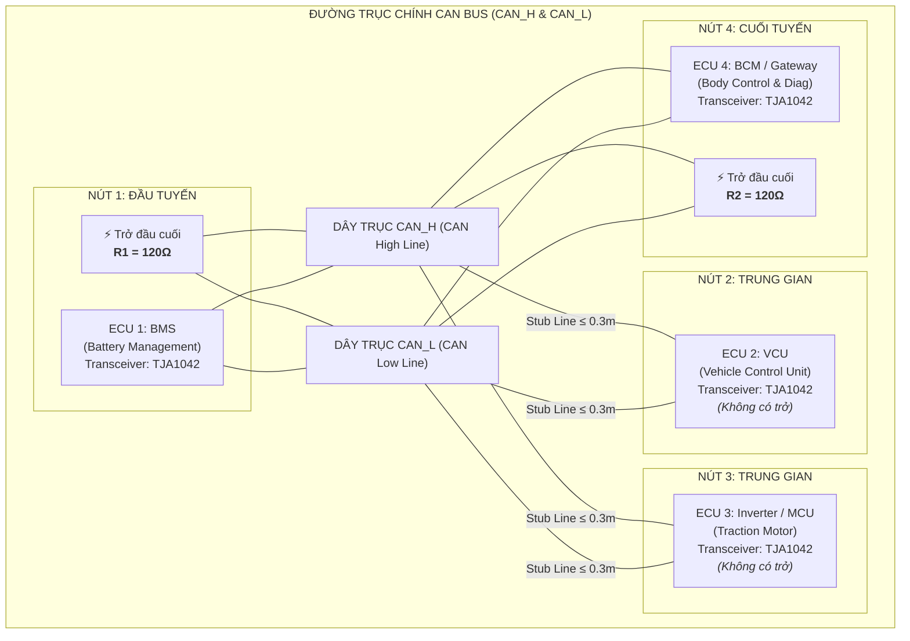
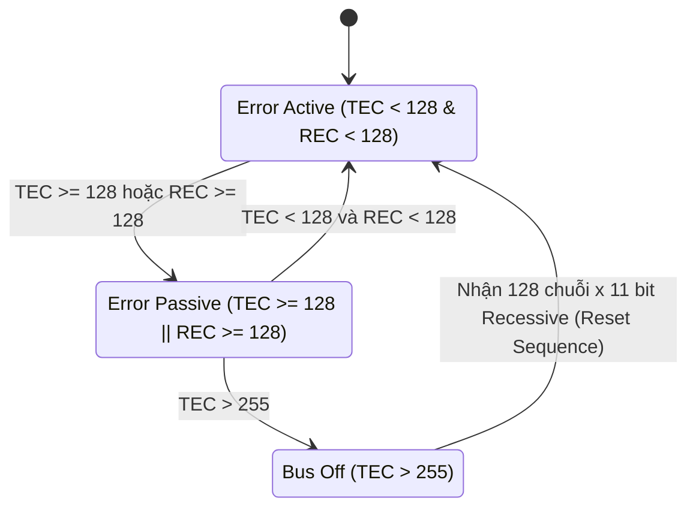
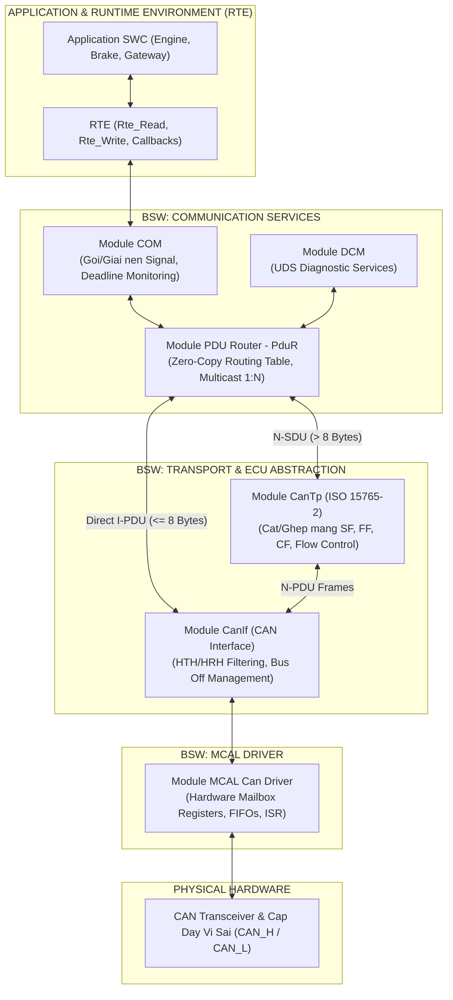
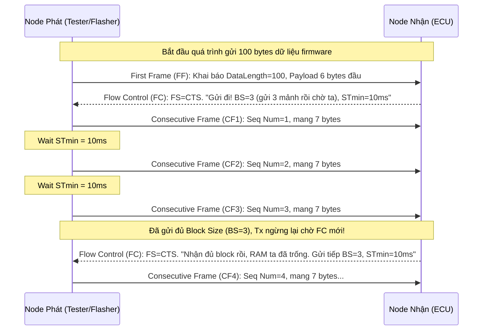
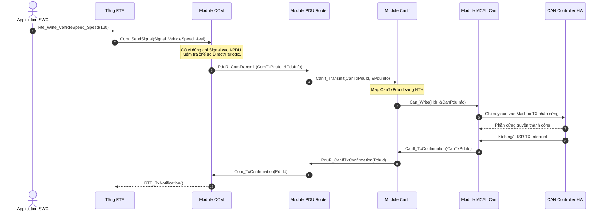
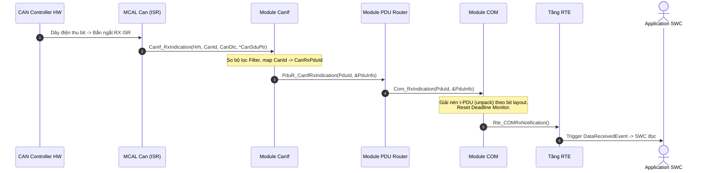

# Chuyên Đề 03: Communication Stack (ComStack) & Giao Thức CAN/CAN-FD Masterclass

> **Ngôn ngữ:** Tiếng Việt Kỹ Nghệ Chuẩn Mực  
> **Cấp độ:** 🟢 Newbie đến 🔴 Expert (Universal Learning Resource)  
> **Tiêu chuẩn tham chiếu:** AUTOSAR ComStack SWS (Release 4.x / R22-11), ISO 11898-1/2 (CAN/CAN-FD), ISO 15765-2 (DoCAN / CanTp)  
> **Mã nguồn đối chiếu thực tế:** Kho mã nguồn `Study_AUTOSAR-main/as/` (`com/as.infrastructure/communication/`)  

---

## Bảng Hệ Thống Icon Hướng Dẫn

- 📖 **Glossary / Định nghĩa:** Giải thích thuật ngữ cốt lõi.
- 💡 **Ví dụ / Example:** Minh họa thực tế dễ hiểu.
- ⚠️ **Warning / Pitfall:** Những cạm bẫy dễ mắc phải trong dự án thực tế.
- ✅ **Best Practice:** Thực hành tốt nhất được khuyến nghị bởi chuyên gia.
- ❌ **Bad Practice:** Cách làm tồi cần tránh.
- 🎯 **Use Case:** Tình huống sử dụng cụ thể.
- 🔧 **API Reference:** Cấu trúc hàm/mã nguồn thực tế.
- 📊 **Data / Statistics:** Công thức tính toán và số liệu đo lường.
- 🛠️ **Hands-On Exercise:** Bài tập thực hành thực tế.
- 🟢🟡🔴 **Difficulty Level:** Mức độ khó của kiến thức.
- 💀 **Critical Bug:** Lỗi nghiêm trọng gây hậu quả lớn (thu hồi xe, hỏng phần cứng).

---

## 1. Nền Tảng Giao Thức CAN & CAN-FD (ISO 11898 Masterclass)

### 1.1 Tầng Vật Lý: Điện Áp Vi Sai & Trở Kháng Đầu Cuối 120Ω


#### Kiến Trúc Đường Trục Tuyến Tính (Linear Backbone Topology) 4 ECU

Mạng CAN tiêu chuẩn ISO 11898-2 bắt buộc phải được thi công dưới dạng **đường trục chính thẳng (Backbone)** nối dài từ điểm đầu đến điểm cuối xe, các ECU trung gian kết nối vào trục thông qua các nhánh rẽ ngắn (**Stub Line**):

```text
┌────────────────────────────────────────────────────────────────────────────────────────────────────────────────────────┐
│                              SƠ ĐỒ NGUYÊN LÝ MẠNG CAN BUS 4 ECU TRÊN Ô TÔ (ISO 11898-2)                                │
├────────────────────────────────────────────────────────────────────────────────────────────────────────────────────────┤
│    [NÚT ĐẦU TUYẾN]                [NÚT TRUNG GIAN 1]              [NÚT TRUNG GIAN 2]                [NÚT CUỐI TUYẾN]   │
│       ECU 1: BMS                     ECU 2: VCU                   ECU 3: INVERTER / MCU            ECU 4: BCM / GATEWAY│
│  ┌──────────────────┐           ┌──────────────────┐            ┌─────────────────────┐          ┌───────────────────┐ │
│  │ Microcontroller  │           │ Microcontroller  │            │   Microcontroller   │          │  Microcontroller  │ │
│  │ (CAN Controller) │           │ (CAN Controller) │            │  (CAN Controller)   │          │ (CAN Controller)  │ │
│  └────────┬─────────┘           └────────┬─────────┘            └──────────┬──────────┘          └─────────┬─────────┘ │
│      TxD  │  ▲ RxD                  TxD  │  ▲ RxD                      TxD │  ▲ RxD                    TxD │  ▲ RxD    │
│           ▼  │                           ▼  │                              ▼  │                            ▼  │        │
│  ┌────────┴─────────┐           ┌────────┴─────────┐            ┌──────────┴──────────┐          ┌─────────┴─────────┐ │
│  │ CAN Transceiver  │           │ CAN Transceiver  │            │   CAN Transceiver   │          │  CAN Transceiver  │ │
│  │ (ví dụ: TJA1042) │           │ (ví dụ: TJA1042) │            │   (ví dụ: TJA1042)  │          │ (ví dụ: TJA1042)  │ │
│  └───┬───────────┬──┘           └───┬───────────┬──┘            └───┬───────────┬─────┘          └───┬───────────┬───┘ │
│      │ CAN_H     │ CAN_L            │ CAN_H     │ CAN_L             │ CAN_H     │ CAN_L              │ CAN_H     │CAN_L│
│      │           │                  │           │                   │           │                    │           │     │
│      │   ┌─────┐ │                  │ (Đường    │                   │ (Đường    │                    │   ┌─────┐ │     │
│      ├───┤ 120Ω├─┤                  │  nhánh    │                   │  nhánh    │                    ├───┤ 120Ω├─┤     │
│      │   │  R1 │ │                  │  ≤ 0.3m)  │                   │  ≤ 0.3m)  │                    │   │  R2 │ │     │
│      │   └─────┘ │                  │           │                   │           │                    │   └─────┘ │     │
│══════╪═══════════╪══════════════════╪═══════════╪═══════════════════╪═══════════╪════════════════════╪═══════════╪═════│ DÂY TRỤC CAN_H
│      │           │                  │           │                   │           │                    │           │     │
│══════╪═══════════╪══════════════════╪═══════════╪═══════════════════╪═══════════╪════════════════════╪═══════════╪═════│ DÂY TRỤC CAN_L
│                                                                                                                        │
│  ◄──────────────────────────── ĐƯỜNG TRỤC CHÍNH (CAN BUS BACKBONE) ────────────────────────────────────────────────►   │
│  * Điện trở tương đương toàn bus: R_bus = R1 // R2 = 120Ω // 120Ω = 60Ω                                                │
│  * Nút trung gian (ECU 2 - VCU, ECU 3 - Inverter): TUYỆT ĐỐI KHÔNG gắn điện trở, nối qua nhánh ngắn (Stub Line ≤ 0.3m) │
└────────────────────────────────────────────────────────────────────────────────────────────────────────────────────────┘
```



#### Định Nghĩa Mức Logic: Dominant (Trội) vs Recessive (Lặn)

CAN sử dụng hai trạng thái bit có tính chất ưu tiên vật lý:

| Thông số / Trạng thái | Bit 0: Dominant (Mức Trội) | Bit 1: Recessive (Mức Lặn) |
| :--- | :--- | :--- |
| **Giá trị logic của MCU** | Chân TxD = $0\text{V}$ (Logic 0) | Chân TxD = $3.3\text{V} / 5\text{V}$ (Logic 1) |
| **Trạng thái Transistor Transceiver** | Mở (Dẫn dòng tích cực) | Đóng hoàn toàn (Thả nổi cách ly) |
| **Điện áp dây CAN_H** | $\approx 3.5\text{V}$ (Dải chuẩn: $2.75\text{V} - 4.5\text{V}$) | $\approx 2.5\text{V}$ (Dải chuẩn: $2.0\text{V} - 3.0\text{V}$) |
| **Điện áp dây CAN_L** | $\approx 1.5\text{V}$ (Dải chuẩn: $0.5\text{V} - 2.25\text{V}$) | $\approx 2.5\text{V}$ (Dải chuẩn: $2.0\text{V} - 3.0\text{V}$) |
| **Điện áp vi sai $V_{\text{diff}}$** | **$\approx +2.0\text{V}$** (Dải chuẩn: $1.5\text{V} - 3.0\text{V}$) | **$\approx 0.0\text{V}$** (Dải chuẩn: $-0.5\text{V} - +0.05\text{V}$) |
| **Dòng điện qua bus ($R_{\text{bus}} = 60\Omega$)** | Bơm dòng: $I \approx \frac{2.0\text{V}}{60\Omega} \approx 33.3\text{mA}$ | Thả nổi: $I \approx 0\text{mA}$ |
| **Ý nghĩa phân xử bus (Wired-AND)** | **Áp đảo (Thắng):** Kéo bus về mức 0 | **Nhượng bộ (Thua):** Bị mức Dominant đè |

- **Nguyên lý phân xử "Dominant đè Recessive" (Wired-AND Logic):**
  - Nếu ECU 1 (BMS) muốn phát bit 0 (kích hoạt transistor bơm dòng tạo $V_{\text{diff}} = 2\text{V}$), trong khi cùng lúc đó ECU 2 (VCU) muốn phát bit 1 (thả nổi transistor):
  - Do có dòng điện từ ECU 1 chạy qua hai trở $120\Omega$, toàn bộ đường bus lập tức có điện áp chênh lệch $V_{\text{diff}} = 2\text{V}$.
  - Lúc này, bộ thu của cả 4 ECU (kể cả ECU 2) đều đọc được bit 0. ECU 2 phát hiện mình muốn phát 1 nhưng bus lại nhận 0, lập tức nhận biết mình bị mất quyền ưu tiên (Arbitration Loss) và tự động lùi về chế độ chỉ lắng nghe mà không gây hỏng dữ liệu của ECU 1.
  - Chỉ khi **toàn bộ 4 ECU đều phát bit 1 (thả nổi)** thì bus mới đo được $V_{\text{diff}} \approx 0\text{V}$ (Recessive).

#### Ví Dụ Thực Tế Đo Dạng Sóng Trên Máy Hiện Sóng (Oscilloscope Measurement Example)

Khi kỹ sư kết nối máy hiện sóng số (Digital Storage Oscilloscope - DSO) vào mạng CAN để kiểm tra chất lượng tín hiệu (Signal Integrity), thiết lập chuẩn gồm:
- **Kênh CH1 (Đầu dò vàng):** Kẹp vào chân **CAN_H** (tham chiếu mass xe GND).
- **Kênh CH2 (Đầu dò xanh lam):** Kẹp vào chân **CAN_L** (tham chiếu mass xe GND).
- **Kênh toán học MATH (Đường màu tím):** Cấu hình hàm toán học $\text{MATH} = \text{CH1} - \text{CH2}$ để đo trực tiếp điện áp vi sai $V_{\text{diff}}$.
- **Tốc độ truyền (Baudrate):** $500\text{ kbps} \implies \text{Thời gian 1 bit (Bit Time)} = \frac{1}{500,000\text{ Hz}} = 2.0\,\mu\text{s}$.

Dưới đây là hình ảnh thực tế ghi nhận trên màn hình máy hiện sóng khi một ECU bắt đầu truyền khung dữ liệu với chuỗi bit `1 (Idle) -> 0 (SOF) -> 1 (Data) -> 0 (Data) -> 1 (Data)`:

```text
┌────────────────────────────────────────────────────────────────────────────────────────────────────────────────────────┐
│                      HÌNH ẢNH DẠNG SÓNG THỰC TẾ TRÊN MÁY HIỆN SÓNG (OSCILLOSCOPE WAVEFORM CAPTURE)                     │
├────────────────────────────────────────────────────────────────────────────────────────────────────────────────────────┤
│ Cấu hình đo: Tốc độ 500 kbps (1 Bit = 2.0 µs) │ Thang đo trục Y: 1.0V/Div │ Thang thời gian trục X: 2.0 µs/Div         │
│ Kênh CH1 (Vàng): Dây CAN_H │ Kênh CH2 (Xanh lam): Dây CAN_L │ Kênh MATH (Tím): V_diff = CAN_H - CAN_L                  │
└────────────────────────────────────────────────────────────────────────────────────────────────────────────────────────┘

 Điện áp (V)
   ▲
   │
4.0┼┄┄┄┄┄┄┄┄┄┄┄┄┄┄┄┄┄┄┄┄┄┄┄┄┄┄┄┄┄┄┄┄┄┄┄┄┄┄┄┄┄┄┄┄┄┄┄┄┄┄┄┄┄┄┄┄┄┄┄┄┄┄┄┄┄┄┄┄┄┄┄┄┄┄┄┄┄┄┄┄┄┄┄┄┄┄┄┄┄┄┄┄┄┄┄┄
   │
3.5┼               ┌───────────────────────┐                       ┌───────────────────────┐          CAN_H (CH1)
   │               │                       │                       │                       │          Mức Dominant (+3.5V)
3.0┼ - - - - - - - │ - - - - - - - - - - - │ - - - - - - - - - - - │ - - - - - - - - - - - │ - - - - 
   │   Recessive   │       Dominant        │       Recessive       │       Dominant        │  Recessive
2.5┼═══════════════╡                       ╞═══════════════════════╡                       ╞════════  CAN_H & CAN_L đè nhau
   │ (Điện áp tĩnh)│                       │    (Điện áp tĩnh)     │                       │          Mức Recessive (+2.5V)
2.0┼ - - - - - - - │ - - - - - - - - - - - │ - - - - - - - - - - - │ - - - - - - - - - - - │ - - - - 
   │               │                       │                       │                       │
1.5┼               └───────────┬───────────┘                       └───────────┬───────────┘          CAN_L (CH2)
   │                           │ Sample Point (80%)                            │                      Mức Dominant (+1.5V)
1.0┼┄┄┄┄┄┄┄┄┄┄┄┄┄┄┄┄┄┄┄┄┄┄┄┄┄┄┄┼┄┄┄┄┄┄┄┄┄┄┄┄┄┄┄┄┄┄┄┄┄┄┄┄┄┄┄┄┄┄┄┄┄┄┄┄┄┄┄┄┄┄┄┄┄┄┼┄┄┄┄┄┄┄┄┄┄┄┄┄┄┄┄┄┄┄
   │                           ▼                                               ▼
0.0┴────────────────────────────────────────────────────────────────────────────────────────────────► Thời gian (t)
   │
   │─── KÊNH TOÁN HỌC: MATH = CH1 - CH2 (ĐIỆN ÁP VI SAI V_diff) ────────────────────────────────────
   │
   ▲
2.0┼               ┌───────────────────────┐                       ┌───────────────────────┐          V_diff = +2.0V
   │               │                       │                       │                       │          (Dominant: Bit 0)
0.0┴───────────────┘                       └───────────────────────┘                       └────────► V_diff =  0.0V
   │                                                                                                  (Recessive: Bit 1)
   ├───────────────┬───────────────────────┬───────────────────────┬───────────────────────┤
   │◄── 2.0 µs ───►│◄────── 2.0 µs ───────►│◄────── 2.0 µs ───────►│◄────── 2.0 µs ───────►│
   │   Bus Rảnh    │ Bit Bắt Đầu Khung SOF │    Bit Dữ Liệu ID9    │    Bit Dữ Liệu ID8    │      Bit Kế Tiếp...
   │  Bit 1 (Lặn)  │      Bit 0 (Trội)     │      Bit 1 (Lặn)      │      Bit 0 (Trội)     │       Bit 1 (Lặn)
   │  [RECESSIVE]  │       [DOMINANT]      │      [RECESSIVE]      │       [DOMINANT]      │       [RECESSIVE]
   │ TxD = 3.3V/5V │     TxD = 0.0V (GND)  │     TxD = 3.3V/5V     │    TxD = 0.0V (GND)   │      TxD = 3.3V/5V
```

```text
┌────────────────────────────────────────────────────────────────────────────────────────────────────────────────────────┐
│                              BẢN VẼ TÁCH BIỆT DẠNG SÓNG TỪNG KÊNH TRUYỀN (CHANNEL DECOMPOSITION)                       │
├────────────────────────────────────────────────────────────────────────────────────────────────────────────────────────┤
│ 1. KÊNH CH1: DÂY CAN_H (Đo so với GND)                                                                                 │
│                                                                                                                        │
│  3.5V ────────────┐               ┌───────────────────────┐                       ┌───────────────────────┐            │
│                   │               │                       │                       │                       │            │
│  2.5V ────────────┴───────────────┘                       └───────────────────────┘                       └─────────── │
│                   │◄── 2.0 µs ───►│◄────── 2.0 µs ───────►│◄────── 2.0 µs ───────►│◄────── 2.0 µs ───────►│            │
├────────────────────────────────────────────────────────────────────────────────────────────────────────────────────────┤
│ 2. KÊNH CH2: DÂY CAN_L (Đo so với GND)                                                                                 │
│                                                                                                                        │
│  2.5V ────────────┬───────────────┐                       ┌───────────────────────┐                       ┌─────────── │
│                   │               │                       │                       │                       │            │
│  1.5V ────────────┘               └───────────────────────┘                       └───────────────────────┘            │
│                   │◄── 2.0 µs ───►│◄────── 2.0 µs ───────►│◄────── 2.0 µs ───────►│◄────── 2.0 µs ───────►│            │
├────────────────────────────────────────────────────────────────────────────────────────────────────────────────────────┤
│ 3. KÊNH TOÁN HỌC: MATH (Điện áp vi sai V_diff = CAN_H - CAN_L)                                                         │
│                                                                                                                        │
│ +2.0V ────────────┐               ┌───────────────────────┐                       ┌───────────────────────┐            │
│                   │               │                       │                       │                       │            │
│   0.0V ───────────┴───────────────┘                       └───────────────────────┘                       └─────────── │
│                   │◄── 2.0 µs ───►│◄────── 2.0 µs ───────►│◄────── 2.0 µs ───────►│◄────── 2.0 µs ───────►│            │
│                   │  Recessive 1  │      Dominant 0       │      Recessive 1      │      Dominant 0       │Recessive 1 │
└────────────────────────────────────────────────────────────────────────────────────────────────────────────────────────┘
```

##### Phân Tích Chi Tiết 4 Trạng Thái Quan Sát Được Trên Màn Hình Máy Hiện Sóng:

1. **Giai đoạn Bus Idle / Bit 1 (Recessive - Lặn):**
   - **Đặc điểm hiển thị:** Hai tia tín hiệu CH1 (CAN_H) và CH2 (CAN_L) chập đè lên nhau thành một đường thẳng duy nhất nằm tại vạch **$+2.5\text{V}$**.
   - **Tín hiệu vi sai MATH:** $V_{\text{diff}} = 2.5\text{V} - 2.5\text{V} = 0.0\text{V}$.
   - **Bản chất mạch:** Lúc này MCU phát chân TxD = $3.3\text{V}$ (hoặc $5\text{V}$), toàn bộ các transistor công suất bên trong CAN Transceiver đều ngắt dòng hoàn toàn. Bus ở trạng thái thả nổi tự do, được mạng phân áp nội bộ kéo về mức điện áp chung $+2.5\text{V}$. Không có dòng điện tiêu thụ qua tải.
2. **Giai đoạn chuyển sườn lên Bit 0 (Dominant - Trội):**
   - **Đặc điểm hiển thị:** Đúng khoảnh khắc ECU phát bit 0 (ví dụ bit SOF - Start of Frame), hai đường tín hiệu **mở rộng đối xứng nhau qua trục trung hòa $+2.5\text{V}$**:
     - Kênh CH1 (CAN_H) vọt lên đỉnh: **$+3.5\text{V}$** (tăng thêm $+1.0\text{V}$).
     - Kênh CH2 (CAN_L) tụt xuống đáy: **$+1.5\text{V}$** (giảm đi $-1.0\text{V}$).
   - **Tín hiệu vi sai MATH:** Vọt thẳng lên mức **$+2.0\text{V}$** ($3.5\text{V} - 1.5\text{V}$).
   - **Bản chất mạch:** MCU kéo chân TxD xuống $0\text{V}$ (GND). Transceiver lập tức kích hoạt hai transistor đẩy kéo (Push-Pull): một transistor nối nguồn cấp $+5\text{V}$ bơm dòng vào CAN_H, một transistor nối GND hút dòng từ CAN_L. Dòng điện khoảng $33.3\text{mA}$ chạy xuyên qua hai điện trở đầu cuối $120\Omega$, tạo ra sụt áp vi sai $+2.0\text{V}$.
   - Bộ so sánh (Comparator) tại đầu thu nhận thấy $V_{\text{diff}} = 2.0\text{V} > 0.9\text{V}$ (ngưỡng quy định ISO 11898-2) và xuất tín hiệu mức thấp ($0\text{V}$) về chân RxD cho MCU nhận diện chính xác bit 0.
3. **Đặc tính thời gian xung (Bit Timing & Sườn Xung):**
   - **Độ rộng bit (Bit Width):** Tại baudrate $500\text{ kbps}$, mỗi ô bit có chiều dài chính xác $2.0\,\mu\text{s}$ (dung sai clock thạch anh khắt khe $<\pm 0.5\%$).
   - **Thời gian sườn lên (Rise Time):** Quá trình chuyển từ Recessive sang Dominant diễn ra cực nhanh ($t_{\text{rise}} < 50\text{ns}$) nhờ có transistor chủ động bơm dòng (**Active Drive**).
   - **Thời gian sườn xuống (Fall Time):** Quá trình trở về Recessive phụ thuộc vào dòng xả tự nhiên qua điện trở kết thúc $60\Omega$ và tụ ký sinh của dây cáp (**Passive Release**), sườn xuống hơi thoai thoải hơn một chút ($t_{\text{fall}} \approx 50\text{ns} - 100\text{ns}$).
4. **Điểm lấy mẫu dữ liệu (Sample Point):**
   - Bộ thu CAN không đọc tín hiệu ở ngay đầu bit (nơi vừa chuyển trạng thái có thể còn gợn sóng ringing nhỏ).
   - Phần cứng CAN Controller tự động chờ đến vị trí **$75\% - 80\%$ của chu kỳ bit** (tương ứng thời điểm $1.5\,\mu\text{s} - 1.6\,\mu\text{s}$ tính từ đầu bit) — khi điện áp đã hoàn toàn phẳng và ổn định tuyệt đối — mới chốt giá trị bit vào thanh ghi nhận.

##### Bảng Chẩn Đoán Dị Tật Sóng (Waveform Anomalies) Thường Gặp Khi Bắt Bằng Oscilloscope:

| Hình ảnh thực tế trên Oscilloscope | Nguyên nhân lỗi phần cứng | Hậu quả kỹ thuật |
| :--- | :--- | :--- |
| **Sóng có xung nhọn dội ngược (Ringing / Overshoot $> 4.0\text{V}$)** | **Mất 1 điện trở đầu cuối** (Tổng trở đo được $120\Omega$ thay vì $60\Omega$). Sóng cao tần không được hấp thụ, dội ngược ở đầu cáp hở. | Ở $125\text{kbps}$ chạy bình thường, nhưng lên $500\text{kbps}$ hoặc CAN-FD thì rung sóng lấn vào Sample Point $\to$ Báo lỗi **Error Frame** liên tục. |
| **Biên độ vi sai thấp ($V_{\text{diff}} < 1.2\text{V}$)** | **Thừa điện trở đầu cuối** (Gắn 3 hoặc 4 trở $120\Omega$, tổng trở tụt về $40\Omega$ hoặc $30\Omega$). | Dòng tải vượt quá khả năng Transceiver, áp vi sai tụt sát ngưỡng lật trạng thái $\to$ Mất gói tin chập chờn khi xe tăng tốc hoặc nhiệt độ tăng. |
| **Đường $2.5\text{V}$ bị nâng lên $3.5\text{V}$ hoặc tụt xuống $1.5\text{V}$** | **Lệch điện áp mass (Ground Offset / Shift)** giữa các cụm ECU do dây tiếp địa khung xe bị rỉ sét hoặc lỏng ốc. | Nhờ nguyên lý vi sai, $V_{\text{diff}}$ vẫn giữ được $+2.0\text{V}$ nên xe vẫn chạy được, nhưng biên độ chịu nhiễu EMI bị thu hẹp đáng kể. |
| **CAN_H hoặc CAN_L bị ghim cứng ở $0\text{V}$ hoặc $12\text{V}$** | Chạm chập dây cáp: Short-to-GND hoặc Short-to-VBAT (chạm nguồn ắc quy). | Transceiver kích hoạt bảo vệ quá dòng, ECU rơi vào trạng thái cô lập **Bus-Off**. |

---

### NÂNG CAO

#### 1. Tại Sao Bắt Buộc Là 120Ω Và Chỉ Đặt Ở 2 Nút Xa Nhất?

1. **Trở kháng đặc tính (Characteristic Impedance $Z_0$):**
   - Dây cáp xoắn đôi dùng trong ngành ô tô có trở kháng sóng cao tần danh định xấp xỉ $Z_0 = 120\Omega$ (được quyết định bởi đường kính lõi đồng, khoảng cách giữa 2 dây và hằng số điện môi của lớp vỏ cách điện).
   - Khi tín hiệu điện áp chuyển trạng thái (sườn lên/sườn xuống chỉ vài nano giây), sóng điện từ lan truyền trên dây với vận tốc xấp xỉ $200,000\text{ km/s}$.
2. **Hiện tượng phản xạ sóng (Signal Reflection):**
   - Theo lý thuyết đường dây truyền tải (Transmission Line Theory), khi sóng điện từ chạy tới cuối đường cáp:
     - Nếu đầu cáp để **hở mạch** ($R = \infty$), toàn bộ năng lượng sóng sẽ **bị dội ngược trở lại** (tương tự sóng nước đập vào bờ tường bê tông). Sóng phản xạ dội ngược giao thoa với sóng phát tới, tạo ra các xung dao động méo dạng nghiêm trọng (**Ringing / Overshoot / Undershoot**), làm cho Transceiver đọc sai bit.
     - Nếu gắn điện trở đầu cuối **bằng đúng trở kháng đặc tính cáp ($R_{\text{term}} = Z_0 = 120\Omega$)**, toàn bộ năng lượng của sóng điện từ khi truyền tới đầu mút sẽ bị điện trở hấp thụ 100% và chuyển hóa thành nhiệt lượng siêu nhỏ ($P = I^2 R$). Hoàn toàn không còn sóng dội ngược, sườn xung vuông vắn và sắc nét.
3. **Tại sao ECU ở giữa (ECU 2 - VCU, ECU 3 - Inverter) TUYỆT ĐỐI KHÔNG ĐƯỢC gắn thêm trở?**
   - Hai điện trở $120\Omega$ ở hai đầu mút được mắc song song qua cặp dây CAN_H và CAN_L:
     $$R_{\text{bus}} = R_1 \parallel R_2 = \frac{120\Omega \times 120\Omega}{120\Omega + 120\Omega} = 60\Omega$$
   - Khi đó dòng điện vi sai mà Transceiver phải cấp ở mức Dominant là $I = \frac{2.0\text{V}}{60\Omega} \approx 33.3\text{mA}$ — hoàn toàn nằm trong vùng làm việc tối ưu và mát của chip bán dẫn.
   - **Hậu quả nếu lắp sai số lượng điện trở:**
     - **Nếu có 3 trở $120\Omega$** (gắn nhầm vào ECU 2): $R_{\text{bus}} = 120\Omega \parallel 120\Omega \parallel 120\Omega = 40\Omega$. Dòng tải tăng vọt lên $I = \frac{2.0\text{V}}{40\Omega} = 50\text{mA}$. Transceiver bị phát nhiệt lớn, sụt áp $V_{\text{diff}}$ xuống dưới $1.5\text{V}$, gây lỗi ngắt quãng (Intermittent Error).
     - **Nếu cả 4 ECU đều có trở $120\Omega$**: $R_{\text{bus}} = 30\Omega \implies I \approx 66.7\text{mA}$. Mạch bảo vệ quá dòng/quá nhiệt của Transceiver lập tức kích hoạt ngắt mạch, bus bị sập hoàn toàn (Bus-Off).
     - **Nếu chỉ có 1 trở $120\Omega$** (thiếu 1 trở đầu cuối): $R_{\text{bus}} = 120\Omega$. Đầu không có trở sinh phản xạ sóng cực mạnh. Ở tốc độ thấp $125\text{kbps}$, chu kỳ bit đủ dài ($8\mu\text{s}$) nên dao động ringing kịp lắng xuống trước thời điểm lấy mẫu (Sample Point). Tuy nhiên, khi chuyển sang tốc độ cao $500\text{kbps}$ ($2\mu\text{s}$) hoặc CAN-FD $2\text{Mbps} - 5\text{Mbps}$, dao động dội ngược trùng khớp đúng vào Sample Point, làm bộ điều khiển CAN sinh khung lỗi (**Error Frame**) liên tục.
4. **Quy tắc thiết kế đường nhánh (Stub Line Constraints):**
   - Đoạn dây dẫn nối từ đường trục chính (Backbone) vào ECU trung gian (Stub Line) là đoạn dây không có trở kết thúc.
   - Để năng lượng phản xạ trên nhánh rẽ không làm biến dạng sóng trên trục chính:
     - Độ dài nhánh rẽ: **$L_{\text{stub}} \le 0.3\text{m}$** (ở tốc độ $500\text{kbps} - 1\text{Mbps}$).
     - Tổng chiều dài cộng dồn tất cả các đường nhánh trên toàn mạng không vượt quá $3\text{m} - 5\text{m}$.
     - Khoảng cách giữa hai điểm nối rẽ nhánh liên tiếp trên trục chính tối thiểu phải từ **$0.1\text{m}$** trở lên để tránh tạo dung kháng ký sinh tập trung.

#### 2. Bảng Hướng Dẫn Đo Kiểm Chẩn Đoán Thực Tế (Troubleshooting Checklist)

Kỹ sư kiểm tra nhanh tính toàn vẹn của tầng vật lý CAN bằng đồng hồ vạn năng số (VOM/DMM) theo các bước:

| Chế độ kiểm tra | Điểm đo | Giá trị tiêu chuẩn | Chẩn đoán lỗi nếu sai lệch |
| :--- | :--- | :--- | :--- |
| **Tắt nguồn xe (Power OFF / Cọc bình rút)** | Que đỏ: **CAN_H**<br>Que đen: **CAN_L**<br>(Đo thang Ohm $\Omega$) | **$55\Omega - 65\Omega$**<br>(Danh định: $60\Omega$) | - **$110\Omega - 130\Omega$:** Thiếu 1 điện trở đầu cuối, hoặc đứt cáp giữa chừng chia cắt mạng làm đôi.<br>- **$38\Omega - 45\Omega$:** Cắm nhầm ECU thứ 3 có chứa trở $120\Omega$.<br>- **$28\Omega - 33\Omega$:** Cắm nhầm cả 4 ECU đều có trở.<br>- **$0\Omega$ (hoặc rất nhỏ):** Chập dây CAN_H với CAN_L.<br>- **$\infty$ (Hở mạch):** Đứt toàn bộ cáp hoặc mất cả 2 điện trở đầu cuối. |
| **Tắt nguồn xe (Power OFF)** | Que đỏ: **CAN_H (hoặc CAN_L)**<br>Que đen: **Chassis (Mass vỏ xe)** | **$\ge 1\text{ M}\Omega$ (Cách điện)** | - **$\approx 0\Omega$:** Dây CAN bị chạm chập vào khung xe (Short-to-GND). |
| **Bật khóa điện (IGN ON) - Bus rảnh** | Que đỏ: **CAN_H** / Que đen: **GND**<br>Que đỏ: **CAN_L** / Que đen: **GND** | **CAN_H $\approx 2.5\text{V}$**<br>**CAN_L $\approx 2.5\text{V}$**<br>($V_{\text{diff}} \approx 0\text{V}$) | - Nếu một dây vọt lên $12\text{V}$: Chạm chập nguồn ắc quy (Short-to-VBAT).<br>- Nếu tụt về $0\text{V}$: Chạm mass hoặc Transceiver hỏng. |
| **Xe hoạt động - Bus có giao tiếp** | Đo vi sai: **CAN_H so với CAN_L**<br>(Đo thang Volt DC) | **$V_{\text{diff}} \approx 1.5\text{V} - 2.5\text{V}$**<br>(Giá trị trung bình theo chu kỳ) | - Tín hiệu dao động bình thường của các khung truyền đang phát liên tục. |

---

### 1.2 Cấu Trúc Khung Truyền CAN 2.0A (11-bit) & CAN 2.0B (29-bit Extended)


#### 1. Cơ Sở Mã Hóa & Chuyên Sâu Về Cơ Chế Bit Stuffing (Nguyên Lý, Vùng Giới Hạn, Bắt Lỗi & Cải Tiến CAN-FD)

Trước khi phân tích chi tiết từng trường bit, kỹ sư cần nắm vững **Nguyên lý Mã hóa NRZ & Cơ chế Bit Stuffing** — bởi vì Bit Stuffing quyết định trực tiếp việc tại sao khung truyền có ranh giới "Vùng áp dụng Stuffing" và "Vùng miễn nhiễm", cũng như lý do chiều dài khung thực tế luôn biến thiên.

##### A. Tại Sao Mạng CAN Bắt Buộc Phải Có Bit Stuffing?
1. **CAN Không Có Dây Clock Riêng:** Khác với SPI hay I2C (sở hữu chân xung nhịp riêng như SCK/SCL để đồng bộ dữ liệu theo từng sườn xung), bus CAN chỉ sử dụng duy nhất một cặp dây vi sai (`CAN_H` và `CAN_L`) để truyền tải đồng thời cả dữ liệu lẫn tín hiệu đồng hồ.
2. **Mã Hóa NRZ (Non-Return-to-Zero):** Mạng CAN sử dụng mã hóa NRZ — bit 0 giữ điện áp Dominant liên tục, bit 1 giữ điện áp Recessive liên tục trong suốt thời gian bit. Nếu dữ liệu có chuỗi dài các bit giống nhau (ví dụ: `0x00 0x00 0x00...` gồm 64 bit 0 liên tiếp), điện áp trên đường truyền sẽ nằm bất động ở mức $V_{\text{diff}} \approx 2.0\text{V}$.
3. **Hiện tượng trôi nhịp đồng hồ (Clock Drift) & Lệch pha (Phase Loss):** Bộ dao động thạch anh trên mỗi ECU có sai số chế tạo và bị trôi tần số theo nhiệt độ môi trường xe hơi ($\pm 0.5\% - 1.58\%$). Nếu không có sườn chuyển tiếp điện áp ($0 \leftrightarrow 1$) trong thời gian dài, mạch bám pha của bộ thu không thể tự cân chỉnh lại. Điểm lấy mẫu (**Sample Point**) sẽ bị trôi dần ra khỏi chu kỳ bit, gây đọc sai dữ liệu (Bit Slip).  
   $\implies$ **Mục tiêu kỹ thuật:** Bit Stuffing cưỡng bức tạo sườn chuyển tiếp xung với chu kỳ tối đa không quá 5 bit, giúp mạch hồi tiếp pha (Resynchronization) của tất cả các bộ thu luôn khóa cứng với xung nhịp của bộ phát.

##### B. Quy Tắc Hoạt Động Phần Cứng (Bit Stuffer vs Bit De-stuffer)
- **Phía Node Phát (Transmitter - Bit Stuffer):**  
  Khi phát hiện chuỗi **5 bit cùng mức logic liên tiếp** (`00000` hoặc `11111`) trong dòng dữ liệu, phần cứng CAN Controller tự động chèn thêm **1 bit đảo chiều (Stuff Bit)** (`1` hoặc `0`) ngay sau bit thứ 5.
- **Phía Node Nhận (Receiver - Bit De-stuffer):**  
  Khi bộ thu đếm được 5 bit liên tiếp cùng mức, nó đọc bit thứ 6:
  1. Dùng sườn chuyển tiếp của bit thứ 6 để **tái đồng bộ pha (Resynchronization)**.
  2. Phần cứng **tự động loại bỏ (strip/discard) bit thứ 6 này** ra khỏi dòng dữ liệu trước khi nạp vào thanh ghi nhận và tính toán mã kiểm tra CRC.

##### C. Sơ Đồ Giải Mã Từng Bước (Bitstream Walkthrough)
```text
1. Dữ liệu gốc từ tầng trên (Application / COM):
   [ 0 ] [ 0 ] [ 0 ] [ 0 ] [ 0 ] [ 0 ] [ 0 ] [ 0 ] [ 1 ]
    └─── 5 bit 0 liên tiếp ───┘

2. Phần cứng Controller phát chèn Stuff Bit (ký hiệu (*)):
   [ 0 ] [ 0 ] [ 0 ] [ 0 ] [ 0 ]   [ 1* ]   [ 0 ] [ 0 ] [ 0 ] [ 1 ]
   └────── 5 bit gốc ──────────┘   (Stuff)  └───── các bit gốc còn lại ─────┘
                                     ▲
                          Tạo sườn xung 0 -> 1 trên dây

3. Dòng bit thực tế chạy trên cặp dây vi sai CAN_H / CAN_L:
   0 ── 0 ── 0 ── 0 ── 0 ── 1* ── 0 ── 0 ── 0 ── 1

4. Phía Controller nhận (De-stuffing):
   - Đọc 5 bit 0 -> Nhận diện chuỗi 5 bit đồng mức.
   - Đọc bit thứ 6: Là bit 1* -> Hợp lệ! Tái đồng bộ xung clock.
   - Tự động gỡ bỏ bit 1* -> Hoàn trả dữ liệu gốc chuẩn xác: 0 0 0 0 0 0 0 0 1.
```

##### D. Ranh Giới Áp Dụng: Vùng Nhồi Bit vs Vùng Miễn Nhiễm
```text
┌────────────────────────────────────────────────────────────────────────┬──────────────────────────────────┐
│                     VÙNG ÁP DỤNG BIT STUFFING                          │      VÙNG MIỄN NHIỄM STUFFING     │
│             (Bắt đầu từ SOF đến hết bit CRC thứ 15)                    │   (Tuyệt đối KHÔNG ĐƯỢC nhồi bit)│
├─────────┬───────────────────────┬───────────────┬─────────┬────────────┼───────────┬─────┬─────────┬──────┤
│   SOF   │   Arbitration Field   │ Control Field │  DATA   │  CRC Seq   │  CRC Del  │ ACK │ ACK Del │ EOF  │
│  (1 b)  │ (11/29b ID + RTR/IDE) │    (6 bit)    │ (0..8B) │  (15 bit)  │   (1 b)   │(2b) │  (1 b)  │(7 b) │
└─────────┴───────────────────────┴───────────────┴─────────┴────────────┴───────────┴─────┴─────────┴──────┘
```
**Tại sao CRC Delimiter, ACK và EOF tuyệt đối không được nhồi bit?**
- **Trường EOF (End of Frame) gồm đúng 7 bit Recessive (`1111111`):** Nếu cho phép nhồi bit, cứ sau 5 bit 1 (`11111`) bộ phát sẽ chèn 1 bit 0. Lúc đó các ECU nhận không thể phân biệt được đâu là dấu hiệu kết thúc khung truyền, đâu là dữ liệu. Chuỗi 7 bit 1 liên tiếp là ký hiệu cấu trúc tĩnh bất biến để phân giải ranh giới bản tin.
- **CRC Delimiter & ACK Delimiter (1 bit Recessive):** Đóng vai trò khoảng đệm thời gian chuyển mạch cố định, không được phép thay đổi độ dài.

##### E. Cơ Chế Phát Hiện Lỗi: Stuff Error & Lan Truyền Lỗi Toàn Mạng
Nếu trong vùng giám sát (từ SOF đến hết CRC Sequence) mà xuất hiện **6 bit liên tiếp cùng mức logic** (`000000` hoặc `111111`):
1. CAN Controller nhận diện ngay tín hiệu đường truyền bị méo dạng hoặc đứt/chập dây.
2. Bộ điều khiển kích hoạt lỗi **Stuff Error**.
3. **Cơ chế lan truyền lỗi (Error Propagation):** 
   - Node phát hiện lỗi lập tức phát ra **Active Error Flag gồm 6 bit Dominant liên tiếp (`000000`)**.
   - Chuỗi 6 bit 0 này **cố tình vi phạm trắng trợn quy tắc Bit Stuffing trên toàn đường bus**, buộc mọi ECU còn lại trên mạng cũng đồng loạt nhận diện lỗi Stuff Error và hủy bỏ ngay lập tức gói tin bị lỗi.
   - Node phát vi phạm sẽ tăng bộ đếm lỗi truyền `TEC += 8`, kích hoạt cơ chế tự cô lập lỗi ([Fault Confinement](file:///C:/Users/liem.vu/Liem.vuOD/Study_AUTOSAR-main/docs/theory/03_Communication_Stack_And_CAN_Protocol.md#L403-L448)).

##### F. Tính Toán Tải Trọng Bus Load & Chiều Dài Khung Cực Đại (Worst-Case)
Do số lượng bit nhồi phụ thuộc hoàn toàn vào nội dung dữ liệu nhị phân, độ dài thực tế của một khung truyền CAN luôn biến thiên:

Công thức ước lượng số bit nhồi cực đại (Worst-Case Stuff Bits):
$$\text{Stuff\_Bits}_{\text{max}} = \left\lfloor \frac{\text{Stuffable\_Bits} - 1}{4} \right\rfloor$$

| Thông số kỹ thuật | CAN 2.0A (Standard 11-bit) | CAN 2.0B (Extended 29-bit) |
| :--- | :---: | :---: |
| **Số bit trong vùng Stuffing (Payload 8 bytes)** | $1 + 11 + 1 + 1 + 1 + 4 + 64 + 15 = \mathbf{98\text{ bits}}$ | $1 + 11 + 1 + 1 + 18 + 1 + 1 + 1 + 4 + 64 + 15 = \mathbf{118\text{ bits}}$ |
| **Số bit nhồi cực đại ($\text{Worst-case}$)** | $\lfloor \frac{98 - 1}{4} \rfloor = \mathbf{24\text{ bits}}$ | $\lfloor \frac{118 - 1}{4} \rfloor = \mathbf{29\text{ bits}}$ |
| **Chiều dài khung danh định (Best-case, 0 stuff bit)** | **108 bits** (cộng 3 bit IFS = 111) | **128 bits** (cộng 3 bit IFS = 131) |
| **Chiều dài khung cực đại (Worst-case)** | **132 bits** (cộng 3 bit IFS = 135) | **157 bits** (cộng 3 bit IFS = 160) |
| **Độ dôi băng thông do nhồi bit** | **Tăng thêm tối đa ~22.2%** | **Tăng thêm tối đa ~22.6%** |

- **Công thức tính Bus Load chuẩn OEM:**
  $$\text{Bus Load (\%)} = \frac{\sum_{i=1}^{M} \left( \frac{\text{Frame\_Length}_i}{\text{Baudrate}} \right) \times \text{Frequency}_i}{1\text{ second}} \times 100\%$$
- **Quy tắc thiết kế OEM Tier-1:** Khi thiết kế ma trận truyền thông CAN Matrix (`.dbc` / `.arxml`), kỹ sư hệ thống **luôn luôn dùng chiều dài Worst-Case (132 đến 135 bits cho CAN 2.0A)** để tính tải bus. Bus load trung bình không được vượt quá **70%** (khuyến nghị lý tưởng từ $40\% - 60\%$), chừa lại $30\% - 40\%$ biên dự phòng an toàn cho các đợt phát Burst khẩn cấp và cơ chế tự truyền lại khi gặp nhiễu.

##### G. Hạn Chế Của Classic CAN & Cải Tiến Trong CAN-FD (Fixed Stuff Bits)
- **Hạn chế của Classic CAN (CAN 2.0):** Bit nhồi được chèn động (Dynamic Stuffing) dựa theo nội dung dữ liệu. Nếu một bit bị nhiễu điện từ lật ngược giá trị đúng ở vị trí nhồi, vị trí của các bit nhồi phía sau sẽ bị trượt lệch hàng loạt (Cascading Bit Shift), làm bộ tính CRC bị sai lệch và khiến bộ thu khó khoanh vùng lỗi.
- **Cải tiến trong CAN-FD (ISO 11898-1:2015):**
  - Trong trường CRC của CAN-FD, giao thức áp dụng **Fixed Stuff Bits (FSB)**: Các bit nhồi được đặt ở vị trí cố định theo chu kỳ 4 bit (bất kể dữ liệu là gì), xen kẽ giá trị đảo ngược so với bit trước nó.
  - CAN-FD bổ sung thêm trường **Stuff Bit Count (SBC - 3 bit modulo 8 + bit chẵn lẻ Parity)** trước trường CRC để bộ nhận kiểm tra chéo số lượng bit nhồi thực tế có khớp tuyệt đối với bộ phát hay không, triệt tiêu hoàn toàn điểm yếu trượt pha của Classic CAN.

---

#### 2. Sơ Đồ Cấu Trúc Khung Truyền Chuẩn CAN 2.0A (11-bit Identifier)
Tổng chiều dài danh định (chưa tính bit stuffing): **44 bit khung + $0..64$ bit dữ liệu = 44 đến 108 bit**.

```text
┌───────┬───────────────────────────┬─────────────────────┬──────────────┬──────────────────┬──────────────┬────────┬────────┐
│  SOF  │     ARBITRATION FIELD     │    CONTROL FIELD    │  DATA FIELD  │    CRC FIELD     │  ACK FIELD   │  EOF   │  IFS   │
│ (1 b) │         (12 bit)          │       (6 bit)       │  (0..8 Byte) │     (16 bit)     │   (2 bit)    │ (7 bit)│ (≥3 b) │
├───────┼─────────────────────┬─────┼─────┬─────┬─────────┼──────────────┼────────────┬─────┼────────┬─────┼────────┼────────┤
│  SOF  │ Base ID (ID10..ID0) │ RTR │ IDE │ r0  │ DLC(3..0│ Data 0 .. 7  │ CRC Seq    │ CRC │  ACK   │ ACK │  EOF   │  ITM   │
│  (0)  │      (11 bit)       │ (0) │ (0) │ (0) │ (4 bit) │ (0..64 bit)  │ (15 bit)   │ Del │  Slot  │ Del │(1111111│ (111)  │
│       │                     │     │     │     │         │              │            │ (1) │  (R/D) │ (1) │        │        │
└───────┴─────────────────────┴─────┴─────┴─────┴─────────┴──────────────┴────────────┴─────┴────────┴─────┴────────┴────────┘
 ◄────────────────────── VÙNG ÁP DỤNG BIT STUFFING ────────────────────────►│◄──────── VÙNG MIỄN NHIỄM STUFFING ────────►
```

#### 3. Sơ Đồ Cấu Trúc Khung Truyền Mở Rộng CAN 2.0B (29-bit Extended Identifier)
Tổng chiều dài danh định (chưa tính bit stuffing): **64 bit khung + $0..64$ bit dữ liệu = 64 đến 128 bit**.

```text
┌───────┬───────────────────────────────────────────────────────────────┬───────────────────────┬──────────────┬───────────────┬─────────────┬─────────┬─────────┐
│  SOF  │                       ARBITRATION FIELD                       │     CONTROL FIELD     │  DATA FIELD  │   CRC FIELD   │  ACK FIELD  │   EOF   │   IFS   │
│ (1 b) │                           (32 bit)                            │        (6 bit)        │ (0..8 Byte)  │   (16 bit)    │   (2 bit)   │ (7 bit) │ (≥3 b)  │
├───────┼──────────────────────┬─────┬─────┬──────────────────────┬─────┼─────┬─────┬───────────┼──────────────┼─────────┬─────┼───────┬─────┼─────────┼─────────┤
│  SOF  │ Base ID (ID28..ID18) │ SRR │ IDE │  Ext ID (ID17..ID0)  │ RTR │ r1  │ r0  │ DLC(3..0) │ Data 0 .. 7  │ CRC Seq │ CRC │  ACK  │ ACK │   EOF   │   ITM   │
│  (0)  │       (11 bit)       │ (1) │ (1) │       (18 bit)       │ (0) │ (0) │ (0) │  (4 bit)  │ (0..64 bit)  │ (15 bit)│ Del │ Slot  │ Del │(1111111)│  (111)  │
│       │                      │     │     │                      │     │     │     │           │              │         │ (1) │ (R/D) │ (1) │         │         │
└───────┴──────────────────────┴─────┴─────┴──────────────────────┴─────┴─────┴─────┴───────────┴──────────────┴─────────┴─────┴───────┴─────┴─────────┴─────────┘
 ◄───────────────────────────────────────────── VÙNG ÁP DỤNG BIT STUFFING ──────────────────────────────────────────────►│◄───── VÙNG MIỄN NHIỄM STUFFING ───────►
```

---

### NÂNG CAO

#### 1. Trường Khởi Đầu Khung: SOF (Start of Frame) — 1 Bit
- **Giá trị logic:** Luôn là **1 bit Dominant (Mức 0)** ($V_{\text{diff}} \approx 2.0\text{V}$).
- **Cơ chế phần cứng:**
  - Ở trạng thái nghỉ (Bus Idle), đường truyền liên tục ở mức Recessive (Mức 1).
  - Khi một ECU muốn truyền, nó chủ động kéo chân TxD về 0, kích hoạt Transceiver tạo ra sườn điện áp xuống (**Falling Edge: Recessive $\to$ Dominant**).
  - **Hard Synchronization (Đồng bộ cứng):** Mọi CAN Controller khác trên toàn mạng khi nhận được sườn xuống này lập tức reset bộ đếm pha nhịp nội bộ (Time Quanta counter) về phân đoạn `Sync_Seg`. Cơ chế này đảm bảo tất cả các ECU khóa cứng pha xung nhịp với node phát ngay từ bit đầu tiên.
- **Quy tắc Bit Stuffing:** Bắt đầu áp dụng ngay từ bit SOF.

#### 2. Trường Phân Xử Trọng Tài: Arbitration Field
Trường phân xử quyết định quyền ưu tiên chiếm giữ bus khi có nhiều node phát xung đột đồng thời, đồng thời mang địa chỉ nhận dạng của bản tin (Message Identifier).

| Tên Bit / Trường Bit | Khung 2.0A | Khung 2.0B | Mức Logic Chuẩn | Ý Nghĩa Chức Năng & Hành Vi Phần Cứng |
| :--- | :---: | :---: | :---: | :--- |
| **Base Identifier** | 11 bit<br>(`ID10` .. `ID0`) | 11 bit<br>(`ID28` .. `ID18`) | Tùy biến (Dominant / Recessive) | - Được truyền theo thứ tự trọng số cao trước (MSB first).<br>- **Quy định chuẩn ISO 11898:** 7 bit trọng số cao nhất (`ID10..ID4` trong 2.0A hoặc `ID28..ID22` trong 2.0B) **không được phép toàn bộ là bit 1 (Recessive)** (tức là cấm chuỗi `1111111XXXX`) để ngăn ngừa sự nhầm lẫn với cờ phân cách EOF hoặc Passive Error Flag. |
| **SRR (Substitute Remote Request)** | *Không có* | 1 bit | Luôn là **Recessive (1)** | - **Cơ chế tương thích ngược (Backward Compatibility):** Bit SRR trong 2.0B nằm ở cùng vị trí vật lý với bit `RTR` trong 2.0A.<br>- Việc cố định $SRR = 1$ đảm bảo nếu một khung chuẩn CAN 2.0A Data Frame ($RTR = 0$) và một khung mở rộng CAN 2.0B ($SRR = 1$) có cùng 11 bit Base ID ban đầu cạnh tranh bus: **Khung CAN 2.0A có bit 0 sẽ đè bẹp bit 1 của 2.0B**, giành quyền truyền trước mà không bị gián đoạn! |
| **IDE (Identifier Extension)** | 1 bit | 1 bit | 2.0A: **Dominant (0)**<br>2.0B: **Recessive (1)** | - Phân định định dạng khung.<br>- Nếu Controller nhận đọc được $IDE = 0$: Khung là Standard 11-bit, bit tiếp theo là `r0`.<br>- Nếu đọc được $IDE = 1$: Khung là Extended 29-bit, 18 bit tiếp theo là phần mở rộng `Ext ID`.<br>- Trong trường hợp cạnh tranh giữa CAN 2.0A Remote Frame ($RTR = 1, IDE = 0$) và CAN 2.0B Extended Frame ($SRR = 1, IDE = 1$): CAN 2.0A tiếp tục thắng ở bit IDE! |
| **Extended Identifier** | *Không có* | 18 bit<br>(`ID17` .. `ID0`) | Tùy biến (Dominant / Recessive) | - Mang 18 bit định danh mở rộng, kết hợp cùng 11 bit Base ID tạo thành bộ định danh 29-bit duy nhất ($2^{29}$ giá trị).<br>- Trong chuẩn xe tải thương mại **SAE J1939**, 29-bit này được bẻ nhỏ thành: Priority (3 bit), Parameter Group Number - PGN (18 bit), Source Address - SA (8 bit). |
| **RTR (Remote Transmission Request)** | 1 bit<br>(sau `ID0`) | 1 bit<br>(sau `ID0` của Ext ID) | **Dominant (0):** Data Frame<br>**Recessive (1):** Remote Frame | - **Data Frame (Bit 0):** Khung mang tải trọng dữ liệu thực tế.<br>- **Remote Frame (Bit 1):** Khung yêu cầu dữ liệu. Một ECU phát Remote Frame để yêu cầu ECU sở hữu ID tương ứng phải phản hồi lại bằng Data Frame. Do $0$ đè $1$, nếu một ECU đang gửi Data Frame trong khi ECU khác gửi Remote Frame cùng ID, Data Frame sẽ luôn chiếm ưu tiên tuyệt đối. |

#### 3. Trường Điều Khiển: Control Field — 6 Bits
Xác định các cờ đặc tính giao thức tương lai và kích thước tải trọng dữ liệu.

| Tên Bit | Khung 2.0A | Khung 2.0B | Mức Logic Chuẩn | Ý Nghĩa Chức Năng Kỹ Thuật |
| :--- | :---: | :---: | :---: | :--- |
| **IDE** | 1 bit | *Nằm ở Arbitration* | Dominant (0) | Thuộc Control Field trong 2.0A; chỉ thị không mở rộng định danh. |
| **r1 (Reserved Bit 1)** | *Không có* | 1 bit | Luôn là **Dominant (0)** | Dành riêng cho mở rộng giao thức tương lai theo chuẩn ISO. |
| **r0 (Reserved Bit 0)** | 1 bit | 1 bit | Luôn là **Dominant (0)** | - Dành riêng cho mở rộng giao thức (trong CAN-FD, bit này được dùng làm bit FDF - FD Format Indicator).<br>- **Nguyên tắc nhận:** Node phát bắt buộc phát mức 0 (Dominant). Tuy nhiên, node nhận phải được thiết kế để không báo lỗi nếu đọc thấy bit này là mức 1 (Recessive) để đảm bảo khả năng tương thích với các tiêu chuẩn tương lai. |
| **DLC (Data Length Code)** | 4 bit<br>(`DLC3`..`DLC0`) | 4 bit<br>(`DLC3`..`DLC0`) | Nhị phân 4 bit<br>($0000_2$ đến $1111_2$) | - Xác định số lượng byte dữ liệu trong Data Field từ **0 đến 8 bytes** ($0000_2 = 0\text{ byte}, \dots, 1000_2 = 8\text{ bytes}$).<br>- **Quy định CAN 2.0 Classic:** Các giá trị mã hóa từ $1001_2$ ($9$) đến $1111_2$ ($15$) vẫn chỉ được gán tải trọng tối đa là 8 bytes (không mở rộng thêm dữ liệu, chỉ CAN-FD mới dùng mã này để chỉ thị tải trọng lên đến 64 bytes). |

#### 4. Trường Dữ Liệu Tải Trọng: Data Field — 0 đến 8 Bytes (0 đến 64 Bits)
- **Độ dài tải trọng:** Đúng bằng giá trị khai báo trong trường `DLC` ($0 \le N \le 8$ bytes).
- **Khung Remote Frame ($RTR = 1$):** Trường dữ liệu này có độ dài chính xác là **0 bit** (hoàn toàn không được truyền trên bus), dù trường DLC có mang giá trị $1 \dots 8$.
- **Quy tắc thứ tự truyền tải tuần tự (Transmission Order):**  
  Theo tiêu chuẩn ISO 11898-1: **Truyền tuần tự từng byte (Byte 0 trước, đến Byte 7). Trong mỗi byte, bit có trọng số cao nhất được truyền trước (MSB First: Bit 7 $\to$ Bit 0)**.

##### A. Trực Quan Hóa Dòng Bit Chạy Trên Cặp Dây Vi Sai (On-The-Wire Serialization)
Một khung truyền CAN mang đủ tải trọng $DLC = 8$ bytes (tương đương 64 bits dữ liệu tải trọng). Dòng bit tuần tự được đẩy ra từ chân TxD của bộ điều khiển CAN theo đúng thứ tự thời gian ($t_0 \to t_{63}$):

```text
Trục thời gian truyền trên đường bus (Thời gian t tăng dần từ TRÁI sang PHẢI ──────►)

┌────────────────────────┬────────────────────────┬────────────────────────┬─── ... ───┬────────────────────────┐
│         BYTE 0         │         BYTE 1         │         BYTE 2         │           │         BYTE 7         │
│       (Bay đầu tiên)   │      (Bay thứ hai)     │      (Bay thứ ba)      │           │      (Bay cuối cùng)   │
├─┬─┬─┬─┬─┬─┬─┬──────────┼─┬─┬─┬─┬─┬─┬─┬──────────┼─┬─┬─┬─┬─┬─┬─┬──────────┼─── ... ───┼─┬─┬─┬─┬─┬─┬─┬──────────┤
│7│6│5│4│3│2│1│0 (LSB)   │7│6│5│4│3│2│1│0 (LSB)   │7│6│5│4│3│2│1│0 (LSB)   │           │7│6│5│4│3│2│1│0 (LSB)   │
│ │ │ │ │ │ │ │          │ │ │ │ │ │ │ │          │ │ │ │ │ │ │ │          │           │ │ │ │ │ │ │ │          │
▲(MSB)                   ▲(MSB)                   ▲(MSB)                   ▲           ▲(MSB)                   ▲
│                        │                        │                        │           │                        │
Bit thứ 0 của Data Field Bit thứ 8                Bit thứ 16                           Bit thứ 56               Bit thứ 63
```

> ⚠️ **Lưu ý về Bit Stuffing:**  
> Trong quá trình phần cứng đẩy tuần tự 64 bit này ra dây, nếu gặp bất kỳ chuỗi **5 bit nào cùng mức liên tiếp** (ví dụ `00000` hoặc `11111`), mạch Bit Stuffer sẽ lập tức chèn 1 bit đảo chiều vào giữa dòng bit mà không làm thay đổi thứ tự logic của các bit dữ liệu. Phía nhận sau khi gỡ bit nhồi sẽ tái tạo lại đúng 64 bit theo thứ tự này.

##### B. Ví Dụ Cụ Thể Bằng Con Số Hex Thực Tế
Giả sử ECU chuẩn bị gửi một mảng dữ liệu 8 byte:
```c
uint8 can_payload[8] = {
    0xA5,   /* Byte 0: Nhị phân = 1 0 1 0 0 1 0 1 */
    0x3C,   /* Byte 1: Nhị phân = 0 0 1 1 1 1 0 0 */
    0x00,   /* Byte 2: Nhị phân = 0 0 0 0 0 0 0 0 */
    0x00, 0x00, 0x00, 0x00,
    0x81    /* Byte 7: Nhị phân = 1 0 0 0 0 0 0 1 */
};
```
Khi quan sát bằng **Máy hiện sóng (Oscilloscope)** hoặc **Bộ phân tích logic (Logic Analyzer)**:
1. Ngay sau trường Control Field (4 bit DLC = `1000`), bus bắt đầu đón **Byte 0 (`0xA5`)**:
   - Bit đầu tiên xuất hiện trên dây là **Bit 7** = `1` (Recessive).
   - Bit tiếp theo là **Bit 6** = `0` (Dominant).
   - Tiếp tục: `1`, `0`, `0`, `1`, `0`, và kết thúc Byte 0 bằng **Bit 0** = `1`.
   - $\implies$ Dòng bit của Byte 0 trên dây: `1 -> 0 -> 1 -> 0 -> 0 -> 1 -> 0 -> 1`.
2. Sau khi phát xong bit 0 của Byte 0, bus lập tức phát tiếp **Bit 7 của Byte 1 (`0x3C`)**:
   - Dòng bit của Byte 1 trên dây: `0 -> 0 -> 1 -> 1 -> 1 -> 1 -> 0 -> 0`.
3. Cứ tuần tự như vậy cho đến **Bit 0 của Byte 7 (`0x81`)**. Sau khi phát xong bit này, phần cứng lập tức chuyển sang phát **15 bit của trường CRC Sequence**.

##### C. Ánh Xạ Phần Cứng Vi Điều Khiển: Thanh Ghi Mailbox Hoạt Động Ra Sao?
Hầu hết các vi điều khiển ô tô (ARM Cortex-M, Infineon TriCore AURIX, NXP S32K) đều có kiến trúc bộ nhớ nội bộ là **Little-Endian** (byte thấp nằm ở địa chỉ thấp). Tuy nhiên, phần cứng CAN Controller (Mailbox/FIFO) được thiết kế chuyên biệt để ánh xạ chính xác mảng byte:

- **Ví dụ trên chip STM32 (bxCAN Controller):**
  Thanh ghi Mailbox truyền (Tx Mailbox) lưu 8 byte dữ liệu vào hai thanh ghi 32-bit:
  - `CAN_TDLR` (Transmit Data Low Register — 32 bit): Chứa Byte 0, Byte 1, Byte 2, Byte 3.
  - `CAN_TDHR` (Transmit Data High Register — 32 bit): Chứa Byte 4, Byte 5, Byte 6, Byte 7.

```text
Thanh ghi CAN_TDLR (32-bit):
 31                  24 23                  16 15                   8 7                    0
┌──────────────────────┬──────────────────────┬──────────────────────┬──────────────────────┐
│        DATA 3        │        DATA 2        │        DATA 1        │        DATA 0        │
│       (Byte 3)       │       (Byte 2)       │       (Byte 1)       │       (Byte 0)       │
└──────────────────────┴──────────────────────┴──────────────────────┴──────────────────────┘
                                                                       ▲
                                                                Được truyền ĐẦU TIÊN!
```
- Khi phần cứng CAN bắt đầu truyền:
  1. Nó lấy các bit từ `DATA 0 [Bits 7..0]`, đẩy qua thanh ghi dịch (Shift Register) theo chiều từ bit 7 xuống bit 0.
  2. Tiếp tục lấy `DATA 1 [Bits 15..8]`, đẩy từ bit 15 xuống bit 8.
  3. Tuần tự đến `DATA 2`, `DATA 3`, sau đó chuyển sang thanh ghi `CAN_TDHR` để đẩy `DATA 4` đến `DATA 7`.

##### D. Vấn Đề Sống Còn Trong Ngành Xe Hơi: Endianness Của Tín Hiệu (Motorola vs Intel)
Cần phân biệt rạch ròi giữa:
- **Thứ tự bit trên dây (Bit order on wire):** Cố định theo chuẩn ISO 11898-1: Luôn là **Byte 0 đến Byte 7**, và trong mỗi byte luôn là **Bit 7 đến Bit 0**.
- **Đóng gói tín hiệu nghiệp vụ đa byte (Signal Packing):** Khi một tín hiệu lớn hơn 1 byte (ví dụ: Vận tốc xe `VehicleSpeed` 16-bit, Mô-men xoắn `TargetTorque` 12-bit) nằm vắt qua nhiều byte trong khung CAN, file mô tả mạng (`.dbc` / `.arxml`) quy định cách sắp xếp theo 2 chuẩn:
  1. **Chuẩn Intel (Little-Endian Packing):**
     - Byte chứa các bit trọng số thấp (LSB) của tín hiệu được đặt ở **Byte có chỉ số nhỏ hơn** (ví dụ Byte 0). Byte chứa các bit trọng số cao (MSB) nằm ở **Byte có chỉ số lớn hơn** (ví dụ Byte 1).
     - $\implies$ Các bit trọng số thấp (LSB) của tín hiệu sẽ bay ra bus **TRƯỚC** các bit trọng số cao.
  2. **Chuẩn Motorola (Big-Endian Packing — Chuẩn phổ biến nhất trong ô tô):**
     - Byte chứa các bit trọng số cao (MSB) của tín hiệu được đặt ở **Byte có chỉ số nhỏ hơn** (Byte 0). Byte chứa các bit trọng số thấp (LSB) nằm ở **Byte có chỉ số lớn hơn** (Byte 1).
     - $\implies$ Các bit trọng số cao (MSB) của tín hiệu sẽ bay ra bus **TRƯỚC**, các bit trọng số thấp bay ra sau.

**Bảng Đối Chiếu Thực Tế: Tín Hiệu 16-bit `EngineSpeed = 0x1234` ($4660\text{ RPM}$)**

| Tiêu Chí So Sánh | Chuẩn Motorola (Big-Endian) | Chuẩn Intel (Little-Endian) |
| :--- | :---: | :---: |
| **Phân bổ trong Byte 0** | Chứa MSB: `0x12` (`0001 0010`) | Chứa LSB: `0x34` (`0011 0100`) |
| **Phân bổ trong Byte 1** | Chứa LSB: `0x34` (`0011 0100`) | Chứa MSB: `0x12` (`0001 0010`) |
| **Thứ tự bit bay ra dây vi sai** | `0001 0010` (Byte 0) $\to$ `0011 0100` (Byte 1)<br>(Các bit hàng nghìn bay trước) | `0011 0100` (Byte 0) $\to$ `0001 0010` (Byte 1)<br>(Các bit đơn vị bay trước) |

##### E. Luồng Xử Lý Trong Kiến Trúc AUTOSAR COM Stack
Trong phần mềm AUTOSAR, kỹ sư ứng dụng không cần tự dịch chuyển từng bit trên mảng:
```text
[SWC: Application] 
       │ 
       ▼ Gửi biến uint16 EngineSpeed = 0x1234
[RTE: Rte_Write_EngineSpeed()]
       │
       ▼
[COM: Com_SendSignal(SignalId, &EngineSpeed)]
       │
       ├──► Module COM đọc cấu hình trong Com_Cfg.h (sinh ra từ autosar.arxml):
       │    - ComBitPosition: Vị trí bit bắt đầu
       │    - ComBitSize: 16
       │    - ComSignalEndianness: COM_BIG_ENDIAN (Motorola)
       │
       ├──► Hàm Com_PackSignal(): Trích xuất từng byte và đặt vào mảng I-PDU Buffer:
       │    buffer[0] = 0x12;
       │    buffer[1] = 0x34;
       │
       ▼
[PduR] ──► [CanIf] ──► [MCAL: Can_Write(Hth, &PduInfo)]
                            │
                            ▼
           MCAL ghi buffer[0..7] vào thanh ghi phần cứng Mailbox.
           Phần cứng CAN Controller tự động bắn Byte 0 trước (Bit 7 -> Bit 0) ra dây.
```

#### 5. Trường Kiểm Tra Dư Thừa Tuần Hoàn: CRC Field (Cyclic Redundancy Check) — 16 Bits
Trường kiểm tra dư thừa tuần hoàn đóng vai trò là "chốt chặn an toàn dữ liệu" (Data Integrity Gatekeeper) tối quan trọng tại tầng liên kết dữ liệu (Data Link Layer), đảm bảo tính toàn vẹn tuyệt đối của dữ liệu trước tác động của xung nhiễu điện từ công nghiệp (EMI/EMC) trong khoang động cơ.

> 💡 **Cách Hiểu Cốt Lõi Đơn Giản Nhất (The Simplified Mental Model):**  
> Nếu ví toàn bộ khung truyền CAN như một **bức thư quan trọng**:
> - Các trường đi trước (`SOF`, `Arbitration`, `Control`, `Data`) chính là **nội dung bức thư**.
> - Trường **CRC** chính là **con dấu niêm phong toán học (Mathematical Fingerprint)** được đóng ở cuối thư.
>
> ⚙️ **Bản chất dòng chảy:** CRC là một **dòng chảy tính toán liên tục trên toàn bộ các bit đi trước nó** (từ SOF đến hết Data Field) thông qua một thuật toán chia đa thức cố định. Cả bên gửi (Sender) và bên nhận (Receiver) cùng chạy song song thuật toán này trên cùng một dòng bit để tìm ra một kết quả chung và so khớp với nhau:
> - **Nếu kết quả trùng khớp ($100\%$):** Dữ liệu hoàn toàn nguyên vẹn $\implies$ Receiver chủ động kéo bus xuống $0$ ở khe `ACK Slot` (*"Tôi đã nhận đủ và đúng!"*).
> - **Nếu kết quả sai lệch:** Có bit trên đường truyền bị xung nhiễu lật ngược $\implies$ Receiver giữ im lặng (không kéo ACK) và phát cờ báo lỗi `Error Frame` để hủy bỏ bản tin hỏng ngay lập tức!
>
> 🚀 **3 Quy tắc bỏ túi của kỹ sư ô tô:**
> 1. **Tính toán song song theo thời gian thực (Zero CPU Overhead):** Không bên nào phải đợi nhận hết bản tin rồi mới gọi hàm tính; khi từng bit bay qua dây vi sai, mạch phần cứng của cả 2 bên tự động dịch và tính toán song song theo thời gian thực (On-the-fly). Khi bit Data cuối cùng vừa bay qua, mã CRC ở cả 2 đầu đã sẵn sàng ngay lập tức.
> 2. **Được tính vào CRC:** Toàn bộ dòng bit thuần từ $\text{SOF} \to \text{Arbitration} \to \text{Control} \to \text{Data}$ (ở dạng dữ liệu gốc, trước khi nhồi bit).
> 3. **Không tính vào CRC:** Các bit nhồi (`Stuff Bits`), các bit của bản thân trường CRC, ACK, EOF hay IFS.

Trường CRC có độ dài danh định cố định **16 bits**, nằm ngay sau `Data Field` (hoặc sau `Control Field` nếu $DLC = 0$) và đứng trước `ACK Field`:

```text
 ◄─────────────── CRC FIELD (16 Bits) ───────────────►
┌──────────────────────────────────────────────┬─────┐
│             CRC SEQUENCE (15 bits)           │ CRC │
│  (Mã dư kiểm tra tính toán bởi thuật toán)    │ DEL │
│    G(x) = x¹⁵ + x¹⁴ + x¹⁰ + x⁸ + x⁷ + x⁴ + x³ + 1   │ (1b)│
└──────────────────────────────────────────────┴─────┘
 ▲                                              ▲
 │                                              │
 └─ VẪN ÁP DỤNG BIT STUFFING                    └─ MIỄN NHIỄM STUFFING
    (Nếu có 5 bit cùng mức sẽ chèn bit nhồi)        (Luôn cố định là bit Recessive '1')
```

| Thành Phần | Độ Dài | Mức Logic Chuẩn | Đặc Tính & Quy Tắc Phần Cứng |
| :--- | :---: | :---: | :--- |
| **CRC Sequence** | **15 bits** | Tính toán động | - Là phần dư của phép chia đa thức modulo-2 trên toàn bộ dòng bit thuần từ SOF đến hết Data Field.<br>- **Vẫn áp dụng Bit Stuffing:** Nếu trong 15 bit này xuất hiện chuỗi 5 bit cùng mức logic, bộ nhồi bit sẽ tự động chèn thêm bit đảo dấu khi phát ra bus. |
| **CRC Delimiter** | **1 bit** | Luôn là **Recessive (1)** | - Dấu phân cách cố định và khoảng đệm thời gian (processing buffer) để phần cứng node nhận chốt kết quả so khớp CRC trước khe ACK.<br>- **Miễn nhiễm Bit Stuffing:** Tuyệt đối không nhồi bit. Nếu node nhận đọc thấy bit này là mức Dominant (0), phần cứng lập tức kích hoạt lỗi **Form Error**. |

##### A. Bản Chất Toán Học & Mạch Phần Cứng LFSR (Linear Feedback Shift Register)
Theo tiêu chuẩn quốc tế ISO 11898-1, mã CRC-15 của CAN Classic sử dụng đa thức sinh chuẩn (Generator Polynomial):
$$G(x) = x^{15} + x^{14} + x^{10} + x^8 + x^7 + x^4 + x^3 + 1$$

Khi biểu diễn dưới dạng nhị phân 16-bit (từ hệ số $x^{15}$ đến $x^0$):
$$\text{Polynomial} = \mathbf{1}\ 1000\ 1011\ 0011\ 001_2 \quad (\text{Mã Hex đầy đủ: } \mathtt{0xC599})$$
Trong mạch phần cứng thanh ghi dịch 15-bit, hệ số của số hạng bậc cao nhất $x^{15}$ được hồi tiếp qua đường phản hồi (Feedback Loop), do đó hằng số chia modulo-2 trong thanh ghi là **`0x4599`** (`100 0101 1001 1001` nhị phân).

**Sơ Đồ Mạch Phần Cứng LFSR (Linear Feedback Shift Register 15-bit) Trong Silicon CAN Controller:**
Để đáp ứng tốc độ xử lý thời gian thực ở mức baudrate cao (lên đến 1 Mbps) mà không làm tiêu tốn chu kỳ lệnh của CPU, các vi điều khiển ô tô (Infineon AURIX, NXP S32K, STM32 bxCAN/FDCAN) hiện thực hóa bộ tính CRC bằng mạch thanh ghi dịch hồi tiếp 15 flip-flop với các cổng XOR đặt tại các vị trí số mũ:

```text
               ┌────────────────────────────────────────────────────────┐
               │                        FEEDBACK                        │
               │             (NXTBIT ⊕ CRC_RG[14])                      │
               ▼                                                        │
Dòng bit vào ──⊕                                                        │
 (NXTBIT)      │                                                        │
               ├──►[RG 0]──►[RG 1]──►[RG 2]──⊕──►[RG 3]──⊕──►[RG 4]     │
               │                             ▲           ▲              │
               │                           (x³)        (x⁴)             │
               ├──►[RG 5]──►[RG 6]──⊕──►[RG 7]──⊕──►[RG 8]──►[RG 9]     │
               │                    ▲           ▲                       │
               │                  (x⁷)        (x⁸)                      │
               └──►⊕──►[RG 10]──►[RG 11]──►[RG 12]──►[RG 13]──⊕──►[RG 14]─┘
                   ▲                                           ▲
                 (x¹⁰)                                       (x¹⁴)
```

**Quy Tắc Thuật Toán Phần Cứng (ISO 11898-1):**
1. **Khởi tạo (Seed):** Trước khi bắt đầu truyền/nhận khung, thanh ghi được khởi tạo về 0: $\text{CRC\_RG} = \mathtt{0x0000}$ (15 bit 0).
2. **Quy tắc dòng bit đầu vào (Cực kỳ quan trọng):** Thuật toán tính toán liên tục trên **dòng bit thuần chưa nhồi (Un-stuffed bitstream)**. Nghĩa là:
   - Phía Transmitter: Dữ liệu từ bộ đệm $\to$ đi qua bộ tính CRC trước $\to$ sau đó mới đi qua bộ chèn bit nhồi (Bit Stuffer) để bay ra bus.
   - Phía Receiver: Tín hiệu từ dây bus $\to$ đi qua bộ gỡ bit nhồi (De-stuffer) $\to$ dòng bit thuần mới được nạp vào bộ tính CRC của Receiver.
3. **Chu kỳ dịch bit:** Với mỗi bit tiếp theo (`NXTBIT`) từ SOF đến hết Data Field:
   - $\text{CRCNXT} = \text{NXTBIT} \oplus \text{CRC\_RG}[14]$
   - Dịch toàn bộ thanh ghi sang trái 1 bit: $\text{CRC\_RG} = (\text{CRC\_RG} \ll 1) \ \& \ \mathtt{0x7FFF}$
   - Nếu $\text{CRCNXT} == 1$, thực hiện phép XOR với đa thức: $\text{CRC\_RG} = \text{CRC\_RG} \oplus \mathtt{0x4599}$
4. Sau khi nạp bit cuối cùng của Data Field, giá trị 15-bit còn lại trong thanh ghi chính là **CRC Sequence**.

##### B. Ví Dụ Cụ Thể Từng Bước Bằng Con Số Nhị Phân & Mã Hex Thực Tế
Giả sử một ECU phát một khung truyền chuẩn **CAN 2.0A** với cấu hình thực tế:
- **SOF:** `0` (1 bit Dominant)
- **Base ID:** `0x123` (11 bits nhị phân: `00100100011`)
- **RTR:** `0` (Data Frame — mang tải trọng)
- **IDE:** `0` (Standard 11-bit)
- **r0:** `0` (Bit dành riêng)
- **DLC:** `1` (4 bits nhị phân: `0001` — dữ liệu dài 1 byte)
- **Data Byte 0:** `0x55` (8 bits nhị phân: `01010101`)

**Bước 1: Tập hợp dòng bit đầu vào (Input Stream — 27 bits):**
$$\text{Bitstream} = \underbrace{0}_{\text{SOF}} \ \underbrace{00100100011}_{\text{ID = 0x123}} \ \underbrace{0}_{\text{RTR}} \ \underbrace{0}_{\text{IDE}} \ \underbrace{0}_{\text{r0}} \ \underbrace{0001}_{\text{DLC = 1}} \ \underbrace{01010101}_{\text{Data Byte 0 = 0x55}}$$
Chuỗi bit liên tục: `0 0 0 1 0 0 1 0 0 0 1 1 0 0 0 0 0 0 1 0 1 0 1 0 1 0 1` (Tổng cộng 27 bits).

**Bước 2: Bảng diễn giải trạng thái thanh ghi LFSR qua các bước dịch:**

| Chu kỳ | Bit vào (`NXTBIT`) | `CRC_RG[14]` trước dịch | `CRCNXT` (XOR) | Giá trị thanh ghi sau chu kỳ (`CRC_RG` Hex) | Ghi chú trạng thái |
| :---: | :---: | :---: | :---: | :---: | :--- |
| **Khởi tạo** | — | — | — | `0x0000` (`000 0000 0000 0000`) | Reset thanh ghi |
| **Bit 1** | `0` (SOF) | `0` | `0` | `0x0000` | Dịch 0 |
| **Bit 2** | `0` (ID10) | `0` | `0` | `0x0000` | Dịch 0 |
| **Bit 3** | `0` (ID9) | `0` | `0` | `0x0000` | Dịch 0 |
| **Bit 4** | `1` (ID8) | `0` | `1` | `0x4599` (`100 0101 1001 1001`) | XOR đa thức `0x4599` |
| **Bit 5** | `0` (ID7) | `1` | `1` | `0x4E4B` (`100 1110 0100 1011`) | XOR đa thức |
| ... | ... | ... | ... | ... | *(tiếp tục qua các bit Arbitration, Control)* |
| **Bit 26** | `0` (Data b1) | `1` | `1` | `0x32A4` (`011 0010 1010 0100`) | Bit kế cuối của Data |
| **Bit 27** | **`1` (Data b0)** | `0` | **`1`** | **`0x2363` (`010 0011 0110 0011`)** | **Bit cuối cùng của Data Field** |

- **Kết quả tính toán mã CRC Sequence (15 bits):**
  $$\text{CRC-15} = \mathtt{0x2363} \implies \mathbf{010\ 0011\ 0110\ 0011_2}$$

**Bước 3: Dòng bit phát ra dây bus:**
1. Bộ điều khiển CAN tuần tự phát 15 bit này từ bit cao xuống bit thấp (MSB $\to$ LSB):
   $$0 \to 1 \to 0 \to 0 \to 0 \to 1 \to 1 \to 0 \to 1 \to 1 \to 0 \to 0 \to 0 \to 1 \to 1$$
   *(Nếu xuất hiện 5 bit giống nhau liên tiếp trong chuỗi 15 bit này, mạch Bit Stuffer sẽ tự động chèn thêm bit nhồi trái dấu).*
2. Ngay sau bit thứ 15, node phát nhả bus về mức **Recessive (1)** trong 1 chu kỳ bit để tạo thành **CRC Delimiter**.

##### C. Cơ Chế Bắt Tay Xác Thực & 2 Kịch Bản Phản Ứng Tại Phía Receiver
Mọi ECU đang kết nối trên đường bus (Receiver Nodes) đều lắng nghe khung tin và thực hiện quy trình kiểm tra song song:

```text
[Dây Bus CAN] ──► [Bộ Gỡ Bit Nhồi: De-stuffer] ──► [Dòng bit thuần] ──► [Bộ LFSR CRC của Receiver]
```

1. **Receiver tự tính toán CRC:** Trong suốt quá trình nhận dòng bit thuần từ SOF đến hết Data Field, Receiver nạp từng bit vào bộ LFSR nội bộ của mình. Kết thúc Data Field, thanh ghi của Receiver cũng tính ra giá trị $\text{CRC}_{\text{Receiver}} = \mathtt{0x2363}$.
2. **Đối chiếu kết quả (Syndrome Check):**
   - **Phương pháp so sánh trực tiếp:** So khớp mã tự tính với 15 bit CRC Sequence nhận được từ bus: $\text{CRC}_{\text{Receiver}} \stackrel{?}{=} \text{CRC}_{\text{Transmitter}}$ ($\mathtt{0x2363} == \mathtt{0x2363}$).
   - **Phương pháp hội chứng phần cứng (Hardware LFSR Syndrome):** Receiver tiếp tục nạp luôn 15 bit CRC nhận được vào thanh ghi LFSR của mình. Theo định lý mã tuần hoàn Galois GF(2), nếu dữ liệu hoàn toàn không bị lỗi bit nào, **toàn bộ 15 flip-flop trong thanh ghi LFSR sẽ trả về giá trị số 0 tuyệt đối (`0x0000`)**!

```text
Kịch bản 1: KHÔNG CÓ LỖI (Đường truyền sạch)
Transmitter: ... DATA ... ──► [CRC: 0x2363] ──► [CRC Del: 1] ──► [ACK Slot: Phát 1]
Receiver:    Tính ra 0x2363  Trùng khớp 100%!   Kiểm tra = 1    KÉO BUS XUỐNG 0 (DOMINANT)!
                                                                ===> Khung truyền hợp lệ!

Kịch bản 2: BỊ XUNG NHIỄU SÉT / TIA LỬA ĐIỆN (EMI Bit Flip)
Nhiễu làm lật 1 bit trong Data: 0x55 (01010101) ---> thành 0x51 (01010001)
Receiver:    Tính ra CRC = 0x6FE2 != 0x2363 (LỖI CRC MISMATCH!)
Hành động:   1. Receiver CẤM BỘ PHÁT KHÔNG KÉO ACK (để yên mức 1 ở ACK Slot).
             2. Transmitter phát xong đọc về thấy ACK = 1 => Báo lỗi ACK ERROR!
             3. Sau khe ACK Delimiter, Receiver lập tức phát ACTIVE ERROR FRAME (6 bit Dominant liên tiếp)!
             4. Bản tin bị hủy trên toàn mạng, bộ đếm lỗi TEC/REC tăng lên, Transmitter tự động phát lại.
```

##### D. Tại Sao Bit CRC Delimiter (1 Bit Recessive) Lại Có Vai Trò Sống Còn?
Bit CRC Delimiter tuy chỉ dài đúng 1 chu kỳ bit nhưng là điều kiện tiên quyết đảm bảo tính ổn định của giao thức CAN:
1. **Khoảng đệm trễ xử lý (Processing & Pipeline Latency):**  
   Sau khi nhận xong bit thứ 15 của CRC Sequence, khối logic phần cứng trong CAN Controller cần một khoảng thời gian trễ nhất định để giải mã, so khớp mã CRC, và ra lệnh cho chân điều khiển Transceiver: *"Có được phép kích hoạt Transistor kéo bus xuống Dominant ở khe ACK Slot tiếp theo hay không?"*. Bit CRC Delimiter chính là khoảng thời gian nghỉ để phần cứng hoàn tất quyết định này.
2. **Khôi phục mức điện áp Bus về trạng thái chuẩn (Recessive Baseline):**  
   Bit cuối cùng của CRC Sequence hoàn toàn có thể là mức Dominant (`0`). Nếu không có Delimiter, bus sẽ ở mức 0 và trôi thẳng vào ACK Slot mà không tạo ra bất kỳ sườn xung (Edge transition) nào, gây khó khăn cho mạch đồng bộ hóa của Receiver. Delimiter buộc bus phải quay về mức Recessive (`1`).
3. **Đánh dấu kết thúc vùng Bit Stuffing:**  
   Là chốt chặn kết thúc quy tắc nhồi bit. Nếu một ECU đọc thấy bit này là mức `0` (thay vì mức `1` cố định), nó sẽ kích hoạt lỗi **Form Error** (Lỗi vi phạm định dạng khung).

##### E. Năng Lực Phát Hiện Lỗi & Tiêu Chuẩn An Toàn Chức Năng Xe Hơi (ISO 26262 ASIL-D)
Đa thức sinh $G(x)$ bậc 15 của CAN Classic được các nhà khoa học máy tính tối ưu hóa đặc biệt cho kích thước khung truyền không quá 127 bits:
- **Khoảng cách Hamming $d = 6$ (Hamming Distance):** Đảm bảo phát hiện được **$100\%$ mọi sự cố có tối đa 5 bit lỗi ngẫu nhiên bất kỳ** nằm ở bất kỳ đâu trong khung truyền ($d - 1 = 5$).
- **Phát hiện $100\%$ lỗi chùm (Burst Errors):** Mọi xung nhiễu điện áp kéo dài làm méo mó một cụm bit liên tiếp có độ dài lên tới **15 bits** đều bị phát hiện tuyệt đối $100\%$.
- **Phát hiện $100\%$ mọi số lượng bit lỗi lẻ:** Do đa thức $G(x)$ chia hết cho nhân tử $(x + 1)$, bất kể khung bị đảo 1, 3, 5, hay 7 bit lỗi... thuật toán CRC đều phát hiện được mà không có ngoại lệ.
- **Xác suất lỗi sót (Residual Error Rate):** Khi kết hợp với các cơ chế kiểm tra đồng thời của CAN (Stuff Error, Form Error, Bit Monitoring, ACK Check), xác suất để một bản tin bị hỏng lọt qua tầng kiểm tra đến phần mềm ứng dụng thấp hơn **$10^{-13}$**, đáp ứng tiêu chuẩn an toàn cao nhất **ISO 26262 ASIL-D** cho các hệ thống an toàn tính mạng như Phanh tự động (AEB/ESP), Lái trợ lực điện (EPS), và Túi khí (Airbag).

#### 6. Trường Xác Nhận: ACK Field (Acknowledgment) — 2 Bits
Cơ chế xác nhận tức thời theo thời gian thực tại tầng liên kết dữ liệu (Data Link Layer).

- **ACK Slot (1 bit):**
  - **Phía Node Truyền (Transmitter):** Node phát gửi ra **1 bit Recessive (Mức 1)** và đồng thời đọc ngược lại trạng thái điện áp thực tế trên bus tại điểm lấy mẫu (Sample Point).
  - **Phía Tất Cả Các Node Nhận (Receivers):** Mọi ECU nhận được khung tin trên bus (bất kể ID có được chấp nhận bởi Acceptance Filter hay không), miễn là tính toán mã CRC nội bộ trùng khớp 100% với CRC Sequence nhận được, sẽ **chủ động kéo bus xuống mức Dominant (Mức 0)** ngay tại thời điểm ACK Slot này.
  - **Xác lập trạng thái:**
    - Nếu Transmitter đọc về thấy mức **Dominant (0)**: Bản tin đã được ít nhất một ECU trên mạng tiếp nhận thành công mà không có lỗi bit.
    - Nếu Transmitter đọc về vẫn thấy mức **Recessive (1)**: Không có bất kỳ ECU nào kéo bus (do không có node nào nghe thấy hoặc tất cả các node nhận đều tính sai CRC). Transmitter lập tức kích hoạt lỗi **ACK Error**, tự động tăng bộ đếm lỗi truyền `TEC += 8`, và chuẩn bị phát lại khung truyền.
- **ACK Delimiter (1 bit):**
  - **Mức logic:** Luôn là **1 bit Recessive (Mức 1)**.
  - **Chức năng:** Tách biệt khe thời gian ACK Slot với phần kết thúc khung truyền.
  - **Miễn nhiễm Bit Stuffing:** Không áp dụng bit stuffing.

#### 7. Trường Kết Thúc Khung & Khoảng Cách Giữa Các Khung: EOF & IFS
- **EOF (End of Frame) — 7 Bits:**
  - Gồm **7 bit Recessive liên tiếp (`1111111`)**.
  - Báo hiệu hoàn tất quá trình truyền tải khung dữ liệu.
  - **Quy tắc bất biến:** Tuyệt đối không áp dụng Bit Stuffing. Nếu có bất kỳ bit Dominant (0) nào xuất hiện trong 7 bit này $\to$ Toàn bộ các ECU lập tức phát hiện lỗi **Form Error** (Lỗi vi phạm định dạng khung) và phát Error Frame hủy bản tin.
- **IFS (Interframe Space) — Tối thiểu 3 Bits:**
  - Khoảng cách vật lý tối thiểu ngăn cách giữa hai khung truyền liên tiếp.
  - **Intermission (ITM — 3 bits):** Gồm 3 bit Recessive (`111`). Trong 3 bit này, không node nào được phép truyền SOF. Chỉ có tín hiệu báo quá tải (**Overload Frame**) mới được phép kích hoạt trong phân đoạn này.
  - **Bus Idle (Vô hạn định):** Sau khi kết thúc 3 bit Intermission, đường bus chính thức rơi vào trạng thái rảnh. Bất kỳ ECU nào có dữ liệu cần phát đều có thể kéo bit SOF (Dominant) để bắt đầu chu kỳ phân xử mới.
  - **Suspend Transmission (8 bits Recessive bổ sung):** Dành riêng cho các node đang ở trạng thái lỗi **Error Passive**. Sau khi truyền xong một khung, node này bắt buộc phải chờ thêm 8 bit Recessive trước khi được phép gửi khung tiếp theo, trao quyền ưu tiên tuyệt đối cho các node lành mạnh (Error Active) chiếm bus trước.

---

#### 8. Bảng So Sánh Kỹ Thuật Toàn Diện Giữa CAN 2.0A & CAN 2.0B

| Tiêu Chí So Sánh | CAN 2.0A (Standard Format) | CAN 2.0B (Extended Format) |
| :--- | :---: | :---: |
| **Chuẩn ban đầu** | Bosch CAN 2.0A / ISO 11898-1 Standard | Bosch CAN 2.0B / ISO 11898-1 Extended |
| **Độ dài trường Identifier (ID)** | **11 bits** ($2^{11} = 2,048$ ID) | **29 bits** ($2^{29} \approx 5.36 \times 10^8$ ID) |
| **Bit phân định định dạng IDE** | Nằm ở Control Field, giá trị **0 (Dominant)** | Nằm ở Arbitration Field, giá trị **1 (Recessive)** |
| **Vị trí bit RTR** | Đứng ngay sau `ID0` | Đứng sau `ID0` của Extended ID |
| **Sự hiện diện của bit SRR** | *Không có* | Có, giá trị cố định **1 (Recessive)** |
| **Số bit Reserved** | 1 bit (`r0`) | 2 bit (`r1`, `r0`) |
| **Số bit cố định (Overhead - chưa tính Data)** | **44 bits** | **64 bits** (Tăng thêm 20 bit) |
| **Tổng số bit danh định (Data = 8 bytes)** | **108 bits** | **128 bits** |
| **Số bit tối đa thực tế (Worst-case Bit Stuffing)** | **~131 đến 135 bits** | **~155 đến 160 bits** |
| **Hiệu suất truyền tải hữu ích (Efficiency)** | $\frac{64\text{ bits payload}}{108\text{ bits}} \approx \mathbf{59.3\%}$ | $\frac{64\text{ bits payload}}{128\text{ bits}} \approx \mathbf{50.0\%}$ |
| **Quyền ưu tiên khi trùng 11-bit Base ID** | **Luôn THẮNG** (Do $RTR=0$ đè $SRR=1$, hoặc $IDE=0$ đè $IDE=1$) | **Luôn THUA** và lùi về chế độ nhận |
| **Ứng dụng tiêu biểu trong ô tô** | Mạng truyền động (Powertrain), Phanh/Lái (Chassis) cần tối ưu thời gian trễ và bus load | Mạng xe tải nặng (SAE J1939), Chẩn đoán UDS ISO 15765, BMS Pin xe điện cần quản trị hàng ngàn cell |

---

### 1.3 Cơ Chế Tranh Chấp Bus Không Phá Hủy (Bitwise Arbitration)


Cơ chế **Wired-AND**: Nhờ phần cứng vi sai, bit Dominant (0) sẽ đè bẹp bit Recessive (1). ECU nào thua lập tức chuyển sang chế độ Receiver.
> ✅ **Best Practice:** **CAN ID CÀNG NHỎ thì ĐỘ ƯU TIÊN CÀNG CAO**. Ví dụ: ID 0x010 (BMS gửi cảnh báo nhiệt độ pin) ưu tiên hơn ID 0x100 (Gateway gửi nhiệt độ điều hòa).

| Bit Vị trí | Bus State | Node A (ID: `0x5` = `0000 0000 101`) | Node B (ID: `0x6` = `0000 0000 110`) | Node C (ID: `0x7` = `0000 0000 111`) | Trạng thái phân xử |
|------------|-----------|-------------------------------------|-------------------------------------|-------------------------------------|--------------------|
| Bit 10...3 | `0` (DOM) | `0` (Dominant)                      | `0` (Dominant)                      | `0` (Dominant)                      | Cả 3 cùng gửi.     |
| Bit 2      | `1` (REC) | `1` (Recessive)                     | `1` (Recessive)                     | `1` (Recessive)                     | Cả 3 cùng gửi.     |
| **Bit 1**  | `0` (DOM) | `0` (Dominant)                      | `1` (Recessive) -> Đọc lại thấy 0   | `1` (Recessive) -> Đọc lại thấy 0   | **B, C thua!**     |
| Bit 0      | `1` (REC) | `1` (Recessive)                     | Nghe (Listen Only)                  | Nghe (Listen Only)                  | **A chiến thắng!** |

---

### NÂNG CAO

#### A. Bản Chất Mạch Phần Cứng: Tại Sao ECU Có Thể Vừa Phát Vừa Đọc Ngược Lại Cùng Lúc?
Nhiều kỹ sư thường thắc mắc: *"Làm sao một node vừa phát tín hiệu ra dây mà lại vừa đọc ngược lại trạng thái bus tại cùng một thời điểm?"*. Câu trả lời là: **Phần cứng của mọi ECU mạng CAN bắt buộc phải được thiết kế có vòng lặp đọc hồi tiếp vật lý (Hardware Loopback) hoạt động $100\%$ thời gian**.

##### 1. Cấu Trúc Khối Mạch Giữa CAN Controller và CAN Transceiver
Mỗi ECU trên xe luôn có hai thành phần phần cứng cốt lõi được nối với nhau qua **2 đường dây kỹ thuật số độc lập hoàn toàn**:
- **CAN Controller (Bộ điều khiển giao thức trong MCU):** Quản lý đóng gói khung truyền, bộ đếm lỗi TEC/REC, và logic giám sát bit (Bit Monitoring).
- **CAN Transceiver (Chip thu phát vật lý vi sai):** Ví dụ NXP TJA1051, Microchip MCP2561, TI TCAN1042.

```text
               ECU (NODE MẠNG CAN)
┌─────────────────────────────────────────────────┐
│           CAN CONTROLLER (Trong MCU)            │
│  ┌───────────────────────────────────────────┐  │
│  │       Logic So Sánh Bit Monitoring        │  │
│  │ (TxD so với RxD tại thời điểm Sample Point)│  │
│  └──────┬─────────────────────────────▲──────┘  │
│         │ TxD                         │ RxD     │
└─────────┼─────────────────────────────┼─────────┘
          │                             │
┌─────────▼─────────────────────────────┴─────────┐
│                 CAN TRANSCEIVER                 │
│  ┌────────────┐         ┌────────────────────┐  │
│  │ Mạch Lái   │         │    Bộ So Sánh      │  │
│  │ Driver     │         │    Vi Sai Thu      │  │
│  │ (Transistor│         │ (Diff Comparator)  │  │
│  │ Kéo Dây)   │         │                    │  │
│  └──────┬─────┘         └─────────────▲──────┘  │
│         │                             │         │
│         └──────────────┬──────────────┘  ◄──────┼─── VÒNG LẶP VẬT LÝ NỘI BỘ (Luôn nối liền!)
│                        ▼                        │
│                     CAN_H                       │
│                     CAN_L                       │
└────────────────────────┬────────────────────────┘
                         │
   ══════════════════════╪════════════════════════════ Cặp dây vi sai CAN Bus chia sẻ chung
```

##### 2. Nguyên Lý Vòng Lặp Phần Cứng (Hardware Loopback)
- **Nhánh phát (`TxD`):**
  - Khi Controller xuất `TxD = 0` (Dominant): Transceiver kích hoạt 2 transistor kéo `CAN_H` lên $3.5\text{V}$ và `CAN_L` xuống $1.5\text{V}$ ($V_{\text{diff}} = 2.0\text{V}$).
  - Khi Controller xuất `TxD = 1` (Recessive): Transceiver ngắt hoàn toàn 2 transistor (trạng thái trở kháng cao Hi-Z), điện trở $120\Omega$ kéo điện áp 2 dây về cân bằng $2.5\text{V}$ ($V_{\text{diff}} = 0\text{V}$).
- **Nhánh thu (`RxD`):**
  - Bộ so sánh vi sai (Differential Comparator) bên trong Transceiver **KHÔNG BAO GIỜ bị ngắt**, kể cả khi node đang tích cực phát.
  - Nó liên tục giám sát điện áp thực tế trên cặp dây vi sai và xuất kết quả ra chân `RxD` với độ trễ chỉ vài nano giây:
    - Nếu $V_{\text{diff}} \ge 0.9\text{V} \implies \text{RxD} = 0$ (Bus đang ở mức Dominant).
    - Nếu $V_{\text{diff}} \le 0.5\text{V} \implies \text{RxD} = 1$ (Bus đang ở mức Recessive).
- **Bộ giám sát Bit Monitoring trong Controller:**  
  Tại thời điểm lấy mẫu (**Sample Point** — thường ở $75\% - 80\%$ chu kỳ bit), Controller so sánh:
  $$\text{Bit vừa đẩy ra (TxD)} \stackrel{?}{=} \text{Bit thực tế đọc về (RxD)}$$
  Nhờ đó, Controller biết được chính xác bit mình gửi đi có thực sự tồn tại trên bus hay đã bị một node khác đè bẹp.

---

#### B. Tổng Hợp 8 Kịch Bản Phân Xử Bit Toàn Diện (All 8 Arbitration Scenarios)

Dựa trên nguyên lý vật lý **Wired-AND** (mức Trội Dominant 0 luôn đè bẹp mức Lặn Recessive 1), dưới đây là toàn bộ 8 kịch bản có thể diễn ra trên mạng CAN:

| Kịch Bản | Node A Phát | Node B Phát | Trạng Thái Bus | Phản Hồi Node A | Phản Hồi Node B | Kết Quả Phân Xử & Hành Động Kỹ Thuật |
| :---: | :---: | :---: | :---: | :---: | :---: | :--- |
| **1** | `0` (DOM) | `0` (DOM) | `0` (DOM) | Đọc `0` (Khớp) | Đọc `0` (Khớp) | **Hòa nhau:** Cả hai node tiếp tục giữ quyền truyền và cùng phân xử ở bit tiếp theo. |
| **2** | `1` (REC) | `1` (REC) | `1` (REC) | Đọc `1` (Khớp) | Đọc `1` (Khớp) | **Hòa nhau:** Cả hai cùng thả nổi bus, tiếp tục giữ quyền truyền sang bit tiếp theo. |
| **3** | `0` (DOM) | `1` (REC) | `0` (DOM) | Đọc `0` (Khớp) | Đọc `0` (**Lệch!**) | **Phân xử kinh điển (Node A Thắng, Node B Thua):**<br>- Node A tiếp tục phát mà không bị gián đoạn.<br>- Node B phát `1` nhưng đọc về `0` $\to$ Nhận diện thua phân xử (**Arbitration Loss**), lập tức ngắt mạch phát chuyển sang chế độ **Receiver (chỉ nghe)**, không bắn Error Frame, đợi bus rảnh mới phát lại. |
| **4** | Chuẩn 2.0A<br>(11-bit ID) | Mở rộng 2.0B<br>(29-bit ID) | Phụ thuộc bit thứ 12 & 13 | Đọc `0` (Khớp) | Đọc `0` (**Lệch!**) | **Trùng 11 bit Base ID ban đầu:**<br>- Tại bit thứ 12: Khung 2.0A Data Frame mang $RTR = 0$ (DOM), trong khi 2.0B mang $SRR = 1$ (REC) $\to$ **Khung 2.0A thắng ngay tại bit 12!**<br>- Nếu 2.0A là Remote Frame ($RTR=1$), tại bit 13: 2.0A mang $IDE = 0$ (DOM) trong khi 2.0B mang $IDE = 1$ (REC) $\to$ **Khung 2.0A lại thắng tại bit 13!**<br>$\implies$ Khung chuẩn 11-bit luôn luôn ưu tiên cao hơn khung mở rộng 29-bit khi trùng Base ID. |
| **5** | Data Frame<br>(Mang data) | Remote Frame<br>(Yêu cầu data) | `0` (DOM) tại bit RTR | Đọc `0` (Khớp) | Đọc `0` (**Lệch!**) | **Cùng CAN ID:** Sau các bit ID, đến bit thứ 12 (`RTR`):<br>- Data Frame phát $RTR = 0$ (DOM).<br>- Remote Frame phát $RTR = 1$ (REC).<br>$\implies$ **Data Frame luôn thắng!** Dữ liệu thực tế luôn được ưu tiên hơn bản tin xin dữ liệu. |
| **6** | Trùng ID, DLC & Payload Data | Trùng ID, DLC & Payload Data | Trùng $100\%$ từng bit | Đọc khớp từ đầu đến cuối | Đọc khớp từ đầu đến cuối | **Trùng lặp hoàn hảo ($100\%$):** Cả hai node phân xử hòa suốt từ SOF đến hết CRC. Đến khe ACK, cả hai cùng thả bus để lắng nghe ACK. Cả hai node đều ngỡ rằng mình đã truyền thành công đơn lẻ! Không xảy ra lỗi bus, nhưng gây lãng phí băng thông. |
| **7** | Trùng ID nhưng **KHÁC DATA** | Trùng ID nhưng **KHÁC DATA** | DOM tại bit dữ liệu khác biệt đầu tiên | Node phát `0` thấy khớp | Node phát `1` đọc về `0` (**BÁO ĐỘNG**) | **Kịch Bản Nguy Hiểm Nhất (Vi Phạm Kiến Trúc):**<br>- Cả hai node đều thắng phân xử ID và cùng bước vào `Data Field`.<br>- Đến bit dữ liệu đầu tiên mà hai node khác nhau (ví dụ Node A phát `1`, Node B phát `0`): Bus bị kéo về `0`.<br>- Theo chuẩn ISO 11898-1: **Phân xử CHỈ ĐƯỢC PHÉP TRONG ARBITRATION FIELD**. Trong Data Field, việc phát 1 đọc về 0 bị xem là **LỖI BIT (BIT ERROR)**!<br>- Node A lập tức bắn **Active Error Frame (6 bit Dominant)** phá hủy toàn bộ bản tin của cả 2 node, tăng `TEC += 8`!<br>👉 **Quy tắc thiết kế mạng ô tô:** **MỖI BẢN TIN TRÊN MẠNG CAN PHẢI CÓ MỘT CAN ID DUY NHẤT TRÊN TOÀN XE**. Tuyệt đối không gán cùng ID cho 2 ECU phát dữ liệu khác nhau. |
| **8** | `0` (DOM) | Không ai phát | `1` (REC) (**Bất thường!**) | Phát `0` đọc về `1` | — | **Sự Cố Phần Cứng Vật Lý:** Node đã bật transistor kéo Dominant mà bus vẫn trôi về Recessive $\implies$ Chắc chắn do phần cứng hỏng (chập dây bus lên nguồn, đứt chân Transceiver, sụt áp nguồn). Node lập tức báo **Bit Error**, tăng `TEC += 8` và sẽ bị cô lập vào trạng thái **Bus-Off**. |

---

#### C. Cơ Chế Đa Truy Cập CSMA/CR: Điều Gì Xảy Ra Khi Một Node Đang Truyền Mà Node Khác Muốn Gửi?

Một câu hỏi mang tính bản chất: *"8 kịch bản trên diễn ra khi 2 node cùng gửi một lúc. Vậy nếu Node A đang truyền dở bản tin mà Node B cũng muốn phát thì sao? Node B có chen ngang được không?"*.

Câu trả lời theo tiêu chuẩn ISO 11898-1:
- **Trong điều kiện hoạt động bình thường (Normal Operation): KHÔNG BAO GIỜ CÓ CHUYỆN CHEN NGANG.**
- **Trong điều kiện sự cố phần cứng (Faulty/Glitch): NÓ SẼ BỊ HỦY DIỆT NGAY LẬP TỨC bởi cơ chế quản lý lỗi của CAN.**

##### 1. Vận Hành Bình Thường: Nguyên Tắc "Lắng Nghe Trước Khi Nói" & Trạng Thái Bus Idle
Giao thức CAN hoạt động theo nguyên lý **CSMA/CR (Carrier Sense Multiple Access with Collision Resolution)**:
1. **Lắng nghe đường truyền (Carrier Sense):** Khi phần mềm ứng dụng gọi lệnh gửi (`Com_SendSignal` $\to$ `Can_Write`), bản tin được nạp vào thanh ghi **Tx Mailbox**. Phần cứng CAN Controller trước khi phát bắt buộc phải kiểm tra trạng thái vật lý của đường bus.
2. **Nếu Bus đang bận (Node A đang truyền):** Node B **tuyệt đối không được phép phát bit SOF**. Bản tin của Node B được lưu tạm trong hàng đợi Tx Mailbox. Trong suốt thời gian Node A truyền, Node B **đóng vai trò là một Node Nhận (Receiver)**: nó đồng bộ xung nhịp, kiểm tra CRC của Node A, và hỗ trợ kéo Dominant ở khe `ACK Slot` nếu Node A truyền đúng!
3. **Thời điểm vàng được phép xuất phát (Bus Idle Condition):**  
   Node B chỉ được phép kéo chân `TxD` để phát bit SOF (Start of Frame) khi và chỉ khi đường bus đã trải qua chuỗi **10 bit Recessive liên tiếp**:
   - **7 bit EOF (End of Frame):** Báo hiệu kết thúc khung truyền của Node A.
   - **3 bit ITM (Intermission):** Khoảng nghỉ bắt buộc giữa hai khung truyền.
4. **Cơ chế phân xử đồng loạt tại vạch xuất phát:**  
   Nếu trong lúc Node A đang truyền, **cả Node B và Node C** đều phát sinh dữ liệu cần gửi $\implies$ Cả hai node đều phải lịch sự xếp hàng trong Tx Mailbox. Ngay khi bit thứ 3 của ITM vừa kết thúc (bước sang mili-giây đầu tiên của trạng thái **Bus Idle**), cả Node B và Node C **sẽ cùng đồng loạt phóng bit SOF ra dây tại cùng một thời điểm!**  
   $\implies$ **Và thế là quá trình Bitwise Arbitration (8 kịch bản ở trên) lại diễn ra sòng phẳng và hoàn hảo mà không làm mất mát bất kỳ bit dữ liệu nào!**

##### 2. Vận Hành Bất Thường: Khi Một Node Lỗi Cố Tình Chen Ngang Lúc Bus Đang Bận
Giả sử có một ECU bị lỗi phần cứng (bị trôi thạch anh dao động, chip bị treo, hoặc Transceiver bị chạm chập) và cố tình kéo bus xuống Dominant (`0`) đúng lúc Node A đang truyền tải dữ liệu ở Data Field. Hệ thống phòng vệ của giao thức CAN sẽ xử lý như sau:

```text
Node A (Đang truyền chuẩn): ... [Bit 1 Recessive] ...
Node Lỗi (Chen ngang bừa): ──► Kéo bus xuống [Bit 0 Dominant]!
Bus thực tế bị kéo xuống mức 0!
```

1. **Kích hoạt tức thời 3 loại mã lỗi:**
   - **Bit Error:** Node A đang phát bit `1` mà đọc về thấy `0` ở ngoài vùng phân xử ID $\implies$ Báo lỗi Bit Error!
   - **Stuff Error:** Việc chèn ngang mức 0 bất hợp pháp dễ dàng tạo thành chuỗi **6 bit 0 liên tiếp** $\implies$ Toàn bộ các ECU đang lắng nghe trên xe đều bắt lỗi vi phạm quy tắc nhồi bit!
   - **Form Error:** Nếu node lỗi nhảy vào đè sóng đúng lúc Node A đang phát các bit cố định Recessive (như CRC Delimiter, ACK Delimiter, hoặc 7 bit EOF) $\implies$ Toàn mạng bắt lỗi sai định dạng khung!
2. **Hủy diệt bản tin rác bằng Active Error Frame:**  
   Bất kể node nào phát hiện ra các lỗi trên, nó lập tức kích hoạt bộ phát bắn ra **Active Error Frame gồm 6 bit Dominant liên tiếp (`000000`)**. Tín hiệu này cố tình phá vỡ quy tắc Bit Stuffing trên toàn bộ mạng vi sai, ép **TẤT CẢ các ECU trên xe hủy bỏ ngay lập tức gói tin đang truyền dở**, ngăn chặn hoàn toàn việc nhận dữ liệu hỏng.
3. **Cô lập kẻ phá đám (Fault Confinement — Cách Ly Y Tế):**  
   Mỗi lần gây lỗi, bộ đếm lỗi truyền `TEC` của node lỗi tăng vọt $+8$ điểm:
   - Khi $TEC > 127$: Bị giáng xuống trạng thái **Error Passive** (Bị tước quyền bắn Active Error Frame, chỉ được phát Passive Error Frame 6 bit Recessive để không phá mạng).
   - Khi $TEC > 255$: Rơi vào trạng thái **BUS-OFF (Rút phích cắm vĩnh viễn)**! Phần cứng CAN Controller của node lỗi tự động ngắt kết nối hoàn toàn khỏi đường bus, trả lại sự trong sạch và an toàn cho toàn bộ hệ thống xe hơi.

🔧 **Production Debugging: Arbitration Loss Counter (ALC)**  
Trong thực tế, khi một node có ID độ ưu tiên quá thấp, nếu bus load liên tục ở mức cao, nó sẽ vĩnh viễn không đẩy được gói tin lên bus (hiện tượng *Starvation* hay *Babbling Idiot* nếu do lỗi node khác).  
Khi đó, kỹ sư Senior sẽ cấu trúc log hệ thống đọc thanh ghi phần cứng `ALC` (Arbitration Lost Capture) của vi điều khiển CAN (vd: thanh ghi ALC trên chip NXP hoặc Infineon). Nó cho biết gói tin bị rớt chính xác ở bit thứ mấy trong chuỗi phân xử ID. Bằng cách so khớp vị trí bit này với file cấu hình mạng (.dbc hoặc .arxml), ta biết chính xác ECU nào đang "cướp" mất quyền của ECU mình, từ đó cân đối lại ma trận CAN (CAN Matrix).

---

### 1.4 Bit Timing, Điểm Lấy Mẫu (Sample Point) & Đồng Bộ Hóa


Một chu kỳ bit (*Nominal Bit Time*) được cấu tạo từ các khoảng thời gian lượng tử nhỏ gọi là *Time Quanta (tq)*, do bộ dao động hệ thống sinh ra:

```text
|<--------------------------- 1 Bit Time (100% thời gian) --------------------------->|
+-----------+---------------+-----------------------+---------------------------------+
|  Sync_Seg |    Prop_Seg   |     Phase_Seg1        |     Phase_Seg2                  |
+-----------+---------------+-----------------------+---------------------------------+
    1 tq        1 .. 8 tq           1 .. 8 tq                     1 .. 8 tq
                                                    ▲
                                                    │
                                     Sample Point (Ví dụ 80%)
```

- **Sync_Seg:** Dùng để đồng bộ xung nhịp cạnh xuống của tín hiệu.
- **Prop_Seg:** Bù đắp độ trễ lan truyền vật lý của cáp và transceiver.
- **Phase_Seg1 & Phase_Seg2:** Bù đắp sai số pha xung nhịp giữa các bộ dao động.
- **Sample Point:** Thường được thống nhất cấu hình ở mức **75% đến 87.5%**.
- **SJW (Synchronization Jump Width):** Giới hạn tối đa mà Phase Segments có thể kéo dãn/thu hẹp để duy trì đồng bộ.

### NÂNG CAO
❌ **Bad Practice trong thực tế lắp ráp tích hợp hệ thống (System Integration):**
Cấu hình hai ECU đến từ hai nhà cung cấp khác nhau giao tiếp trên cùng 1 mạng. ECU A có Sample Point = 60%, ECU B = 85%. Dù cùng Baudrate (500kbps), hệ thống vẫn chập chờn và rớt gói tin vào giữa trưa khi nhiệt độ xe tăng cao. Tại sao? Khi nóng lên, thạch anh dao động của ECU bị trôi tần số (Clock Drift). Do Sample Point lệch nhau ban đầu, việc lệch thêm do nhiệt khiến ECU A chốt nhầm bit của chu kỳ kế tiếp. ✅ **Giải pháp bắt buộc:** OEM phải yêu cầu mọi ECU trong mạng dùng chung 1 setting Bit Timing cụ thể hoặc có cơ chế dung sai chặt chẽ!

---

### 1.5 Cơ Chế Quản Lý Lỗi & Giới Hạn Lỗi (Fault Confinement)


Mỗi CAN Controller duy trì 2 bộ đếm lỗi: **TEC (Transmit Error Counter)** và **REC (Receive Error Counter)**:



1. **Error Active:** Hoạt động bình thường. Nếu phát hiện lỗi, nó phát cờ lỗi chủ động (*Active Error Flag* - 6 bit Dominant).
2. **Error Passive:** Nghi ngờ chính mình bị lỗi, không dám phát cờ Dominant phá gói tin người khác, chỉ phát *Passive Error Flag* (6 bit Recessive).
3. **Bus Off:** Cắt mạch hoàn toàn, không thể gửi hay nhận.

### NÂNG CAO
Khi xảy ra tình trạng Bus-Off do chập mạch tạm thời, phần mềm AUTOSAR phải ghi nhận lỗi này vào bộ nhớ không bay hơi (NVM) thông qua module DEM (Diagnostic Event Manager) và gọi BSW Manager phục hồi.
🔧 **API Reference: Code ví dụ quản lý Bus-Off trong MCAL CAN & CanIf**
```c
/* File: CanIf_Cbk.c (Tầng Can Interface)
 * Khi MCAL Can Driver ngắt phần cứng do TEC > 255, nó gọi CanIf_ControllerBusOff() */
void CanIf_ControllerBusOff(uint8 ControllerId) {
    /* Đặt bộ điều khiển về trạng thái STOPPED, ngăn chặn COM tiếp tục đẩy dữ liệu */
    CanIf_SetControllerMode(ControllerId, CANIF_CS_STOPPED);
    
    /* 1. Báo cáo lỗi nghiêm trọng lên DEM để lưu mã DTC (Diagnostic Trouble Code)
       cảnh báo cho người sửa xe biết mạng CAN đã từng sụp. */
    Dem_SetEventStatus(DEM_EVENT_CAN_BUSOFF_CTRL_0, DEM_EVENT_STATUS_FAILED);
    
    /* 2. Yêu cầu BswM bắt đầu quy trình Bus-Off Recovery.
       Thường là cấu hình Fast Recovery (thử reset sau 50ms) rồi Slow Recovery (sau 1000ms). */
    BswM_CanIf_CurrentBusOff(ControllerId);
}
```

---

### 1.6 Sự Tiến Hóa Lên CAN-FD (Flexible Data-Rate)


Chuẩn **CAN-FD** ra đời nhằm đáp ứng nhu cầu truyền thông dữ liệu lớn cho các hệ thống hỗ trợ lái nâng cao (ADAS) và nạp phần mềm từ xa (FOTA):
1. **Payload mở rộng:** Tăng kích thước trường Data từ tối đa 8 bytes lên tối đa **64 bytes** (hỗ trợ các bước nhảy 12, 16, 20, 24, 32, 48, 64 bytes).
2. **Bit Rate Switch (BRS):** 
   - **Arbitration Phase (Pha phân xử):** Hoạt động ở tốc độ bit tiêu chuẩn (thường là 500 kbps) để đảm bảo tính tất định của cơ chế phân xử tranh chấp bitwise trên toàn bộ chiều dài cáp mạng xe hơi.
   - **Data Phase (Pha dữ liệu):** Ngay sau khi chốt quyền kiểm soát bus, bộ điều khiển tăng tốc độ truyền xung nhịp lên **2 Mbps, 5 Mbps hoặc 8 Mbps** trong suốt thời gian phát trường Data và CRC, sau đó hạ tốc độ trở lại mức tiêu chuẩn ở trường ACK.

### NÂNG CAO
⚠️ **Pitfall tương thích ngược (Backward Compatibility):** Một nút mạng CAN chuẩn sẽ xem khung CAN-FD là một khung lỗi (Error Frame) và đánh sập bus ngay lập tức khi CAN-FD tăng tốc độ, vì chip CAN 2.0A/B không thể hiểu pha chuyển đổi tốc độ BRS.
✅ **Giải pháp:** Trong hệ thống tích hợp hỗn hợp, tất cả các transceiver của CAN cổ điển phải là loại "CAN-FD Tolerant" (ví dụ TJA1043) có chức năng tự động ngủ tạm thời khi phát hiện có khung CAN-FD, hoặc phải tách biệt mạng FD và mạng Standard hoàn toàn qua Gateway PduR.

---

### 1.7 Bảng So Sánh Toàn Diện: CAN Bus vs I2C Bus (Hardware, Protocol & Software Stack)

Trong kỹ nghệ nhúng ô tô, **CAN (Controller Area Network)** và **I2C (Inter-Integrated Circuit)** đại diện cho hai triết lý thiết kế truyền thông hoàn toàn khác biệt:
- **CAN Bus:** Là giao thức mạng truyền thông **cấp độ toàn xe (Vehicle-Level Inter-ECU Network)**, tối ưu cho môi trường công nghiệp khắc nghiệt, chống nhiễu điện từ cực cao, khoảng cách truyền xa và cam kết an toàn thời gian thực (Safety-Critical / ISO 26262 ASIL-D).
- **I2C Bus:** Là giao thức giao tiếp **nội bộ bo mạch (Intra-Board / On-Board Chip-to-Chip Bus)**, tối ưu cho việc tiết kiệm chân vi điều khiển và chi phí linh kiện để kết nối MCU với các cảm biến ngoại vi, bộ nhớ EEPROM hoặc chip RTC trên cùng một mạch in PCB.

#### 📊 Bảng Đối Chiếu Chi Tiết Kỹ Nghệ (Comprehensive Comparison Matrix)

| Nhóm Tiêu Chí | Tiêu Chí So Sánh | CAN Bus (ISO 11898-1/2) | I2C Bus (Philips / NXP UM10204) |
| :--- | :--- | :--- | :--- |
| **1. Tổng Quan & Triết Lý** | **Phạm vi ứng dụng chính** | Mạng liên ECU toàn xe (Inter-ECU Backbone: Động cơ, Pin, Phanh, Thân xe). | Giao tiếp nội bo mạch PCB (Intra-Board: Cảm biến IMU, RTC, EEPROM, AFE). |
| | **Mô hình giao tiếp** | **Multi-Master, Broadcast, Message-Oriented** (Định hướng thông điệp theo CAN ID, không có địa chỉ node cụ thể). | **Master-Slave, Address-Oriented** (Định hướng địa chỉ: Master giao tiếp điểm-điểm với từng Slave qua địa chỉ 7-bit/10-bit). |
| | **Chuẩn hóa công nghiệp** | ISO 11898-1, ISO 11898-2, AUTOSAR ComStack. | NXP I2C Specification UM10204, SMBus, PMBus. |
| **2. Tầng Vật Lý & Phần Cứng** | **Số dây tín hiệu** | **2 dây vi sai** (`CAN_H`, `CAN_L`) xoắn đôi (Twisted Pair). | **2 dây đơn (Single-Ended)**: `SDA` (Dữ liệu) và `SCL` (Xung nhịp Clock). |
| | **Cơ chế mức điện áp** | **Điện áp vi sai đối xứng** ($V_{\text{diff}} = V_{\text{CAN\_H}} - V_{\text{CAN\_L}}$):<br>• Dominant '0': $V_{\text{diff}} \approx 2.0\text{V}$ (3.5V / 1.5V)<br>• Recessive '1': $V_{\text{diff}} \approx 0.0\text{V}$ (2.5V / 2.5V). | **Mức logic tham chiếu Mass (GND)**:<br>• Mức logic 0: $0\text{V}$ (kéo xuống Mass qua MOSFET)<br>• Mức logic 1: $V_{\text{DD}}$ ($3.3\text{V}$ hoặc $5\text{V}$ qua điện trở Pull-up). |
| | **Yêu cầu linh kiện phần cứng** | **Bắt buộc có IC CAN Transceiver chuyên dụng** (TJA1042, TCAN1042...) để chuyển đổi mức logic TTL/CMOS của MCU sang mức vi sai. | **Không cần Transceiver**, tích hợp trực tiếp trong Silicon MCU và IC ngoại vi; chỉ cần 2 điện trở kéo lên nguồn ($R_{\text{pull-up}}$ 1kΩ - 10kΩ). |
| | **Trở kháng phối hợp đường truyền** | Bắt buộc 2 điện trở đầu cuối **120Ω** tại 2 đầu xa nhất của bus (tổng trở song song $60\Omega$) để triệt tiêu sóng phản xạ. | Không có trở kháng đầu cuối; chỉ dùng $R_{\text{pull-up}}$ cho Open-Drain. |
| | **Đồng bộ xung nhịp** | **Bất đồng bộ (Asynchronous)**: Không có dây clock; tự đồng bộ qua cạnh xung tín hiệu, cơ chế Bit Timing, Time Quanta, Sample Point và Resynchronization (SJW). | **Đồng bộ (Synchronous)**: Sử dụng xung nhịp clock tường minh phát liên tục trên dây `SCL` bởi Master (hỗ trợ Clock Stretching từ Slave). |
| | **Khả năng chống nhiễu (EMC/EMI)** | **Cực kỳ cao**: Nhờ đường truyền vi sai xoắn đôi, xung nhiễu điện từ trường cảm ứng đồng pha lên cả 2 dây bị triệt tiêu hoàn toàn (Common-Mode Rejection). | **Kém**: Đường truyền single-ended rất dễ bị nhiễm nhiễu xuyên âm (Crosstalk) và xung gai điện áp môi trường. |
| | **Khoảng cách truyền dẫn** | **Hàng chục mét đến 1 km** (40m @ 1 Mbps, 500m @ 125 kbps, 1km @ 50 kbps). | **Cực ngắn**: Thông thường $< 30\text{cm} - 50\text{cm}$ (giới hạn điện dung ký sinh bus $C_{\text{bus}} \le 400\text{pF}$). |
| | **Tốc độ truyền dữ liệu** | • CAN 2.0: 125 kbps - **1 Mbps**.<br>• CAN-FD: Pha Data lên tới **2 - 5 - 8 Mbps**. | • Standard-mode: **100 kbps**<br>• Fast-mode: **400 kbps**<br>• Fast-mode Plus: **1 Mbps**<br>• High-speed mode: **3.4 Mbps** (ít dùng). |
| **3. Giao Thức & Điều Khiển Bus** | **Cơ chế phân xử bus (Arbitration)** | **Bitwise Non-destructive Arbitration**: Dựa trên CAN ID; node có bit Dominant (0) thắng quyền phát, **thông điệp không bị hủy hoặc truyền lại**. | **Wired-AND Arbitration**: Chỉ áp dụng khi có nhiều Master cùng phát; Master kéo SDA xuống 0 khi Master kia thả 1 sẽ thắng. |
| | **Kiểm tra tính toàn vẹn (Integrity)** | **Cực kỳ nghiêm ngặt**: Khung CAN tích hợp trường **CRC 15-bit** (hoặc CRC 17/21-bit trong CAN-FD) với khoảng cách Hamming $d = 6$, phát hiện tới 5 bit lỗi ngẫu nhiên. | **Cơ bản**: Chỉ có 1 bit ACK/NACK sau mỗi byte dữ liệu (8 bits). Không có CRC phần cứng (trừ khi phần mềm tự thêm hoặc dùng chuẩn mở rộng SMBus PEC). |
| | **Cơ chế xử lý lỗi phần cứng (Fault Confinement)** | **Tự động & Độc lập phần cứng**: Tích hợp 2 bộ đếm TEC/REC; tự động chuyển trạng thái `Error Active` $\to$ `Error Passive` $\to$ `Bus-Off` để tự cô lập node hỏng, bảo vệ toàn mạng. | **Không có cơ chế Fault Confinement**: Nếu 1 Slave bị treo giữ chân SDA ở mức LOW (**Bus Hang / Bus Lockup**), toàn bộ mạng I2C sẽ bị tê liệt hoàn toàn. |
| | **Cơ chế xác nhận (Acknowledge)** | **Tất cả các node nhận hợp lệ trên bus** đều đồng loạt kéo chân ACK slot xuống mức Dominant '0' để xác nhận khung tin toàn vẹn. | **Chỉ duy nhất một Slave có địa chỉ trùng khớp** mới được phép kéo SDA xuống '0' ở chu kỳ xung clock thứ 9 để trả lời lời gọi của Master. |
| **4. Tầng Phần Mềm & AUTOSAR** | **Vị trí trong Kiến Trúc AUTOSAR** | Chuẩn hóa toàn diện trong **ComStack** đa tầng phức tạp:<br>`Can Driver (MCAL)` $\to$ `CanIf` $\to$ `CanTp` $\to$ `PduR` $\to$ `COM` $\to$ `CanSM` / `CanNM` $\to$ `RTE`. | Thường nằm ở tầng **MCAL (`I2c`)** phục vụ nội bộ hoặc được bọc trong **Complex Device Driver (CDD)**; không có ngăn xếp ComStack riêng. |
| | **Mô hình lập trình phần mềm** | Hướng sự kiện và tuần hoàn thời gian thực (Event-driven & Periodic Tasks qua Mailboxes HTH/HRH, Rx/Tx Interrupts, Polling MainFunctions). | Hướng giao dịch tuần tự theo trạng thái (Transaction-based State Machine): Start $\to$ Addr+W $\to$ RegAddr $\to$ Repeated Start $\to$ Addr+R $\to$ Read Data $\to$ Stop. |
| | **Tiêu chuẩn An toàn Chức năng** | Đạt chuẩn **ISO 26262 ASIL-D** cho các hệ thống an toàn tính mạng (Steering, Braking, Powertrain, Airbag). | Chủ yếu dùng ở mức **QM** (Quality Management) hoặc hỗ trợ cảm biến phụ trợ; hạn chế dùng cho đường truyền an toàn sinh mệnh. |

---

#### 🔍 Điểm Khác Biệt Kỹ Nghệ Sống Còn: Phân Tích Chuyên Sâu

##### 1. Sự Cố Treo Bus (Bus Lockup / Hang) & Khả Năng Tự Sinh Tồn
* **I2C Bus Lockup (Hiểm họa cố hữu của I2C):**  
  Do hoạt động trên cơ chế Open-Drain với điện trở kéo $R_{\text{pull-up}}$, nếu một chip Slave bị mất xung clock giữa chừng hoặc gặp lỗi phần mềm đúng lúc đang kéo đường `SDA` xuống mức `0` (LOW), đường truyền sẽ bị **ghim chặt ở mức LOW vĩnh viễn**. Vì SDA bị kéo LOW, Master không thể tạo điều kiện START hay STOP mới, dẫn đến toàn bộ bus I2C bị "chết chùm", tê liệt tất cả các cảm biến khác trên cùng bus.  
  👉 *Biện pháp khắc phục trong Driver C:* Master phải kiểm tra SDA trước khi truyền; nếu bị kẹt, Master phải tự chuyển chân SCL sang GPIO và phát thủ công 9 xung clock giả (Clock Toggling) để ép Slave nhả chân SDA, hoặc phải ngắt transistor cấp nguồn cho toàn bộ mạch I2C để Reset cứng.
* **CAN Fault Confinement (Cơ chế tự bảo vệ tuyệt hảo của CAN):**  
  Nhân silicon CAN Controller tích hợp hai bộ đếm phần cứng: Bộ đếm lỗi truyền `TEC` (*Transmit Error Counter*) và Bộ đếm lỗi nhận `REC` (*Receive Error Counter*). Nếu một ECU bị chập, nhiễu xung gai hoặc phát sai định dạng bit, TEC sẽ nhảy vọt lên:
  $$\text{Node Lỗi} \xrightarrow{\text{TEC} > 127} \text{Error Passive} \xrightarrow{\text{TEC} > 255} \text{Bus-Off}$$
  Khi rơi vào `Bus-Off`, node lỗi **tự động cắt ly hoàn toàn đường truyền khỏi bus** (transceiver ngừng kéo dòng). Nhờ vậy, bus CAN toàn xe không bao giờ bị tê liệt bởi một node gặp sự cố, đảm bảo các tính năng an toàn khác (như phanh ABS hay túi khí) tiếp tục vận hành bình thường.

##### 2. Định Hướng Thông Điệp (Message-Oriented) vs Định Hướng Địa Chỉ (Address-Oriented)
* **CAN Bus — Định hướng thông điệp:**  
  Trong mạng CAN, **không có khái niệm ECU nhận là ai hay ECU gửi là ai**. Thay vào đó, mỗi thông điệp mang một mã định danh **CAN ID (Message Identifier)** đại diện cho ý nghĩa của dữ liệu (ví dụ: `CAN ID 0x120` = Tốc độ góc bánh xe).  
  - Node phát (BMS/ABS) chỉ việc nạp dữ liệu và phát tán (Broadcast) lên mạng.
  - Mọi ECU trên xe đều nghe thấy thông điệp này. ECU nào cần (ví dụ: VCU cần tốc độ xe để tính mô-men xoắn, BCM cần tốc độ xe để khóa cửa tự động, Cụm đồng hồ ODO cần để hiển thị km/h) thì tự cài đặt **Bộ lọc phần cứng (Hardware Acceptance Filter / Mask)** để kéo dữ liệu vào RAM.
  - *Ưu điểm:* Cực kỳ linh hoạt, khi bổ sung một tính năng mới (ví dụ lắp thêm hộp ghi dữ liệu hành trình Black-box), kỹ sư chỉ cần cắm thêm ECU vào bus mà không cần sửa đổi bất kỳ dòng code nào trên các ECU phát hiện tại.
* **I2C Bus — Định hướng địa chỉ:**  
  Master bắt buộc phải biết rõ địa chỉ phần cứng cố định (Slave Address) của chip ngoại vi cần nói chuyện (ví dụ: EEPROM `AT24C08` có địa chỉ `0x50`, cảm biến nhiệt độ `TMP102` có địa chỉ `0x48`). Giao tiếp diễn ra theo mô hình hỏi - đáp điểm-điểm tuần tự. Không hỗ trợ cơ chế đa nhận Broadcast hiệu quả trên diện rộng.

##### 3. Kiến Trúc Triển Khai Phần Mềm: AUTOSAR ComStack vs I2C Driver
* **CAN trong AUTOSAR:**  
  Được chuẩn hóa thành ngăn xếp truyền thông phân tầng khổng lồ (Communication Stack - ComStack):  
  - Tầng thấp nhất là MCAL `Can` điều khiển thanh ghi Controller và Mailbox HTH/HRH.
  - Tầng `CanIf` trừu tượng hóa phần cứng và quản lý bộ lọc Frame.
  - Tầng `PduR` định tuyến gói tin giữa các stack.
  - Tầng `CanTp` xử lý phân mảnh bản tin đa khung (ISO 15765-2 DoCAN).
  - Tầng `COM` giải nén I-PDU thành từng biến Signal nghiệp vụ cung cấp trực tiếp cho Application SWC qua RTE.
  - Tầng quản trị trạng thái `CanSM` và `ComM` tự động phục hồi bus khi xảy ra sự cố `Bus-Off`.
* **I2C trong AUTOSAR:**  
  Không có một ngăn xếp "I2cStack" đồ sộ như CAN. I2C chỉ được chuẩn hóa ở mức **MCAL Driver (`I2c.h` / `I2c.c`)** để cung cấp các API giao dịch cơ bản (`I2c_SyncTransmit()`, `I2c_AsyncTransmit()`). Các tác vụ cao cấp như đọc EEPROM ngoại vi qua I2C sẽ được quản lý bởi module Memory Stack (`Eep` driver trong MCAL), hoặc được viết độc lập dưới dạng **Complex Device Driver (CDD)** để điều khiển trực tiếp các chip ngoại vi đặc thù (như AFE đo pin hoặc chip codec âm thanh).

---

#### 🎯 Quy Tắc Lựa Chọn Kỹ Nghệ (Engineering Decision Rule)

```
                              BẠN ĐANG THIẾT KẾ ĐƯỜNG TRUYỀN NÀO?
                                              │
                    ┌─────────────────────────┴─────────────────────────┐
                    ▼                                                   ▼
       LIÊN KẾT GIỮA CÁC HỘP ECU KHÁC NHAU               GIAO TIẾP NỘI BỘ TRÊN BO MẠCH PCB
           (Khoảng cách > 1 mét)                                (Khoảng cách < 30 cm)
                    │                                                   │
     Môi trường nhiều nhiễu động cơ,                     Kết nối MCU với IC phụ trợ: Cảm biến
     yêu cầu an toàn chức năng ASIL-D,                    gia tốc, RTC, EEPROM cấu hình, AFE.
     thời gian thực, Fault Confinement.                                 │
                    │                                      Ưu tiên: Ít chân GPIO (2 dây),
                    ▼                                      chi phí phần cứng rẻ, không cần Transceiver.
            CHỌN CAN / CAN-FD                                           │
                                                                        ▼
                                                                    CHỌN I2C
```

---


## 2. Các Khái Niệm Dữ Liệu Cốt Lõi: Signal, Signal Group, I-PDU, N-PDU, L-PDU

> 📖 **Tài Liệu Bổ Trợ Chuyên Sâu:**  
> Để tìm hiểu chi tiết toàn diện từ lý thuyết mô hình mạng, cơ chế đóng gói phân cấp $PDU = SDU + PCI$, giải thuật Shadow Buffer trong mã nguồn C đến các câu hỏi phỏng vấn Senior Architect, xem tài liệu:  
> 👉 [`docs/supplementary_knowledge/05_OSI_7_Layers_vs_TCP_IP_And_AUTOSAR_ComStack.md`](file:///C:/Users/liem.vu/Liem.vuOD/Study_AUTOSAR-main/docs/supplementary_knowledge/05_OSI_7_Layers_vs_TCP_IP_And_AUTOSAR_ComStack.md)


Mô hình đối chiếu dòng chảy dữ liệu giữa **Kiến trúc 4 tầng AUTOSAR** và các đơn vị dữ liệu ComStack:

```text
KIẾN TRÚC 4 TẦNG AUTOSAR              DÒNG CHẢY DỮ LIỆU & ĐƠN VỊ TƯƠNG ỨNG
┌─────────────────────────────────┐
│ 1. APPLICATION LAYER (SWC)      │ ──► [SIGNAL / SIGNAL GROUP]
│    (Chứa thuật toán nghiệp vụ)  │     Biến thuần túy: VehicleSpeed = 85, Accel_X, Y, Z
└────────────────┬────────────────┘
                 │ Rte_Write()
┌────────────────▼────────────────┐
│ 2. RUNTIME ENVIRONMENT (RTE)    │ ──► Vận chuyển Signal nguyên vẹn qua Virtual Functional Bus
└────────────────┬────────────────┘
                 │ Com_SendSignal() / Com_SendSignalGroup()
┌────────────────▼────────────────┐
│ 3. BASIC SOFTWARE (BSW)         │ ──► [I-PDU, N-PDU, L-PDU] Quá trình biến đổi cốt lõi:
│    ┌─────────────────────────┐  │     • Services Layer (COM): Pack Signal thành I-PDU
│    │ Services Layer (COM)    │  │     • Routing (PduR): Điều hướng I-PDU nguyên khối
│    ├─────────────────────────┤  │     • Transport (CanTp): Phân mảnh thành N-PDU (nếu > 8B)
│    │ ECU Abstraction (CanIf) │  │     • ECU Abstraction (CanIf): Đóng thành L-PDU (gán CAN ID)
│    ├─────────────────────────┤  │     • MCAL (Can Driver): Ghi L-PDU vào Mailbox thanh ghi
│    │ MCAL (Can Driver)       │  │
│    └─────────────────────────┘  │
└────────────────┬────────────────┘
                 │ Lái chân phần cứng vi điều khiển (TxD)
┌────────────────▼────────────────┐
│ 4. MICROCONTROLLER & HARDWARE   │ ──► [BITS ON WIRE]
│    (MCU, Transceiver, Cáp CAN)  │     CAN Controller bắn ra bit vi sai trên cặp dây CAN_H/L
└─────────────────────────────────┘
```

### NÂNG CAO

#### A. Ma Trận Đối Chiếu: 7 Tầng OSI $\leftrightarrow$ 4 Tầng Mạng $\leftrightarrow$ 4 Tầng AUTOSAR

| Khái Niệm Dữ Liệu | Thuộc Tầng Nào Trong 7 Tầng OSI? | Thuộc Tầng Nào Trong 4 Tầng Mạng? | Thuộc Tầng Nào Trong 4 Tầng AUTOSAR? | Module BSW Phụ Trách | Ý Nghĩa Kỹ Thuật Cốt Lõi |
| :--- | :--- | :--- | :--- | :--- | :--- |
| **Signal** / **Signal Group** | **Tầng 7:** Application | **Tầng 1:** Application | **Tầng 1:** Application Layer (SWC) | Application SWC | Dữ liệu vật lý ứng dụng (km/h, RPM, độ C). |
| *(Điều phối trung gian)* | **Tầng 6:** Presentation | **Tầng 1:** Application | **Tầng 2:** Runtime Environment (RTE)| RTE | Virtual Functional Bus, quản lý Shadow Buffer. |
| **I-PDU** | **Tầng 5:** Session | **Tầng 1:** Application | **Tầng 3:** BSW (*Services Layer*) | **COM Module** | Đóng gói Signal vào mảng byte, Endianness, chu kỳ truyền. |
| **I-PDU Routing** | **Tầng 3:** Network | **Tầng 3:** Internet / Network | **Tầng 3:** BSW (*Services Layer*) | **PduR (PDU Router)** | Định tuyến gói tin liên bus (CAN $\leftrightarrow$ LIN $\leftrightarrow$ Ethernet Gateway). |
| **N-PDU** | **Tầng 4 & 3:** Transport/Network | **Tầng 2:** Transport | **Tầng 3:** BSW (*Transport Layer*) | **CanTp** (ISO 15765-2) | Phân mảnh (Segmentation), ghép mảnh, kiểm soát luồng Flow Control. |
| **L-PDU** | **Tầng 2:** Data Link Layer | **Tầng 4:** Network Access | **Tầng 3:** BSW (*ECU Abstraction & MCAL*)| **CanIf** & **MCAL Can** | Gán CAN ID, DLC, kiểm tra CRC-15, phân xử bitwise arbitration, Mailbox. |
| **Bits on Wire** | **Tầng 1:** Physical Layer | **Tầng 4:** Network Access | **Tầng 4:** Microcontroller & Hardware| **CAN Transceiver** & Cáp | Mức điện áp vi sai $V_{\text{diff}}$ ($3.5\text{V} / 1.5\text{V}$), đồng bộ nhịp bit timing. |

#### B. Phân Biệt Sống Còn: Signal vs Signal Group (Bảo Vệ Tính Nhất Quán Nguyên Tử)
- **Signal:** Biến vô hướng đơn lẻ (ví dụ `VehicleSpeed`). Cập nhật độc lập qua `Rte_Write()`.
- **Signal Group:** Bảo vệ tính nhất quán thời gian thực cho các bộ cảm biến đa trục (ví dụ cảm biến con quay hồi chuyển 3 trục $X, Y, Z$ của hệ thống cân bằng điện tử ESP). Bằng cách sử dụng **Shadow Buffer (Bộ đệm bóng)** và hàm `Com_SendSignalGroup()`, toàn bộ các trục $X, Y, Z$ được sao chép sang I-PDU như một giao dịch nguyên tử (Atomic Transaction), ngăn chặn hoàn toàn rủi ro bị ngắt ISR ghi đè làm cọc cạch thời điểm lấy mẫu giữa các trục.

#### C. Knowledge Mapping: Linux SocketCAN $\to$ AUTOSAR ComStack
Nếu bạn đã quen với môi trường Linux Automotive:
- `struct can_frame` trong kernel SocketCAN tương đương hoàn toàn với `PduInfoType` ở tầng CanIf trong AUTOSAR.
- Các raw socket `socket(PF_CAN, SOCK_RAW, CAN_RAW)` đại diện cho API thao tác trực tiếp ở CanIf.
- Chức năng của `socket(PF_CAN, SOCK_DGRAM, CAN_ISOTP)` chính là module **CanTp** trong AUTOSAR (tự động phân mảnh, ghép mảnh, gửi Flow Control BS/STmin).
- Công đoạn phức tạp "bit-shifting" và masking từ DBus sang Signal (mà ở Linux bạn hay dùng `candump` kết hợp custom parser) được AUTOSAR trừu tượng hóa toàn bộ vào module **COM** bằng code C được gen tự động từ ARXML!

---

## 3. Kiến Trúc Ngăn Xếp ComStack Chi Tiết Từng Module

### Sơ Đồ Kiến Trúc Phân Tầng ComStack (ASCII Architecture View)

```text
+-----------------------------------------------------------------------------------+
|                            APPLICATION LAYER (SWC)                                |
|           [EngineControl]         [BrakeControl]         [BodyGateway]            |
+-----------------------------------------+-----------------------------------------+
                                          | Rte_Read() / Rte_Write()
+-----------------------------------------v-----------------------------------------+
|                            RUNTIME ENVIRONMENT (RTE)                              |
|                 Signals & Callbacks Mapping (Virtual Functional Bus)              |
+--------------------+--------------------------------------------------------------+
                     |
                     | Com_SendSignal() / Com_ReceiveSignal()
+--------------------v--------------------------------------------------------------+
| BSW: SERVICES      |                                                              |
|                    |   +------------------------------------+                     |
|                    |   |             Module DCM             |                     |
|                    |   |      (UDS Diagnostic Requests)     |                     |
|                    |   +------------------+-----------------+                     |
|                    |                      |                                       |
|    +---------------+----------------+     | DcmTransmit()                         |
|    |           Module COM           |     |                                       |
|    |  • Signal Packing/Unpacking    |     |                                       |
|    |  • Periodic/Direct Transmission|     |                                       |
|    |  • Signal Deadline Monitoring  |     |                                       |
|    +---------------+----------------+     |                                       |
|                    | I-PDU                |                                       |
|                    v                      v                                       |
|    +--------------------------------------------------------+                     |
|    |                Module PDU Router (PduR)                |                     |
|    |        Zero-Copy Static Routing (1:1, Multicast 1:N)   |                     |
|    +--------------------+-------------------------------+---+                     |
+-------------------------|-------------------------------|-------------------------+
                          |                               |
                          | Gói tin dài (> 8 Bytes)       | Gói tin ngắn (<= 8 Bytes)
+-------------------------v-------------------------------|-------------------------+
| BSW: TRANSPORT &        |                               |                         |
| ECU ABSTRACTION         v                               |                         |
|            +----------------------------+               |                         |
|            |        Module CanTp        |               |                         |
|            |   (ISO 15765-2 Transport)  |               |                         |
|            |  Segmentation & Flow Ctrl  |               |                         |
|            +--------------+-------------+               |                         |
|                           | N-PDU                       | Direct I-PDU            |
|                           +--------------+   +----------+                         |
|                                          |   |                                    |
|                                          v   v                                    |
|            +--------------------------------------------------------+             |
|            |                      Module CanIf                      |             |
|            |             (CAN Hardware Object Interface)            |             |
|            |      Software Filtering, HTH/HRH, Transceiver Ctrl     |             |
|            +-----------------------------+--------------------------+             |
+------------------------------------------|----------------------------------------+
                                           | L-PDU (Can_Write)
+------------------------------------------v----------------------------------------+
| BSW: MCAL DRIVER                         |                                        |
|            +--------------------------------------------------------+             |
|            |                 Module MCAL Can Driver                 |             |
|            |        Hardware Mailboxes, FIFOs, Rx/Tx Interrupts     |             |
|            +-----------------------------+--------------------------+             |
+------------------------------------------|----------------------------------------+
                                           | Physical Register Access & CAN_Tx/Rx
+------------------------------------------v----------------------------------------+
| PHYSICAL HARDWARE                        |                                        |
|            +--------------------------------------------------------+             |
|            |             CAN Transceiver & Cặp Dây Vi Sai           |             |
|            |                Đường truyền CAN_H / CAN_L              |             |
|            +--------------------------------------------------------+             |
+-----------------------------------------------------------------------------------+
```

### Sơ Đồ Luồng Gọi Hàm & Tương Tác Giữa Các Module (Mermaid Flowchart - High Contrast)



### 3.1 Module COM (AUTOSAR COM SWS)


* **Chế độ truyền (Transmission Modes):**
  1. **Direct:** Gửi ngay gói tin ra bus khi giá trị `Rte_Write` thay đổi.
  2. **Periodic:** Gửi định kỳ bằng hàm chu kỳ `Com_MainFunction_Tx()` (VD: 10ms/lần).
  3. **Mixed:** Kết hợp (gửi định kỳ, nhưng nếu giá trị đột biến sẽ gửi ngay lập tức).
* **Signal Filtering:** Lọc tín hiệu nhiễu, có các thuật toán như `ALWAYS`, `MASKED_NEW_EQUALS_X`...

### NÂNG CAO
🔧 **Code Example: Gửi tín hiệu tốc độ xe (BMS sang VCU)**
```c
/* 1. Tầng SWC (BMS) đo được tốc độ và gọi hàm RTE cập nhật tốc độ xe */
Rte_Write_VehicleSpeed_Speed(85); /* Tốc độ 85 km/h */

/* 2. Bên trong mã RTE được generate, nó map thẳng vào hàm Com_SendSignal */
void Com_SendSignal(Com_SignalIdType SignalId, const void* SignalDataPtr) {
    /* Pack (đóng gói) giá trị 85 vào bộ đệm I-PDU theo thông số StartBit, Length */
    CopyDataToBuffer(Com_IPduBuffer[IPduId], SignalDataPtr, StartBit, Length);
    
    /* Kiểm tra thuộc tính Transfer Property đã cấu hình (DIRECT hay PERIODIC) */
    if (Com_Config[SignalId].TransferProperty == TRIGGERED) {
        /* DIRECT (Event-driven): Gửi I-PDU xuống PduR ngay lập tức */
        PduR_ComTransmit(IPduId, &PduInfo);
    } else {
        /* PERIODIC: Chỉ bật cờ hiệu, hàm Com_MainFunction_Tx chạy chu kỳ ngầm sẽ gọi gửi sau */
        Com_IPduFlags[IPduId].TxRequest = TRUE;
    }
}
```

🎯 **Real-world Scenario: BMS mất gói tin → COM Deadline Monitoring → Limp-Home Mode**  
Giả sử bộ pin (BMS) bị lỏng cáp vật lý và mất điện chớp nhoáng, không gửi được khung `BMS_Status` về VCU (Vehicle Control Unit). 
Ở VCU, module COM đang đếm timer (Deadline Monitoring). Quá 500ms không nhận được `BMS_Status`, COM gọi callback timeout. RTE báo lỗi cho logic điều khiển xe SWC. Ngay lập tức, SWC kích hoạt chế độ **Limp-Home** (cắt mô-men xoắn, hạn chế tốc độ max 20km/h) để xe tấp vào lề an toàn trước khi cháy nổ do thiếu giám sát pin.

---

### 3.2 Module PDU Router (PduR SWS)


* **Nguyên lý Zero Data Modification:** PduR chỉ thao tác trên ID định tuyến tĩnh (Routing path) và chuyển tiếp con trỏ `PduInfoType*`, không tốn chu kỳ CPU để copy buffer.
* **Hỗ trợ Multicast:** Gửi 1 L-PDU từ COM xuống, PduR có thể rẽ nhánh 1 luồng gọi `CanIf_Transmit` ra CAN bus và 1 luồng ra `LinIf_Transmit`.

### NÂNG CAO
Khái niệm cao cấp **Gateway Routing**: Trên hệ thống lớn, xe có mạng CAN Powertrain (500k) và CAN Body (125k). PduR đóng vai trò làm Gateway, nhận data từ `CanIf` nhánh Body (chức năng chìa khóa), không thèm chuyển lên COM mà gọi trực tiếp hàm `CanIf_Transmit` đẩy thẳng sang mạng Powertrain (ECU Động cơ). Độ trễ Gateway lúc này cực thấp (< 1ms)!

---

### 3.3 Module CAN Transport Protocol (CanTp SWS - ISO 15765-2)


Giao thức sử dụng 4 loại Frame chuẩn PCI:
1. **Single Frame (SF):** Gói tin bé (< 7 bytes), gửi 1 nhát ăn ngay.
2. **First Frame (FF):** Khai báo độ dài khối khổng lồ và chứa byte đầu tiên.
3. **Flow Control (FC):** Node đích gửi lại quy định luồng: `BS` (Block Size) và `STmin` (Separation Time Min).
4. **Consecutive Frame (CF):** Những xe tải nối đuôi nhau chở phần còn lại.

📊 **Sequence Diagram: End-to-End phân mảnh gói UDS 100 bytes**


### NÂNG CAO
📊 **Tính toán BS và STmin khi lập trình cấu hình (Calibration):**
- **BS (Block Size):** Dựa vào bộ nhớ đệm RAM của ECU thu. Nếu chip quá yếu, set BS=8. Sau 8 khung (56 bytes), bên thu có thời gian copy đệm ra flash rồi mới phản hồi.
- **STmin (Separation Time Minimum):** Nếu CPU ECU nhận chạy tần số thấp (16 MHz), nó cần 5ms rảnh rang để xử lý ngắt CAN. Bắt buộc set STmin = 0x0A (10ms).  
💀 **Critical Bug:** Khi FOTA, kĩ sư bên Tester muốn nạp firmware thật nhanh nên ép cấu hình STmin = 0 (phát liên hoàn). ECU nhận bị ngập chìm trong hàng trăm ngắt (Interrupt Storm), dẫn đến chết treo hệ điều hành và rớt gói (Buffer Overflow), biến xe thành "cục gạch" (Bricked ECU).

---

### 3.4 Module CAN Interface (CanIf SWS)


* **Abstracting Hardware:** Ẩn giấu hoàn toàn Mailbox cấu trúc phức tạp bằng khái niệm tiêu chuẩn:
  - **HTH (Hardware Transmit Handle):** Quản lý đường ra.
  - **HRH (Hardware Receive Handle):** Quản lý đường vào.
* **Software Filtering:** Cung cấp bộ lọc phần mềm mềm dẻo.

### NÂNG CAO
🔧 **Code Example: Cấu hình CanIf Acceptance Filter (Bộ lọc phần mềm)**  
Khi phần cứng không đủ số lượng bộ lọc (Hardware Filters), CanIf sẽ bổ sung lọc phần mềm.
```c
/* CanIf duyệt qua danh sách các filter cấu hình tĩnh để chặn rác mạng */
boolean CanIf_SoftwareFilter(Can_IdType CanId, uint8 Hrh) {
    for (uint16 i = 0; i < CanIf_Config.HrhConfig[Hrh].NumFilters; i++) {
        Can_IdType mask = CanIf_Config.HrhConfig[Hrh].Filter[i].Mask;
        Can_IdType expectedId = CanIf_Config.HrhConfig[Hrh].Filter[i].Id;
        
        /* So sánh bitwise siêu nhanh: Loại bỏ bit don't care thông qua mask */
        if ((CanId & mask) == (expectedId & mask)) {
            return TRUE; /* Pass bộ lọc -> Chuyển lên PduR */
        }
    }
    /* Thả rớt PDU, kết thúc, không gọi PduR_CanIfRxIndication, tiết kiệm CPU */
    return FALSE; 
}
```

---

## 4. Luồng Truyền Nhận Dữ Liệu End-to-End Toàn Diện (Sequence Traces)

### 4.1 Luồng Phát Tín Hiệu (Transmission Path: SWC → CAN Bus)




### NÂNG CAO
🎯 **Real-world Scenario: Mã hóa End-to-End (E2E Protection)**  
Trong tài liệu chuẩn ISO 26262 về Safety, tín hiệu phát từ chân ga (Pedal) tới ECU động cơ cực kỳ nguy hiểm nếu lỗi. Tại tầng SWC hoặc RTE (E2E_Wrapper), dữ liệu 120km/h sẽ được gắn thêm 1 byte **Alive Counter** (chạy vòng tròn 0-14 để chống việc kẹt mạng làm lặp gói tin cũ) và 1 byte **CRC Profile 1**. Khi ECU động cơ nhận qua luồng Rx, nếu CRC sai hoặc Counter đứng im, nó sẽ chối bỏ (discard) và ngắt bướm ga để bảo vệ tài xế khỏi sự cố tăng tốc ngoài ý muốn (Unintended Acceleration).

---

### 4.2 Luồng Thu Tín Hiệu (Reception Path: CAN Bus → SWC)




### NÂNG CAO
⚠️ **Kiến trúc ngắt (Interrupt Architecture):** Chuỗi lệnh từ bước 2 đến bước 6 mặc định gọi lồng nhau và chạy ngay trên **Context Ngắt (ISR - Interrupt Service Routine)** của CPU. 
Nếu gói tin có 64 bytes và xử lý giải nén phức tạp ở COM, ISR này sẽ chiếm dụng CPU cực lâu, chặn (block) toàn bộ các ngắt ưu tiên thấp hơn.  
✅ **Giải pháp hệ thống tối ưu:** Người ta cấu hình cơ chế `Deferred Processing`. Tại CanIf hoặc COM, gói tin chỉ đẩy vào Queue FIFO và thoát ngắt lập tức. Sau đó OS (hệ điều hành RTOS) sẽ đánh thức một background Task chạy định kỳ để nhặt từ Queue ra giải nén.

---

### 4.3 🆎 Case Study Chuyên Sâu: Chuỗi Gọi Hàm Thực Tế Trong Codebase Cho Luồng Nhận Tín Hiệu Chuẩn Truyền Thống (Hardware ──► MCAL ──► CanIf ──► PduR ──► Com ──► SWC Gauge)

> 📌 **Bản chất kiến trúc (Architecture Context):**  
> • Khác với mô hình **USB-CAN Gateway Dongle** trên `board.stm32f107vc` (nơi ngắt CAN phần cứng bị chuyển tiếp ra USB `canout` để giao tiếp với máy tính PC), đây là **Luồng AUTOSAR ComStack Chuẩn Truyền Thống (Classic Traditional ECU Architecture)** được thiết kế cho một ECU ô tô độc lập (Standalone ECU).  
> • Luồng dưới đây bóc tách chính xác chuỗi gọi hàm *Function-Call-Function* liên tục xuyên suốt 7 tầng kiến trúc, từ khi tín hiệu điện áp xuất hiện tại chân vi điều khiển cho đến khi kim đồng hồ trên táp-lô quay hiển thị tốc độ xe trong linh kiện phần mềm ứng dụng (`Swc_Gauge`).

```
┌────────────────────────────────────────────────────────────────────────────────────────────────┐
│  🌐 CHUỖI GỌI HÀM COMSTACK TRUYỀN THỐNG: TỪ CHÂN PHẦN CỨNG ĐẾN APPLICATION SWC GAUGE / OSEKNM  │
└────────────────────────────────────────────────────────────────────────────────────────────────┘

1. [TẦNG 0: CHÂN VI ĐIỀU KHIỂN & BỘ THU PHÁT VẬT LÝ]
   • Cặp dây vi sai CAN_H / CAN_L đưa tín hiệu điện áp vào CAN Transceiver (VD: TJA1042).
   • Bộ Transceiver giải mã mức vi sai thành luồng bit logic đưa vào chân CAN_RX của vi điều khiển.
         │
         ▼
2. [TẦNG 1: KHỐI PHẦN CỨNG CAN CONTROLLER & BỘ ĐỆM MAILBOX FIFO0]
   • Khối CAN Controller phần cứng nhận đủ 1 khung tin (ví dụ: CAN ID = 0x102 mang tín hiệu tốc độ xe).
   • Dữ liệu được nạp vào thanh ghi phần cứng Mailbox FIFO0:
     - sFIFOMailBox[0].RIR  = (0x102 << 21) | CAN_ID_STD
     - sFIFOMailBox[0].RDTR = 8 (DLC)
     - sFIFOMailBox[0].RDLR = 4 byte dữ liệu đầu (Data[0..3] chứa VehicleSpeed)
     - sFIFOMailBox[0].RDHR = 4 byte dữ liệu sau (Data[4..7] chứa TachoSpeed)
   • CAN Controller giương cờ ngắt FMP0 và kéo đường ngắt IRQ 20 (CAN1_RX0_IRQn) lên mức tích cực.
   • Khối NVIC phần cứng tự động thực hiện Stacking ({R0-R3, R12, LR, PC, xPSR}) xuống stack hiện tại trong 12 chu kỳ xung nhịp.
         │
         ▼
3. [TẦNG 2: BẢNG VECTOR & LỚP BỌC NGẮT OS (TRAP & DISPATCHER)]
   • Vector Table startup.S: L87 xác định ngắt 36 (IRQ 20) nạp địa chỉ hàm nhãn:
     .word     knl_isr_process
   • Lớp bọc hợp ngữ OS (as/com/as.infrastructure/system/kernel/askar/portable/cortex-m/portableS.S: L126-L150):
     knl_isr_process:
         mov r3, lr
         bl  EnterISR         /* Lưu {r4-r11} vào RunningVar, ISR2Counter++, chuyển SP sang knl_system_stack_top */
         mrs r0, ipsr         /* Đọc số hiệu Exception: r0 = 36 */
         bl  knl_isr_handler  /* Gọi hàm điều phối C với intno = 36 */
         b   ExitISR          /* Xử lý cướp quyền khi hàm C trả về */
   • Hàm điều phối C (as/com/as.infrastructure/system/kernel/askar/portable/cortex-m/portable.c: L118-L130):
     void knl_isr_handler(int intno) {
         if (intno > 15) {
             tisr_pc[intno - 16]();  /* intno = 36 => 36 - 16 = 20 => gọi tisr_pc[20]() */
         }
     }
         │
         ▼
4. [TẦNG 3: TRÌNH ĐIỀU KHIỂN MCAL CAN NGUYÊN BẢN (arch/stm32f1/mcal/Can.c)]
   • Bảng vector gọi hàm ISR MCAL chuẩn (as/com/as.infrastructure/arch/stm32f1/mcal/Can.c: L222):
     void Can_1_RxIsr(void) {
         Can_RxIsr(CAN_CTRL_1);
     }
   • Hàm xử lý ngắt MCAL CAN (as/com/as.infrastructure/arch/stm32f1/mcal/Can.c: L308-L355):
     static void Can_RxIsr(int unit) {
         CAN_HW_t *canHw = GetController(unit);
         CanRxMsg RxMessage;
         CAN_Receive(canHw, CAN_FIFO0, &RxMessage); /* Đọc trực tiếp thanh ghi phần cứng Mailbox FIFO0 */
         
         /* Trích xuất ID và DLC */
         Can_IdType id = (RxMessage.IDE != CAN_ID_STD) ? (RxMessage.ExtId | 0x80000000) : RxMessage.StdId;
         
         /* Kích hoạt hàm gọi lại tiếp nhận lớp trên (Top-Half) */
         if (GET_CALLBACKS()->RxIndication != NULL) {
             GET_CALLBACKS()->RxIndication(hohObj->CanObjectId, id, RxMessage.DLC, (uint8*)&RxMessage.Data[0]);
         }
     }
   • Con trỏ hàm GET_CALLBACKS()->RxIndication liên kết tĩnh trực tiếp tới hàm CanIf_RxIndication()!
         │
         ▼
5. [TẦNG 4: GIAO DIỆN CAN TRUNG GIAN (communication/CanIf/CanIf.c)]
   • Hàm tiếp nhận CanIf (as/com/as.infrastructure/communication/CanIf/CanIf.c: L380-L442):
     void CanIf_RxIndication(uint8 Hrh, Can_IdType CanId, uint8 CanDlc, const uint8 *CanSduPtr) {
         CanIf_RxPduConfigType *entry = (CanIf_RxPduConfigType *)&CanIf_ConfigPtr->RxPduConfig[0];
         for (int i = 0; i < CanIf_ConfigPtr->Arc_NumRxPdu; i++) {
             /* 1. Lọc phần mềm: So khớp Mask & ID */
             if ((CanId & entry->CanIfCanRxPduCanIdMask) == entry->CanIfCanRxPduCanId) {
                 switch (entry->CanIfRxUserType) {
                 case CANIF_USER_TYPE_CAN_PDUR:
                     PduInfoType pduInfo;
                     pduInfo.SduLength = CanDlc;
                     pduInfo.SduDataPtr = (uint8 *)CanSduPtr;
                     PduR_CanIfRxIndication(entry->CanIfCanRxPduId, &pduInfo); /* CHUYỂN TIẾP LÊN PDUR */
                     return;
                 case CANIF_USER_TYPE_CAN_SPECIAL:
                     ((CanIf_FuncTypeCanSpecial)(entry->CanIfUserRxIndication))(
                         entry->CanIfCanRxPduHrhRef->CanIfCanControllerHrhIdRef,
                         entry->CanIfCanRxPduId, CanSduPtr, CanDlc, CanId);
                     return;
                 ...
                 }
             }
             entry++;
         }
     }
   • Đối chiếu bảng cấu hình sinh mã tĩnh (as/build/nt/stm32f107vc/ascore/config/CanIf_Cfg.c: L327-L362):
     - Với CAN ID 0x102 (PDUR_ID_RxMsgAbsInfo): entry->CanIfRxUserType = CANIF_USER_TYPE_CAN_PDUR.
       ──► Gọi hàm PduR_CanIfRxIndication().
     - Với CAN ID 0x400 (PDUR_ID_OSEK_NM_RX): entry->CanIfRxUserType = CANIF_USER_TYPE_CAN_SPECIAL.
       ──► Gọi hàm CanIf_OsekNmUserRxIndication().
         │
         ▼
6. [TẦNG 5: ĐỊNH TUYẾN PDU ROUTER (PduR) & TẦNG TRUYỀN THÔNG COM]
   • Hàm tiếp nhận PduR (as/com/as.infrastructure/communication/PduR/PduR_CanIf.c: L21-L23):
     void PduR_CanIfRxIndication(PduIdType CanRxPduId, const PduInfoType* PduInfoPtr) {
         PduR_ARC_RxIndication(CanRxPduId, PduInfoPtr, 0x01);
     }
   • Hàm định tuyến trực tiếp Zero-Cost (as/com/as.infrastructure/communication/PduR/PduR_Logic.c: L182-L189):
     void PduR_ARC_RxIndicationDirect(const PduRDestPdu_type * destination, const PduInfoType *PduInfo) {
         /* Tra cứu bảng RoutingPath: destination trỏ tới Com_RxIndication */
         Com_RxIndication(destination->DestPduId, PduInfo);
     }
   • Hàm tiếp nhận của module COM (as/com/as.infrastructure/communication/Com/Com_Com.c: L263-L295):
     void Com_RxIndication(PduIdType ComRxPduId, const PduInfoType* PduInfoPtr) {
         const ComIPdu_type *IPdu = GET_IPdu(ComRxPduId);
         Com_Arc_IPdu_type *Arc_IPdu = GET_ArcIPdu(ComRxPduId);
         ...
         /* 1. Sao chép dữ liệu khung tin vào I-PDU buffer */
         memcpy(IPdu->ComIPduDataPtr, PduInfoPtr->SduDataPtr, IPdu->ComIPduSize);
         
         /* 2. Kích hoạt giải nén tín hiệu */
         Com_RxProcessSignals(IPdu, Arc_IPdu);
     }
   • Giải nén bit & Cập nhật Signal (as/com/as.infrastructure/communication/Com/Com_misc.c: L338-L368):
     void Com_RxProcessSignals(const ComIPdu_type *IPdu, Com_Arc_IPdu_type *Arc_IPdu) {
         for (uint8 i = 0; IPdu->ComIPduSignalRef[i] != NULL; i++) {
             comSignal = IPdu->ComIPduSignalRef[i];
             Arc_Signal = GET_ArcSignal(comSignal->ComHandleId);
             
             /* Cập nhật giám sát thời hạn (Deadline Monitoring) */
             if (comSignal->ComTimeoutFactor > 0) {
                 Arc_Signal->Com_Arc_DeadlineCounter = comSignal->ComTimeoutFactor;
             }
             
             /* Đánh dấu tín hiệu đã được cập nhật dữ liệu mới */
             Arc_Signal->ComSignalUpdated = 1;
             
             /* Nếu cấu hình COM_IMMEDIATE: kích hoạt callback thông báo */
             if (IPdu->ComIPduSignalProcessing == COM_IMMEDIATE && comSignal->ComNotification != NULL) {
                 comSignal->ComNotification();
             }
         }
     }
         │
         ▼
7. [TẦNG 6: TẦNG ỨNG DỤNG CẤP CAO NHẤT (APPLICATION SWC GAUGE)]
   • Hàm xử lý chu kỳ của linh kiện táp-lô (as/com/as.application/swc/gauge/Swc_Gauge.c: L48-L80):
     void Swc_Gauge_Step(void) {
         static Stmo_DegreeType speed = 0;
         static Stmo_DegreeType tacho = 0;
         
         /* 1. Gọi API của COM để đọc dữ liệu tín hiệu đã được giải nén */
         (void)Com_ReceiveSignal(COM_SID_VehicleSpeed, &VehicleSpeed);
         (void)Com_ReceiveSignal(COM_SID_TachoSpeed, &TachoSpeed);
         
         /* 2. Thực thi thuật toán điều khiển kim đồng hồ tốc độ */
         speed = VehicleSpeed;
         tacho = TachoSpeed;
         
         /* 3. Truyền góc quay sang mô-tơ bước táp-lô hiển thị cho tài xế */
         Stmo_SetPos(STMO_SPEED_GAUGE_ID, speed);
         Stmo_SetPos(STMO_TACHO_GAUGE_ID, tacho);
     }
```

---

#### 📊 Bảng So Sánh Hai Mô Hình Kiến Trúc Tiếp Nhận CAN Trong Dự Án:

| Tiêu Chí So Sánh | Mô Hình USB-CAN Gateway Dongle (`board.stm32f107vc`) | Mô Hình AUTOSAR MCAL Chuẩn Truyền Thống (`Can.c`) |
| :--- | :--- | :--- |
| **Cấu hình Module (`SConscript`)** | `MODULES = ['SCAN', 'USB_CAN', ...]` | `MODULES = ['CAN', 'CANIF', 'PDUR', 'COM', ...]` |
| **File Driver CAN tham gia build** | `as/release/download/stm32f107vc/Src/usbd_cdc_if.c` | `as/com/as.infrastructure/arch/stm32f1/mcal/Can.c` |
| **Hàm xử lý ngắt phần cứng** | `CAN1_RX0_IRQHandler()` $\rightarrow$ `HAL_CAN_RxCpltCallback()` | `Can_1_RxIsr()` $\rightarrow$ `Can_RxIsr()` |
| **Đích đến của bản tin từ bus** | Đẩy vào bộ đệm vòng `canout` (`RB_PUSH(canout, &pdu)`) | Đọc qua `CAN_Receive()` và gọi `GET_CALLBACKS()->RxIndication` |
| **Kênh truyền dữ liệu tiếp theo** | Tác vụ nền USB đọc `canout` bắn lên PC (SavvyCAN) | Đi trực tiếp lên `CanIf_RxIndication` ngay trong ngắt |
| **Tầng ComStack nội bộ kết nối với** | Đọc từ `canin` do máy tính PC gửi xuống qua USB CDC | Nhận trực tiếp từ mạng CAN vật lý qua `CanIf_RxIndication` |
| **Điểm đến cuối cùng** | Phần mềm phân tích trên máy tính PC | Linh kiện phần mềm ứng dụng (`Swc_Gauge`) & Task (`TaskNmInd`) |
| **Mục đích sử dụng** | Thiết bị chuyển đổi phần cứng USB-CAN Adapter | Hệ thống ECU điều khiển ô tô độc lập (Standalone ECU) |

---

## 5. Thực Hành & Pitfalls (Mastering the ComStack)

### 5.1 ⚠️ Common Pitfalls (5 Lỗi Kinh Điển Trong Dự Án AUTOSAR Thực Tế)

1. ❌ **Thiếu điện trở Terminator:** Quên hàn trở 120Ω hoặc hàn sai thiết kế. Giao tiếp chập chờn hoặc chết hẳn khi nâng Baudrate. (Thường gặp ở môi trường Test Bench giả lập).
2. ❌ **STmin quá nhỏ trong CanTp (Buffer Overflow):** Ép STmin = 0 khi gửi FOTA xuống ECU có CPU yếu. Kết quả ECU quá tải ngắt và đánh rơi khung CF liên tục.
3. ❌ **Lệch Sample Point:** Cùng Baudrate nhưng ECU A ở 70%, ECU B ở 87.5%. Lúc xe nổ máy, nhiệt độ cao làm dao động thạch anh trượt tần số, sinh lỗi Error Frame không thể debug.
4. ❌ **Lẫn lộn Big Endian (Motorolla) và Little Endian (Intel):** File .dbc hoặc .arxml định nghĩa Signal 16-bit bị ngược cấu hình byte order. Xe hiển thị sai lệch chỉ số vận tốc (ví dụ chạy 5km/h hiển thị thành 2000km/h).
5. ❌ **Interrupt Blocking dài hạn:** Code custom callback (Callouts) chèn vòng lặp `while(1)` hoặc xử lý quá dài trong hàm nhận ngắt CAN_RxIndication gây sập toàn hệ thống Realtime.

### 5.2 🛠️ Hands-On Exercise: Lab Đo Tranh Chấp Arbitration Bằng Oscilloscope

**Mục tiêu:** Tận mắt nhìn thấy hiện tượng Bitwise Arbitration (nhường đường) ở mức vật lý.
**Chuẩn bị:** 2 board vi điều khiển (VD: STM32 Nucleo hoặc Infineon Aurix), Oscilloscope số (2 kênh).
**Các bước:**
1. Nối 2 board qua bus CAN vật lý (CAN_H, CAN_L). Hàn 2 điện trở 120Ω.
2. Lập trình Board A (Node A): Gửi liên tục mỗi 10ms frame có `ID = 0x100`.
3. Lập trình Board B (Node B): Gửi liên tục mỗi 10ms frame có `ID = 0x050`.
4. Dùng Oscilloscope kẹp đo vi sai. Kích hoạt trigger "Single" hoặc CAN Decode khi phát hiện Start Of Frame (SOF). Cố tình reset 2 board cùng lúc để bắt chúng đua lệnh.
5. **Đọc kết quả:** Tại bit định danh vị trí thứ 5 (nơi chuỗi nhị phân bắt đầu khác nhau `1` và `0`), bạn sẽ thấy Node A cố đẩy tín hiệu Recessive nhưng bus vẫn bị chốt Dominant bởi Node B. Phép màu xảy ra: Node A ngay lập tức "bỏ cuộc" và ngừng kích điện vào Transceiver. Node B hiên ngang đi tiếp gói tin của mình!

### 5.3 🎤 Câu Hỏi Phỏng Vấn ComStack Trọng Điểm

1. **(Cơ bản / Fresher):** Sự khác biệt cốt lõi giữa tín hiệu truyền Direct (Event) và Periodic trong module COM? Làm sao để chống dội (chặn gửi quá nhiều event)?
   - *Gợi ý trả lời:* Dùng `ComTxModeTimeOffset` và `ComMinimumDelayTime` (MDT) để giới hạn số gói gửi ra trong 1 giây dù sự kiện nhảy liên tục.
2. **(Mid-level):** Tại sao cần có PduR ở giữa thay vì COM gọi thẳng hàm vào CanIf? 
   - *Gợi ý trả lời:* PduR trừu tượng hóa phương thức truyền thông dưới mạng vật lý. Nhờ nó, ECU có thể gửi cùng 1 I-PDU cho cả CAN, LIN, và Ethernet (Multicast) mà không làm COM bị dính cứng (coupling) vào logic CanIf.
3. **(Senior / Architect):** I-PDU Callout Function là gì? Ứng dụng thực tế lớn nhất của nó?
   - *Gợi ý trả lời:* Nó là một hàm do người dùng định nghĩa, chèn ở đoạn chuyển giao COM <-> PduR để thao tác trực tiếp trên byte payload trước khi đi ra. Ứng dụng phổ biến là tính toán Checksum tuân thủ an toàn chức năng (Safety/E2E).

---

## 6. Đúc Kết Kỹ Nghệ & Bảng Tra Cứu ComStack APIs

```text
[BẢNG TỔNG KẾT VAI TRÒ CỦA TỪNG MODULE BSW TRONG COMSTACK]

1. Module COM (Giao tiếp tầng SWC):
   - Đóng gói / Giải nén Signal từ/ra I-PDU (Signal Packing).
   - Kiểm soát vòng đời (Periodic / Event). Deadline Monitoring.

2. Module PDU ROUTER (Trạm trung chuyển):
   - Nhận I-PDU nguyên khối.
   - Định tuyến linh hoạt 1:1, 1:N (Gateway Routing, Multicast).
   - Không thao tác sửa byte (Zero Copy).

3. Module CAN TP (Vận tải kích thước lớn):
   - Phân mảnh gói > 8 bytes (SF, FF, CF, FC) theo ISO 15765-2 DoCAN.
   - Quản lý tải và luồng (Block Size / STmin).

4. Module CAN INTERFACE (Người bảo vệ):
   - Cung cấp tính đồng nhất không phụ thuộc vào dòng vi điều khiển.
   - Quản trị Mailbox phần cứng HTH/HRH và lọc ID rác (Filtering).

5. MCAL CAN (Tài xế phần cứng):
   - Ghi bit 0, 1 vào thanh ghi vi điều khiển. Bắn ngắt Interrupt.
```

---

## 7. Hiện Thực Hóa Trong Dự Án Study_AUTOSAR (Source Code & Toolchain Walkthrough)

Để giải đáp thắc mắc *"Trong các công cụ thương mại (Vector DaVinci Configurator, EB Tresos, ETAS ISOLAR-AB), các thuộc tính CAN/CanIf/CanTp/PduR được cài đặt thế nào và trong kho mã nguồn `Study_AUTOSAR` hiện tại chúng được lưu trữ, cấu hình ở đâu?"*, phần này sẽ mổ xẻ toàn diện kiến trúc cấu hình thực tế của dự án.

### 7.1 Tổng Quan Cơ Chế Cấu Hình: ARXML & Python Generator Toolchain

Thay vì phụ thuộc vào các bộ phần mềm thương mại đắt đỏ (hàng chục ngàn USD bản quyền mỗi seat), dự án `Study_AUTOSAR` (`as` / OpenSAR) xây dựng một giải pháp thay thế hoàn toàn tương thích với chuẩn **AUTOSAR BSW Module Definition**:

```text
┌────────────────────────────────────────────────────────────────────────────────────────────────────────────────────────┐
│                          DÒNG CHẢY CẤU HÌNH COMSTACK TRONG DỰ ÁN STUDY_AUTOSAR (OPEN_SAR)                              │
└────────────────────────────────────────────────────────────────────────────────────────────────────────────────────────┘

    [TẬP TIN CẤU HÌNH ĐẦU VÀO]
    as/com/as.application/common/autosar.arxml
    (Chứa toàn bộ thẻ <Can>, <CanIf>, <CanTp>, <PduR>, <Com>, <EcuC>)
                       │
                       │ (Được nạp vào bộ sinh mã argen)
                       ▼
    [BỘ TOOLCHAIN SINH MÃ PYTHON (Tương đương DaVinci / EB Tresos Generator)]
    as/com/as.tool/config.infrastructure.system/argen/
        ├── GenCan.py     ───> Sinh mã cấu hình MCAL Can
        ├── GenCanIf.py   ───> Sinh mã cấu hình Tầng giao tiếp CanIf
        ├── GenCanTp.py   ───> Sinh mã vận tải đa khung CanTp (ISO 15765-2)
        ├── GenPduR.py    ───> Sinh bảng định tuyến PduR
        └── GenCom.py     ───> Sinh ma trận Signal / I-PDU Com
                       │
                       │ (Sinh mã nguồn C tĩnh theo cấu hình phần cứng mục tiêu)
                       ▼
    [MÃ NGUỒN C TĨNH ĐƯỢC TẠO RA (Generated Configuration Source Files)]
    as/build/nt/lm3s6965evb/ascore/config/  (hoặc stm32f107vc)
        ├── Can_PBCfg.c / Can_Cfg.h      ──> Bảng cấu hình bộ điều khiển & Mailbox HOH
        ├── CanIf_Cfg.c / CanIf_Cfg.h    ──> Bảng định tuyến Tx/Rx PDU, Filter Mask
        ├── CanTp_Cfg.c / CanTp_Cfg.h    ──> Tham số Block Size (BS), STmin, Timers
        ├── PduR_Cfg.c / PduR_Cfg.h      ──> Bảng phân phối gói tin giữa các Module
        └── Com_Cfg.c / Com_Cfg.h        ──> Bảng định nghĩa tín hiệu Signal/SignalGroup
                       │
                       │ (Biên dịch cùng Driver phần cứng)
                       ▼
    [TRÌNH ĐIỀU KHIỂN PHẦN CỨNG THỰC TẾ (MCAL CAN DRIVERS)]
    as/com/as.infrastructure/arch/
        ├── lm3s/mcal/Can.c          (QEMU ARM Cortex-M3 lm3s6965evb)
        ├── stm32f1/mcal/Can.c       (STMicroelectronics STM32F107 Connectivity Line)
        ├── mpc56xx/mcal/Can.c       (NXP PowerPC Automotive Grade)
        └── posix/mcal/Can.c         (Linux / Windows Simulator)
```

---

### 7.2 Cấu Hình Tầng MCAL Can: Thanh Ghi Baudrate, Seg1/Seg2 & Mailbox HOH

#### 1. Định nghĩa trong file cấu hình [autosar.arxml](file:///C:/Users/liem.vu/Liem.vuOD/Study_AUTOSAR-main/as/com/as.application/common/autosar.arxml#L115-L125):
```xml
<Can>
    <General DevelopmentErrorDetection="ON" VersionInfoApi="ON" />
    <ControllerList Max="TBD">
        <!-- Cấu hình bộ điều khiển CAN 0: Baudrate 250kbps, Seg1 = 12 Tq, Seg2 = 1 Tq -->
        <Controller Baudrate="250" Comment="*" Name="CAN_CTRL_0" Seg1="12" Seg2="1">
            <HohList Max="TBD">
                <!-- Mailbox nhận phần cứng (HRH): Standard ID 11-bit, kiểu Basic CAN -->
                <Hoh Comment="*" HohType="BASIC" IdentifierType="STANDARD" Name="Can0Hrh" ObjectType="RECEIVE" />
                <!-- Mailbox truyền phần cứng (HTH): Standard ID 11-bit, kiểu Basic CAN -->
                <Hoh Comment="*" HohType="BASIC" IdentifierType="STANDARD" Name="Can0Hth" ObjectType="TRANSMIT" />
            </HohList>
        </Controller>
    </ControllerList>
</Can>
```

#### 2. Mã C sinh ra trong [Can_PBCfg.c](file:///C:/Users/liem.vu/Liem.vuOD/Study_AUTOSAR-main/as/build/nt/lm3s6965evb/ascore/config/Can_PBCfg.c#L24-L67):
Bộ tạo mã [`GenCan.py`](file:///C:/Users/liem.vu/Liem.vuOD/Study_AUTOSAR-main/as/com/as.tool/config.infrastructure.system/argen/GenCan.py) đọc file XML trên và tự động sinh mảng cấu hình cấu trúc phần cứng:
```c
/* Cấu hình các đối tượng Mailbox phần cứng (Hardware Object Handles) */
static const Can_HardwareObjectType CAN_CTRL_0_HOHCfgData[] = {
    {   /* Can0Hrh - Mailbox Nhận */
        .CanHandleType    = CAN_ARC_HANDLE_TYPE_BASIC,
        .CanIdType        = CAN_ID_TYPE_STANDARD,
        .CanObjectId      = Can0Hrh,
        .CanObjectType    = CAN_OBJECT_TYPE_RECEIVE,
        .CanFilterMaskRef = &vCanFilterMask0,
        .Can_Arc_EOL      = FALSE
    },
    {   /* Can0Hth - Mailbox Truyền */
        .CanHandleType    = CAN_ARC_HANDLE_TYPE_BASIC,
        .CanIdType        = CAN_ID_TYPE_STANDARD,
        .CanObjectId      = Can0Hth,
        .CanObjectType    = CAN_OBJECT_TYPE_TRANSMIT,
        .CanFilterMaskRef = &vCanFilterMask0,
        .Can_Arc_EOL      = TRUE
    }
};

/* Cấu hình bộ điều khiển phần cứng (CAN Controller Configuration) */
const Can_ControllerConfigType Can_ControllerCfgData[] = {
    {
        .CanControllerId       = CAN_CTRL_0,
        .CanRxProcessing       = CAN_ARC_PROCESS_TYPE_INTERRUPT,
        .CanTxProcessing       = CAN_ARC_PROCESS_TYPE_INTERRUPT,
        .CanBusOffProcessing   = CAN_ARC_PROCESS_TYPE_INTERRUPT,
        .CanControllerBaudRate = 250, /* 250 kbps */
        .CanControllerPropSeg  = 0,   /* SJW */
        .CanControllerSeg1     = 12,  /* Phase Segment 1: 12 Time Quanta */
        .CanControllerSeg2     = 1,   /* Phase Segment 2: 1 Time Quanta */
        .Can_Arc_Hoh           = CAN_CTRL_0_HOHCfgData,
        .Can_Arc_Loopback      = FALSE
    }
};
```

#### 3. Cách Driver MCAL ([lm3s/mcal/Can.c](file:///C:/Users/liem.vu/Liem.vuOD/Study_AUTOSAR-main/as/com/as.infrastructure/arch/lm3s/mcal/Can.c)) sử dụng để nạp vào thanh ghi chip:
Khi hàm `Can_Init(&Can_ConfigData)` được hệ điều hành kích hoạt:
- Driver đọc `CanControllerSeg1 = 12`, `CanControllerSeg2 = 1`, tính toán giá trị `Prescaler` theo tần số xung nhịp hệ thống (ví dụ $16\text{MHz}$ hoặc $50\text{MHz}$) để ghi trực tiếp vào thanh ghi điều khiển thời gian bit của chip CAN (như thanh ghi `CANBIT` trên ARM Cortex-M3 hoặc `CAN_BTR` trên STM32).
- Khởi tạo ngắt tiếp nhận ngắt truyền (Interrupt driven) qua NVIC.

---

### 7.3 Cấu Hình Tầng CanIf: Bảng Định Tuyến PDU & Bộ Lọc Nhận Dạng (Acceptance Filter)

Tầng CanIf chịu trách nhiệm phân loại luồng dữ liệu: frame nào của UDS Diag gửi lên CanTp, frame nào của tín hiệu điều khiển gửi lên PduR/Com, frame nào của Network Management gửi lên CanNm.

#### 1. Định nghĩa trong [autosar.arxml](file:///C:/Users/liem.vu/Liem.vuOD/Study_AUTOSAR-main/as/com/as.application/common/autosar.arxml#L126-L208):
```xml
<CanIf>
    <ChannelList Max="TBD">
        <Channel Comment="*" ControllerRef="CAN_CTRL_0" Name="CANIF_CHL_LS">
            <HthList Max="TBD">
                <Hth Comment="*" HthRef="Can0Hth" Name="LS_Hth" />
            </HthList>
            
            <!-- DANH SÁCH CÁC GÓI TIN TRUYỀN ĐI (TX PDU LIST) -->
            <TxPduList Max="TBD">
                <!-- Gói UDS Chẩn đoán vật lý: CAN ID 0x732, định tuyến từ CanTp -->
                <Pdu DataLengthCode="8" Identifier="0x732" Name="P2P" TransmitNotifier="CanTp" HthRef="LS_Hth" EcuCPduRef="TxDiagP2P" />
                <!-- Gói dữ liệu ứng dụng: CAN ID 0x101, định tuyến từ PduR -->
                <Pdu DataLengthCode="8" Identifier="0x101" Name="Time" TransmitNotifier="PduR" HthRef="LS_Hth" EcuCPduRef="TxMsgTime" />
                <!-- Gói quản lý mạng: CAN ID 0x502, định tuyến từ CanNm -->
                <Pdu DataLengthCode="8" Identifier="0x502" Name="LS_NM" TransmitNotifier="CanNm" HthRef="LS_Hth" EcuCPduRef="LS_NM_TX" />
                <!-- Gói hiệu chuẩn bộ nhớ: CAN ID 0x555, định tuyến từ Xcp -->
                <Pdu DataLengthCode="8" Identifier="0x555" Name="XCP_TX" TransmitNotifier="Xcp" HthRef="LS_Hth" EcuCPduRef="XCP_TX" />
            </TxPduList>
            
            <!-- DANH SÁCH CÁC GÓI TIN NHẬN VÀO (RX PDU LIST & BỘ LỌC) -->
            <RxPduList Max="TBD">
                <!-- Nhận gói chẩn đoán Tester Request: CAN ID 0x731, FilterMask 0x7FF -> CanTp -->
                <Pdu DataLengthCode="8" FilterMask="0x7FF" Identifier="0x731" Name="P2P" ReceivedNotifier="CanTp" HrhRef="LS_Hrh" EcuCPduRef="RxDiagP2P" />
                <!-- Nhận gói dữ liệu tốc độ/ABS: CAN ID 0x102, FilterMask 0x7FF -> PduR -->
                <Pdu DataLengthCode="8" FilterMask="0x7FF" Identifier="0x102" Name="AbsInfo" ReceivedNotifier="PduR" HrhRef="LS_Hrh" EcuCPduRef="RxMsgAbsInfo" />
            </RxPduList>
        </Channel>
    </ChannelList>
</CanIf>
```

#### 2. Mã C sinh ra trong [CanIf_Cfg.c](file:///C:/Users/liem.vu/Liem.vuOD/Study_AUTOSAR-main/as/build/nt/lm3s6965evb/ascore/config/CanIf_Cfg.c#L123-L200):
```c
/* Bảng cấu hình gói truyền: CanIf ánh xạ trực tiếp PduId -> CAN ID và Callback */
const CanIf_TxPduConfigType CanIfTxPduConfigData[] = {
    {
        .CanIfTxPduId          = CANTP_ID_TxDiagP2P,
        .CanIfCanTxPduIdCanId  = 0x732, /* CAN ID phản hồi UDS Diag */
        .CanIfCanTxPduIdDlc    = 8,
        .CanIfTxPduIdCanIdType = CANIF_CAN_ID_TYPE_11,
        .CanIfUserTxConfirmation = CanTp_TxConfirmation, /* Callback báo thành công về CanTp */
        .CanIfCanTxPduHthRef   = &CanIfHthConfigData_CANIF_CHL_LS[0]
    },
    {
        .CanIfTxPduId          = PDUR_ID2_TxMsgTime,
        .CanIfCanTxPduIdCanId  = 0x101, /* CAN ID dữ liệu ứng dụng */
        .CanIfCanTxPduIdDlc    = 8,
        .CanIfTxPduIdCanIdType = CANIF_CAN_ID_TYPE_11,
        .CanIfUserTxConfirmation = PduR_CanIfTxConfirmation, /* Callback báo về PduR */
        .CanIfCanTxPduHthRef   = &CanIfHthConfigData_CANIF_CHL_LS[0]
    }
};

/* Bảng cấu hình lọc gói nhận: CanIf_RxIndication() so khớp CAN ID để dispatch */
const CanIf_RxPduConfigType CanIfRxPduConfigData[] = {
    {
        .CanIfCanRxPduId       = CANTP_ID_RxDiagP2P,
        .CanIfCanRxPduCanId    = 0x731, /* CAN ID yêu cầu UDS Diag */
        .CanIfCanRxPduDlc      = 8,
        .CanIfCanRxPduIdCanIdType = CANIF_CAN_ID_TYPE_11,
        .CanIfUserRxIndication = CanTp_RxIndication, /* Đẩy lên CanTp để ghép gói ISO 15765-2 */
        .CanIfCanRxPduHrhRef   = &CanIfHrhConfigData_CANIF_CHL_LS[0]
    },
    {
        .CanIfCanRxPduId       = PDUR_ID_RxMsgAbsInfo,
        .CanIfCanRxPduCanId    = 0x102, /* CAN ID cảm biến ABS */
        .CanIfCanRxPduDlc      = 8,
        .CanIfCanRxPduIdCanIdType = CANIF_CAN_ID_TYPE_11,
        .CanIfUserRxIndication = PduR_CanIfRxIndication, /* Đẩy lên PduR -> Com -> SWC */
        .CanIfCanRxPduHrhRef   = &CanIfHrhConfigData_CANIF_CHL_LS[0]
    }
};
```

---

### 7.4 Cấu Hình Tầng CanTp: Tham Số Vận Tải ISO 15765-2 (DoCAN)

Tầng CanTp chịu trách nhiệm cắt nhỏ và ghép lại các gói tin UDS lớn (lên tới $4095$ bytes).

#### 1. Định nghĩa trong [autosar.arxml](file:///C:/Users/liem.vu/Liem.vuOD/Study_AUTOSAR-main/as/com/as.application/common/autosar.arxml#L210-L230):
```xml
<CanTp>
    <General DevelopmentErrorDetection="ON" VersionInfoApi="OFF" />
    <RxSduList Max="TBD">
        <!-- Cấu hình nhận chẩn đoán P2P: Block Size = 8, STmin = 1ms -->
        <Sdu AddressingMode="STANDARD" BS="8" CommunicationType="PHYSICAL" 
             MaxBusyTransmission="10" Name="SduP2P" 
             Nar="100" Nbr="100" Ncr="100" Padding="ON" 
             RxPduRef="RxDiagP2P" STmin="1" TxFcPduRef="TxDiagP2P" ll_dl="64" />
    </RxSduList>
    <TxSduList Max="TBD">
        <!-- Cấu hình truyền chẩn đoán P2P -->
        <Sdu AddressingMode="STANDARD" CommunicationType="PHYSICAL" 
             Name="SduP2P" Nas="100" Nbs="100" Ncs="100" Padding="ON" 
             RxFcPduRef="RxDiagP2P" TxPduRef="TxDiagP2P" ll_dl="64" />
    </TxSduList>
</CanTp>
```

#### 2. Ý nghĩa kỹ thuật các thuộc tính cấu hình:
- **`BS="8"` (Block Size):** Sau khi nhận/phát 8 khung liên tiếp (**Consecutive Frames - CF**), CanTp bắt buộc phải tạm dừng và phát khung kiểm soát luồng (**Flow Control - FC**) để kiểm tra tình trạng bộ đệm của đối tác.
- **`STmin="1"` (Separation Time = 1ms):** CanTp giữ khoảng cách trễ tối thiểu $1\text{ms}$ giữa 2 khung CF liên tiếp để tránh làm tràn bộ đệm phần cứng của ECU nhận.
- **`Nar=100`, `Nbr=100`, `Ncr=100`:** Các bộ đếm thời gian mạng (Network Layer Timers theo tiêu chuẩn ISO 15765-2) tính bằng mili-giây:
  - $N\_Ar$: Thời gian tối đa để truyền frame xác nhận ở tầng liên kết dữ liệu ($100\text{ms}$).
  - $N\_Br$: Thời gian chờ từ lúc nhận First Frame đến khi phát Flow Control ($100\text{ms}$).
  - $N\_Cr$: Thời gian chờ nhận Consecutive Frame tiếp theo trước khi hủy bỏ phiên giao dịch ($100\text{ms}$).
- **`ll_dl="64"` (Link Layer Data Length):** Cho phép hỗ trợ CAN-FD với độ dài dữ liệu khung lên đến 64 bytes.

---

### 7.5 Cấu Hình Tầng PduR: Ma Trận Định Tuyến Liên Tầng (Routing Engine)

PduR hoạt động như một tổng đài chuyển mạch gói tin nội bộ.

#### 1. Định nghĩa trong [autosar.arxml](file:///C:/Users/liem.vu/Liem.vuOD/Study_AUTOSAR-main/as/com/as.application/common/autosar.arxml#L231-L293):
```xml
<PduR>
    <!-- Bật tính năng Zero-Cost Optimization cho CanIf và CanTp để gọi hàm trực tiếp -->
    <General CanIfUsed="True" CanTpUsed="True" ComUsed="True" DcmUsed="True" 
             ZeroCostIf="CanIf" ZeroCostTp="CanTp" ZeroCostOperationMode="OFF" />
    <RoutineList Max="TBD">
        <!-- Tuyến 1: Gói UDS từ DCM chuyển giao xuống CanTp để phân mảnh -->
        <Source Module="Dcm" Name="DcmP2P" PduRef="TxDiagP2P">
            <DestinationList Max="TBD">
                <Destination Module="CanTp" Name="CanTpP2P" PduRef="TxDiagP2P" />
            </DestinationList>
        </Source>
        
        <!-- Tuyến 2: Gói UDS sau khi CanTp ghép xong chuyển giao lên DCM để giải mã service -->
        <Source Module="CanTp" Name="CanTpP2P" PduRef="RxDiagP2P">
            <DestinationList Max="TBD">
                <Destination Module="Dcm" Name="DcmP2P" PduRef="RxDiagP2P" />
            </DestinationList>
        </Source>
        
        <!-- Tuyến 3: Gói tín hiệu ứng dụng từ COM gửi xuống CanIf để phát ra bus -->
        <Source Module="Com" Name="ComMsgTime" PduRef="TxMsgTime">
            <DestinationList Max="TBD">
                <Destination Module="CanIf" Name="CanIfMsgTime" PduRef="TxMsgTime" />
            </DestinationList>
        </Source>
        
        <!-- Tuyến 4: Gói tín hiệu từ CanIf chuyển giao lên COM để unpack thành Signals cho SWC -->
        <Source Module="CanIf" Name="CanIfMsgAbs" PduRef="RxMsgAbsInfo">
            <DestinationList Max="TBD">
                <Destination Module="Com" Name="ComMsgAbs" PduRef="RxMsgAbsInfo" />
            </DestinationList>
        </Source>
    </RoutineList>
</PduR>
```

---

### 7.6 Tóm Lược: So Sánh Quy Trình Cấu Hình Công Nghiệp vs Dự Án Study_AUTOSAR

| Tiêu chí | Công cụ thương mại (Vector DaVinci / EB Tresos) | Hiện thực trong dự án `Study_AUTOSAR` |
| :--- | :--- | :--- |
| **Giao diện người dùng (GUI)** | Giao diện đồ họa chuyên dụng kéo thả (DaVinci Configurator / EB Tresos Studio). | File cấu hình trung tâm [`autosar.arxml`](file:///C:/Users/liem.vu/Liem.vuOD/Study_AUTOSAR-main/as/com/as.application/common/autosar.arxml) chỉnh sửa trực tiếp hoặc qua công cụ giao diện đồ họa Python `as.one.py` / `easySAR`. |
| **Định dạng dữ liệu đầu vào** | AUTOSAR XML Schema tiêu chuẩn (System Description ARXML, Ecuc ARXML). | Tương thích chuẩn AUTOSAR XML Schema (`<AS><Can>`, `<CanIf>`, `<CanTp>`, `<PduR>`, `<Com>`). |
| **Trình sinh mã (Generator Engine)** | Trình sinh mã đóng gói nhị phân (Binary Executable / Java Plugin). | Tập lệnh mã nguồn mở Python hoàn toàn trong suốt ([`argen/GenCan.py`](file:///C:/Users/liem.vu/Liem.vuOD/Study_AUTOSAR-main/as/com/as.tool/config.infrastructure.system/argen/GenCan.py), [`GenCanIf.py`](file:///C:/Users/liem.vu/Liem.vuOD/Study_AUTOSAR-main/as/com/as.tool/config.infrastructure.system/argen/GenCanIf.py), v.v.), cho phép lập trình viên đọc hiểu cách ánh xạ từng biến cấu hình thành mã C. |
| **Mã nguồn C được tạo ra** | Các file Post-Build / Link-Time Configuration (`Can_PBcfg.c`, `CanIf_Cfg.c`, `PduR_Cfg.c`). | Các file C tĩnh đặt trực tiếp trong thư mục build đích ([`as/build/nt/lm3s6965evb/ascore/config/`](file:///C:/Users/liem.vu/Liem.vuOD/Study_AUTOSAR-main/as/build/nt/lm3s6965evb/ascore/config/)), tuân thủ đúng 100% chuẩn cấu trúc dữ liệu AUTOSAR SWS. |

> 🎉 **Tổng kết:** Qua tài liệu masterclass này, bạn đã nắm vững toàn bộ kiến trúc từ bản chất vật lý (ISO 11898), mô hình giao tiếp 4 ECU vi sai, giải mã dạng sóng oscilloscope, ngăn xếp ComStack lý thuyết, cho đến cách cấu hình thực tế từng module qua file ARXML và bộ sinh mã Python trong kho mã nguồn `Study_AUTOSAR`!

