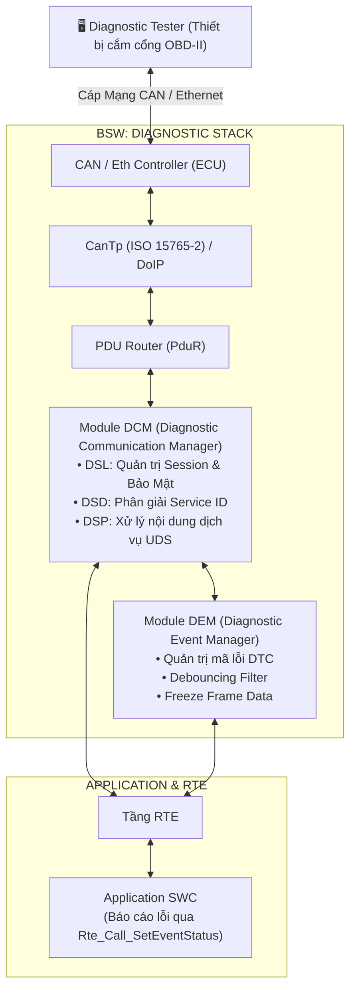
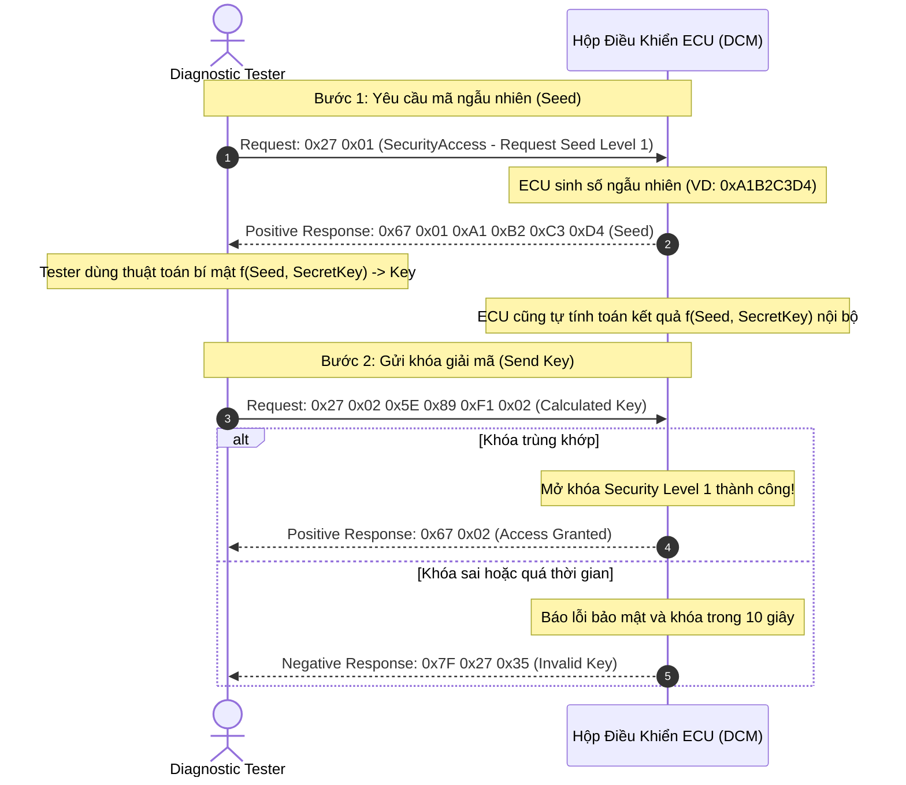
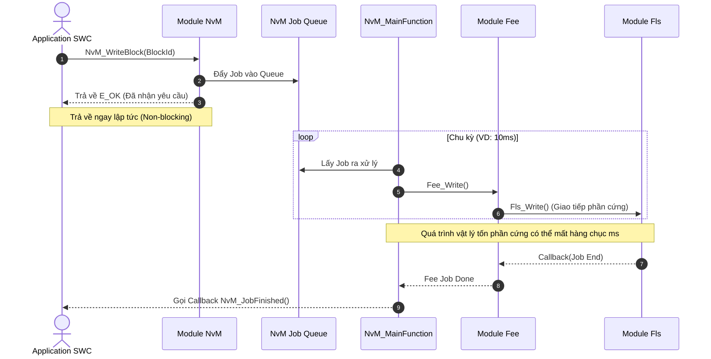

# Chuyên Đề 04: Diagnostic Stack (UDS ISO 14229, DCM, DEM) & Memory Stack (NvM, MemIf, Fee) Masterclass
## Masterclass Phân Tích Chuyên Sâu Giao Thức Chẩn Đoán UDS, Hệ Thống Quản Lý Mã Lỗi DEM/DCM và Ngăn Xếp Lưu Trữ Bộ Nhớ Phi Bốc Hơi NvM/MemIf/Fee

> **Ngôn ngữ:** Tiếng Việt Kỹ Nghệ Chuẩn Mực  
> **Cấp độ:** Universal Learning Resource (Từ Newbie đến Expert)
> **Tiêu chuẩn tham chiếu:** ISO 14229-1 (UDS), ISO 15031 (OBD), AUTOSAR DCM SWS, AUTOSAR DEM SWS, AUTOSAR NvM SWS, AUTOSAR Fee SWS  
> **Mã nguồn đối chiếu thực tế:** Kho mã nguồn [Study_AUTOSAR-main/as/](file:///C:/Users/liem.vu/Liem.vuOD/Study_AUTOSAR-main/as) (`com/as.infrastructure/diagnostic/`, `com/as.infrastructure/memory/`)  

---

## 📖 Bảng Thuật Ngữ (Glossary) Bắt Buộc Cần Nắm

*   **UDS** (*Unified Diagnostic Services - ISO 14229*): Giao thức chẩn đoán hợp nhất tiêu chuẩn toàn cầu được sử dụng hầu hết trên các phương tiện hiện nay.
*   **DTC** (*Diagnostic Trouble Code*): Mã lỗi chẩn đoán hư hỏng phần cứng/cảm biến/mạng. Giúp kỹ thuật viên nhận diện nhanh nguyên nhân.
*   **DID** (*Data Identifier*): Mã định danh dữ liệu 2-byte dùng để đọc/ghi thông số từ ECU, ví dụ DID 0xF190 để lấy số VIN.
*   **NRC** (*Negative Response Code*): Mã phản hồi âm khi yêu cầu UDS không hợp lệ hoặc không thể thực thi (VD: 0x13, 0x33, 0x78).
*   **Freeze Frame**: Khung dữ liệu đóng băng, lưu lại trạng thái các cảm biến tại khoảnh khắc xảy ra lỗi, cực kỳ hữu ích để tái hiện sự kiện.
*   **DCM** (*Diagnostic Communication Manager*): Module quản lý giao tiếp chẩn đoán, đóng vai trò định tuyến các tin nhắn UDS tới ứng dụng tương ứng. Gồm 3 phân hệ con: **DSL** (*Diagnostic Session Layer*), **DSD** (*Diagnostic Service Dispatcher*), và **DSP** (*Diagnostic Service Processing*).
*   **DEM** (*Diagnostic Event Manager*): Module quản lý sự kiện chẩn đoán, lưu trữ DTC, Freeze Frame và Extended Data vào bộ nhớ.
*   **NvM** (*Non-Volatile Memory Manager*): Module quản lý bộ nhớ phi bốc hơi, trừu tượng hóa các thao tác với EEPROM hoặc Flash.
*   **Fee** (*Flash EEPROM Emulation*): Module giả lập hành vi EEPROM trên chip Flash vật lý, cung cấp thuật toán Wear Leveling để nâng cao tuổi thọ Flash.
*   **Fls** (*Flash Driver*): Driver phần cứng điều khiển chip Flash vật lý (MCAL).
*   **MemIf** (*Memory Abstraction Interface*): Tầng trung gian cho phép NvM giao tiếp với cả Fee (Flash) và Eep (EEPROM vật lý) một cách trong suốt.

### 📌 Bảng So Sánh Kỹ Nghệ: EEPROM vs Flash Trong Kiến Trúc ECU Ô Tô

| Tiêu Chí Kỹ Nghệ | Bộ Nhớ EEPROM (Electrically Erasable PROM) | Bộ Nhớ Flash (NOR / NAND Flash) |
|---|---|---|
| **Cơ Chế Ghi / Xóa Vật Lý** | **Byte-level alterable**: Có thể xóa và ghi trực tiếp trên từng **Byte** riêng lẻ độc lập mà không ảnh hưởng đến các byte lân cận. | **Block / Sector Erase**: Chỉ có thể đổi bit từ 1 về 0 khi ghi. Muốn ghi đè dữ liệu mới, bắt buộc phải **xóa toàn bộ Sector** (trả tất cả bit về 1). |
| **Đơn Vị Thao Tác Nhỏ Nhất** | **1 Byte** (cho cả 3 tác vụ: Đọc, Ghi, Xóa). | **Đọc:** Byte/Word;<br>**Ghi:** Page (ví dụ: 8, 16, 32 Bytes);<br>**Xóa:** Sector/Block (ví dụ: 2KB, 4KB, 64KB). |
| **Thao Tác Xóa Trước Khi Ghi** | **Không cần**: Ghi đè trực tiếp lên đúng địa chỉ mong muốn. | **Bắt buộc**: Không thể sửa 1 byte đơn lẻ nếu không xóa trắng toàn bộ Sector chứa nó. |
| **Tuổi Thọ Chu Kỳ (Endurance)** | **Rất cao**: Thường từ **$1,000,000$ đến $10,000,000$** lần ghi/xóa trên mỗi ô nhớ. | **Giới hạn**: Thường chỉ từ **$10,000$ đến $100,000$** lần xóa/ghi (Erase Cycles) trên mỗi Sector. |
| **Tốc Độ & Độ Trễ Ghi** | Tốc độ ghi trung bình (~ vài ms/byte), nhưng không chịu độ trễ xóa cả khối lớn. | Tác vụ xóa Sector tốn thời gian rất lớn (hàng chục đến hàng trăm ms). Tác vụ ghi Page thì nhanh. |
| **Mật Độ Dung Lượng & Giá Thành** | Cấu trúc cell nhớ phức tạp (thường 2 transistor/cell) $\rightarrow$ **Mật độ dung lượng thấp (vài KB đến vài trăm KB)**, giá thành trên mỗi bit cao. | Cấu trúc cell nhớ gọn (1 transistor/cell) $\rightarrow$ **Mật độ dung lượng rất lớn (vài MB đến hàng GB)**, giá thành trên mỗi bit rẻ. |
| **Hiện Diện Phần Cứng Trên ECU** | Thường là chip nhớ ngoại vi rời (External IC kết nối qua bus SPI/I2C như 24C08, 25LC256) hoặc phân vùng Data EEPROM chuyên biệt trong vi điều khiển. | Tích hợp sẵn trực tiếp bên trong vi điều khiển MCU (On-chip Code/Data Flash) hoặc chip Flash ngoại vi dung lượng lớn (QSPI Flash). |
| **Cách Xử Lý Trong AUTOSAR** | Tầng Memory Stack gọi trực tiếp qua **Module `Eep` (EEPROM Driver)** của tầng MCAL mà không cần thuật toán phức tạp. | Bắt buộc phải thông qua **Module `Fee` (Flash EEPROM Emulation)** để chia Virtual Sectors, Wear Leveling và Garbage Collection trước khi gọi driver **`Fls`**. |
| **Ứng Dụng Điển Hình Trên Ô Tô** | Lưu các thông số biến động nhỏ, ghi liên tục với tần suất cao (VD: Quãng đường Odometer, thông số hiệu chuẩn nhỏ lẻ, số lần nổ túi khí). | Lưu toàn bộ mã thực thi Firmware ECU, bảng hiệu chuẩn động cơ lớn (Calibrations), file nhị phân Bootloader (`asboot`), bản sao lưu FOTA. |

---

## Mục Lục

1. [Tổng Quan Ngăn Xếp Chẩn Đoán (Diagnostic Stack & UDS ISO 14229)](#1-tổng-quan-ngăn-xếp-chẩn-đoán-diagnostic-stack--uds-iso-14229)
2. [Bảng Ma Trận Các Dịch Vụ UDS Cốt Lõi (Core UDS Services)](#2-bảng-ma-trận-các-dịch-vụ-uds-cốt-lõi-core-uds-services)
   - [2.1 Dịch Vụ 0x10: DiagnosticSessionControl](#21-dịch-vụ-0x10-diagnosticsessioncontrol)
   - [2.2 Dịch Vụ 0x27: SecurityAccess (Thuật Toán Seed & Key)](#22-dịch-vụ-0x27-securityaccess-thuật-toán-seed--key)
   - [2.3 Dịch Vụ 0x22 & 0x2E: Read / Write Data By Identifier (DID)](#23-dịch-vụ-0x22--0x2e-read--write-data-by-identifier-did)
   - [2.4 Dịch Vụ 0x19 & 0x14: Read & Clear DTC Information](#24-dịch-vụ-0x19--0x14-read--clear-dtc-information)
   - [2.5 Cấu Trúc Khung Phản Hồi Âm (Negative Response - NRC)](#25-cấu-trúc-khung-phản-hồi-âm-negative-response---nrc)
3. [Module DCM (Diagnostic Communication Manager: DSL, DSD, DSP)](#3-module-dcm-diagnostic-communication-manager-dsl-dsd-dsp)
4. [Module DEM (Diagnostic Event Manager) & Cấu Trúc Mã Lỗi DTC](#4-module-dem-diagnostic-event-manager--cấu-trúc-mã-lỗi-dtc)
   - [4.1 Cấu Trúc Mã Lỗi DTC 3-Byte & Mã Kiểu Lỗi (Fault Type Byte - FTB)](#41-cấu-trúc-mã-lỗi-dtc-3-byte--mã-kiểu-lỗi-fault-type-byte---ftb)
   - [4.2 Giải Mã Chi Tiết 8-Bit Của DTC Status Byte](#42-giải-mã-chi-tiết-8-bit-của-dtc-status-byte)
   - [4.3 Thuật Toán Lọc Rung Lỗi (Debounce Algorithms: Counter-Based vs Time-Based)](#43-thuật-toán-lọc-rung-lỗi-debounce-algorithms-counter-based-vs-time-based)
   - [4.4 Khung Dữ Liệu Đóng Băng (Freeze Frame) & Extended Data Records](#44-khung-dữ-liệu-đóng-băng-freeze-frame--extended-data-records)
5. [Ngăn Xếp Bộ Nhớ Phi Bốc Hơi (Memory Stack: NvM, MemIf, Fee, Fls)](#5-ngăn-xếp-bộ-nhớ-phi-bốc-hơi-memory-stack-nvm-memif-fee-fls)
   - [5.1 Kiến Trúc 4 Tầng Của Memory Stack](#51-kiến-trúc-4-tầng-của-memory-stack)
   - [5.2 3 Loại Khối Bộ Nhớ NVRAM Block Types (Native, Redundant, Dataset)](#52-3-loại-khối-bộ-nhớ-nvram-block-types-native-redundant-dataset)
   - [5.3 Chu Trình Đọc/Ghi Bất Đồng Bộ (NvM_WriteBlock)](#53-chu-trình-đọcghi-bất-đồng-bộ-nvm_readall-nvm_writeall-nvm_writeblock)
   - [5.4 Cơ Chế Giả Lập Flash EEPROM (Fee: Virtual Sectors, Wear Leveling, Garbage Collection)](#54-cơ-chế-giả-lập-flash-eeprom-fee-virtual-sectors-wear-leveling-garbage-collection)
6. [Kiến Trúc Bootloader Ô Tô (asboot), Ứng Dụng Chính (ascore) & Vùng Lưu Trữ Firmware Dự Phòng (FOTA / Anti-Brick)](#6-kiến-trúc-bootloader-ô-tô-asboot-ứng-dụng-chính-ascore--vùng-lưu-trữ-firmware-dự-phòng-fota--anti-brick)
   - [6.0 Bản Chất Kỹ Nghệ: Nạp Bàn Thí Nghiệm (JTAG/SWD/QEMU) vs Nạp Xe Thật (UDS Bootloader) & Bản Chất Việc Sửa Linker Script](#60-bản-chất-kỹ-nghệ-nạp-bàn-thí-nghiệm-jtagswdqemu-vs-nạp-xe-thật-uds-bootloader--bản-chất-việc-sửa-linker-script)
   - [6.1 So Sánh Bản Chất Kỹ Nghệ: asboot vs ascore vs Vùng Lưu Trữ Dự Phòng](#61-so-sánh-bản-chất-kỹ-nghệ-asboot-vs-ascore-vs-vùng-lưu-trữ-dự-phòng)
   - [6.2 Giải Phẫu Cấu Trúc Module Của asboot Trong Dự Án as](#62-giải-phẫu-cấu-trúc-module-của-asboot-trong-dự-án-as)
   - [6.3 Chu Trình Nạp Flash Chuẩn UDS ISO 14229 & BSW Integration](#63-chu-trình-nạp-flash-chuẩn-uds-iso-14229--bsw-integration)
   - [6.4 Vùng Lưu Trữ Firmware Dự Phòng & 2 Kiến Trúc Chống Brick ECU](#64-vùng-lưu-trữ-firmware-dự-phòng--2-kiến-trúc-chống-brick-ecu)
   - [6.5 Cơ Chế Bàn Giao Quyền Thực Thi & Tái Định Vị Vector Table](#65-cơ-chế-bàn-giao-quyền-thực-thi--tái-định-vị-vector-table)
   - [6.6 Giải Mã Vòng Lặp for(;;) Trong StartOS() Của asboot, Vòng Đời Task OSEK Và Mô Hình Polling vs Preemptive RTOS](#66-giải-mã-vòng-lặp-for-trong-startos-của-asboot-vòng-đời-task-osek-và-mô-hình-polling-vs-preemptive-rtos)
7. [Thực Chiến & Hands-On Exercise](#7-thực-chiến--hands-on-exercise)
8. [Các Cạm Bẫy Phổ Biến (Common Pitfalls)](#8-các-cạm-bẫy-phổ-biến-common-pitfalls)
9. [Bằng Chứng Mã Nguồn & Định Nghĩa Giao Tiếp](#9-bằng-chứng-mã-nguồn--định-nghĩa-giao-tiếp-trong-paraias)
10. [Đúc Kết Kỹ Nghệ & Bảng Tra Cứu APIs](#10-đúc-kết-kỹ-nghệ--bảng-tra-cứu-apis)
11. [Bộ Câu Hỏi Phỏng Vấn (Interview Questions)](#11-bộ-câu-hỏi-phỏng-vấn)

---

## 1. Tổng Quan Ngăn Xếp Chẩn Đoán (Diagnostic Stack & UDS ISO 14229)


Ngăn xếp chẩn đoán (*Diagnostic Stack*) phục vụ việc giao tiếp giữa **Thiết bị kiểm chuẩn bên ngoài (Diagnostic Tester / Scanner cắm qua cổng OBD-II)** và các hộp **ECU** trên xe hơi để:
1. Đọc và xóa mã lỗi hư hỏng phần cứng/cảm biến (**Diagnostic Trouble Codes - DTCs**).
2. Đọc thông số thời gian thực của xe (Live Sensor Data: Điện áp bình, Nhiệt độ dầu, Tốc độ động cơ).
3. Hiệu chỉnh cấu hình (Calibration), nạp số khung xe (VIN), và cập nhật Firmware (Flashing / FOTA).
4. Khởi chạy các Routine đặc biệt như xả gió phanh, tự học vị trí bướm ga.



### NÂNG CAO
Ở cấp độ kiến trúc hệ thống, Diagnostic Stack phải xử lý các luồng dữ liệu song song và quản lý bộ nhớ đệm (buffer management). Khi nhận một gói lệnh UDS dài qua CanTp (ISO 15765-2 Segmentation), PDUR gọi DCM cung cấp buffer (`Dcm_ProvideRxBuffer`). DCM phải tính toán timeout (P2/P2*). Nếu việc thao tác bộ nhớ kéo dài, DCM phải tự động phát NRC 0x78 (Response Pending) định kỳ để Tester không bị timeout ở Transport Layer. Sự đồng bộ giữa DCM (nhận request), DEM (đọc trạng thái fault hiện tại) và NvM (lấy snapshot data) là cực kỳ quan trọng, thường được đồng bộ thông qua các hàm callback bất đồng bộ được gọi từ BSW Scheduler (SchM).

---

## 2. Bảng Ma Trận Các Dịch Vụ UDS Cốt Lõi (Core UDS Services)


Chuẩn **ISO 14229-1 (Unified Diagnostic Services - UDS)** quy định các mã dịch vụ (*Service Identifier - SID*) chuẩn. Dưới đây là bảng phân loại các Service quan trọng nhất:

| SID Request | SID Positive Response | Tên Dịch Vụ UDS | Mô Tả Kỹ Thuật & Ứng Dụng Thực Tế |
|:---:|:---:|---|---|
| **`0x10`** | `0x50` | **DiagnosticSessionControl** | Chuyển đổi phiên làm việc (Default, Programming, Extended Diagnostic). |
| **`0x11`** | `0x51` | **ECUReset** | Yêu cầu ECU khởi động lại phần cứng (Hard Reset, Soft Reset, Key-Off-On). |
| **`0x14`** | `0x54` | **ClearDiagnosticInformation** | Xóa sạch bộ nhớ lưu trữ mã lỗi DTC và Freeze Frame trong Flash/EEPROM. |
| **`0x19`** | `0x59` | **ReadDTCInformation** | Đọc danh sách mã lỗi, số lượng lỗi, Snapshot dữ liệu lúc xảy ra lỗi. |
| **`0x22`** | `0x62` | **ReadDataByIdentifier (RDBI)** | Đọc dữ liệu biến/thông số từ ECU dựa theo mã định danh 2-byte DID. |
| **`0x2E`** | `0x6E` | **WriteDataByIdentifier (WDBI)** | Ghi dữ liệu cấu hình (VIN, Calibration data) vào bộ nhớ ECU theo DID. |
| **`0x27`** | `0x67` | **SecurityAccess** | Mở khóa bảo mật mức cao (yêu cầu Seed $\rightarrow$ tính toán Key) trước khi nạp Flash. |
| **`0x28`** | `0x68` | **CommunicationControl** | Bật / tắt tạm thời việc phát gói tin thông thường trên mạng CAN. |
| **`0x31`** | `0x71` | **RoutineControl** | Kích hoạt thực thi một hàm chức năng đặc biệt (Xả gió phanh ABS, Kiểm tra kim phun). |
| **`0x34`** | `0x74` | **RequestDownload** | Bắt đầu quy trình nạp phần mềm FOTA: Khai báo địa chỉ và dung lượng binary. |
| **`0x36`** | `0x76` | **TransferData** | Truyền các khối dữ liệu binary nhị phân vào RAM/Flash của ECU. |
| **`0x37`** | `0x77` | **RequestTransferExit** | Kết thúc quá trình truyền dữ liệu và kiểm tra toàn vẹn mã CRC. |

### NÂNG CAO
Các dịch vụ như 0x22, 0x2E, 0x31 đòi hỏi quyền truy cập dựa trên (1) Session, (2) Security Level, (3) Application State. Ma trận quyền truy cập này được định nghĩa tĩnh trong cấu hình DcmDsp (DcmDspDidInfo, DcmDspRoutineInfo). Ví dụ, DID 0xF190 (VIN) có thể cấu hình Read Allowed trong mọi Session, nhưng Write chỉ Allowed trong Extended Session và Security Level 1. Nếu không thỏa mãn, DCM tự động reject request bằng DSD mà không cần DSP xử lý, trả về 0x7F 0x2E 0x33.

### 2.1 Dịch Vụ 0x10: DiagnosticSessionControl
Mỗi ECU luôn khởi động ở chế độ mặc định (**Default Session**). Để thực hiện các tác vụ nguy hiểm, Tester phải yêu cầu chuyển Session. Mỗi session được duy trì bằng bộ đếm timeout (S3_Server, mặc định 5s). Nếu Tester ngắt kết nối không gửi thông điệp TesterPresent (0x3E), session sẽ reset về Default.
* `0x01` — **Default Session:** Phiên cơ bản, chỉ cho phép đọc thông số và đọc lỗi.
* `0x02` — **Programming Session:** Phiên nạp Flash Bootloader (vô hiệu hóa các ứng dụng thông thường).
* `0x03` — **Extended Diagnostic Session:** Cho phép điều khiển cơ cấu chấp hành và cấu hình thông số.

> 📄 **Trích dẫn nguyên văn cấu hình ARXML (Ctrl+F để tra cứu):** [`as/build/nt/stm32f107vc/ascore/config/autosar_tree.arxml: L470-L481`](file:///C:/Users/liem.vu/Liem.vuOD/Study_AUTOSAR-main/as/build/nt/stm32f107vc/ascore/config/autosar_tree.arxml#L470-L481)
```xml
    <SessionList Max="TBD">
      <SHORT-NAME>SessionList</SHORT-NAME>
      <Session Comment="*" Identifier="1" Name="DS" P2ServerMaxTimeMs="5000" P2StartServerMaxTimeMs="500">
        <SHORT-NAME>DS</SHORT-NAME>
      </Session>
      <Session Comment="*" Identifier="2" Name="PRGS" P2ServerMaxTimeMs="5000" P2StartServerMaxTimeMs="500">
        <SHORT-NAME>PRGS</SHORT-NAME>
      </Session>
      <Session Comment="*" Identifier="3" Name="EXTDS" P2ServerMaxTimeMs="5000" P2StartServerMaxTimeMs="500">
        <SHORT-NAME>EXTDS</SHORT-NAME>
      </Session>
    </SessionList>
```

> ⚡ **Mã nguồn C được sinh ra (Generated C Code):** [`as/build/nt/stm32f107vc/ascore/config/Dcm_Lcfg.c: L105-L127`](file:///C:/Users/liem.vu/Liem.vuOD/Study_AUTOSAR-main/as/build/nt/stm32f107vc/ascore/config/Dcm_Lcfg.c#L105-L127)
```c
/* Generator tự động ánh xạ thuộc tính XML sang mảng struct Dcm_DspSessionRowType */
static const Dcm_DspSessionRowType DspSessionList[] = {
    {
        .DspSessionLevel = 1,              /* Name="DS" (Default Session 0x01) */
        .DspSessionP2ServerMax = 5000,     /* P2ServerMaxTimeMs="5000" */
        .DspSessionP2StarServerMax = 500,  /* P2StartServerMaxTimeMs="500" */
        .Arc_EOL = FALSE
    },
    {
        .DspSessionLevel = 2,              /* Name="PRGS" (Programming Session 0x02) */
        .DspSessionP2ServerMax = 5000,
        .DspSessionP2StarServerMax = 500,
        .Arc_EOL = FALSE
    },
    {
        .DspSessionLevel = 3,              /* Name="EXTDS" (Extended Session 0x03) */
        .DspSessionP2ServerMax = 5000,
        .DspSessionP2StarServerMax = 500,
        .Arc_EOL = FALSE
    },
    {
        .Arc_EOL = TRUE                    /* Đánh dấu kết thúc mảng */
    }
};
```

### 2.2 Dịch Vụ 0x27: SecurityAccess (Thuật Toán Seed & Key)

Quy trình bắt tay bảo mật 2 bước để ngăn chặn truy cập trái phép vào ECU (ví dụ ngăn chặn Odometer tampering - tua công tơ mét).

> 📄 **Trích dẫn nguyên văn cấu hình ARXML (Ctrl+F để tra cứu):** [`as/build/nt/stm32f107vc/ascore/config/autosar_tree.arxml: L482-L493`](file:///C:/Users/liem.vu/Liem.vuOD/Study_AUTOSAR-main/as/build/nt/stm32f107vc/ascore/config/autosar_tree.arxml#L482-L493)
```xml
    <SecurityList Max="TBD">
      <SHORT-NAME>SecurityList</SHORT-NAME>
      <Security Comment="*" CompareKeyCallback="NULL" GetSeedCallback="NULL" Identifier="6" KeySize="4" Name="PRGS" SeedSize="4">
        <SHORT-NAME>PRGS</SHORT-NAME>
      </Security>
      <Security Comment="*" CompareKeyCallback="Diag_CompareKeyEXTDS" GetSeedCallback="Diag_GetSeedEXTDS" Identifier="1" KeySize="4" Name="EXTDS" SeedSize="4">
        <SHORT-NAME>EXTDS</SHORT-NAME>
      </Security>
      <Security Comment="Level 0, is the default for each session when enterred" CompareKeyCallback="NULL" GetSeedCallback="NULL" Identifier="0" KeySize="4" Name="DS" SeedSize="4">
        <SHORT-NAME>DS</SHORT-NAME>
      </Security>
    </SecurityList>
```

> ⚡ **Mã nguồn C được sinh ra (Generated C Code):** [`as/build/nt/stm32f107vc/ascore/config/Dcm_Lcfg.c: L56-L99`](file:///C:/Users/liem.vu/Liem.vuOD/Study_AUTOSAR-main/as/build/nt/stm32f107vc/ascore/config/Dcm_Lcfg.c#L56-L99)
```c
/* Generator tự động liên kết các hàm callback được khai báo trong ARXML */
extern Std_ReturnType Diag_GetSeedEXTDS (uint8 *securityAccessDataRecord, uint8 *seed, Dcm_NegativeResponseCodeType *errorCode);
extern Std_ReturnType Diag_CompareKeyEXTDS (uint8 *key);

static const Dcm_DspSecurityRowType DspSecurityList[] = {
    {
        .DspSecurityLevel = 6,          /* Name="PRGS" (Identifier="6") */
        .DspSecuritySeedSize = 4,       /* SeedSize="4" */
        .DspSecurityKeySize = 4,        /* KeySize="4" */
        .GetSeed = NULL,
        .CompareKey = NULL,
        .Arc_EOL = FALSE
    },
    {
        .DspSecurityLevel = 1,          /* Name="EXTDS" (Identifier="1") */
        .DspSecuritySeedSize = 4,       /* SeedSize="4" */
        .DspSecurityKeySize = 4,        /* KeySize="4" */
        .GetSeed = Diag_GetSeedEXTDS,         /* Gắn hàm callback lấy Seed */
        .CompareKey = Diag_CompareKeyEXTDS,   /* Gắn hàm callback so khớp Key */
        .Arc_EOL = FALSE
    },
    {
        .DspSecurityLevel = 0,          /* Name="DS" (Identifier="0" - Level 0 Default) */
        .DspSecuritySeedSize = 4,
        .DspSecurityKeySize = 4,
        .GetSeed = NULL,
        .CompareKey = NULL,
        .Arc_EOL = FALSE
    },
    {
        .Arc_EOL = TRUE
    }
};
```



> 📁 **Mã nguồn thực tế trong dự án đối chiếu:**  
> - BSW DCM Security Dispatcher: [`as/com/as.infrastructure/diagnostic/Dcm/Dcm_Dsp.c: L1705-L1743`](file:///C:/Users/liem.vu/Liem.vuOD/Study_AUTOSAR-main/as/com/as.infrastructure/diagnostic/Dcm/Dcm_Dsp.c#L1705-L1743) (`DspUdsSecurityAccess`)  
> - Bootloader Seed/Key Callback: [`as/com/as.infrastructure/boot/common/bl_sessec.c: L29-L65`](file:///C:/Users/liem.vu/Liem.vuOD/Study_AUTOSAR-main/as/com/as.infrastructure/boot/common/bl_sessec.c#L29-L65) (`BL_GetProgramSessionSeed` & `BL_CompareProgramSessionKey`)

🔧 **Code C Minh Họa Nguyên Lý: Thuật toán f(Seed, Key) và Pitfall Attempt Counter**
```c
// Ví dụ thuật toán XOR/CRC đơn giản (Chỉ mang tính chất minh họa học thuật)
uint32 Calculate_Key(uint32 Seed, uint32 SecretKey) {
    // ⚠️ Warning: Thuật toán thực tế dùng AES-128/RSA, đây chỉ là dummy example
    return (Seed ^ SecretKey) + 0x12345678; 
}

// State Machine trong DCM
static uint8 SecurityAttemptCounter = 0;
static boolean IsLockedOut = FALSE;

Std_ReturnType Dcm_ProcessSecurityAccess(uint32 ReceivedKey) {
    if (IsLockedOut) {
        return E_NOT_OK; // ❌ Phải chờ Delay Timer (ví dụ 10 giây) kết thúc
    }
    
    uint32 ExpectedKey = Calculate_Key(CurrentSeed, APP_SECRET_KEY);
    
    if (ReceivedKey == ExpectedKey) {
        SecurityAttemptCounter = 0; // ✅ Best Practice: Luôn reset counter khi đúng để tránh khóa do tích lũy
        Unlock_Security_Level();
        return E_OK;
    } else {
        SecurityAttemptCounter++;
        if (SecurityAttemptCounter >= 3) {
            IsLockedOut = TRUE;
            Start_Penalty_Timer(10000); // 💀 Critical: Khóa 10 giây (Anti-bruteforce bảo vệ Brute Force Attack)
        }
        return E_NOT_OK;
    }
}
```

### 2.3 Dịch Vụ 0x22 & 0x2E: Read / Write Data By Identifier (DID)
Mỗi thông số được định danh bằng một số nguyên 2-byte (**DID - Data Identifier**):
* `0xF190`: Mã nhận diện xe VIN (17 ký tự ASCII).
* `0xF189`: Phiên bản phần mềm ECU Software Version.
* `0x0100`: Điện áp ắc-quy (Battery Voltage).

💡 **Code Example: Gửi UDS Request 0x22 & 0x2E (Đọc/Ghi VIN)**
```text
[ĐỌC VIN - Service 0x22, DID 0xF190]
Request  (Tester -> ECU): 0x22 0xF1 0x90
Response (ECU -> Tester): 0x62 0xF1 0x90 0x57 0x41 0x55 0x5A 0x5A 0x5A ... (Chuỗi ASCII của WAUZZZ...)

[GHI VIN - Service 0x2E, DID 0xF190]
Request  (Tester -> ECU): 0x2E 0xF1 0x90 0x57 0x41 0x55 0x5A 0x5A 0x5A ...
Response (ECU -> Tester): 0x6E 0xF1 0x90 (Báo hiệu ECU đã nhận và ghi thành công)
```
*(Nếu việc ghi mất thời gian, ECU sẽ trả về NRC 0x78 cho Tester đợi, sau đó trả về 0x6E).*

### 2.4 Dịch Vụ 0x19 & 0x14: Read & Clear DTC Information
* `0x19 0x01`: Yêu cầu báo cáo số lượng mã lỗi theo mặt nạ trạng thái (*reportNumberOfDTCByStatusMask*).
* `0x19 0x02`: Yêu cầu báo cáo danh sách mã lỗi theo mặt nạ trạng thái (*reportDTCByStatusMask*).
* `0x19 0x04`: Đọc dữ liệu đóng băng Snapshot của một mã lỗi cụ thể (*reportDTCSnapshotRecordByDTCNumber*).
* `0x14 0xFF 0xFF 0xFF`: Xóa toàn bộ mã lỗi của tất cả các nhóm lỗi.

### 2.5 Cấu Trúc Khung Phản Hồi Âm (Negative Response - NRC)

Khi một yêu cầu không hợp lệ hoặc bị từ chối, ECU trả về khung lỗi có định dạng 3 byte:
```
+------------+------------------------+---------------------------------+
| Byte 0: 7F | Byte 1: Requested SID  | Byte 2: NRC (Negative Resp Code)|
+------------+------------------------+---------------------------------+
```

| Mã NRC | Tên Mã Lỗi Chuẩn | Ý Nghĩa Kỹ Thuật |
|:---:|---|---|
| **`0x11`** | `serviceNotSupported` | ECU không hỗ trợ Service ID này (ví dụ gửi 0xAA không tồn tại). |
| **`0x12`** | `subFunctionNotSupported` | Sub-function không được hỗ trợ trong phiên hiện tại. |
| **`0x13`** | `incorrectMessageLengthOrInvalidFormat` | Chiều dài byte của gói tin Request bị sai so với cấu hình chuẩn. |
| **`0x22`** | `conditionsNotCorrect` | Điều kiện xe chưa thỏa mãn (ví dụ: đòi xả phanh ABS nhưng xe đang chạy 100km/h). |
| **`0x31`** | `requestOutOfRange` | Tham số DID hoặc Routine ID vượt quá dải cho phép. |
| **`0x33`** | `securityAccessDenied` | Chưa mở khóa dịch vụ `0x27` thành công. |
| **`0x78`** | `responsePending` | ECU đã nhận lệnh hợp lệ nhưng đang bận xử lý tác vụ dài (ví dụ: Ghi Flash/EEPROM), Tester chờ tiếp. |

---

## 3. Module DCM (Diagnostic Communication Manager: DSL, DSD, DSP)

> 💡 **Giải Mã Viết Tắt 3 Phân Hệ Cốt Lõi Của Module DCM:**
> * **DSL (Diagnostic Session Layer):** Tầng Quản trị Phiên Chẩn đoán & Giao tiếp Vận chuyển (quản trị Session, trạng thái Security Level, giám sát các bộ định thời P2/P2* Timer và cấp phát/khóa bộ đệm Rx/Tx Buffer giao tiếp với PduR/CanTp).
> * **DSD (Diagnostic Service Dispatcher):** Tầng Phân phối & Điều phối Dịch vụ (kiểm tra tính hợp lệ của định dạng bản tin, thẩm tra quyền thực thi dịch vụ theo Session/Security hiện hành và định tuyến SID sang hàm xử lý tương ứng).
> * **DSP (Diagnostic Service Processing):** Tầng Hiện thực hóa & Xử lý Nghiệp vụ Dịch vụ (thực thi logic chi tiết của từng SID cụ thể như 0x10, 0x22, 0x2E, 0x27, 0x19... và tương tác với DEM/NvM).  
> ⚠️ *Lưu ý thuật ngữ:* Trong kiến trúc chuẩn AUTOSAR DCM, phân hệ thứ ba luôn là **DSP** (*Processing*), không phải **DCP**. (Nếu gặp chữ *DCP* trong một số câu hỏi hoặc tài liệu ngoài lề, đó thường là gõ nhầm từ DSP, hoặc là viết tắt của *Diagnostic Communication Protocol* / *Data Collection Point*, hoàn toàn không thuộc cấu trúc 3 tầng con nội bộ của AUTOSAR DCM).

Trong mã nguồn thực tế của dự án, module DCM được phân chia thành các tệp chuyên biệt tại thư mục [`as/com/as.infrastructure/diagnostic/Dcm/`](file:///C:/Users/liem.vu/Liem.vuOD/Study_AUTOSAR-main/as/com/as.infrastructure/diagnostic/Dcm/):
- [`Dcm.c`](file:///C:/Users/liem.vu/Liem.vuOD/Study_AUTOSAR-main/as/com/as.infrastructure/diagnostic/Dcm/Dcm.c): Bộ điều phối chu kỳ hoạt động chung ([`Dcm_MainFunction()`](file:///C:/Users/liem.vu/Liem.vuOD/Study_AUTOSAR-main/as/com/as.infrastructure/diagnostic/Dcm/Dcm.c#L97)).
- [`Dcm_Dsl.c`](file:///C:/Users/liem.vu/Liem.vuOD/Study_AUTOSAR-main/as/com/as.infrastructure/diagnostic/Dcm/Dcm_Dsl.c) (**DSL**): Quản trị phiên chẩn đoán, P2/P2*/S3 timer, cấp phát bộ đệm và giao tiếp với PduR.
- [`Dcm_Dsd.c`](file:///C:/Users/liem.vu/Liem.vuOD/Study_AUTOSAR-main/as/com/as.infrastructure/diagnostic/Dcm/Dcm_Dsd.c) (**DSD**): Giải mã Service Identifier (SID), thẩm tra quyền Session/Security, điều phối dịch vụ.
- [`Dcm_Dsp.c`](file:///C:/Users/liem.vu/Liem.vuOD/Study_AUTOSAR-main/as/com/as.infrastructure/diagnostic/Dcm/Dcm_Dsp.c) (**DSP**): Hiện thực hóa từng dịch vụ UDS cụ thể (0x10, 0x22, 0x2E, 0x27, 0x19...).

```text
┌──────────────────────────────────────────────────────────────────────────────────────────────────┐
│              KIẾN TRÚC 3 PHÂN HỆ NỘI BỘ VÀ CHU TRÌNH ĐIỀU PHỐI BUFFER CỦA DCM (ISO 14229)        │
├──────────────────────────────────────────────────────────────────────────────────────────────────┤
│                                                                                                  │
│   Yêu Cầu Từ CanTp / PduR (SF/FF)                                 Phát Hồi Đáp Ra CanTp / PduR   │
│            │ (1. Cấp đệm nhận)                                              ▲ (5. Transmit Tx)   │
│            ▼                                                                │                    │
│   ┌─────────────────────────────────────────────────────────────────────────┴────────────────┐   │
│   │ 1. DSL (Diagnostic Session Layer) [Dcm_Dsl.c] - Quản Trị Phiên, Timer & Bộ Đệm Truyền    │   │
│   │    • [Bước 1]: DslProvideRxBufferToPdur() -> Cấp RxBuffer (Buffer1 512B) & dừng S3 timer │   │
│   │    • [Bước 2]: DslRxIndicationFromPduR() -> Giám sát P2 Server Timer & nạp buffer DSD    │   │
│   │    • [Bước 5]: DslMain() -> PduR_DcmTransmit() phát khung phản hồi (Buffer2) ra CAN Bus │   │
│   │    • [Bước 6]: DslTxConfirmation() -> Giải phóng Rx/Tx Buffer về trạng thái AVAILABLE    │   │
│   └─────────────────────────────────────────┬────────────────────────────────────────────────┘   │
│                                             │                                                    │
│                                             ▼ DsdDslDataIndication()                             │
│   ┌──────────────────────────────────────────────────────────────────────────────────────────┐   │
│   │ 2. DSD (Diagnostic Service Dispatcher) [Dcm_Dsd.c] - Điều Phối & Phân Quyền Dịch Vụ     │   │
│   │    • [Bước 3]: Chu kỳ Task gọi DsdMain() -> DsdHandleRequest()                           │   │
│   │    • Thẩm định SID: lookupSid() (Không hỗ trợ -> tạo NRC 0x11: serviceNotSupported)      │   │
│   │    • Thẩm tra phiên: DspCheckSessionLevel() (Sai session -> NRC 0x7E / 0x12)             │   │
│   │    • Thẩm tra bảo mật: DspCheckSecurityLevel() (Chưa giải mã Seed/Key -> NRC 0x33)      │   │
│   │    • Điều phối hàm: selectServiceFunction(currentSid)                                    │   │
│   └─────────────────────────────────────────┬────────────────────────────────────────────────┘   │
│                                             │                                                    │
│                                             ▼ Con trỏ hàm dịch vụ nghiệp vụ                      │
│   ┌──────────────────────────────────────────────────────────────────────────────────────────┐   │
│   │ 3. DSP (Diagnostic Service Processing) [Dcm_Dsp.c] - Hiện Thực Hóa Dịch Vụ Chẩn Đoán    │   │
│   │    • [Bước 4]: Xử lý logic từng SID cụ thể:                                              │   │
│   │      ├── SID 0x10 -> DspUdsDiagnosticSessionControl() (Chuyển Default/Extended/Prog)     │   │
│   │      ├── SID 0x27 -> DspUdsSecurityAccess() (Cấp Seed & xác thực khóa Key)               │   │
│   │      ├── SID 0x22 / 0x2E -> DspUdsReadDataByIdentifier() / DspUdsWriteDataByIdentifier() │   │
│   │      └── SID 0x19 / 0x14 -> DspUdsReadDtcInformation() / DspUdsClearDiagnosticInformation│   │
│   │    • Đóng gói dữ liệu và gọi DsdDspProcessingDone() để nạp SID Response (+ 0x40)        │   │
│   │    • Báo DSL phát bản tin: DslDsdProcessingDone(DSD_TX_RESPONSE_READY)                   │   │
│   └────────────────────────┬─────────────────────────────────────┬───────────────────────────┘   │
│                            │                                     │                               │
│                            ▼ Đọc/Ghi DTC Freeze Frame            ▼ Đọc/Ghi DID NVRAM Block       │
│                 ┌──────────────────────┐             ┌──────────────────────┐                    │
│                 │      Module DEM      │             │      Module NvM      │                    │
│                 │  (Diagnostic Event   │             │ (Non-Volatile Memory │                    │
│                 │       Manager)       │             │       Manager)       │                    │
│                 └──────────────────────┘             └──────────────────────┘                    │
└──────────────────────────────────────────────────────────────────────────────────────────────────┘
```

### Chu Trình Thực Thi Function-Call-Function Chi Tiết Trong Codebase

Dưới đây là chuỗi gọi hàm *Function-Call-Function* hoàn chỉnh hai chiều (Chiều gọi hàm `──► Gọi:` và Chiều hoàn tất trả về `◄── Trả về (Return):`) khi Tester phát một yêu cầu chẩn đoán UDS (ví dụ: chuyển phiên chẩn đoán SID 0x10 DiagnosticSessionControl hoặc đọc dữ liệu SID 0x22 ReadDataByIdentifier) từ bus mạng CAN tới DCM và phát hồi đáp ra mạng, được đối chiếu chi tiết theo từng Target Build:

```
┌────────────────────────────────────────────────────────────────────────────────────────────────┐
│  🌐 CHUỖI GỌI HÀM XỬ LÝ YÊU CẦU CHẨN ĐOÁN UDS: TỪ CAN BUS ĐẾN DCM VÀ PHÁT HỒI ĐÁP            │
│  [TARGET A: BOARD="lm3s6965evb" (QEMU SLCAN) | TARGET B: BOARD="stm32f107vc" (Silicon bxCAN)] │
└────────────────────────────────────────────────────────────────────────────────────────────────┘

==================================================================================================
  GIAI ĐOẠN 1: TIẾP NHẬN BẢN TIN TỪ CAN BUS VÀO DCM (Rx Call & Return Chain - Ngắt Đồng Bộ)
==================================================================================================

1. [TẦNG 0: KHỐI PHẦN CỨNG CAN CONTROLLER & BỘ THU PHÁT VẬT LÝ]
   • Thiết bị chẩn đoán ngoại vi (Diagnostic Tester) phát khung tin CAN ID 0x731 chứa payload UDS Session Control [0x02, 0x10, 0x01, ...].
   • CAN Transceiver giải mã mức điện áp vi sai trên bus thành dòng bit số đưa vào CAN Controller.
         │
         ▼
2. [TẦNG 1: TRÌNH ĐIỀU KHIỂN PHẦN CỨNG MCAL CAN DRIVER & VECTOR NGẮT (PHÂN NHÁNH THEO TARGET)]
   ┌──────────────────────────────────────────────┬──────────────────────────────────────────────┐
   │ 💻 TARGET A: MÔ PHỎNG QEMU (lm3s6965evb)     │ 🔌 TARGET B: SILICON THẬT (stm32f107vc)      │
   ├──────────────────────────────────────────────┼──────────────────────────────────────────────┤
   │ • Gọi: arch/common/mcal/SCan.c: L171         │ • Phần cứng bxCAN nhận frame vào FIFO 0      │
   │ • Nhận chuỗi ký tự SLCAN từ UART1 ảo:        │ • NVIC kích hoạt ngắt ngoại vi Vector 20     │
   │   "t73180210010000000000\r"                  │   (CAN1_RX0_IRQn, Exception 36)              │
   │ • Giải mã thành struct Can_PduType và gọi:   │ • knl_isr_handler gọi tisr_pc[20]() tại      │
   │   CanIf_RxIndication(pdu.busid,              │   Os_Cfg.c: L1048 -> Can_1_RxIsr()           │
   │                      SCANID(pdu.canid),      │ • Can_1_RxIsr() trong arch/stm32f1/mcal/     │
   │                      pdu.dlc, pdu.data);     │   Can.c: L222 gọi Can_RxIsr(CAN_CTRL_1):     │
   │                                              │   - Đọc phần cứng CAN_Receive(canHw, ...)    │
   │                                              │   - Tra cứu HOH và gọi callback:             │
   │                                              │     GET_CALLBACKS()->RxIndication(...)       │
   └──────────────────────────────────────────────┴──────────────────────────────────────────────┘
   ──► Gọi: CanIf_RxIndication(Hrh, CanId, CanDlc, CanSduPtr);
         │
         ▼
3. [TẦNG 2: GIAO DIỆN CAN TRUNG GIAN (CanIf.c & CanIf_Cfg.c)]
   a) [`CanIf_RxIndication(Hrh, CanId, CanDlc, CanSduPtr)`](file:///C:/Users/liem.vu/Liem.vuOD/Study_AUTOSAR-main/as/com/as.infrastructure/communication/CanIf/CanIf.c#L1145):
      - Nhiệm vụ: Xác thực khởi tạo `CanIf_Global.initRun` và dữ liệu hợp lệ.
      ──► Gọi: `scheduleRxIndication(Hrh, CanId, CanDlc, CanSduPtr);` ([`CanIf.c: L317`](file:///C:/Users/liem.vu/Liem.vuOD/Study_AUTOSAR-main/as/com/as.infrastructure/communication/CanIf/CanIf.c#L317))

   b) [`scheduleRxIndication(...)`](file:///C:/Users/liem.vu/Liem.vuOD/Study_AUTOSAR-main/as/com/as.infrastructure/communication/CanIf/CanIf.c#L317-L430):
      - Nhiệm vụ: Lọc CAN ID `0x731`, nhận diện `entry->CanIfRxUserType == CANIF_USER_TYPE_CAN_TP` ([`CanIf.c: L409`](file:///C:/Users/liem.vu/Liem.vuOD/Study_AUTOSAR-main/as/com/as.infrastructure/communication/CanIf/CanIf.c#L409)).
      - Đóng gói: `CanTpRxPdu.SduLength = CanDlc; CanTpRxPdu.SduDataPtr = (uint8*)CanSduPtr;`.
      ──► Gọi: `CanTp_RxIndication(entry->CanIfCanRxPduId, &CanTpRxPdu);` ([`CanIf.c: L415`](file:///C:/Users/liem.vu/Liem.vuOD/Study_AUTOSAR-main/as/com/as.infrastructure/communication/CanIf/CanIf.c#L415))
         │
         ▼
4. [TẦNG 3: TẦNG VẬN CHUYỂN CANTP & ĐỊNH TUYẾN PDUR (CanTp.c & PduR_Cfg.h)]
   a) [`CanTp_RxIndication(CanTpRxPduId, &CanTpRxPdu)`](file:///C:/Users/liem.vu/Liem.vuOD/Study_AUTOSAR-main/as/com/as.infrastructure/communication/CanTp/CanTp.c#L1128-L1235):
      - Nhiệm vụ: Giải mã loại khung qua PCI Byte: `frameType = getFrameType(...)`.
      - Phân nhánh `switch (frameType)` ([`CanTp.c: L1190`](file:///C:/Users/liem.vu/Liem.vuOD/Study_AUTOSAR-main/as/com/as.infrastructure/communication/CanTp/CanTp.c#L1190)): nhận diện `SINGLE_FRAME`.
      ──► Gọi: `handleSingleFrame(rxConfigParams, runtimeParams, CanTpRxPduPtr);` ([`CanTp.c: L1194`](file:///C:/Users/liem.vu/Liem.vuOD/Study_AUTOSAR-main/as/com/as.infrastructure/communication/CanTp/CanTp.c#L1194))

   b) [`handleSingleFrame(rxConfig, rxRuntime, rxPduData)`](file:///C:/Users/liem.vu/Liem.vuOD/Study_AUTOSAR-main/as/com/as.infrastructure/communication/CanTp/CanTp.c#L775-L838):
      - Nhiệm vụ: Trích xuất `pduLength = 2`, đặt `rxRuntime->transferTotal = pduLength;`.
      ──► Gọi: `copySegmentToPduRRxBuffer(rxConfig, rxRuntime, data, pduLength, &bytesWrittenToSduRBuffer);` ([`CanTp.c: L823`](file:///C:/Users/liem.vu/Liem.vuOD/Study_AUTOSAR-main/as/com/as.infrastructure/communication/CanTp/CanTp.c#L823))

   c) [`copySegmentToPduRRxBuffer()`](file:///C:/Users/liem.vu/Liem.vuOD/Study_AUTOSAR-main/as/com/as.infrastructure/communication/CanTp/CanTp.c#L343-L379) - Pha 1: Xin Cấp Đệm:
      - Nhiệm vụ: Do đệm nhận chưa được cấp (`rxRuntime->pdurBuffer == NULL`), gọi lên PduR xin bộ đệm:
      ──► Gọi: `PduR_CanTpProvideRxBuffer(rxConfig->PduR_PduId, rxRuntime->transferTotal, &rxRuntime->pdurBuffer);` ([`CanTp.c: L361`](file:///C:/Users/liem.vu/Liem.vuOD/Study_AUTOSAR-main/as/com/as.infrastructure/communication/CanTp/CanTp.c#L361))

   d) Ánh xạ Zero-Cost Routing trong [`PduR_Cfg.h: L111`](file:///C:/Users/liem.vu/Liem.vuOD/Study_AUTOSAR-main/as/build/nt/stm32f107vc/ascore/config/PduR_Cfg.h#L111):
      ```c
      #define PduR_CanTpProvideRxBuffer Dcm_ProvideRxBuffer
      ```
      ──► Gọi: [`Dcm_ProvideRxBuffer(dcmRxPduId, tpSduLength, pduInfoPtr)`](file:///C:/Users/liem.vu/Liem.vuOD/Study_AUTOSAR-main/as/com/as.infrastructure/diagnostic/Dcm/Dcm.c#L110-L122)
      ──► Gọi: `DslProvideRxBufferToPdur(dcmRxPduId, tpSduLength, (const PduInfoType**)pduInfoPtr);` ([`Dcm_Dsl.c: L698`](file:///C:/Users/liem.vu/Liem.vuOD/Study_AUTOSAR-main/as/com/as.infrastructure/diagnostic/Dcm/Dcm_Dsl.c#L698))

   e) [`DslProvideRxBufferToPdur(...)`](file:///C:/Users/liem.vu/Liem.vuOD/Study_AUTOSAR-main/as/com/as.infrastructure/diagnostic/Dcm/Dcm_Dsl.c#L698-L750):
      - Nhiệm vụ: Tra cứu đệm `Buffer1` (512 bytes). Chuyển trạng thái `BUFFER_BUSY`, gán `status = PROVIDED_TO_PDUR`.
      - Nạp con trỏ RAM: `*pduInfoPtr = &(runtime->diagnosticRequestFromTester);`.
      - Tạm dừng $S_3$ timer: `stopS3SessionTimer(runtime)`.
      ◄── Trả về (Return): return BUFREQ_OK; (Báo cấp phát đệm thành công về cho Dcm_ProvideRxBuffer)

   f) Trả về chuỗi gọi cấp đệm:
      ◄── Trả về (Return): Dcm_ProvideRxBuffer trả về BUFREQ_OK cho PduR_CanTpProvideRxBuffer.
      ◄── Trả về (Return): PduR_CanTpProvideRxBuffer trả về BUFREQ_OK cho copySegmentToPduRRxBuffer (tại dòng CanTp.c: L361).

   g) [`copySegmentToPduRRxBuffer()`](file:///C:/Users/liem.vu/Liem.vuOD/Study_AUTOSAR-main/as/com/as.infrastructure/communication/CanTp/CanTp.c#L354-L356) - Pha 2: Ghi Trực Tiếp RAM:
      - Nhận được `ret == BUFREQ_OK`, gán `rxRuntime->pdurBufferCount = 0;`.
      - Vòng lặp `while` quay lại, lúc này `rxRuntime->pdurBuffer != NULL`:
        Ghi trực tiếp payload [0x10, 0x01] từ khung CAN vào mảng RAM Buffer1 của DCM:
        ```c
        while ((*bytesWrittenSuccessfully < segmentSize) && (rxRuntime->pdurBuffer->SduLength > rxRuntime->pdurBufferCount)) {
            rxRuntime->pdurBuffer->SduDataPtr[rxRuntime->pdurBufferCount++] = segment[(*bytesWrittenSuccessfully)++];
        }
        ```
      - Cập nhật số byte đã nhận: `rxRuntime->transferCount += segmentSize;`.
      ◄── Trả về (Return): return BUFREQ_OK; (Báo sao chép xong về cho handleSingleFrame tại CanTp.c: L823)

   h) [`handleSingleFrame()`](file:///C:/Users/liem.vu/Liem.vuOD/Study_AUTOSAR-main/as/com/as.infrastructure/communication/CanTp/CanTp.c#L825-L828) - Báo Nhận Hoàn Tất:
      - Nhận `ret == BUFREQ_OK`, CanTp xác nhận đã nhận trọn vẹn bản tin UDS Single Frame:
      ──► Gọi: `PduR_CanTpRxIndication(rxConfig->PduR_PduId, NTFRSLT_OK);` ([`CanTp.c: L826`](file:///C:/Users/liem.vu/Liem.vuOD/Study_AUTOSAR-main/as/com/as.infrastructure/communication/CanTp/CanTp.c#L826))

   i) Ánh xạ Zero-Cost Routing trong [`PduR_Cfg.h: L112`](file:///C:/Users/liem.vu/Liem.vuOD/Study_AUTOSAR-main/as/build/nt/stm32f107vc/ascore/config/PduR_Cfg.h#L112):
      ```c
      #define PduR_CanTpRxIndication Dcm_RxIndication
      ```
      ──► Gọi: [`Dcm_RxIndication(dcmRxPduId, result)`](file:///C:/Users/liem.vu/Liem.vuOD/Study_AUTOSAR-main/as/com/as.infrastructure/diagnostic/Dcm/Dcm.c#L125-L131)
      ──► Gọi: `DslRxIndicationFromPduR(dcmRxPduId, result);` ([`Dcm_Dsl.c: L759`](file:///C:/Users/liem.vu/Liem.vuOD/Study_AUTOSAR-main/as/com/as.infrastructure/diagnostic/Dcm/Dcm_Dsl.c#L759))

   j) [`DslRxIndicationFromPduR(...)`](file:///C:/Users/liem.vu/Liem.vuOD/Study_AUTOSAR-main/as/com/as.infrastructure/diagnostic/Dcm/Dcm_Dsl.c#L759-L879):
      - Cài đặt timer phản hồi $P_2\_Server$: `runtime->stateTimeoutCount = DCM_CONVERT_MS_TO_MAIN_CYCLES(...);`.
      - Chuyển quyền quản lý đệm sang DSD: `runtime->externalRxBufferStatus = PROVIDED_TO_DSD;`.
      ──► Gọi: `DsdDslDataIndication(&(runtime->diagnosticRequestFromTester), ..., dcmRxPduId);` ([`Dcm_Dsd.c: L391`](file:///C:/Users/liem.vu/Liem.vuOD/Study_AUTOSAR-main/as/com/as.infrastructure/diagnostic/Dcm/Dcm_Dsd.c#L391))

   k) [`DsdDslDataIndication(...)`](file:///C:/Users/liem.vu/Liem.vuOD/Study_AUTOSAR-main/as/com/as.infrastructure/diagnostic/Dcm/Dcm_Dsd.c#L391-L401):
      - Ghi nhận dữ liệu vào struct nội bộ `msgData`, bật cờ xử lý: `dsdDslDataIndication = TRUE;` ([`Dcm_Dsd.c: L400`](file:///C:/Users/liem.vu/Liem.vuOD/Study_AUTOSAR-main/as/com/as.infrastructure/diagnostic/Dcm/Dcm_Dsd.c#L400)).
      ◄── Trả về (Return): return; (void)

   l) Chuỗi Unwind kết thúc Ngắt tiếp nhận:
      ◄── Trả về (Return): DsdDslDataIndication -> DslRxIndicationFromPduR -> Dcm_RxIndication -> PduR_CanTpRxIndication -> handleSingleFrame -> CanTp_RxIndication -> scheduleRxIndication -> CanIf_RxIndication -> Can_RxIsr.
      - Call Stack ngắt phần cứng được giải phóng hoàn toàn, CPU thoát ngắt trở lại luồng thực thi nền OSEK RTOS!

==================================================================================================
  GIAI ĐOẠN 2: ĐIỀU PHỐI DỊCH VỤ DSD & XỬ LÝ DSP (Task Execution & Service Dispatching)
==================================================================================================

5. [TẦNG 4: ĐIỀU PHỐI DỊCH VỤ DSD & THẨM TRA QUYỀN (Dcm_Dsd.c & Dcm.c)]
   a) Hệ điều hành OSEK RTOS kích hoạt Task định kỳ [`TASK(SchM_BswService)`](file:///C:/Users/liem.vu/Liem.vuOD/Study_AUTOSAR-main/as/com/as.infrastructure/system/SchM/SchM.c#L491-L521):
      ──► Gọi: [`Dcm_MainFunction()`](file:///C:/Users/liem.vu/Liem.vuOD/Study_AUTOSAR-main/as/com/as.infrastructure/diagnostic/Dcm/Dcm.c#L97-L104)
      ──► Gọi: `DsdMain();` ([`Dcm_Dsd.c: L291`](file:///C:/Users/liem.vu/Liem.vuOD/Study_AUTOSAR-main/as/com/as.infrastructure/diagnostic/Dcm/Dcm_Dsd.c#L291))

   b) [`DsdMain()`](file:///C:/Users/liem.vu/Liem.vuOD/Study_AUTOSAR-main/as/com/as.infrastructure/diagnostic/Dcm/Dcm_Dsd.c#L291-L297):
      - Kiểm tra cờ: Phát hiện `dsdDslDataIndication == TRUE` -> hạ cờ `dsdDslDataIndication = FALSE;`.
      ──► Gọi: `DsdHandleRequest();` ([`Dcm_Dsd.c: L300`](file:///C:/Users/liem.vu/Liem.vuOD/Study_AUTOSAR-main/as/com/as.infrastructure/diagnostic/Dcm/Dcm_Dsd.c#L300))

   c) [`DsdHandleRequest()`](file:///C:/Users/liem.vu/Liem.vuOD/Study_AUTOSAR-main/as/com/as.infrastructure/diagnostic/Dcm/Dcm_Dsd.c#L300-L360):
      - Trích xuất SID: `currentSid = msgData.pduRxData->SduDataPtr[0];` (giá trị 0x10).
      - Thẩm định quyền: Tra cứu `lookupSid()`, thẩm tra session qua `DspCheckSessionLevel()`, thẩm tra bảo mật qua `DspCheckSecurityLevel()`.
      - Mọi điều kiện hợp lệ, DSD điều hướng sang DSP:
      ──► Gọi: `selectServiceFunction(currentSid);` ([`Dcm_Dsd.c: L332`](file:///C:/Users/liem.vu/Liem.vuOD/Study_AUTOSAR-main/as/com/as.infrastructure/diagnostic/Dcm/Dcm_Dsd.c#L332))
         │
         ▼
6. [TẦNG 5: HIỆN THỰC HÓA DỊCH VỤ DSP & ĐÓNG GÓI PHẢN HỒI (Dcm_Dsp.c)]
   a) [`selectServiceFunction(sid)`](file:///C:/Users/liem.vu/Liem.vuOD/Study_AUTOSAR-main/as/com/as.infrastructure/diagnostic/Dcm/Dcm_Dsd.c#L89-L257):
      - Phân nhánh switch-case: Với SID 0x10:
      ──► Gọi: [`DspUdsDiagnosticSessionControl(pduRxData, txPduId, pduTxData);`](file:///C:/Users/liem.vu/Liem.vuOD/Study_AUTOSAR-main/as/com/as.infrastructure/diagnostic/Dcm/Dcm_Dsp.c#L551)

   b) [`DspUdsDiagnosticSessionControl(...)`](file:///C:/Users/liem.vu/Liem.vuOD/Study_AUTOSAR-main/as/com/as.infrastructure/diagnostic/Dcm/Dcm_Dsp.c#L551):
      - Thực hiện chuyển phiên trong cấu trúc runtime.
      - Đóng gói dữ liệu phản hồi tích cực vào `pduTxData` (mảng `Buffer2` trên RAM).
      ──► Gọi: `DsdDspProcessingDone(DCM_E_POSITIVE_RESPONSE);` ([`Dcm_Dsd.c: L364`](file:///C:/Users/liem.vu/Liem.vuOD/Study_AUTOSAR-main/as/com/as.infrastructure/diagnostic/Dcm/Dcm_Dsd.c#L364))

   c) [`DsdDspProcessingDone(responseCode)`](file:///C:/Users/liem.vu/Liem.vuOD/Study_AUTOSAR-main/as/com/as.infrastructure/diagnostic/Dcm/Dcm_Dsd.c#L364-L380):
      - Tự động nạp byte Positive Response SID:
        `msgData.pduTxData->SduDataPtr[0] = currentSid | SID_RESPONSE_BIT;` (0x10 | 0x40 = 0x50).
      ──► Gọi: `DslDsdProcessingDone(msgData.rxPduId, DSD_TX_RESPONSE_READY);` ([`Dcm_Dsl.c: L358`](file:///C:/Users/liem.vu/Liem.vuOD/Study_AUTOSAR-main/as/com/as.infrastructure/diagnostic/Dcm/Dcm_Dsl.c#L358))

   d) [`DslDsdProcessingDone(...)`](file:///C:/Users/liem.vu/Liem.vuOD/Study_AUTOSAR-main/as/com/as.infrastructure/diagnostic/Dcm/Dcm_Dsl.c#L358-L385):
      - Chuyển trạng thái đệm phát: `runtime->externalTxBufferStatus = DSD_PENDING_RESPONSE_SIGNALED;`.
      ◄── Trả về (Return): return; (void)

   e) Trả về chuỗi xử lý nghiệp vụ:
      ◄── Trả về (Return): DslDsdProcessingDone -> DsdDspProcessingDone -> DspUdsDiagnosticSessionControl -> selectServiceFunction -> DsdHandleRequest -> DsdMain.
      - Trở về hàm điều phối chung `Dcm_MainFunction()`, tiếp tục gọi `DspMain()` rồi chuyển sang `DslMain()`.

==================================================================================================
  GIAI ĐOẠN 3: PHÁT BẢN TIN HỒI ĐÁP RA CAN BUS (Tx Transmission Call & Return Chain)
==================================================================================================

7. [TẦNG 6: PHÁT BẢN TIN HỒI ĐÁP QUA DSL, PDUR, CANTP & CANIF (Response Transmission)]
   a) Trong [`DslMain()`](file:///C:/Users/liem.vu/Liem.vuOD/Study_AUTOSAR-main/as/com/as.infrastructure/diagnostic/Dcm/Dcm_Dsl.c#L527-L630):
      - Nhận diện cờ: `runtime->externalTxBufferStatus == DSD_PENDING_RESPONSE_SIGNALED` ([`Dcm_Dsl.c: L593`](file:///C:/Users/liem.vu/Liem.vuOD/Study_AUTOSAR-main/as/com/as.infrastructure/diagnostic/Dcm/Dcm_Dsl.c#L593)).
      - Chuyển trạng thái: `runtime->externalTxBufferStatus = DCM_TRANSMIT_SIGNALED;`.
      ──► Gọi: `PduR_DcmTransmit(txPduId, &runtime->diagnosticResponseFromDsd);` ([`Dcm_Dsl.c: L610`](file:///C:/Users/liem.vu/Liem.vuOD/Study_AUTOSAR-main/as/com/as.infrastructure/diagnostic/Dcm/Dcm_Dsl.c#L610))

   b) Ánh xạ Zero-Cost Routing trong [`PduR_Cfg.h: L151`](file:///C:/Users/liem.vu/Liem.vuOD/Study_AUTOSAR-main/as/build/nt/stm32f107vc/ascore/config/PduR_Cfg.h#L151):
      ```c
      #define PduR_DcmTransmit CanTp_Transmit
      ```
      ──► Gọi: [`CanTp_Transmit(CanTpTxSduId, CanTpTxInfoPtr);`](file:///C:/Users/liem.vu/Liem.vuOD/Study_AUTOSAR-main/as/com/as.infrastructure/communication/CanTp/CanTp.c#L991)

   c) [`CanTp_Transmit()`](file:///C:/Users/liem.vu/Liem.vuOD/Study_AUTOSAR-main/as/com/as.infrastructure/communication/CanTp/CanTp.c#L991-L1040):
      - Kích thước payload hồi đáp <= 7 bytes -> đóng gói Single Frame PDU (SF, DLC=8, data=[0x02, 0x50, 0x01, ...]).
      ──► Gọi: `CanIf_Transmit(CanTxPduId, &PduInfo);` ([`CanIf.c: L774`](file:///C:/Users/liem.vu/Liem.vuOD/Study_AUTOSAR-main/as/com/as.infrastructure/communication/CanIf/CanIf.c#L774))

   d) [`CanIf_Transmit()`](file:///C:/Users/liem.vu/Liem.vuOD/Study_AUTOSAR-main/as/com/as.infrastructure/communication/CanIf/CanIf.c#L774-L820):
      - Ánh xạ HTH = 0, gán CAN ID phản hồi `0x739`.
      ──► Gọi: `Can_Write(Can0Hth, &canPdu);`

   ┌──────────────────────────────────────────────┬──────────────────────────────────────────────┐
   │ 💻 TARGET A: MÔ PHỎNG QEMU (lm3s6965evb)     │ 🔌 TARGET B: SILICON THẬT (stm32f107vc)      │
   ├──────────────────────────────────────────────┼──────────────────────────────────────────────┤
   │ • Gọi: arch/common/mcal/SCan.c: L83          │ • Gọi: arch/stm32f1/mcal/Can.c: L741         │
   │ • Mã hóa PDU sang chuỗi SLCAN ASCII:         │ • Tương tác trực tiếp thanh ghi vi điều khiển│
   │   "t73980250010000000000\r"                  │   sTxMailBox[0].TIR  = (0x739<<21)|CAN_ID_STD│
   │ • Đẩy chuỗi ký tự ra UART1 ảo của QEMU.      │   sTxMailBox[0].TDTR = 8 (DLC)               │
   │ ◄── Trả về: return CAN_OK;                   │   sTxMailBox[0].TDLR = *(uint32*)&canPdu.sdu │
   │                                              │   sTxMailBox[0].TIR |= CAN_TI0R_TXRQ         │
   │                                              │ ◄── Trả về: return CAN_OK;                   │
   └──────────────────────────────────────────────┴──────────────────────────────────────────────┘

   e) Trả về chuỗi phát bản tin:
      ◄── Trả về (Return): Can_Write trả về CAN_OK -> CanIf_Transmit trả về E_OK -> CanTp_Transmit trả về E_OK -> PduR_DcmTransmit trả về E_OK -> DslMain.
      - Chu kỳ Task Dcm_MainFunction kết thúc trọn vẹn, khung tin UDS Response [0x50, 0x01] đang được phần cứng phát ra mạng CAN!

==================================================================================================
  GIAI ĐOẠN 4: VÒNG LẶP PHẢN HỒI XÁC NHẬN & GIẢI PHÓNG ĐỆM (Tx Confirmation Loop)
==================================================================================================

8. [VÒNG LẶP PHẢN HỒI XÁC NHẬN TRUYỀN THÀNH CÔNG & GIẢI PHÓNG ĐỆM (Tx Confirmation Loop)]
   a) Ngắt phần cứng & MCAL Tx Confirmation:
      - Khi khung tin truyền thành công trên bus, CAN Controller nhận ACK bit từ Tester -> giương cờ ngắt `RQCP0`.
      - Khối NVIC kích hoạt ngắt ngoại vi Vector 19 (`CAN1_TX_IRQn`, Exception 35).
      - `knl_isr_handler` gọi `tisr_pc[19]()` ([`Os_Cfg.c: L1047`](file:///C:/Users/liem.vu/Liem.vuOD/Study_AUTOSAR-main/as/build/nt/stm32f107vc/ascore/config/Os_Cfg.c#L1047)) -> gọi `Can_1_TxIsr()` ([`Can.c: L225`](file:///C:/Users/liem.vu/Liem.vuOD/Study_AUTOSAR-main/as/com/as.infrastructure/arch/stm32f1/mcal/Can.c#L225)) -> gọi `Can_TxIsr(CAN_CTRL_1)`.
      - `Can_TxIsr()` xóa cờ ngắt `RQCP0` trong thanh ghi `TSR` và gọi ngược lên:
      ──► Gọi: `CanIf_TxConfirmation(CanTxPduId);` ([`CanIf.c: L1120`](file:///C:/Users/liem.vu/Liem.vuOD/Study_AUTOSAR-main/as/com/as.infrastructure/communication/CanIf/CanIf.c#L1120))

   b) [`CanIf_TxConfirmation(...)`](file:///C:/Users/liem.vu/Liem.vuOD/Study_AUTOSAR-main/as/com/as.infrastructure/communication/CanIf/CanIf.c#L1120):
      ──► Gọi: `CanTp_TxConfirmation(CanTpTxPduId);` ([`CanTp.c: L1240`](file:///C:/Users/liem.vu/Liem.vuOD/Study_AUTOSAR-main/as/com/as.infrastructure/communication/CanTp/CanTp.c#L1240))

   c) [`CanTp_TxConfirmation(...)`](file:///C:/Users/liem.vu/Liem.vuOD/Study_AUTOSAR-main/as/com/as.infrastructure/communication/CanTp/CanTp.c#L683-L688):
      - Kiểm tra toàn bộ frame đã phát xong: `txRuntime->transferTotal <= txRuntime->transferCount`.
      ──► Gọi: `PduR_CanTpTxConfirmation(txConfig->PduR_PduId, NTFRSLT_OK);` ([`CanTp.c: L685`](file:///C:/Users/liem.vu/Liem.vuOD/Study_AUTOSAR-main/as/com/as.infrastructure/communication/CanTp/CanTp.c#L685))

   d) Ánh xạ Zero-Cost Routing trong [`PduR_Cfg.h: L114`](file:///C:/Users/liem.vu/Liem.vuOD/Study_AUTOSAR-main/as/build/nt/stm32f107vc/ascore/config/PduR_Cfg.h#L114):
      ```c
      #define PduR_CanTpTxConfirmation Dcm_TxConfirmation
      ```
      ──► Gọi: [`Dcm_TxConfirmation(dcmTxPduId, result);`](file:///C:/Users/liem.vu/Liem.vuOD/Study_AUTOSAR-main/as/com/as.infrastructure/diagnostic/Dcm/Dcm.c#L189-L195)
      ──► Gọi: `DslTxConfirmation(dcmTxPduId, result);` ([`Dcm_Dsl.c: L966`](file:///C:/Users/liem.vu/Liem.vuOD/Study_AUTOSAR-main/as/com/as.infrastructure/diagnostic/Dcm/Dcm_Dsl.c#L966))

   e) [`DslTxConfirmation(...)`](file:///C:/Users/liem.vu/Liem.vuOD/Study_AUTOSAR-main/as/com/as.infrastructure/diagnostic/Dcm/Dcm_Dsl.c#L966-L1005):
      - Khởi động lại bộ định thời duy trì phiên $S_3$: `startS3SessionTimer(runtime, protocolRow);`.
      - Thu hồi & giải phóng bộ đệm RAM nhận và phát: gọi `releaseExternalRxTxBuffers(protocolRow, runtime);` ([`Dcm_Dsl.c: L986`](file:///C:/Users/liem.vu/Liem.vuOD/Study_AUTOSAR-main/as/com/as.infrastructure/diagnostic/Dcm/Dcm_Dsl.c#L986)), chuyển trạng thái `status` về lại `BUFFER_AVAILABLE`.
      - Báo DSD hoàn tất: `DsdDataConfirmation(...)`.
      ◄── Trả về (Return): return; (void)

   f) Chuỗi Unwind giải phóng Call Stack ngắt Tx:
      ◄── Trả về (Return): DslTxConfirmation -> Dcm_TxConfirmation -> PduR_CanTpTxConfirmation -> CanTp_TxConfirmation -> CanIf_TxConfirmation -> Can_TxIsr -> Can_1_TxIsr.
      - Call Stack ngắt NVIC được giải phóng, khép kín trọn vẹn 100% vòng đời của một yêu cầu chẩn đoán UDS!
```

### NÂNG CAO
Quản trị tài nguyên đệm trong DCM rất khắt khe. Khi Tester gọi `0x19 0x02` (Read DTCs by Status Mask), buffer TX (Transmission Buffer) có thể không đủ chứa hàng trăm DTC. Việc phân trang (Pagination) thông qua cơ chế của ISO 15765-2 (gửi các Consecutive Frames liên tục) phải được xử lý ở tầng DSP kết hợp với DSD. Mỗi khi một block dữ liệu được gửi thành công, `Dcm_TpTxConfirmation` được kích hoạt, cho phép DCM điền block tiếp theo vào buffer, bảo đảm an toàn bộ nhớ RAM hẹp hòi của MCU.

> 📄 **Bản Đồ Liên Kết Cấu Hình ARXML & Mã Nguồn Sinh Ra Cho 3 Phân Hệ DCM (DSL, DSD, DSP & DID):**
> 
> Trong file cấu hình chuẩn sau tiền xử lý [`as/build/nt/stm32f107vc/ascore/config/autosar_tree.arxml: L444-L717`](file:///C:/Users/liem.vu/Liem.vuOD/Study_AUTOSAR-main/as/build/nt/stm32f107vc/ascore/config/autosar_tree.arxml#L444-L717), toàn bộ các container XML được phân định nhiệm vụ rõ rệt để Generator sinh ra mã nguồn BSW cấu hình tương ứng trong [`as/build/nt/stm32f107vc/ascore/config/Dcm_Lcfg.c`](file:///C:/Users/liem.vu/Liem.vuOD/Study_AUTOSAR-main/as/build/nt/stm32f107vc/ascore/config/Dcm_Lcfg.c):
> 
> ```
> ┌───────────────────────────┬───────────────────────────────────────────┬───────────────────────────────────────────┐
> │ Phân Hệ Kiến Trúc DCM     │ Thẻ Container Trong autosar_tree.arxml    │ Cấu Trúc Mã Nguồn Sinh Ra Trong Dcm_Lcfg.c│
> ├───────────────────────────┼───────────────────────────────────────────┼───────────────────────────────────────────┤
> │ 1. DSL (Session Layer)    │ <BufferList>, <SessionList>, <ProtocolList│ Mảng static Buffer1/2[512], DcmDslBuffer, │
> │                           │ (Quản lý đệm RAM, P2/P2* timer, PDU PduR) │ DspSessionList, DslProtocolRowList        │
> ├───────────────────────────┼───────────────────────────────────────────┼───────────────────────────────────────────┤
> │ 2. DSD (Service Dispatch) │ <ServiceTableList> -> <ServiceList>       │ Bảng DsdServiceTable[], ma trận kiểm tra  │
> │                           │ (Phân quyền SID theo Session & Security)  │ SecurityList/SessionList cho từng SID     │
> ├───────────────────────────┼───────────────────────────────────────────┼───────────────────────────────────────────┤
> │ 3. DSP (Service Process)  │ <SecurityList> (Cấu hình Seed/Key size &  │ Mảng DspSecurityList[] liên kết con trỏ   │
> │                           │ callback Diag_GetSeed / Diag_CompareKey)  │ hàm Diag_GetSeedEXTDS / Diag_CompareKey   │
> ├───────────────────────────┼───────────────────────────────────────────┼───────────────────────────────────────────┤
> │ 4. DID (Data Identifier)  │ <DIDList Max="TBD"/> (Để trống trong repo)│ Mảng DspDidList[] để trống (.Arc_EOL=TRUE)│
> │                           │ -> Tra cứu qua hàm động lookupDid()       │ (Dự án thương mại sẽ bổ sung thẻ <DID>)   │
> └───────────────────────────┴───────────────────────────────────────────┴───────────────────────────────────────────┘
> ```
> 
> 💡 **Giải Mã Thuật Ngữ Viết Tắt Cốt Lõi Trong Cấu Hình ARXML:**
> * **`DS` (Default Session / Level 0):** Phiên chẩn đoán mặc định (mã UDS sub-function `0x01` theo ISO 14229-1) và cấp độ bảo mật mặc định Level 0 (không khóa). Đây là trạng thái hoạt động tiêu chuẩn khi xe vừa bật khóa điện, chỉ cho phép đọc thông số và đọc mã lỗi cơ bản.
> * **`PRGS` (Programming Session / Level 6):** Phiên lập trình / nạp Flash (mã UDS sub-function `0x02`) và cấp độ bảo mật nạp Bootloader. Được kích hoạt khi cần cập nhật phần mềm (FOTA/Bootloader) để thực thi xóa sector Flash và nạp file nhị phân mới.
> * **`EXTDS` (Extended Diagnostic Session / Level 1):** Phiên chẩn đoán mở rộng (mã UDS sub-function `0x03`) và cấp độ bảo mật Level 1. Đây là điều kiện tiên quyết để thực hiện mở khóa bảo mật SecurityAccess `0x27`, điều khiển cơ cấu chấp hành (IO Control `0x2F`), ghi thông số nhạy cảm (`0x2E`) và kiểm tra Routine (`0x31`).
> * **`P2P` (Peer-to-Peer / Physical Addressing):** Kênh truyền địa chỉ vật lý 1-1. Tester gửi bản tin chẩn đoán đích danh tới duy nhất 1 hộp ECU (ví dụ CAN ID `0x731`) và ECU phản hồi bằng CAN ID riêng (`0x739`).
> * **`P2A` (Peer-to-All / Functional Addressing):** Kênh truyền địa chỉ chức năng 1-nhiều (Broadcast). Tester phát một lệnh chung tới toàn bộ các ECU trên xe cùng lúc (ví dụ CAN ID chuẩn OBD-II `0x7DF`), mọi ECU đều lắng nghe và xử lý đồng thời.
> * **`J1939` (SAE J1939 Standard):** Tiêu chuẩn mạng giao tiếp chẩn đoán chuyên dụng cho xe thương mại hạng nặng, xe tải, xe buýt và máy công trình (sử dụng CAN 29-bit Extended Identifier và gói tin PGN - Parameter Group Number thay vì CAN 11-bit ID trên xe con).
> 
> ---
> 
> 🔍 **Tra Cứu Vị Trí Mã Nguồn & Lý Do Thiết Kế 3 Cấu Trúc Then Chốt Trong `Dcm_Lcfg.c`:**
> 1. [`DcmDslBufferList[DCM_DSL_BUFFER_LIST_LENGTH]`](file:///C:/Users/liem.vu/Liem.vuOD/Study_AUTOSAR-main/as/build/nt/stm32f107vc/ascore/config/Dcm_Lcfg.c#L367-L422):
>    - *Vị trí trong mã nguồn:* [`as/build/nt/stm32f107vc/ascore/config/Dcm_Lcfg.c: L367-L422`](file:///C:/Users/liem.vu/Liem.vuOD/Study_AUTOSAR-main/as/build/nt/stm32f107vc/ascore/config/Dcm_Lcfg.c#L367-L422).
>    - *Nhiệm vụ & Lý do thiết kế:* Quản trị tập trung toàn bộ mảng đệm RAM vật lý tĩnh (`Buffer1` đến `Buffer8`, mỗi buffer 512 bytes) kèm cờ trạng thái `.externalBufferRuntimeData` (`rxBufferParams_BufferX`). Khi CanTp gọi `PduR_CanTpProvideRxBuffer()`, DSL tra cứu danh sách này để cấp phát bộ đệm nhận/phát theo cơ chế Zero-Copy và khóa trạng thái `BUFFER_BUSY`, bảo vệ chống tràn bộ nhớ và chống ghi đè dữ liệu RAM của MCU.
> 2. [`DspSessionList[]`](file:///C:/Users/liem.vu/Liem.vuOD/Study_AUTOSAR-main/as/build/nt/stm32f107vc/ascore/config/Dcm_Lcfg.c#L105-L127):
>    - *Vị trí trong mã nguồn:* [`as/build/nt/stm32f107vc/ascore/config/Dcm_Lcfg.c: L105-L127`](file:///C:/Users/liem.vu/Liem.vuOD/Study_AUTOSAR-main/as/build/nt/stm32f107vc/ascore/config/Dcm_Lcfg.c#L105-L127).
>    - *Nhiệm vụ & Lý do thiết kế:* Bảng cấu hình giới hạn thời gian phản hồi chẩn đoán ISO 14229 cho từng Session (`DS`: 1, `PRGS`: 2, `EXTDS`: 3), gồm thời gian timeout chuẩn `.DspSessionP2ServerMax = 5000` ms và timeout mở rộng `.DspSessionP2StarServerMax = 500` ms. Cung cấp tham số cho máy trạng thái DSL quản lý bộ định thời $P_2$ / $P_2^*$, tự động nạp lại timer khi Tester chuyển phiên (SID `0x10`), đồng thời làm căn cứ để DSD thẩm tra quyền thực thi dịch vụ.
> 3. [`DcmDslProtocolRxList[]`](file:///C:/Users/liem.vu/Liem.vuOD/Study_AUTOSAR-main/as/build/nt/stm32f107vc/ascore/config/Dcm_Lcfg.c#L447-L475):
>    - *Vị trí trong mã nguồn:* [`as/build/nt/stm32f107vc/ascore/config/Dcm_Lcfg.c: L447-L475`](file:///C:/Users/liem.vu/Liem.vuOD/Study_AUTOSAR-main/as/build/nt/stm32f107vc/ascore/config/Dcm_Lcfg.c#L447-L475).
>    - *Nhiệm vụ & Lý do thiết kế:* Danh bạ tiếp nhận cổng vào của tầng DSL. Ánh xạ trực tiếp mã PduId nhận từ PduR (`PDUR_ID_RxDiagP2P`, `PDUR_ID_RxDiagP2A`, `PDUR_ID_J1939TP_RX`) với kiểu địa chỉ (`PHYSICAL` 1-1 hay `FUNCTIONAL` Broadcast) và đối tượng kết nối `DslMainConnectionList`. Giúp DSL phân biệt chính xác gói tin UDS đến từ kênh vật lý riêng (`P2P`), kênh quảng bá toàn xe (`P2A`), hay từ mạng xe tải (`J1939`) để gán đúng vùng đệm RAM và bảng dịch vụ `ServiceTable` tương ứng.
> 
> ---
> 
> #### 1. Phân Hệ DSL (Diagnostic Session Layer): Cấp Phát Đệm RAM, Bộ Định Thời P2 & Kênh Truyền
> * Thẻ `<BufferList>` và `<SessionList>` trong ARXML quyết định kích thước bộ nhớ RAM tĩnh và thời gian timeout của máy chủ chẩn đoán.
> * Thẻ `<ProtocolList>` liên kết giao thức `UDS_ON_CAN` với PDU nhận/phát từ PduR (`RxDiagP2P` và `TxDiagP2P`).
> 
> 📄 **Trích dẫn nguyên văn cấu hình ARXML (Ctrl+F để tra cứu):** [`as/build/nt/stm32f107vc/ascore/config/autosar_tree.arxml: L449-L531`](file:///C:/Users/liem.vu/Liem.vuOD/Study_AUTOSAR-main/as/build/nt/stm32f107vc/ascore/config/autosar_tree.arxml#L449-L531)
> ```xml
>     <BufferList Max="TBD">
>       <SHORT-NAME>BufferList</SHORT-NAME>
>       <Buffer Comment="*" Name="Buffer1" Size="512">
>         <SHORT-NAME>Buffer1</SHORT-NAME>
>       </Buffer>
>       <Buffer Comment="*" Name="Buffer2" Size="512">
>         <SHORT-NAME>Buffer2</SHORT-NAME>
>       </Buffer>
>     </BufferList>
>     <SessionList Max="TBD">
>       <SHORT-NAME>SessionList</SHORT-NAME>
>       <Session Comment="*" Identifier="1" Name="DS" P2ServerMaxTimeMs="5000" P2StartServerMaxTimeMs="500">
>         <SHORT-NAME>DS</SHORT-NAME>
>       </Session>
>       <Session Comment="*" Identifier="2" Name="PRGS" P2ServerMaxTimeMs="5000" P2StartServerMaxTimeMs="500">
>         <SHORT-NAME>PRGS</SHORT-NAME>
>       </Session>
>       <Session Comment="*" Identifier="3" Name="EXTDS" P2ServerMaxTimeMs="5000" P2StartServerMaxTimeMs="500">
>         <SHORT-NAME>EXTDS</SHORT-NAME>
>       </Session>
>     </SessionList>
>     <ProtocolList Max="TBD">
>       <SHORT-NAME>ProtocolList</SHORT-NAME>
>       <Protocol Comment="*" Name="P2P" ProtocolID="UDS_ON_CAN" RxBufferRef="Buffer1" ServiceTableRef="ServiceTableP2P" TimingLimitRef="Timing1" TransmissionType="TYPE_1" TxBufferRef="Buffer2">
>         <SHORT-NAME>P2P</SHORT-NAME>
>         <ConnectionList Max="TBD">
>           <SHORT-NAME>ConnectionList</SHORT-NAME>
>           <Connection Comment="*" Name="Connection1">
>             <SHORT-NAME>Connection1</SHORT-NAME>
>             <RxChannelList Max="TBD">
>               <SHORT-NAME>RxChannelList</SHORT-NAME>
>               <RxChannel AddressingType="PHYSICAL" Comment="*" Name="RxChannel1" PduRef="RxDiagP2P">
>                 <SHORT-NAME>RxChannel1</SHORT-NAME>
>               </RxChannel>
>             </RxChannelList>
>             <TxChannel Comment="*" Name="TxChannel2" PduRef="TxDiagP2P">
>               <SHORT-NAME>TxChannel2</SHORT-NAME>
>             </TxChannel>
>           </Connection>
>         </ConnectionList>
>       </Protocol>
>     </ProtocolList>
> ```
> 
> ⚡ **Mã nguồn C được sinh ra tương ứng:** [`as/build/nt/stm32f107vc/ascore/config/Dcm_Lcfg.c: L105-L127 & L337-L483`](file:///C:/Users/liem.vu/Liem.vuOD/Study_AUTOSAR-main/as/build/nt/stm32f107vc/ascore/config/Dcm_Lcfg.c#L337-L483)
> ```c
> /* Cấp phát tĩnh mảng RAM vật lý cho Buffer1 (Rx) và Buffer2 (Tx) */
> static uint8 Buffer1[512];
> static uint8 Buffer2[512];
> 
> static const Dcm_DslBufferType DcmDslBufferList[DCM_DSL_BUFFER_LIST_LENGTH] = {
> 	{
> 		.DslBufferSize = 512,
> 		.pduInfo = { .SduDataPtr = Buffer1, .SduLength = 512 },
> 		.externalBufferRuntimeData = &rxBufferParams_Buffer1
> 	},
> 	{
> 		.DslBufferSize = 512,
> 		.pduInfo = { .SduDataPtr = Buffer2, .SduLength = 512 },
> 		.externalBufferRuntimeData = &rxBufferParams_Buffer2
> 	}
> };
> 
> /* Bảng tham số định thời P2/P2* theo từng Session cho máy trạng thái DSL */
> static const Dcm_DspSessionRowType DspSessionList[] = {
> 	{ .DspSessionLevel = 1, .DspSessionP2ServerMax = 5000, .DspSessionP2StarServerMax = 500, .Arc_EOL = FALSE }, // DS
> 	{ .DspSessionLevel = 2, .DspSessionP2ServerMax = 5000, .DspSessionP2StarServerMax = 500, .Arc_EOL = FALSE }, // PRGS
> 	{ .DspSessionLevel = 3, .DspSessionP2ServerMax = 5000, .DspSessionP2StarServerMax = 500, .Arc_EOL = FALSE }, // EXTDS
> 	{ 0,0,0, .Arc_EOL = TRUE }
> };
> 
> /* Ánh xạ PDU ID nhận/phát từ PduR sang DSL Protocol */
> static const Dcm_DslProtocolRxType DcmDslProtocolRxList[] = {
> 	{ .DslProtocolAddrType = DCM_PROTOCOL_PHYSICAL_ADDR_TYPE, .DcmDslProtocolRxPduId = PDUR_ID_RxDiagP2P, .Arc_EOL = FALSE }
> };
> static const Dcm_DslProtocolTxType DcmDslProtocolTxList[] = {
> 	{ .DcmDslProtocolTxPduId = PDUR_ID_TxDiagP2P, .DcmDslProtocolDcmTxPduId = DCM_ID_TxDiagP2P, .Arc_EOL = FALSE }
> };
> ```
> 
> ---
> 
> #### 2. Phân Hệ DSD (Diagnostic Service Dispatcher): Bảng Dịch Vụ & Ma Trận Phân Quyền
> * Thẻ `<ServiceTableList>` định nghĩa bảng dịch vụ `ServiceTableP2P`.
> * Mỗi thẻ `<Service>` thiết lập chính xác quyền thực thi của từng SID: Dịch vụ đó chỉ được phép chạy khi ECU đang ở trong danh sách `<SessionList>` và `<SecurityList>` được chỉ định. Nếu Tester gọi sai Session $\rightarrow$ DSD lập tức trả về NRC `0x7E` / `0x12`; nếu chưa mở khóa Security $\rightarrow$ DSD trả về NRC `0x33` (`securityAccessDenied`).
> 
> 📄 **Trích dẫn nguyên văn cấu hình ARXML (Ctrl+F để tra cứu):** [`as/build/nt/stm32f107vc/ascore/config/autosar_tree.arxml: L575-L685`](file:///C:/Users/liem.vu/Liem.vuOD/Study_AUTOSAR-main/as/build/nt/stm32f107vc/ascore/config/autosar_tree.arxml#L575-L685)
> ```xml
>     <ServiceTableList Max="TBD">
>       <SHORT-NAME>ServiceTableList</SHORT-NAME>
>       <ServiceTable Comment="*" Name="ServiceTableP2P">
>         <SHORT-NAME>ServiceTableP2P</SHORT-NAME>
>         <ServiceList Max="TBD">
>           <SHORT-NAME>ServiceList</SHORT-NAME>
>           <Service Comment="*" Name="DIAGNOSTIC_SESSION_CONTROL" SubFunctionSupported="True">
>             <SHORT-NAME>DIAGNOSTIC_SESSION_CONTROL</SHORT-NAME>
>             <SecurityList Max="TBD">
>               <SHORT-NAME>SecurityList</SHORT-NAME>
>               <Security Comment="*" Name="DS">
>                 <SHORT-NAME>DS</SHORT-NAME>
>               </Security>
>               <Security Comment="*" Name="PRGS">
>                 <SHORT-NAME>PRGS</SHORT-NAME>
>               </Security>
>               <Security Comment="*" Name="EXTDS">
>                 <SHORT-NAME>EXTDS</SHORT-NAME>
>               </Security>
>             </SecurityList>
>             <SessionList Max="TBD">
>               <SHORT-NAME>SessionList</SHORT-NAME>
>               <Session Comment="*" Name="DS">
>                 <SHORT-NAME>DS</SHORT-NAME>
>               </Session>
>               <Session Comment="*" Name="PRGS">
>                 <SHORT-NAME>PRGS</SHORT-NAME>
>               </Session>
>               <Session Comment="*" Name="EXTDS">
>                 <SHORT-NAME>EXTDS</SHORT-NAME>
>               </Session>
>             </SessionList>
>           </Service>
>           <Service Comment="*" Name="SECURITY_ACCESS" SubFunctionSupported="True">
>             <SHORT-NAME>SECURITY_ACCESS</SHORT-NAME>
>             <SecurityList Max="TBD">
>               <SHORT-NAME>SecurityList</SHORT-NAME>
>               <Security Comment="*" Name="DS">
>                 <SHORT-NAME>DS</SHORT-NAME>
>               </Security>
>               <Security Comment="*" Name="PRGS">
>                 <SHORT-NAME>PRGS</SHORT-NAME>
>               </Security>
>               <Security Comment="*" Name="EXTDS">
>                 <SHORT-NAME>EXTDS</SHORT-NAME>
>               </Security>
>             </SecurityList>
>             <SessionList Max="TBD">
>               <SHORT-NAME>SessionList</SHORT-NAME>
>               <Session Comment="*" Name="EXTDS">
>                 <SHORT-NAME>EXTDS</SHORT-NAME>
>               </Session>
>             </SessionList>
>           </Service>
>           <Service Comment="*" Name="READ_DATA_BY_IDENTIFIER" SubFunctionSupported="False">
>             <SHORT-NAME>READ_DATA_BY_IDENTIFIER</SHORT-NAME>
>             <SecurityList Max="TBD">
>               <SHORT-NAME>SecurityList</SHORT-NAME>
>               <Security Comment="*" Name="EXTDS">
>                 <SHORT-NAME>EXTDS</SHORT-NAME>
>               </Security>
>               <Security Comment="*" Name="PRGS">
>                 <SHORT-NAME>PRGS</SHORT-NAME>
>               </Security>
>             </SecurityList>
>             <SessionList Max="TBD">
>               <SHORT-NAME>SessionList</SHORT-NAME>
>               <Session Comment="*" Name="EXTDS">
>                 <SHORT-NAME>EXTDS</SHORT-NAME>
>               </Session>
>               <Session Comment="*" Name="PRGS">
>                 <SHORT-NAME>PRGS</SHORT-NAME>
>               </Session>
>             </SessionList>
>           </Service>
> ```
> 
> ⚡ **Mã nguồn C được sinh ra tương ứng:** [`as/build/nt/stm32f107vc/ascore/config/Dcm_Lcfg.c: L229-L270`](file:///C:/Users/liem.vu/Liem.vuOD/Study_AUTOSAR-main/as/build/nt/stm32f107vc/ascore/config/Dcm_Lcfg.c#L229-L270)
> ```c
> /* Ma trận thẩm tra quyền hạn Session & Security của DSD khi tiếp nhận SID */
> static const Dcm_DsdServiceType ServiceTableP2P_serviceList[] = {
> 	{ 
> 		.DsdSidTabServiceId = SID_DIAGNOSTIC_SESSION_CONTROL, // 0x10
> 		.DsdSidTabSubfuncAvail = TRUE,
> 		.DsdSidTabSecurityLevelRef = SecurityList_DS_EXTDS_PRGS,
> 		.DsdSidTabSessionLevelRef = SessionList_DS_EXTDS_PRGS,
> 		.Arc_EOL = FALSE
> 	},
> 	{ 
> 		.DsdSidTabServiceId = SID_SECURITY_ACCESS,            // 0x27
> 		.DsdSidTabSubfuncAvail = TRUE,
> 		.DsdSidTabSecurityLevelRef = SecurityList_DS_EXTDS_PRGS,
> 		.DsdSidTabSessionLevelRef = SessionList_EXTDS,        // Chỉ cho phép chạy trong Extended Session
> 		.Arc_EOL = FALSE
> 	},
> 	{ 
> 		.DsdSidTabServiceId = SID_READ_DATA_BY_IDENTIFIER,    // 0x22
> 		.DsdSidTabSubfuncAvail = FALSE,
> 		.DsdSidTabSecurityLevelRef = SecurityList_EXTDS_PRGS, // Phải mở khóa bảo mật EXTDS hoặc PRGS
> 		.DsdSidTabSessionLevelRef = SessionList_EXTDS_PRGS,
> 		.Arc_EOL = FALSE
> 	},
> 	...
> };
> ```
> 
> ---
> 
> #### 3. Phân Hệ DSP (Diagnostic Service Processing) & Quản Lý Bảo Mật (SecurityAccess 0x27)
> * Thẻ `<SecurityList>` trong ARXML định nghĩa các mức bảo mật, kích thước Seed/Key (4 bytes) và khai báo tên các hàm Callback để DSP gọi ra phần mềm ứng dụng khi xử lý dịch vụ 0x27: `Diag_GetSeedEXTDS` và `Diag_CompareKeyEXTDS`.
> 
> 📄 **Trích dẫn nguyên văn cấu hình ARXML (Ctrl+F để tra cứu):** [`as/build/nt/stm32f107vc/ascore/config/autosar_tree.arxml: L482-L493`](file:///C:/Users/liem.vu/Liem.vuOD/Study_AUTOSAR-main/as/build/nt/stm32f107vc/ascore/config/autosar_tree.arxml#L482-L493)
> ```xml
>     <SecurityList Max="TBD">
>       <SHORT-NAME>SecurityList</SHORT-NAME>
>       <Security Comment="*" CompareKeyCallback="NULL" GetSeedCallback="NULL" Identifier="6" KeySize="4" Name="PRGS" SeedSize="4">
>         <SHORT-NAME>PRGS</SHORT-NAME>
>       </Security>
>       <Security Comment="*" CompareKeyCallback="Diag_CompareKeyEXTDS" GetSeedCallback="Diag_GetSeedEXTDS" Identifier="1" KeySize="4" Name="EXTDS" SeedSize="4">
>         <SHORT-NAME>EXTDS</SHORT-NAME>
>       </Security>
>       <Security Comment="Level 0, is the default for each session when enterred" CompareKeyCallback="NULL" GetSeedCallback="NULL" Identifier="0" KeySize="4" Name="DS" SeedSize="4">
>         <SHORT-NAME>DS</SHORT-NAME>
>       </Security>
>     </SecurityList>
> ```
> 
> ⚡ **Mã nguồn C được sinh ra tương ứng:** [`as/build/nt/stm32f107vc/ascore/config/Dcm_Lcfg.c: L56-L98`](file:///C:/Users/liem.vu/Liem.vuOD/Study_AUTOSAR-main/as/build/nt/stm32f107vc/ascore/config/Dcm_Lcfg.c#L56-L98)
> ```c
> /* Khai báo các hàm Callback Seed/Key mà SWC / Bootloader phải hiện thực hóa */
> extern Std_ReturnType Diag_GetSeedEXTDS (uint8 *securityAccessDataRecord, uint8 *seed, Dcm_NegativeResponseCodeType *errorCode);
> extern Std_ReturnType Diag_CompareKeyEXTDS (uint8 *key);
> 
> static const Dcm_DspSecurityRowType DspSecurityList[] = {
> 	{ // EXTDS
> 		.DspSecurityLevel = 1,
> 		.DspSecuritySeedSize = 4,
> 		.DspSecurityKeySize = 4,
> 		.GetSeed = Diag_GetSeedEXTDS,       // DSP gọi hàm này khi nhận 0x27 0x01
> 		.CompareKey = Diag_CompareKeyEXTDS, // DSP gọi hàm này khi nhận 0x27 0x02
> 		.Arc_EOL = FALSE
> 	},
> 	{ // DS
> 		.DspSecurityLevel = 0,
> 		.GetSeed = NULL,
> 		.CompareKey = NULL,
> 		.Arc_EOL = FALSE
> 	},
> 	...
> };
> ```
> 
> ---
> 
> #### 4. Thực Tế Cấu Hình DID (Data Identifier: 0x22 / 0x2E) Trong Codebase
> * **Hiện trạng trong file ARXML:** Trong tệp [`autosar_tree.arxml: L494-L502`](file:///C:/Users/liem.vu/Liem.vuOD/Study_AUTOSAR-main/as/build/nt/stm32f107vc/ascore/config/autosar_tree.arxml#L494-L502), các container dành cho DID đang để trống:
> ```xml
>     <DIDControlRecordList Max="TBD">
>       <SHORT-NAME>DIDControlRecordList</SHORT-NAME>
>     </DIDControlRecordList>
>     <DIDInfoList Max="TBD">
>       <SHORT-NAME>DIDInfoList</SHORT-NAME>
>     </DIDInfoList>
>     <DIDList Max="TBD">
>       <SHORT-NAME>DIDList</SHORT-NAME>
>     </DIDList>
> ```
> * **Mã nguồn C tương ứng trong [`Dcm_Lcfg.c: L181-L185`](file:///C:/Users/liem.vu/Liem.vuOD/Study_AUTOSAR-main/as/build/nt/stm32f107vc/ascore/config/Dcm_Lcfg.c#L181-L185):**
> ```c
> extern const Dcm_DspDidType DspDidList[];
> const Dcm_DspDidType DspDidList[] = { 
> 	{ 		0,0,0,0,0,0,0,0,0,0,0,0,0,0,0,0,/*.Arc_EOL =*/  TRUE
> 	}
> };
> ```
> * 💡 **Bản chất kỹ nghệ thực tế:**
>   - Do container `<DIDList>` trong ARXML để trống, phần tử đầu tiên của mảng `DspDidList[]` đã được gán cờ kết thúc `Arc_EOL = TRUE`.
>   - Khi Tester gửi yêu cầu đọc DID 0x22, hàm tra cứu [`lookupDid()`](file:///C:/Users/liem.vu/Liem.vuOD/Study_AUTOSAR-main/as/com/as.infrastructure/diagnostic/Dcm/Dcm_Dsp.c#L1289-L1304) trong `Dcm_Dsp.c` quét qua mảng `DspDidList`, ngay lập tức gặp cờ `Arc_EOL` nên trả về `FALSE` (báo lỗi NRC `0x31` - `requestOutOfRange` vì DID chưa được cấu hình tĩnh).
>   - Trong một dự án thương mại hoàn chỉnh, khi kỹ sư cấu hình các DID như `0xF190` (VIN) hay `0x0100` (Battery Voltage) trong ARXML, thẻ con `<DID>` sẽ chứa kích thước byte và hàm đọc/ghi `DspDidReadDataLengthFnc`. Khi đó Generator sẽ điền các thông số này vào mảng `DspDidList[]` để tầng DSP tự động định tuyến đọc trực tiếp từ bộ nhớ hoặc từ SWC!

---

## 4. Module DEM (Diagnostic Event Manager) & Cấu Trúc Quản Lý Mã Lỗi DTC

> 🔧 **Source code đối chiếu tại repo:**  
> - Core Engine: [`as/com/as.infrastructure/diagnostic/Dem/Dem.c`](file:///C:/Users/liem.vu/Liem.vuOD/Study_AUTOSAR-main/as/com/as.infrastructure/diagnostic/Dem/Dem.c)  
> - BSW Interface: [`as/com/as.infrastructure/include/Dem.h`](file:///C:/Users/liem.vu/Liem.vuOD/Study_AUTOSAR-main/as/com/as.infrastructure/include/Dem.h) & [`Dem_Types.h`](file:///C:/Users/liem.vu/Liem.vuOD/Study_AUTOSAR-main/as/com/as.infrastructure/include/Dem_Types.h)  
> - Generated Configuration: [`as/build/nt/stm32f107vc/ascore/config/Dem_Cfg.c`](file:///C:/Users/liem.vu/Liem.vuOD/Study_AUTOSAR-main/as/build/nt/stm32f107vc/ascore/config/Dem_Cfg.c), [`Dem_Cfg.h`](file:///C:/Users/liem.vu/Liem.vuOD/Study_AUTOSAR-main/as/build/nt/stm32f107vc/ascore/config/Dem_Cfg.h), [`Dem_IntErrId.h`](file:///C:/Users/liem.vu/Liem.vuOD/Study_AUTOSAR-main/as/build/nt/stm32f107vc/ascore/config/Dem_IntErrId.h), [`Dem_IntEvtId.h`](file:///C:/Users/liem.vu/Liem.vuOD/Study_AUTOSAR-main/as/build/nt/stm32f107vc/ascore/config/Dem_IntEvtId.h)  
> - Cấu hình ARXML: [`as/build/nt/stm32f107vc/ascore/config/autosar_tree.arxml: L1069-L1163`](file:///C:/Users/liem.vu/Liem.vuOD/Study_AUTOSAR-main/as/build/nt/stm32f107vc/ascore/config/autosar_tree.arxml#L1069-L1163)

---

### 4.1 Tổng Quan Kiến Trúc 5 Phân Hệ Cốt Lõi Của Module DEM

Trong kiến trúc AUTOSAR Classic, **DEM (Diagnostic Event Manager)** đóng vai trò là "bộ não chẩn đoán trên xe" (On-Board Diagnostics Core). DEM chịu trách nhiệm tiếp nhận toàn bộ các báo cáo lỗi từ các khối phần mềm ứng dụng (Application SWC) và các module BSW, thực hiện thuật toán lọc rung (Debouncing), đánh giá vòng đời lỗi (Qualification), chụp lại bức ảnh trạng thái cảm biến (Freeze Frame / Extended Data), đồng bộ dữ liệu vào bộ nhớ Flash qua ngăn xếp **NvM (Non-Volatile Memory)** và cung cấp giao diện chuẩn hóa cho **DCM (Diagnostic Communication Manager)** phục vụ các dịch vụ UDS ISO 14229 (đặc biệt là SID 0x19 Read DTC Information và SID 0x14 Clear Diagnostic Information).

```
┌─────────────────────────────────────────────────────────────────────────────────────────────────────────────────────────┐
│                                          KIẾN TRÚC TỔNG THỂ PHÂN HỆ NỘI BỘ DEM                                          │
│                                                                                                                         │
│  ┌───────────────────────────────┐                             ┌─────────────────────────────────────────────────────┐  │
│  │   Application SWC / BSW       │                             │        Diagnostic Tester (Thiết Bị Chẩn Đoán)       │  │
│  │  (Airbag, BMS, PduR, Fls...)  │                             └──────────────────────────┬──────────────────────────┘  │
│  └──────────────┬────────────────┘                                                        │ ISO 14229 UDS Request       │
│                 │ Rte_Call / Dem_SetEventStatus()                                         ▼ (CAN 0x731)                 │
│                 ▼                                              ┌─────────────────────────────────────────────────────┐  │
│  ┌──────────────────────────────────────────────────────────┐  │ DCM (Diagnostic Communication Manager)              │  │
│  │ 1. Event Pre-Debouncing (Lọc Rung Lỗi)                   │  │  • SID 0x19: DspUdsReadDtcInformation()             │  │
│  │    • Counter-based (-128 .. +127, StepUp / StepDown)     │  │  • SID 0x14: DspUdsClearDiagnosticInformation()     │  │
│  │    • Time-based (Lỗi tồn tại liên tục t ms)              │  └──────────┬──────────────────────────▲───────────────┘  │
│  └──────────────┬───────────────────────────────────────────┘             │                          │                  │
│                 │ Trạng thái lọc đạt ngưỡng (FDC = 127)                   │ Dem_SetDTCFilter()       │ Positive/Negative│
│                 ▼                                                         │ Dem_GetNextFilteredDTC() │ Response         │
│  ┌──────────────────────────────────────────────────────────┐             │ Dem_ClearDTC()           │ (CAN 0x739)      │
│  │ 2. Event Evaluation & DTC Status Byte Management         │◄────────────┘                          │                  │
│  │    • Quản lý 8-bit DTC Status Byte (ISO 14229-1)         │────────────────────────────────────────┘                  │
│  │    • Chuyển cờ: testFailed, pendingDTC, confirmedDTC...  │                                                           │
│  └──────────────┬───────────────────────────────────────────┘                                                           │
│                 │                                                                                                       │
│         ┌───────┴────────────────────────────────┐                                                                      │
│         ▼                                        ▼                                                                      │
│  ┌─────────────────────────────────┐   ┌─────────────────────────────────────────────────────────────────────────────┐  │
│  │ 3. Snapshot & Extended Data     │   │ 4. Event Memory Engine (Quản Trị Bộ Nhớ Lỗi)                                │  │
│  │    • Freeze Frame (DID/PID)     │   │    • eventStatusBuffer[12] (Primary Event Status RAM)                       │  │
│  │    • Extended Data (Odometer...)│──►│    • priMemFreezeFrameBuffer[5] (Freeze Frame RAM Slots)                    │  │
│  │    • Callback lấy dữ liệu SWC   │   │    • priMemAgingBuffer[1] (Aging / Healing Records)                         │  │
│  └─────────────────────────────────┘   └─────────────────────────────────────┬───────────────────────────────────────┘  │
│                                                                              │                                          │
│                                                                              │ Chu kỳ Dem_MainFunction() / FFIsModified │
│                                                                              ▼                                          │
│  ┌───────────────────────────────────────────────────────────────────────────────────────────────────────────────────┐  │
│  │ 5. Persistent Storage Integration (Giao Tiếp NvM Xuống Flash Vật Lý)                                              │  │
│  │    • writeNvmMirror() -> NvM_WriteBlock(FreezeFrameBlockId[i], FreezeFrameMirrorBuffer[i])                        │  │
│  │    • NvM Manager -> MemIf -> Fee/Ea -> Fls/Eep Driver -> CHIP FLASH / EEPROM VẬT LÝ                              │  │
│  └───────────────────────────────────────────────────────────────────────────────────────────────────────────────────┘  │
└─────────────────────────────────────────────────────────────────────────────────────────────────────────────────────────┘
```

> 💡 **Bản chất kiến trúc: DEM là điểm hội tụ của 2 Luồng Thực Thi Độc Lập (2 Execution Flows):**
> 
> Nhìn vào sơ đồ trên, kiến trúc chẩn đoán trong ECU thực chất gồm 2 luồng nghiệp vụ tách biệt hoàn toàn nhưng hội tụ tại **Module DEM**:
> 
> 1. **Flow 1: On-Board Event Logging (Ghi nhận lỗi nội tại khi xe đang chạy trên đường):**
>    - **Nguồn phát động:** Từ cảm biến / Application SWC (ví dụ: Túi khí Airbag, Pin BMS, Phanh ABS) hoặc các module BSW (như CanNm, Fls) khi phát hiện sự cố bất thường.
>    - **Đích đến:** Đi qua RTE $\rightarrow$ DEM (chạy Debounce lọc rung $\rightarrow$ Cập nhật cờ máy trạng thái DTC $\rightarrow$ Chụp ảnh Freeze Frame DID & Odometer) $\rightarrow$ Ngăn xếp NvM $\rightarrow$ Lưu trữ vĩnh viễn vào **Flash on-chip** (để tắt máy không bị mất vết).
>    - **Phạm vi chi tiết:** Ứng với **GIAI ĐOẠN 1, GIAI ĐOẠN 2 và GIAI ĐOẠN 3** trong chu trình thực thi tại [Mục 4.5](#45-chu-trình-thực-thi-function-call-function-chi-tiết-trong-codebase).
> 
> 2. **Flow 2: Off-Board Diagnostic Interrogation (Truy vấn / Xóa lỗi từ thiết bị Tester bên ngoài):**
>    - **Nguồn phát động:** Từ thiết bị chẩn đoán ngoại vi (Diagnostic Tester cắm qua cổng OBD-II tại gara/xưởng dịch vụ) gửi bản tin CAN mang dịch vụ UDS ISO 14229.
>    - **Đích đến:** Khung tin CAN đi qua CanIf $\rightarrow$ CanTp $\rightarrow$ PduR $\rightarrow$ DCM (DSL tiếp nhận $\rightarrow$ DSD thẩm tra quyền $\rightarrow$ DSP xử lý nghiệp vụ). **Tầng DSP đứng ngay trước DEM**, đóng vai trò là "khách hàng" gọi tập API của DEM ([`Dem_SetDTCFilter`](file:///C:/Users/liem.vu/Liem.vuOD/Study_AUTOSAR-main/as/com/as.infrastructure/diagnostic/Dem/Dem.c#L2836), [`Dem_GetNextFilteredDTC`](file:///C:/Users/liem.vu/Liem.vuOD/Study_AUTOSAR-main/as/com/as.infrastructure/diagnostic/Dem/Dem.c#L2953), [`Dem_ClearDTC`](file:///C:/Users/liem.vu/Liem.vuOD/Study_AUTOSAR-main/as/com/as.infrastructure/diagnostic/Dem/Dem.c#L3000)) để trích xuất danh sách lỗi từ RAM/Flash hoặc xóa sạch lịch sử lỗi, rồi đóng gói phản hồi UDS Positive Response (`0x59` / `0x54`) gửi ngược về Tester.
>    - **Phạm vi chi tiết:** Ứng với **GIAI ĐOẠN 4** trong chu trình thực thi tại [Mục 4.5](#45-chu-trình-thực-thi-function-call-function-chi-tiết-trong-codebase).
> 
> 🔑 **Quy tắc tư duy kỹ nghệ nhanh:**
> - **DEM là "Thủ kho kiêm Kế toán trưởng":** Chuyên ghi sổ sách, kiểm đếm rung nhiễu (Debounce) và cất giữ dữ liệu lỗi vào két sắt an toàn (Flash qua NvM).
> - **DCM (đặc biệt là tầng DSP) là "Nhân viên lễ tân / Giao dịch viên":** Đứng ở quầy tiếp tân đối diện với bên ngoài (Tester qua CAN bus). Khi khách yêu cầu xem sổ sách (SID 0x19) hoặc xóa sổ (SID 0x14), DSP chạy vào kho gặp DEM để xin trích lục dữ liệu rồi mang ra trả lời cho khách.

1. **Khối 1: Event Pre-Debouncing (Lọc Rung Trạng Thái Lỗi):**
   - Đảm nhiệm lọc các dao động nhiễu vật lý (chập chờn dây tín hiệu, sụt áp tạm thời).
   - Duy trì biến đếm `faultDetectionCounter` (-128 đến +127). Chỉ khi vượt ngưỡng `DEBOUNCE_FDC_TEST_FAILED (127)`, lỗi mới được coi là đủ tiêu chuẩn để chuyển trạng thái sang Qualification.
2. **Khối 2: Event Evaluation & DTC Status Byte Management (Quản Lý Máy Trạng Thái Byte Lỗi):**
   - Vận hành máy trạng thái 8-bit theo ISO 14229-1 (gồm 8 cờ bit: `testFailed`, `pendingDTC`, `confirmedDTC`, v.v.).
   - Xử lý các chu kỳ vận hành của xe: `OperationCycle` (Ignition ON/OFF) và chu kỳ phục hồi `HealingCycle`.
3. **Khối 3: Freeze Frame & Extended Data Acquisition (Thu Thập Ảnh Nhanh & Dữ Liệu Mở Rộng):**
   - Ngay khi cờ lỗi chuyển sang xác nhận (`confirmedDTC = 1`), DEM tự động kích hoạt cơ chế thu thập dữ liệu:
     * Chụp **Freeze Frame Snapshot**: Quét danh sách DID/PID cấu hình trong `AirbagFreezeFrameClass`, gọi callback SWC đọc các giá trị cảm biến thời gian thực (điện áp bình, vận tốc, nhiệt độ).
     * Thu thập **Extended Data**: Gọi callback cấu hình `Dem_CallbackGetExtDataRecord_ExtendedDataRecordClass_Odometer()` đọc số km hành trình (Odometer 4 bytes).
4. **Khối 4: Event Memory Engine (Quản Trị Bộ Nhớ Lỗi Trên RAM):**
   - Quản trị mảng trạng thái tĩnh định cỡ sẵn: `eventStatusBuffer[]`, `priMemFreezeFrameBuffer[]`, `priMemAgingBuffer[]`.
   - Cơ chế thay thế thông minh (Displacement Algorithm) khi bộ nhớ đầy (`lookupFreezeFrameForDisplacement`).
5. **Khối 5: Persistent Storage Integration & Diagnostic Communication (Giao Tiếp NvM & DCM):**
   - Tự động phát hiện cờ sửa đổi `FFIsModified = TRUE` để gọi `writeNvmMirror()` $\rightarrow$ nạp vào hàng đợi `NvM_WriteBlock()` ghi xuống Flash vật lý.
   - Cung cấp toàn bộ hệ thống API phục vụ DCM: `Dem_SetDTCFilter()`, `Dem_GetNumberOfFilteredDtc()`, `Dem_GetNextFilteredDTC()`, `Dem_ClearDTC()`.

---

### 4.2 Cấu Trúc Mã Lỗi DTC 3-Byte & Máy Trạng Thái Byte Trạng Thái 8-Bit (DTC Status Byte)

Một mã lỗi **DTC (Diagnostic Trouble Code)** trong AUTOSAR gồm đúng **3 bytes (24 bits)**, định dạng phổ biến nhất theo ISO 15031-6:

```
+-----------------------------------+-----------------------------------+-----------------------------------+
|     Byte 1 (High Byte): Category  |     Byte 2 (Middle Byte): Subsys  |     Byte 3 (Low Byte): Fault Type |
+-----------------------------------+-----------------------------------+-----------------------------------+
```

* **Byte 1 & 2:** Xác định phân hệ bị lỗi:
  * **`Pxxxx` (Powertrain):** Động cơ, Hộp số, Pin BMS.
  * **`Cxxxx` (Chassis):** Khung gầm, Phanh ABS, Trợ lực lái EPS.
  * **`Bxxxx` (Body):** Thân xe, Cửa, Đèn, Túi khí (ví dụ: `0x180001` - Airbag).
  * **`Uxxxx` (Network):** Lỗi giao tiếp mạng bus CAN/LIN/Ethernet/FlexRay.
* **Byte 3 (FTB - Fault Type Byte):** Loại lỗi cụ thể:
  * `0x11`: Ngắn mạch lên nguồn dương (*Short to Battery*).
  * `0x12`: Ngắn mạch xuống mass (*Short to Ground*).
  * `0x13`: Hở mạch (*Open Circuit*).
  * `0x29`: Tín hiệu không hợp lệ (*Signal Invalid*).

Mỗi mã lỗi trong ECU luôn đi kèm một **Byte Trạng Thái (Status Byte 8-bit)** phản ánh toàn diện vòng đời của lỗi:

| Bit | Tên Cờ Trạng Thái | Giá Trị `1` | Giá Trị `0` | Điều Kiện Chuyển Đổi Trạng Thái |
|:---:|---|---|---|---|
| **Bit 0** | `testFailed` | Lỗi đang xuất hiện ở chu kỳ kiểm tra gần nhất. | Lần kiểm tra gần nhất không có lỗi. | Đặt lên `1` khi thuật toán debounce báo `DEM_EVENT_STATUS_FAILED`. Về `0` khi báo `DEM_EVENT_STATUS_PASSED`. |
| **Bit 1** | `testFailedThisOperationCycle` | Đã từng xuất hiện lỗi ít nhất 1 lần trong chu kỳ nổ máy hiện tại. | Chưa từng bị lỗi trong chu kỳ nổ máy này. | Đặt lên `1` cùng lúc với Bit 0 lần đầu tiên trong chu kỳ. Chỉ được reset về `0` khi bắt đầu chu kỳ nổ máy mới (`DEM_CYCLE_STATE_START`). |
| **Bit 2** | `pendingDTC` | Lỗi xuất hiện tạm thời nhưng chưa đủ lâu để xác nhận (chờ Debounce). | Không có lỗi chờ xác nhận. | Đặt lên `1` khi Bit 0 lên `1` trong chu kỳ hiện tại. Được giải phóng khi hoàn tất chu kỳ nổ máy mà không tái xuất hiện lỗi. |
| **Bit 3** | `confirmedDTC` | **Lỗi đã được xác nhận chính thức** (ghi đè vào Flash/EEPROM). | Lỗi chưa được xác nhận hoặc đã bị xóa. | Đặt lên `1` khi số chu kỳ lỗi vượt ngưỡng xác nhận (`ConfirmationCycleCounterThreshold`). Kích hoạt ghi Freeze Frame xuống NvM! |
| **Bit 4** | `testNotCompletedSinceLastClear` | Kể từ lần xóa lỗi gần nhất, thuật toán kiểm tra lỗi chưa hoàn tất chạy. | Thuật toán kiểm tra đã chạy xong ít nhất 1 lần. | Đặt lên `1` ngay sau khi Tester gửi lệnh UDS SID 0x14 (Clear DTC). Về `0` ngay khi monitor function chạy xong 1 chu kỳ kiểm tra. |
| **Bit 5** | `testFailedSinceLastClear` | Kể từ lần xóa lỗi gần nhất, đã có ít nhất 1 lần phát hiện lỗi. | Chưa từng phát hiện lỗi từ khi xóa. | Đặt lên `1` khi Bit 0 nhảy lên `1` kể từ sau lệnh UDS 0x14. Chỉ bị xóa về `0` bằng lệnh Clear DTC. |
| **Bit 6** | `testNotCompletedThisOperationCycle` | Trong chu kỳ nổ máy này, thuật toán kiểm tra lỗi chưa hoàn tất chạy. | Thuật toán đã hoàn tất kiểm tra trong chu kỳ này. | Tự động đặt lên `1` mỗi khi bắt đầu một Operation Cycle mới. Về `0` khi monitor chạy xong bài test. |
| **Bit 7** | `warningIndicatorRequested` | Yêu cầu bật đèn cảnh báo lỗi trên đồng hồ taplo (**đèn Check Engine / MIL ON**). | Không yêu cầu bật đèn cảnh báo. | Đặt lên `1` khi lỗi đạt tiêu chí an toàn nghiêm trọng, kích hoạt đèn cảnh báo (MIL / Airbag Warning Lamp) trên bảng đồng hồ. |

#### 4.2.1 Cơ Chế Chu Kỳ Vận Hành (Operation Cycle) & Vòng Đời Tự Phục Hồi (Fault Healing)

Trong tiêu chuẩn AUTOSAR DEM, sự kiện chẩn đoán (Diagnostic Event) không hoạt động độc lập mà chịu sự kiểm soát nghiêm ngặt của **Chu Kỳ Vận Hành (Operation Cycle)** và **Chu Kỳ Phục Hồi (Healing Cycle)**:

1. **Rào Chắn Kiểm Soát Chu Kỳ (Operation Cycle Gatekeeper):**
   - Mọi sự kiện đều được gán với một chu kỳ xác định qua tham số cấu hình `.OperationCycleRef = DEM_IGNITION` ([`Dem_Cfg.c: L80`](file:///C:/Users/liem.vu/Liem.vuOD/Study_AUTOSAR-main/as/build/nt/stm32f107vc/ascore/config/Dem_Cfg.c#L80)).
   - **Vị trí kiểm tra mã nguồn:** Trước khi cho phép xử lý bất kỳ báo cáo lỗi nào, hàm lõi [`handleEvent()`](file:///C:/Users/liem.vu/Liem.vuOD/Study_AUTOSAR-main/as/com/as.infrastructure/diagnostic/Dem/Dem.c#L1917) kiểm tra rào chắn:
     ```c
     /* Trích xuất nguyên văn [`Dem.c: L1917`](file:///C:/Users/liem.vu/Liem.vuOD/Study_AUTOSAR-main/as/com/as.infrastructure/diagnostic/Dem/Dem.c#L1917), L1942-L1944 */
     if (operationCycleStateList[eventParam->EventClass->OperationCycleRef] == DEM_CYCLE_STATE_START) {
         updateEventStatusRec(eventParam, eventStatus, TRUE, &eventStatusLocal);
         ...
     } else {
         // Chu kỳ chưa bật -> Từ chối thẳng thừng!
         returnCode = E_NOT_OK;
     }
     ```
   - **Hậu quả nếu vi phạm:** Nếu chu kỳ chưa ở trạng thái `DEM_CYCLE_STATE_START`, hàm lập tức trả về `E_NOT_OK` và âm thầm vứt bỏ sự kiện (Silently Dropped). Toàn bộ chu trình Pre-debounce, chuyển cờ DTC Status Byte, gom Freeze Frame và ghi Flash NvM bị đình chỉ 100%.

2. **Tác Động Trực Tiếp Của Operation Cycle Lên Máy Trạng Thái DTC Status Byte:**
   Khi phân hệ quản lý chế độ (BswM/EcuM trên xe thật, hoặc harness test) gọi [`Dem_SetOperationCycleState(operationCycleId, cycleState)`](file:///C:/Users/liem.vu/Liem.vuOD/Study_AUTOSAR-main/as/com/as.infrastructure/diagnostic/Dem/Dem.c#L2719):
   - **Pha Bắt Đầu Chu Kỳ (`DEM_CYCLE_STATE_START`):**
     Hàm [`setOperationCycleState()`](file:///C:/Users/liem.vu/Liem.vuOD/Study_AUTOSAR-main/as/com/as.infrastructure/diagnostic/Dem/Dem.c#L2275-L2284) quét mảng `eventStatusBuffer[]`:
     * **Reset Bit 1:** `eventStatusExtended &= ~DEM_TEST_FAILED_THIS_OPERATION_CYCLE;` (Xóa cờ lỗi của chu kỳ cũ để chuẩn bị ghi nhận chu kỳ mới).
     * **Đặt Bit 6:** `eventStatusExtended |= DEM_TEST_NOT_COMPLETED_THIS_OPERATION_CYCLE;` (Đánh dấu thuật toán kiểm tra lỗi chưa hoàn tất trong chu kỳ này).
   - **Pha Kết Thúc Chu Kỳ (`DEM_CYCLE_STATE_END`):**
     Hàm [`setOperationCycleState()`](file:///C:/Users/liem.vu/Liem.vuOD/Study_AUTOSAR-main/as/com/as.infrastructure/diagnostic/Dem/Dem.c#L2286-L2297) quét mảng:
     * Nếu sự kiện không bị lỗi (`!DEM_TEST_FAILED_THIS_OPERATION_CYCLE`) và bài kiểm tra đã hoàn tất (`!DEM_TEST_NOT_COMPLETED_THIS_OPERATION_CYCLE`):
       ──► Tự động **xóa Bit 2:** `eventStatusExtended &= ~DEM_PENDING_DTC;` ([`@req DEM379.PendingClear`](file:///C:/Users/liem.vu/Liem.vuOD/Study_AUTOSAR-main/as/com/as.infrastructure/diagnostic/Dem/Dem.c#L2292)) và gọi `storeEventEvtMem()` đồng bộ vào RAM.

3. **Cơ Chế Tự Phục Hồi Lỗi (Fault Healing) & Xóa Đèn Cảnh Báo:**
   - Cấu hình trong [`Dem_Cfg.c: L80-L84`](file:///C:/Users/liem.vu/Liem.vuOD/Study_AUTOSAR-main/as/build/nt/stm32f107vc/ascore/config/Dem_Cfg.c#L80-L84):
     `.HealingAllowed = FALSE/TRUE`, `.HealingCycleRef = DEM_IGNITION`, `.HealingCycleCounter = 8`.
   - Khi SWC phát hiện trạng thái vật lý trở lại bình thường và báo `DEM_EVENT_STATUS_PASSED`:
     * Bit 0 `testFailed` lập tức bị kéo về `0`.
     * Biến đếm lọc rung Debounce giảm ngược về `-128` (`DEBOUNCE_FDC_TEST_PASSED`).
     * Tuy nhiên, các cờ `confirmedDTC` (Bit 3) và `warningIndicatorRequested` (Bit 7 - Đèn taplo) **chưa bị xóa ngay**.
     * Hàm [`handleAging()`](file:///C:/Users/liem.vu/Liem.vuOD/Study_AUTOSAR-main/as/com/as.infrastructure/diagnostic/Dem/Dem.c#L2200-L2240) theo dõi số chu kỳ nổ máy liên tiếp không xuất hiện lỗi:
       Khi `agingCounter >= HealingCycleCounter` (đạt đủ 8 chu kỳ nổ máy không lỗi):
       ──► Xóa cờ Bit 7: `eventStatusExtended &= ~DEM_WARNING_INDICATOR_REQUESTED;` (Tắt đèn cảnh báo taplo!).
       ──► Xóa cờ Bit 3: `eventStatusExtended &= ~DEM_CONFIRMED_DTC;`.
       ──► Đặt `AgingIsModified = TRUE;` kích hoạt `Dem_MainFunction()` ghi đè dữ liệu mới vào Flash NvM để hoàn tất chu trình tự lành lỗi.

4. **Phân Định Trách Nhiệm Kiến Trúc:**
   - **Xe thương mại (Production ECU):** `Dem_SetOperationCycleState()` do module `BswM` (BSW Mode Manager) hoặc `EcuM` (ECU State Manager) kích hoạt dựa trên chân ngắt điện thế Ignition KL15 (Terminal 15). SWC tuyệt đối không được gọi API này.
   - **Môi trường Test / Nghiên cứu (`ascore`):** Do không có ổ khóa điện KL15 vật lý, tác vụ kiểm thử `Dem_Test()` trong `nvm_test.c` chủ động gọi hàm này để kích hoạt máy trạng thái chu kỳ của DEM.

---

### 4.3 Thuật Toán Lọc Rung Lỗi Debounce (Counter-Based vs Time-Based)

Để tránh báo lỗi giả do nhiễu điện từ đột biến, DEM cung cấp 2 thuật toán lọc, được định nghĩa trong cấu hình BSW:

1. **Counter-Based Debouncing (Bộ đếm bước):**
   - Duy trì một biến đếm có dấu `faultDetectionCounter` (-128 đến +127).
   - Khi phát hiện lỗi $\rightarrow$ Tăng biến đếm thêm `+CountInStepSize` (ví dụ: +2).
   - Khi không có lỗi $\rightarrow$ Giảm biến đếm `-CountOutStepSize` (ví dụ: -1).
   - Hỗ trợ cơ chế nhảy vọt (`JumpUp`, `JumpDown`) khi trạng thái đảo chiều.
   - Khi biến đếm chạm ngưỡng **`DEBOUNCE_FDC_TEST_FAILED` (+127)** $\rightarrow$ DEM chính thức xác nhận lỗi (`confirmedDTC = 1`).
2. **Time-Based Debouncing (Bộ đếm thời gian):**
   - Lỗi phải tồn tại liên tục trong một khoảng thời gian cố định (ví dụ: liên tục 500 ms) mới xác nhận lỗi.

> 📁 **Mã nguồn BSW DEM thực tế trong codebase:** [`as/com/as.infrastructure/diagnostic/Dem/Dem.c: L482-L540`](file:///C:/Users/liem.vu/Liem.vuOD/Study_AUTOSAR-main/as/com/as.infrastructure/diagnostic/Dem/Dem.c#L482-L540)  
> Hàm [`preDebounceCounterBased()`](file:///C:/Users/liem.vu/Liem.vuOD/Study_AUTOSAR-main/as/com/as.infrastructure/diagnostic/Dem/Dem.c#L482) sử dụng cấu trúc `Dem_PreDebounceCounterBasedType` (`CountInStepSize`, `CountOutStepSize`, `JumpUp`, `JumpDown`) và 2 mốc chặn chuẩn công nghiệp:  
> `#define DEBOUNCE_FDC_TEST_FAILED 127` & `#define DEBOUNCE_FDC_TEST_PASSED -128`.

```c
/* Trích dẫn nguyên văn từ Dem.c: L482-L540 */
static Dem_EventStatusType preDebounceCounterBased(Dem_EventStatusType reportedStatus, EventStatusRecType* statusRecord) {
	Dem_EventStatusType returnCode;
	const Dem_PreDebounceCounterBasedType* pdVars = statusRecord->eventParamRef->EventClass->PreDebounceAlgorithmClass->PreDebounceAlgorithm.PreDebounceCounterBased;

	switch (reportedStatus) {
	case DEM_EVENT_STATUS_PREFAILED:
		if (statusRecord->faultDetectionCounter < DEBOUNCE_FDC_TEST_FAILED) {
			if ((pdVars->JumpUp) && (statusRecord->faultDetectionCounter < 0)) {
				statusRecord->faultDetectionCounter = 0;
			} else {
				if (((sint16)statusRecord->faultDetectionCounter + (sint8)pdVars->CountInStepSize) < DEBOUNCE_FDC_TEST_FAILED) {
					statusRecord->faultDetectionCounter += (sint8)pdVars->CountInStepSize;
				} else {
					statusRecord->faultDetectionCounter = DEBOUNCE_FDC_TEST_FAILED;
				}
			}
		}
		break;

	case DEM_EVENT_STATUS_PREPASSED:
		if (statusRecord->faultDetectionCounter > DEBOUNCE_FDC_TEST_PASSED) {
			if ((pdVars->JumpDown) && (statusRecord->faultDetectionCounter > 0)) {
				statusRecord->faultDetectionCounter = 0;
			} else {
				if (((sint16)statusRecord->faultDetectionCounter - (sint8)pdVars->CountOutStepSize) > DEBOUNCE_FDC_TEST_PASSED) {
					statusRecord->faultDetectionCounter -= (sint8)pdVars->CountOutStepSize;
				} else {
					statusRecord->faultDetectionCounter = DEBOUNCE_FDC_TEST_PASSED;
				}
			}
		}
		break;

	case DEM_EVENT_STATUS_FAILED:
		statusRecord->faultDetectionCounter = DEBOUNCE_FDC_TEST_FAILED;
		break;

	case DEM_EVENT_STATUS_PASSED:
		statusRecord->faultDetectionCounter = DEBOUNCE_FDC_TEST_PASSED;
		break;

	default:
		DET_REPORTERROR(MODULE_ID_DEM, 0, DEM_PREDEBOUNCE_COUNTER_BASED_ID, DEM_E_PARAM_DATA);
		break;
	}

	switch (statusRecord->faultDetectionCounter) {
	case DEBOUNCE_FDC_TEST_FAILED:
		returnCode = DEM_EVENT_STATUS_FAILED;
		break;

	case DEBOUNCE_FDC_TEST_PASSED:
		returnCode = DEM_EVENT_STATUS_PASSED;
		break;

	default:
		returnCode = reportedStatus;
		break;
	}

	return returnCode;
}
```

---

### 4.4 Khung Dữ Liệu Đóng Băng (Freeze Frame Snapshot) & Extended Data Records

1. **Freeze Frame (Snapshot Data):**
   - Ngay tại thời điểm mã lỗi được xác nhận (`confirmedDTC = 1`), DEM lập tức chụp lại toàn bộ bức ảnh tham số vận hành của xe tại đúng thời điểm xảy ra sự cố (Tốc độ xe, Điện áp ắc quy, Nhiệt độ nước làm mát, Vị trí bàn đạp ga) và lưu vĩnh viễn vào Flash qua ngăn xếp NvM.
   - Trong codebase, cấu hình Freeze Frame được khai báo qua thẻ `<FreezeFrameClass>` gắn với `<FFIdClass>` (chứa DID/PID tương ứng). Khi ghi nhận lỗi, hàm [`getFreezeFrameData()`](file:///C:/Users/liem.vu/Liem.vuOD/Study_AUTOSAR-main/as/com/as.infrastructure/diagnostic/Dem/Dem.c#L1820) gọi callback đọc dữ liệu từ Application SWC và nạp vào mảng RAM `priMemFreezeFrameBuffer[]`.
2. **Extended Data Records:**
   - Lưu trữ các bản ghi thống kê bổ trợ như: Số lần lỗi lặp lại (*Fault Occurrence Counter*), Số chu kỳ nổ máy kể từ lần lỗi cuối, hoặc chỉ số đồng hồ công-tơ-mét (*Odometer Record*).
   - Trong cấu hình dự án, thẻ `<ExtendedDataRecordClass>` khai báo `ExtendedDataRecordClass_Odometer` với kích thước 4 bytes và cơ chế cập nhật `VOLATILE`. Callback `Dem_CallbackGetExtDataRecord_ExtendedDataRecordClass_Odometer()` được gọi để lấy dữ liệu km trực tiếp từ SWC.

---

### 4.5 Chu Trình Thực Thi Function-Call-Function Chi Tiết Trong Codebase

> [!NOTE] **Căn Cứ Kỹ Thuật Lựa Chọn Ca Kiểm Thử & Ranh Giới Kiến Trúc:**
> - **Vì sao chọn `AIRBAG_FAILED` (qua `Dem_Test`)?** Trong cấu hình [`Dem_Cfg.c: L127-L252`](file:///C:/Users/liem.vu/Liem.vuOD/Study_AUTOSAR-main/as/build/nt/stm32f107vc/ascore/config/Dem_Cfg.c#L127-L252), toàn bộ 11 sự kiện BSW nội bộ khác (như `FLS_E_ERASE_FAILED`, `NVM_E_INTEGRITY_FAILED`) đều để trống mã DTC (`.DTCClassRef = NULL`) và không có Freeze Frame (`.FreezeFrameClassRef = NULL`). `DEM_EVENT_ID_AIRBAG_FAILED` là **sự kiện duy nhất** có đủ mã DTC UDS (`0x180001`), chụp Snapshot DID `0xFFFF`, gom Odometer và ghi bền vững xuống Flash NvM.
> - **Ranh giới BSW chuẩn mực vs Bản test:** Toàn bộ **BSW DEM Core (Tầng 1 đến Tầng 5 & UDS DCM) là mã nguồn sản xuất thật 100%**. Yếu tố "test/mock" chỉ nằm ở bộ phát sự kiện mẫu ([`nvm_test.c: L212`](file:///C:/Users/liem.vu/Liem.vuOD/Study_AUTOSAR-main/as/com/as.application/common/test/nvm_test.c#L212)) và các hàm stub dữ liệu xe ([`diag_app.c: L105-L134`](file:///C:/Users/liem.vu/Liem.vuOD/Study_AUTOSAR-main/as/release/ascore/app/diag_app.c#L105-L134)) do hệ thống chạy mô phỏng trên kit thí nghiệm thay vì xe thương mại thật.

#### 4.5.0 Chu Trình Khởi Tạo & Biến Đổi Vùng Nhớ RAM Của DEM (Memory-Centric Initialization Flow)

Để giải quyết triệt để câu hỏi *"Dữ liệu trong `eventStatusBuffer[]` từ đâu ra mà `Dem_GetEventStatus()` có thể đọc được ngay tại Tầng 0?"*, toàn bộ chu trình khởi động của DEM chỉ tập trung xoay quanh **4 vùng nhớ RAM cốt lõi**:
1. `eventStatusBuffer[]` ([`Dem.c: L199`](file:///C:/Users/liem.vu/Liem.vuOD/Study_AUTOSAR-main/as/com/as.infrastructure/diagnostic/Dem/Dem.c#L199)): Máy trạng thái 8-bit DTC Status Byte và các bộ đếm lỗi của từng sự kiện.
2. `priMemFreezeFrameBuffer[]` ([`Dem.c: L213`](file:///C:/Users/liem.vu/Liem.vuOD/Study_AUTOSAR-main/as/com/as.infrastructure/diagnostic/Dem/Dem.c#L213)): Vùng đệm RAM nội bộ lưu snapshot Freeze Frame (các giá trị cảm biến DID/PID).
3. `priMemEventBuffer[]` ([`Dem.c: L212`](file:///C:/Users/liem.vu/Liem.vuOD/Study_AUTOSAR-main/as/com/as.infrastructure/diagnostic/Dem/Dem.c#L212)): Vùng đệm sơ cấp lưu trữ bản ghi sự kiện lỗi đã ghi nhận.
4. `NvM_Block_DemFreezeFrame_DataGroup_RAM[]` / `FreezeFrameMirrorBuffer[]` ([`Dem_Cfg.c: L262-L269`](file:///C:/Users/liem.vu/Liem.vuOD/Study_AUTOSAR-main/as/build/nt/stm32f107vc/ascore/config/Dem_Cfg.c#L262-L269)): Vùng RAM Mirror trung gian giữa NvM và bộ nhớ Flash phi bốc hơi.

Dưới đây là chuỗi gọi hàm *Function-Call-Function* tinh gọn, tập trung theo dõi sự biến đổi trạng thái của các vùng nhớ RAM này từ lúc cấp nguồn vi điều khiển đến khi mở khóa chu kỳ nổ máy:

```
┌────────────────────────────────────────────────────────────────────────────────────────────────┐
│  🌐 CHU TRÌNH BIẾN ĐỔI BỘ ĐỆM RAM DEM: TỪ KHỞI TẠO, PHỤC HỒI FLASH ĐẾN MỞ CHU KỲ VẬN HÀNH      │
│  [Trọng tâm: eventStatusBuffer[] | priMemFreezeFrameBuffer[] | NvM RAM Mirror]                 │
└────────────────────────────────────────────────────────────────────────────────────────────────┘

==================================================================================================
  PHA 1: CẤP PHÁT & THIẾT LẬP MẶC ĐỊNH BỘ ĐỆM RAM (Pre-OS - Dem_PreInit)
==================================================================================================

1. [CẤP PHÁT KHE CẮM & GÁN TRẠNG THÁI KHỞI THỦY]
   - Trong giai đoạn khởi động tiền hệ điều hành (`EcuM_AL_DriverInitOne`), hệ thống gọi:
   ──► Gọi: [`Dem_PreInit();`](file:///C:/Users/liem.vu/Liem.vuOD/Study_AUTOSAR-main/as/com/as.infrastructure/diagnostic/Dem/Dem.c#L2337)
   - Tác động lên các vùng nhớ:
     * operationCycleStateList[i] = DEM_CYCLE_STATE_END; ([`Dem.c: L2351`](file:///C:/Users/liem.vu/Liem.vuOD/Study_AUTOSAR-main/as/com/as.infrastructure/diagnostic/Dem/Dem.c#L2351))
       ──► Khóa cứng cửa ải: Mọi sự kiện phát ra trước khi bật chu kỳ đều bị vứt bỏ (returnCode = E_NOT_OK).
     * eventStatusBuffer[DEM_MAX_NUMBER_EVENT] ([`Dem.c: L2354-L2364`](file:///C:/Users/liem.vu/Liem.vuOD/Study_AUTOSAR-main/as/com/as.infrastructure/diagnostic/Dem/Dem.c#L2354-L2364)):
       - Ánh xạ sự kiện: eventId = DEM_EVENT_ID_AIRBAG_FAILED (2) (từ EventParameterList trong Dem_Cfg.c: L127).
       - Xóa trắng bộ đếm: faultDetectionCounter = 0; occurrence = 0; confirmationCounter = 0;
       - Thiết lập 8-bit DTC Status Byte mặc định:
         eventStatusExtended = DEM_TEST_NOT_COMPLETED_THIS_OPERATION_CYCLE | DEM_TEST_NOT_COMPLETED_SINCE_LAST_CLEAR;
         👉 Giá trị khởi thủy là 0x50 (0b01010000 theo ISO 14229-1: Bit 4 = 1, Bit 6 = 1).
     * preInitFreezeFrameBuffer[] ([`Dem.c: L2386-L2394`](file:///C:/Users/liem.vu/Liem.vuOD/Study_AUTOSAR-main/as/com/as.infrastructure/diagnostic/Dem/Dem.c#L2386-L2394)): memset toàn bộ về 0.
     * Cập nhật máy trạng thái DEM: demState = DEM_PREINITIALIZED; ([`Dem.c: L2409`](file:///C:/Users/liem.vu/Liem.vuOD/Study_AUTOSAR-main/as/com/as.infrastructure/diagnostic/Dem/Dem.c#L2409)).
   ◄── Trả về (Return): void.

==================================================================================================
  PHA 2: NẠP DỮ LIỆU TỪ FLASH & KHÔI PHỤC LỊCH SỬ LỖI LÊN RAM (Memory Stack & Dem_Init)
==================================================================================================

2. [BƯỚC 1: NẠP FLASH LÊN RAM MIRROR NVM QUA NVM_READALL]
   - Sau khi RTOS khởi động, tác vụ khởi tạo BSW gọi:
   ──► Gọi: [`NvM_ReadAll();`](file:///C:/Users/liem.vu/Liem.vuOD/Study_AUTOSAR-main/as/com/as.infrastructure/memory/NvM/NvM.c#L1392)
   - Tác động lên các vùng nhớ:
     * Đọc các sector Flash phi bốc hơi (chứa snapshot DID và bản ghi lỗi từ các chu kỳ nổ máy trước) nạp vào:
       NvM_Block_DemFreezeFrame_DataGroup_RAM[] (trỏ bởi FreezeFrameMirrorBuffer[] trong Dem_Cfg.c: L262-L269).
   ◄── Trả về (Return): void (NvM xử lý đọc bất đồng bộ trong nền cho đến khi hoàn tất NVM_REQ_OK).
       │
       ▼
3. [BƯỚC 2: SAO CHÉP VÀO RAM NỘI BỘ DEM & HÒA NHẬP TRẠNG THÁI TẠI DEM_INIT]
   - Sau khi NvM nạp xong toàn bộ Flash lên RAM Mirror, hệ thống gọi:
   ──► Gọi: [`Dem_Init();`](file:///C:/Users/liem.vu/Liem.vuOD/Study_AUTOSAR-main/as/com/as.infrastructure/diagnostic/Dem/Dem.c#L2417)
   - Tác động lên các vùng nhớ:
     * Khôi phục Freeze Frame RAM nội bộ (Cơ chế Đệm Đôi):
       ──► Gọi: [`copyNvmMirror(FreezeFrameBlockId[i], (uint8 *)&priMemFreezeFrameBuffer[i], (const uint8 *)FreezeFrameMirrorBuffer[i], sizeof(FreezeFrameRecType));`](file:///C:/Users/liem.vu/Liem.vuOD/Study_AUTOSAR-main/as/com/as.infrastructure/diagnostic/Dem/Dem.c#L2436)
       👉 Dữ liệu snapshot từ RAM Mirror của NvM được sao chép sang priMemFreezeFrameBuffer[] nội bộ của DEM.
     * Hòa nhập cờ trạng thái lỗi lịch sử vào eventStatusBuffer[]:
       ──► Gọi: [`mergeEventStatusRec(&priMemEventBuffer[i]);`](file:///C:/Users/liem.vu/Liem.vuOD/Study_AUTOSAR-main/as/com/as.infrastructure/diagnostic/Dem/Dem.c#L672)
       - eventStatusRecPtr->occurrence += eventRec->occurrence; (Khôi phục số lần lỗi xuất hiện trong quá khứ).
       - eventStatusRecPtr->eventStatusExtended |= (eventRec->eventStatusExtended & (DEM_PENDING_DTC | DEM_CONFIRMED_DTC | DEM_WARNING_INDICATOR_REQUESTED));
         👉 Khôi phục cờ Bit 2 (Pending), Bit 3 (Confirmed), Bit 7 (Đèn cảnh báo taplo) đã ghi nhận trong Flash từ trước!
     * Cập nhật máy trạng thái DEM: demState = DEM_INITIALIZED; ([`Dem.c: L2545`](file:///C:/Users/liem.vu/Liem.vuOD/Study_AUTOSAR-main/as/com/as.infrastructure/diagnostic/Dem/Dem.c#L2545)).
   ◄── Trả về (Return): void.

==================================================================================================
  PHA 3: MỞ KHÓA CHU KỲ NỔ MÁY & CHUẨN HÓA CỜ RAM (Operation Cycle START)
==================================================================================================

4. [BẬT CHU KỲ IGNITION & RESET CỜ TEST CỦA CHU KỲ MỚI]
   - BswM/EcuM (xe thật) hoặc Dem_Test() (bản test - [`nvm_test.c: L207`](file:///C:/Users/liem.vu/Liem.vuOD/Study_AUTOSAR-main/as/com/as.application/common/test/nvm_test.c#L207)) kích hoạt:
   ──► Gọi: [`Dem_SetOperationCycleState(DEM_IGNITION, DEM_CYCLE_STATE_START);`](file:///C:/Users/liem.vu/Liem.vuOD/Study_AUTOSAR-main/as/com/as.infrastructure/diagnostic/Dem/Dem.c#L2716)
   ──► Gọi: [`setOperationCycleState(DEM_IGNITION, DEM_CYCLE_STATE_START);`](file:///C:/Users/liem.vu/Liem.vuOD/Study_AUTOSAR-main/as/com/as.infrastructure/diagnostic/Dem/Dem.c#L2267)
   - Tác động lên các vùng nhớ:
     * operationCycleStateList[DEM_IGNITION] = DEM_CYCLE_STATE_START; ([`Dem.c: L2276`](file:///C:/Users/liem.vu/Liem.vuOD/Study_AUTOSAR-main/as/com/as.infrastructure/diagnostic/Dem/Dem.c#L2276))
       👉 Mở "Cửa Ải Tử Thần" tại [`Dem.c: L1917`](file:///C:/Users/liem.vu/Liem.vuOD/Study_AUTOSAR-main/as/com/as.infrastructure/diagnostic/Dem/Dem.c#L1917), cho phép hàm handleEvent() bên dưới tiếp nhận và xử lý sự kiện.
     * eventStatusBuffer[DEM_EVENT_ID_AIRBAG_FAILED] ([`Dem.c: L2280-L2281`](file:///C:/Users/liem.vu/Liem.vuOD/Study_AUTOSAR-main/as/com/as.infrastructure/diagnostic/Dem/Dem.c#L2280-L2281)):
       - eventStatusExtended &= ~DEM_TEST_FAILED_THIS_OPERATION_CYCLE;
         👉 Xóa Bit 1: Bắt đầu chu kỳ nổ máy mới, chưa có lỗi nào bị trượt trong chu kỳ này!
       - eventStatusExtended |= DEM_TEST_NOT_COMPLETED_THIS_OPERATION_CYCLE;
         👉 Dựng Bit 6: Đánh dấu bài kiểm tra của các Monitor chưa hoàn thành trong chu kỳ mới này!
   ◄── Trả về (Return): E_OK.

==================================================================================================
  KẾT QUẢ TỔNG HỢP: TRẠNG THÁI VÙNG NHỚ TRƯỚC KHI BẮT ĐẦU TẦNG 0
==================================================================================================

┌───────────────────────────────────────┬───────────────────────────┬────────────────────────────────────────────┐
│ VÙNG NHỚ / BIẾN CỐT LÕI               │ TRẠNG THÁI TRƯỚC TẦNG 0   │ Ý NGHĨA KỸ THUẬT CHO TẦNG 0 TIẾP THEO       │
├───────────────────────────────────────┼───────────────────────────┼────────────────────────────────────────────┤
│ demState                              │ DEM_INITIALIZED           │ Cho phép Dem_GetEventStatus & Dem_Report... │
│ operationCycleStateList[DEM_IGNITION] │ DEM_CYCLE_STATE_START     │ Mở cổng cho handleEvent() tiếp nhận lỗi    │
│ eventStatusBuffer[AIRBAG].Bit 1       │ 0 (Test Not Failed Cycle) │ Thỏa mãn if (DEM_FAILED_THIS_CYCLE != stat)│
│ priMemFreezeFrameBuffer[]             │ Sẵn sàng / Đã nạp Flash   │ Chuẩn bị chụp thêm dữ liệu mới nếu có lỗi  │
└───────────────────────────────────────┴───────────────────────────┴────────────────────────────────────────────┘
```

> 📖 **Chỉ Dẫn Đọc Bổ Trợ (Prerequisite Citations):**
> - **Cơ chế ghi bền vững xuống Flash vật lý (GIAI ĐOẠN 3):** Xem **[Mục 5: Ngăn Xếp Bộ Nhớ Phi Bốc Hơi (Memory Stack: NvM, MemIf, Fee, Fls)](#5-ngăn-xếp-bộ-nhớ-phi-bốc-hơi-memory-stack-nvm-memif-fee-fls)** để nắm rõ cách NvM nạp job vào hàng đợi và Fee hoán đổi Virtual Sectors.
> - **Giao thức Tester truy vấn/xóa mã lỗi qua CAN (GIAI ĐOẠN 4 & 5):** Xem **[Mục 2.4 (Dịch Vụ UDS 0x19 & 0x14)](#24-dịch-vụ-0x19--0x14-read--clear-dtc-information)** và **[Mục 3 (Kiến Trúc Module DCM: DSL, DSD, DSP)](#3-module-dcm-diagnostic-communication-manager-dsl-dsd-dsp)**.

---

Dưới đây là chuỗi gọi hàm *Function-Call-Function* hoàn chỉnh khi sự kiện báo lỗi túi khí `AIRBAG_FAILED` được phát từ Application SWC qua RTE vào DEM, lưu trữ snapshot Freeze Frame vào NvM Flash và được thiết bị chẩn đoán Diagnostic Tester truy vấn đọc/xóa qua DCM (UDS SID 0x19 và 0x14), được đối chiếu chi tiết theo từng Target Build:

```
┌────────────────────────────────────────────────────────────────────────────────────────────────┐
│  🌐 CHUỖI GỌI HÀM QUẢN LÝ SỰ KIỆN CHẨN ĐOÁN DEM: TỪ BÁO LỖI SWC ĐẾN LƯU FLASH VÀ ĐỌC QUA UDS  │
│  [TARGET A: BOARD="lm3s6965evb" (QEMU SLCAN) | TARGET B: BOARD="stm32f107vc" (Silicon bxCAN)] │
└────────────────────────────────────────────────────────────────────────────────────────────────┘

==================================================================================================
  GIAI ĐOẠN 1: TIẾP NHẬN BÁO LỖI TỪ SWC VÀ THUẬT TOÁN LỌC RUNG (Pre-Debouncing & Qualification)
==================================================================================================

1. [TẦNG 0: ĐIỂM KHỞI PHÁT THỜI GIAN THỰC & ĐIỀU KIỆN TIÊN QUYẾT BẮT BUỘC]
   a) Kích hoạt chu kỳ Task định kỳ:
      - Hệ điều hành RTOS kích hoạt tác vụ kiểm thử định kỳ 1000ms:
      ──► Gọi: [`tester_nvm_1000ms_runnable();`](file:///C:/Users/liem.vu/Liem.vuOD/Study_AUTOSAR-main/as/com/as.application/common/test/nvm_test.c#L266) (từ bộ điều phối tác vụ [`tester.c: L61`](file:///C:/Users/liem.vu/Liem.vuOD/Study_AUTOSAR-main/as/com/as.application/common/test/tester.c#L61)).
      ──► Gọi: [`Dem_Test();`](file:///C:/Users/liem.vu/Liem.vuOD/Study_AUTOSAR-main/as/com/as.application/common/test/nvm_test.c#L203-L218)

   b) Ba điều kiện tiên quyết & logic kích hoạt bên trong [`Dem_Test()`](file:///C:/Users/liem.vu/Liem.vuOD/Study_AUTOSAR-main/as/com/as.application/common/test/nvm_test.c#L203-L218):
      • Bước 1: Đọc trạng thái lỗi hiện tại (Tránh spam lệnh vào BSW):
        ──► Gọi: `Dem_GetEventStatus(DEM_EVENT_ID_AIRBAG_FAILED, &status);` ([`Dem.c: L2641`](file:///C:/Users/liem.vu/Liem.vuOD/Study_AUTOSAR-main/as/com/as.infrastructure/diagnostic/Dem/Dem.c#L2641))
        - Nhiệm vụ: Đọc 8-bit DTC Status Byte hiện tại từ RAM `eventStatusBuffer[]` (đã được khởi tạo tại Giai đoạn 0A và nạp phục hồi từ Flash qua Giai đoạn 0B ở Mục 4.5.0) để kiểm tra máy trạng thái của Monitor trước khi ra quyết định tác động.

      • Bước 2: Bật chu kỳ nổ máy Ignition Cycle ("Cửa Ải Tử Thần" của DEM):
        ──► Gọi: `Dem_SetOperationCycleState(DEM_IGNITION, DEM_CYCLE_STATE_START);` ([`Dem.c: L2716`](file:///C:/Users/liem.vu/Liem.vuOD/Study_AUTOSAR-main/as/com/as.infrastructure/diagnostic/Dem/Dem.c#L2716))
        - **Bản chất sống còn:** Trong [`[`Dem.c: L1917`](file:///C:/Users/liem.vu/Liem.vuOD/Study_AUTOSAR-main/as/com/as.infrastructure/diagnostic/Dem/Dem.c#L1917), L1942-L1944`](file:///C:/Users/liem.vu/Liem.vuOD/Study_AUTOSAR-main/as/com/as.infrastructure/diagnostic/Dem/Dem.c#L1917), DEM kiểm tra nghiêm ngặt:
          `if (operationCycleStateList[eventParam->EventClass->OperationCycleRef] == DEM_CYCLE_STATE_START)`
          *Nếu chu kỳ nổ máy chưa bắt đầu (START), DEM sẽ lập tức trả về `returnCode = E_NOT_OK` và âm thầm vứt bỏ sự kiện (Silently Dropped)!* Toàn bộ thuật toán lọc rung, nhảy cờ DTC và lưu Flash sẽ bị tê liệt hoàn toàn.
        - **Đối chiếu xe thương mại:** Trên xe thật, hàm này do `BswM` (BSW Mode Manager) hoặc `EcuM` gọi khi tài xế bật chìa khóa điện ON (chân KL15 có điện 12V). Trong môi trường thí nghiệm/test, `Dem_Test()` bắt buộc phải đóng vai tài xế "bật khóa điện ảo" bằng lệnh này!

      • Bước 3: Kiểm tra điều kiện chu kỳ & Thuật toán vòng đời lỗi (Fault Lifecycle Engine):
        `if (DEM_TEST_FAILED_THIS_OPERATION_CYCLE != status)`
        - **Chuẩn ISO 14229-1 Bit 1:** `testFailedThisOperationCycle` xác nhận lỗi đã từng xảy ra ít nhất 1 lần trong chu kỳ nổ máy này.
        - **Kịch bản kiểm thử 2 pha:**
          * Pha 1 (Lần chạy đầu khi chưa có Bit 1): Nhánh `if` thực thi, phát lệnh báo lỗi:
            ──► Gọi: [`Dem_ReportErrorStatus(DEM_EVENT_ID_AIRBAG_FAILED, DEM_EVENT_STATUS_FAILED);`](file:///C:/Users/liem.vu/Liem.vuOD/Study_AUTOSAR-main/as/com/as.application/common/test/nvm_test.c#L212)
          * Pha 2 (Lần chạy tiếp theo khi Bit 1 đã dựng): Nhánh `else` thực thi, phát lệnh:
            `Dem_ReportErrorStatus(DEM_EVENT_ID_AIRBAG_FAILED, DEM_EVENT_STATUS_PASSED);`
            (Mô phỏng chu trình **Tự lành lỗi / Fault Healing**: Kéo biến đếm Debounce ngược về -128, hạ cờ Bit 0 `testFailed = 0`, nhưng vẫn bảo lưu cờ Bit 1 và Bit 3 `confirmedDTC` trong Flash NvM!).
          │
          ▼
2. [TẦNG 1: GIAO DIỆN CHUẨN DEM BSW & KIỂM TRA TRẠNG THÁI KHỞI TẠO]
   a) [`Dem_SetEventStatus(eventId, eventStatus)`](file:///C:/Users/liem.vu/Liem.vuOD/Study_AUTOSAR-main/as/com/as.infrastructure/diagnostic/Dem/Dem.c#L2584-L2602) (hoặc [`Dem_ReportErrorStatus()`](file:///C:/Users/liem.vu/Liem.vuOD/Study_AUTOSAR-main/as/com/as.infrastructure/diagnostic/Dem/Dem.c#L2780-L2805)):
      - Nhiệm vụ: Xác thực `demState == DEM_INITIALIZED` (DEM đã được BSW Scheduler khởi tạo).
      - Tham số: `eventId = DEM_EVENT_ID_AIRBAG_FAILED` ([`Dem_IntEvtId.h: L25`](file:///C:/Users/liem.vu/Liem.vuOD/Study_AUTOSAR-main/as/build/nt/stm32f107vc/ascore/config/Dem_IntEvtId.h#L25)), `eventStatus = DEM_EVENT_STATUS_FAILED`.
      ──► Gọi: `handleEvent(eventId, eventStatus);` ([`Dem.c: L2593`](file:///C:/Users/liem.vu/Liem.vuOD/Study_AUTOSAR-main/as/com/as.infrastructure/diagnostic/Dem/Dem.c#L2593))
         │
         ▼
3. [TẦNG 2: THẨM ĐỊNH THAM SỐ VÀ KÍCH HOẠT THUẬT TOÁN DEBOUNCE]
   a) [`handleEvent(eventId, eventStatus)`](file:///C:/Users/liem.vu/Liem.vuOD/Study_AUTOSAR-main/as/com/as.infrastructure/diagnostic/Dem/Dem.c#L1904-L1940):
      - Nhiệm vụ: Tra cứu cấu hình sự kiện qua `lookupEventIdParameter(eventId, &eventParam);` ([`Dem.c: L409`](file:///C:/Users/liem.vu/Liem.vuOD/Study_AUTOSAR-main/as/com/as.infrastructure/diagnostic/Dem/Dem.c#L409)).
      - Kiểm tra chu kỳ nổ máy: `operationCycleStateList[eventParam->EventClass->OperationCycleRef] == DEM_CYCLE_STATE_START`.
      - Kiểm tra cờ chặn ghi nhận lỗi: `disableDtcStorage.storageDisabled == FALSE`.
      ──► Gọi: `updateEventStatusRec(eventParam, eventStatus, TRUE, &eventStatusLocal);` ([`Dem.c: L1921`](file:///C:/Users/liem.vu/Liem.vuOD/Study_AUTOSAR-main/as/com/as.infrastructure/diagnostic/Dem/Dem.c#L1921))

   b) [`updateEventStatusRec(...)`](file:///C:/Users/liem.vu/Liem.vuOD/Study_AUTOSAR-main/as/com/as.infrastructure/diagnostic/Dem/Dem.c#L569-L653):
      - Nhiệm vụ: Kích hoạt bộ lọc rung lỗi trước khi thay đổi trạng thái chính thức:
      ──► Gọi: `preDebounceCounterBased(eventStatus, eventStatusRecPtr);` ([`Dem.c: L482-L540`](file:///C:/Users/liem.vu/Liem.vuOD/Study_AUTOSAR-main/as/com/as.infrastructure/diagnostic/Dem/Dem.c#L482-L540))
      - Trích xuất: `CountInStepSize = 2`, `statusRecord->faultDetectionCounter`.
      - Tăng biến đếm: `faultDetectionCounter = DEBOUNCE_FDC_TEST_FAILED (127)`.
      ◄── Trả về (Return): return DEM_EVENT_STATUS_FAILED; (Xác nhận lỗi đã vượt ngưỡng lọc rung!)
      - Kích hoạt xác nhận lỗi: `handleFaultConfirmation(eventParam, eventStatusRecPtr);` ([`Dem.c: L554-L562`](file:///C:/Users/liem.vu/Liem.vuOD/Study_AUTOSAR-main/as/com/as.infrastructure/diagnostic/Dem/Dem.c#L554-L562))
        Tăng `confirmationCounter++`, đạt điều kiện `faultConfirmationCriteriaFulfilled()` $\rightarrow$ giương cờ `DEM_CONFIRMED_DTC`!

==================================================================================================
  GIAI ĐOẠN 2: CHUYỂN TRẠNG THÁI DTC STATUS BYTE, THU THẬP EXTENDED DATA & FREEZE FRAME SNAPSHOT
==================================================================================================

4. [TẦNG 3: CẬP NHẬT MÁY TRẠNG THÁI DTC STATUS BYTE VÀ LƯU VÀO PRIMARY RAM]
   a) Hoàn tất logic trong [`updateEventStatusRec()`](file:///C:/Users/liem.vu/Liem.vuOD/Study_AUTOSAR-main/as/com/as.infrastructure/diagnostic/Dem/Dem.c#L619-L653):
      - Cập nhật 8-bit DTC Status Byte theo quy chuẩn ISO 14229-1:
        * Đặt Bit 0: `testFailed = 1`
        * Đặt Bit 1: `testFailedThisOperationCycle = 1`
        * Đặt Bit 2: `pendingDTC = 1`
        * Đặt Bit 3: `confirmedDTC = 1` (khi `handleFaultConfirmation` xác nhận đạt ngưỡng chu kỳ)
        * Đặt Bit 5: `testFailedSinceLastClear = 1`
        * Đặt Bit 7: `warningIndicatorRequested = 1` (Yêu cầu sáng đèn Airbag Warning Lamp)
      - Đánh dấu: `eventStatusLocal.errorStatusChanged = TRUE`.
      ◄── Trả về (Return): Hoàn tất hàm updateEventStatusRec về cho handleEvent (Dem.c: L1921).

   b) [`handleEvent()`](file:///C:/Users/liem.vu/Liem.vuOD/Study_AUTOSAR-main/as/com/as.infrastructure/diagnostic/Dem/Dem.c#L1923):
      - Nhận diện `errorStatusChanged == TRUE`, tiến hành lưu vết:
      ──► Gọi: `storeEventEvtMem(eventParam, &eventStatusLocal);` ([`Dem.c: L1350`](file:///C:/Users/liem.vu/Liem.vuOD/Study_AUTOSAR-main/as/com/as.infrastructure/diagnostic/Dem/Dem.c#L1350))
      - `storeEventEvtMem` phân phối đích `DEM_DTC_ORIGIN_PRIMARY_MEMORY`:
      ──► Gọi: `storeEventPriMem(eventParam, eventStatus);` ([`Dem.c: L1278-L1321`](file:///C:/Users/liem.vu/Liem.vuOD/Study_AUTOSAR-main/as/com/as.infrastructure/diagnostic/Dem/Dem.c#L1278-L1321))
      - Ghi đè trạng thái mới vào mảng RAM `priMemEventBuffer[]` ([`Dem.c: L212`](file:///C:/Users/liem.vu/Liem.vuOD/Study_AUTOSAR-main/as/com/as.infrastructure/diagnostic/Dem/Dem.c#L212)) và cập nhật checksum.
         │
         ▼
5. [TẦNG 4: THU THẬP EXTENDED DATA (ODOMETER) VÀ FREEZE FRAME SNAPSHOT]
   a) Thu thập Extended Data Records:
      - Nhận diện `eventStatusLocal.eventStatusExtended & DEM_TEST_FAILED`:
      ──► Gọi: `storeExtendedData(eventParam, bFirstFail);` ([`Dem.c: L1182-L1271`](file:///C:/Users/liem.vu/Liem.vuOD/Study_AUTOSAR-main/as/com/as.infrastructure/diagnostic/Dem/Dem.c#L1182-L1271))
      - DEM gọi hàm callback trỏ tới Application SWC:
      ──► Gọi: `Dem_CallbackGetExtDataRecord_ExtendedDataRecordClass_Odometer(extData);` ([`as/release/ascore/app/diag_app.c: L125`](file:///C:/Users/liem.vu/Liem.vuOD/Study_AUTOSAR-main/as/release/ascore/app/diag_app.c#L125))
      - Thu nhận 4 bytes Odometer (ví dụ: `0x00, 0x01, 0x86, 0xA0` = 100,000 km) lưu vào mảng RAM `priMemExtDataBuffer[]` ([`Dem.c: L215`](file:///C:/Users/liem.vu/Liem.vuOD/Study_AUTOSAR-main/as/com/as.infrastructure/diagnostic/Dem/Dem.c#L215)).
      ◄── Trả về (Return): return E_OK;

   b) Thu thập Freeze Frame Snapshot:
      - DEM phát hiện cờ lỗi xác nhận:
      ──► Gọi: `getFreezeFrameData(eventParam, &freezeFrameLocal, eventStatus, &eventStatusLocal);` ([`Dem.c: L998-L1095`](file:///C:/Users/liem.vu/Liem.vuOD/Study_AUTOSAR-main/as/com/as.infrastructure/diagnostic/Dem/Dem.c#L998-L1095))
      - `getFreezeFrameData` gọi `getDidData(...)` ([`Dem.c: L3743`](file:///C:/Users/liem.vu/Liem.vuOD/Study_AUTOSAR-main/as/com/as.infrastructure/diagnostic/Dem/Dem.c#L3743)), tra cứu DID `0xFFFF` (`AirbagFFIdClass`):
      ──► Gọi: `Dem_DidReadFnc_AirbagFFIdClass(data);` ([`as/release/ascore/app/diag_app.c: L115`](file:///C:/Users/liem.vu/Liem.vuOD/Study_AUTOSAR-main/as/release/ascore/app/diag_app.c#L115))
      - Đóng gói struct: `freezeFrameLocal.eventId = DEM_EVENT_ID_AIRBAG_FAILED`, `recordNumber = 1`.
      ──► Gọi: `storeFreezeFrameDataEvtMem(eventParam, &freezeFrameLocal);` ([`Dem.c: L1736-L1753`](file:///C:/Users/liem.vu/Liem.vuOD/Study_AUTOSAR-main/as/com/as.infrastructure/diagnostic/Dem/Dem.c#L1736-L1753))
      ──► Gọi: `storeFreezeFrameDataPriMem(eventParam, freezeFrame);` ([`Dem.c: L1647-L1685`](file:///C:/Users/liem.vu/Liem.vuOD/Study_AUTOSAR-main/as/com/as.infrastructure/diagnostic/Dem/Dem.c#L1647-L1685))
      - `memcpy(&priMemFreezeFrameBuffer[0], freezeFrame, sizeof(FreezeFrameRecType));` (mảng RAM tại [`Dem.c: L213`](file:///C:/Users/liem.vu/Liem.vuOD/Study_AUTOSAR-main/as/com/as.infrastructure/diagnostic/Dem/Dem.c#L213)).
      - `storeFreezeFrameDataEvtMem` gọi tiếp: `storeFreezeFrameDataPerMem();` ([`Dem.c: L1751`](file:///C:/Users/liem.vu/Liem.vuOD/Study_AUTOSAR-main/as/com/as.infrastructure/diagnostic/Dem/Dem.c#L1751)).
      - Đánh dấu cờ cần đồng bộ bộ nhớ phi bốc hơi: `FFIsModified = TRUE;`.
      ◄── Trả về (Return): Trả về E_OK cho handleEvent -> trả về E_OK cho Dem_SetEventStatus.
      - Chuỗi cuộc gọi của SWC hoàn tất trọn vẹn, RAM Primary Memory đã lưu giữ đầy đủ thông tin lỗi!

==================================================================================================
  GIAI ĐOẠN 3: ĐỒNG BỘ BỘ NHỚ PHI BỐC HƠI QUA NVM LƯU VĨNH VIỄN XUỐNG FLASH VẬT LÝ
==================================================================================================

6. [TẦNG 5: CHU KỲ TASK SCHEDULER & GIAO TIẾP NVM PERSISTENT STORAGE]
   a) Hệ điều hành OSEK RTOS kích hoạt task định kỳ BSW [`TASK(SchM_BswService)`](file:///C:/Users/liem.vu/Liem.vuOD/Study_AUTOSAR-main/as/com/as.infrastructure/system/SchM/SchM.c#L491-L521):
      ──► Gọi: [`Dem_MainFunction()`](file:///C:/Users/liem.vu/Liem.vuOD/Study_AUTOSAR-main/as/com/as.infrastructure/diagnostic/Dem/Dem.c#L2567-L2576)
      - Kiểm tra cờ sửa đổi: Phát hiện `FFIsModified == TRUE` ([`Dem.c: L2569`](file:///C:/Users/liem.vu/Liem.vuOD/Study_AUTOSAR-main/as/com/as.infrastructure/diagnostic/Dem/Dem.c#L2569)).
      ──► Gọi: `storeFreezeFrameDataPerMem();` ([`Dem.c: L1691-L1710`](file:///C:/Users/liem.vu/Liem.vuOD/Study_AUTOSAR-main/as/com/as.infrastructure/diagnostic/Dem/Dem.c#L1691-L1710))

   b) [`storeFreezeFrameDataPerMem()`](file:///C:/Users/liem.vu/Liem.vuOD/Study_AUTOSAR-main/as/com/as.infrastructure/diagnostic/Dem/Dem.c#L1691-L1710):
      - Quét mảng: `for(uint16 i = 0; i < DEM_MAX_NUMBER_FF_DATA_PRI_MEM; i++)`.
      - Phát hiện khác biệt RAM đệm với Mirror:
        `memcmp(&priMemFreezeFrameBuffer[0], FreezeFrameMirrorBuffer[0], sizeof(FreezeFrameRecType)) != 0`.
      ──► Gọi: `writeNvmMirror(FreezeFrameBlockId[0], FreezeFrameMirrorBuffer[0], &priMemFreezeFrameBuffer[0], ...);` ([`Dem.c: L1699`](file:///C:/Users/liem.vu/Liem.vuOD/Study_AUTOSAR-main/as/com/as.infrastructure/diagnostic/Dem/Dem.c#L1699))

   c) [`writeNvmMirror(BlockId, dstPtr, srcPtr, len)`](file:///C:/Users/liem.vu/Liem.vuOD/Study_AUTOSAR-main/as/com/as.infrastructure/diagnostic/Dem/Dem.c#L1584-L1603):
      - Tra cứu trạng thái khối NvM: `NvM_GetErrorStatus(BlockId, &requestResult);`.
      - Nếu khối rảnh (`requestResult != NVM_REQ_PENDING`):
        `memcpy(dstPtr, srcPtr, len);` (Sao chép snapshot vào `NvM_Block_DemFreezeFrame_DataGroup_RAM[0]`).
      ──► Gọi: [`NvM_WriteBlock(FreezeFrameBlockId[0], (const uint8*)dstPtr);`](file:///C:/Users/liem.vu/Liem.vuOD/Study_AUTOSAR-main/as/com/as.infrastructure/memory/NvM/NvM.c#L1747)
      - Khối `NVM_BLOCK_ID_DemFreezeFrame_0` được nạp vào hàng đợi nội bộ `NvM_Queue`.
      - Đặt trạng thái khối: `NVM_REQ_PENDING`.
      ◄── Trả về (Return): return E_OK;
      - `storeFreezeFrameDataPerMem()` xóa cờ: `FFIsModified = FALSE;`.

   d) Chu kỳ Task tiếp theo của [`NvM_MainFunction()`](file:///C:/Users/liem.vu/Liem.vuOD/Study_AUTOSAR-main/as/com/as.infrastructure/memory/NvM/NvM.c#L1887):
      - NvM State Machine rút yêu cầu ghi `NVM_BLOCK_ID_DemFreezeFrame_0` từ hàng đợi.
      ──► Gọi: [`MemIf_Write(0, BlockNumber, &NvM_Block_DemFreezeFrame_DataGroup_RAM[0]);`](file:///C:/Users/liem.vu/Liem.vuOD/Study_AUTOSAR-main/as/com/as.infrastructure/memory/MemIf/MemIf.c#L53)
      ──► Gọi: [`Fee_Write(BlockNumber, DataBufferPtr);`](file:///C:/Users/liem.vu/Liem.vuOD/Study_AUTOSAR-main/as/com/as.infrastructure/memory/Fee/Fee.c#L1518)
      ──► Gọi: Trình điều khiển MCAL Flash Driver `Fls_Write()`.

   ┌──────────────────────────────────────────────┬──────────────────────────────────────────────┐
   │ 💻 TARGET A: MÔ PHỎNG QEMU (lm3s6965evb)     │ 🔌 TARGET B: SILICON THẬT (stm32f107vc)      │
   ├──────────────────────────────────────────────┼──────────────────────────────────────────────┤
   │ • Trình điều khiển MCAL mô phỏng trên đĩa:  │ • Trình điều khiển MCAL trên chip STM32F1:  │
   │   - arch/common/mcal/RamFlash.c              │   - arch/stm32f1/mcal/Flash.c: L102          │
   │   - arch/lm3s/DriverLib/src/flash.c          │   - arch/stm32f1/Libraries/STM32F10x_Std-   │
   │   (Đối với host target là Fls.c: L512)       │     Periph_Driver/src/stm32f10x_flash.c      │
   │ • Ghi block snapshot vào phân vùng bộ nhớ    │ • Tương tác thanh ghi ngoại vi Flash MCU:    │
   │   RAM giả lập Flash (SRAM Emulation).        │   FLASH_Unlock();                            │
   │ • Dữ liệu snapshot được bảo lưu an toàn      │   FLASH_ProgramWord(address, data);          │
   │   trong không gian nhớ mô phỏng của QEMU.    │ • Bơm dữ liệu Freeze Frame vào Flash Sector  │
   │ ◄── Trả về: return MEMIF_JOB_OK;             │   vật lý lưu trữ lâu dài không bay hơi.      │
   │                                              │ ◄── Trả về: return MEMIF_JOB_OK;             │
   └──────────────────────────────────────────────┴──────────────────────────────────────────────┘

==================================================================================================
  GIAI ĐOẠN 4: TRUY VẤN ĐỌC & XÓA MÃ LỖI TỪ DCM QUA GIAO THỨC UDS 0x19 VÀ 0x14
==================================================================================================

7. [TRUY VẤN ĐỌC MÃ LỖI UDS SID 0x19 (ReadDTCInformation - SubFunction 0x02 reportDTCByStatusMask)]
   a) Thiết bị chẩn đoán Diagnostic Tester phát khung CAN ID `0x731` mang payload:
      `[0x03, 0x19, 0x02, 0xFF]` (Yêu cầu đọc toàn bộ mã lỗi khớp Mask 0xFF).
   b) Bản tin được CanIf, CanTp, PduR và Dcm_Dsl tiếp nhận, chuyển lên DSD:
      `selectServiceFunction(0x19)` kích hoạt DSP:
      ──► Gọi: [`DspUdsReadDtcInformation(pduRxData, pduTxData);`](file:///C:/Users/liem.vu/Liem.vuOD/Study_AUTOSAR-main/as/com/as.infrastructure/diagnostic/Dcm/Dcm_Dsp.c#L1172)
      - Sub-function = 0x02:
      ──► Gọi: [`udsReadDtcInfoSub_0x02_0x0A_0x0F_0x13_0x15(pduRxData, pduTxData);`](file:///C:/Users/liem.vu/Liem.vuOD/Study_AUTOSAR-main/as/com/as.infrastructure/diagnostic/Dcm/Dcm_Dsp.c#L789)

   c) Thiết lập bộ lọc trong DCM & DEM:
      ──► Gọi: [`Dem_SetDTCFilter(0xFF, DEM_DTC_KIND_ALL_DTCS, DEM_DTC_ORIGIN_PRIMARY_MEMORY, ...);`](file:///C:/Users/liem.vu/Liem.vuOD/Study_AUTOSAR-main/as/com/as.infrastructure/diagnostic/Dem/Dem.c#L2836)
      - DEM xác nhận các tham số hợp lệ, lưu `dtcFilter.dtcStatusMask = 0xFF`, `dtcFilter.faultIndex = 12`.
      ◄── Trả về (Return): return DEM_FILTER_ACCEPTED; ([`Dem.c: L2843`](file:///C:/Users/liem.vu/Liem.vuOD/Study_AUTOSAR-main/as/com/as.infrastructure/diagnostic/Dem/Dem.c#L2843))
      ──► Gọi: [`Dem_GetDTCStatusAvailabilityMask(&dtcStatusMask);`](file:///C:/Users/liem.vu/Liem.vuOD/Study_AUTOSAR-main/as/com/as.infrastructure/diagnostic/Dem/Dem.c#L2815)
      - Nạp `txData->reportType = 0x02`, `txData->dtcStatusAvailabilityMask = 0xFF`.

   d) Vòng lặp trích xuất danh sách DTC:
      ──► Gọi: [`Dem_GetNextFilteredDTC(&dtc, &dtcStatus);`](file:///C:/Users/liem.vu/Liem.vuOD/Study_AUTOSAR-main/as/com/as.infrastructure/diagnostic/Dem/Dem.c#L2953)
      - DEM quét lùi mảng `eventStatusBuffer[]` ([`Dem.c: L199`](file:///C:/Users/liem.vu/Liem.vuOD/Study_AUTOSAR-main/as/com/as.infrastructure/diagnostic/Dem/Dem.c#L199)):
        Phát hiện sự kiện `AIRBAG_FAILED` có `DTCClassRef->DTC == 0x180001`, `eventStatusExtended == 0x2F`.
      - Nạp tham số: `*dtc = 0x180001;`, `*dtcStatus = 0x2F;`.
      ◄── Trả về (Return): return DEM_FILTERED_OK; ([`Dem.c: L2955`](file:///C:/Users/liem.vu/Liem.vuOD/Study_AUTOSAR-main/as/com/as.infrastructure/diagnostic/Dem/Dem.c#L2955))
      - DSP đóng gói bản ghi:
        `txData->dtcAndStatusRecord[0] = { dtcHighByte=0x18, dtcMiddleByte=0x00, dtcLowByte=0x01, statusOfDtc=0x2F };`.
      - Gọi tiếp `Dem_GetNextFilteredDTC()`: Không còn lỗi nào khác -> trả về `DEM_FILTERED_NO_MATCHING_DTC` ([`Dem.c: L2976`](file:///C:/Users/liem.vu/Liem.vuOD/Study_AUTOSAR-main/as/com/as.infrastructure/diagnostic/Dem/Dem.c#L2976)).
      - DSP đóng gói Positive Response: `pduTxData = [0x59, 0x02, 0xFF, 0x18, 0x00, 0x01, 0x2F]`.
      - DCM phát bản tin phản hồi ra bus mạng CAN tới Tester!

8. [TRUY VẤN XÓA MÃ LỖI UDS SID 0x14 (ClearDiagnosticInformation)]
   a) Thiết bị chẩn đoán Diagnostic Tester phát khung CAN ID `0x731` mang payload:
      `[0x04, 0x14, 0xFF, 0xFF, 0xFF]` (Yêu cầu xóa toàn bộ DTC nhóm All Groups).
   b) DSD phân phối tới DSP:
      ──► Gọi: [`DspUdsClearDiagnosticInformation(pduRxData, pduTxData);`](file:///C:/Users/liem.vu/Liem.vuOD/Study_AUTOSAR-main/as/com/as.infrastructure/diagnostic/Dcm/Dcm_Dsp.c#L662)
      - Trích xuất: `dtc = BYTES_TO_DTC(0xFF, 0xFF, 0xFF) = 0xFFFFFF`.
      ──► Gọi: [`Dem_ClearDTC(0xFFFFFF, DEM_DTC_KIND_ALL_DTCS, DEM_DTC_ORIGIN_PRIMARY_MEMORY);`](file:///C:/Users/liem.vu/Liem.vuOD/Study_AUTOSAR-main/as/com/as.infrastructure/diagnostic/Dem/Dem.c#L3000)

   c) [`Dem_ClearDTC(...)`](file:///C:/Users/liem.vu/Liem.vuOD/Study_AUTOSAR-main/as/com/as.infrastructure/diagnostic/Dem/Dem.c#L3000-L3060) xử lý xóa sạch:
      - Quét toàn bộ mảng `eventStatusBuffer[]`:
        * Kích hoạt callback SWC: `eventParam->CallbackInitMForEFnc(DEM_INIT_MONITOR_CLEAR);` ([`diag_app.c: L130`](file:///C:/Users/liem.vu/Liem.vuOD/Study_AUTOSAR-main/as/release/ascore/app/diag_app.c#L130))
        * Xóa bộ nhớ RAM sự kiện: `deleteEventPriMem(eventParam);` ([`Dem.c: L1327`](file:///C:/Users/liem.vu/Liem.vuOD/Study_AUTOSAR-main/as/com/as.infrastructure/diagnostic/Dem/Dem.c#L1327))
        * Xóa Freeze Frame RAM: `deleteFreezeFrameDataPriMem(eventParam);` ([`Dem.c: L1715`](file:///C:/Users/liem.vu/Liem.vuOD/Study_AUTOSAR-main/as/com/as.infrastructure/diagnostic/Dem/Dem.c#L1715))
        * Xóa Extended Data RAM: `deleteExtendedDataPriMem(eventParam);` ([`Dem.c: L1412`](file:///C:/Users/liem.vu/Liem.vuOD/Study_AUTOSAR-main/as/com/as.infrastructure/diagnostic/Dem/Dem.c#L1412))
        * Reset máy trạng thái byte lỗi: `resetEventStatusRec(eventParam);` ([`Dem.c: L712`](file:///C:/Users/liem.vu/Liem.vuOD/Study_AUTOSAR-main/as/com/as.infrastructure/diagnostic/Dem/Dem.c#L712)) (đặt lại các cờ bit về 0).
        * Đồng bộ xóa Flash: `storeFreezeFrameDataPerMem();` ([`Dem.c: L1691`](file:///C:/Users/liem.vu/Liem.vuOD/Study_AUTOSAR-main/as/com/as.infrastructure/diagnostic/Dem/Dem.c#L1691)) -> gọi `writeNvmMirror()` ghi đè block trống vào Flash NvM!
      ◄── Trả về (Return): return DEM_CLEAR_OK;
      - DSP nhận `DEM_CLEAR_OK`, cấu hình phản hồi tích cực:
        `pduTxData->SduLength = 1;`
      ──► Gọi: [`DsdDspProcessingDone(DCM_E_POSITIVE_RESPONSE);`](file:///C:/Users/liem.vu/Liem.vuOD/Study_AUTOSAR-main/as/com/as.infrastructure/diagnostic/Dcm/Dcm_Dsd.c#L364) (Sinh byte SID phản hồi `0x14 | 0x40 = 0x54`).
      - Tester nhận được bản tin hồi đáp `[0x01, 0x54]` - Toàn bộ mã lỗi trong xe đã được dọn sạch hoàn toàn!
```

---

### 4.6 Bản Đồ Liên Kết Cấu Hình ARXML & Mã Nguồn Sinh Ra Cho Phân Hệ DEM (1:1 Mapping)

Trong file cấu hình chuẩn sau tiền xử lý [`as/build/nt/stm32f107vc/ascore/config/autosar_tree.arxml: L1069-L1163`](file:///C:/Users/liem.vu/Liem.vuOD/Study_AUTOSAR-main/as/build/nt/stm32f107vc/ascore/config/autosar_tree.arxml#L1069-L1163), toàn bộ các container XML của DEM được định nghĩa chặt chẽ để bộ sinh mã (Code Generator) chuyển đổi 1:1 sang cấu hình tĩnh trong [`Dem_Cfg.h`](file:///C:/Users/liem.vu/Liem.vuOD/Study_AUTOSAR-main/as/build/nt/stm32f107vc/ascore/config/Dem_Cfg.h) và [`Dem_Cfg.c`](file:///C:/Users/liem.vu/Liem.vuOD/Study_AUTOSAR-main/as/build/nt/stm32f107vc/ascore/config/Dem_Cfg.c).

#### 1. Trích Dẫn Cấu Hình ARXML Nguyên Văn (Verbatim Copy 100% - Khả Kiểm Bằng Ctrl+F):

> 📄 **Trích dẫn từ file ARXML chuẩn trên đĩa:** [`as/build/nt/stm32f107vc/ascore/config/autosar_tree.arxml: L1069-L1163`](file:///C:/Users/liem.vu/Liem.vuOD/Study_AUTOSAR-main/as/build/nt/stm32f107vc/ascore/config/autosar_tree.arxml#L1069-L1163)

```xml
    <SHORT-NAME>Dem</SHORT-NAME>
    <General Comment="DEM_MAX_NUMBER_FF_DATA_PRI_MEM must be the size value of DemFreezeFrame" DEM_CLEAR_ALL_EVENTS="OFF" DEM_DTC_STATUS_AVAILABILITY_MASK="0xFF" DEM_MAX_NUMBER_FF_DATA_PRI_MEM="5" DEM_OBD_SUPPORT="OFF" DEM_PTO_SUPPORT="OFF" DEM_TYPE_OF_DTC_SUPPORTED="0x01" DEM_USE_NVM="ON" DevelopmentErrorDetection="ON" NvMFreezeFrameBlock="DemFreezeFrame" NvMHealingBlock="DemHealing" VersionInfoApi="ON">
      <SHORT-NAME>General</SHORT-NAME>
    </General>
    <ExtendedDataRecordClassList Max="TBD">
      <SHORT-NAME>ExtendedDataRecordClassList</SHORT-NAME>
      <ExtendedDataRecordClass CallbackGetExtDataRecord="USED" Comment="*" DataSize="4" InternalDataElement="NO_ELEMENT" Name="ExtendedDataRecordClass_Odometer" RecordNumber="1" UpdateRule="VOLATILE">
        <SHORT-NAME>ExtendedDataRecordClass_Odometer</SHORT-NAME>
      </ExtendedDataRecordClass>
    </ExtendedDataRecordClassList>
    <DTCClassList Max="TBD">
      <SHORT-NAME>DTCClassList</SHORT-NAME>
      <DTCClass Comment="*" DTC="0x180001" DTCFunctionalUnit="0" DTCKind="ALL_DTCS" Name="DTCAirbag">
        <SHORT-NAME>DTCAirbag</SHORT-NAME>
      </DTCClass>
    </DTCClassList>
    <FFIdClassList Max="TBD">
      <SHORT-NAME>FFIdClassList</SHORT-NAME>
      <FFIdClass Comment="*" DidConditionCheckReadFnc="USED" DidIdentifier="0xFFFF" DidReadDataLengthFnc="USED" DidReadFnc="USED" Name="AirbagFFIdClass" PidIndentifier="1" PidOrDidSize="1" PidReadFnc="USED">
        <SHORT-NAME>AirbagFFIdClass</SHORT-NAME>
      </FFIdClass>
    </FFIdClassList>
    <FreezeFrameClassList Max="TBD">
      <SHORT-NAME>FreezeFrameClassList</SHORT-NAME>
      <FreezeFrameClass Comment="*" FFKind="NON_OBD" FFRecordNumber="1" FFStorageCondition="FAILED" Name="AirbagFreezeFrameClass">
        <SHORT-NAME>AirbagFreezeFrameClass</SHORT-NAME>
        <FFIdClassRefList Max="TBD">
          <SHORT-NAME>FFIdClassRefList</SHORT-NAME>
          <FFIdClassRef Comment="*" Name="AirbagFFIdClass">
            <SHORT-NAME>AirbagFFIdClass</SHORT-NAME>
          </FFIdClassRef>
        </FFIdClassRefList>
      </FreezeFrameClass>
    </FreezeFrameClassList>
    <EventClassList Max="TBD">
      <SHORT-NAME>EventClassList</SHORT-NAME>
      <EventClass Comment="*" ConfirmationCycleCounterThreshold="8" ConsiderPtoStatus="False" EventPriority="1" FFPrestorageSupported="False" HealingAllowed="False" HealingCycleCounter="8" HealingCycleRef="IGNITION" Name="BSWEventClass" OperationCycleRef="IGNITION">
        <SHORT-NAME>BSWEventClass</SHORT-NAME>
      </EventClass>
      <EventClass Comment="*" ConfirmationCycleCounterThreshold="8" ConsiderPtoStatus="False" EventPriority="1" FFPrestorageSupported="False" HealingAllowed="False" HealingCycleCounter="8" HealingCycleRef="IGNITION" Name="SWCEventClass" OperationCycleRef="IGNITION">
        <SHORT-NAME>SWCEventClass</SHORT-NAME>
      </EventClass>
    </EventClassList>
    <EventParameterList Max="TBD">
      <SHORT-NAME>EventParameterList</SHORT-NAME>
      <EventParameter CallbackInitMForEFnc="NULL" Comment="*" DTCClassRef="NULL" EventClassRef="BSWEventClass" EventKind="BSW" Name="EEP_E_WRITE_FAILED">
        <SHORT-NAME>EEP_E_WRITE_FAILED</SHORT-NAME>
      </EventParameter>
      <EventParameter CallbackInitMForEFnc="NULL" Comment="*" DTCClassRef="NULL" EventClassRef="BSWEventClass" EventKind="BSW" Name="EEP_E_READ_FAILED">
        <SHORT-NAME>EEP_E_READ_FAILED</SHORT-NAME>
      </EventParameter>
      <EventParameter CallbackInitMForEFnc="NULL" Comment="*" DTCClassRef="NULL" EventClassRef="BSWEventClass" EventKind="BSW" Name="FLS_E_ERASE_FAILED">
        <SHORT-NAME>FLS_E_ERASE_FAILED</SHORT-NAME>
      </EventParameter>
      <EventParameter CallbackInitMForEFnc="NULL" Comment="*" DTCClassRef="NULL" EventClassRef="BSWEventClass" EventKind="BSW" Name="FLS_E_WRITE_FAILED">
        <SHORT-NAME>FLS_E_WRITE_FAILED</SHORT-NAME>
      </EventParameter>
      <EventParameter CallbackInitMForEFnc="NULL" Comment="*" DTCClassRef="NULL" EventClassRef="BSWEventClass" EventKind="BSW" Name="FLS_E_READ_FAILED">
        <SHORT-NAME>FLS_E_READ_FAILED</SHORT-NAME>
      </EventParameter>
      <EventParameter CallbackInitMForEFnc="NULL" Comment="*" DTCClassRef="NULL" EventClassRef="BSWEventClass" EventKind="BSW" Name="CANNM_E_NETWORK_TIMEOUT">
        <SHORT-NAME>CANNM_E_NETWORK_TIMEOUT</SHORT-NAME>
      </EventParameter>
      <EventParameter CallbackInitMForEFnc="NULL" Comment="*" DTCClassRef="NULL" EventClassRef="BSWEventClass" EventKind="BSW" Name="PDUR_E_PDU_INSTANCE_LOST">
        <SHORT-NAME>PDUR_E_PDU_INSTANCE_LOST</SHORT-NAME>
      </EventParameter>
      <EventParameter CallbackInitMForEFnc="NULL" Comment="*" DTCClassRef="NULL" EventClassRef="BSWEventClass" EventKind="BSW" Name="NVM_E_INTEGRITY_FAILED">
        <SHORT-NAME>NVM_E_INTEGRITY_FAILED</SHORT-NAME>
      </EventParameter>
      <EventParameter CallbackInitMForEFnc="NULL" Comment="*" DTCClassRef="NULL" EventClassRef="BSWEventClass" EventKind="BSW" Name="NVM_E_REQ_FAILED">
        <SHORT-NAME>NVM_E_REQ_FAILED</SHORT-NAME>
      </EventParameter>
      <EventParameter CallbackInitMForEFnc="NULL" Comment="*" DTCClassRef="NULL" EventClassRef="BSWEventClass" EventKind="BSW" Name="ECUM_E_ALL_RUN_REQUESTS_KILLED">
        <SHORT-NAME>ECUM_E_ALL_RUN_REQUESTS_KILLED</SHORT-NAME>
      </EventParameter>
      <EventParameter CallbackInitMForEFnc="NULL" Comment="*" DTCClassRef="NULL" EventClassRef="BSWEventClass" EventKind="BSW" Name="ECUM_E_RAM_CHECK_FAILED">
        <SHORT-NAME>ECUM_E_RAM_CHECK_FAILED</SHORT-NAME>
      </EventParameter>
      <EventParameter CallbackInitMForEFnc="USED" Comment="*" DTCClassRef="DTCAirbag" EventClassRef="SWCEventClass" EventKind="SWC" Name="AIRBAG_FAILED">
        <SHORT-NAME>AIRBAG_FAILED</SHORT-NAME>
        <FreezeFrameClassRefList Max="TBD">
          <SHORT-NAME>FreezeFrameClassRefList</SHORT-NAME>
          <FreezeFrameClassRef Comment="*" Name="AirbagFreezeFrameClass">
            <SHORT-NAME>AirbagFreezeFrameClass</SHORT-NAME>
          </FreezeFrameClassRef>
        </FreezeFrameClassRefList>
        <ExtendedDataClassRefList>
          <SHORT-NAME>ExtendedDataClassRefList</SHORT-NAME>
          <ExtendedDataClassRef Comment="*" Name="ExtendedDataRecordClass_Odometer">
            <SHORT-NAME>ExtendedDataRecordClass_Odometer</SHORT-NAME>
          </ExtendedDataClassRef>
        </ExtendedDataClassRefList>
      </EventParameter>
    </EventParameterList>
```

---

#### 2. Đối Chiếu Mã C Sinh Ra Tương Ứng (Generated C Code - Khả Kiểm Bằng Ctrl+F):

##### a) Định Nghĩa Macro & Kích Thước Bộ Nhớ Tại [`Dem_Cfg.h: L18-L59`](file:///C:/Users/liem.vu/Liem.vuOD/Study_AUTOSAR-main/as/build/nt/stm32f107vc/ascore/config/Dem_Cfg.h#L18-L59):

```c
#define DEM_VERSION_INFO_API        STD_ON
#define DEM_DEV_ERROR_DETECT        STD_ON
#define DEM_USE_NVM                 STD_ON
#define DEM_OBD_SUPPORT             STD_OFF
#define DEM_PTO_SUPPORT             STD_OFF
#define DEM_CLEAR_ALL_EVENTS        STD_OFF

#define DEM_TYPE_OF_DTC_SUPPORTED          0x01
#define DEM_DTC_STATUS_AVAILABILITY_MASK   0xFF
#define DEM_MAX_NUMBER_EVENT               12
#define DEM_MAX_NUMBER_FF_DATA_PRI_MEM     5
#define DEM_FF_DID_LENGTH                    TBD    // Length of DID & PID of FreezeFrames in Bytes.
#define DEM_MAX_NUMBER_EVENT_ENTRY_MIR        0    // Max nr of events stored in mirror memory.
#define DEM_MAX_NUMBER_EVENT_ENTRY_PER        0    // Max nr of events stored in permanent memory.
#define DEM_MAX_NUMBER_EVENT_ENTRY_PRI        DEM_MAX_NUMBER_EVENT    // Max nr of events stored in primary memory.
#define DEM_MAX_NUMBER_EVENT_ENTRY_SEC        0    // Max nr of events stored in secondary memory.
#define DEM_MAX_NUMBER_PRESTORED_FF            0    // Max nr of prestored FreezeFrames. 0=Not supported.

#define DEM_MAX_NR_OF_EVENT_DESTINATION             1    // 0..4 according to Autosar
#define DEM_MAX_SIZE_FF_DATA                     10    // Max number of bytes in one freeze frame
#define DEM_MAX_SIZE_EXT_DATA                     10    // Max number of bytes in one extended data record

#define DEM_MAX_NUMBER_EVENT_PRE_INIT             20    // Max number of events status to keep before init
#define DEM_MAX_NUMBER_FF_DATA_PRE_INIT             20    // Max number of freeze frames to store before init
#define DEM_MAX_NUMBER_EXT_DATA_PRE_INIT         20    // Max number of extended data to store before init

#define DEM_MAX_NUMBER_EVENT_PRI_MEM            (DEM_MAX_NUMBER_EVENT_ENTRY_PRI)    // Max number of events status to store in primary memory
#define DEM_MAX_NUMBER_EXT_DATA_PRI_MEM            5                                    // Max number of extended data to store in primary memory

#define DEM_MAX_NUMBER_AGING_PRI_MEM 1
#define DEM_DID_IDENTIFIER_SIZE_OF_BYTES 1
#define DEM_FREEZEFRAME_DEFAULT_VALUE 1

#define HealingMirrorBuffer ((void*)&NvM_Block_DemHealing_DataGroup_RAM)
```

##### b) Ánh Xạ Cấu Trúc Dữ Liệu Tĩnh & Liên Kết NvM Tại [`Dem_Cfg.c: L41-L281`](file:///C:/Users/liem.vu/Liem.vuOD/Study_AUTOSAR-main/as/build/nt/stm32f107vc/ascore/config/Dem_Cfg.c#L41-L281):

```c
/* 1. Mảng định nghĩa tham số DID/PID Freeze Frame */
static const Dem_PidOrDidType Dem_PidOrDid[]=
{
	{ /* AirbagFFIdClass */
		.DidConditionCheckReadFnc=Dem_DidConditionCheckReadFnc_AirbagFFIdClass,
		.DidIdentifier=0xFFFF,
		.DidReadDataLengthFnc=Dem_DidReadDataLengthFnc_AirbagFFIdClass,
		.DidReadFnc=Dem_DidReadFnc_AirbagFFIdClass,
		.PidIndentifier=1,
		.PidOrDidSize=1,
		.PidOrDidUsePort=FALSE,
		.PidReadFnc=Dem_PidReadFnc_AirbagFFIdClass,
	},
};

/* 2. Mảng Extended Data Record (Odometer 4 Bytes) */
static const Dem_ExtendedDataRecordClassType Dem_ExtendedDataRecord[]=
{
	{ /* ExtendedDataRecordClass_Odometer */
		.RecordNumber=1,
		.DataSize=4,
		.UpdateRule=DEM_UPDATE_RECORD_VOLATILE,
		.CallbackGetExtDataRecord=Dem_CallbackGetExtDataRecord_ExtendedDataRecordClass_Odometer,
		.InternalDataElement=DEM_NO_ELEMENT,
	},
};

/* 3. Khai báo mã lỗi DTC 3-byte chuẩn cho Airbag */
static const Dem_DTCClassType DTCClassRef_DTCAirbag=
{
	.DTC=0x180001,
	.DTCFunctionalUnit=0,
	.DTCKind=DEM_DTC_KIND_ALL_DTCS,
};

/* 4. Khai báo lớp sự kiện (Confirmation & Healing Cycles) */
static const Dem_EventClassType EventClass_SWCEventClass = 
{
	.ConsiderPtoStatus=FALSE,
	.EventDestination={ DEM_DTC_ORIGIN_PRIMARY_MEMORY },
	.EventPriority=1,
	.FFPrestorageSupported=FALSE,
	.HealingAllowed=FALSE,
	.OperationCycleRef=DEM_IGNITION,
	.HealingCycleRef=DEM_IGNITION,
	.HealingCycleCounter=8,
	.ConfirmationCycleCounterThreshold=8,
};

/* 5. Cấu hình Freeze Frame Class kết nối DID */
static const Dem_PidOrDidType *AirbagFreezeFrameClass_FFIdClassRef[] = 
{
	&Dem_PidOrDid[INDEX_OF_FFIDCLASS_AirbagFFIdClass],
	NULL
};

static const Dem_FreezeFrameClassType Dem_FreezeFrameClass[]=
{
	{ /* AirbagFreezeFrameClass */
		.FFKind=DEM_FREEZE_FRAME_NON_OBD,
		.FFRecordNumber=1,
		.FFStorageCondition=DEM_FF_STORAGE_FAILED,
		.FFIdClassRef=AirbagFreezeFrameClass_FFIdClassRef,
	},
};

/* 6. Danh mục tổng hợp toàn bộ Event của hệ thống (BSW & SWC) */
static const Dem_EventParameterType EventParameterList[] = 
{
	{ .EventID=EEP_E_WRITE_FAILED,            .EventKind=DEM_EVENT_KIND_BSW, .EventClass=&EventClass_BSWEventClass, .Arc_EOL=FALSE },
	{ .EventID=EEP_E_READ_FAILED,             .EventKind=DEM_EVENT_KIND_BSW, .EventClass=&EventClass_BSWEventClass, .Arc_EOL=FALSE },
	{ .EventID=FLS_E_ERASE_FAILED,            .EventKind=DEM_EVENT_KIND_BSW, .EventClass=&EventClass_BSWEventClass, .Arc_EOL=FALSE },
	{ .EventID=FLS_E_WRITE_FAILED,            .EventKind=DEM_EVENT_KIND_BSW, .EventClass=&EventClass_BSWEventClass, .Arc_EOL=FALSE },
	{ .EventID=FLS_E_READ_FAILED,             .EventKind=DEM_EVENT_KIND_BSW, .EventClass=&EventClass_BSWEventClass, .Arc_EOL=FALSE },
	{ .EventID=CANNM_E_NETWORK_TIMEOUT,       .EventKind=DEM_EVENT_KIND_BSW, .EventClass=&EventClass_BSWEventClass, .Arc_EOL=FALSE },
	{ .EventID=PDUR_E_PDU_INSTANCE_LOST,      .EventKind=DEM_EVENT_KIND_BSW, .EventClass=&EventClass_BSWEventClass, .Arc_EOL=FALSE },
	{ .EventID=NVM_E_INTEGRITY_FAILED,        .EventKind=DEM_EVENT_KIND_BSW, .EventClass=&EventClass_BSWEventClass, .Arc_EOL=FALSE },
	{ .EventID=NVM_E_REQ_FAILED,              .EventKind=DEM_EVENT_KIND_BSW, .EventClass=&EventClass_BSWEventClass, .Arc_EOL=FALSE },
	{ .EventID=ECUM_E_ALL_RUN_REQUESTS_KILLED,.EventKind=DEM_EVENT_KIND_BSW, .EventClass=&EventClass_BSWEventClass, .Arc_EOL=FALSE },
	{ .EventID=ECUM_E_RAM_CHECK_FAILED,       .EventKind=DEM_EVENT_KIND_BSW, .EventClass=&EventClass_BSWEventClass, .Arc_EOL=FALSE },
	{
		.EventID=DEM_EVENT_ID_AIRBAG_FAILED,
		.EventKind=DEM_EVENT_KIND_SWC,
		.EventClass=&EventClass_SWCEventClass,
		.FreezeFrameClassRef=AIRBAG_FAILED_FreezeFrameClassRef,
		.ExtendedDataClassRef=AIRBAG_FAILED_ExtendedDataClassRef,
		.CallbackInitMForEFnc=Dem_CallbackInitMForEFnc_AIRBAG_FAILED,
		.DTCClassRef=&DTCClassRef_DTCAirbag,
		.Arc_EOL=FALSE,
	},
	{ .Arc_EOL=TRUE }
};

/* 7. Mảng đệm RAM Mirror và danh sách Block ID kết nối trực tiếp NvM */
#ifdef USE_NVM
FreezeFrameRecType * const FreezeFrameMirrorBuffer[DEM_MAX_NUMBER_FF_DATA_PRI_MEM] = 
{
	(FreezeFrameRecType*)&NvM_Block_DemFreezeFrame_DataGroup_RAM[0],
	(FreezeFrameRecType*)&NvM_Block_DemFreezeFrame_DataGroup_RAM[1],
	(FreezeFrameRecType*)&NvM_Block_DemFreezeFrame_DataGroup_RAM[2],
	(FreezeFrameRecType*)&NvM_Block_DemFreezeFrame_DataGroup_RAM[3],
	(FreezeFrameRecType*)&NvM_Block_DemFreezeFrame_DataGroup_RAM[4],
};

const NvM_BlockIdType FreezeFrameBlockId[DEM_MAX_NUMBER_FF_DATA_PRI_MEM] = 
{
	NVM_BLOCK_ID_DemFreezeFrame_0,
	NVM_BLOCK_ID_DemFreezeFrame_1,
	NVM_BLOCK_ID_DemFreezeFrame_2,
	NVM_BLOCK_ID_DemFreezeFrame_3,
	NVM_BLOCK_ID_DemFreezeFrame_4,
};

const NvM_BlockIdType HealingBlockId = NVM_BLOCK_ID_DemHealing;
#endif
```

##### c) Bảng Phân Tích Kỹ Nghệ 1:1 Giữa ARXML và Generated C Code:

| Khối Cấu Hình ARXML | Đối Chiếu C Symbol / Generated Structure | Phân Tích Bản Chất Kỹ Nghệ & Lý Do Thiết Kế |
|---|---|---|
| `<General DEM_MAX_NUMBER_FF_DATA_PRI_MEM="5" DEM_USE_NVM="ON">` | `#define DEM_MAX_NUMBER_FF_DATA_PRI_MEM 5`<br>`FreezeFrameBlockId[5]` | Thiết lập kích thước giới hạn Primary Memory chỉ chứa tối đa 5 bản ghi Freeze Frame. Kích hoạt cờ `DEM_USE_NVM = STD_ON` cho phép hàm `writeNvmMirror()` gọi trực tiếp `NvM_WriteBlock()` đẩy dữ liệu xuống Flash vật lý. |
| `<ExtendedDataRecordClass Name="ExtendedDataRecordClass_Odometer" DataSize="4">` | `Dem_ExtendedDataRecord[]`<br>`.DataSize = 4`<br>`.CallbackGetExtDataRecord` | Cấu hình bản ghi dữ liệu mở rộng lưu số km xe chạy (4 bytes). Generator tự động sinh hàm extern callback `Dem_CallbackGetExtDataRecord_ExtendedDataRecordClass_Odometer` để DEM gọi trực tiếp vào Application SWC lúc lỗi kích hoạt. |
| `<DTCClass Name="DTCAirbag" DTC="0x180001">` | `DTCClassRef_DTCAirbag`<br>`.DTC = 0x180001` | Khởi tạo mã lỗi DTC 3-byte `0x180001` (thuộc nhóm Body `B0001` theo phân loại SAE/ISO). Khi Tester truy vấn UDS SID 0x19 0x02, hàm `Dem_GetNextFilteredDTC()` trích xuất trường `.DTC` này để trả về cho DCM. |
| `<FreezeFrameClass FFStorageCondition="FAILED">` | `Dem_FreezeFrameClass[]`<br>`.FFStorageCondition = DEM_FF_STORAGE_FAILED` | Điều kiện kích hoạt chụp Snapshot: Chỉ chụp và lưu trữ ảnh nhanh tham số xe khi trạng thái sự kiện chuyển thành `FAILED`. Tránh chụp nhầm khi lỗi mới chỉ chập chờn chưa qua lọc rung. |
| `<EventClass ConfirmationCycleCounterThreshold="8">` | `EventClass_SWCEventClass`<br>`.ConfirmationCycleCounterThreshold = 8` | Số chu kỳ kiểm tra nổ máy liên tiếp xuất hiện lỗi phải đạt đủ 8 chu kỳ thì bit 3 `confirmedDTC` mới chính thức nhảy lên `1` (cơ chế chống báo lỗi ảo trên xe thương mại). |
| `<EventParameter Name="AIRBAG_FAILED">` | `EventParameterList[11]` (`DEM_EVENT_ID_AIRBAG_FAILED`) | Phần tử then chốt kết nối toàn diện: Event ID, DTC 3-byte, Freeze Frame DID, Extended Data và Callback khởi tạo `Dem_CallbackInitMForEFnc_AIRBAG_FAILED`. Đóng vai trò là thẻ tra cứu duy nhất của DEM Runtime! |
| `<General NvMFreezeFrameBlock="DemFreezeFrame">` | `FreezeFrameMirrorBuffer[5]`<br>`FreezeFrameBlockId[5]` | Ánh xạ trực tiếp 5 khe đệm RAM của DEM với 5 mảng RAM Mirror của module NvM (`NvM_Block_DemFreezeFrame_DataGroup_RAM[0..4]`). Nhờ vậy việc ghi Flash diễn ra phi khóa (Zero-Copy) và đồng bộ trơn tru qua OSEK Task. |

---

## 5. Ngăn Xếp Bộ Nhớ Phi Bốc Hơi (Memory Stack: NvM, MemIf, Fee, Fls)

> 🔧 **Source code đối chiếu tại repo:**  
> - [`as/com/as.infrastructure/memory/NvM/NvM.c`](file:///C:/Users/liem.vu/Liem.vuOD/Study_AUTOSAR-main/as/com/as.infrastructure/memory/NvM/NvM.c)  
> - [`as/com/as.infrastructure/memory/MemIf/MemIf.c`](file:///C:/Users/liem.vu/Liem.vuOD/Study_AUTOSAR-main/as/com/as.infrastructure/memory/MemIf/MemIf.c)  
> - [`as/com/as.infrastructure/memory/Fee/Fee.c`](file:///C:/Users/liem.vu/Liem.vuOD/Study_AUTOSAR-main/as/com/as.infrastructure/memory/Fee/Fee.c)


### 5.1 Kiến Trúc 4 Tầng Của Memory Stack

```text
┌──────────────────────────────────────────────────────────────────────────────────────────────────┐
│              KIẾN TRÚC 4 TẦNG CỦA NGĂN XẾP BỘ NHỚ PHI BỐC HƠI (AUTOSAR MEMORY STACK)             │
├──────────────────────────────────────────────────────────────────────────────────────────────────┤
│                                                                                                  │
│   ┌──────────────────────────────────────────────────────────────────────────────────────────┐   │
│   │                        Application SWCs / DEM (Diagnostic Event Manager)                 │   │
│   └─────────────────────────────────────────────┬────────────────────────────────────────────┘   │
│                                                 │ Rte_Call_NvM_WriteBlock / NvM_ReadBlock        │
│                                                 ▼                                                │
│   ┌──────────────────────────────────────────────────────────────────────────────────────────┐   │
│   │ 1. Module NvM (Non-Volatile Memory Manager)                                              │   │
│   │    • Quản lý hàng đợi bất đồng bộ (Async Multi-Block & Single-Block Requests)            │   │
│   │    • Quản lý vùng đệm RAM Mirror & Cơ chế kiểm tra toàn vẹn dữ liệu (CRC16/CRC32)        │   │
│   │    • Xử lý khôi phục cấu hình dự phòng mặc định từ ROM khi dữ liệu NVRAM bị hỏng        │   │
│   └─────────────────────────────────────────────┬────────────────────────────────────────────┘   │
│                                                 │ MemIf_Read() / MemIf_Write() / MemIf_Erase()   │
│                                                 ▼                                                │
│   ┌──────────────────────────────────────────────────────────────────────────────────────────┐   │
│   │ 2. Module MemIf (Memory Abstraction Interface)                                           │   │
│   │    • Trừu tượng hóa hoàn toàn phần cứng lưu trữ đối với tầng trên NvM                     │   │
│   │    • Định tuyến lời gọi API dựa vào DeviceIndex sang driver Flash (Fee) hoặc EEPROM (Eep)│   │
│   └───────────────────────┬──────────────────────────────────────────────────┬───────────────┘   │
│                           │ Fee_Read / Fee_Write                             │ Eep_Read/Write    │
│                           ▼                                                  ▼                   │
│   ┌─────────────────────────────────────────────────┐      ┌─────────────────────────────────┐   │
│   │ 3. Module Fee (Flash EEPROM Emulation)          │      │ Module Eep (EEPROM Abstraction) │   │
│   │    • Giả lập đặc tính đọc/ghi theo byte của     │      │ • Giao tiếp trực tiếp với chip  │   │
│   │      EEPROM trên nền chip Flash vật lý          │      │   EEPROM vật lý (SPI / I2C hoặc │   │
│   │    • Quản lý Sector ảo (Virtual Sectors),       │      │   EEPROM tích hợp nội bộ vi     │   │
│   │      Dàn đều hao mòn (Wear Leveling)            │      │   điều khiển)                   │   │
│   │    • Thu gom rác & Hoán đổi dữ liệu             │      │ • Ghi/xóa trực tiếp từng Byte   │   │
│   │      (Garbage Collection / Swapping)            │      │                                 │   │
│   └───────────────────────┬─────────────────────────┘      └────────────────┬────────────────┘   │
│                           │ Fls_Read / Fls_Write / Fls_Erase                │                    │
│                           ▼                                                 ▼                    │
│   ┌─────────────────────────────────────────────────┐      ┌─────────────────────────────────┐   │
│   │ 4. Module MCAL Fls (Flash Driver)               │      │ Hardware SPI/I2C Controller /   │   │
│   │    • Trực tiếp điều khiển thanh ghi phần cứng   │      │ EEPROM On-chip Bus Controller   │   │
│   │    • Thực thi xóa theo Sector (Sector Erase)    │      └────────────────┬────────────────┘   │
│   │    • Ghi dữ liệu theo Page/Word vật lý          │                       │                    │
│   └───────────────────────┬─────────────────────────┘                       │                    │
│                           ▼                                                 ▼                    │
│            ┌─────────────────────────────┐                   ┌─────────────────────────────┐     │
│            │   CHIP BỘ NHỚ FLASH VẬT LÝ  │                   │  CHIP BỘ NHỚ EEPROM VẬT LÝ  │     │
│            │  (On-Chip / External NOR)   │                   │    (External SPI / I2C)     │     │
│            └─────────────────────────────┘                   └─────────────────────────────┘     │
└──────────────────────────────────────────────────────────────────────────────────────────────────┘
```

### 5.2 3 Loại Khối Bộ Nhớ NVRAM Block Types (Native, Redundant, Dataset)

| Loại Khối NVRAM | Cấu Trúc Vật Lý Lưu Trữ | Độ An Toàn & Khả Năng Khôi Phục | Ứng Dụng Thực Tế |
|---|---|---|---|
| **Native Block** | 1 bản sao duy nhất trong Flash + 1 mã kiểm tra CRC. | Trung bình: Nếu CRC lỗi $\rightarrow$ Dữ liệu bị hỏng vĩnh viễn, phải nạp lại ROM Default. | Lưu thông số cấu hình thông thường (Cài đặt âm lượng, Độ sáng màn hình, Vị trí ghế lái). |
| **Redundant Block** | **2 bản sao lưu độc lập (Copy 1 & Copy 2)** + 2 mã CRC riêng biệt. | **Cực cao**: Nếu Copy 1 bị hỏng hoặc mất nguồn giữa lúc đang ghi, NvM tự động khôi phục dữ liệu từ Copy 2. | **Dữ liệu an toàn sống còn**: Odometer (Số km xe đã chạy), Mã lỗi chẩn đoán DTC, Dữ liệu túi khí, Khóa bảo mật. |
| **Dataset Block** | Mảng gồm **N phần tử dữ liệu con** được đánh chỉ số từ `0` đến `N-1`. | Linh hoạt: Cho phép ứng dụng chọn lựa phần tử cần đọc/ghi qua hàm `NvM_SetDataIndex()`. | Bảng dữ liệu hiệu chỉnh động cơ theo nhiều chế độ lái (Eco, Sport, Comfort). |

> 📄 **Trích dẫn nguyên văn cấu hình ARXML (Ctrl+F để tra cứu):** [`as/build/nt/stm32f107vc/ascore/config/autosar_tree.arxml: L792-L860`](file:///C:/Users/liem.vu/Liem.vuOD/Study_AUTOSAR-main/as/build/nt/stm32f107vc/ascore/config/autosar_tree.arxml#L792-L860)
```xml
  <Fee>
    <SHORT-NAME>Fee</SHORT-NAME>
    <General Comment="*" DevelopmentErrorDetection="ON" NvmJobEndNotification="NULL" NvmJobErrorNotification="NULL" PollingMode="ON" VersionInfoApi="OFF" VirtualPageSize="8">
      <SHORT-NAME>General</SHORT-NAME>
    </General>
    <BlockList Max="TBD">
      <SHORT-NAME>BlockList</SHORT-NAME>
      <Block ArraySize="2" BlockSize="16" Comment="*" ImmediateData="False" IsArray="False" Name="Time" NumberOfWriteCycles="0xFFFFFFFF">
        <SHORT-NAME>Time</SHORT-NAME>
      </Block>
    ...
  <NvM>
    <SHORT-NAME>NvM</SHORT-NAME>
    <General Comment="*" ConfigClass="CLASS_2" DevelopmentErrorDetection="ON" ImmediateJobQueueSize="8" MultiBlockCallback="NULL" PollingMode="OFF" RamBlockStatusApi="OFF" StandardJobQueueSize="8" VersionInfoApi="OFF">
      <SHORT-NAME>General</SHORT-NAME>
    </General>
    <BlockList Max="TBD">
      <SHORT-NAME>BlockList</SHORT-NAME>
      <Block ArraySize="2" BlockCRCType="Crc16" BlockManagementType="NATIVE" BlockNumRef0="Time" BlockNumRef1="TBD" BlockUseCrc="True" Comment="*" InitBlockCallback="NULL" IsArray="False" Name="Time" NvramDeviceId="Fee" SelectBlockForReadall="True">
        <SHORT-NAME>Time</SHORT-NAME>
        <DataList Max="TBD">
          <SHORT-NAME>DataList</SHORT-NAME>
          <Data ArraySize="2" Comment="*" DefaultValue="2015" IsArray="False" Name="Year" Type="uint16">
            <SHORT-NAME>Year</SHORT-NAME>
          </Data>
          <Data ArraySize="2" Comment="*" DefaultValue="12" IsArray="False" Name="Month" Type="uint8">
            <SHORT-NAME>Month</SHORT-NAME>
          </Data>
```

> ⚡ **Mã nguồn C được sinh ra (Generated C Code):** [`as/build/nt/stm32f107vc/ascore/config/NvM_Cfg.c: L114-L130`](file:///C:/Users/liem.vu/Liem.vuOD/Study_AUTOSAR-main/as/build/nt/stm32f107vc/ascore/config/NvM_Cfg.c#L114-L130) & [`Fee_Cfg.c: L18-L29`](file:///C:/Users/liem.vu/Liem.vuOD/Study_AUTOSAR-main/as/build/nt/stm32f107vc/ascore/config/Fee_Cfg.c#L18-L29)
```c
/* 1. Tầng Fee: Generator sinh mảng cấu hình Block ảo */
static const Fee_BlockConfigType BlockConfigList[] = {
    {    /* Block Time */
        .DeviceIndex = FEE_INDEX,
        .BlockNumber = FEE_BLOCK_NUM_Time,
        #ifdef USE_NVM
        .BlockSize  =  NVM_FEE_BLOCK_SIZE_Time,
        #else
        .BlockSize  =  16,                      /* BlockSize="16" */
        #endif
        .ImmediateData = FALSE,                 /* ImmediateData="False" */
        .NumberOfWriteCycles = 0xFFFFFFFF
    },
    ...
};

/* 2. Tầng NvM: Generator sinh mảng BlockDescriptorTable ánh xạ thẳng xuống Fee */
const NvM_BlockDescriptorType BlockDescriptorList[] = {
    {
        .BlockManagementType = NVM_BLOCK_NATIVE,   /* BlockManagementType="NATIVE" */
        .SelectBlockForReadall = True,              /* SelectBlockForReadall="True" */
        .SingleBlockCallback = NULL,
        .NvBlockLength = sizeof(NvM_Block_Time_DataGroupType),
        .BlockUseCrc = TRUE,                        /* BlockUseCrc="True" */
        .BlockCRCType = NVM_CRC16,                  /* BlockCRCType="Crc16" */
        .RamBlockDataAddress = (uint8*)&NvM_Block_Time_DataGroup_RAM,
        .NvBlockNum = FEE_BLOCK_NUM_Time,           /* Liên kết ID Block của Fee */
        .NvramDeviceId = FEE_INDEX,                 /* NvramDeviceId="Fee" */
        .RomBlockDataAdress = (uint8*)&NvM_Block_Time_DataGroup_ROM
    },
    ...
};
```

### NÂNG CAO
### 5.3 Chu Trình Đọc/Ghi Bất Đồng Bộ (`NvM_ReadAll`, `NvM_WriteAll`, `NvM_WriteBlock`)

Quá trình ghi Flash mất rất nhiều thời gian (vài mili-giây đến vài giây tùy kích thước block). Do đó, NvM hoạt động theo cơ chế **Bất Đồng Bộ (Asynchronous Non-Blocking)**:

1. **Giai đoạn Khởi động xe (`NvM_ReadAll`):**
   * Hàm `EcuM` gọi `NvM_ReadAll()` lúc hệ thống boot.
   * NvM tự động nạp toàn bộ các block dữ liệu từ Flash vào các vùng nhớ RAM tương ứng (*RAM Mirror Buffers*) và kiểm tra mã CRC. Nếu sai, nạp Default ROM.
2. **Giai đoạn Hoạt động bình thường Lúc Xe Chạy:**
   * Ứng dụng chỉ việc đọc/ghi trực tiếp trên RAM Mirror Buffer $\rightarrow$ Tốc độ tức thì (0 ns).
   * Khi muốn lưu vĩnh viễn xuống Flash, ứng dụng gọi `NvM_WriteBlock(BlockId, NULL)` $\rightarrow$ Lệnh được đẩy vào hàng đợi *NvM Queue*. Hàm nền `NvM_MainFunction()` chạy định kỳ để âm thầm thực thi tác vụ từ hàng đợi, nhường CPU cho các task khác chạy song song.
3. **Giai đoạn Tắt máy (`NvM_WriteAll`):**
   * Khi tài xế tắt chìa khóa xe (Key-Off), `EcuM` gọi `NvM_WriteAll()`.
   * NvM quét toàn bộ các RAM Mirror có cờ đánh dấu đã thay đổi (*Block Changed*) và ghi đồng loạt xuống Flash trước khi ngắt nguồn ECU hoàn toàn (đòi hỏi Mạch duy trì nguồn - Power Hold Circuit).



---

Dưới đây là chuỗi gọi hàm *Function-Call-Function* hoàn chỉnh hai chiều (Chiều gọi hàm `──► Gọi:` và Chiều hoàn tất trả về `◄── Trả về (Return):`) khi Application SWC yêu cầu ghi dữ liệu khối bộ nhớ (ví dụ: khối cấu hình `NvM_Block_Config_DataGroup` hoặc thông tin thời gian `Time`) xuống Flash bất đồng bộ qua `NvM_WriteBlock`, được đối chiếu chi tiết theo từng Target Build:

```
┌────────────────────────────────────────────────────────────────────────────────────────────────┐
│  💾 CHUỖI GỌI HÀM GHI BỘ NHỚ BẤT ĐỒNG BỘ: TỪ APPLICATION SWC ĐẾN CHIP FLASH VẬT LÝ            │
│  [TARGET A: BOARD="lm3s6965evb" (QEMU Emulation) | TARGET B: BOARD="stm32f107vc" (Silicon Flash)]│
└────────────────────────────────────────────────────────────────────────────────────────────────┘

==================================================================================================
  GIAI ĐOẠN 1: TIẾP NHẬN YÊU CẦU BẤT ĐỒNG BỘ & NẠP HÀNG ĐỢI (Asynchronous Enqueueing - Non-Blocking)
==================================================================================================

1. [TẦNG 6: TẦNG ỨNG DỤNG SWC & MÔI TRƯỜNG THỰC THI RTE (Rte_NvM.h & NvM_Cfg.h)]
   • Trong Application SWC hoặc BSW module, khi có nhu cầu lưu dữ liệu cấu hình xuống bộ nhớ vĩnh cửu:
     - SWC gọi API RTE sinh tự động trong [`NvM_Cfg.h: L135`](file:///C:/Users/liem.vu/Liem.vuOD/Study_AUTOSAR-main/as/build/nt/stm32f107vc/ascore/config/NvM_Cfg.h#L135):
       ```c
       #define Rte_NvmWriteBlock(GroupName) NvM_WriteBlock(NVM_BLOCK_ID_##GroupName,(uint8*)&NvM_Block_##GroupName##_DataGroup_RAM)
       ```
     - Với khối Config (`NVM_BLOCK_ID_Config = 3`), macro ánh xạ tới lệnh gọi hàm trực tiếp:
       `(void)Rte_NvmWriteBlock(Config);`
       ──► Gọi: `NvM_WriteBlock(NVM_BLOCK_ID_Config, (uint8*)&NvM_Block_Config_DataGroup_RAM);`
         │
         ▼
2. [TẦNG 5: TẦNG QUẢN LÝ BỘ NHỚ PHI BỐC HƠI NVM (NvM.c, NvM_Cfg.h & NvM_Cfg.c)]
   a) [`NvM_WriteBlock(blockId, NvM_SrcPtr)`](file:///C:/Users/liem.vu/Liem.vuOD/Study_AUTOSAR-main/as/com/as.infrastructure/memory/NvM/NvM.c#L1747-L1794):
      - Nhiệm vụ: Tiếp nhận yêu cầu ghi khối từ SWC/RTE (`blockId = 3`).
      - Xác thực hợp lệ: Kiểm tra `blockId <= NVM_NUM_OF_NVRAM_BLOCKS` ([`NvM.c: L1759`](file:///C:/Users/liem.vu/Liem.vuOD/Study_AUTOSAR-main/as/com/as.infrastructure/memory/NvM/NvM.c#L1759)).
      - Kiểm tra tương tranh: `DET_VALIDATE_RV(admPtr->ErrorStatus != NVM_REQ_PENDING)` để tránh ghi đè tác vụ đang dở.
      - Đóng gói cấu trúc hàng đợi:
        * `qEntry.blockId   = blockId;` (3)
        * `qEntry.op        = NVM_WRITE_BLOCK;`
        * `qEntry.dataPtr   = (uint8_t*)NvM_SrcPtr;` (trỏ tới mảng RAM `NvM_Block_Config_DataGroup_RAM`)
        * `qEntry.serviceId = NVM_WRITE_BLOCK_ID;`
      - Đẩy tác vụ vào hàng đợi xoay vòng: `rv = CirqBuffPush(&nvmQueue, &qEntry);` ([`NvM.c: L1776`](file:///C:/Users/liem.vu/Liem.vuOD/Study_AUTOSAR-main/as/com/as.infrastructure/memory/NvM/NvM.c#L1776)).
      - Đánh dấu trạng thái đang chờ: `admPtr->ErrorStatus = NVM_REQ_PENDING;`.
      - Cập nhật trạng thái máy trạng thái khối:
        `admPtr->BlockState = (bPtr->BlockUseCrc) ? BLOCK_STATE_CALC_CRC_WRITE : BLOCK_STATE_MEMIF_REQ;`
      ◄── Trả về (Return): return E_OK; (Std_ReturnType)

   b) Hành vi của Application SWC sau Return:
      - Nhận giá trị `E_OK` ngay lập tức (trong vòng vài micro-giây), SWC giải phóng Call Stack và tiếp tục thực thi các thuật toán điều khiển khác mà hoàn toàn không bị chặn (Non-blocking Asynchronous Execution).
      - Quá trình ghi Flash vật lý tốn hàng chục mili-giây được bàn giao cho OS Task chạy nền trong Giai đoạn 2!

==================================================================================================
  GIAI ĐOẠN 2: CHU KỲ OS TASK QUÉT HÀNG ĐỢI & ĐIỀU PHỐI MEMIF (Cyclic Task Execution & DriveBlock)
==================================================================================================

3. [HỆ ĐIỀU HÀNH OSEK RTOS KÍCH HOẠT TASK ĐỊNH KỲ (SchM_BswService)]
   a) Hệ điều hành OSEK RTOS kích hoạt Task định kỳ [`TASK(SchM_BswService)`](file:///C:/Users/liem.vu/Liem.vuOD/Study_AUTOSAR-main/as/com/as.infrastructure/system/SchM/SchM.c#L491-L521) (chu kỳ 10ms):
      ──► Gọi: [`NvM_MainFunction()`](file:///C:/Users/liem.vu/Liem.vuOD/Study_AUTOSAR-main/as/com/as.infrastructure/memory/NvM/NvM.c#L1887-L1963)

   b) [`NvM_MainFunction()`](file:///C:/Users/liem.vu/Liem.vuOD/Study_AUTOSAR-main/as/com/as.infrastructure/memory/NvM/NvM.c#L1887-L1963):
      - Nhiệm vụ: Quét hàng đợi `nvmQueue`. Khi `nvmState == NVM_IDLE`:
        * Lấy tác vụ ra khỏi FIFO: `rv = CirqBuffPop(&nvmQueue, &qEntry);` ([`NvM.c: L1899`](file:///C:/Users/liem.vu/Liem.vuOD/Study_AUTOSAR-main/as/com/as.infrastructure/memory/NvM/NvM.c#L1899)).
        * Thiết lập trạng thái hoạt động: `nvmState = qEntry.op;` (`NVM_WRITE_BLOCK`), trỏ tới cấu trúc cấu hình `nvmBlock = &bList[qEntry.blockId - 1];`.
      - Rẽ nhánh máy trạng thái vào khối lệnh ghi:
      ──► Gọi: `DriveBlock(nvmBlock, admBlock, qEntry.dataPtr, true /*write*/, false, false);` ([`NvM.c: L1961`](file:///C:/Users/liem.vu/Liem.vuOD/Study_AUTOSAR-main/as/com/as.infrastructure/memory/NvM/NvM.c#L1961))

   c) [`DriveBlock(bPtr, admPtr, dataPtr, write, multiBlock, restoreFromRom)`](file:///C:/Users/liem.vu/Liem.vuOD/Study_AUTOSAR-main/as/com/as.infrastructure/memory/NvM/NvM.c#L696-L765):
      - Nhiệm vụ:
        1. Tính toán mã kiểm tra toàn vẹn CRC: Nếu `bPtr->BlockUseCrc == TRUE` (cấu hình `BlockCRCType = NVM_CRC16` tại [`NvM_Cfg.c: L154`](file:///C:/Users/liem.vu/Liem.vuOD/Study_AUTOSAR-main/as/build/nt/stm32f107vc/ascore/config/NvM_Cfg.c#L154)), hàm tính mã CRC16 trên toàn bộ byte dữ liệu khối.
        2. Sao chép dữ liệu từ RAM mirror vào bộ đệm nội bộ:
           `memcpy(Nvm_WorkBuffer, ramData, bPtr->NvBlockLength);` ([`NvM.c: L724`](file:///C:/Users/liem.vu/Liem.vuOD/Study_AUTOSAR-main/as/com/as.infrastructure/memory/NvM/NvM.c#L724)).
        3. Nạp mã CRC vào cuối bộ đệm: `writeCrcToBuffer(Nvm_WorkBuffer, bPtr, admPtr);`.
        4. Đánh dấu tác vụ MemIf bận: `SetMemifJobBusy(); MemIfJobAdmin.BlockAdmin = admPtr; MemIfJobAdmin.BlockDescriptor = bPtr;`.
        5. Khóa ngắt an toàn `Irq_Save(state)` và chuyển giao PDU bộ nhớ xuống MemIf:
        ──► Gọi: `MemIf_Write(bPtr->NvramDeviceId, BLOCK_BASE_AND_SET_TO_BLOCKNR(bPtr->NvBlockBaseNumber, admPtr->DataIndex), Nvm_WorkBuffer);` ([`NvM.c: L739`](file:///C:/Users/liem.vu/Liem.vuOD/Study_AUTOSAR-main/as/com/as.infrastructure/memory/NvM/NvM.c#L739))
         │
         ▼
4. [TẦNG 4: TẦNG TRỪU TƯỢNG BỘ NHỚ MEMORY ABSTRACTION INTERFACE (MemIf.c & MemIf.h)]
   a) [`MemIf_Write(DeviceIndex, BlockNumber, DataBufferPtr)`](file:///C:/Users/liem.vu/Liem.vuOD/Study_AUTOSAR-main/as/com/as.infrastructure/memory/MemIf/MemIf.c#L53-L72):
      - Nhiệm vụ: Giải đa hợp căn cứ theo chỉ số thiết bị:
        * Với `DeviceIndex == FEE_INDEX` (`0xFE` - cấu hình tại [`Fee_Cfg.h: L27`](file:///C:/Users/liem.vu/Liem.vuOD/Study_AUTOSAR-main/as/build/nt/stm32f107vc/ascore/config/Fee_Cfg.h#L27)):
          Chuyển tiếp trực tiếp xuống tầng giả lập Flash EEPROM Emulation:
          ──► Gọi: `Fee_Write(BlockNumber, DataBufferPtr);` ([`MemIf.c: L58`](file:///C:/Users/liem.vu/Liem.vuOD/Study_AUTOSAR-main/as/com/as.infrastructure/memory/MemIf/MemIf.c#L58))
        * Với `DeviceIndex == EA_INDEX` (`0xEA`): Chuyển tiếp tới driver EEPROM `Ea_Write()`.
      - Kiến trúc Zero-Copy: MemIf chuyển thẳng con trỏ `DataBufferPtr` (vẫn trỏ trực tiếp tới mảng `Nvm_WorkBuffer`) mà không sao chép thêm dữ liệu.
         │
         ▼
5. [TẦNG 3: TẦNG GIẢ LẬP FLASH EEPROM FEE (Fee.c, Fee_Cfg.h & Fee_Cfg.c)]
   a) [`Fee_Write(blockNumber, dataBufferPtr)`](file:///C:/Users/liem.vu/Liem.vuOD/Study_AUTOSAR-main/as/com/as.infrastructure/memory/Fee/Fee.c#L1518-L1544):
      - Nhiệm vụ: Xác thực module đã khởi tạo và đang rảnh: `ModuleStatus == MEMIF_IDLE`.
      - Tra cứu chỉ số cấu hình khối: `blockIndex = GetBlockIdxFromBlockNumber(blockNumber);` ([`Fee.c: L1530`](file:///C:/Users/liem.vu/Liem.vuOD/Study_AUTOSAR-main/as/com/as.infrastructure/memory/Fee/Fee.c#L1530)).
      - Cài đặt trạng thái thiết bị:
        * `SET_FEE_STATUS(MEMIF_BUSY);`
        * `SET_FEE_JOBRESULT(MEMIF_JOB_PENDING);`
      - Lưu tham số tác vụ: `CurrentJob.Write.BlockIdx = blockIndex; CurrentJob.Write.DataPtr = dataBufferPtr;`.
      - Bật cờ tác vụ chờ: `AdminFls.pendingJob |= PENDING_WRITE_JOB;`.
      ◄── Trả về (Return): return E_OK; (Báo nhận tác vụ ghi về cho MemIf_Write)

   b) Chuỗi Unwind giải phóng Call Stack Task Giai đoạn 2:
      ◄── Trả về (Return): MemIf_Write nhận E_OK và trả về E_OK cho DriveBlock (tại NvM.c: L739).
      - `DriveBlock()`: Nhận `rv == E_OK`, chuyển trạng thái khối sang chờ xử lý phần cứng:
        `admPtr->BlockState = BLOCK_STATE_MEMIF_PROCESS;` ([`NvM.c: L843`](file:///C:/Users/liem.vu/Liem.vuOD/Study_AUTOSAR-main/as/com/as.infrastructure/memory/NvM/NvM.c#L843)), mở ngắt `Irq_Restore(state)`.
      ◄── Trả về (Return): return; (void) (DriveBlock thoát về NvM_MainFunction tại NvM.c: L1961)
      ◄── Trả về (Return): return; (void) (NvM_MainFunction kết thúc chu kỳ quét, nhường CPU cho các BSW Task khác trong hệ thống).

==================================================================================================
  GIAI ĐOẠN 3: GIẢ LẬP EEPROM FEE & XỬ LÝ GHI PHẦN CỨNG MCAL FLS (Fee & Fls State Machines)
==================================================================================================

6. [MÁY TRẠNG THÁI FEE ĐIỀU PHỐI VIRTUAL SECTOR & GỌI MCAL FLASH DRIVER]
   a) Trong chu kỳ Task tiếp theo, hệ điều hành gọi [`Fee_MainFunction()`](file:///C:/Users/liem.vu/Liem.vuOD/Study_AUTOSAR-main/as/com/as.infrastructure/memory/Fee/Fee.c#L1675-L1710):
      - Nhiệm vụ: Máy trạng thái (State Machine) điều phối tuần tự các pha ghi Flash:
        1. Trạng thái `FEE_WRITE`: kiểm tra khoảng trống trong Virtual Sector hiện tại. Nếu sector đầy, kích hoạt Garbage Collection để dọn rác và đảo Virtual Sector; nếu còn chỗ, tính toán địa chỉ mới `AdminFls.Write.NewBlockDataAddress`.
        2. Chuyển sang trạng thái `FEE_WRITE_DATA`:
        ──► Gọi: `WriteData();` ([`Fee.c: L929`](file:///C:/Users/liem.vu/Liem.vuOD/Study_AUTOSAR-main/as/com/as.infrastructure/memory/Fee/Fee.c#L929))

   b) [`WriteData()`](file:///C:/Users/liem.vu/Liem.vuOD/Study_AUTOSAR-main/as/com/as.infrastructure/memory/Fee/Fee.c#L929-L942):
      - Kiểm tra driver Flash rảnh: `Fls_GetStatus() == MEMIF_IDLE`.
      ──► Gọi: `Fls_Write(AdminFls.Write.NewBlockDataAddress, CurrentJob.Write.DataPtr, PAGE_ALIGN(Fee_Config.BlockConfig[CurrentJob.Write.BlockIdx].BlockSize));` ([`Fee.c: L934`](file:///C:/Users/liem.vu/Liem.vuOD/Study_AUTOSAR-main/as/com/as.infrastructure/memory/Fee/Fee.c#L934))
         │
         ▼
7. [TẦNG 1: TRÌNH ĐIỀU KHIỂN PHẦN CỨNG MCAL FLASH DRIVER (PHÂN NHÁNH RÕ RÀNG THEO TARGET)]
   a) [`Fls_Write(TargetAddress, SourceAddressPtr, Length)`](file:///C:/Users/liem.vu/Liem.vuOD/Study_AUTOSAR-main/as/com/as.infrastructure/arch/posix/mcal/Fls.c#L512-L570):
      - Nhiệm vụ: Xác thực căn chỉnh trang Flash: `TargetAddress % FLASH_PAGE_SIZE == 0` (8 bytes).
      - Thiết lập trạng thái tác vụ:
        `Fls_Global.jobResultType = MEMIF_JOB_PENDING; Fls_Global.status = MEMIF_BUSY; Fls_Global.jobType = FLS_JOB_WRITE;`
      - Nạp thông số ghi: `flashWriteInfo.source = SourceAddressPtr; flashWriteInfo.dest = TargetAddress; flashWriteInfo.left = Length;`.
      - Xác định kích thước từng chunk ghi: `chunkSize = Fls_Global.config->FlsMaxWriteNormalMode;` (8 bytes).
      ◄── Trả về (Return): return E_OK; (Báo nhận tác vụ ghi về cho WriteData tại Fee.c: L934)

   b) Trả về chuỗi gọi WriteData:
      - `WriteData()` nhận `E_OK`, cập nhật trạng thái chờ phần cứng hoàn tất:
        `AdminFls.State = FEE_WRITE_DATA_WAIT;` ([`Fee.c: L936`](file:///C:/Users/liem.vu/Liem.vuOD/Study_AUTOSAR-main/as/com/as.infrastructure/memory/Fee/Fee.c#L936)).
      ◄── Trả về (Return): return; (void) (WriteData thoát về Fee_MainFunction).
      ◄── Trả về (Return): return; (void) (Fee_MainFunction kết thúc chu kỳ quét).

   c) [`Fls_MainFunction()`](file:///C:/Users/liem.vu/Liem.vuOD/Study_AUTOSAR-main/as/com/as.infrastructure/arch/posix/mcal/Fls.c#L601-L810):
      - Được kích hoạt định kỳ bởi Task BSW để nạp từng chunk 8-byte dữ liệu vào Flash phần cứng:
   ┌──────────────────────────────────────────────┬──────────────────────────────────────────────┐
   │ 💻 TARGET A: MÔ PHỎNG QEMU (lm3s6965evb)     │ 🔌 TARGET B: SILICON THẬT (stm32f107vc)      │
   ├──────────────────────────────────────────────┼──────────────────────────────────────────────┤
   │ • Gọi: arch/posix/mcal/Fls.c: L807           │ • Tương tác thanh ghi Flash Controller (FPEC)│
   │ • Mở tệp nhị phân ảo qua VFS File System:    │ • Chu trình ghi chuẩn Embedded NOR Flash:     │
   │   fp = vfs_fopen("flash.img", "rb+");        │   1. Mở khóa FPEC: ghi FLASH_KEY1 (0x45670123)│
   │   vfs_fseek(fp, Fls_Global.flashAddr, ...);  │      và FLASH_KEY2 (0xCDEF89AB) vào FLASH_KEYR│
   │   vfs_fwrite(SourceAddressPtr, chunkSize,...);│  2. Bật bit lập trình: FLASH->CR |= FLASH_CR_PG│
   │   vfs_fclose(fp);                            │   3. Ghi dữ liệu 16-bit half-word:           │
   │ • Giảm độ dài còn lại:                       │      *(__IO uint16_t*)destAddr = *(uint16*)src│
   │   Fls_Global.flashWriteInfo.left -= chunkSize│   4. Chờ bit FLASH_SR_BSY xóa & kiểm tra EOP │
   │ • Mô phỏng hoàn tất ghi dữ liệu xuống đĩa.   │   5. Khóa lại bộ điều khiển: CR |= CR_LOCK   │
   │ ◄── Trả về: return; (void)                   │ ◄── Trả về: return; (void)                   │
   └──────────────────────────────────────────────┴──────────────────────────────────────────────┘
         │
         ▼
8. [TẦNG 0: MẢNG VÙNG NHỚ VẬT LÝ EMBEDDED FLASH (NOR FLASH ARRAY)]
   • Trên Silicon Thật: Các tế bào nhớ Floating-gate MOSFET tích lũy điện tích âm trên oxide gate qua hiện tượng Tunneling,
     chuyển đổi trạng thái logic từ bit 1 (Erased state 0xFF) thành bit 0 (Programmed state).
   • Trên QEMU: Các byte nhị phân được ghi bền vững vào tệp nhị phân ảo `flash.img` trên ổ cứng máy chủ.

==================================================================================================
  GIAI ĐOẠN 4: VÒNG LẶP PHẢN HỒI KẾT THÚC TÁC VỤ GHI & THÔNG BÁO SWC (Job End Notification Loop)
==================================================================================================

9. [VÒNG LẶP PHẢN HỒI KẾT THÚC TÁC VỤ GHI (Job End Notification Loop)]
   Sau khi toàn bộ các chunk dữ liệu đã ghi xong an toàn vào Flash vật lý, chuỗi callback thông báo hoàn tất khép kín từ dưới lên trên:

   a) MCAL Fls hoàn tất & Báo Fee:
      - Trong [`Fls_MainFunction()`](file:///C:/Users/liem.vu/Liem.vuOD/Study_AUTOSAR-main/as/com/as.infrastructure/arch/posix/mcal/Fls.c#L791-L798), khi `Fls_Global.flashWriteInfo.left == 0`:
        `Fls_Global.jobResultType = MEMIF_JOB_OK; Fls_Global.status = MEMIF_IDLE; Fls_Global.jobType = FLS_JOB_NONE;`
      - Kích hoạt callback hoàn tất:
      ──► Gọi: `FEE_JOB_END_NOTIFICATION();` ([`Fls.c: L796`](file:///C:/Users/liem.vu/Liem.vuOD/Study_AUTOSAR-main/as/com/as.infrastructure/arch/posix/mcal/Fls.c#L796)) gọi sang Fee.

   b) Tầng Fee hoàn tất:
      - Hàm [`Fee_JobEndNotification()`](file:///C:/Users/liem.vu/Liem.vuOD/Study_AUTOSAR-main/as/com/as.infrastructure/memory/Fee/Fee.c#L1783-L1786) giương cờ: `FlsJobReady = TRUE;`.
      ◄── Trả về (Return): return; (void) (Thoát về Fls_MainFunction).
      - Trong chu kỳ `Fee_MainFunction()` tiếp theo, Fee ghi tiếp khối quản trị Admin Block (chứa mã `BlockMagicMaster` và `blockNumber` bù 1 vào `RWBuffer.BlockCtrl.IdPage`).
      - Khi hoàn tất trọn vẹn toàn bộ khối dữ liệu và khối quản trị, Fee chuyển trạng thái sang `FEE_IDLE`, gọi [`FinishJob(MEMIF_JOB_OK)`](file:///C:/Users/liem.vu/Liem.vuOD/Study_AUTOSAR-main/as/com/as.infrastructure/memory/Fee/Fee.c#L538-L553).
      - `FinishJob()` gọi hàm callback cấp trên:
      ──► Gọi: `Fee_Config.General.NvmJobEndCallbackNotificationCallback();` ([`Fee.c: L546`](file:///C:/Users/liem.vu/Liem.vuOD/Study_AUTOSAR-main/as/com/as.infrastructure/memory/Fee/Fee.c#L546)) (ánh xạ tới `NvM_JobEndNotification`).

   c) Tầng NvM hoàn tất & Phản hồi Application SWC:
      - Hàm [`NvM_JobEndNotification()`](file:///C:/Users/liem.vu/Liem.vuOD/Study_AUTOSAR-main/as/com/as.infrastructure/memory/NvM/NvM.c#L2073-L2081) cập nhật:
        `MemIfJobAdmin.JobFinished = TRUE; MemIfJobAdmin.JobResult = MEMIF_JOB_OK;`
      ◄── Trả về (Return): return; (void) (Thoát về FinishJob trong Fee.c).
      - Trong chu kỳ [`NvM_MainFunction()`](file:///C:/Users/liem.vu/Liem.vuOD/Study_AUTOSAR-main/as/com/as.infrastructure/memory/NvM/NvM.c#L850-L865) tiếp theo, NvM phát hiện `jobResult == MEMIF_JOB_OK`:
        Cập nhật trạng thái quản trị khối: `admPtr->ErrorStatus = NVM_REQ_OK; admPtr->BlockState = BLOCK_STATE_MEMIF_REQ; nvmState = NVM_IDLE;`.
      - Kích hoạt callback thông báo về SWC (nếu cấu hình `.SingleBlockCallback != NULL`):
      ──► Gọi: `bPtr->SingleBlockCallback(NVM_WRITE_BLOCK_ID, NVM_REQ_OK);` ([`NvM.c: L1162`](file:///C:/Users/liem.vu/Liem.vuOD/Study_AUTOSAR-main/as/com/as.infrastructure/memory/NvM/NvM.c#L1162))
      ◄── Trả về (Return): return; (void) (SWC nhận thông báo khối dữ liệu cấu hình đã được ghi vĩnh viễn an toàn vào Flash).
      - Toàn bộ chu trình ghi bộ nhớ Flash bất đồng bộ hai chiều hoàn tất an toàn 100%, bảo vệ dữ liệu chống mất mát khi ECU ngắt nguồn đột ngột!
```

### 5.4 Cơ Chế Giả Lập Flash EEPROM (Fee: Virtual Sectors, Wear Leveling, Garbage Collection)

Bộ nhớ Flash có 2 nhược điểm vật lý cố hữu:
1. **Phải xóa toàn bộ Sector** lớn (ví dụ: 4KB - 64KB) trước khi ghi.
2. **Tuổi thọ xóa/ghi có giới hạn** (khoảng 10.000 đến 100.000 lần Erase Cycles), nếu ghi mãi vào 1 chỗ sẽ gây "cháy" sector đó.

Module **`Fee`** giải quyết triệt để vấn đề này, biến Flash thô sơ thành một thiết bị lưu trữ thông minh:
* **Virtual Sectors:** Chia Flash thành ít nhất 2 Sector ảo (*Sector 1* và *Sector 2*).
* **Chunk Allocation:** Khi ứng dụng cập nhật một biến Odometer (12 byte), Fee không xóa Flash. Nó ghi thêm block 12 byte này vào vùng trống (*Appended Chunks*) ngay dưới block cũ. Lúc này block cũ bị đánh dấu là "Rác" (Invalidated).
* **Garbage Collection (Thu gom rác):** Khi Sector 1 gần đầy, Fee tự động kích hoạt tiến trình sao chép các bản dữ liệu *mới nhất và hợp lệ* từ Sector 1 sang Sector 2. Sau khi sao chép xong an toàn, nó mới xóa trắng hoàn toàn Sector 1 để tái sử dụng.
* Cơ chế này luân phiên sử dụng toàn bộ dung lượng Flash, dàn đều số lần Erase lên khắp bề mặt vật lý, thuật ngữ này gọi là **Wear Leveling**. Tuổi thọ bộ nhớ có thể tăng từ 10.000 lên hàng trăm ngàn vòng đời.

```text
┌──────────────────────────────────────────────────────────────────────────────────────────────────┐
│     CƠ CHẾ GIẢ LẬP EEPROM TRÊN FLASH: QUẢN LÝ VIRTUAL SECTOR & THU GOM RÁC (GARBAGE COLLECTION)   │
├──────────────────────────────────────────────────────────────────────────────────────────────────┤
│                                                                                                  │
│   TRƯỚC KHI THU GOM RÁC (GARBAGE COLLECTION):                                                    │
│                                                                                                  │
│   VIRTUAL SECTOR 1 [TRẠNG THÁI: ACTIVE - ĐÃ ĐẦY 100%]                                            │
│   ┌────────────────┬────────────────┬────────────────┬───────────────────────────┐               │
│   │ Chunk 1 (Cũ)   │ Chunk 2 (Cũ)   │ Chunk 1 (Mới)  │ Dữ liệu khác...           │               │
│   │ ODO = 10,000km │ ODO = 10,005km │ ODO = 10,020km │ (Configs, DTCs...)        │               │
│   │ [RÁC / INVALID]│ [RÁC / INVALID]│ [HỢP LỆ/VALID] │ [HỢP LỆ/VALID]            │               │
│   └────────────────┴────────────────┴───────┬────────┴─────────────┬─────────────┘               │
│                                             │                      │                             │
│   VIRTUAL SECTOR 2 [TRẠNG THÁI: ERASED]     │                      │                             │
│   ┌─────────────────────────────────────────┼──────────────────────┼─────────────┐               │
│   │ VÙNG BỘ NHỚ TRỐNG (0xFF...FF)           │                      │             │               │
│   └─────────────────────────────────────────┼──────────────────────┼─────────────┘               │
│                                             │                      │                             │
│ ────────────────────────────────────────────┼──────────────────────┼──────────────────────────── │
│   TIẾN TRÌNH THU GOM RÁC & HOÁN ĐỔI (GARBAGE COLLECTION & SWAPPING):                             │
│   1. Fee duyệt qua Virtual Sector 1, lọc bỏ toàn bộ các Chunk đã bị vô hiệu hóa (Rác).           │
│   2. Chỉ sao chép các Chunk hợp lệ mới nhất (Valid Chunks) sang Virtual Sector 2.                │
│                                             │                      │                             │
│                                             ▼                      ▼                             │
│   VIRTUAL SECTOR 2 [CHUYỂN THÀNH: ACTIVE]                                                        │
│   ┌────────────────────────────────┬───────────────────────────────┬─────────────┐               │
│   │ Chunk 1 (Mới): ODO = 10,020km  │ Dữ liệu khác... (Hợp lệ)      │ Vùng Trống  │               │
│   │ [HỢP LỆ / VALID]               │ [HỢP LỆ / VALID]              │ (Sẵn sàng)  │               │
│   └────────────────────────────────┴───────────────────────────────┴─────────────┘               │
│                                                                                                  │
│   3. Virtual Sector 1 được Fls_Erase() xóa trắng toàn bộ -> Chuyển về trạng thái ERASED.         │
│   VIRTUAL SECTOR 1 [CHUYỂN THÀNH: ERASED (0xFF...FF)] -> Sẵn sàng cho chu kỳ gom rác tiếp theo. │
└──────────────────────────────────────────────────────────────────────────────────────────────────┘
```

---

## 6. Kiến Trúc Bootloader Ô Tô (`asboot`), Ứng Dụng Chính (`ascore`) & Vùng Lưu Trữ Firmware Dự Phòng (FOTA / Anti-Brick)

### 6.0 Bản Chất Kỹ Nghệ: Nạp Bàn Thí Nghiệm (JTAG/SWD/QEMU) vs Nạp Xe Thật (UDS Bootloader) & Bản Chất Việc Sửa Linker Script

> 💡 **Câu hỏi kỹ nghệ bản chất:**  
> *"Nạp qua cáp JTAG/SWD trên bàn thí nghiệm là gì? Tại sao khi chạy trên máy ảo QEMU ta lại tạm thời loại bỏ `asboot` và nạp thẳng `ascore`? Và tại sao khi làm như thế ta bắt buộc phải sửa file Linker Script (`linker.lds`)?"*

#### 1. "Nạp Qua Cáp JTAG/SWD Trên Bàn Thí Nghiệm" Nghĩa Là Gì?
* **Trên bàn thí nghiệm (Lab Bench / R&D Desk):** Kỹ sư cầm trên tay bo mạch phát triển (Development Board) hoặc một ECU mẫu đã được mở nắp vỏ. Trên mạch có các chân hàn kim loại nhỏ gọi là header nạp (`SWDIO`, `SWCLK`, `NRST`, `GND` hoặc JTAG `TMS`, `TCK`, `TDI`, `TDO`). Kỹ sư cắm một mạch nạp phần cứng vật lý (như ST-Link, J-Link, Lauterbach Trace32, PE Micro) trực tiếp vào các chân này và nối cáp USB vào máy tính.
  - **Đặc quyền của JTAG/SWD:** Mạch nạp có quyền lực tối thượng can thiệp thẳng vào phần cứng của chip vi điều khiển: Nó cưỡng bức CPU dừng chạy (Halt Core), điều khiển bus bộ nhớ ghi xóa Flash trực tiếp, và nạp từng byte file nhị phân vào Flash chỉ trong 1-2 giây.
* **Trên máy ảo QEMU:** Khi bạn chạy lệnh `qemu-system-arm -M lm3s6965evb -kernel stm32f107vc.exe`, QEMU đóng vai trò **chính là một cỗ máy nạp JTAG/SWD ảo siêu tốc**! QEMU đọc thẳng file nhị phân ELF từ ổ cứng máy tính và nạp thô dữ liệu trực tiếp vào bộ nhớ RAM/Flash mô phỏng, rồi đặt con trỏ lệnh Program Counter (PC) của CPU ảo vào hàm khởi động. **Hoàn toàn không cần đường truyền mạng CAN và không cần giao thức nạp chẩn đoán nào!**

#### 2. Tại Sao Trên Xe Thật (Production Vehicle) Lại TUYỆT ĐỐI KHÔNG THỂ Dùng JTAG/SWD?
* **ECU trên xe thật đã được đóng gói kín trong hộp nhôm đúc nguyên khối chống nước và bụi bẩn theo tiêu chuẩn IP67 / IP69K**, lắp đặt sâu trong khoang máy, dưới ghế lái, hoặc bên trong khối pack pin cao áp của xe điện.
* **Hoàn toàn không có chân cắm JTAG/SWD nào thò ra ngoài vỏ hộp!** Nếu muốn cắm JTAG, người thợ sửa xe hoặc kỹ sư sẽ phải tháo dỡ linh kiện xe, dùng tuốc-nơ-vít cạy keo silicon chống nước, tháo nắp hộp nhôm làm rách gioăng cao su bảo vệ (gây mất bảo hành của hãng và nguy cơ chập cháy do nước lọt vào).
* **Giao tiếp vật lý duy nhất giữa hộp ECU với thế giới bên ngoài là Giắc Cắm Bó Dây Điện Của Xe (Wiring Harness Connector)**. Giắc này chỉ dẫn ra 2 dây cấp nguồn (12V / GND) và các cặp dây mạng truyền thông trong xe: **CAN High / CAN Low**, LIN, hoặc Automotive Ethernet nối về cổng chẩn đoán OBD-II dưới vô lăng.
* **HỆ QUẢ:** Khi xe xuất xưởng chạy ngoài đường hoặc đưa vào xưởng dịch vụ bảo hành (Gara), **cách duy nhất để nạp lại phần mềm là gửi các gói tin dữ liệu nhị phân qua cổng chẩn đoán OBD-II (mạng CAN/Ethernet) vào một chương trình nạp có sẵn trong chip: đó chính là Bootloader (`asboot`)!**

```
+---------------------------------------------------------------------------------------------------+
|               SO SÁNH 2 PHƯƠNG THỨC NẠP FIRMWARE TRONG VÒNG ĐỜI KỸ NGHỆ Ô TÔ                      |
+---------------------------------------------------------------------------------------------------+

[PHƯƠNG THỨC 1: BÀN THÍ NGHIỆM / MÁY ẢO QEMU (DEVELOPMENT MODE)]
   Máy tính Dev ──(Cáp USB ST-Link / J-Link / QEMU Kernel)──► Bơm thẳng mã máy vào Flash CPU
   • Ưu điểm: Nhanh như chớp (1-2 giây), debug từng dòng lệnh C qua GDB, không cần giao thức.
   • Nhược điểm: Chỉ dùng được khi mạch mở nắp trên bàn lab; xe đã lắp ráp hoàn chỉnh KHÔNG THỂ dùng!

[PHƯƠNG THỨC 2: XE THẬT NGOÀI GARA / DÂY CHUYỀN LẮP RÁP (PRODUCTION MODE)]
   Máy chẩn đoán (Tester) ──(Cổng OBD-II / Cáp CAN Bus)──► [asboot] ──(Ghi Flash nội bộ)──► [ascore]
   • Ưu điểm: Nạp qua giắc điện ngoài xe mà không cần mở vỏ hộp ECU; Hỗ trợ nâng cấp từ xa qua 4G (FOTA).
   • Nhược điểm: Phải tuân theo chu trình đóng gói UDS ($10 02, $27, $34, $36, $37), tốn 1-3 phút.
+---------------------------------------------------------------------------------------------------+
```

#### 3. Bản Chất Cốt Lõi: Tại Sao Tạm Bỏ `asboot` Để Nạp `ascore` Vào QEMU/Board Lại Phải Sửa File Linker Script (`linker.lds`)?
Đây là câu hỏi chạm đến bản chất sâu sắc nhất về **kiến trúc phần cứng vi điều khiển ARM Cortex-M**:

##### ⚙️ Cơ Chế Phần Cứng CPU Khi Bật Nguồn (Power-On Reset):
Lõi CPU ARM Cortex-M được đúc sẵn trong silicon một hành vi vật lý bất biến: Khi có xung nguồn điện, phần cứng **luôn luôn đọc 8 bytes đầu tiên tại địa chỉ mặc định `0x00000000`** (hoặc địa chỉ Flash vật lý ánh xạ tương đương `0x08000000` trên dòng chip STM32):
* `0x00000000`: Nạp vào thanh ghi con trỏ ngăn xếp `MSP` (Main Stack Pointer).
* `0x00000004`: Nạp vào thanh ghi con trỏ lệnh `PC` (Program Counter) để nhảy đến lệnh C đầu tiên.

##### 🚗 Trường Hợp 1: Chế Độ Xe Thật (Production Mode — Chạy Kèm Bootloader `asboot`):
* `asboot` được biên dịch bằng [`linker-boot.lds`](file:///C:/Users/liem.vu/Liem.vuOD/Study_AUTOSAR-main/as/com/as.application/board.stm32f107vc/script/linker-boot.lds) với cấu hình: `FLASH.ORIGIN = 0x08000000`. Khi cấp nguồn, CPU đọc địa chỉ `0x08000000` và chạy thẳng vào hàm `reset_handler` của Bootloader.
* `ascore` được biên dịch bằng [`linker-app.lds`](file:///C:/Users/liem.vu/Liem.vuOD/Study_AUTOSAR-main/as/com/as.application/board.stm32f107vc/script/linker-app.lds) với cấu hình: `FLASH.ORIGIN = 0x08010000` (được đẩy lùi 64KB để nhường đất cho `asboot`). Toàn bộ bảng Vector Table và mã lệnh của `ascore` bắt đầu từ `0x08010000`.
* Khi cấp nguồn, CPU **không thể tự chạy `ascore` ngay**, mà `asboot` sẽ chạy trước, kiểm tra an toàn CRC, sau đó `asboot` mới thực thi lệnh ghi thanh ghi `SCB->VTOR = 0x08010000` và nhảy vào `ascore`.

##### 🧪 Trường Hợp 2: Chế Độ Thí Nghiệm / QEMU Debug Nhanh (Loại Bỏ `asboot`, Chỉ Nạp `ascore` — Standalone Mode):
* Trong quá trình học tập hoặc phát triển tính năng mới (ví dụ viết logic điều khiển xe, kiểm thử ma trận truyền thông CAN), bạn muốn sửa code và kiểm tra kết quả ngay trong 2 giây. Bạn không muốn mỗi lần chạy thử lại phải giả lập toàn bộ tiến trình nạp chẩn đoán UDS phiền phức của Bootloader.
* Vì vậy, bạn quyết định **chỉ biên dịch và nạp duy nhất file `ascore`** vào máy ảo QEMU hoặc nạp trực tiếp qua ST-Link.
* 💥 **CHUYỆN GÌ XẢY RA NẾU BẠN KHÔNG SỬA FILE LINKER SCRIPT?**
  - Nếu bạn vẫn để `ascore` biên dịch với `ORIGIN = 0x08010000` (hoặc `0x00010000` trên QEMU): Toàn bộ code `ascore` nằm tít ở địa chỉ `0x08010000`.
  - Trong khi đó, tại gốc bộ nhớ `0x08000000` (nơi CPU phần cứng sẽ đọc đầu tiên), do không có `asboot` được nạp vào, vùng nhớ này **HOÀN TOÀN TRỐNG RỖNG** (chứa toàn số `0xFFFFFFFF` hoặc `0x00000000`).
  - Khi bật máy ảo QEMU, CPU đọc tại `0x00000000`, nạp vào PC giá trị `0xFFFFFFFF` ➔ **Hệ thống bị treo cứng và sập ngay lập tức (HardFault Crash) trước khi kịp chạy bất kỳ dòng code nào!**
* ✅ **VÌ SAO PHẢI SỬA FILE `linker.lds`?**
  - Để giải quyết vấn đề trên, bạn sửa file [`linker-app.lds`](file:///C:/Users/liem.vu/Liem.vuOD/Study_AUTOSAR-main/as/com/as.application/board.stm32f107vc/script/linker-app.lds) (hoặc [`linker.lds`](file:///C:/Users/liem.vu/Liem.vuOD/Study_AUTOSAR-main/as/com/as.application/board.lm3s6965evb/script/linker.lds) trên QEMU): Đổi `ORIGIN = 0x08010000` (hoặc `0x00010000`) lùi về gốc **`ORIGIN = 0x08000000`** (hoặc `0x00000000` trên QEMU).
  - Khi liên kết (Link), bảng Vector Table của `ascore` được đặt **ngay tại vị trí xuất phát đầu tiên của phần cứng CPU**!
  - Khi QEMU bật lên, CPU đọc ngay tại gốc `0x00000000` thấy đúng Entry [0] (`knl_system_stack_top`) và Entry [1] (`reset_handler`) của `ascore`.
  - `ascore` lập tức tự khởi động, gọi [`EcuM_Init()`](file:///C:/Users/liem.vu/Liem.vuOD/Study_AUTOSAR-main/as/release/ascore/app/main.c#L68) tự cấu hình ngoại vi từ con số 0, bật hệ điều hành `askar` và chạy mượt mà mà **hoàn toàn không cần đến sự hiện diện của Bootloader!**

---

Trong sản xuất phần mềm ECU ô tô thực tế theo chuẩn AUTOSAR, bộ nhớ Flash của vi điều khiển được phân vùng thành 3 thực thể có vai trò, kiến trúc và vòng đời hoàn toàn khác biệt:

```
+===================================================================================================+
|               CẤU TRÚC PHÂN BỔ BỘ NHỚ FLASH THỰC TẾ TRONG DỰ ÁN AS (STM32F107VC)                  |
+===================================================================================================+

Địa chỉ Flash
0x08040000 +-------------------------------------------------------------------------------------+  <-- HẾT FLASH VẬT LÝ (256 KB)
           | 3. VÙNG LƯU TRỮ DỰ PHÒNG (BACKUP / INACTIVE BANK / OTA STAGING SLOT)                |
           | • Không chứa mã lệnh thực thi trực tiếp khi xe chạy bình thường                    |
           | • Lưu bản sao Firmware an toàn (Golden Image) hoặc gói cập nhật FOTA mới tải về     |
           | • Dung lượng: 64 KB – 128 KB                                                        |
0x08010000 +-------------------------------------------------------------------------------------+
           | 2. APPLICATION CORE FIRMWARE (`ascore`)                                             |  (Biên dịch bởi `linker-app.lds`)
           | • Bảng Vector Table của App (VTOR trỏ tại 0x08010000)                               |
           | • Hệ điều hành AUTOSAR OS (`askar` ECC2, 6 Tasks đa nhiệm tiền định)                 |
           | • Toàn bộ ngăn xếp BSW: ComStack (Can, CanIf, PduR, Com), Diag (Dcm, Dem), NvM/Fee   |
           | • Tầng trừu tượng RTE và các Software Component (SWC) điều khiển xe                 |
           | • Dung lượng: 128 KB – 192 KB                                                       |
0x08000000 +-------------------------------------------------------------------------------------+  <-- ĐỊA CHỈ NHẢY (APP_START_ADDR)
           | 1. BOOTLOADER FIRMWARE (`asboot`)                                                   |  (Biên dịch bởi `linker-boot.lds`)
           | • Bảng Vector Table mặc định của MCU (Nạp tại 0x08000000)                           |
           | • Primary Bootloader (`pbl_core.c`) & Flash Bootloader Engine (`bl_core.c`)          |
           | • UDS Flash Reprogramming Kernel ($10 02, $27, $34, $36, $37, $31)                  |
           | • Driver Flash vật lý độc lập (Polling mode, không dùng OS)                        |
           | • Dung lượng: 32 KB – 64 KB                                                         |
0x08000000 +-------------------------------------------------------------------------------------+  <-- GỐC FLASH VẬT LÝ
```

---

### 6.1 So Sánh Bản Chất Kỹ Nghệ: `asboot` vs `ascore` vs `Vùng Lưu Trữ Dự Phòng`

| Tiêu Chí Kỹ Nghệ | Bootloader Firmware (`asboot`) | Application Firmware (`ascore`) | Vùng Lưu Trữ Dự Phòng (Backup Slot) |
|---|---|---|---|
| **Định Nghĩa** | Khối chương trình khởi động tối giản, độc lập, nạp cố định tại gốc bộ nhớ Flash. | Phần mềm điều khiển nghiệp vụ chính thức của ECU ô tô (Operational SW). | Phân vùng Flash tĩnh dùng để chứa bản sao dữ liệu hoặc firmware thứ 2. |
| **Vị Trí Flash** | Gốc Flash (`0x08000000` trên STM32 / `0x00000000` trên QEMU LM3S). | Vùng giữa Flash (`0x08010000` trên STM32 / `0x00010000` trên LM3S). | Vùng cuối Flash (`0x08040000`+) hoặc chip External SPI Flash. |
| **Hệ Điều Hành** | **KHÔNG DÙNG OS** (Chạy vòng lặp tuần tự Polling đơn luồng). | **CÓ OS** (AUTOSAR OS `askar` chuẩn ECC2, đa nhiệm tiền định). | **KHÔNG** (Chỉ là vùng dữ liệu nhị phân thô, không thực thi). |
| **Tầng MCAL & BSW** | Chỉ gồm Driver tối thiểu: CAN Polling + Flash Programming. | Ngăn xếp BSW hoàn chỉnh 6 tầng: CAN, LIN, ETH, NvM, Fee, Dem, Dcm, RTE. | Không có. |
| **Thời Điểm Kích Hoạt** | 5ms đến 20ms đầu sau Power-On Reset hoặc khi nhận lệnh UDS `$10 02`. | Suốt toàn bộ vòng đời vận hành bình thường của xe (Drive Cycle). | Không bao giờ được CPU trực tiếp nhảy vào thực thi lệnh. |
| **Mục Đích Xây Dựng** | Cứu hộ ECU khi App hỏng; Tiếp nhận nạp Flash UDS; Xác thực an toàn (Secure Boot). | Thực thi logic điều khiển xe (BMS đo pin, VCU điều khiển mô tơ, BCM mở cửa). | Chống biến ECU thành "cục gạch" (Anti-brick) khi FOTA lỗi; Hỗ trợ Rollback. |

---

### 6.2 Giải Phẫu Cấu Trúc Module Của `asboot` Trong Dự Án `as`

Toàn bộ mã nguồn của Bootloader nằm tại thư mục [`as/com/as.infrastructure/boot/common/`](file:///C:/Users/liem.vu/Liem.vuOD/Study_AUTOSAR-main/as/com/as.infrastructure/boot/common/):

```
as/com/as.infrastructure/boot/common/
├── bootloader.h    <-- Định nghĩa macro log, cấp bảo mật BL_SECURITY_LEVEL_PRGS (0x02)
├── pbl_core.c      <-- Primary Bootloader: Kiểm tra cờ nạp, gọi Flash erase/write qua XCP
├── bl_core.c       <-- Flash Bootloader Engine: Quản lý danh sách blMemoryList[], UDS CheckMemory, Jump App
├── bl_sessec.c     <-- Session & Security: Xử lý Programming Session ($10 02) và thuật toán Seed/Key ($27)
├── main.c          <-- Hàm main() của Bootloader: Khởi tạo CAN, cấu hình Timer 1000ms chờ nạp
└── miniblt.h       <-- Định nghĩa cấu trúc khung gói nạp mini bootloader
```

#### 1. Module Quản Lý Bộ Nhớ Flash: `bl_core.c` ([`bl_core.c: L73-L79`](file:///C:/Users/liem.vu/Liem.vuOD/Study_AUTOSAR-main/as/com/as.infrastructure/boot/common/bl_core.c#L73-L79))
Bootloader quản lý các phân vùng Flash thông qua mảng cấu trúc tĩnh `blMemoryList[]`. Khi máy chẩn đoán gửi yêu cầu xóa hoặc ghi Flash, hàm `Dcm_CheckMemory()` sẽ đối chiếu địa chỉ để đảm bảo Tester không ghi đè vào chính vùng Bootloader:

```c
/* as/com/as.infrastructure/boot/common/bl_core.c */
static BL_MemoryInfoType blMemoryList[] = {
    /* STM32F107VC  */ { 0x00010000, 0x00040000, 0xFF, 0x04|0x02|0x01 }, /* Vùng nạp ascore (192KB) */
    /* VERSATILEPB  */ { 0x00040000, 0x08000000, 0xFF, 0x04|0x02|0x01 },
    /* MPC56XX      */ { 0x00020000, 0x00180000, 0xFF, 0x04|0x02|0x01 },
    /* FLASH DRIVER */ { 0x00000000, 0x00001000, 0xFD, 0x04|0x02|0x01 }, /* Vùng RAM chứa Flash Driver */
};
```

#### 2. Module Bảo Mật Seed & Key: `bl_sessec.c` ([`bl_sessec.c: L29-L65`](file:///C:/Users/liem.vu/Liem.vuOD/Study_AUTOSAR-main/as/com/as.infrastructure/boot/common/bl_sessec.c#L29-L65))
Để ngăn ngừa việc nạp phần mềm trái phép vào xe, `asboot` yêu cầu mở khóa bảo mật trước khi cho phép xóa Flash:
- Khi nhận `$27 01`, `BL_GetProgramSessionSeed()` sinh ra một số ngẫu nhiên 4-byte từ nhịp `GetOsTick()`.
- Máy chẩn đoán tính toán Key dựa trên thuật toán bí mật và gửi lại qua `$27 02`.
- `BL_CompareProgramSessionKey()` so khớp `u32KeyExpected = bl_prgs_seed ^ 0x94586792`. Nếu khớp, cờ bảo mật được mở và dừng bộ đếm `BL_StopAppTimer()` để không tự nhảy vào App!

---

### 6.3 Chu Trình Nạp Flash Chuẩn UDS ISO 14229 & BSW Integration

Một chu kỳ nạp lại phần mềm (Flash Reprogramming) cho ECU ô tô từ máy chẩn đoán (Tester) diễn ra qua chuỗi 8 bước nghiêm ngặt:

```
+===================================================================================================+
|               CHU KỲ NẠP FLASH UDS HOÀN CHỈNH TỪ TESTER ĐẾN ASBOOT QUA MẠNG CAN                   |
+===================================================================================================+

    MÁY CHẨN ĐOÁN (TESTER)                                 HỘP ĐIỀU KHIỂN ECU (ASBOOT)
             │                                                          │
   [1] Gửi:  │── 0x10 02 (DiagnosticSessionControl: ProgrammingSession) ──►│ Chuyển sang phiên nạp
       Nhận: │◄── 0x50 02 (Positive Response) ──────────────────────────│ Khóa các Task thông thường
             │                                                          │
   [2] Gửi:  │── 0x27 01 (SecurityAccess: Request Seed) ───────────────►│ Sinh số ngẫu nhiên `Seed`
       Nhận: │◄── 0x67 01 [Seed 4 bytes] ───────────────────────────────│ Lưu `bl_prgs_seed` vào RAM
             │                                                          │
   [3] Gửi:  │── 0x27 02 [Key 4 bytes = Seed ^ 0x94586792] ────────────►│ So sánh khóa `u32KeyExpected`
       Nhận: │◄── 0x67 02 (Security Unlocked OK) ───────────────────────│ Dừng Timer nhảy App
             │                                                          │
   [4] Gửi:  │── 0x31 01 FF 00 [StartAddr, Length] (Erase Flash Routine) ─►│ Gọi `eraseFlash()` trong bl_core
       Nhận: │◄── 0x71 01 FF 00 (Flash Erased Successfully) ────────────│ Xóa sạch phân vùng ascore
             │                                                          │
   [5] Gửi:  │── 0x34 [Format, Addr: 0x08010000, Size: 128KB] ─────────►│ `RequestDownload`: Kiểm tra
       Nhận: │◄── 0x74 [MaxNumberOfBlockLength: 4096 bytes] ────────────│ Cấp phát bộ đệm nhận dữ liệu
             │                                                          │
   [6] Gửi:  │── 0x36 01 [4096 bytes dữ liệu nhị phân] ─────────────────►│ `TransferData`: Ghi vào Flash
       Nhận: │◄── 0x76 01 (Block 1 Write OK) ───────────────────────────│ Gọi `FLASH_DRIVER_WRITE()`
             │   (Lặp lại bước 6 cho đến khi truyền hết file Hex)      │
             │                                                          │
   [7] Gửi:  │── 0x37 (RequestTransferExit) ────────────────────────────►│ `RequestTransferExit`
       Nhận: │◄── 0x77 (Transfer Closed OK) ────────────────────────────│ Đóng phiên truyền dữ liệu
             │                                                          │
   [8] Gửi:  │── 0x31 01 02 02 [CRC32 Checksum mong đợi] ───────────────►│ `CheckMemory`: Tính CRC Flash
       Nhận: │◄── 0x71 01 02 02 (Integrity Verification PASSED) ────────│ Khớp CRC32 -> Cho phép Boot
             │                                                          │
   [9] Gửi:  │── 0x11 01 (ECUReset: Hard Reset) ────────────────────────►│ CPU Reset vật lý
             │                                                          ▼
                                                                Nhảy vào `ascore` mới!
+===================================================================================================+
```

---

### 6.4 Vùng Lưu Trữ Firmware Dự Phòng & 2 Kiến Trúc Chống Brick ECU

#### ❓ Tại sao trong ngành ô tô bắt buộc phải có Vùng Lưu Trữ Dự Phòng?
Khi nâng cấp phần mềm từ xa qua sóng di động (**FOTA — Firmware Over-The-Air**), xe có thể đang chạy vào hầm mất sóng 4G, hoặc ắc quy 12V bị sụt nguồn giữa chừng đúng lúc đang xóa Flash (bước 4). Nếu hệ thống chỉ có 1 vùng nhớ duy nhất chứa `ascore`, hành động xóa Flash dở dang sẽ làm ECU **bị hỏng hoàn toàn (Bricked ECU)**, xe không thể khởi động lại để chạy về gara.

Tiêu chuẩn an toàn chức năng **ISO 26262** và quy định an ninh mạng **UN ECE R156** bắt buộc các ECU trung tâm (Gateway, VCU, ADAS) phải triển khai một trong hai kiến trúc sau:

#### 🌟 Kiến Trúc 1: A/B Dual-Bank Swapping (Phần Cứng Hỗ Trợ Độc Lập)
*Áp dụng trên các dòng vi điều khiển ô tô cao cấp: Infineon AURIX TC3xx, STM32H7, NXP S32K3, Renesas RH850.*
- Bộ nhớ Flash vật lý được chia đôi thành 2 Bank phần cứng hoàn toàn độc lập: **Bank A** và **Bank B**.
- **Cơ chế hoạt động:**
  1. Xe đang vận hành bình thường trên đường bằng Firmware tại **Bank A**.
  2. Module FOTA tải bản Firmware mới qua mạng 4G và ghi trực tiếp vào **Bank B** (Background Download). Quá trình này hoàn toàn không làm gián đoạn việc lái xe của tài xế!
  3. Sau khi tải xong, ECU tính toán chữ ký số RSA/SHA256 trên Bank B.
  4. Khi tài xế dừng xe, về số P và tắt khóa điện, Bootloader chỉ cần ghi 1 bit vào thanh ghi điều khiển Flash của MCU (`FLASH_OPTCR.SWAP_BANK = 1`).
  5. Phần cứng MCU tự động đảo địa chỉ: Bank B lập tức biến thành gốc `0x08000000`, Bank A trở thành vùng dự phòng. **Thời gian chuyển giao chỉ mất 0.1 giây (Zero Downtime)!**
  6. **Cơ chế Rollback:** Nếu Bank B khởi động bị lỗi làm Watchdog Reset 3 lần liên tiếp, Bootloader tự động xóa bit `SWAP_BANK` để đảo ngược lại Bank A an toàn.

#### 🌟 Kiến Trúc 2: Single-Bank Staging Slot + Golden Image Recovery
*Áp dụng trên các dòng vi điều khiển chỉ có 1 Bank Flash vật lý (như STM32F107VC trong dự án `as`).*
- Bộ nhớ Flash chia thành 3 phân vùng: `asboot` (`0x08000000`), `ascore` (`0x08010000`), và **Vùng Dự Phòng Staging Slot** (`0x08040000`).
- **Cơ chế hoạt động:**
  1. Dữ liệu nạp mới được ghi toàn bộ vào **Staging Slot**.
  2. Bootloader kiểm tra toàn vẹn CRC32 của Staging Slot. Nếu sai lệch do rớt mạng, hủy bỏ ngay lập tức — phân vùng `ascore` hiện tại vẫn nguyên vẹn 100%.
  3. Nếu CRC32 hợp lệ, `asboot` mới bắt đầu sao chép dữ liệu từ Staging Slot đè sang phân vùng `ascore`.
  4. Nếu trong quá trình chép đè bị mất nguồn điện, `asboot` phát hiện cờ `UpdateInProgress = TRUE` khi có điện trở lại và **tự động phục hồi lại từ bản sao an toàn (Golden Image)** được lưu trong chip nhớ ngoài SPI Flash / eMMC.

---

### 6.5 Cơ Chế Bàn Giao Quyền Thực Thi & Tái Định Vị Vector Table

Trong file [`bl_core.c: L402-L416`](file:///C:/Users/liem.vu/Liem.vuOD/Study_AUTOSAR-main/as/com/as.infrastructure/boot/common/bl_core.c#L402-L416), hàm `BL_TestJumpToApplicatin()` kích hoạt hàm liên kết `application_main()` để chuyển quyền sang `ascore`. Để quá trình chuyển giao này diễn ra an toàn tuyệt đối mà không bị crash hệ thống, chuỗi thao tác phần cứng sau bắt buộc phải được thực thi:

```
[BƯỚC 1: ĐÓNG BĂNG NGOẠI VI]
Vô hiệu hóa toàn bộ ngắt trong NVIC: `NVIC->ICER[i] = 0xFFFFFFFF`.
Xóa sạch toàn bộ cờ ngắt đang chờ: `NVIC->ICPR[i] = 0xFFFFFFFF`.
Dừng hoàn toàn bộ đếm nhịp SysTick: `SysTick->CTRL = 0`.
     │
     ▼
[BƯỚC 2: TÁI ĐỊNH VỊ VECTOR TABLE SANG ASCORE]
Ghi địa chỉ bắt đầu của `ascore` vào thanh ghi VTOR:
`SCB->VTOR = 0x08010000;`  (Trên STM32) hoặc `0x00010000;` (Trên QEMU).
     │
     ▼
[BƯỚC 3: THIẾT LẬP LẠI ĐỈNH NGĂN XẾP MAIN STACK POINTER (MSP)]
Đọc 4 bytes đầu tiên tại Entry [0] của ascore và gán vào thanh ghi SP:
`__set_MSP(*((uint32_t*)0x08010000));`
     │
     ▼
[BƯỚC 4: NHẢY VÀO RESET_HANDLER CỦA ASCORE]
Đọc con trỏ hàm tại Entry [1] của ascore (địa chỉ hàm `reset_handler` trong startup.S):
`pFunction app_entry = (pFunction)(*((uint32_t*)0x08010004));`
Thực thi lệnh rào cản pipeline và nhảy:
`__DSB(); __ISB();`
`app_entry();`  ➔ `ascore` bắt đầu chạy chu trình EcuM_Init() từ con số 0!
```

---

### 6.6 Giải Mã Vòng Lặp for(;;) Trong StartOS() Của `asboot`, Vòng Đời Task OSEK Và Mô Hình Polling vs Preemptive RTOS

Trong quá trình đào sâu mã nguồn Bootloader `asboot` của dự án `Study_AUTOSAR`, một phát hiện kiến trúc rất thú vị xuất hiện tại tệp [`as/com/as.infrastructure/boot/common/main.c`](file:///C:/Users/liem.vu/Liem.vuOD/Study_AUTOSAR-main/as/com/as.infrastructure/boot/common/main.c): hàm `StartOS()` lại chứa một vòng lặp vĩnh cửu `for(;;)` tuần hoàn gọi hàng loạt hàm `Can_MainFunction_Read/Write`, `CanTp_MainFunction`, `Dcm_MainFunction`.

Hiện tượng này thoạt nhìn có vẻ mâu thuẫn với nguyên lý điều phối đa nhiệm tiền chiếm (Preemptive Multitasking) của hệ điều hành thời gian thực OSEK/VDX chuẩn AUTOSAR OS trong `ascore`. Mục này sẽ bóc tách toàn diện bản chất kỹ thuật, giải tỏa các hiểu lầm về việc cấp phát bộ nhớ Task, và làm sáng tỏ sự tương phản giữa hai kiến trúc thực thi trong hệ thống.

```
                    HỆ THỐNG PHÂN NHÁNH THỰC THI TRONG DỰ ÁN
                                       │
        ┌──────────────────────────────┴──────────────────────────────┐
        ▼                                                             ▼
[BẢN BUILD BOOTLOADER: asboot]                                [BẢN BUILD APPLICATION: ascore]
(as/com/as.infrastructure/boot/common/main.c)               (as/com/as.infrastructure/system/kernel/askar)
        │                                                             │
        ▼                                                             ▼
#ifdef USE_ANYOS                                            OSEK RTOS Chuẩn (BCC1 / ECC1)
Mock OS / Bare-metal Super-Loop                             Preemptive Scheduling Engine
        │                                                             │
        ▼                                                             ▼
for(;;) polling liên tục                                    StartOS() khởi tạo & nhảy vào Task
Can_MainFunction_Read/Write                                 Cpu chạy trong Task (SchM_BswService)
CanTp_MainFunction, Dcm_MainFunction                        Được đánh thức bởi Hardware Timer (Alarm 10ms)
        │                                                             │
        ▼                                                             ▼
Phục vụ: Nạp Flash UDS / XCP                                Phục vụ: Ứng dụng điều khiển ComStack đầy đủ
(Không dùng COM, không dùng RTE)                            (Can -> CanIf -> PduR -> COM -> RTE -> SWC)
```

#### 1. Dẫn chứng mã nguồn Bootloader (`asboot`)
Xem xét trực tiếp hàm `StartOS()` tại [`as/com/as.infrastructure/boot/common/main.c: L171-L205`](file:///C:/Users/liem.vu/Liem.vuOD/Study_AUTOSAR-main/as/com/as.infrastructure/boot/common/main.c#L171-L205):

```c
#ifdef USE_ANYOS
void StartOS( AppModeType mode )
{
	static TickType preTick = 1;
	(void) mode;
	StartupHook();
	OsTickCounter = 1;
	StartOsTick();
	for(;;)
	{
		Irq_Enable();
		BL_HwMonitor();
		#ifdef USE_CAN
		Can_MainFunction_Read();
		Can_MainFunction_Write();
		#endif
		#ifdef USE_SHELL
		SHELL_Mainloop();
		#endif

		if(preTick != OsTickCounter)
		{
			#ifdef USE_CANTP
			CanTp_MainFunction();
			#endif
			#ifdef USE_DCM
			Dcm_MainFunction();
			#endif
			#ifdef USE_XCP
			Xcp_MainFunction();
			#endif
			BL_MainFunction();
			preTick = OsTickCounter;
		}
	}
}
#endif
```

#### 2. Vì sao có sự tồn tại của vòng lặp `for(;;)` này trong Bootloader?
Sự tồn tại của vòng lặp này hoàn toàn **bình thường và là một giải pháp thiết kế kinh điển** trong phần mềm nhúng ô tô vì 2 lý do cốt lõi:

1. **Tuân thủ giao diện khởi tạo AUTOSAR EcuM (ECU State Manager):**
   - Theo chuẩn kiến trúc AUTOSAR, chuỗi khởi động của ECU luôn đi qua hàm [`EcuM_Init()`](file:///C:/Users/liem.vu/Liem.vuOD/Study_AUTOSAR-main/as/com/as.infrastructure/boot/common/main.c#L216-L253). Sau khi khởi tạo đồng hồ, ngoại vi, CAN Driver và các module BSW, bước cuối cùng của `EcuM_Init()` bắt buộc phải bàn giao quyền điều khiển cho hệ điều hành bằng lời gọi:
     ```c
     StartOS(OSDEFAULTAPPMODE); /* Dòng 251 main.c */
     ```
   - Để module `EcuM` có thể tái sử dụng nguyên vẹn mà không cần sửa đổi mã nguồn, Bootloader phải cung cấp một hàm mang đúng tên `StartOS(AppModeType mode)`.

2. **Bản chất Bare-metal Mock OS / Super-Loop của Bootloader:**
   - Bootloader là chương trình nằm ở vùng Flash độc lập (thường là Sector 0). Mục tiêu tối thượng của Bootloader là:
     * **Kích thước cực nhỏ (Ultra-low Footprint):** Chiếm dung lượng FLASH tối thiểu (thường < 16KB - 32KB) và RAM cực ít để nhường tài nguyên cho Application.
     * **Tính tất định và đơn giản:** Bootloader chỉ làm đúng một nhiệm vụ là tiếp nhận gói tin chẩn đoán UDS (hoặc XCP) qua CAN, ghi dữ liệu vào Flash và nhảy sang Application. Nó không cần các tính năng đa nhiệm phức tạp, không cần quản lý tài nguyên (Resource Mutex), không cần chuyển ngữ cảnh (Context Switching).
   - Nếu Bootloader kéo theo toàn bộ nhân OSEK RTOS (bảng TCB, Task Stacks riêng biệt, Scheduler logic), kích thước nhị phân sẽ phình to gấp nhiều lần và làm tăng nguy cơ lỗi.
   - Do đó, macro `#ifdef USE_ANYOS` được kích hoạt để biến `StartOS()` thành một **Super-Loop Polling Architecture** (Vòng lặp siêu tuần hoàn bare-metal).

#### 3. Đối Chiếu Chuyên Sâu: `StartOS()` Bootloader (`asboot`) vs `StartOS()` OSEK RTOS Chuẩn (`ascore`)

Để hiểu rõ sự khác biệt bản chất, hãy đối chiếu hàm `StartOS()` của Bootloader ở trên với hàm `StartOS()` thực sự của hệ điều hành OSEK RTOS trong dự án tại [`as/com/as.infrastructure/system/kernel/askar/kernel/kernel.c: L183-L209`](file:///C:/Users/liem.vu/Liem.vuOD/Study_AUTOSAR-main/as/com/as.infrastructure/system/kernel/askar/kernel/kernel.c#L183-L209):

```c
void StartOS ( AppModeType Mode )
{
	DECLARE_SMP_PROCESSOR_ID();

	appMode = Mode;

	Irq_Disable();

	Os_MiscInit();
	Os_PortInit();
	Os_TaskInit(Mode);
	Os_ResourceInit();
#if (COUNTER_NUM > 0)
	Os_CounterInit();
#endif
#if (ALARM_NUM > 0)
	Os_AlarmInit(Mode);
#endif

	OSStartupHook();
#ifdef USE_SMP
	Os_PortSpinLock();
#endif
	Sched_GetReady();
	Os_PortStartFirstDispatch();
	while(1); /* Bẫy phòng thủ - CPU thực tế KHÔNG BAO GIỜ chạy đến dòng này */
}
```

##### Bảng so sánh cơ chế hoạt động:

| Đặc tính kỹ thuật | `StartOS()` trong Bootloader (`boot/common/main.c`) | `StartOS()` trong OSEK RTOS Chuẩn (`askar/kernel/kernel.c`) |
| :--- | :--- | :--- |
| **Kiểu kiến trúc** | **Bare-metal Super-Loop Polling** (Vòng lặp quét cờ). | **Preemptive Multi-Tasking RTOS** (Hệ điều hành đa nhiệm tiền chiếm). |
| **Hành vi hàm** | Chạy vào vòng lặp `for(;;)` vô tận ngay trong stack của hàm `main()`. | Khởi tạo cấu trúc dữ liệu Kernel rồi gọi `Os_PortStartFirstDispatch()`. |
| **Điểm trả về (Return)** | **Không bao giờ thoát** vòng lặp `for(;;)`. | **Không bao giờ quay lại** `main()`. CPU nạp ngữ cảnh (Registers/PC) của Task ưu tiên cao nhất và nhảy thẳng vào Task đó. |
| **Chuyển ngữ cảnh (Context Switch)** | **Không có**. Tất cả các hàm chạy tuần tự trên cùng một Stack duy nhất (Main Stack Pointer - MSP). | **Có**. CPU lưu trữ và khôi phục các thanh ghi (R0-R12, LR, PC, xPSR) giữa các Task Stack riêng rẽ. |
| **Chiếm dụng tài nguyên** | Cực thấp (Flash ~ vài KB, RAM ~ vài trăm bytes). | Cần phân bổ RAM Stack cho từng Extended Task và bảng quản lý TCB của RTOS. |

> [!NOTE]
> Vòng lặp `while(1);` ở dòng 208 của [`kernel.c`](file:///C:/Users/liem.vu/Liem.vuOD/Study_AUTOSAR-main/as/com/as.infrastructure/system/kernel/askar/kernel/kernel.c#L208) là một vòng lặp phòng vệ (Defensive Trap). Trong điều kiện bình thường, `Os_PortStartFirstDispatch()` đã thay đổi Program Counter (PC) của CPU để nhảy vào mã của Task đầu tiên, nên dòng `while(1);` này không bao giờ được chạm tới.

#### 4. Giải Mã Vòng Đời Task OSEK & Vấn Đề Cấp Phát Bộ Nhớ (RAM vs FLASH)

Một thắc mắc kinh điển của kỹ sư nhúng khi tiếp cận AUTOSAR: *"Các Task trong AUTOSAR sau khi chạy có bị xóa đi (delete) để giải phóng vùng nhớ cho Task khác không?"*

Cần phân định rạch ròi giữa hai phân vùng nhớ vật lý **FLASH** và **RAM** theo chuẩn OSEK/VDX OS:

```
                            BẢN ĐỒ BỘ NHỚ CỦA TASK TRONG AUTOSAR
┌─────────────────────────────────────────────────────────────────────────────────────────────┐
│ 1. BỘ NHỚ FLASH (MÃ NGUỒN CỐ ĐỊNH - KHÔNG BAO GIỜ BỊ XÓA)                                   │
│ ┌─────────────────────────────┐ ┌─────────────────────────────┐ ┌─────────────────────────┐ │
│ │ TASK(Task_10ms) Code (.text)│ │ TASK(Task_100ms) Code(.text)│ │ TASK(SchM_BswService)   │ │
│ └─────────────────────────────┘ └─────────────────────────────┘ └─────────────────────────┘ │
└─────────────────────────────────────────────────────────────────────────────────────────────┘
                                               │
                                               ▼
┌─────────────────────────────────────────────────────────────────────────────────────────────┐
│ 2. BỘ NHỚ RAM (CALL STACK & BIẾN CỤC BỘ)                                                    │
│                                                                                             │
│ [MÔ HÌNH BASIC TASK (BCC1) - SINGLE-STACK SHARING]                                          │
│ ┌─────────────────────────────────────────────────────────────────────────────────────────┐ │
│ │                    VÙNG RAM STACK CHUNG DUY NHẤT (SHARED STACK)                         │ │
│ │ Task A chạy -> chiếm Stack -> TerminateTask() -> GIẢI PHÓNG RAM -> Task B tái sử dụng   │ │
│ └─────────────────────────────────────────────────────────────────────────────────────────┘ │
│                                                                                             │
│ [MÔ HÌNH EXTENDED TASK (ECC1) - DEDICATED STACK]                                            │
│ ┌──────────────────────────────────────────┐ ┌────────────────────────────────────────────┐ │
│ │ RAM Stack Riêng Của Task X (Dedicated)   │ │ RAM Stack Riêng Của Task Y (Dedicated)     │ │
│ │ Khi WaitEvent() -> Stack giữ nguyên!     │ │ Không thể chia sẻ với Task khác.           │ │
│ └──────────────────────────────────────────┘ └────────────────────────────────────────────┘ │
└─────────────────────────────────────────────────────────────────────────────────────────────┘
```

* **Bộ nhớ FLASH (Code Segment / `.text`):**
  - Mã nhị phân của tất cả các Task (ví dụ `TASK(SchM_BswService) { ... }`) được ghi cố định vào Flash trong quá trình nạp chương trình (Flashing).
  - Task **KHÔNG BAO GIỜ** bị xóa khỏi Flash khi kết thúc. Chúng luôn nằm sẵn ở đó chờ bộ lập lịch kích hoạt.

* **Bộ nhớ RAM (Stack & Execution Context):**
  - **Basic Task (Chuẩn OSEK BCC1 / BCC2):** Chỉ có 3 trạng thái (`SUSPENDED`, `READY`, `RUNNING`), không có trạng thái `WAITING`. Khi xong việc bắt buộc gọi `TerminateTask()`. Chuẩn OSEK BCC1 cho phép tất cả Basic Task chia sẻ chung 1 vùng nhớ RAM Stack duy nhất: khi Task A xong thì giải phóng stack để Task B vào tái sử dụng.
  - **Extended Task (Chuẩn OSEK ECC1 / ECC2):** Có thêm trạng thái `WAITING` (chờ sự kiện qua `WaitEvent()`). Khi chờ, biến cục bộ và thanh ghi CPU phải được bảo toàn nguyên vẹn, do đó mỗi Extended Task bắt buộc phải có riêng một vùng RAM Stack độc lập (Dedicated Stack) không thể chia sẻ.

#### 5. Chức Năng Từng Hàm Polling Trong Vòng Lặp `StartOS()` Của Bootloader

Trong vòng lặp `for(;;)` của Bootloader, các hàm được chia làm 2 nhóm tốc độ thực thi:

```c
for(;;)
{
    Irq_Enable();
    BL_HwMonitor();             /* [Nhóm 1]: Quét liên tục tốc độ cao (Back-to-back Polling) */
    Can_MainFunction_Read();
    Can_MainFunction_Write();
    SHELL_Mainloop();

    if(preTick != OsTickCounter) /* [Nhóm 2]: Quét định kỳ 1ms (Pseudo-Tick Scheduling) */
    {
        CanTp_MainFunction();
        Dcm_MainFunction();
        Xcp_MainFunction();
        BL_MainFunction();
        preTick = OsTickCounter;
    }
}
```

* **Nhóm 1: Quét liên tục tốc độ tối đa (Continuous Polling):**
  1. [`BL_HwMonitor()`](file:///C:/Users/liem.vu/Liem.vuOD/Study_AUTOSAR-main/as/com/as.infrastructure/boot/common/main.c#L154-L159): Làm tươi Watchdog Timer phần cứng, kiểm tra chân phần cứng Boot-Pin để xác định người dùng có ép vào chế độ nạp hay không.
  2. [`Can_MainFunction_Read()`](file:///C:/Users/liem.vu/Liem.vuOD/Study_AUTOSAR-main/as/com/as.infrastructure/boot/common/main.c#L183): Quét liên tục cờ nhận của Mailbox CAN phần cứng (bit `FMP` trong thanh ghi `CAN_RF0R`), ngay khi có gói tin mới lập tức chuyển lên [`CanIf_RxIndication()`](file:///C:/Users/liem.vu/Liem.vuOD/Study_AUTOSAR-main/as/com/as.infrastructure/boot/common/main.c#L88-L105).
  3. [`Can_MainFunction_Write()`](file:///C:/Users/liem.vu/Liem.vuOD/Study_AUTOSAR-main/as/com/as.infrastructure/boot/common/main.c#L184): Kiểm tra cờ truyền phần cứng (bit `RQCP` trong thanh ghi `CAN_TSR`) để gọi `CanIf_TxConfirmation()` giải phóng buffer truyền.

* **Nhóm 2: Điều phối định kỳ 1ms bằng cờ Tick (`preTick != OsTickCounter`):**
  4. [`CanTp_MainFunction()`](file:///C:/Users/liem.vu/Liem.vuOD/Study_AUTOSAR-main/as/com/as.infrastructure/boot/common/main.c#L193): Quản lý các bộ đếm thời gian truyền nhận đa khung ISO 15765-2 ($N\_Ar, N\_As, N\_Bs, N\_Cr$), đảm bảo phát Flow Control (FC) đúng hạn và kiểm tra timeout giữa các Consecutive Frame (CF).
  5. [`Dcm_MainFunction()`](file:///C:/Users/liem.vu/Liem.vuOD/Study_AUTOSAR-main/as/com/as.infrastructure/boot/common/main.c#L196): Quản lý máy trạng thái chẩn đoán UDS (ISO 14229) và các bộ đếm thời gian dịch vụ ($P2Server, P2^*Server, S3Server$). Duy trì phiên nạp `$10 02` (ProgrammingSession) và kiểm soát mở khóa bảo mật `$27` (SecurityAccess Seed & Key).
  6. [`Xcp_MainFunction()`](file:///C:/Users/liem.vu/Liem.vuOD/Study_AUTOSAR-main/as/com/as.infrastructure/boot/common/main.c#L199): Quản lý giao thức ASAM XCP on CAN phục vụ đo kiểm hoặc nạp nhanh bộ nhớ.
  7. [`BL_MainFunction()`](file:///C:/Users/liem.vu/Liem.vuOD/Study_AUTOSAR-main/as/com/as.infrastructure/boot/common/main.c#L201): Tiếp nhận payload từ DCM qua dịch vụ `$34` (RequestDownload) và `$36` (TransferData), ra lệnh cho Flash Driver xóa các Sector đích, ghi nhị phân mới vào Flash, và tính toán CRC checksum (dịch vụ `$31` RoutineControl).

#### 6. Tổng Kết: Sự Tương Phản Giữa Hai Luồng Xử Lý Trong Hệ Thống

| Tiêu chí kỹ thuật | Luồng 1: Ứng dụng điều khiển thời gian thực (`ascore`) | Luồng 2: Nạp Flash Bootloader / Chẩn đoán UDS (`asboot`) |
| :--- | :--- | :--- |
| **Chuỗi module tham gia** | `CAN Driver` $\rightarrow$ `CanIf` $\rightarrow$ `PduR` $\rightarrow$ `COM` $\rightarrow$ `RTE` $\rightarrow$ `SWC`. | `CAN Driver` $\rightarrow$ `CanIf` $\rightarrow$ `CanTp` $\rightarrow$ `PduR` $\rightarrow$ `Dcm` $\rightarrow$ `Bootloader (BL)`. |
| **Sự hiện diện của COM & RTE** | **BẮT BUỘC**. COM giải mã Signal từ I-PDU, RTE điều phối truyền nhận tới SWC. | **HOÀN TOÀN KHÔNG CÓ**. Tầng DCM trao đổi trực tiếp với Bootloader qua Service Handlers. |
| **Môi trường thực thi (Environment)** | **OSEK RTOS Preemptive Kernel**. Các hàm `Com_MainFunctionRx`, `Can_MainFunction_...` nằm trong Task tuần hoàn [`TASK(SchM_BswService)`](file:///C:/Users/liem.vu/Liem.vuOD/Study_AUTOSAR-main/as/com/as.infrastructure/system/SchM/SchM.c#L491-L521) kích hoạt bởi Alarm 10ms. | **Bare-metal Super-Loop Polling**. Các hàm `Can_MainFunction_...`, `CanTp_...`, `Dcm_...` nằm trong vòng lặp `for(;;)` của `StartOS(USE_ANYOS)`. |
| **Mục đích sử dụng trên xe** | Vận hành xe bình thường (điều khiển động cơ, phanh ABS, hiển thị đồng hồ tốc độ). | Sửa chữa tại gara (Diagnostic Tester) hoặc cập nhật phần mềm ECU tại nhà máy sản xuất (End-of-Line Flashing / OTA). |

---

## 7. Thực Chiến & Hands-On Exercise

🛠️ **Hands-On Exercise: Dùng CANoe/PCAN gửi UDS frame đọc DTC và parse response**
**Yêu cầu:** Kết nối máy tính (cài đặt phần mềm CANoe hoặc PCAN-Explorer) với mạng CAN của xe qua cổng OBD-II.
**Bước 1:** Gửi UDS Request đọc mã lỗi:
`Tx: 03 19 02 08 00 00 00 00`
*(Giải thích: `03` là PCI độ dài gói Single Frame, `19 02` là Service ReadDTCByStatusMask, `08` là Mask lọc theo bit 3 - Confirmed DTC).*
**Bước 2:** ECU xử lý và trả về UDS Response. Nhận khung phản hồi:
`Rx: 07 59 02 09 0A 7E 2F 00`
**Bước 3:** Parse Response:
*   `07`: Độ dài nội dung 7 byte.
*   `59 02`: Positive Response của dịch vụ 19 02 (19 + 40 = 59).
*   `09`: DTC Status Availability Mask của ECU (báo cho Tester biết ECU có thể cung cấp các trạng thái nào).
*   `0A 7E`: Chính là mã lỗi `P0A7E` được lưu dưới dạng Hex.
*   `2F`: Status Byte của lỗi này (0x2F tức là 0010 1111 dạng nhị phân, bit 0,1,2,3 và 5 đều bật $\rightarrow$ TestFailed + Confirmed + Pending + TestFailedSinceLastClear).

🎯 **Real-world Scenario:**
Xe điện (EV) đang đi trên cao tốc, tài xế thấy báo lỗi hệ thống pin (BMS) nhấp nháy trên đồng hồ trung tâm. Thợ sửa xe đưa xe vào gara, dùng máy chẩn đoán cắm vào cổng OBD-II, gửi lệnh `19 04` (Read DTC Snapshot) để đọc Freeze Frame của mã lỗi P0A7E. Khi phân tích Freeze Frame trên màn hình máy scan, thợ thấy `Max Cell Temp` là 65 độ C tại thời điểm lỗi phát sinh, trong khi `Vehicle Speed` đang là 120km/h. Thợ sửa chữa tiếp tục kích hoạt Routine Control `0x31` bật bơm nước bằng tay, kết quả thấy bơm quay lờ đờ, dòng điện tiêu thụ thấp. Kết luận: Hệ thống làm mát pin bị nghẽn (do mô tơ bơm nước làm mát yếu đi sau thời gian sử dụng), dẫn đến nhiệt độ cell pin không kịp thoát khi xả dòng lớn chạy cao tốc. Thợ quyết định thay cụm bơm nước.

---

## 8. Các Cạm Bẫy Phổ Biến (Common Pitfalls)

1. ⚠️ **NRC 0x78 Loop:** ECU trả về NRC 0x78 (Response Pending) liên tục mà không có điểm dừng khi thao tác NvM bị kẹt hoặc phần cứng Fls bị lỗi không thể hoàn thành lệnh, làm Tester bị treo vô hạn, ảnh hưởng đến quy trình sản xuất End-Of-Line. ✅ *Khắc phục: Phải cấu hình thông số DcmDspMaxNumOf0x78 trong DCM để giới hạn số vòng lặp tối đa, quá giới hạn thì abort và trả về NRC `0x22` hoặc `0x10`.*
2. 💀 **Seed=0 Vulnerability:** Thuật toán sinh random trong chip (TRNG - True Random Number Generator) bị lỗi khởi tạo, lúc nào cũng sinh ra `Seed = 0x00000000`. Hacker bắt được gói, dễ dàng tìm được khóa bí mật (SecretKey) nếu thuật toán là hàm toán học đơn giản. ✅ *Khắc phục: Luôn kiểm tra Seed sinh ra, nếu bằng 0 phải sinh lại. Hơn nữa, tích hợp các chuẩn mã hóa HSM (Hardware Security Module) hoặc AES-128 để mã hóa Seed-Key.*
3. ❌ **NvM Blocking:** Gọi trực tiếp hàm ghi Flash (`Fls_Write`) bên trong một hàm ngắt (Interrupt ISR) hoặc MainFunction đồng bộ của ứng dụng. Điều này chiếm trọn CPU, gây treo Task, OS Watchdog reset ECU. ✅ *Khắc phục: Bắt buộc gọi `NvM_WriteBlock` (Async) để ghi ngầm nền, và cung cấp callback `Rte_Call_NvM_JobFinished()`.*
4. ⚠️ **Redundant block bị corruption cả 2 bản:** Mất nguồn điện đúng lúc hệ thống đang ghi song song hoặc ghi đè cả hai block dự phòng cùng một lúc. ✅ *Khắc phục: Kiến trúc module MemIf và Fee phải xử lý ghi tuần tự (Sequential). Ghi xong Copy 1 hoàn chỉnh, cập nhật Management byte (trạng thái hợp lệ), xác nhận thành công, rồi mới bắt đầu ghi Copy 2. Vậy nếu mất điện lúc ghi Copy 1, ta còn Copy 2 nguyên vẹn, và ngược lại.*
5. ❌ **Bỏ qua Negative Response khi Routine Control:** Tester gửi lệnh kích hoạt hàm xả gió phanh ABS (`0x31 0x01 0x02 0x03`), Tester (máy chẩn đoán của thợ) nhận về khung NRC `0x7F 0x31 0x22` (Conditions Not Correct, do ECU từ chối vì xe đang chạy ở tốc độ cao). Tester lại hiển thị cho thợ là "Bắt đầu xả gió thành công" vì lập trình viên quên bắt lỗi. Gây hiểu nhầm vô cùng nguy hiểm.

---

## 9. Bằng Chứng Mã Nguồn & Định Nghĩa Giao Tiếp

### 9.1 Cấu Trúc Khối Dữ Liệu NvM: `NvM.h`
> 📁 **Mã nguồn định nghĩa API:** [`as/com/as.infrastructure/include/NvM.h`](file:///C:/Users/liem.vu/Liem.vuOD/Study_AUTOSAR-main/as/com/as.infrastructure/include/NvM.h)  
> 🔧 **Hiện thực hóa BSW:** [`as/com/as.infrastructure/memory/NvM/NvM.c#L1887`](file:///C:/Users/liem.vu/Liem.vuOD/Study_AUTOSAR-main/as/com/as.infrastructure/memory/NvM/NvM.c#L1887) (`NvM_MainFunction`)

```c
/* Khởi tạo toàn bộ ngăn xếp NvM */
void NvM_Init(void);

/* Đọc đồng loạt toàn bộ dữ liệu từ Flash lên RAM lúc khởi động (Gọi từ EcuM) */
void NvM_ReadAll(void);

/* Ghi đồng loạt toàn bộ dữ liệu từ RAM xuống Flash lúc tắt nguồn (Gọi từ EcuM) */
void NvM_WriteAll(void);

/* Yêu cầu ghi 1 block bất đồng bộ (Gọi từ App SWC) */
Std_ReturnType NvM_WriteBlock(NvM_BlockIdType BlockId, const uint8 *NvM_SrcPtr);

/* Yêu cầu đọc 1 block bất đồng bộ */
Std_ReturnType NvM_ReadBlock(NvM_BlockIdType BlockId, uint8 *NvM_DstPtr);

/* Lấy trạng thái kết quả của yêu cầu bất đồng bộ (Đang PENDING, OK, hay FAILED) */
Std_ReturnType NvM_GetErrorStatus(NvM_BlockIdType BlockId, NvM_RequestResultType *RequestResultPtr);
```

🔧 **Code Example: NvM_WriteBlock với callback khi ghi xong**
```c
// File: Bms_NvM_Callback.c
// Hàm này được cấu hình gọi khi NvM xử lý xong Job trong hàng đợi cho một Block cụ thể (Ví dụ block cấu hình dòng xả)
Std_ReturnType NvM_JobFinished_BMS_Config(uint8 ServiceId, NvM_RequestResultType JobResult) {
    if (JobResult == NVM_REQ_OK) {
        // Ghi thành công vào bộ nhớ phi bốc hơi, gửi notification cho State Machine của BMS
        Bms_UpdateStatus_NvmWrite(BMS_NVM_SUCCESS);
    } else {
        // Lỗi ghi bộ nhớ (ví dụ do Flash bị mòn, vượt quá tuổi thọ, hoặc lỗi phần cứng)
        Bms_UpdateStatus_NvmWrite(BMS_NVM_FAILED);
        // Báo lỗi hệ thống bộ nhớ lên DEM, để kỹ thuật viên biết ECU đã hư phần cứng lưu trữ
        (void) Dem_SetEventStatus(DEM_EVENT_EEPROM_ERROR, DEM_EVENT_STATUS_FAILED);
    }
    return E_OK; // Return OK cho BSW caller
}
```

### 9.2 Báo Cáo Lỗi Từ Ứng Dụng Lên DEM: `Dem.h`
> 📁 **Mã nguồn định nghĩa API:** [`as/com/as.infrastructure/include/Dem.h`](file:///C:/Users/liem.vu/Liem.vuOD/Study_AUTOSAR-main/as/com/as.infrastructure/include/Dem.h)  
> 🔧 **Hiện thực hóa BSW:** [`as/com/as.infrastructure/diagnostic/Dem/Dem.c#L2587`](file:///C:/Users/liem.vu/Liem.vuOD/Study_AUTOSAR-main/as/com/as.infrastructure/diagnostic/Dem/Dem.c#L2587) (`Dem_SetEventStatus`) & [`Dem.c#L3000`](file:///C:/Users/liem.vu/Liem.vuOD/Study_AUTOSAR-main/as/com/as.infrastructure/diagnostic/Dem/Dem.c#L3000) (`Dem_ClearDTC`)

```c
/* Hàm API cốt lõi để SWC hoặc BSW báo cáo trạng thái lỗi cho DEM */
Std_ReturnType Dem_SetEventStatus(
    Dem_EventIdType     EventId,       /* Mã định danh sự kiện lỗi (Được gen từ cấu hình) */
    Dem_EventStatusType EventStatus    /* Trạng thái: DEM_EVENT_STATUS_PASSED hoặc DEM_EVENT_STATUS_FAILED */
);

/* Hàm xóa mã lỗi chẩn đoán (Được gọi từ DCM khi nhận UDS 0x14) */
Std_ReturnType Dem_ClearDTC(
    uint32              DTC,           /* Mã DTC 3-byte hoặc 0xFFFFFF (Clear All) */
    Dem_DTCKindType     DTCKind,       /* Nhóm lỗi: DEM_DTC_KIND_ALL_DTCS */
    Dem_DTCOriginType   DTCOrigin      /* Vùng nhớ lưu: DEM_DTC_ORIGIN_PRIMARY_MEMORY */
);
```

🔧 **Code Example: Implement Dem_SetEventStatus trong BMS SWC cho lỗi quá nhiệt**
```c
// File: Bms_App.c
// Task giám sát nhiệt độ định kỳ mỗi 50ms
void BMS_MonitorTemperature(void) {
    // Lấy nhiệt độ cao nhất từ tất cả các cell pin (qua BSW ADC hoặc Sensor)
    float CurrentMaxTemp = Adc_GetMaxCellTemperature();
    
    // Nếu nhiệt độ lớn hơn 60 độ, báo lỗi FAILED
    if (CurrentMaxTemp >= 60.0f) {
        (void) Dem_SetEventStatus(DEM_DTC_BMS_OVERTEMP_P0A7E, DEM_EVENT_STATUS_FAILED);
        
        // Có thể bổ sung cơ chế Derating (giảm công suất xe để bảo vệ) tại đây
        Bms_ActivatePowerDerating(DERATING_LEVEL_SEVERE);
    } 
    // Nếu nhiệt độ giảm xuống mức an toàn, báo PASSED
    else if (CurrentMaxTemp <= 50.0f) {
        // Hiện tượng Hysteresis (trễ) giữa 50 - 60 giúp lọc rung chập chờn
        (void) Dem_SetEventStatus(DEM_DTC_BMS_OVERTEMP_P0A7E, DEM_EVENT_STATUS_PASSED);
        Bms_DeactivatePowerDerating();
    }
}
```

---

### 9.3 Cấu Trúc Khối Nạp Flash Của Bootloader: `bl_core.c` & `bl_sessec.c`
> 📁 **Mã nguồn Bootloader:** [`as/com/as.infrastructure/boot/common/bl_core.c: L73-L79`](file:///C:/Users/liem.vu/Liem.vuOD/Study_AUTOSAR-main/as/com/as.infrastructure/boot/common/bl_core.c#L73-L79) & [`bl_core.c: L402-L416`](file:///C:/Users/liem.vu/Liem.vuOD/Study_AUTOSAR-main/as/com/as.infrastructure/boot/common/bl_core.c#L402-L416)

```c
/* Định nghĩa phân vùng bộ nhớ được phép lập trình Flash */
static BL_MemoryInfoType blMemoryList[] = {
    /* STM32F107VC  */ { 0x00010000, 0x00040000, 0xFF, 0x04|0x02|0x01 }, /* ascore */
    /* MPC56XX      */ { 0x00020000, 0x00180000, 0xFF, 0x04|0x02|0x01 },
    /* FLASH DRIVER */ { 0x00000000, 0x00001000, 0xFD, 0x04|0x02|0x01 },
};

/* Hàm kiểm tra tính hợp lệ của địa chỉ nạp từ Tester */
boolean Dcm_CheckMemory(uint8 attr, uint8 memoryIdentifier, uint32 memoryAddress, uint32 length);

/* Hàm chuyển giao quyền thực thi sang application_main() */
Std_ReturnType BL_TestJumpToApplicatin(uint8 *inBuffer, uint8 *outBuffer, Dcm_NegativeResponseCodeType *errorCode) {
    imask_t imask;
    Irq_Save(imask);
    application_main(); /* Nhảy vào ascore */
    Irq_Restore(imask);
    *errorCode = DCM_E_REQUEST_OUT_OF_RANGE;
    return E_NOT_OK;
}
```

---

### 9.4 Cấu Hình Tổng Thể ComStack, Diagnostic & Memory Trong ARXML Sạch
> 📁 **Tệp cấu hình ARXML sau tiền xử lý (Dùng cho ARXML Tree View):** [`as/build/nt/stm32f107vc/ascore/config/autosar_tree.arxml`](file:///C:/Users/liem.vu/Liem.vuOD/Study_AUTOSAR-main/as/build/nt/stm32f107vc/ascore/config/autosar_tree.arxml)  
> ⚠️ **Lưu ý kỹ nghệ:** File template nguồn [`as/com/as.application/common/autosar.arxml`](file:///C:/Users/liem.vu/Liem.vuOD/Study_AUTOSAR-main/as/com/as.application/common/autosar.arxml) chứa các chỉ thị C-preprocessor `#ifdef`, do đó parser XML chuẩn sẽ báo lỗi. Khi kiểm tra cấu trúc cây AUTOSAR BSW, kỹ sư **bắt buộc mở file sạch sau tiền xử lý** tại thư mục build.

| Module BSW | Vị Trí Dòng Trong `autosar_tree.arxml` | Đối Tượng Cấu Hình Nổi Bật |
|:---:|:---:|---|
| **DCM** | [`autosar_tree.arxml: L444-L670`](file:///C:/Users/liem.vu/Liem.vuOD/Study_AUTOSAR-main/as/build/nt/stm32f107vc/ascore/config/autosar_tree.arxml#L444-L670) | `BufferList` (512B), `SessionList` (DS, PRGS, EXTDS), `SecurityList` (L0, L1 Seed/Key, L6 Bootloader), `ProtocolList` (UDS_ON_CAN) |
| **DEM** | [`autosar_tree.arxml: L1068-L1163`](file:///C:/Users/liem.vu/Liem.vuOD/Study_AUTOSAR-main/as/build/nt/stm32f107vc/ascore/config/autosar_tree.arxml#L1068-L1163) | `DTCClassList` (DTCAirbag 0x180001), `ExtendedDataRecordClassList` (Odometer 4B), `FreezeFrameClassList`, `EventParameterList` |
| **NvM** | [`autosar_tree.arxml: L831-L974`](file:///C:/Users/liem.vu/Liem.vuOD/Study_AUTOSAR-main/as/build/nt/stm32f107vc/ascore/config/autosar_tree.arxml#L831-L974) | `BlockList` (`Time`, `Config`, `DemFreezeFrame`, `DemHealing`), CRC16, NVRAM Device Reference (`Fee`) |
| **FEE** | [`autosar_tree.arxml: L792-L815`](file:///C:/Users/liem.vu/Liem.vuOD/Study_AUTOSAR-main/as/build/nt/stm32f107vc/ascore/config/autosar_tree.arxml#L792-L815) | `VirtualPageSize` (8 Bytes), Quản lý kích thước Block Flash ảo |
| **FLS** | [`autosar_tree.arxml: L780-L791`](file:///C:/Users/liem.vu/Liem.vuOD/Study_AUTOSAR-main/as/build/nt/stm32f107vc/ascore/config/autosar_tree.arxml#L780-L791) | Phân vùng Sector `NVM` vật lý trên vi điều khiển |

---

## 10. Đúc Kết Kỹ Nghệ & Bảng Tra Cứu APIs

```
[BẢNG TỔNG KẾT VAI TRÒ DIAGNOSTIC & MEMORY STACK TRONG AUTOSAR CLASSIC]

1. DCM (Diagnostic Communication Manager):
   - Xử lý phiên làm việc (Session Control 0x10) và xác thực bảo mật Seed/Key (Security Access 0x27).
   - Tiếp nhận và định tuyến các dịch vụ UDS 0x11, 0x14, 0x19, 0x22, 0x2E, 0x31.
   - Quản lý P2, P2* timeout, phát sinh NRC 0x78 khi hệ thống bận rộn.

2. DEM (Diagnostic Event Manager):
   - Quản lý tập trung toàn bộ mã lỗi DTC 3-byte và Status Byte 8-bit từ tất cả SWC.
   - Cung cấp thuật toán lọc rung lỗi (Debounce Counter/Timer) giảm thiểu false-positive.
   - Chụp dữ liệu đóng băng Freeze Frame Data Record và Extended Data Record tại tích tắc lỗi xảy ra.
   - Quyết định việc bật đèn cảnh báo MIL (Check Engine).

3. NVM (Non-Volatile Memory Manager):
   - Đọc/Ghi dữ liệu bất đồng bộ xuống phần cứng lưu trữ vật lý.
   - Hỗ trợ Native, Redundant (2 bản sao an toàn chống mất nguồn), Dataset blocks.
   - Tự động hóa tiến trình NvM_ReadAll lúc Startup và NvM_WriteAll lúc Shutdown xe.
   - Đảm bảo tính toàn vẹn qua cấu hình CRC16/CRC32.

4. FEE (Flash EEPROM Emulation):
   - Giả lập hành vi EEPROM (ghi nhỏ lẻ byte) trên nền tảng bộ nhớ Flash (buộc xóa sector).
   - Phân tán mức độ hao mòn số lần ghi (Wear Leveling) bảo vệ chip.
   - Tự động thu gom vùng nhớ rác (Garbage Collection) trong nền.
```

---

## 11. Bộ Câu Hỏi Phỏng Vấn (Interview Questions)

**Q1:** Sự khác biệt cốt lõi giữa hàm `NvM_WriteBlock` và `NvM_WriteAll` là gì? Khi nào dùng cái nào?
> *Trả lời:* `NvM_WriteBlock` là hàm lưu 1 block dữ liệu cụ thể một cách bất đồng bộ, thường được gọi bởi SWC khi đang chạy bình thường để lưu ngay một dữ liệu quan trọng. Trái lại, `NvM_WriteAll` là hàm lưu đồng loạt toàn bộ các block RAM bị thay đổi (có cờ Block Changed) xuống Flash. Nó chỉ được gọi một lần duy nhất bởi BSW Manager (`EcuM`) trong pha Shutdown Phase lúc tắt máy. Dùng WriteBlock liên tục quá nhiều sẽ làm mòn Flash, còn dùng WriteAll thì phải đảm bảo ECU không bị ngắt điện đột ngột trước khi quá trình ghi hàng loạt hoàn tất (cần Power Hold Relay).

**Q2:** Hãy giải thích ý nghĩa và sự liên kết của bit 3 (ConfirmedDTC) và bit 0 (TestFailed) trong DTC Status Byte?
> *Trả lời:* Bit 0 biểu thị lỗi đang thực sự xảy ra ngay tại khoảnh khắc hệ thống lấy mẫu hiện tại. Bit 3 biểu thị lỗi đã từng tồn tại đủ lâu để vượt qua bộ lọc đếm thời gian/số lần (Debounce Filter) và đã được ghi nhận chính thức vào bộ nhớ phi bốc hơi. 
> - Nếu bit 0 = 1 và bit 3 = 0: Lỗi mới chớm xuất hiện, đang chờ đếm Debounce, chưa lưu.
> - Nếu bit 0 = 1 và bit 3 = 1: Lỗi đang xảy ra và đã được ghi nhận.
> - Nếu bit 0 = 0 nhưng bit 3 = 1: Lỗi đã từng xảy ra và được xác nhận trước đây, nhưng hiện tại hệ thống cảm biến đã ổn định và không còn lỗi (Ví dụ: tuột giắc cắm nhưng thợ đã cắm lại). Lỗi này gọi là lỗi lịch sử.

**Q3:** Cơ chế Wear Leveling của module Fee hoạt động như thế nào để bảo vệ Flash khỏi hiện tượng hao mòn do ghi lặp lại?
> *Trả lời:* Module Fee tạo ra khái niệm các "Virtual Sectors". Thay vì xóa toàn bộ Sector khi có một byte thay đổi (gây tốn kém và mòn bộ nhớ), Fee sử dụng cơ chế "Chunk Allocation" để ghi nối tiếp các block mới cập nhật vào vùng trống tiếp theo của Sector hiện tại, đồng thời đánh dấu block cũ là invalid (rác). Khi Sector hiện tại đã đầy, cơ chế "Garbage Collection" sẽ kích hoạt: copy các block dữ liệu mới nhất (còn hợp lệ) sang một Sector mới, và tiến hành "Erase" toàn bộ Sector cũ để tạo vùng trống luân phiên. Điều này dàn trải chu kỳ xóa/ghi (Erase/Write cycles) luân phiên ra toàn bộ bề mặt vật lý của bộ nhớ Flash, tránh tình trạng "cháy" một vùng nhớ cụ thể.

**Q4:** NRC 0x78 (Response Pending) được gửi trong hoàn cảnh nào? Làm sao để Tester không bị treo vô hạn?
> *Trả lời:* NRC 0x78 được gửi bởi module DCM khi nó đã nhận một Request hợp lệ, nhưng quá trình thực thi cần nhiều thời gian hơn P2 timeout (ví dụ: đang gọi NvM_WriteBlock để ghi DID xuống Flash, thao tác I/O này mất hàng trăm ms). DCM sẽ phát NRC 0x78 để "xin" Tester cấp thêm thời gian P2*. Để ngăn chặn vòng lặp 0x78 vô tận khi phần cứng Flash bị treo, ta phải cấu hình thuộc tính `DcmDspMaxNumOf0x78` (số lần phát NRC 0x78 tối đa). Nếu vượt quá số lần này mà Job chưa xong, DCM tự động abort tác vụ và trả về NRC 0x10 hoặc 0x22 (General Reject), giải phóng kết nối cho Tester.

**Q5:** Trong kiến trúc ECU ô tô, tại sao `asboot` lại không sử dụng hệ điều hành RTOS/AUTOSAR OS mà chạy theo mô hình Polling tuần tự?
> *Trả lời:* Bootloader là thành phần cứu hộ an toàn mức thấp nhất (Safety-critical / Fail-safe recovery). Nếu tích hợp RTOS vào Bootloader, kích thước mã máy sẽ phình to (vượt ngưỡng 32-64KB của sector đầu Flash), thời gian khởi động (Startup latency) bị kéo dài vượt quá mức cho phép (yêu cầu xe phải phản hồi CAN trong vòng 20-50ms), và tiềm ẩn nguy cơ Deadlock hoặc Stack Overflow trong nhân OS khi Flash bị lỗi. Chạy Polling đơn luồng đảm bảo tính đơn giản tuyệt đối (Deterministic execution), dễ dàng chứng minh chứng chỉ an toàn ISO 26262 ASIL-D.

**Q6:** Trình bày cơ chế chống Brick ECU khi thực hiện nâng cấp FOTA qua kiến trúc Dual-Bank Flash A/B Swapping?
> *Trả lời:* Trong kiến trúc Dual-Bank, bộ nhớ Flash chia thành Bank A (đang chạy) và Bank B (dự phòng). Firmware mới được ghi ngầm vào Bank B trong lúc xe vẫn chạy bình thường trên Bank A. Sau khi nạp xong, hệ thống kiểm tra chữ ký số RSA/SHA256 trên Bank B. Khi đỗ xe và tắt máy, Bootloader cấu hình thanh ghi phần cứng MCU tráo đổi địa chỉ (`SWAP_BANK`), biến Bank B thành địa chỉ gốc để khởi động App mới. Nếu App mới bị lỗi khiến Watchdog reset liên tục (vượt quá `MAX_BOOT_ATTEMPTS`), Bootloader phát hiện và tự động xóa cờ `SWAP_BANK` để Rollback quay trở lại Bank A, đảm bảo xe không bao giờ bị "chết đứng" ngoài đường.

