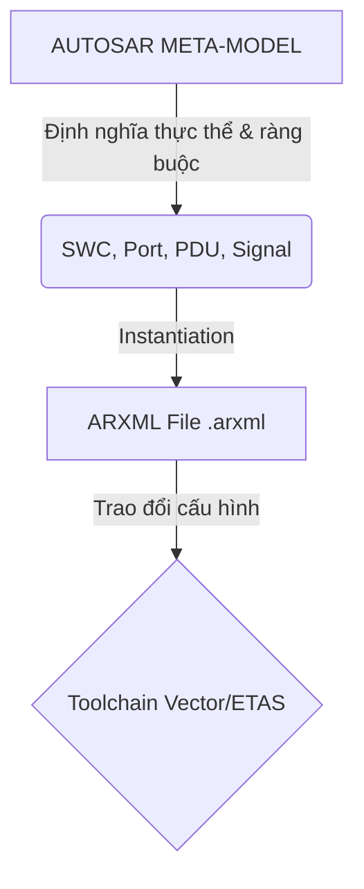
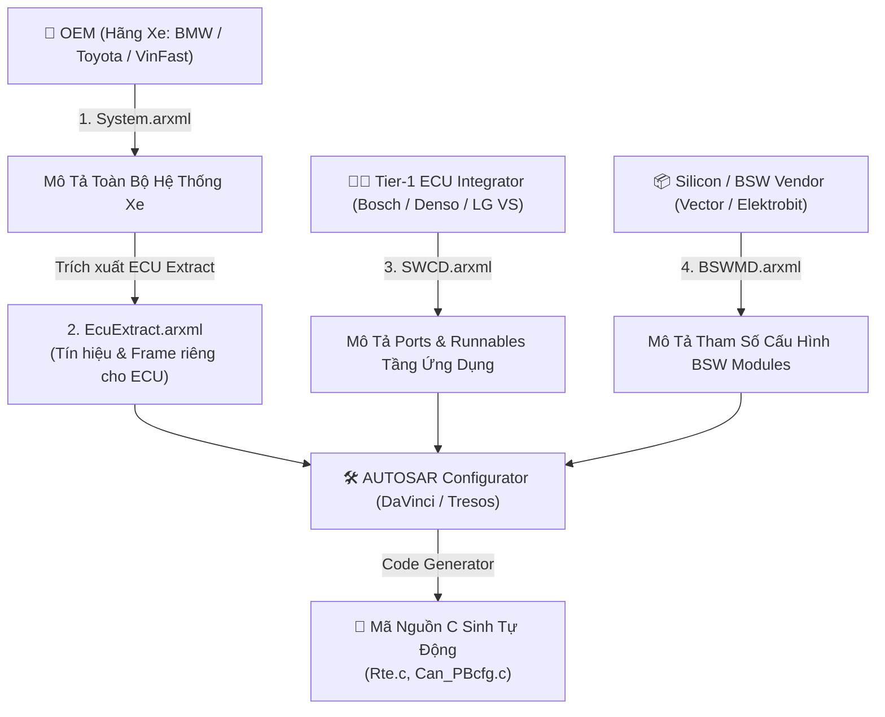
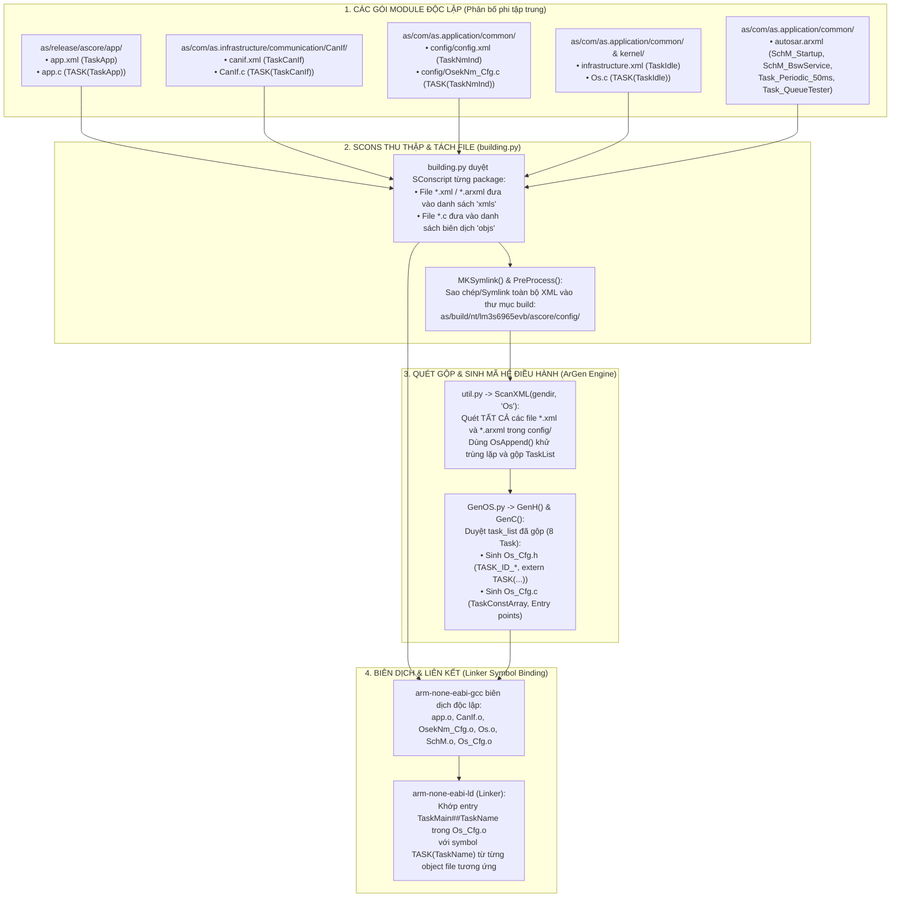
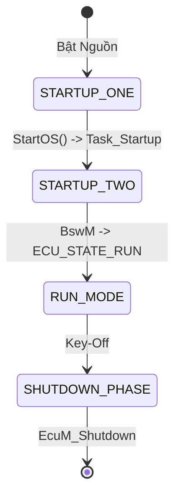
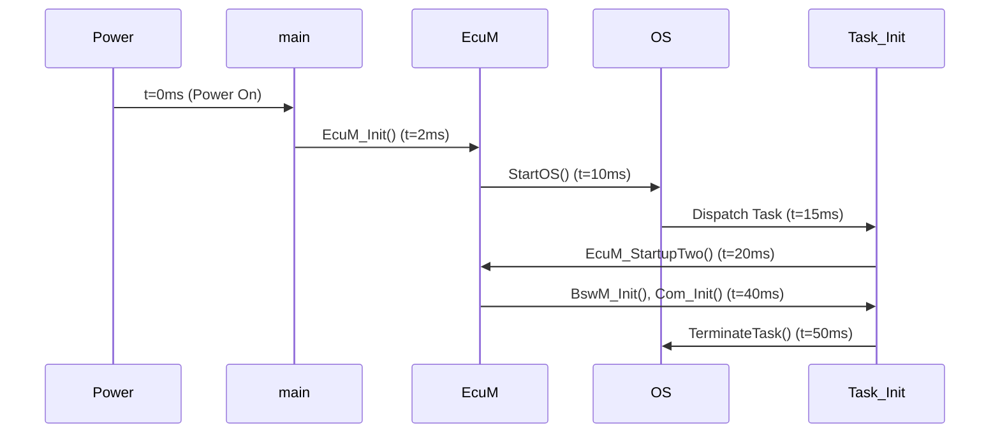

# Chuyên Đề 05: ARXML Meta-Model, Toolchain Engineering, ECU Integration & Mock Interview
## Masterclass Phân Tích Cấu Trúc ARXML, Quy Trình Toolchain Vector DaVinci/Tresos, Chu Trình Khởi Động EcuM/BswM và Bộ 60 Câu Hỏi Phỏng Vấn Thực Chiến

> **Ngôn ngữ:** Tiếng Việt Kỹ Nghệ Chuẩn Mực  
> **Cấp độ:** Universal Learning Resource (Newbie to Expert)
> **Tiêu chuẩn tham chiếu:** AUTOSAR Toolchain SWS, AUTOSAR EcuM SWS, AUTOSAR BswM SWS, AUTOSAR WdgM SWS, ARXML Schema Release 4.x  
> **Mã nguồn đối chiếu thực tế:** Kho mã nguồn [Study_AUTOSAR-main/as/](file:///C:/Users/liem.vu/Liem.vuOD/Study_AUTOSAR-main/as) (`com/as.infrastructure/system/EcuM/`, `com/as.tool/`)  
> **Vị trí tài liệu:** [Study_AUTOSAR-main/docs/05_Toolchain_ARXML_And_ECU_Integration.md](file:///C:/Users/liem.vu/Liem.vuOD/Study_AUTOSAR-main/docs/05_Toolchain_ARXML_And_ECU_Integration.md)

---

## Mục Lục

1. [Bản Chất Kỹ Thuật Của ARXML & Mô Hình AUTOSAR Meta-Model](#1-bản-chất-kỹ-thuật-của-arxml--mô-hình-autosar-meta-model)
2. [Phân Loại 4 Tệp ARXML Cốt Lõi Trong Dự Án Ô Tô](#2-phân-loại-4-tệp-arxml-cốt-lõi-trong-dự-án-ô-tô)
   - [2.4 Bảng Đối Chiếu Thực Chiến: ARXML Chuẩn Công Nghiệp (Vector/EB Multi-ECU) vs ARXML Dự Án Này (`parai/as`)](#24-bảng-đối-chiếu-thực-chiến-arxml-chuẩn-công-nghiệp-vectoreb-multi-ecu-vs-arxml-dự-án-này-paraias)
3. [Quy Trình Công Cụ Kỹ Nghệ Ô Tô (Industry Toolchain Workflow)](#3-quy-trình-công-cụ-kỹ-nghệ-ô-tô-industry-toolchain-workflow)
   - [3.4 Bản Chất Kỹ Nghệ: File ARXML Sinh Ra Những Gì? (BSW Static Core vs. Generated Code)](#34--bản-chất-kỹ-nghệ-file-arxml-sinh-ra-những-gì-bsw-static-core-vs-generated-code)
   - [3.5 Nghịch Lý Linker Script Trong Toolchain & ECU Integration (So Sánh AUTOSAR vs Bare-Metal vs Linux/Zephyr)](#35--nghịch-lý-linker-script-trong-toolchain--ecu-integration-so-sánh-toàn-diện-autosar-linker-vs-bare-metal-vs-linuxzephyr)
     - [3.5.5 Thực Tế Nghề Nghiệp: Kỹ Sư BSW Có Cần Đụng Vào Linker Script Không? Tôi Có Cần Học Không?](#5-thực-tế-nghề-nghiệp-kỹ-sư-bsw-có-cần-đụng-vào-linker-script-không-tôi-có-cần-học-không)
   - [3.6 Kiến Trúc Hợp Nhất Cấu Hình Đa Tệp (Multi-File XML Aggregation) & Cơ Chế Đóng Gói Module](#36--kiến-trúc-hợp-nhất-cấu-hình-đa-tệp-multi-file-xml-aggregation--cơ-chế-đóng-gói-module-trong-paraias-vs-chuẩn-công-nghiệp)
4. [Chu Trình Khởi Động & Vòng Đời Tích Hợp ECU (ECU Integration & Lifecycle)](#4-chu-trình-khởi-động--vòng-đời-tích-hợp-ecu-ecu-integration--lifecycle)
5. [Giám Sát An Toàn Chương Trình (Watchdog Manager - WdgM Masterclass)](#5-giám-sát-an-toàn-chương-trình-watchdog-manager---wdgm-masterclass)
6. [Bằng Chứng Mã Nguồn & Định Nghĩa Giao Tiếp Trong `parai/as`](#6-bằng-chứng-mã-nguồn--định-nghĩa-giao-tiếp-trong-paraias)
7. [Bộ 60 Câu Hỏi Phỏng Vấn Thực Chiến Toàn Diện (Easy → Medium → Hard)](#7-bộ-60-câu-hỏi-phỏng-vấn-thực-chiến-toàn-diện-easy--medium--hard)

---

## 1. Bản Chất Kỹ Thuật Của ARXML & Mô Hình AUTOSAR Meta-Model


Trong kỹ nghệ phần mềm ô tô, **ARXML** không phải là file XML thông thường mà là sự cụ thể hóa tuần tự (*Serialization*) của mô hình dữ liệu trừu tượng **AUTOSAR Meta-Model**:


✅ **Best Practice**: Luôn validate file ARXML với AUTOSAR Schema (.xsd) tương ứng trước khi import vào project.

### NÂNG CAO

**Phân Định Khởi Tạo Ngoại Vi: Standalone Mode vs Bootloader Integration**:
- **Không có BIOS trên MCU:** Tầng MCAL (`Mcu_Init`, `Port_Init`, `Can_Init`) chính là lớp khởi tạo phần cứng từ con số 0 trong Application.
- **Production Mode (Dual-Binary):** Flash chia 2 vùng: Bootloader tại `0x00000000` (64KB) và App tại `0x00010000`. Khi chuyển giao, Bootloader de-init ngoại vi, nạp `SCB->VTOR = 0x00010000`, nạp `MSP = *(uint32*)0x00010000` và nhảy vào `Reset_Handler` của App.
- **Standalone Development Mode:** `FLASH.ORIGIN = 0x00000000` trong linker script, cho phép nạp trực tiếp qua J-Link hoặc giả lập QEMU mà không cần tầng Bootloader trung gian.


Dưới đây là một ví dụ 💡 **ARXML snippet thực tế** khai báo một **Software Component (SWC)** với một **Sender/Receiver Port (S/R Port)**:

```xml
<?xml version="1.0" encoding="UTF-8"?>
<AUTOSAR xmlns="http://autosar.org/schema/r4.0" xmlns:xsi="http://www.w3.org/2001/XMLSchema-instance" xsi:schemaLocation="http://autosar.org/schema/r4.0 AUTOSAR_4-2-2.xsd">
  <AR-PACKAGES>
    <AR-PACKAGE>
      <SHORT-NAME>MyApplication</SHORT-NAME>
      <ELEMENTS>
        <APPLICATION-SW-COMPONENT-TYPE>
          <SHORT-NAME>EngineController_SWC</SHORT-NAME> <!-- Tên của SWC -->
          <PORTS>
            <R-PORT-PROTOTYPE>
              <SHORT-NAME>RP_EngineSpeed</SHORT-NAME> <!-- Tên Port Nhận (Receiver Port) -->
              <REQUIRED-INTERFACE-TREF DEST="SENDER-RECEIVER-INTERFACE">/Interfaces/SRI_EngineSpeed</REQUIRED-INTERFACE-TREF>
            </R-PORT-PROTOTYPE>
          </PORTS>
          <INTERNAL-BEHAVIORS>
            <SWC-INTERNAL-BEHAVIOR>
              <SHORT-NAME>IB_EngineController</SHORT-NAME>
              <RUNNABLES>
                <RUNNABLE-ENTITY>
                  <SHORT-NAME>RE_CalculateInjection</SHORT-NAME>
                  <MINIMUM-START-INTERVAL>0.01</MINIMUM-START-INTERVAL> <!-- Chu kỳ 10ms -->
                  <SYMBOL>EngineController_CalculateInjection</SYMBOL> <!-- Tên hàm C được sinh ra -->
                </RUNNABLE-ENTITY>
              </RUNNABLES>
            </SWC-INTERNAL-BEHAVIOR>
          </INTERNAL-BEHAVIORS>
        </APPLICATION-SW-COMPONENT-TYPE>
      </ELEMENTS>
    </AR-PACKAGE>
  </AR-PACKAGES>
</AUTOSAR>
```
🔧 **Giải thích tag XML**: 
- `<APPLICATION-SW-COMPONENT-TYPE>`: Định nghĩa một SWC ứng dụng.
- `<R-PORT-PROTOTYPE>`: Định nghĩa Receiver Port.
- `<REQUIRED-INTERFACE-TREF>`: Trỏ tới Interface mô tả kiểu dữ liệu của Port.
- `<RUNNABLE-ENTITY>`: Định nghĩa hàm xử lý logic bên trong SWC.

💀 **Critical Bug**: Thiếu hoặc sai version schema ở thẻ `<AUTOSAR>` có thể dẫn đến toàn bộ hệ thống parsing ARXML bị lỗi sập (Crash) hoặc bỏ qua các thẻ quan trọng.

---

## 2. Phân Loại 4 Tệp ARXML Cốt Lõi Trong Dự Án Ô Tô


Trong một dự án phát triển ECU thực tế, có 4 loại tệp ARXML chính được luân chuyển:

🎯 **Use Case**: Sử dụng `System.arxml` để quản lý giao tiếp giữa các ECU trên mạng CAN.

### NÂNG CAO
Quá trình map tín hiệu từ System.arxml xuống EcuExtract đòi hỏi sự chính xác tuyệt đối ở tầng COM và PDU Router.
⚠️ **Warning / Pitfall**: ARXML version mismatch! Nếu `System.arxml` của OEM dùng ARXML 4.3 mà Toolchain chỉ hỗ trợ tối đa 4.2.2, các thẻ `<GLOBAL-TIME-DOMAIN>` có thể bị bỏ qua, gây lỗi đồng bộ thời gian.
✅ **Best Practice**: Sử dụng các công cụ Migration (như AUTOSAR XML Migration Tool) để chuẩn hóa ARXML trước khi tích hợp.

### 2.4 Bảng Đối Chiếu Thực Chiến: ARXML Chuẩn Công Nghiệp (Vector/EB Multi-ECU) vs ARXML Dự Án Này (`parai/as`)

Khi quan sát tệp cấu hình [`as/com/as.application/common/autosar.arxml`](file:///C:/Users/liem.vu/Liem.vuOD/Study_AUTOSAR-main/as/com/as.application/common/autosar.arxml), một câu hỏi kiến trúc kinh điển thường xuất hiện:
> *"Tại sao file này lại chứa nhiều chỉ thị tiền xử lý `#ifdef USE_SMP`, `#ifdef USE_LWIP`, `#else`, `#endif` của ngôn ngữ C và gộp chung toàn bộ vi điều khiển (lm3s6965evb, posix, versatilepb, stm32f107vc) vào 1 file? Liệu đây có phải là cách viết đúng chuẩn công nghiệp không, hay chuẩn thực tế mỗi ECU phải có tệp ARXML riêng biệt?"*

#### 1. Bản Chất Kỹ Nghệ: Phản Biện Dứt Khoát
- **Cú pháp phi chuẩn (Malformed XML):** Theo tiêu chuẩn quốc tế AUTOSAR (Release 4.x), tệp ARXML bắt buộc phải là XML thuần túy tuân thủ nghiêm ngặt lược đồ XML Schema (`AUTOSAR_4-x-x.xsd`). Việc chèn `#ifdef` khiến cú pháp XML bị phá vỡ. Mọi bộ công cụ chính quy như **Vector DaVinci Configurator Pro**, **Elektrobit tresos Studio** hay **ETAS ISOLAR** sẽ quăng ngoại lệ cú pháp (*Fatal XML Parsing Error*) ngay tại dòng `#ifdef` đầu tiên và từ chối xử lý.
- **Nguyên tắc phân định Multi-ECU độc lập:** Trên một phương tiện giao thông hiện đại (Passenger Car/Commercial Vehicle) có từ 50 đến hơn 100 hộp ECU (Engine ECM, Body Control BCM, ADAS Domain Controller, Radar, BMS,...). Mỗi ECU sở hữu vi điều khiển khác nhau, sơ đồ chân I/O khác nhau và ma trận truyền thông CAN khác nhau. **Không bao giờ có chuyện gộp chung nhiều ECU vào 1 tệp ARXML duy nhất rồi dùng `#ifdef` để bật tắt!**
- **Cơ chế quản lý biến thể chính quy (AUTOSAR Variation Points):** Chuẩn AUTOSAR hỗ trợ quản lý biến thể (ví dụ: dòng xe Sedan dùng 1 Radar vs SUV dùng 2 Radar) thông qua các thẻ XML hợp lệ như `<VARIATION-POINT>`, `<POST-BUILD-VARIANT-CONDITION>` và `<PREDEFINED-VARIANT>`. Kỹ sư tích chọn Variant trên giao diện đồ họa (GUI) của DaVinci/Tresos, bảo toàn tính toàn vẹn 100% của tệp XML.

#### 2. Giải Mã "Hack Kỹ Thuật" Của Dự Án Mã Nguồn Mở (`parai/as`)
Tác giả dự án `parai/as` đã sử dụng một lối tắt kỹ thuật (Pragmatic Engineering Shortcut) nhằm phục vụ mục đích nghiên cứu, học tập:
- Dự án hỗ trợ cùng lúc hơn 10 loại bo mạch vi điều khiển khác nhau. Nếu làm đúng chuẩn OEM, tác giả sẽ phải duy trì 10 thư mục riêng với hàng trăm tệp XML bị lặp lại 90% nội dung (Boilerplate code).
- **Giải pháp:** Coi file `autosar.arxml` như một **C-Header Template**. Trong quy trình build SCons ([`building.py`](file:///C:/Users/liem.vu/Liem.vuOD/Study_AUTOSAR-main/as/com/as.tool/config.infrastructure.system/building.py#L1239-L1265)), hàm `PreProcess()` gọi trình tiền xử lý GNU C:
  ```bash
  arm-none-eabi-gcc -E --include asmconfig.h autosar.arxml.h -o autosar.arxml
  ```
  Trình tiền xử lý `gcc -E` sẽ bóc sạch toàn bộ `#ifdef` và xuất ra tệp XML chuẩn hợp lệ tại [`as/build/nt/lm3s6965evb/ascore/config/autosar.arxml`](file:///C:/Users/liem.vu/Liem.vuOD/Study_AUTOSAR-main/as/build/nt/lm3s6965evb/ascore/config/autosar.arxml). Sau đó, generator Python [`GenOS.py`](file:///C:/Users/liem.vu/Liem.vuOD/Study_AUTOSAR-main/as/com/as.tool/config.infrastructure.system/argen/GenOS.py) mới phân tích tệp sạch này để sinh code C.

#### 3. Bảng So Sánh Đối Chiếu Toàn Diện: Chuẩn Công Nghiệp vs Dự Án Nghiên Cứu

| Tiêu Chí So Sánh | Dự Án AUTOSAR Chuẩn Công Nghiệp (OEM / Tier-1) | Dự Án Mã Nguồn Mở `Study_AUTOSAR` (`parai/as`) |
| :--- | :--- | :--- |
| **Cú Pháp Tệp Nguồn** | **100% Well-formed XML**, tuân thủ nghiêm ngặt Schema W3C (`AUTOSAR_4-x-x.xsd`). | **Hybrid XML + C Preprocessor** (chứa `#ifdef`, `#else`, `#endif`). |
| **Cấu Trúc Tệp (File Granularity)** | **Module hóa phân tán:** Chia nhỏ theo từng ECU và từng module BSW (`Os_Ecuc.arxml`, `Can_Ecuc.arxml`, `Dem_Ecuc.arxml`...). | **Tập trung hóa:** 1 tệp duy nhất `autosar.arxml` (~1050 dòng) gộp toàn bộ OS, CAN, Chẩn đoán và 10+ bo mạch. |
| **Phân Định Multi-ECU** | **Mỗi ECU một Workspace riêng biệt:** OEM trích xuất `EcuExtract.arxml` riêng cho từng ECU (BCM, Engine, ADAS). Không bao giờ gộp chung. | **Gộp chung 1 file template:** Cấu hình cho nhiều target phần cứng nằm xen kẽ nhau trong cùng một cây thẻ XML. |
| **Quản Lý Biến Thể (Variants)** | Dùng cơ chế chính quy **`<VARIATION-POINT>`**, `<POST-BUILD-VARIANT-CONDITION>`, điều khiển qua GUI của tool. | Dùng các cờ Macro C (`USE_SMP`, `USE_LWIP`, `USE_ECUM`, `USE_SHELL`) để tiền xử lý biên dịch có điều kiện. |
| **Giai Đoạn Tiền Xử Lý (Pre-processing)** | Không có. Các công cụ DaVinci/Tresos đọc trực tiếp XML Schema bằng Java/C++ engine chuyên dụng. | Có. Sử dụng `arm-none-eabi-gcc -E` để strip sạch `#ifdef` trước khi đưa vào bộ parser Python. |
| **Toolchain Cấu Hình & Sinh Mã** | **Bộ công cụ thương mại bản quyền triệu đô:** Vector DaVinci Configurator Pro, EB tresos Studio, ETAS ISOLAR. | **Bộ công cụ Python tự xây dựng (In-house scripts):** SCons + `GenOS.py`, `GenCan.py`, `GenEcuC.py`. |
| **Ưu Điểm Cốt Lõi** | Chuẩn hóa toàn cầu, hỗ trợ an toàn chức năng ISO 26262, ASPICE, quản lý dự án hàng trăm kỹ sư đa quốc gia. | Cực kỳ tinh gọn, trực quan, chi phí 0 đồng, rất phù hợp cho kỹ sư nghiên cứu bản chất sâu bên dưới RTOS/MCAL. |
| **Nhược Điểm / Rào Cản** | Cấu hình cực kỳ đồ sộ, phức tạp, cồng kềnh, bản quyền đắt đỏ, đòi hỏi chứng chỉ và đào tạo bài bản. | Phi chuẩn so với công nghiệp, không thể import trực tiếp vào các phần mềm của hãng (Vector/Elektrobit). |

---

## 3. Quy Trình Công Cụ Kỹ Nghệ Ô Tô (Industry Toolchain Workflow)


**Quy Trình Công Cụ Vector DaVinci (Developer & Configurator Pro)**:

```
[QUY TRÌNH PHÁT TRIỂN VECTOR DAVINCI]

  1. DaVinci Developer (Tạo SWCD.arxml)
            │
            ▼
  2. DaVinci Configurator Pro (Tích hợp EcuExtract + BSWMD + SWCD)
            │
            ▼
  3. DaVinci Code Generators (Sinh Rte.c, <Module>_PBcfg.c)
            │
            ▼
  4. Trình Biên Dịch C (Compiler & Linker) -> ECU_Firmware.hex
```
**Knowledge Mapping**: Linux module development → AUTOSAR ECU Integration workflow
- Linux Kernel Config (Kconfig, menuconfig) ⇔ DaVinci Configurator (Cấu hình BSW).
- Linux Device Tree (dts) ⇔ EcuExtract.arxml (Mô tả Hardware/Network cho 1 ECU).
- Linux Kernel Build (make bzImage) ⇔ Toolchain Build (Compiler + Linker sinh ra file hex).

### NÂNG CAO
**Step-by-step hướng dẫn config DaVinci**:
1. **Khởi tạo Project**: Tạo SIP (Software Integration Package). Import thư mục BSW và Base.
2. **Import EcuExtract**: Kéo thả `EcuExtract.arxml` vào Configurator:
   ```
   [ EcuExtract.arxml ] ──► (DaVinci Configurator Input) ──► [ Phân giải BSW Modules: Can, CanIf, Com, Os, EcuM ]
   ```
3. **Task Mapping**: Map các Runnable Entities từ SWC vào các OS Tasks (ví dụ: `RE_Calculate` map vào `Task_10ms`).
4. **Validation**: Chạy Validation Engine. Sửa các lỗi màu đỏ ❌.
5. **Code Generation**: Nhấn nút Generate. Sinh ra thư mục `Appl/GenData`.

⚠️ **5 Common Pitfalls khi làm việc với toolchain**:
1. **ARXML version mismatch**: Lỗi không tương thích version (ví dụ 4.2.2 vs 4.3.0).
2. **Circular dependency**: Module A phụ thuộc module B, B phụ thuộc A trong file header sinh ra gây lỗi biên dịch.
3. **Unconnected port**: Cấu hình SWC có Port nhưng quên nối (Connect) trong Composition, dẫn tới RTE sinh lỗi `Unconnected_Port`.
4. **Wrong task mapping**: Map Runnable chạy 10ms vào OS Task chu kỳ 100ms gây sai lệch logic.
5. **Missing BSW Default Config**: Quên import file BSWMD.arxml của một module dẫn đến thiếu param mặc định.

🛠️ **Hands-On Exercise**: Import ARXML vào `parai/as` project.
- Mở thư mục `Study_AUTOSAR-main/as/`.
- Tìm kiếm các file ARXML mẫu trong `com/as.tool/config/`.
- Thực thi script sinh code Python để trải nghiệm việc chuyển từ XML sang file C.

---


---

### 3.4 🧩 Bản Chất Kỹ Nghệ: File ARXML Sinh Ra Những Gì? (BSW Static Core vs. Generated Code)

> ❓ **Câu hỏi kinh điển:** *File ARXML chỉ sinh ra RTE hay sinh ra cả BSW? BSW có dùng chung cho mọi ECU không?*

#### 1. Công Thức Lắp Ráp Phần Mềm 1 ECU Trong Thực Tế:
Để tạo ra file nhị phân (`.hex` / `.bin`) nạp vào bất kỳ ECU nào (BMS, VCU, BCM), hệ thống lắp ráp **4 khối mô-đun**:

$$\mathbf{ECU\_Binary} = \underbrace{\mathbf{BSW\_Static\_Core}}_{\text{Mã BSW dùng chung 100\%}} + \underbrace{\mathbf{MCAL\_Drivers}}_{\text{Trình điều khiển theo Chip}} + \underbrace{\mathbf{Generated\_Code}}_{\text{Sinh tự động từ ARXML (RTE + BSW Cfg)}} + \underbrace{\mathbf{SWC\_Runnables}}_{\text{Thuật toán ứng dụng riêng}}$$

```
                              FILE CẤU HÌNH ECU (autosar.arxml)
                                              │
                                              ▼ (Toolchain Generator)
                      ┌───────────────────────┴───────────────────────┐
                      │                                               │
                      ▼                                               ▼
         1. SINH RA TẦNG RTE                            2. SINH RA CẤU HÌNH BSW
      (Glue Code giữa SWC & BSW)                       (Mã cấu hình riêng của ECU)
   ─────────────────────────────────              ───────────────────────────────────
   • Rte.c, Rte.h, Rte_Type.h                     • Com_PbCfg.c, Com_PbCfg.h (Bảng Signal/PDU)
   • Rte_Telltale.h, Rte_Bms.h                    • CanIf_Cfg.c, CanIf_Cfg.h (Bảng Filter CAN)
   • Nối Rte_Write() ──► Com_SendSignal()         • Os_Cfg.c, Os_Cfg.h       (Bảng Task/Alarm)
                                                  • Dcm_Lcfg.c, Dem_Cfg.c    (Bảng UDS/DTC)
                                                  • EcuM_PbCfg.c             (Bảng Driver Init)
```

#### 2. Phân Định Rạch Ròi 2 Nửa Của Module BSW:
Một module BSW (như COM hay CANIF) luôn bao gồm **2 nửa tách biệt**:
* **Nửa thứ nhất — Mã Logic Tĩnh (`Com.c`, `CanIf.c`, `PduR.c`, `EcuM.c`):**  
  Chứa toàn bộ thuật toán máy trạng thái, xử lý bit, bộ định tuyến. **DÙNG CHUNG 100% cho mọi ECU**, do nhà cung cấp BSW (Vector, EB, ArcCore) viết sẵn, không bao giờ sửa tay.
* **Nửa thứ hai — Bảng Cấu Hình Tham Số (`Com_PbCfg.c`, `CanIf_Cfg.c`, `Os_Cfg.c`):**  
  Chứa các mảng hằng số cấu hình riêng của ECU đó (danh sách CAN ID, chu kỳ gửi ms, danh sách Task). **Được sinh tự động 100% từ file ARXML của ECU đó**.

#### 3. ⚠️ "Nguyên Tắc Vàng": CẤM SỬA TAY VÀO GENERATED CODE (Do Not Edit Generated Code)
* Tất cả các file sinh ra (`Rte.c`, `*_Cfg.c`) đều có comment cảnh báo:  
  `/* WARNING: THIS FILE IS AUTO-GENERATED. DO NOT EDIT MANUALLY! */`
* **Hậu quả:** Nếu sửa tay vào các file này, mỗi khi chạy lại Tool Generate hoặc chạy CI/CD pipeline, **toàn bộ mã sửa tay sẽ bị xóa sạch và ghi đè 100%!**

#### 4. 🛠️ 3 Vùng Kỹ Sư Được Phép Viết Code Trong Dự Án:
1. **Sửa cấu hình hệ thống:** Sửa trên file ARXML / Tool GUI (DaVinci/Tresos) $\rightarrow$ Bấm Generate Code.
2. **Viết thuật toán ứng dụng:** Viết trong thân hàm Runnable của SWC (`Swc_*.c`), đọc ghi qua cổng RTE (`Rte_Read()`, `Rte_Write()`).
3. **Viết mã điều khiển phần cứng đặc thù:** Viết trong các hàm BSW Callouts (`EcuM_AL_DriverInitOne()`) và OS Hooks (`StartupHook()`, `ErrorHook()`).

---

### 3.5 ⚡ Nghịch Lý Linker Script Trong Toolchain & ECU Integration: So Sánh Toàn Diện AUTOSAR Linker vs Bare-Metal vs Linux/Zephyr

> 🎯 **Trọng tâm ECU Integration:**  
> Trong quy trình tích hợp phần mềm ô tô (ECU Integration), **Linker Script (`.ld`, `.lds`, `.lsl`)** chính là bản thiết kế quy hoạch bộ nhớ vật lý tối thượng. Nó là điểm hội tụ cuối cùng của chuỗi Toolchain — nơi kết hợp mã BSW tĩnh, MCAL driver, mã cấu hình sinh tự động từ ARXML (`Rte.c`, `<Mod>_PBcfg.c`) và thuật toán ứng dụng SWC thành một file nhị phân hoàn chỉnh (`.hex` / `.elf` / `.s19`).

Một hiểu lầm rất phổ biến của nhiều kỹ sư nhúng khi mới bước vào ngành Automotive là:  
*"Vì AUTOSAR MCAL và BSW không dùng macro gom hàm đăng ký driver tự động vào linker section (như `.initcall` trong Linux hay Zephyr), nên nhiệm vụ của Linker Script trong AUTOSAR đơn giản và nhàn hơn rất nhiều."*

Thực tế hoàn toàn ngược lại 180 độ: **Đây là một "Nghịch lý Kỹ nghệ" (Engineering Paradox)!**  
Dù không dùng kỹ thuật gom hàm đăng ký động, nhưng **Linker Script trong AUTOSAR Classic lại là một trong những Linker Script phức tạp, đồ sộ và khắt khe bậc nhất thế giới hệ thống nhúng** (trong các dự án ECU thương mại của Bosch, Continental, Denso, một file linker script thường dài từ **2.000 đến hơn 10.000 dòng**).

---

#### 1. Vì Sao Kỹ Thuật Linker Section Trong Linux/Zephyr Trông "Nguy Hiểm" Nhưng Lại Rất "Nhàn"?

Trong Linux Kernel hay Zephyr RTOS, cơ chế driver self-registration hoạt động theo nguyên lý đặt biến con trỏ hàm vào một section chung:
```c
// Ví dụ trong Linux:
#define module_init(initfn)     static initcall_t __initcall_##initfn __attribute__((__section__(".initcall6.init"))) = initfn;
```
Đối với Linker của Linux hay Zephyr, nhiệm vụ này **vô cùng đơn giản**:  
Linker chỉ cần một khối lệnh gom tất cả các con trỏ hàm nằm rải rác trong các file object vào giữa 2 nhãn địa chỉ:
```lds
/* Linker script của Linux/Zephyr - Cực kỳ tinh gọn */
__initcall_start = .;
KEEP(*(.initcall*))
__initcall_end = .;
```
Linker **hoàn toàn không cần quan tâm** hàm đó thuộc về driver nào, kích thước bao nhiêu bytes, nằm ở lõi CPU số mấy, hay có vi phạm phân vùng an toàn MPU hay không. Khi khởi động, Kernel chỉ việc chạy một vòng lặp `for` duyệt từ `__initcall_start` đến `__initcall_end` và gọi từng con trỏ hàm theo thứ tự level.

---

#### 2. 4 "Cơn Ác Mộng" Của Kỹ Sư ECU Integration Với Linker Script Trong AUTOSAR

Trong thế giới ô tô (Automotive ASIL-D), cơ chế "nhét chung một túi" của Linux/Zephyr bị cấm hoàn toàn. Thay vào đó, kỹ sư ECU Integration phải trực tiếp cấu hình Linker Script để giải quyết 4 bài toán phần cứng sống còn:

```
┌────────────────────────────────────────────────────────────────────────────────────────┐
│                   4 TRỌNG TRÁCH KỸ NGHỆ CỦA LINKER SCRIPT TRONG AUTOSAR                 │
├────────────────────────────────────────────────────────────────────────────────────────┤
│                                                                                        │
│ 1. ĐẶC TẢ ÁNH XẠ BỘ NHỚ AUTOSAR MemMap (Hàng trăm Sections riêng biệt)                │
│    • Mỗi hàm, mỗi biến đều bị bọc bởi cặp macro: CAN_START_SEC_CODE / STOP_SEC_CODE   │
│    • Phân lập rạch ròi: Code chạy Flash vs Code chạy RAM (.ramcode cho Fls Driver)    │
│    • Tách biến khởi tạo khi bật nguồn vs biến lưu vết tai nạn không bị xóa (.noinit)  │
│                                                                                        │
│ 2. PHÂN VÙNG BẢO VỆ BỘ NHỚ MPU & AN TOÀN ASIL (ISO 26262 Partitioning)                 │
│    • Cô lập ứng dụng ASIL-D (Phanh, Túi khí) khỏi ứng dụng QM (Điều hòa, Báo xăng)    │
│    • Mạch phần cứng MPU đòi hỏi địa chỉ và kích thước PHẢI LÀ LŨY THỪA CỦA 2         │
│      (Power of 2 Alignment: 32B, 64B, 128B, 1KB, 4KB, 16KB...). Lệch 1 byte -> Crash! │
│                                                                                        │
│ 3. PHÂN BỔ BỘ NHỚ ĐA LÕI PHẦN CỨNG (Multi-Core Silicon Allocation)                    │
│    • Chip ô tô hiện đại có 3-6 lõi (Infineon AURIX TC397, NXP S32G, Renesas RH850)    │
│    • Định tuyến code/data vào đúng bộ nhớ cục bộ siêu tốc của từng lõi (DSPR0, DSPR1)  │
│    • Bộ nhớ chia sẻ đa lõi (Inter-Core Shared Memory) phải cấu hình Non-cacheable     │
│                                                                                        │
│ 4. PHÂN ĐOẠN NẠP FIRMWARE: BOOTLOADER, CALIBRATION DATA & OTA A/B SWAP                 │
│    • Vùng Calibration Data (.calib): Ghim cố định địa chỉ tuyệt đối cho tool INCA     │
│    • Vùng Flash Driver nạp động (.flsdrv): Nạp tạm vào RAM để nạp UDS Bootloader      │
│                                                                                        │
└────────────────────────────────────────────────────────────────────────────────────────┘
```

##### Trọng trách 1: Đặc tả Memory Mapping (`MemMap.h`)
Trong một dự án AUTOSAR thương mại (Vector DaVinci, EB Tresos), toàn bộ mã nguồn của hàng chục module BSW và hàng trăm SWC đều bị bọc kín bởi các macro MemMap:
```c
#define CAN_START_SEC_CODE
#include "Can_MemMap.h"
void Can_Init(const Can_ConfigType *Config) { ... }
#define CAN_STOP_SEC_CODE
#include "Can_MemMap.h"

#define CAN_START_SEC_VAR_NOINIT_8BIT
#include "Can_MemMap.h"
static uint8 _can_filter_index;
#define CAN_STOP_SEC_VAR_NOINIT_8BIT
#include "Can_MemMap.h"
```
Linker Script phải có các chỉ thị riêng cho từng phân vùng đó. File linker script của một ECU thực tế trên xe có thể **dài từ 2.000 đến hơn 10.000 dòng**, chi tiết đến từng biến 8-bit, 16-bit, 32-bit nhằm tối ưu hóa bộ nhớ đệm cache và bus alignment.

##### Trọng trách 2: Hiện tượng Read-While-Write (RWW) và Vùng Nhớ `.ramcode`
Khi Fls Driver thực hiện xóa hoặc ghi một Sector Flash, cấu trúc bán dẫn của Flash Bank đó bị khóa hoàn toàn. Nếu CPU cố tình đọc lệnh tiếp theo từ Flash, chip sẽ văng lỗi **Bus Fault / Data Abort**.  
👉 Kỹ sư ECU Integration bắt buộc phải cấu hình Linker Script tạo phân vùng `.ramcode`: Mã máy được lưu ở Flash nhưng khi chạy phải được copy vào RAM và thực thi hoàn toàn trên RAM (`AT>FLASH >RAM`).

##### Trọng trách 3: Phân vùng MPU và Quy tắc "Lũy Thừa 2" (Power-of-2 Alignment)
Để đạt chứng chỉ ASIL-D theo tiêu chuẩn ISO 26262, các OS-Application có mức an toàn khác nhau phải được cách ly hoàn toàn bằng phần cứng MPU.  
Phần cứng MPU của vi điều khiển (ARM Cortex-M/R MPU, TriCore MPU) không cho phép đặt biên giới tùy tiện. Vùng nhớ được giám sát bắt buộc phải có kích thước và địa chỉ khởi đầu căn chỉnh theo $2^N$ (32 bytes, 64 bytes, 512 bytes, 4 KB, 16 KB...).  
Nếu kỹ sư cấu hình Linker Script thiếu chỉ thị `. = ALIGN(4096);`, chỉ cần compiler dịch code lệch 1 byte là phần cứng MPU sẽ từ chối thiết lập boundary $\rightarrow$ ECU sập ngay khi vừa boot!

##### Trọng trách 4: Vùng Calibration Hiệu Chuẩn Tham Số Xe (A2L / XCP)
Trong ngành ô tô, các thông số điều khiển (Bản đồ phun xăng, góc mở bướm ga, giới hạn dòng pin BMS) không được biên dịch lẫn vào code thông thường.  
Linker Script phải ghim toàn bộ biến hiệu chuẩn này vào một phân vùng Flash cố định tuyệt đối (`.calib` section). Nhờ đó, các kỹ sư cân chỉnh xe hơi ngoài hiện trường có thể dùng phần mềm **Vector CANape** hoặc **ETAS INCA** qua giao thức XCP/UDS để ghi đè tham số mới trực tiếp vào bộ nhớ mà không cần phải compile lại toàn bộ phần mềm ECU.

---

#### 3. Bảng So Sánh Toàn Diện Linker Script Giữa 3 Thế Giới Kiến Trúc

| Tiêu Chí So Sánh | Bare-Metal Thông Thường (Keil / IAR / STM32Cube) | General OS (Linux / Zephyr / FreeRTOS) | Automotive AUTOSAR Classic (ISO 26262 ASIL-D) |
| :--- | :--- | :--- | :--- |
| **Quy mô Linker Script** | Rất ngắn (30 – 80 dòng). | Trung bình (100 – 300 dòng). | **Cực kỳ đồ sộ (1.000 – 10.000+ dòng)**. |
| **Cơ chế nạp Driver** | Gọi trực tiếp trong `main()`. | **Dùng Macro tự đăng ký qua Linker Section** (`.initcall`). | **Khởi tạo tường minh qua `EcuM`**, cấm tự đăng ký động. |
| **Phân chia Section** | Cơ bản: `.text`, `.data`, `.bss`, `.rodata`. | Cơ bản + Driver sections + Initcall levels. | **Hàng trăm Sections chi tiết** theo chuẩn `MemMap.h` (`SEC_CODE`, `SEC_VAR_FAST`, `SEC_VAR_NOINIT`). |
| **Bảo vệ Bộ nhớ (Memory Protection)** | Không có (Flat memory model). | 2 cấp (User Space vs Kernel Space) hoặc MPU cơ bản. | **Đa phân vùng MPU khắt khe (OS-Applications)**, bắt buộc Power-of-2 Alignment cho ASIL-D. |
| **Hỗ trợ MCU Đa Lõi (Multi-Core)** | Hiếm khi hỗ trợ hoặc cấu hình thô sơ. | SMP Kernel tự quản lý bộ nhớ tập trung qua MMU. | **Phân bổ tĩnh chi li từng Byte** vào Local RAM của Core (DSPR0, DSPR1, Core-Specific Stacks, Spinlock Shared RAM). |
| **Xử lý RAM Code (RWW)** | Hiếm khi cấu hình trừ khi tự làm IAP Bootloader. | Không áp dụng (Kernel chạy hoàn toàn trên RAM). | **Bắt buộc cấu hình `.ramcode`** cho Flash Driver (`Fls`) để tránh nghẽn bus CPU khi xóa ghi Flash. |
| **Vùng Dữ liệu Hiệu chuẩn (Calibration)** | Không hỗ trợ. | Không có khái niệm này. | **Ghim địa chỉ tuyệt đối cố định** (`.calib`) phục vụ cân chỉnh xe qua CANape / INCA (A2L / XCP). |

---

#### 4. Minh Chứng Pháp Y Trong Mã Nguồn Thực Tế `Study_AUTOSAR` (`parai/as`)

Ngay trong dự án `Study_AUTOSAR`, hệ thống cung cấp tới **17 file Linker Script (`.lds`)** đại diện cho các phân đoạn vận hành khác nhau của chiếc xe:

1. **Linker Script Chạy Ứng Dụng Bình Thường** — [board.stm32f107vc/script/linker-app.lds](file:///C:/Users/liem.vu/Liem.vuOD/Study_AUTOSAR-main/as/com/as.application/board.stm32f107vc/script/linker-app.lds):
   * Phân bổ Flash từ `0x00000000`, RAM từ `0x20000000`.
   * Cấu hình cơ chế nạp biến khởi tạo: `.data : AT (__etext) { ... } > RAM` (Lưu giá trị khởi tạo ở Flash, khi boot copy sang RAM).
2. **Linker Script Nạp Bootloader Ô Tô** — [board.stm32f107vc/script/linker-boot.lds](file:///C:/Users/liem.vu/Liem.vuOD/Study_AUTOSAR-main/as/com/as.application/board.stm32f107vc/script/linker-boot.lds):
   * Tách đôi Flash: Dành `64KB` đầu tiên cho Bootloader (`FLASH`), và cô lập `192KB` tiếp theo từ địa chỉ `0x00010000` cho `APPCODE`.
   * Ghim sẵn địa chỉ nhảy sang ứng dụng: `application_main = 0x00010401;`.
3. **Linker Script Nạp Động Flash Driver Vào RAM** — [board.stm32f107vc/script/linker-flsdrv.lds](file:///C:/Users/liem.vu/Liem.vuOD/Study_AUTOSAR-main/as/com/as.application/board.stm32f107vc/script/linker-flsdrv.lds):
   * Điểm kỳ lạ nhưng cực kỳ tinh tế: Vùng `FLASH (rx)` lại có địa chỉ `ORIGIN = 0x20000000` (Chính là vùng SRAM)!
   * Đây là driver ghi xóa flash được công cụ UDS Bootloader nạp tạm thời vào RAM để thực thi, giải quyết triệt để vấn đề Read-While-Write restriction.

---

#### 5. Thực Tế Nghề Nghiệp: Kỹ Sư BSW Có Cần Đụng Vào Linker Script Không? Tôi Có Cần Học Không?

Rất nhiều kỹ sư nhúng và sinh viên khi định hướng làm việc trong ngành phần mềm ô tô (Automotive Embedded) đều băn khoăn:  
> *"Linker Script trong AUTOSAR phức tạp và dài hàng nghìn dòng như vậy, liệu trong công việc thực tế (các job BSW, MCAL, Integration) kỹ sư có phải đụng vào không? Và một kỹ sư BSW có bắt buộc phải học Linker Script không?"*

Dưới đây là câu trả lời toàn diện, chân thực và bóc tách theo đúng các vị trí công việc thực tế tại các công ty ô tô (OEM như VinFast, Ford, BMW; Tier-1 như Bosch, Denso, Continental, LG Electronics, Hyundai Mobis; và Software Houses như Vector, Elektrobit, ETAS, FPT Automotive):

---

##### 1️⃣ Phân Định Theo Vị Trí Công Việc (Job Roles & Linker Script Involvement)

Trong một dự án AUTOSAR, mức độ làm việc với Linker Script được phân hóa rất rõ rệt theo 4 vai trò chính:

| Vị Trí Công Việc (Job Role) | Mô Tả Trách Nhiệm Chính | Mức Độ Đụng Vào Linker Script | Tình Huống Thực Tế Cần Can Thiệp |
| :--- | :--- | :---: | :--- |
| **1. BSW Integration Engineer / ECU Integrator / Platform Engineer** | Tích hợp toàn bộ MCAL + BSW + OS + RTE + Code SWC ứng dụng thành một file binary hoàn chỉnh (`.hex` / `.elf` / `.s19`). Thiết lập Toolchain, compiler flags và hệ thống build. | **BẮT BUỘC & LIÊN TỤC (100%)** *(Chủ sở hữu chính của Linker Script)* | • Quy hoạch Memory Map cho toàn ECU.<br>• Phân bổ RAM/Flash cho Multi-core (Core0, Core1, Core2).<br>• Cấu hình phân vùng MPU đạt chuẩn ISO 26262 ASIL-D (Power-of-2 Alignment).<br>• Phân vùng OTA Flash A/B Swap, Dual-Bank Bootloader.<br>• Ghim địa chỉ cố định `.calib` cho các kỹ sư chạy CANape/INCA.<br>• **Xử lý các sự cố tràn bộ nhớ (Flash/RAM Overflow)** khi thêm tính năng mới. |
| **2. BSW Developer (MCAL & BSW Module Dev)** | Phát triển, cấu hình và bảo trì các driver tầng thấp MCAL (Can, Spi, Adc, Fls) hoặc các stack BSW (ComStack, DiagStack, MemoryStack). | **THỈNH THOẢNG (20% – 30%)** *(Tùy module phụ trách)* | • **Nếu làm Flash Driver (`Fls` / FLS Loader):** Bắt buộc phải hiểu và cấu hình `.ramcode` để giải quyết hiện tượng Read-While-Write.<br>• **Nếu làm Driver Ethernet / CAN-FD DMA:** Phải cấu hình vùng nhớ Non-cacheable Buffer trong Linker Script để tránh DMA Cache Incoherency.<br>• **Nếu làm Bootloader (FBL):** Bắt buộc phải viết và chỉnh sửa Linker Script riêng cho Bootloader (`linker-boot.lds`).<br>• Còn nếu chỉ làm các stack thuần logic như `Com`, `PduR`, `Dcm` thì chỉ cần tuân thủ khai báo qua `MemMap.h`, hiếm khi phải sửa trực tiếp file `.lds`. |
| **3. Software / System Architect** | Thiết kế kiến trúc phần mềm, hoạch định tài nguyên phần cứng (Memory Budgeting, ASIL safety concept). | **GIÁN TIẾP (Review & Quy hoạch)** | Thiết kế tài liệu Memory Layout Spec (quy định Core nào được dùng bao nhiêu KB RAM, dải địa chỉ từ đâu đến đâu) để chuyển giao cho Integration Engineer cấu hình vào Linker Script. |
| **4. Application / SWC Developer** | Phát triển thuật toán điều khiển xe (Matlab Simulink hoặc C), kết nối cổng qua RTE. | **GẦN NHƯ KHÔNG (0% – 5%)** | Tầng RTE và BSW đã trừu tượng hóa 100% bộ nhớ. Kỹ sư Application chỉ cần code logic nghiệp vụ mà không cần quan tâm biến của mình nằm ở địa chỉ vật lý nào trong RAM. |

---

##### 2️⃣ Bạn Có Cần Học Linker Script Không? Và Cần Học Đến Mức Nào?

👉 **CÂU TRẢ LỜI:** **BẮT BUỘC PHẢI HỌC, NHƯNG HỌC ĐÚNG TRỌNG TÂM, ĐÚNG CẤP ĐỘ — KHÔNG CẦN PHẢI TỰ TAY VIẾT TỪ ĐẦU (FROM SCRATCH) 5.000 DÒNG!**

###### ❌ Những điều bạn KHÔNG CẦN phải lo lắng:
- Bạn **không bao giờ phải ngồi gõ trắng một file Linker Script 10.000 dòng từ con số 0**.
- Trong mọi dự án ô tô thương mại, nhà cung cấp vi điều khiển (NXP, Infineon, Renesas, ST) hoặc hãng làm Compiler (Tasking, Green Hills Multi, Wind River Diab, HighTec GCC) luôn bàn giao kèm một **File Linker Script Mẫu (BSP Template Linker Script)** đã định nghĩa sẵn toàn bộ thanh ghi phần cứng và các dải địa chỉ Flash/RAM vật lý của chip.

###### ✅ 3 Năng Lực Cốt Lõi Bạn BẮT BUỘC Phải Thành Thạo:

1. **Năng Lực 1: Đọc, Hiểu & Chỉnh Sửa (Read, Understand & Customize):**  
   Bạn phải đọc hiểu được cú pháp Linker Script để khi dự án yêu cầu:
   - *"Hãy tạo thêm một section mới để đưa mảng dữ liệu 4KB của driver Ethernet vào vùng SRAM không qua cache (Non-cacheable RAM)!"*
   - *"Hãy tăng kích thước System Stack của OS từ 2KB lên 4KB!"*
   - *"Hãy chuyển hàm xóa Flash `Fls_WriteSector()` từ Flash vào RAM để chạy!"*  
   $\rightarrow$ Bạn phải biết mở file `.lds` ra và thêm đúng cú pháp `AT>FLASH >RAM` hoặc `ALIGN(4)`.

2. **Năng Lực 2: Kỹ Năng Debug "Cứu Hộ" Khi Build Thất Bại Hoặc Chip Sập (Crash Debugging):**  
   Đây là sự khác biệt giữa một kỹ sư tay mơ và một kỹ sư chuyên nghiệp:
   - **Khi Build báo lỗi tràn bộ nhớ:** `region 'RAM' overflowed by 2048 bytes`. Nếu không hiểu Linker Script và không biết cách đọc file ánh xạ bộ nhớ [`.map`](file:///C:/Users/liem.vu/Liem.vuOD/Study_AUTOSAR-main/as/build/nt/lm3s6965evb/ascore/lm3s6965evb.map), bạn sẽ không thể biết được module nào, file C nào hay biến nào đang ngốn dung lượng RAM bất thường để tối ưu.
   - **Khi nạp chip bị lỗi phần cứng:** Chip vừa boot lên đã văng ngay vào **HardFault**, **BusFault** hoặc **MemManage Fault** (do MPU chặn). 90% trường hợp lỗi này xuất phát từ việc căn chỉnh địa chỉ sai (Alignment mismatch) hoặc con trỏ nhảy vào vùng nhớ chưa được Linker Script cấp quyền thực thi (`NOEXEC`).

3. **Năng Lực 3: Vượt Qua Vòng Phỏng Vấn Kỹ Thuật (Senior BSW / Automotive Interview):**  
   Tại các công ty ô tô hàng đầu (Bosch, VinFast, LG, Aptiv...), các Senior Technical Interviewer luôn dùng các câu hỏi về Linker Script để **phân loại ứng viên**:
   - Ứng viên bậc thấp (Junior) thường chỉ biết dùng giao diện đồ họa GUI của Vector DaVinci để gen code và không hiểu bên dưới file `.hex` được tạo ra thế nào.
   - Ứng viên xuất sắc (Solid Mid/Senior) sẽ giải thích vanh vách: VMA (*Virtual Memory Address*) vs LMA (*Load Memory Address*), cơ chế copy `.data` từ Flash sang RAM trong file Startup, và cách Linker Script phối hợp với `MemMap.h`.

---

##### 3️⃣ Cẩm Nang Trọng Tâm: Kỹ Sư BSW Cần Nắm Vững Những Khái Niệm Nào?

Để tự tin làm chủ Linker Script trong các dự án AUTOSAR, bạn chỉ cần nắm vững **6 khái niệm nền tảng** sau:

1. **Khai báo vùng nhớ vật lý (`MEMORY` command):**  
   Hiểu lệnh khai báo `ORIGIN` (địa chỉ bắt đầu) và `LENGTH` (dung lượng tối đa) của từng bank Flash, SRAM, Data Flash.
2. **4 Phân đoạn cơ bản của ngôn ngữ C trong nhúng:**  
   - `.text`: Mã máy thực thi (Flash).
   - `.rodata`: Hằng số tĩnh `const`, chuỗi ký tự (Flash).
   - `.data`: Biến toàn cục có giá trị khởi tạo khác 0 (LMA ở Flash, VMA ở RAM).
   - `.bss`: Biến toàn cục không khởi tạo hoặc khởi tạo bằng 0 (chỉ chiếm RAM, được Startup xóa về 0).
3. **Phân đoạn đặc thù trong AUTOSAR:**  
   - `.noinit`: Vùng RAM lưu cờ chẩn đoán xe, vết tai nạn hoặc lý do reset mà mã Startup **tuyệt đối không được xóa về 0**.
   - `.ramcode`: Mã máy được lưu ở Flash nhưng khi chạy được copy sang RAM để CPU thực thi (cho Flash Driver / Bootloader).
4. **Cơ chế nạp địa chỉ VMA vs LMA (`> REGION AT > REGION`):**  
   Hiểu rõ sự khác nhau giữa địa chỉ lưu trữ lúc nạp ROM (LMA - Load Memory Address) và địa chỉ CPU nhảy đến lúc chạy (VMA - Virtual/Run Memory Address).
5. **Căn chỉnh địa chỉ (`ALIGN(n)`) & Giữ Section (`KEEP(*(...))`):**  
   - `ALIGN(n)` để đảm bảo địa chỉ chia hết cho $n$ (đặc biệt là lũy thừa của 2 cho MPU).
   - `KEEP()` để ngăn Linker cờ trảm (`--gc-sections`) vô tình xóa mất Bảng Vector Ngắt hoặc các biến quan trọng không có hàm nào gọi trực tiếp.
6. **Kỹ năng đọc tệp Bản Đồ Bộ Nhớ (`.map` file):**  
   Biết cách dùng Text Editor mở file `.map` (được sinh ra sau khi gõ lệnh `scons`) để kiểm tra địa chỉ thực tế và kích thước chiếm dụng của từng Task, từng biến và từng hàm.

> 📖 **Khảo cứu chuyên sâu & Cẩm nang 3 năng lực thực chiến:**  
> Toàn bộ kiến thức lý thuyết gắn liền mã nguồn thực nghiệm (cú pháp `linker.lds`, đối chiếu hợp ngữ `startup.S`, phân tích tệp ánh xạ `lm3s6965evb.map`, kịch bản cứu hộ tràn RAM / sập HardFault, và Bộ 10 câu hỏi phỏng vấn Senior BSW) được hệ thống hóa toàn diện tại:  
> 👉 [**Chuyên Đề Bổ Trợ 03: Cẩm Nang Toàn Diện Về Linker Script & Ánh Xạ Bộ Nhớ Trong AUTOSAR**](../supplementary_knowledge/03_Linker_Script_And_Memory_Mapping_Masterclass.md).

---

### 3.6 🧩 Kiến Trúc Hợp Nhất Cấu Hình Đa Tệp (Multi-File XML Aggregation) & Cơ Chế Đóng Gói Module

#### 1. Hiện Tượng Thực Tế & Câu Hỏi Kỹ Nghệ Cốt Lõi
Khi thực hiện cấu hình hệ điều hành OSEK/AUTOSAR OS (ví dụ trong [Task 2.3](../hands_on_tasks/02_OS_MCAL_Tasks.md#task-23-basic-task-định-kỳ--khảo-sát-conformance-classes-bcc1-vs-bcc2-🟢-dễ--vừa--2h)), kỹ sư đối soát tệp [`as/build/nt/lm3s6965evb/ascore/config/autosar.arxml`](file:///C:/Users/liem.vu/Liem.vuOD/Study_AUTOSAR-main/as/build/nt/lm3s6965evb/ascore/config/autosar.arxml) và nhận thấy:
- Trong danh sách `<TaskList>`, tệp này **chỉ có 2 task gốc ban đầu**: `SchM_Startup` và `SchM_BswService` (cùng 2 task người dùng vừa bổ sung là `Task_Periodic_50ms` và `Task_QueueTester`).
- Tuy nhiên, khi mở tệp mã nguồn sinh tự động [`as/build/nt/lm3s6965evb/ascore/config/Os_Cfg.h`](file:///C:/Users/liem.vu/Liem.vuOD/Study_AUTOSAR-main/as/build/nt/lm3s6965evb/ascore/config/Os_Cfg.h), hệ thống lại có tổng cộng **8 Task**:
  ```c
  #define TASK_ID_TaskApp                          0   /* priority = 5 */
  #define TASK_ID_TaskCanIf                        1   /* priority = 9 */
  #define TASK_ID_TaskNmInd                        2   /* priority = 7 */
  #define TASK_ID_TaskIdle                         3   /* priority = 0 */
  #define TASK_ID_SchM_Startup                     4   /* priority = 7 */
  #define TASK_ID_SchM_BswService                  5   /* priority = 8 */
  #define TASK_ID_Task_Periodic_50ms               6   /* priority = 2 */
  #define TASK_ID_Task_QueueTester                 7   /* priority = 5 */
  #define TASK_NUM                                 8
  ```

Hai câu hỏi kỹ nghệ lớn được đặt ra:
1. **Tại sao `autosar.arxml` chỉ có 2 task gốc mà `Os_Cfg.h` lại có 8 task? 4 task còn lại (`TaskApp`, `TaskCanIf`, `TaskNmInd`, `TaskIdle`) chui từ đâu ra?**
2. **Tại sao ta lại chọn file `app.c` để viết thân hàm `TASK(Task_Periodic_50ms)`? Các Task khác trong hệ thống (`TaskIdle`, `SchM_Startup`, `TaskCanIf`...) đang được định nghĩa ở đâu, tại sao chúng lại nằm ở các vị trí đó, và đoạn mã nào trong hệ thống chứng minh khai báo gốc khác nhau dẫn đến định nghĩa ở các file khác nhau?**

---

#### 2. Bản Chất Kiến Trúc: Phân Mảnh Cấu Hình (Configuration Splitting) & Hợp Nhất Đa Tệp
Trong các dự án ECU ô tô thương mại (sử dụng Vector DaVinci Configurator hoặc Elektrobit EB tresos):
- Một ECU có hàng trăm module phần mềm (BSW Com, Diag, Mem, IO, OS, RTE) và hàng chục kỹ sư tham gia phát triển đồng thời.
- **Nếu toàn bộ hệ thống lưu trên một file ARXML duy nhất**, xung đột mã nguồn (Git Merge Conflict) sẽ xảy ra liên tục và làm tê liệt dự án.
- Do đó, chuẩn AUTOSAR áp dụng nguyên tắc **Splitable ARXML Packages (Phân mảnh cấu hình theo module)**:
  - Module CAN Interface tự quản lý file mô tả của nó (`CanIf_EcucValues.arxml`).
  - Module Network Management tự quản lý file của nó (`Nm_EcucValues.arxml`).
  - Tầng Application tự quản lý cấu hình Application (`App_Swc.arxml`).
- Khi nhấn Generate hoặc Build, Toolchain sẽ **quét và hợp nhất (Merge)** tất cả các mảnh cấu hình rời rạc này thành một cây mô hình dữ liệu tổng thể (Unified System Data Model) trước khi sinh ra mã nguồn C (`Os_Cfg.h`, `Os_Cfg.c`).

Dự án mã nguồn mở `as` (open-source AUTOSAR stack) hiện thực hóa chính xác triết lý công nghiệp này thông qua **Quy trình Hợp nhất Đa tệp (Multi-file XML Aggregation)**:



---

#### 3. Bằng Chứng Mã Nguồn: Đoạn Mã Chứng Minh Khai Báo Gốc Khác Nhau Dẫn Đến Định Nghĩa Ở Các File Khác Nhau

Dưới đây là 4 mắt xích mã nguồn thực tế chứng minh quy trình liên kết chặt chẽ giữa **khai báo XML** và **định nghĩa C**:

##### 📌 Mắt xích 1: Tính Đóng Gói Theo Cặp (Coupling) Trong `SConscript` Từng Module
Trong kiến trúc phần mềm nhúng ô tô, mỗi module phải là một đơn vị độc lập (Self-contained & Plug-and-Play). Nếu bật tính năng nào trong file cấu hình board, module đó sẽ đóng góp cả **cấu hình XML** lẫn **mã thực thi C**:

- **Module CanIf** ([`as/com/as.infrastructure/communication/SConscript`](file:///C:/Users/liem.vu/Liem.vuOD/Study_AUTOSAR-main/as/com/as.infrastructure/communication/SConscript#L28-L31)):
  ```python
  if('CANIF' in MODULES):
      objs += Glob('CanIf/*.c')    # Thu thập CanIf.c (Chứa TASK(TaskCanIf))
      objs += Glob('CanIf/*.xml')  # Thu thập canif.xml (Chứa <Task Name="TaskCanIf">)
  ```
- **Module OsekNm** ([`as/com/as.application/common/SConscript`](file:///C:/Users/liem.vu/Liem.vuOD/Study_AUTOSAR-main/as/com/as.application/common/SConscript#L55-L58)):
  ```python
  if('OSEKNM' in MODULES):
      objs += Glob('config/OsekNm*.c')  # Thu thập OsekNm_Cfg.c (Chứa TASK(TaskNmInd))
      objs += Glob('config/config.xml') # Thu thập config.xml (Chứa <Task Name="TaskNmInd">)
  ```
- **Module Tầng Ứng Dụng (Application Layer)** ([`as/release/ascore/app/SConscript`](file:///C:/Users/liem.vu/Liem.vuOD/Study_AUTOSAR-main/as/release/ascore/app/SConscript#L12-L13)):
  ```python
  objs += Glob('*.c')    # Thu thập app.c (Chứa TASK(TaskApp))
  objs += Glob('*.xml')  # Thu thập app.xml (Chứa <Task Name="TaskApp">)
  ```

> 🎯 **Chứng minh bản chất Plug-and-Play:**  
> Nếu một ECU không sử dụng giao tiếp CAN (bỏ cờ `CANIF` khỏi `MODULES`), hệ thống build sẽ đồng thời loại bỏ cả `canif.xml` và `CanIf.c`.  
> - Vì `canif.xml` bị loại bỏ $\rightarrow$ `Os_Cfg.h` sẽ không sinh ra `TASK_ID_TaskCanIf`.  
> - Vì `CanIf.c` bị loại bỏ $\rightarrow$ Linker không tốn ROM/RAM cho driver CAN, và không hề bị lỗi thiếu symbol!  
> **Nếu ai đó viết `TASK(TaskCanIf)` vào `app.c` thay vì `CanIf.c`, tính đóng gói này lập tức bị phá vỡ hoàn toàn.**

###### 💡 Cơ Chế Bật / Tắt Tính Năng (Feature Toggling): Biến `MODULES` Được Nạp Từ Đâu?
Một câu hỏi thực tế rất hay: *"Trước giờ khi build chỉ chọn board (`$env:BOARD="lm3s6965evb"`), tại sao không phải cấu hình tính năng cho board? Có phải tác giả đã fix sẵn theo phần cứng không? Và làm thế nào để TẮT một tính năng mà board sẵn có?"*

**Câu trả lời:**
1. **Tại sao trước giờ build không cần cấu hình thêm?**  
   Đúng như dự đoán, tác giả đã cấu hình sẵn một **Danh mục tính năng mặc định (Default Module Profile)** đi kèm theo từng bo mạch phần cứng. Tại tệp cấu hình của board [`as/com/as.application/board.lm3s6965evb/SConscript`](file:///C:/Users/liem.vu/Liem.vuOD/Study_AUTOSAR-main/as/com/as.application/board.lm3s6965evb/SConscript#L20-L31):
   ```python
   MODULES = ['ECUM','SCHM','MCU',
              'DET',
              'CAN','CANIF','PDUR','COM','COMM','CANTP','CANNM',
              'DCM','CANNM','CANSM','NM','OSEKNM','XCP',
              'CLIB_MISCLIB','CLIB_STDIO_PRINTF',
              'ASKAR','COMMONXML'
              ]
   asenv['MODULES'] = MODULES
   ```
   Do vi điều khiển LM3S6965 không có phần cứng USB hay thẻ nhớ SD, danh sách trên chỉ bật các tính năng mà vi điều khiển hỗ trợ (CAN, UART, Flash, Timer). Ngược lại, ở bo mạch [`board.stm32f107vc/SConscript`](file:///C:/Users/liem.vu/Liem.vuOD/Study_AUTOSAR-main/as/com/as.application/board.stm32f107vc/SConscript#L17-L28), tác giả bật thêm các module: `'USB'`, `'USB_CAN'`, `'FATFS'`, `'SDCARD'`, `'SHELL'` vì phần cứng STM32F107 có các ngoại vi này.

2. **Làm thế nào để TẮT một tính năng mà bo mạch sẵn có?**  
   Hệ thống cung cấp **2 phương pháp kỹ nghệ** để can thiệp:
   - **Phương pháp 1: Tắt trực tiếp trong `SConscript` của bo mạch (Trực quan & Nhanh nhất)**  
     Nếu dự án của bạn trên LM3S6965 không sử dụng Quản trị mạng OSEK (`OSEKNM`), bạn chỉ cần mở [`as/com/as.application/board.lm3s6965evb/SConscript`](file:///C:/Users/liem.vu/Liem.vuOD/Study_AUTOSAR-main/as/com/as.application/board.lm3s6965evb/SConscript#L23) và xóa `'OSEKNM'` ra khỏi mảng `MODULES`.  
     Ngay lập tức:
     - `communication/SConscript` sẽ bỏ qua toàn bộ mã nguồn `OsekNm/*.c`.
     - `common/SConscript` sẽ không nạp `config.xml` (chứa `<Task Name="TaskNmInd">`) và `OsekNm_Cfg.c`.
     - `OsGen` khi sinh mã sẽ không tìm thấy `TaskNmInd` $\rightarrow$ `Os_Cfg.h` tự động giảm từ 8 Task xuống còn 7 Task!
   - **Phương pháp 2: Sử dụng Menuconfig / `.config` chuẩn Linux Kernel (`scons --menuconfig`)**  
     Dự án tích hợp đầy đủ hệ thống Kconfig (file `as/Kconfig`, `as/com/as.infrastructure/communication/Kconfig`). Tại hàm `GetConfig()` trong [`as/com/as.tool/config.infrastructure.system/building.py`](file:///C:/Users/liem.vu/Liem.vuOD/Study_AUTOSAR-main/as/com/as.tool/config.infrastructure.system/building.py#L328-L352):
     ```python
     def GetConfig(cfg, env):
         # Đọc file build/.../.config sinh ra từ menuconfig
         for el in fp.readlines():
             if(value == 'y'):
                 env['MODULES'].append(name) # Nạp module nếu CONFIG_XXX=y
     ```
     Tại các board như `stm32f107vc`, `posix`, `virt`, đoạn mã sau được thực thi:
     ```python
     if(asenv['MODULES'] is None):
         asenv['MODULES'] = MODULES      # Dùng mặc định nếu chưa chạy menuconfig
     else:
         MODULES = asenv['MODULES']      # Ưu tiên cấu hình từ file .config đã chọn
     ```
     Nhờ đó, kỹ sư có thể gõ `scons --menuconfig` để bật/tắt từng checkbox module như trong nhân Linux.

3. **Đối chiếu thực tế tại các công ty lớn (Vector DaVinci / Elektrobit EB tresos):**  
   Tại các dự án OEM/Tier-1, việc bật/tắt module tương đương với:
   - **Module Package Selection (SIP):** Kỹ sư thêm/bớt module trong giao diện cấu hình ECU.
   - **Pre-compile Feature Macros (`*_Cfg.h`):** Bật/tắt các tính năng con qua macro (ví dụ `#define CANIF_PUBLIC_TX_BUFFERING STD_OFF`), các khối code không dùng sẽ bị tiền xử lý C `#if (CANIF_PUBLIC_TX_BUFFERING == STD_ON)` loại bỏ hoàn toàn khỏi bộ nhớ Flash/RAM.

---

##### 📌 Mắt xích 2: Hệ Thống Build Tập Hợp File Về Thư Mục Cấu Hình (`building.py`)
Tại [`as/com/as.tool/config.infrastructure.system/building.py`](file:///C:/Users/liem.vu/Liem.vuOD/Study_AUTOSAR-main/as/com/as.tool/config.infrastructure.system/building.py#L1307-L1344), SCons phân tách các tệp:
```python
# Lọc các file từ tất cả SConscript
for obj in sobjs:
    if(str(obj)[-6:]=='.arxml'):
        arxml = obj             # Nhận diện as/com/as.application/common/autosar.arxml
    elif(str(obj)[-4:]=='.xml'):
        xmls.append(obj)        # Gom app.xml, canif.xml, config.xml, infrastructure.xml
    else:
        objs.append(obj)        # Gom các file .c vào danh sách compile (app.c, CanIf.c, Os.c,...)

# Đưa tất cả vào thư mục cấu hình build: as/build/nt/lm3s6965evb/ascore/config/
if(arxml != None):
    arxmlR = PreProcess(cfgdir, str(arxml))
    for xml in xmls:
        MKSymlink(str(xml), '%s/%s'%(cfgdir, os.path.basename(str(xml))))
    xcc.XCC(cfgdir)             # Khởi chạy bộ sinh mã ArGen
```

---

##### 📌 Mắt xích 3: Bộ Sinh Mã Quét Toàn Bộ File XML (`ScanXML`)
Bộ sinh mã OS không chỉ đọc một file đơn lẻ. Tại [`as/com/as.tool/config.infrastructure.system/argen/util.py`](file:///C:/Users/liem.vu/Liem.vuOD/Study_AUTOSAR-main/as/com/as.tool/config.infrastructure.system/argen/util.py#L46-L62):
```python
def ScanXML(gendir, tag):
    a_list = []
    # ĐỌC TẤT CẢ CÁC TỆP .xml VÀ .arxml CÓ MẶT TRONG THƯ MỤC CONFIG:
    for xml in glob.glob('%s/*.xml'%(gendir)) + glob.glob('%s/*.arxml'%(gendir)):
        root = ET.parse(xml).getroot()
        if((root.tag=='AS') or (root.tag=='AUTOSAR')):
            for each in root:
                if(each.tag==tag):
                    for sub in each:
                        a_list.append(sub)
                elif((each.tag=='OS') and (tag=='Os')):
                    for sub in each:
                        if(sub.tag == 'General'):
                            OsAppend(a_list, sub)
                        else:
                            for ss in sub:
                                OsAppend(a_list, ss) # Khử trùng lặp và gộp Task
    return a_list
```
Chính vòng lặp `glob.glob('*.xml') + glob.glob('*.arxml')` này đã gộp các tệp cấu hình độc lập thành một danh sách 8 Task duy nhất.

---

##### 📌 Mắt xích 4: Liên Kết Symbol Của Trình Liên Kết (Linker Symbol Binding)
Sau khi quét xong danh sách Task, [`GenOS.py`](file:///C:/Users/liem.vu/Liem.vuOD/Study_AUTOSAR-main/as/com/as.tool/config.infrastructure.system/argen/GenOS.py#L177-L179) sinh ra:
1. File header [`Os_Cfg.h`](file:///C:/Users/liem.vu/Liem.vuOD/Study_AUTOSAR-main/as/build/nt/lm3s6965evb/ascore/config/Os_Cfg.h#L121-L128):
   ```c
   extern TASK(TaskApp);
   extern TASK(TaskCanIf);
   extern TASK(TaskNmInd);
   extern TASK(TaskIdle);
   extern TASK(SchM_Startup);
   extern TASK(SchM_BswService);
   extern TASK(Task_Periodic_50ms);
   extern TASK(Task_QueueTester);
   ```
2. File cấu hình [`Os_Cfg.c`](file:///C:/Users/liem.vu/Liem.vuOD/Study_AUTOSAR-main/as/build/nt/lm3s6965evb/ascore/config/Os_Cfg.c#L162-L210):
   ```c
   const TaskConstType TaskConstArray[TASK_NUM] =
   {
       { /*.entry =*/ TaskMainTaskApp,              /*.name =*/ "TaskApp",        ... },
       { /*.entry =*/ TaskMainTaskCanIf,            /*.name =*/ "TaskCanIf",      ... },
       { /*.entry =*/ TaskMainTaskNmInd,            /*.name =*/ "TaskNmInd",      ... },
       { /*.entry =*/ TaskMainTaskIdle,             /*.name =*/ "TaskIdle",       ... },
       { /*.entry =*/ TaskMainSchM_Startup,         /*.name =*/ "SchM_Startup",   ... },
       { /*.entry =*/ TaskMainSchM_BswService,      /*.name =*/ "SchM_BswService",... },
       { /*.entry =*/ TaskMainTask_Periodic_50ms,   /*.name =*/ "Task_Periodic_50ms", ... },
       { /*.entry =*/ TaskMainTask_QueueTester,     /*.name =*/ "Task_QueueTester",   ... },
   };
   ```
   *Lưu ý:* Macro `TASK(X)` chuẩn OSEK mở rộng thành `void TaskMain##X(void)`.
3. **Cơ chế phân giải của Linker (`ld`):**  
   File `Os_Cfg.c` tạo mảng con trỏ hàm tham chiếu đến 8 symbol `TaskMain*`. Trình liên kết (Linker) sẽ tìm kiếm các symbol này trong tập hợp các file đối tượng (`.o`) đã biên dịch từ `objs`.  
   Nếu bất kỳ file `.c` nào thuộc module sở hữu không định nghĩa đúng thân hàm `TASK(X)`, Linker sẽ báo lỗi `undefined reference to TaskMainX`.

---

#### 4. Bảng Phân Bổ Toàn Diện 8 Task Trong Hệ Thống

Dưới đây là bảng đối soát chi tiết toàn bộ 8 Task trong dự án, chứng minh rõ ràng: **Tên Task $\rightarrow$ File XML khai báo $\rightarrow$ File C định nghĩa $\rightarrow$ Tầng kiến trúc $\rightarrow$ Lý do kỹ nghệ bắt buộc**:

| STT | Tên Task | Mức Ưu Tiên | File XML Khai Báo Gốc | File C Định Nghĩa Thân Hàm | Tầng Kiến Trúc AUTOSAR | Lý Do Bắt Buộc Viết Tại Vị Trí Đó |
| :---: | :--- | :---: | :--- | :--- | :--- | :--- |
| 1 | **`TaskApp`** | `5` | [`app.xml`](file:///C:/Users/liem.vu/Liem.vuOD/Study_AUTOSAR-main/as/build/nt/lm3s6965evb/ascore/config/app.xml#L4) | [`as/release/ascore/app/app.c`](file:///C:/Users/liem.vu/Liem.vuOD/Study_AUTOSAR-main/as/release/ascore/app/app.c#L173) | **Application Layer (Tầng Ứng Dụng)** | Task chính của ứng dụng mẫu. Quản lý trạng thái xe, xử lý đèn táp-lô (Telltale), chu kỳ logic giao tiếp người dùng. |
| 2 | **`TaskCanIf`** | `9` (Cao) | [`canif.xml`](file:///C:/Users/liem.vu/Liem.vuOD/Study_AUTOSAR-main/as/build/nt/lm3s6965evb/ascore/config/canif.xml#L4) | [`as/com/as.infrastructure/communication/CanIf/CanIf.c`](file:///C:/Users/liem.vu/Liem.vuOD/Study_AUTOSAR-main/as/com/as.infrastructure/communication/CanIf/CanIf.c#L1302) | **Communication Stack (CanIf)** | Task xử lý hàng đợi truyền nhận RX/TX FIFO bất đồng bộ của driver CAN Interface. Phải nằm trong `CanIf.c` để đảm bảo module CanIf có thể tái sử dụng độc lập trên mọi dự án. |
| 3 | **`TaskNmInd`** | `7` | [`config.xml`](file:///C:/Users/liem.vu/Liem.vuOD/Study_AUTOSAR-main/as/build/nt/lm3s6965evb/ascore/config/config.xml#L4) | [`as/com/as.application/common/config/OsekNm_Cfg.c`](file:///C:/Users/liem.vu/Liem.vuOD/Study_AUTOSAR-main/as/com/as.application/common/config/OsekNm_Cfg.c#L93) | **Network Management (OsekNm)** | Task xử lý các sự kiện mạng OSEK Direct Network Management (LimpHome, RingData). Phải nằm ở tệp cấu hình triển khai của tầng NM. |
| 4 | **`TaskIdle`** | `0` (Thấp nhất) | [`infrastructure.xml`](file:///C:/Users/liem.vu/Liem.vuOD/Study_AUTOSAR-main/as/build/nt/lm3s6965evb/ascore/config/infrastructure.xml#L59) | [`as/com/as.infrastructure/system/kernel/Os.c`](file:///C:/Users/liem.vu/Liem.vuOD/Study_AUTOSAR-main/as/com/as.infrastructure/system/kernel/Os.c#L100) | **OS Kernel Core** | Tác vụ chạy nền khi CPU rảnh rỗi (vòng lặp `while(1)` tiết kiệm năng lượng). Thuộc nhân hệ điều hành nên bắt buộc phải nằm trong mã nguồn Kernel `Os.c`. |
| 5 | **`SchM_Startup`** | `7` | [`autosar.arxml`](file:///C:/Users/liem.vu/Liem.vuOD/Study_AUTOSAR-main/as/build/nt/lm3s6965evb/ascore/config/autosar.arxml#L14) | [`as/com/as.infrastructure/system/SchM/SchM.c`](file:///C:/Users/liem.vu/Liem.vuOD/Study_AUTOSAR-main/as/com/as.infrastructure/system/SchM/SchM.c#L410) | **BSW Scheduler (SchM)** | Tác vụ khởi tạo chuỗi dịch vụ BSW khi ECU khởi động (Post-OS Phase). Là hạt nhân của Schedule Manager nên phải nằm tại `SchM.c`. |
| 6 | **`SchM_BswService`**| `8` | [`autosar.arxml`](file:///C:/Users/liem.vu/Liem.vuOD/Study_AUTOSAR-main/as/build/nt/lm3s6965evb/ascore/config/autosar.arxml#L19) | [`as/com/as.infrastructure/system/SchM/SchM.c`](file:///C:/Users/liem.vu/Liem.vuOD/Study_AUTOSAR-main/as/com/as.infrastructure/system/SchM/SchM.c#L491) | **BSW Scheduler (SchM)** | Tác vụ định kỳ gọi các hàm `Can_MainFunction()`, `Com_MainFunction()`, `NvM_MainFunction()`... Phục vụ điều phối BSW nên nằm tại `SchM.c`. |
| 7 | **`Task_Periodic_50ms`**| `2` | [`autosar.arxml`](file:///C:/Users/liem.vu/Liem.vuOD/Study_AUTOSAR-main/as/build/nt/lm3s6965evb/ascore/config/autosar.arxml#L21) | 👉 [`as/release/ascore/app/app.c`](file:///C:/Users/liem.vu/Liem.vuOD/Study_AUTOSAR-main/as/release/ascore/app/app.c) | **Application Layer (Tầng Ứng Dụng)** | **Task ứng dụng người dùng tạo mới!** Chạy định kỳ 50ms theo chu kỳ của `Alarm_Periodic_50ms`. |
| 8 | **`Task_QueueTester`** | `5` | [`autosar.arxml`](file:///C:/Users/liem.vu/Liem.vuOD/Study_AUTOSAR-main/as/build/nt/lm3s6965evb/ascore/config/autosar.arxml#L22) | 👉 [`as/release/ascore/app/app.c`](file:///C:/Users/liem.vu/Liem.vuOD/Study_AUTOSAR-main/as/release/ascore/app/app.c) | **Application Layer (Tầng Ứng Dụng)** | **Task ứng dụng người dùng tạo mới!** Tự khởi động (`OSDEFAULTAPPMODE`) để kiểm thử kích hoạt đa lần. |

---

#### 5. Kết Luận Kiến Trúc: Tại Sao Chọn `app.c` Cho Các Task Mới Của Kỹ Sư?
1. **Phân định ranh giới trách nhiệm (Separation of Concerns):**  
   Hai tác vụ `Task_Periodic_50ms` và `Task_QueueTester` đại diện cho chức năng nghiệp vụ của ứng dụng điều khiển xe (SWC - Software Component), không phục vụ cho việc gửi nhận gói tin CAN (`CanIf`), không phục vụ quản trị mạng (`Nm`), cũng không phải tác vụ điều phối hệ thống (`SchM`).
2. **Tuân thủ Quy tắc 3 trong [`rule.md`](file:///C:/Users/liem.vu/Liem.vuOD/Study_AUTOSAR-main/docs/hands_on_tasks/task_fix/rule.md):**  
   Mã nguồn bài tập và ứng dụng người dùng **tuyệt đối không được xâm phạm (pollute)** vào các thư mục lõi BSW/MCAL (`as/com/as.infrastructure/`). Nếu sửa trực tiếp vào `CanIf.c` hay `Os.c`:
   - Khi cập nhật phiên bản mới của BSW/Kernel, toàn bộ mã của bạn sẽ bị ghi đè (overwritten).
   - Khi chuyển đổi hệ điều hành (ví dụ từ `askar` sang `FreeRTOS` hoặc `Trampoline`), các file trong `kernel/` sẽ bị thay thế, dẫn đến mất mã nguồn ứng dụng.
3. **`app.c` là không gian hợp lệ duy nhất của Target `ascore`:**  
   Trong cấu hình bản phát hành `ascore` (`release/ascore/app/`), `app.c` là file C duy nhất được SCons thu thập đại diện cho tầng Ứng dụng. Do đó, việc định nghĩa `TASK(Task_Periodic_50ms)` và `TASK(Task_QueueTester)` tại [`as/release/ascore/app/app.c`](file:///C:/Users/liem.vu/Liem.vuOD/Study_AUTOSAR-main/as/release/ascore/app/app.c) là hoàn toàn chuẩn mực về mặt kiến trúc phần mềm ô tô.

##### 💡 Phân Tích Chuyên Sâu: Tại Sao `SchM_BswService` Và `Task_Periodic_50ms` Cùng Thuộc `autosar.arxml` Nhưng Không Viết Chung Vào `SchM.c`?

Nhiều kỹ sư khi soi xét cấu hình sẽ đặt câu hỏi:  
> *"Cả `SchM_BswService` lẫn `Task_Periodic_50ms` đều được tôi khai báo nằm cạnh nhau trong thẻ `<TaskList>` của file `autosar.arxml`. Tại sao không tiện tay viết luôn `TASK(Task_Periodic_50ms)` vào file `as/com/as.infrastructure/system/SchM/SchM.c` cạnh `TASK(SchM_BswService)` cho cùng một chỗ?"*

Dưới đây là 3 lý do kỹ nghệ cốt tử mà mọi kỹ sư tích hợp AUTOSAR bắt buộc phải khắc ghi:

1. **Phân biệt rạch ròi giữa "Khai báo tài nguyên" (ARXML) và "Trách nhiệm thực thi" (C Implementation):**  
   - File [`autosar.arxml`](file:///C:/Users/liem.vu/Liem.vuOD/Study_AUTOSAR-main/as/com/as.application/common/autosar.arxml) là **Bản hợp đồng tài nguyên tổng thể cấp ECU (System-level Resource Blueprint)**. Nhiệm vụ của nó là thông báo cho Toolchain biết ECU này cần bao nhiêu Task ID, kích thước bao nhiêu Stack để cấp phát bộ nhớ tĩnh.  
   - Tuy nhiên, việc xuất hiện chung trong một file ARXML **hoàn toàn không có nghĩa là chúng thuộc về cùng một module C**. Khai báo tài nguyên hệ thống (Resource Declaration) và thực thi mã nguồn nghiệp vụ (C Implementation) là hai miền trách nhiệm hoàn toàn độc lập trong quy chuẩn AUTOSAR.

2. **Ranh giới bất khả xâm phạm giữa Tầng Hạ Tầng BSW và Tầng Ứng Dụng (Architecture Boundary):**  
   - [`as/com/as.infrastructure/system/SchM/SchM.c`](file:///C:/Users/liem.vu/Liem.vuOD/Study_AUTOSAR-main/as/com/as.infrastructure/system/SchM/SchM.c#L491) là thành phần cốt lõi của **BSW Scheduler (SchM)** thuộc Tầng Hạ Tầng (Infrastructure Layer). Nhiệm vụ sống còn duy nhất của `TASK(SchM_BswService)` là gọi tuần hoàn các hàm xử lý nội bộ của các stack mạng: `Can_MainFunction_Write()`, `Can_MainFunction_Read()`, `Com_MainFunction()`, `NvM_MainFunction()`...  
   - Trong khi đó, `Task_Periodic_50ms` là tác vụ nghiệp vụ người dùng (Application/SWC) dùng để tính toán thuật toán điều khiển xe, đọc cảm biến hoặc nhấp nháy đèn.  
   - Đưa logic ứng dụng vào `SchM.c` là hành vi **phá vỡ tính trừu tượng kiến trúc (Architecture Layering Pollution)**, điều tối kỵ trong chuẩn AUTOSAR và ISO 26262.

3. **Thảm họa đóng gói & khả năng tái sử dụng thư viện (Portability & Decoupling):**  
   - Thư mục `as/com/as.infrastructure/` được thiết kế như một **thư viện C dùng chung cho hàng chục dự án và hàng chục dòng vi điều khiển khác nhau** (`lm3s6965evb`, `stm32f107vc`, `mpc56xx`, `posix`...).  
   - Nếu bạn nhét `TASK(Task_Periodic_50ms)` vào `SchM.c`:  
     * Thư viện SchM lập tức bị trói chặt (tight coupling) với ứng dụng mẫu hiện tại.  
     * Khi một dự án khác (ví dụ một ECU khác không có bài tập 50ms) tái sử dụng file `SchM.c`, Linker sẽ lập tức quăng lỗi biên dịch: `undefined reference to TASK_ID_Task_Periodic_50ms`!  
     * Mỗi lần cập nhật framework hoặc chuyển chip, mã nguồn của bạn trong `SchM.c` sẽ bị đè bẹp hoặc gây conflict toàn bộ hệ thống Git.

👉 **Quy tắc vàng:** *Task của module nào $\rightarrow$ Viết trong file C của module đó. Task của nghiệp vụ người dùng $\rightarrow$ Bắt buộc viết tại file ứng dụng `app.c`!*

> 🧭 **Cẩm nang thiết kế tương lai:**  
> Để nắm vững bộ quy luật thiết kế chủ động: *4 tiêu chí phân chia Task (chu kỳ, kích hoạt, an toàn ASIL, ranh giới tầng kiến trúc)* và *Cây quyết định 3 bước định vị file XML/C cho bất kỳ tính năng nào trong tương lai*, hãy tham khảo chi tiết tại [**Mục 5 trong `docs/hands_on_tasks/task_fix/rule.md`**](../hands_on_tasks/task_fix/rule.md#5-🧭-bộ-quy-luật-thiết-kế-nguyên-tắc-chia-task-chia-file-xml-và-định-vị-file-c-trong-tương-lai).

---

## 4. Chu Trình Khởi Động & Vòng Đời Tích Hợp ECU (ECU Integration & Lifecycle)


**Chu Trình Khởi Động & Vòng Đời**:

📊 **Timing diagram startup với cycle times**:


### NÂNG CAO
**Code C thực tế của chuỗi khởi động**:
```c
/* file: main.c */
int main(void)
{
    /* Vô hiệu hóa ngắt toàn cục */
    SuspendAllInterrupts();

    /* 1. Gọi EcuM_Init (Giai đoạn khởi động trước OS) */
    EcuM_Init();

    /* 2. Khởi động OS (Hàm này không bao giờ return) */
    StartOS(OSDEFAULTAPPMODE);

    return 0;
}

/* file: EcuM.c */
void EcuM_Init(void)
{
    /* Cấu hình phần cứng cơ bản */
    Mcu_Init(&Mcu_Config);
    Mcu_InitClock(0);
    while(Mcu_GetPllStatus() != MCU_PLL_LOCKED);
    Mcu_DistributePllClock();

    Port_Init(&Port_Config); /* Khởi tạo cấu hình chân */
    Wdg_Init(); /* Bật Watchdog */
}

/* Thực thi trong Task_Startup (sau OS) */
void EcuM_StartupTwo(void)
{
    SchM_Init();
    BswM_Init();
    
    /* Khởi tạo ComStack */
    Can_Init();
    CanIf_Init();
    Com_Init();

    /* Khởi tạo chẩn đoán */
    Dem_Init();
    Dcm_Init();

    /* Nạp dữ liệu cấu hình */
    NvM_ReadAll();

    /* Khởi chạy RTE (kích hoạt các SWC) */
    Rte_Start();
}
```
💀 **Critical Bug**: Nếu `NvM_ReadAll()` bị kẹt quá lâu do Flash memory hỏng, ECU sẽ không bao giờ gọi được `Rte_Start()` $\rightarrow$ Timeout khởi động toàn hệ thống mạng xe.

---

## 5. Giám Sát An Toàn Chương Trình (Watchdog Manager - WdgM Masterclass)


Để đạt chứng chỉ an toàn chức năng **ISO 26262 ASIL-D**, `WdgM` thực hiện 3 cơ chế giám sát độc lập: Alive, Deadline, Logical.
✅ **Best Practice**: Map WdgM vào một OS Task riêng có độ ưu tiên cao nhất để đảm bảo WdgM luôn được chạy, kể cả khi các Task khác bị treo.

### NÂNG CAO
**Code implement WdgM checkpoint (Alive Supervision)**:
Giả sử ta cần giám sát một Runnable `RE_EngineControl` chạy định kỳ 10ms.

```c
/* Bên trong file code của SWC Application */
#include "WdgM.h"
#include "Rte_WdgM.h" /* Nếu gọi qua RTE */

/* ID của thực thể được giám sát và Checkpoint của nó */
#define SE_ENGINE_CTRL 0
#define CP_ENGINE_START 0

void EngineController_CalculateInjection(void) /* Chu kỳ 10ms */
{
    /* Báo cáo đã đến Checkpoint 0 cho WdgM */
    WdgM_CheckpointReached(SE_ENGINE_CTRL, CP_ENGINE_START);
    
    /* Thực thi logic nghiệp vụ */
    DoInjectionCalculation();
}
```
🔧 **Chuỗi Gọi Hàm & Cơ Chế Giám Sát Runtime Của WdgM (Execution Call Chain)**:

```
┌──────────────────────────────────────────────────────────────────────────────────────────────────┐
│                   CHU TRÌNH GIÁM SÁT 3 CẤP & CƠ CHẾ FAIL-SAFE CỦA AUTOSAR WdgM                    │
├──────────────────────────────────────────────────────────────────────────────────────────────────┤
│                                                                                                  │
│   [ 1. RUNNABLE APPLICATION BÁO CÁO CHECKPOINT ]                                                 │
│   Hàm nghiệp vụ SWC định kỳ gọi:                                                                 │
│   WdgM_CheckpointReached(SE_ENGINE_CTRL, CP_ENGINE_START)                                        │
│   ├── Ghi nhận số lần chạy thực tế (Alive Counter++)                                             │
│   ├── Đo khoảng thời gian giữa 2 Checkpoint liên tiếp (Deadline Timer Check)                     │
│   └── So khớp luồng chuyển đổi trạng thái đồ thị thuật toán (Logical Graph Transition)           │
│                                                                                                  │
│   [ 2. WdgM_MainFunction() CHU KỲ (DO OS LẬP LỊCH, VÍ DỤ 20ms) ]                                 │
│   1. Đánh giá trạng thái từng Supervised Entity (SE Local Status):                               │
│      - Nếu Alive Counter nằm trong ngưỡng [Min, Max] -> SE Local: WDGM_LOCAL_STATUS_OK           │
│      - Nếu vượt ngoài ngưỡng -> SE Local: WDGM_LOCAL_STATUS_FAILED                               │
│   2. Tổng hợp trạng thái toàn hệ thống (Global Status Evaluation):                               │
│      - WDGM_GLOBAL_STATUS_OK      : Toàn bộ SE hoạt động bình thường.                            │
│      - WDGM_GLOBAL_STATUS_FAILED  : Có ít nhất 1 SE lỗi (chưa vượt quá số chu kỳ Tolerance).     │
│      - WDGM_GLOBAL_STATUS_EXPIRED : Lỗi kéo dài vượt ngưỡng -> Cắt Watchdog Triggering!          │
│      - WDGM_GLOBAL_STATUS_STOPPED : Hệ thống bị phong tỏa.                                       │
│                                                                                                  │
│   [ 3. HÀNH ĐỘNG CAN THIỆP PHẦN CỨNG (FAIL-SAFE REACTION) ]                                      │
│   • Trường hợp OK: WdgM gọi WdgIf_SetTriggerCondition(TriggerValue) để nuôi Watchdog phần cứng.  │
│   • Trường hợp EXPIRED / STOPPED:                                                                │
│     - WdgM ngừng nuôi Watchdog (TriggerValue = 0) hoặc gọi WdgIf_SetMode(WDGIF_OFF_MODE).        │
│     - Timer phần cứng của chip Watchdog (nội MCU hoặc chip SBC ngoài) đếm lùi về 0.              │
│     - Khối Watchdog giương chân Reset kéo chân vi điều khiển xuống LOW -> HARDWARE RESET ECU!    │
│     - Đưa toàn bộ hệ thống xe về trạng thái an toàn (Safe State) theo chuẩn ISO 26262 ASIL-D.     │
│                                                                                                  │
└──────────────────────────────────────────────────────────────────────────────────────────────────┘
```

---

## 6. Bằng Chứng Mã Nguồn & Định Nghĩa Giao Tiếp Trong `parai/as`


**Giao Diện Điều Khiển Trạng Thái: `EcuM.h`**
File: `com/as.infrastructure/include/EcuM.h`
Đây là nơi chứa các nguyên mẫu hàm (prototypes) để khởi động và tắt ECU.

### NÂNG CAO
```c
/* Khởi tạo giai đoạn 1 trước OS */
void EcuM_Init(void);

/* Khởi tạo giai đoạn 2 sau OS */
void EcuM_StartupTwo(void);

/* Chu trình tắt máy ECU */
void EcuM_Shutdown(void);

/* Đưa ECU vào chế độ ngủ tiết kiệm điện */
Std_ReturnType EcuM_GoHalt(void);

/* Báo cáo nguồn đánh thức ECU */
void EcuM_SetWakeupEvent(EcuM_WakeupSourceType sources);

/* Xác thực nguồn đánh thức hợp lệ */
void EcuM_ValidateWakeupEvent(EcuM_WakeupSourceType sources);
```

---

## 7. Bộ 60 Câu Hỏi Phỏng Vấn Thực Chiến Toàn Diện (Easy → Medium → Hard)

Dưới đây là bộ 60 câu hỏi cốt lõi được chọn lọc từ quy trình phỏng vấn chuyên sâu của các tập đoàn ô tô hàng đầu thế giới:

### 🟢 MỨC ĐỘ 1: CƠ BẢN & KIẾN TRÚC TỔNG THỂ (Câu 1 – 15)
1. **AUTOSAR là gì và tại sao ngành công nghiệp ô tô cần nó?**  
   *Đáp án:* Là chuẩn kiến trúc mở nhằm tách biệt phần cứng và phần mềm, tăng tính tái sử dụng, chuẩn hóa API.
2. **Nêu 4 tầng kiến trúc chính của AUTOSAR Classic?**  
   *Đáp án:* Application Layer, RTE, Basic Software (BSW), Microcontroller Hardware.
3. **BSW được chia thành những tầng con nào?**  
   *Đáp án:* Service Layer, ECU Abstraction Layer, MCAL, và Complex Device Driver (CDD).
4. **MCAL là gì và do ai cung cấp?**  
   *Đáp án:* Là Microcontroller Abstraction Layer, do nhà sản xuất chip (NXP, Infineon, ST) cung cấp.
5. **RTE đóng vai trò gì trong AUTOSAR?**  
   *Đáp án:* Là tầng keo trung gian sinh tự động từ ARXML, hiện thực hóa Virtual Functional Bus (VFB).
6. **Sự khác nhau cơ bản giữa AUTOSAR Classic và Adaptive?**  
   *Đáp án:* Classic chạy tĩnh trên OSEK OS; Adaptive chạy trên POSIX OS và kiến trúc hướng dịch vụ SOA.
7. **Virtual Functional Bus (VFB) là gì?**  
   *Đáp án:* Khái niệm bus ảo trong pha thiết kế, cho phép SWC giao tiếp bất kể vị trí vật lý.
8. **Kể tên 4 loại Port Interface trong RTE?**  
   *Đáp án:* Sender-Receiver, Client-Server, Parameter, Mode-Switch.
9. **Sự khác biệt giữa Sender-Receiver và Client-Server?**  
   *Đáp án:* S/R truyền biến giá trị; C/S gọi hàm dịch vụ.
10. **Complex Device Driver (CDD) là gì và khi nào cần dùng?**  
    *Đáp án:* Kênh bypass cho ngoại vi phi chuẩn hoặc yêu cầu realtime siêu cao.
11. **Tệp tin ARXML là gì?**  
    *Đáp án:* File cấu hình XML đại diện cho AUTOSAR Meta-Model.
12. **Một Software Component (SWC) bao gồm những thành phần gì?**  
    *Đáp án:* Ports, Port Interfaces, Internal Behavior, Runnables, Events, IRV.
13. **Runnable Entity là gì?**  
    *Đáp án:* Hàm C thực thi thuật toán, kích hoạt bởi RTE Events.
14. **Kể tên 3 loại sự kiện kích hoạt Runnable (RTE Events)?**  
    *Đáp án:* TimingEvent, DataReceivedEvent, OperationInvokedEvent.
15. **Hàm `Port_Init()` khác gì với `Dio_Init()`?**  
    *Đáp án:* `Port_Init()` cấu hình hướng chân (MUX); `Dio` đọc/ghi mức logic High/Low.

### 🟡 MỨC ĐỘ 2: NHÂN OS, MCAL & TRUYỀN THÔNG COMSTACK (Câu 16 – 35)
16. **Sự khác nhau giữa Basic Task và Extended Task trong AUTOSAR OS?**  
    *Đáp án:* Basic không có trạng thái WAITING, Extended có `WaitEvent()` và stack riêng.
17. **Priority Inversion là gì và AUTOSAR giải quyết thế nào?**  
    *Đáp án:* Nghẽn task ưu tiên cao. Dùng Priority Ceiling Protocol (PCP).
18. **Phân biệt ISR Category 1 và ISR Category 2?**  
    *Đáp án:* Cat 1 không qua OS, trễ thấp; Cat 2 qua OS, được gọi OS API.
19. **Schedule Table trong OS dùng để làm gì?**  
    *Đáp án:* Kích hoạt đồng bộ các Task theo chu kỳ khắt khe của mạng bus.
20. **Điểm lấy mẫu (Sample Point) trong chuẩn CAN là gì?**  
    *Đáp án:* Thời điểm phần cứng chốt bit, thường mức 75% – 87.5% chu kỳ bit.
21. **Cơ chế tranh chấp bus CAN (Bitwise Arbitration) hoạt động thế nào?**  
    *Đáp án:* Wired-AND, bit Dominant (0) thắng. ID nhỏ ưu tiên cao.
22. **Ba trạng thái lỗi của CAN Controller trong Fault Confinement?**  
    *Đáp án:* Error Active $\rightarrow$ Error Passive $\rightarrow$ Bus Off.
23. **CAN-FD khác gì so với CAN 2.0 cổ điển?**  
    *Đáp án:* Payload tối đa 64 bytes; Data phase tăng tốc (BRS).
24. **Phân biệt Signal, I-PDU, N-PDU và L-PDU?**  
    *Đáp án:* Signal (COM) $\rightarrow$ I-PDU (COM/PduR) $\rightarrow$ N-PDU (CanTp) $\rightarrow$ L-PDU (CanIf/Driver).
25. **Module COM hỗ trợ những chế độ truyền phát nào?**  
    *Đáp án:* Direct/Event-Driven, Periodic, và Mixed Mode.
26. **Vai trò cốt lõi của module PDU Router (PduR)?**  
    *Đáp án:* Định tuyến I-PDU (Zero-copy).
27. **CanTp dùng 4 loại khung (PCI Types) nào?**  
    *Đáp án:* Single Frame (SF), First Frame (FF), Consecutive Frame (CF), Flow Control (FC).
28. **Các tham số trong khung Flow Control (FC) có ý nghĩa gì?**  
    *Đáp án:* FS (Status), BS (Block Size), STmin (Separation Time).
29. **Hardware Object Handle (HTH và HRH) trong CanIf là gì?**  
    *Đáp án:* HTH = Mailbox phát; HRH = Mailbox thu.
30. **Sự khác biệt giữa Gpt và Wdg?**  
    *Đáp án:* Gpt đếm thời gian; Wdg giám sát chống treo chip.
31. **SPI Driver chia thành Channel, Job, Sequence như thế nào?**  
    *Đáp án:* Channel $\rightarrow$ Job (1 Chip Select) $\rightarrow$ Sequence (nhiều Jobs).
32. **Adc Group Conversion hoạt động ra sao?**  
    *Đáp án:* Đọc tuần tự một nhóm kênh ADC, kích hoạt bằng Timer hoặc SW.
33. **DET (Default Error Tracer) dùng để làm gì?**  
    *Đáp án:* Bắt lỗi tham số phát sinh lúc runtime trong quá trình Dev.
34. **Khi nào một Task rơi vào trạng thái WAITING?**  
    *Đáp án:* Khi Extended Task gọi `WaitEvent()`.
35. **Tại sao AUTOSAR cấm `malloc`/`free`?**  
    *Đáp án:* Đảm bảo tính tất định (Deterministic), tránh phân mảnh/rò rỉ bộ nhớ.

### 🔴 MỨC ĐỘ 3: CHẨN ĐOÁN UDS, BỘ NHỚ NVM, TÍCH HỢP HỆ THỐNG & SAFETY (Câu 36 – 60)
36. **Giải thích các thành phần của module DCM (DSL, DSD, DSP)?**  
    *Đáp án:* DSL (Session/Security), DSD (Routing), DSP (Service Logic).
37. **Quy trình bắt tay bảo mật SecurityAccess (Service 0x27)?**  
    *Đáp án:* Request Seed $\rightarrow$ Calculate Key $\rightarrow$ Send Key $\rightarrow$ Unlock.
38. **Cấu trúc một mã lỗi DTC 3-byte gồm những gì?**  
    *Đáp án:* Phân hệ + Mã lỗi + Fault Type Byte (FTB).
39. **Ý nghĩa của các bit trong DTC Status Byte?**  
    *Đáp án:* Bit 0 (testFailed), Bit 2 (pending), Bit 3 (confirmed), Bit 7 (warningIndicator).
40. **Freeze Frame trong DEM là gì và chụp khi nào?**  
    *Đáp án:* Chụp thông số xe ngay tại thời điểm `confirmedDTC = 1`.
41. **Phân biệt 3 loại NVRAM: Native, Redundant, Dataset?**  
    *Đáp án:* Native (1 copy), Redundant (2 copy safety), Dataset (Array).
42. **Module Fee giải quyết nhược điểm gì của Flash?**  
    *Đáp án:* Wear Leveling, Garbage Collection giả lập ghi từng byte.
43. **Chu trình `NvM_ReadAll()` và `NvM_WriteAll()` diễn ra khi nào?**  
    *Đáp án:* ReadAll chạy lúc StartOS; WriteAll chạy lúc Shutdown.
44. **Quy trình khởi động ECU qua `EcuM_Init()` và `EcuM_StartupTwo()`?**  
    *Đáp án:* Init hardware $\rightarrow$ StartOS $\rightarrow$ Init BSW, Com, nạp RAM $\rightarrow$ Rte_Start.
45. **BswM đóng vai trò gì trong quản trị trạng thái?**  
    *Đáp án:* Tiếp nhận yêu cầu, chạy Arbitration Rules, gọi Action Lists.
46. **Ba cơ chế giám sát an toàn của Watchdog Manager (WdgM)?**  
    *Đáp án:* Alive, Deadline, Logical.
47. **Sự khác biệt giữa `System.arxml`, `EcuExtract.arxml`, `SWCD.arxml`, `BSWMD.arxml`?**  
    *Đáp án:* Toàn xe $\rightarrow$ 1 ECU $\rightarrow$ Application $\rightarrow$ BSW config.
48. **Inter-Runnable Variable (IRV) Implicit khác gì Explicit?**  
    *Đáp án:* Implicit tạo bản sao trước khi chạy (nhất quán); Explicit truy cập thẳng.
49. **Phản hồi âm `0x7F <SID> 0x78` trong UDS?**  
    *Đáp án:* Response Pending - Lệnh đang xử lý dài hạn, xin nới thời gian chờ.
50. **Tại sao phân tách `Can` (MCAL) và `CanIf` (ECU Abstraction)?**  
    *Đáp án:* Để tầng trên độc lập hoàn toàn với phần cứng chip cụ thể.

*(10 Câu Hỏi Bổ Sung Về Toolchain & Safety - EXPERT LEVEL)*
51. **Làm thế nào để xử lý lỗi "Circular Dependency" khi Configurator báo lỗi vòng lặp header file?**  
    *Đáp án:* Phân tích lại kiến trúc include. Đưa các kiểu dữ liệu dùng chung ra file riêng, hoặc lợi dụng cơ chế forward declaration nếu chỉ dùng con trỏ. Trong DaVinci, điều chỉnh tham số `<Module>_HeaderFileInclusion`.
52. **Nếu thay đổi Data Type của một Signal trong ARXML, bạn cần regenerate những module nào?**  
    *Đáp án:* Rte, Com, PduR. Bạn cần phải chạy Update file `System.arxml` $\rightarrow$ `EcuExtract.arxml` $\rightarrow$ Configurator $\rightarrow$ Sinh lại `Rte.c`, `Com_PBcfg.c`.
53. **Nếu WdgM phát hiện lỗi Logical Supervision, WdgM sẽ gọi API gì để reset hệ thống?**  
    *Đáp án:* Nó sẽ đổi Global Status thành `WDGM_GLOBAL_STATUS_STOPPED`. Tại trạng thái này, hàm `Wdg_SetTriggerCondition(0)` không được gọi nữa, khiến Watchdog Timer phần cứng bị tràn (timeout) và reset chip.
54. **Lỗi "Unconnected Port" phát sinh trong giai đoạn nào của Toolchain? Xử lý ra sao?**  
    *Đáp án:* Phát sinh lúc Validation RTE. Xử lý bằng cách mở DaVinci Developer, vào màn hình Composition/VFB view và vẽ đường kết nối (Connector) giữa Require Port và Provide Port.
55. **Làm sao để cấu hình tính năng End-to-End (E2E) Protection cho tín hiệu an toàn (ASIL) qua DaVinci?**  
    *Đáp án:* Trong EcuExtract, gán E2E Profile (ví dụ Profile 2: CRC 8-bit, Counter 4-bit) cho tín hiệu. Configurator sẽ tự động kích hoạt module E2E, và RTE sinh ra Wrapper chặn dữ liệu trước khi gửi xuống COM để gắn CRC.
56. **Khi import ARXML 4.2.2 vào hệ thống dùng 4.3.0, tính năng nào thường xuyên bị lỗi mất mát dữ liệu nhất?**  
    *Đáp án:* Global Time Synchronization (StbM) và SOME/IP SD, vì cấu trúc schema cho các tính năng này thay đổi rất mạnh giữa các bản release.
57. **Vì sao NvM cần tới 2 khối NVRAM (Redundant Block) cho dữ liệu Odometer (Công tơ mét)?**  
    *Đáp án:* Vì Odometer là dữ liệu pháp lý và safety critical. Nếu đang ghi Flash bị ngắt nguồn, khối số 1 có thể hỏng CRC. Redundant Block sẽ lấy dữ liệu dự phòng từ khối số 2 để phục hồi.
58. **Trong EcuM, sự kiện Wakeup Source "EcuM_SetWakeupEvent(ECUM_WKSOURCE_CAN)" thường do ngắt phần cứng nào kích hoạt?**  
    *Đáp án:* Do chân Rx của CAN Transceiver kích hoạt ngắt ngoài (External Interrupt) trên vi điều khiển khi có tín hiệu bus, Wakeup ISR sẽ gọi hàm này.
59. **Điều gì xảy ra nếu bạn map một Runnable 5ms vào một OS Task 100ms?**  
    *Đáp án:* Báo lỗi Validation ở DaVinci. RTE Event yêu cầu chạy mỗi 5ms nhưng Task chỉ được lập lịch 100ms $\rightarrow$ Mất dữ liệu, trễ control loop, vi phạm timing constraint cực kỳ nghiêm trọng.
60. **Viết một đoạn code C nhỏ mô tả cách gọi hàm Client-Server đồng bộ (Synchronous) qua RTE?**  
    *Đáp án:* 
    ```c
    Std_ReturnType status;
    uint16 input_val = 50;
    uint16 output_val = 0;
    
    /* Giao tiếp C/S: Caller bị block cho đến khi Server trả về kết quả */
    status = Rte_Call_RP_DiagCalculate_CalculateData(input_val, &output_val);
    if (status == RTE_E_OK) {
        /* Xử lý output_val */
    }
    ```

61. **Vì sao Linker Script trong AUTOSAR Classic lại đồ sộ và phức tạp hơn rất nhiều so với Linux/Zephyr dù không dùng macro gom hàm đăng ký động?**  
    *Đáp án:* Vì AUTOSAR phải xử lý hàng trăm section theo `MemMap.h`, căn chỉnh lũy thừa 2 (Power-of-2 Alignment) cho phần cứng MPU ASIL-D, phân bổ tĩnh bộ nhớ đa lõi (DSPR/TCM), định tuyến `.ramcode` tránh hiện tượng Flash Read-While-Write (RWW), và ghim địa chỉ tuyệt đối cho vùng Calibration A2L/XCP.
62. **Vùng nhớ `.ramcode` trong Linker Script của ECU ô tô dùng để làm gì và giải quyết vấn đề vật lý nào?**  
    *Đáp án:* Giải quyết hiện tượng Read-While-Write (RWW) của bộ nhớ Flash. Khi CPU phát lệnh ghi/xóa Flash, bus đọc của bank Flash đó bị treo. Driver ghi Flash (`Fls.c`) phải được Linker chuyển sang thực thi hoàn toàn trong RAM (`.ramcode`) để CPU không bị nghẽn bus hoặc dính BusFault.


## 8. 🔴 EXPERT LEVEL - EXTENDED DEEP DIVE APPENDIX: ECU INTEGRATION CHECKLIST

Bảng kiểm tra thực chiến dành cho Senior / Lead ECU Integration Engineer trước khi phát hành bản build Firmware thương mại:

| STT | Hạng Mục Kiểm Tra | Công Cụ & Bằng Chứng Pháp Y | Rủi Ro Nếu Bỏ Qua |
| :--- | :--- | :--- | :--- |
| 1 | **Map File Verification** | Kiểm tra file `.map` (vd: `stm32f107vc.map`), đối chiếu tổng dung lượng Flash/RAM. | Tràn bộ nhớ (Overflow), đè lên vùng Bootloader hoặc Vector Table. |
| 2 | **Stack & Heap Budgeting** | Đo đạc `knl_system_stack_top` và Task Stacks, đảm bảo High-Watermark < 80%. | Tràn Stack (Stack Overflow) dẫn tới ghi đè biến BSS hoặc HardFault. |
| 3 | **MPU Alignment Check** | Xác thực mọi Region MPU có `ALIGN(2^N)` và kích thước tối thiểu đúng chuẩn vi điều khiển. | MPU cấu hình sai dải địa chỉ $\rightarrow$ Core Dump ngay lệnh khởi tạo đầu tiên. |
| 4 | **Flash RWW Isolation** | Kiểm tra các hàm của `Fls` driver nằm 100% trong `.ramcode` (VMA thuộc dải RAM). | Bus Fault / Data Abort khi ECU ghi chẩn đoán DTC hoặc nạp phần mềm qua UDS. |
| 5 | **Calibration Origin Anchor** | Đối chiếu địa chỉ vùng `.calib` trong file `.a2l` với file `.map`. | Kỹ sư CANape/INCA ghi đè nhầm vào vùng Code thực thi làm chết ECU trên xe thử nghiệm. |
