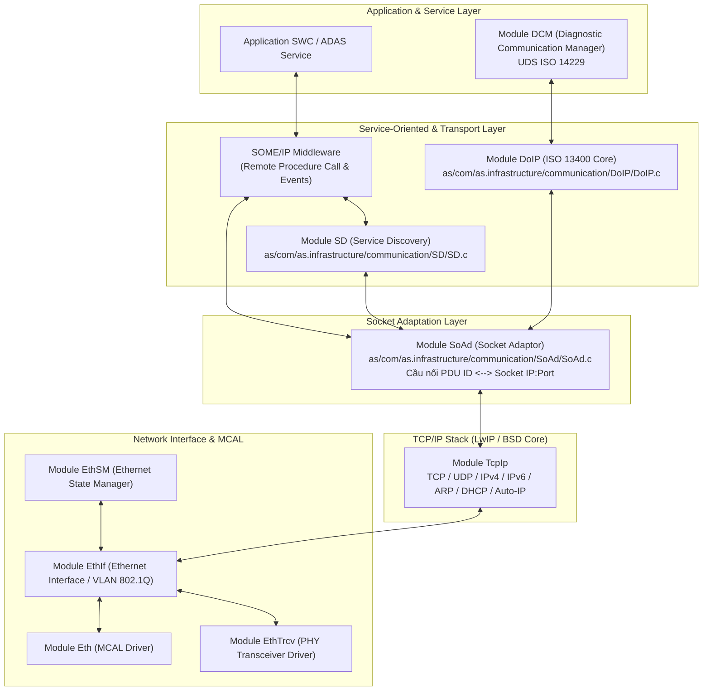
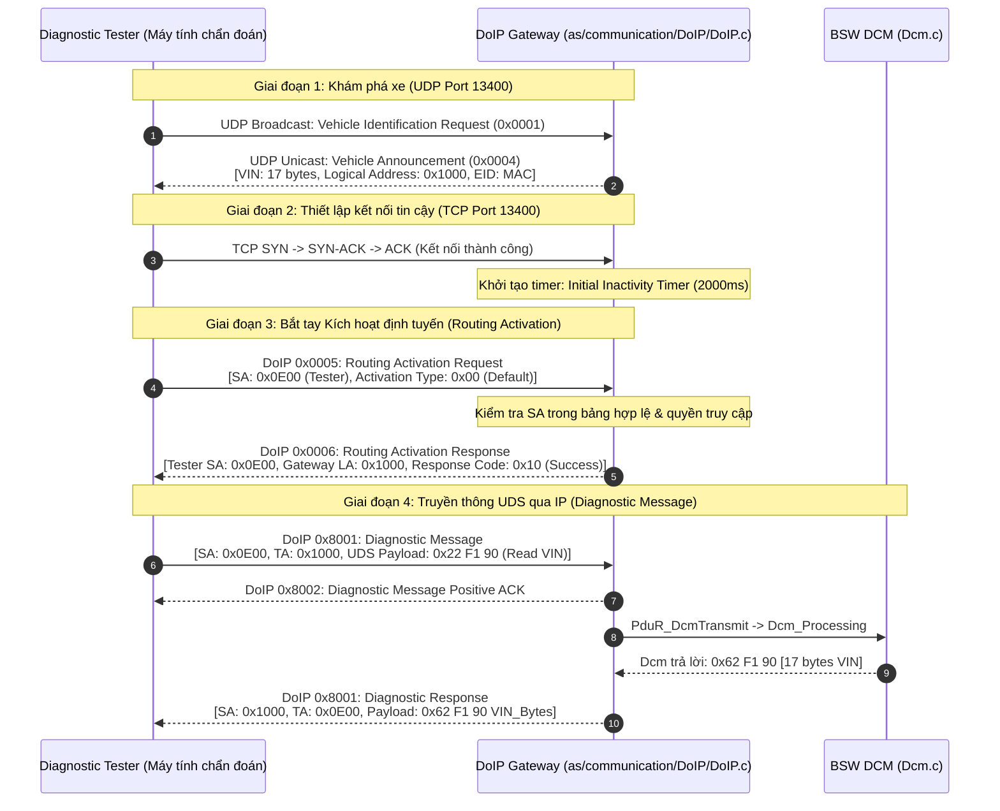
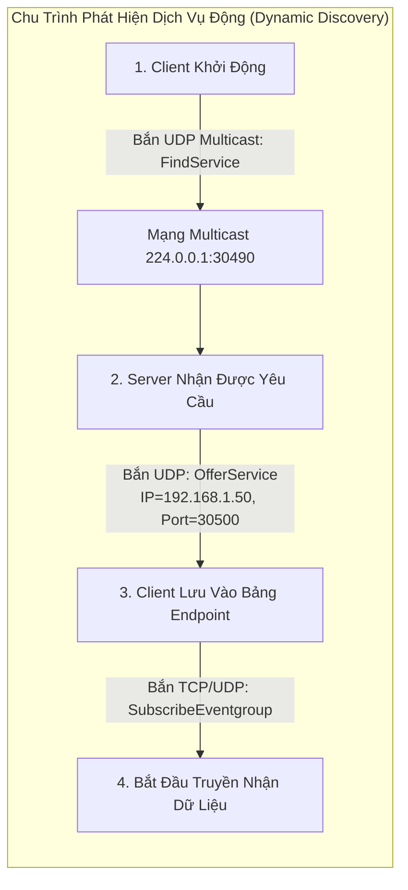

# CHUYÊN ĐỀ 12: Automotive Ethernet, SOME/IP & DoIP Stack Masterclass
## Masterclass Kỹ Nghệ Tầng Sâu: Mạng Ethernet Ô Tô (100BASE-T1), Kiến Trúc Hướng Dịch Vụ SOME/IP & SD, Chẩn Đoán DoIP (ISO 13400), Ngăn Xếp BSW EthStack & Mô Phỏng vECU

> 📚 **Ngôn ngữ:** Tiếng Việt Kỹ Nghệ Chuẩn Mực  
> 🎯 **Định vị:** Dành cho Senior BSW Integration Engineer, Gateway/ADAS/Infotainment ECU Developer  
> 🔧 **Source Code đối chiếu thực tế:**  
> • [`as/com/as.infrastructure/communication/Eth/Eth.c`](file:///C:/Users/liem.vu/Liem.vuOD/Study_AUTOSAR-main/as/com/as.infrastructure/communication/Eth/Eth.c) (MCAL Driver)  
> • [`as/com/as.infrastructure/communication/EthIf/EthIf.c`](file:///C:/Users/liem.vu/Liem.vuOD/Study_AUTOSAR-main/as/com/as.infrastructure/communication/EthIf/EthIf.c) (Ethernet Interface)  
> • [`as/com/as.infrastructure/communication/SoAd/SoAd.c`](file:///C:/Users/liem.vu/Liem.vuOD/Study_AUTOSAR-main/as/com/as.infrastructure/communication/SoAd/SoAd.c) (Socket Adaptor)  
> • [`as/com/as.infrastructure/communication/DoIP/DoIP.c`](file:///C:/Users/liem.vu/Liem.vuOD/Study_AUTOSAR-main/as/com/as.infrastructure/communication/DoIP/DoIP.c) (DoIP ISO 13400 Core)  
> • [`as/com/as.infrastructure/communication/SD/SD.c`](file:///C:/Users/liem.vu/Liem.vuOD/Study_AUTOSAR-main/as/com/as.infrastructure/communication/SD/SD.c) (SOME/IP Service Discovery)  
> • [`as/com/as.virtual/source/vEcu.cpp`](file:///C:/Users/liem.vu/Liem.vuOD/Study_AUTOSAR-main/as/com/as.virtual/source/vEcu.cpp) & [`xlLoadlib.cpp`](file:///C:/Users/liem.vu/Liem.vuOD/Study_AUTOSAR-main/as/com/as.virtual/source/xlLoadlib.cpp) (vECU Type 3 Simulation & Vector XL Driver API)  
> 📑 **Tiêu chuẩn tham chiếu:** IEEE 802.3bw (100BASE-T1), ISO 13400-2 (DoIP), AUTOSAR SWS Ethernet/SoAd/SOME/IP/SD R4.2/R4.4  

---

## 1. Tổng Quan Về Automotive Ethernet (Mạng Ethernet Trên Ô Tô Hiện Đại)

### 1.1 Khác Biệt Giữa Ethernet Tiêu Chuẩn (100BASE-TX) vs Automotive Ethernet (100BASE-T1)

Trong các hệ thống xe thông minh (SDV - Software-Defined Vehicle), mạng CAN-FD ($5\text{ Mbps}$) và FlexRay ($10\text{ Mbps}$) không còn đáp ứng đủ băng thông cho Camera ADAS độ phân giải cao, Radar hình ảnh, màn hình trung tâm HUD/IVI và cập nhật Firmware toàn xe OTA. Automotive Ethernet ra đời như một bước ngoặt:

| Tiêu Chí Kỹ Thuật | Standard Ethernet (100BASE-TX / Cáp Cat5e) | Automotive Ethernet (100BASE-T1 / IEEE 802.3bw) |
| :--- | :--- | :--- |
| **Môi trường vật lý** | 4 dây (2 cặp dây xoắn TX và RX độc lập) | **Chỉ 1 cặp dây xoắn duy nhất (Single Twisted Pair - 2 dây)** |
| **Chế độ truyền nhận** | Song công vật lý (Dual Simplex trên 2 cặp dây riêng) | **Song công toàn phần (Full-Duplex trên 1 cặp dây duy nhất)** |
| **Cơ chế tách tín hiệu** | Tách biệt theo đường truyền vật lý | Sử dụng mạch lai (Hybrid) & **Bộ lọc triệt tiếng vọng số (Digital Echo Cancellation)** trong chip PHY |
| **Mã hóa tín hiệu (Modulation)**| MLT-3 (Tần số tín hiệu đỉnh $125\text{ MHz}$) | **PAM-3 (Tần số cơ bản chỉ $66.7\text{ MHz}$)** $\implies$ Giảm thiểu phát xạ điện từ |
| **Chuẩn chống nhiễu EMC** | Đạt chuẩn dân dụng FCC/CE (Yếu) | **Đạt chuẩn ô tô khắt khe CISPR 25 Class 5** (Chịu xung cảm ứng từ bugi, mô-tơ điện) |
| **Khối lượng bó dây** | Nặng, cồng kềnh, chi phí bấm đầu RJ45 đắt | **Giảm 30% - 50% trọng lượng dây**, giắc khóa cơ khí chống rung (Rosenberger H-MTD) |
| **Khoảng cách truyền** | Lên tới 100 mét | **Tối đa 15 mét** (vừa đủ tối ưu cho toàn bộ chiều dài thân xe) |

> ⚠️ **LƯU Ý KỸ THUẬT (HARDWARE NOTE):**  
> Trong xe thật (như VinFast VF8/VF9 hay xe BMW/Audi), cổng Ethernet sử dụng chip Transceiver PHY chuyên dụng (Broadcom BCM89811, Marvell 88Q2112, NXP TJA1100). Trong mã nguồn mở `as`, module [`Eth.c`](file:///C:/Users/liem.vu/Liem.vuOD/Study_AUTOSAR-main/as/com/as.infrastructure/communication/Eth/Eth.c) triển khai driver MAC điều khiển phần cứng vi điều khiển (như STM32F107 MAC, NXP MAC) hoặc bọc qua socket TAP/TUN trên POSIX Simulator (`scons --board=posix`). Các tầng BSW phía trên (`EthIf`, `TcpIp`, `SoAd`, `DoIP`, `SD`) hoàn toàn giống hệt 100% so với ECU xe thật!

---

## 2. Ngăn Xếp AUTOSAR Ethernet Communication Stack (EthStack)

### 2.1 Sơ Đồ Toàn Cảnh Phân Tầng BSW Ethernet



### 2.2 Giải Phẫu Từng Module Trong Kho Mã Nguồn `as`:

1. **`Eth.c` ([`as/com/as.infrastructure/communication/Eth/Eth.c`](file:///C:/Users/liem.vu/Liem.vuOD/Study_AUTOSAR-main/as/com/as.infrastructure/communication/Eth/Eth.c)):**
   * Quản lý vòng đệm DMA Descriptors (TX/RX Buffer Ring).
   * Khởi tạo Clock MAC, nạp địa chỉ MAC vật lý 6-byte của ECU (`Eth_SetPhysAddr`).
   * Cung cấp API `Eth_Transmit(CtrlIdx, BufIdx, FrameType, TxConfirmation, DataLen, DestAddrPtr)`.
2. **`EthIf.c` ([`as/com/as.infrastructure/communication/EthIf/EthIf.c`](file:///C:/Users/liem.vu/Liem.vuOD/Study_AUTOSAR-main/as/com/as.infrastructure/communication/EthIf/EthIf.c)):**
   * Trừu tượng hóa nhiều cổng Controller.
   * Xử lý gán thẻ VLAN Tag IEEE 802.1Q (VLAN ID 12-bit, Priority PCP 3-bit) để phân tách luồng dữ liệu an toàn (Safety Critical) và giải trí (Infotainment).
3. **`SoAd.c` ([`as/com/as.infrastructure/communication/SoAd/SoAd.c`](file:///C:/Users/liem.vu/Liem.vuOD/Study_AUTOSAR-main/as/com/as.infrastructure/communication/SoAd/SoAd.c)):**
   * **Bản chất kỹ nghệ:** Thế giới AUTOSAR Classic thuần túy giao tiếp dựa trên **PDU ID tĩnh (PduIdType - số nguyên $0, 1, 2\dots$)**, trong khi thế giới Internet giao tiếp dựa trên **Socket động (IP:Port, TCP/UDP)**.
   * `SoAd` chính là từ điển phiên dịch hai chiều:
     * Chiều phát: Nhận `PduR_Transmit(PduId)` $\implies$ Tìm trong bảng cấu hình `SoAd_PduRoute` để biết phải đẩy ra Socket ID nào $\implies$ Gọi `TcpIp_Transmit()`.
     * Chiều nhận: Khi Socket nhận gói tin $\implies$ Tìm trong bảng `SoAd_SocketRoute` để biết dữ liệu thuộc PDU ID nào $\implies$ Bắn callback `PduR_SoAdRxIndication()`.
4. **`DoIP.c` ([`as/com/as.infrastructure/communication/DoIP/DoIP.c`](file:///C:/Users/liem.vu/Liem.vuOD/Study_AUTOSAR-main/as/com/as.infrastructure/communication/DoIP/DoIP.c)):**
   * Triển khai chuẩn quốc tế ISO 13400-2 phục vụ chẩn đoán UDS và nạp Flash ECU qua mạng IP.
5. **`SD.c` ([`as/com/as.infrastructure/communication/SD/SD.c`](file:///C:/Users/liem.vu/Liem.vuOD/Study_AUTOSAR-main/as/com/as.infrastructure/communication/SD/SD.c)):**
   * Quản lý việc công bố dịch vụ (OfferService) và tìm kiếm dịch vụ (FindService) trong kiến trúc hướng dịch vụ SOME/IP.

---

## 3. Chẩn Đoán Qua IP: DoIP (Diagnostic over IP - ISO 13400) Tầng Sâu

### 3.1 Cấu Trúc Khung Tin DoIP Header Chuẩn Quốc Tế

Mọi thông điệp DoIP truyền qua mạng Ethernet đều bắt đầu bằng một **Header 8 bytes cố định**:

```text
 0                   1                   2                   3
 0 1 2 3 4 5 6 7 8 9 0 1 2 3 4 5 6 7 8 9 0 1 2 3 4 5 6 7 8 9 0 1
+-+-+-+-+-+-+-+-+-+-+-+-+-+-+-+-+-+-+-+-+-+-+-+-+-+-+-+-+-+-+-+-+
| Protocol Vers | Inv Proto Vers|         Payload Type          |
+-+-+-+-+-+-+-+-+-+-+-+-+-+-+-+-+-+-+-+-+-+-+-+-+-+-+-+-+-+-+-+-+
|                         Payload Length                        |
+-+-+-+-+-+-+-+-+-+-+-+-+-+-+-+-+-+-+-+-+-+-+-+-+-+-+-+-+-+-+-+-+
|                          Payload Data                         |
|                             ...                               |
+-+-+-+-+-+-+-+-+-+-+-+-+-+-+-+-+-+-+-+-+-+-+-+-+-+-+-+-+-+-+-+-+
```

Trích dẫn định nghĩa trực tiếp từ [`as/com/as.infrastructure/communication/DoIP/DoIP.c`](file:///C:/Users/liem.vu/Liem.vuOD/Study_AUTOSAR-main/as/com/as.infrastructure/communication/DoIP/DoIP.c#L40-L65):
```c
#define DOIP_PROTOCOL_VERSION        2        /* ISO 13400-2:2012 */
#define DOIP_INV_PROTOCOL_VERSION    (uint8)(~DOIP_PROTOCOL_VERSION) // 0xFD

// Các loại Payload Type chuẩn (ISO 13400-2 Table 19):
#define DOIP_PLT_GENERIC_NACK        0x0000UL // Phản hồi lỗi định dạng chung
#define DOIP_PLT_VEHICLE_IDENT_REQ   0x0001UL // Hỏi danh tính xe qua UDP
#define DOIP_PLT_VEHICLE_ANN_MSG     0x0004UL // Thông báo danh tính xe (VIN, MAC, IP)
#define DOIP_PLT_ROUTING_ACTIV_REQ   0x0005UL // Yêu cầu kích hoạt định tuyến TCP
#define DOIP_PLT_ROUTING_ACTIV_RES   0x0006UL // Phản hồi kích hoạt định tuyến TCP
#define DOIP_PLT_ALIVE_CHECK_REQ     0x0007UL // Giữ kết nối TCP (Keep-alive)
#define DOIP_PLT_ALIVE_CHECK_RES     0x0008UL
#define DOIP_PLT_DIAGNOSTIC_MSG      0x8001UL // Khung chứa bản tin UDS chẩn đoán!
#define DOIP_PLT_DIAG_ACK            0x8002UL // Xác nhận nhận thành công bản tin UDS
#define DOIP_PLT_DIAG_NACK           0x8003UL // Từ chối bản tin UDS
```

### 3.2 Chu Trình Bắt Tay Routing Activation & Chẩn Đoán UDS

Khi Diagnostic Tester cắm cáp Ethernet vào xe:



### 3.3 Chi Tiết Xử Lý Mã NACK Trong `DoIP.c`

Trích dẫn từ [`as/com/as.infrastructure/communication/DoIP/DoIP.c`](file:///C:/Users/liem.vu/Liem.vuOD/Study_AUTOSAR-main/as/com/as.infrastructure/communication/DoIP/DoIP.c#L49-L62):
Nếu Tester gửi sai format hoặc địa chỉ logic không tồn tại, Gateway lập tức phản hồi NACK:
* `DOIP_E_INCORRECT_PATTERN_FORMAT (0x00)`: Byte đảo `~ProtocolVersion` không khớp (`pdu[1] != ~pdu[0]`).
* `DOIP_E_UNKNOWN_PAYLOAD_TYPE (0x01)`: Payload Type không nằm trong bảng chuẩn ISO 13400.
* `DOIP_E_MESSAGE_TO_LARGE (0x02)`: Dung lượng gói tin vượt quá cấu hình `DOIP_MAX_SDU_LENGTH`.
* `DOIP_E_DIAG_INVALID_SA (0x02)`: Địa chỉ Source Address của Tester chưa được đăng ký trong cấu hình.
* `DOIP_E_DIAG_UNKNOWN_TA (0x03)`: Target Address không tìm thấy trong bảng định tuyến xe.

---

## 4. Kiến Trúc Hướng Dịch Vụ SOME/IP & Module Service Discovery (SD)

### 4.1 SOME/IP Header Chuẩn 16 Bytes

Khác với CAN/LIN là truyền thông dạng tín hiệu tĩnh (Signal-oriented), SOME/IP là giao thức hướng dịch vụ (**Service-Oriented Architecture - SOA**). Mọi bản tin SOME/IP đều bắt đầu bằng Header 16-byte:

```c
typedef struct {
    uint16  service_id;        /* ID của dịch vụ, ví dụ: 0x1234 (Camera Service) */
    uint16  method_or_event_id;/* ID của phương thức/sự kiện, ví dụ: 0x0001 (GetFrame) */
    uint32  length;            /* Chiều dài dữ liệu từ ClientID đến hết Payload */
    uint16  client_id;         /* ID của Client phát lệnh */
    uint16  session_id;        /* Mã phiên tuần tự để chống lặp gói (Replay attack) */
    uint8   protocol_version;  /* Mặc định: 0x01 */
    uint8   interface_version; /* Phiên bản giao diện IDL: 0x01 */
    uint8   message_type;      /* Kiểu bản tin (Request, Response, Notification) */
    uint8   return_code;       /* 0x00 = E_OK, 0x01 = E_NOT_OK, v.v. */
} SomeIp_HeaderType;
```

**Các kiểu bản tin (`message_type`):**
* `0x00 (REQUEST)`: Client gọi phương thức, yêu cầu Server trả lời.
* `0x01 (REQUEST_NO_RETURN)`: Fire-and-Forget, Client gửi lệnh và không cần chờ phản hồi.
* `0x02 (NOTIFICATION)`: Event được Server phát ra khi có sự kiện (Publish/Subscribe).
* `0x80 (RESPONSE)`: Server phản hồi kết quả cho bản tin REQUEST.
* `0x81 (ERROR)`: Server báo lỗi phương thức thất bại.

---

### 4.2 Cơ Chế Service Discovery (`SD.c`)

Trong một chiếc xe điện thông minh có 50–100 ECU kết nối mạng Ethernet, nếu cấu hình cứng (hard-code) địa chỉ IP của từng dịch vụ vào từng ECU thì việc nâng cấp phần mềm sẽ cực kỳ dễ vỡ.  
Module **`SD`** ([`as/com/as.infrastructure/communication/SD/SD.c`](file:///C:/Users/liem.vu/Liem.vuOD/Study_AUTOSAR-main/as/com/as.infrastructure/communication/SD/SD.c)) giải quyết bài toán này bằng cơ chế động:



Trích dẫn từ [`as/com/as.infrastructure/communication/SD/SD_Entries.c`](file:///C:/Users/liem.vu/Liem.vuOD/Study_AUTOSAR-main/as/com/as.infrastructure/communication/SD/SD_Entries.c):
Một thông điệp SD Message bao gồm 2 mảng chính:
1. **Entries Array:** Chứa các yêu cầu/lời mời dịch vụ:
   * `Type 0x00`: `FindService`
   * `Type 0x01`: `OfferService` / `StopOfferService`
   * `Type 0x06`: `SubscribeEventgroup`
   * `Type 0x07`: `SubscribeEventgroupAck`
2. **Options Array:** Chứa các thuộc tính kết nối mạng đính kèm:
   * `Type 0x04 (IPv4-Endpoint Option)`: Chứa địa chỉ IPv4 (4 bytes) + Giao thức L4 (TCP/UDP) + Port number (2 bytes).

---

## 5. Mô Phỏng Virtual ECU (vECU Type 3) & Tích Hợp Vector XL Driver API

Trong các dự án lớn tại VinFast, Bosch hay HCLTech (tham chiếu Link 3 JD), kỹ sư không phải lúc nào cũng có sẵn hộp ECU phần cứng trên bàn. Họ sử dụng giải pháp **vECU (Virtual ECU)** để chạy toàn bộ mã nguồn BSW và Application trên máy tính xách tay:

### 5.1 Giải Phẫu vECU Trong Mã Nguồn [`as/virtual`](file:///C:/Users/liem.vu/Liem.vuOD/Study_AUTOSAR-main/as/com/as.virtual)

Trong thư mục [`as/com/as.virtual/source/`](file:///C:/Users/liem.vu/Liem.vuOD/Study_AUTOSAR-main/as/com/as.virtual/source/):
1. **`vEcu.cpp` ([`as/com/as.virtual/source/vEcu.cpp`](file:///C:/Users/liem.vu/Liem.vuOD/Study_AUTOSAR-main/as/com/as.virtual/source/vEcu.cpp)):**  
   * Đóng vai trò là Runtime Engine ảo hóa.
   * Khởi tạo luồng OS mô phỏng (POSIX threads / Windows threads), nạp file nhị phân AUTOSAR hoặc biên dịch BSW thành thư viện `.dll` / `.so`.
2. **`xlLoadlib.cpp` ([`as/com/as.virtual/source/xlLoadlib.cpp`](file:///C:/Users/liem.vu/Liem.vuOD/Study_AUTOSAR-main/as/com/as.virtual/source/xlLoadlib.cpp)):**  
   * **Cực kỳ đắt giá cho phỏng vấn:** Tệp này liên kết động trực tiếp với **Vector XL Driver Library (`vxlapi.dll`)** của hãng Vector Informatik!
   * Trích dẫn trực tiếp:
     ```cpp
     /* File: as/com/as.virtual/source/xlLoadlib.cpp */
     #include "vxlapi.h"
     XLGETAPPLCONFIG xlGetApplConfig = NULL;
     XLOPENPORT      xlOpenPort      = NULL;
     XLRECEIVE       xlReceive       = NULL;
     XLTANSMIT       xlCanTransmit   = NULL;
     ```
   * **Ý nghĩa thực chiến:** Cho phép mã nguồn BSW của `as` giao tiếp trực tiếp với card mạng thật của Vector (như Vector VN1610, VN1630, CANcaseXL, hoặc bus ảo **Vector CANoe Virtual CAN Bus**) mà không cần bất kỳ phần cứng trung gian nào!

---

## 6. Đúc Kết & Ma Trận Phỏng Vấn Chuyên Sâu Về Automotive Ethernet

| Vấn đề kỹ thuật | Bản chất kỹ nghệ | Cách trả lời phỏng vấn chuẩn chuyên gia |
| :--- | :--- | :--- |
| **DoIP vs CAN TP** | Băng thông và tốc độ nạp Flash | *"DoIP thay thế CAN TP ở tầng Transport Layer, nâng tốc độ nạp phần mềm từ $500\text{ kbps}$ (CAN) lên $100\text{ Mbps}$ (Ethernet), rút ngắn thời gian flash firmware một chiếc xe từ 4 tiếng xuống còn 5 phút."* |
| **Routing Activation** | Kiểm soát an toàn phiên TCP | *"Sau khi bắt tay 3 bước TCP thành công, Tester bắt buộc phải gửi gói tin DoIP 0x0005 kèm Source Address hợp lệ. Chỉ khi Gateway phản hồi 0x0006 Success thì cổng định tuyến sang DCM mới được mở."* |
| **Vai trò của SoAd** | Cầu nối PDU tĩnh sang Socket IP động | *"AUTOSAR BSW hoạt động dựa trên PDU ID cố định, trong khi TCP/IP dựa trên IP:Port. SoAd cung cấp 2 bảng `SoAd_PduRoute` (chiều phát) và `SoAd_SocketRoute` (chiều nhận) để dịch chuyển trong suốt."* |
| **vECU & Vector XL API** | Kiểm thử phần mềm không cần phần cứng | *"Sử dụng `vxlapi.h` và `xlOpenPort` để map trực tiếp controller ảo của BSW vào bus ảo của Vector CANoe, cho phép kiểm thử SIL/HIL tự động hóa toàn bộ kịch bản chẩn đoán DoIP và SOME/IP ngay trên môi trường CI/CD."* |
