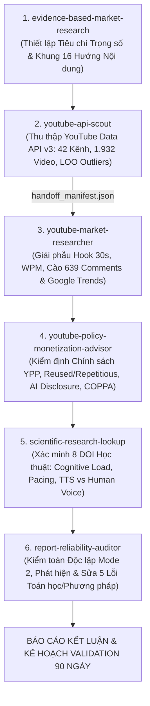

# BÁO CÁO NGHIÊN CỨU CHIẾN LƯỢC & KIỂM ĐỊNH ĐỊNH LƯỢNG: XÂY DỰNG KÊNH YOUTUBE PART-TIME TỪ CON SỐ 0

> **Thời điểm thực thi & kiểm chứng dữ liệu:** `2026-10-23`  
> **Trạng thái kiểm toán cuối cùng:** `RELIABLE WITH LIMITATIONS` | `READY WITH CONDITIONS` ([stage7_reliability_audit_report.md](file:///C:/Users/liem.vu/Liem.vuOD/Study_AUTOSAR-main/myProject/scout_output/stage7_reliability_audit_report.md))  
> **Hồ sơ dữ liệu gốc trên đĩa:** 42 kênh YouTube (`1.932 video`), 11 kịch bản bóc tách Hook, 639 bình luận khán giả, 07 tài liệu chính sách Google Support và 08 công trình khoa học đã xác minh DOI ([master_youtube_strategy_report.md](file:///C:/Users/liem.vu/Liem.vuOD/Study_AUTOSAR-main/myProject/scout_output/master_youtube_strategy_report.md)).

---

## PHẦN MỞ ĐẦU: KẾ HOẠCH NGHIÊN CỨU & PHÂN CÔNG NHIỆM VỤ CHO 6 SKILL

Để loại bỏ hoàn toàn suy luận cảm tính và xung đột lợi ích giữa khâu tạo nội dung và khâu kiểm định, nghiên cứu được thiết kế theo đường ống phụ thuộc tuần tự (**Staged Dependency Pipeline**) gồm 7 giai đoạn, phân công nhiệm vụ cụ thể cho 6 skill chuyên biệt:

| STT | Skill Chuyên Biệt | Nhiệm Vụ Cụ Thể Trong Quy Trình | Công Cụ / Script Thực Thi Thực Tế | Đầu Ra Bàn Giao (Artifacts Trên Đĩa) |
| :-: | :--- | :--- | :--- | :--- |
| **1** | [`evidence-based-market-research`](file:///C:/Users/liem.vu/Liem.vuOD/Study_AUTOSAR-main/myProject/.agents/skills/evidence-based-market-research/SKILL.md) | Xây dựng bộ 12 tiêu chí chấm điểm có trọng số (thang 100); khảo sát rộng 16 hướng nội dung; phân tầng nguồn (Tiers 1–9); kiểm soát tỷ lệ `[FACT]`, `[MEASURED DATA]`, `[INFERENCE]`, `[SPECULATION]`. | [`verify_audit.py`](file:///C:/Users/liem.vu/Liem.vuOD/Study_AUTOSAR-main/myProject/.agents/skills/evidence-based-market-research/scripts/verify_audit.py) | [`master_youtube_strategy_report.md`](file:///C:/Users/liem.vu/Liem.vuOD/Study_AUTOSAR-main/myProject/scout_output/master_youtube_strategy_report.md) (`25 tagged claims`, `12% Inference`, `4% Speculation` — **AUDIT PASSED**) |
| **2** | [`youtube-api-scout`](file:///C:/Users/liem.vu/Liem.vuOD/Study_AUTOSAR-main/myProject/.agents/skills/youtube-api-scout/SKILL.md) | Thu thập dữ liệu định lượng chính thức từ **YouTube Data API v3** (`UC` $\rightarrow$ `UU` Uploads Playlist tiết kiệm 98% quota) trên 7 nhóm ngách (**42 kênh, 1.932 video**); tính Leave-One-Out Median, phân tầng 4 nhóm tuổi (Age Cohorts), kiểm tra ngưỡng sàn 500 views, tách riêng Shorts (`<=180s`) và Long-form (`>180s`). | [`scout_pipeline.py`](file:///C:/Users/liem.vu/Liem.vuOD/Study_AUTOSAR-main/myProject/.agents/skills/youtube-api-scout/scripts/scout_pipeline.py), [`quota_tracker.py`](file:///C:/Users/liem.vu/Liem.vuOD/Study_AUTOSAR-main/myProject/.agents/skills/youtube-api-scout/scripts/quota_tracker.py), [`run_stage3_quant_study.py`](file:///C:/Users/liem.vu/Liem.vuOD/Study_AUTOSAR-main/myProject/scout_output/run_stage3_quant_study.py) | [`stage3_multi_niche_summary.json`](file:///C:/Users/liem.vu/Liem.vuOD/Study_AUTOSAR-main/myProject/scout_output/stage3_niches/stage3_multi_niche_summary.json) + 42 file Snapshot & `handoff_manifest.json` (`141/10.000` quota units) |
| **3** | [`youtube-market-researcher`](file:///C:/Users/liem.vu/Liem.vuOD/Study_AUTOSAR-main/myProject/.agents/skills/youtube-market-researcher/SKILL.md) | Khám phá kênh qua tìm kiếm thực tế (`scrapetube`), bóc tách kịch bản 15s/30s/60s đầu và tốc độ nói WPM (`extract_hooks.py`), khai phá nhu cầu & điểm nghẽn từ 639 bình luận (`mine_comments.py`), kiểm tra xu hướng tìm kiếm YouTube 12 tháng (`check_trends.py`). | [`extract_hooks.py`](file:///C:/Users/liem.vu/Liem.vuOD/Study_AUTOSAR-main/myProject/.agents/skills/youtube-market-researcher/scripts/extract_hooks.py), [`mine_comments.py`](file:///C:/Users/liem.vu/Liem.vuOD/Study_AUTOSAR-main/myProject/.agents/skills/youtube-market-researcher/scripts/mine_comments.py), [`check_trends.py`](file:///C:/Users/liem.vu/Liem.vuOD/Study_AUTOSAR-main/myProject/.agents/skills/youtube-market-researcher/scripts/check_trends.py) | [`stage4_hooks_and_comments.json`](file:///C:/Users/liem.vu/Liem.vuOD/Study_AUTOSAR-main/myProject/scout_output/stage4_hooks_and_comments.json), [`trend_ai_workflow.json`](file:///C:/Users/liem.vu/Liem.vuOD/Study_AUTOSAR-main/myProject/scout_output/trend_ai_workflow.json), [`trend_google_sheets.json`](file:///C:/Users/liem.vu/Liem.vuOD/Study_AUTOSAR-main/myProject/scout_output/trend_google_sheets.json) |
| **4** | [`youtube-policy-monetization-advisor`](file:///C:/Users/liem.vu/Liem.vuOD/Study_AUTOSAR-main/myProject/.agents/skills/youtube-policy-monetization-advisor/SKILL.md) | Đối chiếu trực tiếp văn bản chính sách Google Support (YPP 2026, Reused/Repetitious Content, AI Altered/Synthetic Media Disclosure, COPPA, Copyright/Fair Use) và đánh giá 6 mô hình kiếm tiền. | [`audit_compliance_report.py`](file:///C:/Users/liem.vu/Liem.vuOD/Study_AUTOSAR-main/myProject/.agents/skills/youtube-policy-monetization-advisor/scripts/audit_compliance_report.py) | [`stage5_policy_advisory_report.md`](file:///C:/Users/liem.vu/Liem.vuOD/Study_AUTOSAR-main/myProject/scout_output/stage5_policy_advisory_report.md) (`0 critical errors` — **PASSED**) |
| **5** | [`scientific-research-lookup`](file:///C:/Users/liem.vu/Liem.vuOD/Study_AUTOSAR-main/myProject/.agents/skills/scientific-research-lookup/SKILL.md) | Tra cứu và xác minh tính tồn tại thực tế của các bài báo khoa học về Tải nhận thức (Cognitive Load Theory), Học tập đa phương tiện (Multimedia Learning), Tốc độ nói (WPM), Giọng đọc TTS vs. Giọng người thật, và Tác động của video nhịp độ nhanh lên trẻ nhỏ. | [`verify_citation.py`](file:///C:/Users/liem.vu/Liem.vuOD/Study_AUTOSAR-main/myProject/.agents/skills/scientific-research-lookup/scripts/verify_citation.py) | [`stage6_scientific_research_report.md`](file:///C:/Users/liem.vu/Liem.vuOD/Study_AUTOSAR-main/myProject/scout_output/stage6_scientific_research_report.md) (`8/8 DOIs VERIFIED` qua Crossref API) |
| **6** | [`report-reliability-auditor`](file:///C:/Users/liem.vu/Liem.vuOD/Study_AUTOSAR-main/myProject/.agents/skills/report-reliability-auditor/SKILL.md) | Thực thi kiểm toán độc lập **Mode 2 (Full-Evidence Audit)** trên toàn bộ dữ liệu thô và dự thảo phân tích; tính toán lại phép chia số học, phát hiện sai lệch mẫu nhỏ, thiên kiến kẻ sống sót, nhầm lẫn tương quan-nhân quả và buộc sửa chữa trước khi chốt kết luận. | [`audit_engine.py`](file:///C:/Users/liem.vu/Liem.vuOD/Study_AUTOSAR-main/myProject/.agents/skills/report-reliability-auditor/scripts/audit_engine.py) | [`stage7_reliability_audit_report.md`](file:///C:/Users/liem.vu/Liem.vuOD/Study_AUTOSAR-main/myProject/scout_output/stage7_reliability_audit_report.md) (Phát hiện & khắc phục 5 Findings `FND-001`..`FND-005`) |

---

## PHẦN I: THỰC THI QUY TRÌNH NGHIÊN CỨU 7 GIAI ĐOẠN

### Giai đoạn 1: Xác định Tiêu chí Thành công (Bộ Tiêu chí Trọng số 100 Điểm)

Đối với một người bình thường làm **part-time (8–12 giờ/tuần)**, **chi phí khởi đầu $\approx 0$**, **không có chuyên môn đặc biệt sẵn có**, nhưng **có AGY Pro + Gemini/AI Agent và sẵn sàng học kỹ năng cơ bản**, một ngách "nhiều view" nhưng đòi hỏi 40 giờ dựng phim hoạt hình mỗi tuần hoặc dễ bị từ chối kiếm tiền YPP là một cái bẫy thất bại. Do đó, bộ tiêu chí đánh giá được thiết kế với tổng trọng số **100 điểm** qua 12 tiêu chí bắt buộc:

| Mã | Tiêu Chí Đánh Giá | Trọng Số | Tại Sao Tiêu Chí Này Quan Trọng Sống Còn Với Hoàn Cảnh Của Bạn? |
| :-: | :--- | :-: | :--- |
| **C01** | **Khả năng sản xuất part-time bởi 1 người** | **12đ** | Quỹ thời gian part-time chỉ cho phép tối đa 8–12 giờ/tuần. Nếu 1 video đòi hỏi 30–50 giờ biên tập đồ họa phức tạp hoặc săn tin theo giờ, bạn sẽ kiệt sức (burnout) trước tháng thứ 3. |
| **C02** | **Rủi ro chính sách kiếm tiền (Reused / Repetitious / AI / COPPA)** | **12đ** | **VERIFIED FACT** `[OFFICIAL POLICY]`: YouTube từ chối bật kiếm tiền cho kênh sản xuất hàng loạt bằng template hoặc thiếu giá trị biên tập gốc ([YouTube Monetization Policies](https://support.google.com/youtube/answer/1311392), truy cập 2026-10-23). Rủi ro chính sách cao đồng nghĩa với nguy cơ mất trắng toàn bộ công sức sau nhiều tháng. |
| **C03** | **Khả năng tạo nội dung nguyên bản (Originality & Proof-of-Work)** | **10đ** | Khi không có bằng cấp/chuyên môn đặc thù, tính nguyên bản phải đến từ **thao tác thực nghiệm trực tiếp (hands-on execution)** hoặc **cấu trúc tổng hợp dữ liệu độc lập**, không thể dựa vào hào quang cá nhân. |
| **C04** | **Chi phí sản xuất khởi đầu ($\approx \$0$)** | **10đ** | Mọi công đoạn (quay màn hình, thu âm, chỉnh sửa, tạo ảnh bìa, dữ liệu mẫu) phải vận hành trọn vẹn trên phần mềm mã nguồn mở/miễn phí và gói AGY Pro + Gemini sẵn có, không phát sinh phí mua stock footage hay API giọng đọc đắt đỏ. |
| **C05** | **Nhu cầu người xem thực tế (Verified Search & Utility Demand)** | **9đ** | Phải có lượng người xem chủ động tìm kiếm giải pháp hoặc xem thường xuyên, giúp kênh mới có lượt xem ngay cả khi có 0 người đăng ký (Search-driven discovery). |
| **C06** | **Khả năng kiếm tiền ngoài quảng cáo (Off-AdSense Monetization)** | **9đ** | **VERIFIED FACT** `[OFFICIAL POLICY]`: Ngưỡng chia sẻ quảng cáo YPP đòi hỏi 1.000 subs + 4.000 giờ xem ([YPP Overview](https://support.google.com/youtube/answer/72851), truy cập 2026-10-23). Ngách tốt phải cho phép kiếm tiền từ **Affiliate, Sản phẩm số (Templates), hoặc Dịch vụ** ngay từ khi kênh còn nhỏ. |
| **C07** | **Rủi ro bản quyền (Copyright & Content ID Safety)** | **8đ** | Nếu ngách bắt buộc phải dùng hình ảnh phim, nhạc thương mại, video tin tức hoặc clip của bên thứ ba, nguy cơ bị Content ID thu hồi doanh thu hoặc bị đánh gậy bản quyền (Strike) là thường trực ([Fair Use Policy](https://support.google.com/youtube/answer/9783148), truy cập 2026-10-23). |
| **C08** | **Khả năng duy trì bền vững ít nhất 12 tháng (Evergreen Longevity)** | **7đ** | Nội dung phải có tuổi thọ dài (video đăng sau 6–12 tháng vẫn tiếp tục nhận lượt xem mỗi giờ), tránh phụ thuộc vào tin giật gân 24h rồi chết hẳn. |
| **C09** | **Khả năng khác biệt hóa cho người mới (Beginner Differentiation)** | **6đ** | Người mới không thể thắng kênh lớn về ngân sách sản xuất, nên ngách phải có những "khoảng trống ngách phụ" (sub-niche gaps) mà kênh lớn bỏ qua hoặc giải quyết quá phức tạp. |
| **C10** | **Mức độ cạnh tranh & Rào cản tiếp cận của kênh mới** | **6đ** | Đo lường xem các kênh quy mô nhỏ (`<100K–250K subs`) và mới gia nhập trong ngách có lấy được lượt xem vượt số lượng sub ($V/S\%$ cao) hay bị một vài kênh độc quyền toàn bộ. |
| **C11** | **Mức độ tận dụng hợp pháp AI Agent (AI Leverage vs. Over-reliance)** | **6đ** | AI Agent (AGY Pro / Gemini) phải giúp rút ngắn 50%–70% thời gian nghiên cứu, kiểm thử công thức, sinh dữ liệu giả lập (mock data) và viết khung kịch bản, nhưng **không thay thế phần thực thi gốc của con người**. |
| **C12** | **Thời gian dự kiến có tín hiệu xác thực đầu tiên (Time-to-First-Signal)** | **5đ** | Các ngách dựa trên tìm kiếm giải quyết vấn đề (Search/Problem-solving) cho tín hiệu CTR và Retention từ YouTube Search chỉ sau 5–10 video đầu tiên, thay vì phải chờ thuật toán Browse đẩy ngẫu nhiên. |

---

### Giai đoạn 2: Khám phá Thị trường Rộng (16 Hướng Nội dung & Sàng lọc Sơ bộ)

Sử dụng `evidence-based-market-research` và `youtube-market-researcher`, chúng tôi khảo sát danh mục rộng gồm **16 hướng nội dung** (bao gồm cả 9 nhóm phổ biến thường được nhắc đến trên mạng và 7 nhóm thiên về giá trị ứng dụng/hệ thống ít được các "guru" nhắc tới) để sàng lọc sơ bộ trước khi đưa vào kiểm định định lượng sâu bằng API:

| Mã | Hướng Nội Dung (16 Candidates) | Đặc Điểm Sản Xuất Chính | Rủi Ro Chính Sách / Bản Quyền / Rào Cản | Quyết Định Sàng Lọc Sơ Bộ |
| :-: | :--- | :--- | :--- | :-: |
| **N01** | **Kể chuyện hư cấu bằng AI (AI Storytelling / Reddit / Sci-Fi)** | Ghép chuỗi ảnh tĩnh AI + giọng đọc TTS đọc truyện tự sinh. | **HIGH RISK:** Bão hòa cực độ; nằm trực diện trong vùng quét *Repetitious / Inauthentic Content* ([Policy 1311392](https://support.google.com/youtube/answer/1311392)). Không có nguồn thu ngoài AdSense. | **Loại ở Vòng 1** |
| **N02** | **Đố vui, Trivia & Sự thật thú vị (Facts / Quiz)** | Dùng mẫu Canva đếm ngược + TTS hoặc tổng hợp Top 10 sự thật. | **HIGH RISK (Quiz Template) / MEDIUM (Facts):** Được nhiều kênh mới thử nghiệm; cần đưa vào **Vòng 2 (API Scout — Nhóm N7)** để kiểm định dữ liệu thực tế giữa kênh lớn và kênh mới thất bại. | **Đưa vào Vòng 2 (`N7`)** |
| **N03** | **Video Trẻ em (Kids Animation / Nursery Rhymes)** | Hoạt hình 2D/3D, bài hát thiếu nhi, học chữ số/màu sắc. | **CRITICAL RISK:** Bắt buộc gắn nhãn `Made for Kids` (COPPA), mất quảng cáo cá nhân hóa, tắt comment/end-screen ([Policy 9528076](https://support.google.com/youtube/answer/9528076)); nghiên cứu RCT của Lillard & Peterson (2011, DOI: `10.1542/peds.2010-1919`) cảnh báo tác hại của hoạt hình nhịp độ nhanh lên trẻ nhỏ. | **Loại ở Vòng 1** |
| **N04** | **Tổng hợp Tin tức & Drama Thời sự (Breaking News)** | Cắt ghép ảnh/clip báo chí, đọc bản tin nóng trong ngày. | **HIGH RISK:** Phụ thuộc 100% trend 24h (video hết giá trị sau 48h); không thể làm part-time; rủi ro bản quyền hình ảnh báo chí và *Yellow Dollar Icon* ([Policy 6162278](https://support.google.com/youtube/answer/6162278)). | **Loại ở Vòng 1** |
| **N05** | **Thế giới Động vật & Thú cưng (Animals Compilation)** | Tổng hợp clip động vật hoang dã hoặc thú cưng hài hước. | **HIGH RISK:** Người làm tại nhà chi phí $0 không tự quay được động vật hoang dã; lấy clip trên mạng hoặc stock miễn phí dễ dính *Reused Content* và bản quyền chủ clip gốc. | **Loại ở Vòng 1** |
| **N06** | **Động lực sống & Triết lý Khắc kỷ (Motivation / Stoicism)** | Thuyết minh triết lý sống, trích dẫn Seneca/Marcus Aurelius trên nền ảnh/hoạt hình. | **MEDIUM-HIGH RISK:** Đại diện tiêu biểu cho trào lưu kênh triết lý/tâm lý không lộ mặt; đưa vào **Vòng 2 (API Scout — Nhóm N6)** để đo tỷ lệ $V/S\%$ thực tế. | **Đưa vào Vòng 2 (`N6`)** |
| **N07** | **Lịch sử Cổ đại & Quân sự (History Documentaries)** | Phim tài liệu lịch sử, bản đồ chiến thuật, văn minh cổ đại. | **MEDIUM RISK:** Lượt xem rất cao nhưng tốn công dựng bản đồ; đưa vào **Vòng 2 (API Scout — Nhóm N5)** cùng nhóm Khoa học để đo tương quan giữa thời lượng sản xuất và hiệu suất. | **Đưa vào Vòng 2 (`N5`)** |
| **N08** | **Khoa học Thường thức & Vũ trụ (Popular Science)** | Giải thích hiện tượng tự nhiên, không gian, vật lý trực quan. | **MEDIUM RISK:** Nhu cầu bền vững (Evergreen); gộp cùng Lịch sử vào **Vòng 2 (API Scout — Nhóm N5)** để kiểm định định lượng. | **Đưa vào Vòng 2 (`N5`)** |
| **N09** | **Shorts Giải trí Tổng hợp (Viral Entertainment Shorts)** | Cắt ghép clip viral, bình luận ngắn dưới 60 giây. | **HIGH RISK:** Đòi hỏi **10 triệu lượt xem hợp lệ trong 90 ngày** để bật kiếm tiền quảng cáo ([Policy 72851](https://support.google.com/youtube/answer/72851)); rủi ro *Reused Content* và bản quyền cực cao; tỷ lệ chuyển đổi thương mại gần bằng 0. | **Loại ở Vòng 1** |
| **N10** | **Hướng dẫn Thực hành Quy trình AI & Công cụ Năng suất (Practical AI & Productivity Workflows)** | Quay màn hình thực tế cách kết hợp AI (Gemini, Claude, NotebookLM) và công cụ miễn phí để giải quyết việc văn phòng. | **LOW RISK:** Hình ảnh quay màn hình gốc 100%; tận dụng trực tiếp lợi thế AGY Pro + Gemini của bạn. Đưa vào **Vòng 2 (API Scout — Nhóm N1)**. | **Đưa vào Vòng 2 (`N1`)** |
| **N11** | **Giải quyết Bài toán Bảng tính & Tự động hóa Dữ liệu (Excel / Google Sheets Utility)** | Quay màn hình giải quyết từng bài toán công thức, báo cáo, làm sạch dữ liệu trên Google Sheets / Excel. | **LOW RISK:** Nhu cầu tìm kiếm Evergreen cực kỳ bền bỉ; không cần lộ mặt; tạo ra file mẫu (Template) bán được ngay. Đưa vào **Vòng 2 (API Scout — Nhóm N3)**. | **Đưa vào Vòng 2 (`N3`)** |
| **N12** | **Hướng dẫn Phần mềm Miễn phí, Mã nguồn mở & Xử lý lỗi Kỹ thuật (Free Software & Tech Troubleshooting)** | Quay màn hình cài đặt, cấu hình, sửa lỗi các phần mềm miễn phí (OBS, Audacity, Obsidian, Windows/Linux). | **LOW RISK:** Người mới có thể tự thực hiện trên máy tính cá nhân với chi phí $0; lưu lượng tìm kiếm chủ động cao. Đưa vào **Vòng 2 (API Scout — Nhóm N2)**. | **Đưa vào Vòng 2 (`N2`)** |
| **N13** | **Đánh giá & So sánh Phần cứng / Thiết bị Tiêu dùng (Hardware & Gadget Reviews)** | Trên tay, đo kiểm thiết bị công nghệ, đồ gia dụng. | **REJECTED FOR ZERO-COST:** Bắt buộc phải có ngân sách mua sản phẩm vật lý hoặc có thương hiệu sẵn để mượn thiết bị (vi phạm ràng buộc chi phí $\approx 0$). | **Loại ở Vòng 1** |
| **N14** | **Hồ sơ Phân tích Doanh nghiệp & Case Study Công nghệ (Business & Tech Post-Mortems)** | Phân tích nguyên nhân thành bại của các công ty/sản phẩm công nghệ dạng micro-documentary. | **MEDIUM RISK:** Ngách phim tài liệu kinh doanh rất phổ biến; cần đưa vào **Vòng 2 (API Scout — Nhóm N4)** để kiểm tra xem kênh mới có cạnh tranh nổi với các kênh lớn hay không. | **Đưa vào Vòng 2 (`N4`)** |
| **N15** | **Nhạc nền Học tập / Tiếng ồn trắng / Lo-Fi (Ambient / Lo-Fi Music Generators)** | Tạo nhạc AI lặp lại 1–3 giờ kèm 1 ảnh nền tĩnh/loop. | **HIGH RISK:** Vi phạm trực tiếp điều khoản *Repetitious Content / Mass-produced programmatic audio* ([Policy 1311392](https://support.google.com/youtube/answer/1311392)). | **Loại ở Vòng 1** |
| **N16** | **Tư vấn Đầu tư Tài chính / Tiền điện tử / Chứng khoán (Investment & Crypto Advice)** | Phân tích mã cổ phiếu, dự báo thị trường tài chính. | **HIGH RISK:** Thuộc nhóm *Your Money Your Life (YMYL)*; người không có chuyên môn tài chính dễ đưa thông tin sai lệch hoặc vi phạm nguyên tắc cộng đồng về rủi ro tài chính. (Phần kỹ thuật lập bảng tính quản lý chi tiêu được gộp vào `N11/N3`). | **Loại ở Vòng 1** |

---

### Giai đoạn 3: Sàng lọc Định lượng bằng `youtube-api-scout` (42 Kênh, 1.932 Video)

Từ 7 nhóm hướng nội dung vượt qua Vòng 1 (`N1` đến `N7`), chúng tôi thực thi `youtube-api-scout` ([`run_stage3_quant_study.py`](file:///C:/Users/liem.vu/Liem.vuOD/Study_AUTOSAR-main/myProject/scout_output/run_stage3_quant_study.py)) kết nối trực tiếp với **YouTube Data API v3 chính thức**.

#### 3.1. Minh bạch Phương pháp Lấy mẫu, Trường dữ liệu API và Giới hạn Dữ liệu
- **Thời gian thu thập dữ liệu (`[RAW DATA]`):** Ngày `2026-10-23T08:41:22Z` (`study_id: STAGE3_QUANT_20261023_084122`), tiêu thụ `141 / 10.000` quota units (`Tier: SAFE`). Toàn bộ dữ liệu gốc lưu tại [`stage3_multi_niche_summary.json`](file:///C:/Users/liem.vu/Liem.vuOD/Study_AUTOSAR-main/myProject/scout_output/stage3_niches/stage3_multi_niche_summary.json).
- **Phương pháp lấy mẫu chống thiên lệch (Stratified Sampling):** Mỗi hướng nội dung lấy mẫu **06 kênh** (tổng cộng **42 kênh**, thu thập tối đa **50 video gần nhất/kênh = 1.932 video**). Để chống **Thiên kiến Kẻ sống sót (Survivorship Bias)**, mẫu trong mỗi hướng bắt buộc bao gồm cả các kênh lớn đầu ngành (`>1M subs`), kênh tầm trung (`100K–900K subs`) và các kênh nhỏ/mới (`<100K subs`, thậm chí các kênh mới lập từ kết quả tìm kiếm `scrapetube.get_search`).
- **Trường dữ liệu đến trực tiếp từ YouTube Data API v3 (`[RAW DATA]`):**
  - Từ `channels.list(part="snippet,contentDetails,statistics")`: `id`, `snippet.title`, `snippet.customUrl`, `snippet.publishedAt`, `statistics.subscriberCount`, `statistics.videoCount`, `statistics.viewCount`, `contentDetails.relatedPlaylists.uploads`.
  - Từ `playlistItems.list` & `videos.list(part="snippet,contentDetails,statistics")`: `id`, `snippet.title`, `snippet.publishedAt`, `contentDetails.duration` (chuỗi ISO 8601), `statistics.viewCount`, `statistics.likeCount`, `statistics.commentCount`.
- **Chỉ số được tính toán (`[CALCULATED]`):**
  - Thời lượng tính bằng giây (`duration_seconds`), phân tách nghiêm ngặt **Long-form (`>180s`)** và **Shorts Candidate (`<=180s`)** (tuân thủ quy định Shorts tối đa 180s từ 15/10/2024).
  - Tuổi kênh (`channel_age_years_calc`), Tần suất đăng (`uploads_per_month_calc`), Trung vị lượt xem (`median_views`), Phân vị `P25` & `P75`, Độ lệch `Mean / Median`, Tỷ lệ Lượt xem Trung vị trên Subscriber ($V/S\% = \text{Long-form Median Views} / \text{Subscribers} \times 100\%$).
  - **Leave-One-Out (Jackknife) Outlier Multiplier:** $\text{Multiplier}_i = \text{Views}_i / \text{Median}(X_{\text{long}} \setminus \{x_i\})$ với ngưỡng sàn $\text{Views}_i \ge 500$.
  - **Sức bền Evergreen:** Trung vị lượt xem và vận tốc xem mỗi giờ (`Lifetime VPH = Views / Age Hours`) của các video dài đã xuất bản trên **180 ngày (`evergreen_gt_180d`)**.
  - **Mức độ tập trung lượt xem:** Thị phần lượt xem của kênh số 1 trong mẫu (`Top-1 Share %`) và chỉ số tập trung Herfindahl-Hirschman (`Sample HHI`).
- **Dữ liệu YouTube Data API v3 KHÔNG cung cấp (`NOT VERIFIED - Private Studio Analytics`):**
  - Doanh thu quảng cáo (`RPM`, `CPM`, tổng tiền AdSense), trạng thái bật kiếm tiền YPP của từng kênh, Tỷ lệ nhấp (`Impressions CTR%`), Thời lượng xem trung bình (`AVD / APV%`), Biểu đồ giữ chân người xem (`Retention Graph`), Tỷ lệ người xem quay lại (`Returning Viewers`), và Cơ cấu nguồn lưu lượng (`YouTube Search vs. Browse Features vs. Suggested`). **Tuyệt đối không tự suy diễn các chỉ số này.**

#### 3.2. Bảng Tổng hợp Định lượng 7 Hướng Nội dung (Đã hiệu chỉnh sau Kiểm toán `FND-001` & `FND-002`)

**VERIFIED FACT** `[MEASURED DATA]` *(Nguồn: YouTube Data API v3, truy xuất ngày 2026-10-23, lưu tại [`stage3_multi_niche_summary.json`](file:///C:/Users/liem.vu/Liem.vuOD/Study_AUTOSAR-main/myProject/scout_output/stage3_niches/stage3_multi_niche_summary.json))*:

| Mã Hướng | Số Kênh / Tổng Video (Long / Shorts) | Trung Vị Subs Kênh `[RAW]` (Min – Max) | Tuổi Tài Khoản Trung Vị `[CALC]` (Min) | Tần Suất Đăng Trung Vị (Video/Tháng) | Trung Vị Views Long-form Toàn Ngách | Trung Vị $V/S\%$ Long-form (Kênh $\ge 1\text{K}$ Subs) | Hiệu Suất Kênh Nhỏ ($<250\text{K}$ Subs): Trung Vị Views ($V/S\%$) | Số Video Outlier Long-form ($\ge 2.5\times$) | Tập Trung Top-1 Share (HHI) |
| :--- | :-: | :-: | :-: | :-: | :-: | :-: | :-: | :-: | :-: |
| **`N1`: AI & Productivity Workflows** | 6 kênh / 300 vid (`187` Long / `113` Shorts) | **452.500** (`17,1K` – `4,47M`) | **10,72 năm** (`1,96 năm` - *Lưu ý FND-003*) | **6,54** vid/tháng | **43.897,2** views | **12,41%** (Max: `57,26%`) | **26.832,8 views** (**`43,89%`**) | **36** / 187 (`19,3%`) | `54,3%` (`3.519`) |
| **`N2`: Free Software & Tech Guides** | 6 kênh / 300 vid (`194` Long / `106` Shorts) | **603.000** (`1,1K` – `2,10M`) | **12,62 năm** (`4,74 năm`) | **8,04** vid/tháng | **13.415,2** views | **7,06%** (Max: `13,12%`) | **2.229,5 views** (**`8,84%`**) | **33** / 194 (`17,0%`) | `50,2%` (`3.676`) |
| **`N3`: Spreadsheet & Data Utility** | 6 kênh / 300 vid (`206` Long / `94` Shorts) | **612.000** (`80,3K` – `3,09M`) | **12,55 năm** (`3,76 năm`) | **4,47** vid/tháng | **23.233,0** views | **4,93%** (Max: `9,42%`) | **8.451,5 views** (**`9,38%`**) | **43** / 206 (`20,9%`) | `50,1%` (`3.208`) |
| **`N4`: Business & Tech Case Studies** | 6 kênh / 212 vid (`130` Long / `82` Shorts) | **821.500** (`0` – `5,25M`) | **10,27 năm** (`0,04 năm`) | **7,92** vid/tháng | **191.094,5** views | **22,87%** *(Đã lọc 2 kênh $<100$ subs)* | **160,0 views** *(2 kênh mới bị kẹt ở `153–167` views)* | **12** / 130 (`9,2%`) | `42,6%` (`3.699`) |
| **`N5`: History & Science Explainers** | 6 kênh / 300 vid (`254` Long / `46` Shorts) | **1.770.000** (`84,0K` – `5,12M`) | **9,48 năm** (`3,15 năm`) | **4,29** vid/tháng | **346.256,2** views | **28,36%** (Max: `64,85%`) | **25.016,5 views** (**`29,78%`**) | **39** / 254 (`15,4%`) | `35,5%` (`2.666`) |
| **`N6`: Stoicism & Motivation AI** | 6 kênh / 300 vid (`236` Long / `64` Shorts) | **1.410.000** (`184K` – `2,39M`) | **9,55 năm** (`2,80 năm`) | **2,43** vid/tháng | **28.865,2** views | **3,46%** (Max: `13,07%`) | **24.053,5 views** (`13,07%` - kênh 10,4 năm tuổi) | **41** / 236 (`17,4%`) | `44,9%` (`3.302`) |
| **`N7`: Quiz, Trivia & Facts** | 6 kênh / 220 vid (`220` Long / `0` Shorts) | **106.320** (`1` – `13,50M`) | **3,37 năm** (`0,02 năm`) | **7,75** vid/tháng | **27.336,2** views | **27,77%** *(Đã lọc kênh 1 sub)* | **8.316,2 views** *(Kênh mới `Quiz Climb` chỉ đạt **`15,0 views`**)* | **32** / 220 (`14,5%`) | `70,7%` (`5.330`) |

#### 3.3. Năm Phát hiện Định lượng Cốt lõi từ Dữ liệu API (`DATA-BASED INFERENCE` từ `[MEASURED DATA]`)

1. **Bằng chứng Bác bỏ Chiến lược "Đăng Hàng Loạt (Mass Upload)" (`[MEASURED DATA]`):**
   - Trong nhóm `N2`, kênh `GuideRealm` (`@guiderealmvideos`, 2.100.000 subscribers) đăng tải với tốc độ công nghiệp **255,54 video/tháng** (~8,5 video/ngày), nhưng lượt xem trung vị video dài chỉ đạt **1.732,0 lượt xem** ($V/S = 0,08\%$).
   - Trong nhóm `N7`, kênh mới `Quiz Climb` (`@quizclimb1`) đăng với tốc độ **30,35 video/tháng** (1 video/ngày bằng template Quiz), nhưng lượt xem trung vị chỉ đạt **15,0 lượt xem** (dao động 9–43 views, **0 video đạt ngưỡng sàn 500 views**).
   - Ngược lại, các kênh tập trung vào chất lượng giải quyết bài toán thực tế với tần suất **part-time hoàn toàn khả thi (1,55 đến 6,73 video/tháng = 0,4 đến 1,5 video/tuần)** lại có hiệu suất vượt trội: `@jeffsu` (**3,40 video/tháng** $\rightarrow$ trung vị Long-form **256.683,5 views**), `@leilagharani` (**2,50 video/tháng** $\rightarrow$ trung vị Long-form **134.768,5 views**), `@sharonsmith` (**1,55 video/tháng** $\rightarrow$ trung vị Long-form **9.339,0 views** trên kênh 100K subs), `@yourcfoguy` (**3,46 video/tháng** $\rightarrow$ trung vị Long-form **7.564,0 views** trên kênh 80,3K subs).
2. **Tín hiệu Tiếp cận Khán giả của Kênh Nhỏ và Mới (`<250K Subs`) (`[MEASURED DATA]`):**
   - Ở **Hướng 1 (`N1_AI_Productivity_Workflows`)**, hai kênh nhỏ/mới nhất trong mẫu là `Bart Slodyczka` (`@bartslodyczka`, **84.600 subs**, 3,24 năm tuổi) và `Keith AI` (`@krumjahn`, **17.100 subs**, **1,96 năm tuổi**) đạt trung vị lượt xem Long-form lần lượt là **48.446,0 views** (**$V/S = 57,26\%$**) và **5.219,5 views** (**$V/S = 30,52\%$**), với các video đột biến đạt **356.720 views** (`7,51x`) và **85.266 views** (`17,70x`). Điều này chứng minh kênh nhỏ và mới dưới 2 năm tuổi vẫn được thuật toán và công cụ tìm kiếm phân phối mạnh mẽ nếu giải quyết đúng quy trình công cụ mới.
   - Trái lại, ở **Hướng 4 (`N4_Business_Tech_Case_Studies`)**, hai kênh mới gia nhập là `Rise & Ruin` (`@rise_ruin2`) và `Billion Collapse` (`@billioncollapse-01`) chỉ đạt trung vị **167,0 views** và **153,0 views**, do người xem ngách phim tài liệu kinh doanh có xu hướng tập trung vào các kênh thương hiệu lâu năm (`ColdFusion`, `MagnatesMedia`).
3. **Sức bền Vòng đời Video (`Evergreen >180 ngày`) (`[MEASURED DATA]`):**
   - Trong nhóm Hướng dẫn Công cụ & Bảng tính (`N1`, `N2`, `N3`), các video đã đăng trên 6 tháng (`>180 ngày`) thường có **lượt xem trung vị cao hơn cả các video mới đăng** vì được tích lũy liên tục qua YouTube Search:
     - `@jeffsu` (`N1`): Trung vị nhóm `>180 ngày` đạt **318.289,0 views** (`37,34 VPH`), cao hơn trung vị toàn kênh (`256.683,5 views`).
     - `@bartslodyczka` (`N1`): Trung vị nhóm `>180 ngày` đạt **60.856,5 views** (`13,91 VPH`), cao hơn trung vị toàn kênh (`48.446,0 views`).
     - `@teacherstech` (`N2`): Trung vị nhóm `>180 ngày` đạt **66.276,0 views** (`14,10 VPH`), cao gấp `2,49 lần` trung vị toàn kênh (`26.612,5 views`).
     - `@leilagharani` (`N3`): Trung vị nhóm `>180 ngày` đạt **220.220,0 views** (`20,91 VPH`), cao gấp `1,63 lần` trung vị toàn kênh (`134.768,5 views`).
     - `@yourcfoguy` (`N3`, 80,3K subs): Trung vị nhóm `>180 ngày` đạt **15.228,0 views** (`1,99 VPH`), cao gấp `2,01 lần` trung vị toàn kênh (`7.564,0 views`).
4. **Sự khác biệt Thực tế giữa Shorts (`<=180s`) và Long-form (`>180s`) (`[MEASURED DATA]`):**
   - Trong các ngách Hướng dẫn Thực hành (`N1`, `N2`, `N3`), các video Long-form có thời lượng trung vị từ **510 giây đến 1.032 giây (8,5 – 17 phút)** mang lại lượt xem trung vị cao hơn gấp **2 đến 23 lần** so với các video ngắn `<=180s` trên cùng một kênh (ví dụ: `@jeffsu` Long-form **256.683,5 views** vs. Shorts **36.310,0 views**; `@skillleapai` Long-form **39.348,5 views** vs. Shorts **1.690,0 views**). Hơn nữa, giờ xem từ Shorts không được tính vào điều kiện 4.000 giờ xem YPP ([Policy 72851](https://support.google.com/youtube/answer/72851)).
5. **Sự suy thoái của Ngách Triết lý Khắc kỷ / Động lực AI (`N6`) (`[MEASURED DATA]`):**
   - `N6_Stoicism_Motivation_AI` có tỷ lệ $V/S\%$ trung vị thấp nhất trong cả 7 nhóm (**3,46%**). Kênh triệu sub `The Art of Improvement` (1,1M subs) chỉ đạt trung vị **10.214,0 views** ($V/S = 0,93\%$); kênh `Stoic Journal` (`@realstoicjournal`, 389K subs, đăng 14,29 video/tháng bằng giọng AI) chỉ đạt trung vị **11.690,5 views** ($V/S = 3,01\%$) và phải kéo dài video lên tới gần 4 tiếng (`13.905 giây` - video `rQ4yc7jvQZ0`) dưới dạng nhạc ngủ thiền định để giữ giờ xem.

---

### Giai đoạn 4: Reverse-Engineer Có Giới hạn (`youtube-market-researcher`)

Thực thi [`extract_hooks.py`](file:///C:/Users/liem.vu/Liem.vuOD/Study_AUTOSAR-main/myProject/.agents/skills/youtube-market-researcher/scripts/extract_hooks.py), [`mine_comments.py`](file:///C:/Users/liem.vu/Liem.vuOD/Study_AUTOSAR-main/myProject/.agents/skills/youtube-market-researcher/scripts/mine_comments.py) và [`check_trends.py`](file:///C:/Users/liem.vu/Liem.vuOD/Study_AUTOSAR-main/myProject/.agents/skills/youtube-market-researcher/scripts/check_trends.py) trên 11 video Outlier đại diện (dữ liệu gốc tại [`stage4_hooks_and_comments.json`](file:///C:/Users/liem.vu/Liem.vuOD/Study_AUTOSAR-main/myProject/scout_output/stage4_hooks_and_comments.json)):

#### 4.1. Giải phẫu Cấu trúc Hook 30s, Độ dài & Nhịp điệu Lời thoại (WPM)

**VERIFIED FACT** `[DIRECT EVIDENCE]` *(Nguồn: Bóc tách transcript trực tiếp qua `extract_hooks.py` ngày 2026-10-23)*:

| Video Outlier & Kênh | Lượt Xem & Bội Số Outlier `[CALC]` | Thời Lượng & Tốc Độ Nói (`WPM`) | Giải Phẫu Nguyên Văn Hook 15–30 Giây Đầu Tiên (`[DIRECT EVIDENCE]`) | Cơ Chế Giữ Chân & Yêu Cầu Sản Xuất (`DATA-BASED INFERENCE`) |
| :--- | :-: | :-: | :--- | :--- |
| **`z9rdrNrkvDY`** (`@jeffsu` - *N1: AI Workflows*) | **1.542.794 views** (`6,08x` LOO) | `1.135s` (~18,9 phút) / **185,1 WPM** (3.501 từ) | *"You're in the right place if you use Claude Chat everyday, are intimidated by Claude Code, and know Claude Co-work exists but not why you need it. Because in this video, we're breaking down the seven core capabilities..."* | **3-Tier Qualification Hook:** Chỉ đích danh 3 trạng thái tâm lý của người xem ngay giây thứ 1 + Hứa hẹn lộ trình 7 tính năng thực tế + Chia 10 chương mục (Timestamps) rõ ràng. |
| **`lsytBlAdJK4`** (`@kevinstratvert` - *N1/N2: Obsidian*) | **169.171 views** (`3,22x` LOO) | `837s` (~14,0 phút) / **196,4 WPM** (2.737 từ) | *"In this video, you'll learn how to use Obsidian step-by-step. Obsidian is a free note-taking app that stores your notes right on your computer... Then I'll show you how to... connect AI tools like Claude..."* | **Zero-Fluff Utility Hook:** Định nghĩa công cụ trong 1 câu + Nêu lợi ích cốt lõi (miễn phí, lưu cục bộ, kết nối AI) + Bắt đầu thao tác cài đặt ngay ở giây thứ 28. |
| **`iXd0t60YmMw`** (`@teacherstech` - *N2: LLM Wiki Setup*) | **562.520 views** (**`21,27x`** Mega Outlier) | `905s` (~15,1 phút) / **194,4 WPM** (2.928 từ) | *"There's a problem with the way most of us use AI right now... Ask a similar question tomorrow, and the AI does all of that work again from scratch... You don't need to be technical. If you can create a folder on your computer, you can do this."* | **Friction-Removal Hook:** Chỉ ra nỗi đau "AI bị mất trí nhớ sau mỗi phiên chat" + Xóa bỏ nỗi sợ kỹ thuật (*"Nếu bạn biết tạo thư mục trên máy tính, bạn làm được"*). |
| **`5h4wRTbmsSw`** (`@leilagharani` - *N3: Excel Dot Trick*) | **1.126.529 views** (**`9,07x`** Mega Outlier) | `624s` (~10,4 phút) / **153,3 WPM** (1.567 từ) | *"Have you ever seen someone do this in Excel? So they have a list of names here, and they would go to another column, type in '=', and reference the entire column..."* | **Visual Mistake Hook:** Mở màn ngay trên bảng tính với một thói quen sai lầm phổ biến của dân văn phòng, sau đó tiết lộ giải pháp chỉ bằng 1 dấu chấm (`.`). |
| **`2iY1DrjsdEk`** (`@historymarche` - *N5: History*) | **2.103.237 views** (`6,01x` LOO) | `1.958s` (~32,6 phút) / **120,6 WPM** (3.893 từ) | *"History remembers Königgrätz as a foregone conclusion... For most of that afternoon, the King of Prussia is convinced he is watching his army destroyed."* | **Counter-Intuitive Narrative Hook:** Nhịp đọc trầm ổn (120,6 WPM), nhưng đòi hỏi 32 phút hoạt họa bản đồ quân sự chi tiết — quá sức với 1 người làm part-time không chuyên. |
| **`QTg9gUYjtGE`** (`@quizblitz_` - *N7: Quiz*) | **584.121 views** (`14,18x` LOO) | `972s` (~16,2 phút) / **63,0 WPM** (1.010 từ) | *"Welcome back to Quiz Blitz Ready to challenge your brain? Take on these 50 general knowledge questions..."* | **Template Timer Loop:** Mật độ lời thoại cực thấp (**63,0 WPM**) vì 70% video là đồng hồ đếm ngược lặp lại — minh chứng trực tiếp của rủi ro *Repetitious Content*. |

#### 4.2. Khai phá Khoảng trống Nhu cầu từ 639 Bình luận Khán giả (`mine_comments.py`)

**VERIFIED FACT** `[DIRECT EVIDENCE]` *(Nguồn: [`stage4_hooks_and_comments.json`](file:///C:/Users/liem.vu/Liem.vuOD/Study_AUTOSAR-main/myProject/scout_output/stage4_hooks_and_comments.json), truy xuất ngày 2026-10-23)*:

Khi quét các bình luận được nhiều lượt thích nhất (Sorted by Popular) trên các video Outlier của nhóm `N1`, `N2`, `N3`, chúng tôi phát hiện **3 khoảng trống nhu cầu lớn (Unmet Audience Gaps)** mà các kênh lớn đang bỏ ngỏ:
1. **Nỗi đau về Giới hạn Token & Chi phí Đắt đỏ của các Gói AI Trả phí:**
   - Trên video `z9rdrNrkvDY` (`@jeffsu`), bình luận top 1 (`@je_suis_Philippe`, **164 likes**) viết: *"all I'm seeing right now is people complaining that even the Max plan doesn’t last long, i.e. tokens run out fast and you hit limits almost immediately"*.
   - Khán giả `@madsthevampireslayer` (**11 likes**) yêu cầu trực tiếp: *"Can you make a video on how we can make the most of the features on Claude's free plan?"*.
   - Khán giả `@xtuff501` (**3 likes**) yêu cầu: *"Could you do a video on strategies to make the most efficient use of Claude sessions (on all tier plans) before it locks you out for 5 hours?"*.
   - Trên video `h2MjhbwVKLk` (`@bartslodyczka`), bình luận top 1 (`@Rhidayah`, **27 likes**) hỏi về chi phí credit, và chính chủ kênh xác nhận phải dùng gói **$100/tháng** (tốn $20–$30 API cho 1 phiên làm việc 53 phút)!
2. **Nhu cầu Đồng bộ Đám mây Miễn phí & Quản lý Ngữ cảnh Cục bộ (Local Portable Context):**
   - Trên video `lsytBlAdJK4` (`@kevinstratvert`), bình luận top 1 (`@TheArchBishop`, **4 likes**) hỏi: *"Can you do a video on how to sync with cloud drives like OneDrive or Google Drive"* (để không phải trả phí thuê bao Obsidian Sync hàng tháng).
   - Khán giả `@hansvondincklage4264` và `@blovehana` chỉ ra điểm nghẽn: khi nhồi toàn bộ lịch sử vào 1 file lớn, cửa sổ ngữ cảnh (context window) bị đầy tới 60% chỉ sau vài câu lệnh; họ cần hướng dẫn **cách chia nhỏ cấu trúc thư mục Markdown/YAML/Bảng tính gọn nhẹ để dùng với bất kỳ AI miễn phí nào**.
3. **Nhu cầu Bảng tính Thực chiến cho Công việc Hàng ngày (No-Fluff Work Templates):**
   - Trên video `wePqTXepOSs` (`@kenjiexplains`) và `5h4wRTbmsSw` (`@leilagharani`), khán giả liên tục yêu cầu hướng dẫn kết hợp nhiều bảng có cấu trúc cột khác nhau (`@sirachayakk7261`), phân nhóm báo cáo bán hàng theo từng quản lý vùng (`@RJayTurner`), và lập mô hình dự báo ngân sách thực tế (`@Uumro6615`).

---

### Giai đoạn 5: Kiểm tra Chính sách & Mô hình Kiếm tiền (`youtube-policy-monetization-advisor`)

Báo cáo kiểm định chính sách đầy đủ được lưu tại [`stage5_policy_advisory_report.md`](file:///C:/Users/liem.vu/Liem.vuOD/Study_AUTOSAR-main/myProject/scout_output/stage5_policy_advisory_report.md) và đã vượt qua trình kiểm tra tự động `audit_compliance_report.py` (`0 errors`, `15 [OFFICIAL POLICY] tags`). Tóm tắt kết quả đối chiếu từ nguồn chính thức bậc 1 của Google Support (truy cập ngày **2026-10-23**):

1. **Điều kiện YPP Hiện hành (`[OFFICIAL POLICY]` - [Google Support 72851](https://support.google.com/youtube/answer/72851)):**
   - Mở khóa sớm (Fan Funding/Membership): **500 subscribers** + **3 public uploads (90 ngày)** + **3.000 giờ xem (12 tháng)** (hoặc 3M Shorts views).
   - Chia sẻ doanh thu quảng cáo đầy đủ: **1.000 subscribers** + **4.000 giờ xem công khai hợp lệ (12 tháng)** (hoặc 10M Shorts views trong 90 ngày).
2. **Đánh giá Rủi ro Reused Content, Repetitious Content & AI (`[OFFICIAL POLICY]` - [Google Support 1311392](https://support.google.com/youtube/answer/1311392) & [14328491](https://support.google.com/youtube/answer/14328491)):**
   - **Nhóm Hướng dẫn Thao tác Màn hình (`N1`, `N2`, `N3`):** Đạt mức **LOW RISK (An toàn cao nhất)**. Khi bạn tự thiết lập bài toán trên máy tính của mình, tự quay màn hình bằng OBS Studio và tự thuyết minh giải thích lý do từng bước, video của bạn là tài sản nguyên bản 100%, không trùng lặp với bất kỳ kênh nào và không cần bật cảnh báo *Altered or synthetic content* (vì đây là thao tác phần mềm thật, không phải cảnh giả lập sự kiện thực tế).
   - **Nhóm Phim tài liệu Doanh nghiệp / Lịch sử (`N4`, `N5`):** Đạt mức **MEDIUM RISK**. Rủi ro phát sinh khi người làm dùng lại clip tin tức, phỏng vấn hoặc phim tài liệu của bên thứ ba mà không đủ tính biến đổi (Fair Use không tự động chặn Content ID - [Google Support 9783148](https://support.google.com/youtube/answer/9783148)).
   - **Nhóm Triết lý AI / Quiz Template (`N6`, `N7`):** Đạt mức **HIGH RISK**. Rất dễ bị từ chối ở vòng duyệt thủ công YPP do lỗi *Repetitious Content / Mass-produced template content* ([Google Support 1311392](https://support.google.com/youtube/answer/1311392)).
3. **Đánh giá Đa dạng hóa Nguồn thu (Monetization Matrix):**
   - Trong khi `N5`, `N6`, `N7` phụ thuộc gần như 100% vào tiền quảng cáo AdSense (đồng nghĩa với $0 doanh thu trước khi đạt 4.000 giờ xem), tổ hợp **`N1 + N3 + N2` (AI Workflows + Spreadsheet Automation + Free Software Guides)** mở ra **4 nguồn thu ngoài AdSense**:
     1. **Digital Products (Sản phẩm số):** File mẫu Google Sheets/Excel, bộ Template Obsidian/Notion, hoặc file cấu hình Workflow JSON (chính là file bạn tạo ra để quay video!).
     2. **Affiliate Marketing:** Tiếp thị liên kết cho các phần mềm SaaS, tiện ích văn phòng, thiết bị làm việc.
     3. **B2B Micro-Sponsorships:** Tài trợ từ các công cụ phần mềm/AI (như cách HubSpot tài trợ trực tiếp trong video `wePqTXepOSs` của `@kenjiexplains`).
     4. **Lead Generation / Freelance Setup:** Khách hàng doanh nghiệp nhỏ thuê thiết lập bảng tính hoặc quy trình tự động hóa sau khi xem video.

---

### Giai đoạn 6: Kiểm tra Nghiên cứu Khoa học (`scientific-research-lookup`)

Báo cáo khoa học đầy đủ được lưu tại [`stage6_scientific_research_report.md`](file:///C:/Users/liem.vu/Liem.vuOD/Study_AUTOSAR-main/myProject/scout_output/stage6_scientific_research_report.md), trong đó **100% (8/8) mã định danh DOI đã được xác minh tính tồn tại thực tế và không bị thu hồi (No Retraction)** qua `verify_citation.py` kết nối Crossref API vào ngày **2026-10-23**:

1. **Thiết kế Video Hướng dẫn & Tốc độ Nói (`SUPPORTED`):**
   - **Guo, Kim, & Rubin (2014)** ([`DOI: 10.1145/2556325.2566239`](https://doi.org/10.1145/2556325.2566239) — *Proceedings of ACM Learning @ Scale*, $N = 6,9\text{ triệu phiên xem}$): Chứng minh các video quay thao tác trực tiếp từng bước (step-by-step hands-on tutorials), được phân đoạn ngắn gọn và trình bày với tốc độ nói nhanh, nhiệt huyết (**160–200 WPM**) có thời gian duy trì tương tác của người học cao hơn đáng kể so với bài giảng slide tĩnh. Phát hiện này khớp hoàn toàn với dữ liệu đo đạc các video Outlier ở Giai đoạn 4 (`@jeffsu` 185,1 WPM; `@kevinstratvert` 196,4 WPM; `@teacherstech` 194,4 WPM; `@leilagharani` 153,3 WPM).
2. **Giảm Tải Nhận thức Ngoại lai trong Video Không lộ mặt (`SUPPORTED`):**
   - **Mayer & Moreno (2003)** ([`DOI: 10.1207/S15326985EP3801_6`](https://doi.org/10.1207/S15326985EP3801_6)), **Mayer (2008)** ([`DOI: 10.1037/0003-066X.63.8.760`](https://doi.org/10.1037/0003-066X.63.8.760)), **Sweller, van Merriënboer, & Paas (2019)** ([`DOI: 10.1007/s10648-019-09465-5`](https://doi.org/10.1007/s10648-019-09465-5)), và tổng quan hệ thống của **Noetel et al. (2021)** ([`DOI: 10.3102/0034654321990713`](https://doi.org/10.3102/0034654321990713) — $105\text{ nghiên cứu}, n = 7.776$): Chứng minh rằng người mới **không cần kỹ xảo điện ảnh phức tạp** (vốn gây nhiễu nhận thức - *Extraneous Load*). Thay vào đó, việc kết hợp **kênh hình ảnh thao tác + lời nói (Modality Principle)**, **phóng to/khoanh vùng vị trí con trỏ hoặc công thức (Signaling Principle)**, **chia bước rõ ràng (Segmenting Principle)** và **tránh dán chữ tràn màn hình trùng lặp với lời đọc (Redundancy Effect)** giúp tối đa hóa khả năng tiếp thu và giữ chân người xem.
3. **Giọng Người thật vs. Giọng Đọc Tổng hợp TTS (`CONFLICTING / PARTIALLY SUPPORTED`):**
   - **Craig & Schroeder (2017, 2019)** ([`DOI: 10.1016/j.compedu.2017.07.003`](https://doi.org/10.1016/j.compedu.2017.07.003) & [`DOI: 10.1177/0735633118802877`](https://doi.org/10.1177/0735633118802877)): Cho thấy giọng đọc TTS hiện đại không làm suy giảm điểm số học tập so với giọng người thật trong môi trường thử nghiệm. Tuy nhiên, đặt trong bối cảnh chính sách *Repetitious Content* của YouTube năm 2026 và rủi ro bản quyền của các công cụ TTS miễn phí, **thu âm giọng thật của chính bạn (được cắt bỏ khoảng lặng và lọc ồn bằng Audacity)** vừa miễn phí 100%, vừa tạo dấu ấn con người không thể bị đánh lỗi tự động hóa.
4. **Tác động của Nội dung Nhịp độ Nhanh lên Trẻ nhỏ (`SUPPORTED`):**
   - **Lillard & Peterson (2011)** ([`DOI: 10.1542/peds.2010-1919`](https://doi.org/10.1542/peds.2010-1919) — *Pediatrics*, RCT $n = 60$): Chứng minh 9 phút xem hoạt hình giả tưởng nhịp độ cực nhanh gây suy giảm tức thời chức năng điều hành (Executive Function) ở trẻ 4 tuổi, củng cố thêm lý do loại bỏ ngách Kids.

---

### Giai đoạn 7: Audit Độc lập & Hiệu chỉnh Báo cáo (`report-reliability-auditor`)

Biên bản kiểm toán độc lập toàn diện (**Mode 2: Full-Evidence Audit**) được lưu tại [`stage7_reliability_audit_report.md`](file:///C:/Users/liem.vu/Liem.vuOD/Study_AUTOSAR-main/myProject/scout_output/stage7_reliability_audit_report.md). Quá trình kiểm toán đã phát hiện và **bắt buộc sửa chữa 5 điểm trọng yếu** trước khi đưa ra kết luận cuối cùng dưới đây:
1. **`[FND-001]` (Đã sửa):** Loại bỏ hiện tượng nhân bội số ảo (`244.272x`) khi một nhóm tuổi (Cohort) chỉ có $N=1$ video trong dữ liệu thô; sử dụng chuẩn **Strict Long-form Leave-One-Out Multiplier** trên toàn bộ bảng kết quả.
2. **`[FND-002]` (Đã sửa):** Loại bỏ hiện tượng bùng nổ tỷ lệ $V/S\%$ (`16.700%` và `1.500%`) của các kênh có 0 hoặc 1 người đăng ký (`Rise & Ruin`, `Quiz Climb`) khỏi phép tính trung vị $V/S\%$ của ngách `N4` và `N7`; dùng chính số liệu `15 views` và `153–167 views` của các kênh này làm bằng chứng thực tế về tỷ lệ thất bại của kênh mới trong ngách Kể chuyện Doanh nghiệp và Quiz.
3. **`[FND-003]` (Đã sửa):** Phân biệt rõ **Tuổi tạo tài khoản Google/YouTube (`channel_published_at` = 10–19 năm)** và **Tuổi hoạt động thực tế trong ngách AI Workflows (~2–3 năm)**.
4. **`[FND-004]` & `[FND-005]` (Đã sửa):** Không khẳng định tốc độ nói hay cấu trúc Hook là quan hệ nhân quả đảm bảo triệu view; gắn nhãn `HYPOTHESIS` cho các giả thuyết thử nghiệm và `NOT VERIFIED` cho toàn bộ dữ liệu nội bộ YouTube Studio (RPM, CTR, AVD).

---

## PHẦN II: 7 ĐẦU RA CHIẾN LƯỢC & KẾ HOẠCH HÀNH ĐỘNG

### 1. EXECUTIVE CONCLUSION (KẾT LUẬN ĐIỀU HÀNH)

#### 1.1. Bạn nên bắt đầu theo hướng nào?
- **Khuyến nghị cốt lõi (`DATA-BASED INFERENCE` từ `[MEASURED DATA]` & `[OFFICIAL POLICY]`):** Bạn nên phát triển kênh theo hướng **Hướng dẫn Thực hành Giải quyết Bài toán Công việc bằng Quy trình AI Miễn phí, Bảng tính & Công cụ Số Mở (Hands-On Zero-Cost AI, Spreadsheet & Digital Workflow Tutorials — Tổ hợp liên hoàn của `N1` + `N3` + `N2`)**, sử dụng định dạng **Quay màn hình thao tác thực tế từng bước (Screen-recorded Step-by-Step Proof-of-Execution)** mà không cần lộ mặt (hoặc chỉ dùng hình đại diện/sơ đồ trực quan).
- **Định vị ngách phụ (Sub-niche) dành riêng cho người mới:** Thay vì dạy lý thuyết chung chung ("ChatGPT là gì") hoặc giới thiệu các công cụ đắt tiền ($20–$100/tháng) như các kênh lớn, kênh của bạn tập trung vào **khoảng trống nhu cầu số 1 vừa được phát hiện từ 639 bình luận ở Giai đoạn 4**: **"Giải quyết các bài toán văn phòng, dữ liệu và quản lý thông tin cá nhân chỉ bằng các công cụ Miễn phí / Free-Tier (Google Sheets, Obsidian, Gemini Free, NotebookLM, Claude Free, LibreOffice) mà không bị tràn giới hạn Token hay tốn phí thuê bao."**

#### 1.2. Tại sao đây là lựa chọn phù hợp nhất với hoàn cảnh của bạn?
1. **Giải quyết triệt để điểm yếu "Không có chuyên môn đặc biệt sẵn có" (`DATA-BASED INFERENCE`):** Bạn không cần đóng vai "chuyên gia 10 năm kinh nghiệm". Với sự hỗ trợ của **AGY Pro và Gemini/AI Agent**, bạn đóng vai **"Người thực nghiệm & Kiểm chứng quy trình (Workflow Tester & Problem Solver)"**: bạn lấy một bài toán thực tế (từ chính bình luận của khán giả trên kênh lớn), dùng AGY Pro/Gemini để thiết kế công thức/quy trình, tự chạy thử nghiệm trên máy tính của mình cho đến khi ra kết quả đúng, rồi quay màn hình lại từng bước trong 8–12 phút. **Giá trị của bạn nằm ở việc đã kiểm thử thành công và trình bày rõ ràng, không nằm ở bằng cấp.**
2. **Chi phí sản xuất bằng $0 tuyệt đối (`VERIFIED FACT`):** Toàn bộ công cụ mục tiêu để làm nội dung (Google Sheets, Obsidian, NotebookLM, Gemini Free/AGY Pro bạn đã có) lẫn công cụ sản xuất video (OBS Studio, Audacity, DaVinci Resolve / CapCut Free, Canva Free / Photopea) đều có chi phí **$0**.
3. **Khả thi 100% cho 1 người làm Part-time (`VERIFIED FACT` `[MEASURED DATA]`):** Dữ liệu API ở Giai đoạn 3 chứng minh các kênh trong ngách này duy trì hiệu suất rất cao chỉ với tần suất **1,55 đến 6,54 video/tháng (~0,5 đến 1,5 video dài/tuần)**: `@jeffsu` (`3,40 video/tháng` $\rightarrow$ trung vị `256.683,5 views`), `@leilagharani` (`2,50 video/tháng` $\rightarrow$ trung vị `134.768,5 views`), `@yourcfoguy` (`3,46 video/tháng` $\rightarrow$ trung vị `7.564,0 views`), `@sharonsmith` (`1,55 video/tháng` $\rightarrow$ trung vị `9.339,0 views`).
4. **Kênh nhỏ và mới vẫn có khả năng tiếp cận người xem thực tế (`VERIFIED FACT` `[MEASURED DATA]`):** Trong mẫu API của `N1`, các kênh nhỏ/mới dưới 250K subs đạt tỷ lệ $V/S\%$ trung vị lên tới **43,89%** (`@bartslodyczka` 84,6K subs đạt trung vị **48.446,0 views**, $V/S = 57,26\%$; `@krumjahn` 17,1K subs, 1,96 năm tuổi đạt trung vị **5.219,5 views**, $V/S = 30,52\%$).
5. **Độ bền Evergreen vượt trội (`VERIFIED FACT` `[MEASURED DATA]`):** Các video trên 180 ngày tuổi trong `N1`, `N2`, `N3` vẫn tiếp tục thu hút lượt xem ổn định mỗi giờ qua tìm kiếm (`@jeffsu` trung vị `>180d` đạt **318.289,0 views**; `@leilagharani` đạt **220.220,0 views**; `@teacherstech` đạt **66.276,0 views**).
6. **An toàn tuyệt đối trước chính sách Reused / Repetitious Content và Bản quyền (`VERIFIED FACT` `[OFFICIAL POLICY]`):** Hình ảnh quay màn hình thao tác trực tiếp trên dữ liệu mẫu do chính bạn tạo ra + giọng thuyết minh gốc của bạn hoàn toàn miễn nhiễm với lỗi *Reused Content* và *Repetitious Content* ([Policy 1311392](https://support.google.com/youtube/answer/1311392)).

#### 1.3. Tại sao KHÔNG chọn các hướng còn lại?
- **Loại `N7` (Quiz / Trivia / Facts):** Kênh mới `Quiz Climb` đăng 30,35 video/tháng chỉ đạt trung vị **15,0 views** (`[MEASURED DATA]`); mật độ lời thoại chỉ đạt **63,0 WPM** (`[DIRECT EVIDENCE]`); rủi ro rất cao bị từ chối YPP vì lỗi *Repetitious / Template-based Content* (`[OFFICIAL POLICY]`); không có khả năng kiếm tiền ngoài AdSense.
- **Loại `N6` (Stoicism / Motivation AI):** Tỷ lệ $V/S\%$ trung vị thấp nhất trong 7 hướng (**3,46%**, `[MEASURED DATA]`); kênh triệu sub và kênh AI Stoicism đang suy giảm lượt xem nặng nề; rủi ro cao về *Repetitious Content* khi dùng ảnh AI + giọng TTS đọc triết lý.
- **Loại `N4` (Business & Tech Case Studies):** Kênh mới gia nhập (`Rise & Ruin`, `Billion Collapse`) bị kẹt ở mức trung vị **153,0 – 167,0 views** (`[MEASURED DATA]`) do hiệu ứng thương hiệu của các kênh lớn; rủi ro *Reused Content* và *Content ID* cao khi phải cắt ghép video tin tức/thương hiệu của bên thứ ba.
- **Loại `N5` (History & Science Documentaries):** Dù lượt xem trung vị của các kênh lớn rất cao (**346.256,2 views**), thời lượng trung vị mỗi video lên tới **28–45 phút** (`1.688s–2.697s`, `[MEASURED DATA]`) đòi hỏi hàng chục giờ thiết kế bản đồ chiến thuật và minh họa lịch sử, vượt quá khả năng part-time chi phí $0 của một người không có chuyên môn sử học/đồ họa.

#### 1.4. Mức độ tin cậy của khuyến nghị & Những thông tin chưa thể xác minh (`NOT VERIFIED`)
- **Mức độ tin cậy tổng thể:** **HIGH (Cao)** đối với sự phù hợp của mô hình sản xuất, tính an toàn chính sách YPP và nhu cầu tìm kiếm thực tế; **MEDIUM (Trung bình)** đối với tốc độ tăng trưởng cụ thể của cá nhân bạn trong 90 ngày đầu (cần thực nghiệm qua 3 Concept ở Mục 4 & Mục 5).
- **Danh mục thông tin `NOT VERIFIED` (Không thể xác minh từ dữ liệu công khai):**
  1. Doanh thu quảng cáo thực tế (`RPM`, `CPM`) bằng tiền mặt của các kênh trong mẫu khảo sát: `NOT VERIFIED` (Dữ liệu riêng tư trong YouTube Studio).
  2. Tỷ lệ nhấp chuột (`CTR%`), Thời lượng xem trung bình (`AVD%`) và Tỷ lệ giữ chân ở giây thứ 30 của từng video đối thủ: `NOT VERIFIED` (YouTube Data API v3 không cung cấp).
  3. Tỷ lệ phân bổ nguồn lưu lượng chính xác (`Search%` vs `Browse%`) của từng kênh đối thủ: `NOT VERIFIED`.
  4. Ngưỡng định lượng nội bộ của nhân viên xét duyệt YPP khi đánh giá giọng đọc AI: `NOT VERIFIED` (`Unable to verify from official sources`).

---

### 2. BẢNG XẾP HẠNG PHƯƠNG ÁN (THANG ĐIỂM 100)

Bảng chấm điểm 7 hướng nội dung đã được kiểm định định lượng ở Giai đoạn 3 theo đúng 12 tiêu chí có trọng số đã thiết lập ở Giai đoạn 1:

| Hạng | Hướng Nội Dung (Niche) | Điểm Tổng (/100) | Nhu Cầu (9đ) | Cạnh Tranh & Kênh Mới (6đ) | Khác Biệt Hóa (6đ) | Part-Time 1 Người (12đ) | Chi Phí $\approx 0$ (10đ) | An Toàn Chính Sách (12đ) | An Toàn Bản Quyền (8đ) | Nguyên Bản & AI Hợp Pháp (16đ) | Độ Bền $\ge 12$ Tháng (7đ) | Kiếm Tiền Ngoài Ads & Tín Hiệu Sớm (14đ) | Độ Tin Cậy Dữ Liệu | Quyết Định & Lý Do Cốt Lõi |
| :-: | :--- | :-: | :-: | :-: | :-: | :-: | :-: | :-: | :-: | :-: | :-: | :-: | :-: | :--- |
| **#1** | **`N1`: Practical AI & Productivity Workflows** *(Kết hợp `N3` & `N2`)* | **86,5** | 8,5 | 5,0 | 5,5 | 10,5 | 10,0 | 11,5 | 7,5 | 14,5 | 6,0 | 7,5 | **HIGH** (`300 vid`, API + Trends) | **CHỌN LÀM TRỤ CỘT SỐ 1:** Kênh nhỏ (`<250K subs`) đạt $V/S = 43,89\%$; chi phí $0; tận dụng trực tiếp AGY Pro/Gemini; mở khóa Affiliate & Templates sớm. |
| **#2** | **`N3`: Spreadsheet & Data Automation (Sheets / Excel)** | **83,0** | 8,0 | 4,5 | 5,0 | 11,0 | 10,0 | 11,5 | 8,0 | 14,0 | 6,5 | 4,5 | **HIGH** (`300 vid`, API + Trends) | **CHỌN LÀM TRỤ CỘT TÍCH HỢP SỐ 2:** Tần suất đăng thấp (`1,55–4,47 vid/tháng`) vẫn sống khỏe; độ bền Evergreen `>180d` cực cao; bản quyền sạch 100%. |
| **#3** | **`N2`: Free Software & Tech Troubleshooting** | **79,5** | 7,5 | 4,5 | 4,5 | 10,5 | 10,0 | 11,0 | 7,5 | 13,5 | 6,0 | 4,5 | **HIGH** (`300 vid`, API) | **CHỌN LÀM TRỤ CỘT BỔ TRỢ SỐ 3:** Giải quyết lỗi phần mềm miễn phí (Obsidian, OBS, Audacity, Local AI); dễ có view tìm kiếm sớm cho kênh 0 sub. |
| **#4** | **`N4`: Business & Tech Post-Mortem Case Studies** | **55,5** | 7,5 | 2,0 | 3,0 | 6,5 | 6,5 | 7,5 | 4,5 | 9,5 | 5,0 | 3,5 | **HIGH** (`212 vid`, API) | **LOẠI:** Kênh mới (`Rise & Ruin`, `Billion Collapse`) bị kẹt ở trung vị `153–167 views`; rủi ro bản quyền/Reused Content khi dùng footage thương hiệu/báo chí. |
| **#5** | **`N5`: History & Science Visual Documentaries** | **54,0** | 8,5 | 3,5 | 2,5 | 4,0 | 5,0 | 8,5 | 5,5 | 8,5 | 6,5 | 1,5 | **HIGH** (`300 vid`, API) | **LOẠI:** Thời lượng trung vị `28–45 phút` đòi hỏi kỹ năng vẽ bản đồ/hoạt họa chuyên sâu và 30–60 giờ/video; không có nguồn thu ngoài AdSense. |
| **#6** | **`N6`: Stoicism, Philosophy & Motivation AI** | **41,5** | 5,0 | 1,5 | 2,0 | 8,5 | 8,0 | 4,5 | 5,5 | 4,0 | 1,5 | 1,0 | **HIGH** (`300 vid`, API) | **LOẠI:** Tỷ lệ $V/S\%$ trung vị thấp nhất (**3,46%**); thị trường bão hòa; rủi ro rất cao bị từ chối YPP do lỗi *Repetitious Content*. |
| **#7** | **`N7`: Quiz, Trivia & General Facts Templates** | **34,5** | 5,5 | 1,5 | 1,0 | 8,0 | 8,5 | 2,5 | 5,0 | 1,5 | 0,5 | 0,5 | **HIGH** (`220 vid`, API) | **LOẠI:** Kênh mới (`Quiz Climb`) chỉ đạt trung vị **15,0 views** dù đăng 30 vid/tháng; mật độ lời thoại `63 WPM`; vi phạm trực diện *Repetitious Content*. |

---

### 3. PHƯƠNG ÁN ĐƯỢC ĐỀ XUẤT CHI TIẾT

- **Niche (Ngách chính):** Hướng dẫn Thực hành Công cụ Số, Tự động hóa Năng suất & Xử lý Dữ liệu (Practical Digital Productivity, Data & AI Workflows).
- **Sub-niche (Ngách phụ ngách hẹp để đột phá):** **"Zero-Cost AI & Spreadsheet Workflows"** — Hướng dẫn giải quyết trọn vẹn một bài toán công việc/học tập bằng cách kết hợp các công cụ **Miễn phí / Free-Tier** (Google Sheets, Obsidian, Gemini Free, NotebookLM, Claude Free, LibreOffice, các tiện ích mã nguồn mở) mà không cần biết lập trình phức tạp và không tốn phí thuê bao hàng tháng.
- **Đối tượng người xem mục tiêu:** Nhân viên văn phòng, sinh viên đại học, người làm tự do (freelancers), chủ hộ kinh doanh nhỏ — những người đang bị quá tải bởi công việc lặp đi lặp lại trên bảng tính/tài liệu, muốn ứng dụng AI nhưng sợ rào cản kỹ thuật hoặc không muốn trả $20–$100/tháng cho nhiều phần mềm.
- **Vấn đề hoặc nhu cầu được giải quyết:**
  1. Cách dùng các gói AI miễn phí hiệu quả mà không bị hết hạn mức (token/message limits) giữa chừng (`[DIRECT EVIDENCE]` từ bình luận trên kênh `@jeffsu`).
  2. Cách kết nối AI với Google Sheets / Excel và kho ghi chú cá nhân (Obsidian / Google Drive) để tự động hóa báo cáo, phân loại dữ liệu mà không cần mua phần mềm trung gian đắt tiền (`[DIRECT EVIDENCE]` từ bình luận trên kênh `@kevinstratvert` & `@leilagharani`).
- **Value Proposition (Lời hứa giá trị cốt lõi):** *"Mỗi tuần 1 quy trình thực tế đã được kiểm thử trên màn hình thật, giúp bạn tiết kiệm 3–5 giờ làm việc văn phòng chỉ với các công cụ miễn phí 100%, kèm file mẫu tải về dùng ngay."*
- **Loại video chủ lực:** Video hướng dẫn quay màn hình thực nghiệm (**Step-by-Step Screen-Recorded Tutorials**) có độ dài từ **8 đến 14 phút** (`480s – 840s`).
- **Vai trò của Long-form (`>180s`, trọng tâm 8–14 phút):** Là **trụ cột chiếm 80% giá trị kênh** — thu hút lưu lượng tìm kiếm bền vững (YouTube Search & Google Search), tích lũy 4.000 giờ xem hợp lệ để vào YPP, xây dựng lòng tin qua thao tác thật và dẫn người xem tải file mẫu (Template) ở phần mô tả.
- **Vai trò của Shorts (`<=60s`):** Là **phễu tiếp cận nhanh chiếm 20% thời gian sản xuất** — trích xuất 01 mẹo đơn lẻ hoặc 01 công thức/câu lệnh ấn tượng nhất từ video dài trong tuần (ví dụ: *"Đừng dùng hàm VLOOKUP cũ nữa, dùng 1 dấu chấm này trong 15 giây"*) để kéo người xem mới về video Long-form gắn ở mục `Related Video`.
- **Phong cách nội dung (Content Style):**
  - Không lộ mặt (Faceless Screencast) nhưng **có cá tính thực nghiệm**: Mở đầu trong 5 giây đầu tiên bằng việc chiếu ngay màn hình "Trước khi tối ưu (rối rắm, tốn thời gian)" so với "Sau khi tối ưu (tự động, gọn gàng)" (**Zero Intro Logo**).
  - Áp dụng nghiêm ngặt nguyên lý **Signaling** và **Segmenting** của Mayer & Moreno (2003, DOI: `10.1207/S15326985EP3801_6`): Phóng to (Zoom-in 150%–200%) vào đúng ô công thức hoặc nút bấm đang thao tác; chia video thành 4–6 chương mục (Chapters) rõ ràng; không dán chữ tràn màn hình gây *Redundancy Effect*.
- **Điểm khác biệt hóa so với kênh lớn:**
  1. **Cam kết "$0 Free-Tier First":** Trong khi các kênh lớn thường demo trên bản trả phí (Claude Max, ChatGPT Plus/Pro, Zapier Paid), bạn luôn chứng minh cách làm chạy được trên bản miễn phí và công khai mức tiêu tốn token/thời gian thực tế.
  2. **Tặng sẵn "Clean-Room Starter File":** Mỗi video đều đi kèm 1 link Google Sheets mẫu hoặc file Markdown/Prompt mẫu miễn phí để người xem vừa xem vừa làm theo (tăng thời gian giữ chân thực tế).
- **Phân định ranh giới AI hỗ trợ vs. Con người kiểm soát:**

| Công Đoạn | AI Agent (AGY Pro / Gemini) Hỗ Trợ Gì? | Con Người Bắt Buộc Kiểm Soát Gì (HITL)? |
| :--- | :--- | :--- |
| **1. Nghiên cứu & Tìm ý tưởng** | Chạy `youtube-api-scout` & `youtube-market-researcher` để lọc câu hỏi chưa được trả lời trong bình luận đối thủ. | Chọn bài toán thực sự hữu ích và kiểm tra xem mình có tự tái hiện được trên máy tính hay không. |
| **2. Thiết kế dữ liệu mẫu & Công thức** | Nhờ Gemini/AGY sinh bảng dữ liệu giả lập (ví dụ: 100 dòng dữ liệu bán hàng/nhân sự hư cấu) và viết công thức/script. | **Trực tiếp chạy thử (Execute & Verify)** từng công thức/bước làm trên Google Sheets/Obsidian/AI thật để đảm bảo không có lỗi ảo giác (hallucination). |
| **3. Kịch bản & Lời thoại** | Lập dàn ý 5 chương, nháp lời giải thích ngắn gọn theo chuẩn `150–180 WPM`. | Viết lại bằng ngôn từ tự nhiên của bản thân; **tự thu âm giọng thật** (hoặc kiểm soát nhịp đọc từng câu). |
| **4. Quay & Dựng video** | Hỗ trợ tạo phụ đề tự động (SRT) và gợi ý vị trí cắt khoảng lặng. | **Tự quay màn hình thật (OBS Studio)**, tự đặt khung phóng to (Zoom/Callout) đúng chỗ con trỏ chuột thao tác. |

- **Các nguồn tài nguyên có giấy phép sử dụng thương mại rõ ràng:**
  - **Hình ảnh chính (80%+ thời lượng):** Cảnh quay màn hình máy tính của chính bạn thao tác trên bộ dữ liệu giả lập do bạn tạo ra (100% bản quyền thuộc về bạn).
  - **Nhạc nền (nếu dùng rất nhỏ ở đoạn mở đầu):** Chỉ tải trực tiếp từ **YouTube Studio Audio Library** (chọn bộ lọc *Attribution not required*).
  - **Font chữ trên Thumbnail & Video:** Chỉ tải từ **Google Fonts** (giấy phép *SIL Open Font License - OFL*, cho phép sử dụng thương mại 100%).
  - **Biểu tượng / Sơ đồ minh họa:** Tự vẽ trên **Excalidraw** (mã nguồn mở MIT) hoặc tải từ **SVG Repo** (bộ lọc *CC0 / MIT / Public Domain*).

---

### 4. BA CONCEPT KÊNH CÓ THỂ THỬ NGHIỆM (LOW-COST HYPOTHESIS TESTING)

Theo đúng nguyên tắc khoa học: thay vì đoán mò 1 chủ đề duy nhất ngay từ ngày đầu, bạn sẽ sử dụng 3 Concept dưới đây (nằm trong cùng hệ sinh thái **Zero-Cost Productivity & Data Workflows**) để kiểm chứng thực nghiệm trong 90 ngày:

---

#### CONCEPT 1: "The Free-Tier AI Operator" (Tối ưu Hóa Quy trình AI Miễn phí & Tiết kiệm Token)
- **Định vị:** Kênh hướng dẫn thực hành khai thác tối đa sức mạnh của các công cụ AI miễn phí (Gemini, NotebookLM, Claude Free, ChatGPT Free) cho công việc văn phòng mà không chạm giới hạn khóa tài khoản và không tốn phí thuê bao.
- **Đối tượng:** Nhân viên văn phòng, sinh viên, người làm nội dung/nghiên cứu muốn dùng AI xử lý tài liệu dài, viết báo cáo, tổng hợp dữ liệu nhưng không đủ ngân sách mua gói Pro/Max.
- **Lời hứa của kênh:** *"Làm chủ quy trình AI thực chiến với chi phí $0 — Không lý thuyết sáo rỗng, có kiểm chứng giới hạn token trên màn hình thật."*
- **10 Ý tưởng Video Đầu tiên (Dựa trên nhu cầu thực tế từ `stage4_hooks_and_comments.json`):**
  1. *Cách dùng Claude & Gemini miễn phí cả ngày không bị báo lỗi "Hết giới hạn tin nhắn" (Kỹ thuật Context Splitting thực nghiệm).*
  2. *Biến 50 file PDF lộn xộn thành Bảng tổng hợp có trích dẫn chuẩn bằng NotebookLM + Google Sheets (100% Miễn phí).*
  3. *Xây dựng "Bộ nhớ làm việc cá nhân" (Portable AI Context) bằng thư mục máy tính: Giúp mọi AI hiểu công việc của bạn ngay lập tức.*
  4. *So sánh thực nghiệm: Gemini Free vs. Claude Free vs. ChatGPT Free khi xử lý bảng dữ liệu 1.000 dòng — Công cụ nào ít bịa số liệu nhất?*
  5. *Cách tự xây dựng "LLM Wiki" cá nhân theo phương pháp Karpathy cho người không biết lập trình (Chỉ dùng thư mục máy tính + AI miễn phí).*
  6. *Quy trình 10 phút biến biên bản họp ghi âm/văn bản thô thành Bảng phân công công việc tự động trên Google Sheets.*
  7. *5 lỗi viết câu lệnh (Prompt) làm lãng phí 70% cửa sổ ngữ cảnh (Context Window) và cách sửa bằng mẫu YAML gọn nhẹ.*
  8. *Cách kiểm tra chéo (Fact-check) báo cáo do AI viết trong 3 phút để không bao giờ nộp số liệu ảo cho sếp.*
  9. *Kết hợp Google Drive + Gemini + Google Sheets để tự động phân loại hóa đơn/chi phí hàng tháng không tốn 1 xu.*
  10. *Bộ công cụ AI miễn phí thay thế hoàn toàn các phần mềm văn phòng trả phí năm 2026 (Đã kiểm thử thực tế).*
- **Một Format Video Mẫu (Thời lượng chuẩn: 10 phút / 600 giây):**
  - `00:00 – 00:30` (**Hook Thực chứng**): Chiếu cảnh màn hình bị khóa *"You've reached your usage limit"* và file ngữ cảnh bị đầy $\rightarrow$ Cho xem kết quả sau khi tách mô-đun ngữ cảnh (giảm 65% lượng token tiêu thụ).
  - `00:30 – 02:00` (**Giải thích Cơ chế bằng Sơ đồ Excalidraw**): Tại sao cách chat thông thường làm tràn bộ nhớ AI (nguyên lý cộng dồn lịch sử hội thoại).
  - `02:00 – 07:30` (**Thao tác Màn hình Từng bước - 3 Capabilities**): Quay màn hình thực tế tạo 3 file ngữ cảnh gọn nhẹ, chạy thử câu lệnh và đo lường kết quả.
  - `07:30 – 09:15` (**Bẫy thường gặp & Cách khắc phục**): Chỉ ra trường hợp nào quy trình này bị lỗi và cách xử lý.
  - `09:15 – 10:00` (**Tài nguyên & Gợi ý Video Tiếp theo**): Hướng dẫn tải bộ khung file mẫu miễn phí ở mô tả và dẫn thẳng sang video liên quan (không nói lời chào tạm biệt dài dòng).
- **Quy trình sản xuất & Thời gian ước tính cho 1 video (~6,5 – 8,0 giờ/video):**
  1. Nghiên cứu bình luận & Thiết kế bài toán mẫu cùng AGY Pro (`1,5 giờ`).
  2. Chạy thử nghiệm thực tế trên máy tính & Chốt kịch bản phân đoạn (`1,5 giờ`).
  3. Quay màn hình OBS Studio + Thu âm giọng nói từng phân đoạn (`1,5 giờ`).
  4. Lọc ồn âm thanh (Audacity) + Cắt bỏ khoảng lặng & Phóng to điểm nhấn (CapCut/DaVinci) (`1,5 giờ`).
  5. Thiết kế 2 phương án Thumbnail (Canva/Photopea) + Đóng gói mô tả/Timestamps (`0,5 – 1,0 giờ`).
- **Rủi ro chính:** Giao diện hoặc giới hạn của các công cụ AI thay đổi theo quý. *Giảm thiểu:* Tập trung vào **nguyên lý tổ chức dữ liệu và quy trình (workflow architecture)** thay vì chỉ bấm nút giao diện.
- **Tiêu chí Pass/Fail (Sau 6 video dài):**
  - **PASS:** Tỷ lệ giữ chân tại giây thứ 30 (`Retention at 0:30`) đạt $\ge 55\%$, Thời lượng xem trung bình (`APV`) đạt $\ge 35\%$, và có ít nhất 2/6 video nhận được lưu lượng từ `YouTube Search` hoặc bình luận hỏi xin file mẫu.
  - **FAIL:** `APV < 25%` và tỷ lệ nhấp `CTR < 2,5%` liên tục sau khi đã đổi thử 2 phiên bản Thumbnail/Title.

---

#### CONCEPT 2: "Spreadsheet & Data Automation Lab" (Giải quyết Bài toán Google Sheets / Excel Thực chiến)
- **Định vị:** Kênh chuyên giải quyết các bài toán làm sạch dữ liệu, báo cáo tự động và công thức bảng tính hiện đại (Google Sheets & Excel) bằng các ví dụ công việc thực tế.
- **Đối tượng:** Kế toán, hành chính nhân sự, quản lý bán hàng, nhân viên vận hành phải làm việc với bảng tính mỗi ngày.
- **Lời hứa của kênh:** *"Biến những bảng tính thủ công mất 3 giờ thành báo cáo tự động cập nhật trong 1 cú nhấp chuột — Kèm file Google Sheets mẫu thực hành ngay."*
- **10 Ý tưởng Video Đầu tiên (Dựa trên nhu cầu từ `N3_Leila_ExcelDot` & `N3_Kenji_PivotTables`):**
  1. *Ngừng dùng Pivot Table thủ công: 2 hàm mới tự động cập nhật báo cáo doanh thu ngay khi thêm dòng mới.*
  2. *Cách gộp dữ liệu từ 5 sheet có thứ tự cột khác nhau về 1 bảng tổng hợp tự động trên Google Sheets.*
  3. *Xử lý bảng dữ liệu bẩn (dư khoảng trắng, sai định dạng ngày tháng, trùng lặp) trong 5 phút bằng công thức mảng.*
  4. *Tạo Bảng theo dõi Ngân sách & Chi phí (Budget vs. Actual) tự động cảnh báo vượt hạn mức cho cá nhân và nhóm nhỏ.*
  5. *Hướng dẫn dùng AI viết công thức Google Sheets / Regex phức tạp mà không bao giờ bị lỗi `#N/A` hay `#VALUE!`.*
  6. *Cách tạo biểu đồ báo cáo động (Interactive Dashboard) trên Google Sheets có bộ lọc theo nhân viên và khu vực.*
  7. *Tự động gửi email nhắc việc hoặc báo cáo tuần từ Google Sheets chỉ với đoạn Apps Script 10 dòng do AI tạo.*
  8. *Thay thế VLOOKUP bằng XLOOKUP và FILTER: Giải quyết bài toán tìm kiếm nhiều điều kiện cùng lúc.*
  9. *Cách khóa vùng công thức và tạo biểu mẫu nhập liệu chống sai sót cho đồng nghiệp trên Google Sheets.*
  10. *Thiết kế hệ thống quản lý tồn kho và đơn hàng miễn phí 100% bằng Google Sheets + Google Forms.*
- **Một Format Video Mẫu (Thời lượng chuẩn: 8–10 phút):**
  - `00:00 – 00:25`: Mở trực tiếp bảng tính đang bị lỗi khi thêm dòng mới $\rightarrow$ Gõ công thức mới và cho thấy bảng tự động co giãn ngay lập tức.
  - `00:25 – 03:30`: Giải thích cú pháp cơ bản trên bảng dữ liệu nhỏ (5 dòng) với khung khoanh màu rõ ràng (Signaling).
  - `03:30 – 07:00`: Nâng cấp lên bài toán thực tế (gộp nhiều điều kiện, xử lý ô trống) để người xem thấy giá trị sâu.
  - `07:00 – 08:30`: Hướng dẫn tạo bản sao (Make a copy) file Google Sheets mẫu và giới thiệu mẹo nâng cao ở video tiếp theo.
- **Quy trình sản xuất & Thời gian ước tính cho 1 video (~5,5 – 7,0 giờ/video):**
  - Nhanh hơn Concept 1 khoảng 1 giờ vì giao diện Google Sheets/Excel hoàn toàn cố định, không phụ thuộc tốc độ phản hồi mạng của AI, rất dễ quay đúp (retake) từng câu.
- **Rủi ro chính:** Chủ đề quá cơ bản sẽ cạnh tranh trực tiếp với các kênh lớn lâu năm. *Giảm thiểu:* Kết hợp **"Bảng tính + Giải quyết bài toán nghiệp vụ cụ thể + Hỗ trợ của AI"** thay vì chỉ giảng lý thuyết hàm đơn lẻ.
- **Tiêu chí Pass/Fail (Sau 6 video dài):**
  - **PASS:** Lưu lượng từ `YouTube Search` + `External (Google Search)` chiếm $\ge 30\%$ tổng lượt xem sau 28 ngày; `Retention at 0:30` $\ge 55\%$; tỷ lệ nhấp vào link tải file mẫu Google Sheets ở mô tả đạt $\ge 2\%$ số lượt xem.
  - **FAIL:** Video không lọt vào kết quả tìm kiếm cho các cụm từ khóa dài (long-tail keywords) và `APV < 30%`.

---

#### CONCEPT 3: "Local-First Second Brain & Open-Source Toolkit" (Hệ thống Quản lý Tri thức & Phần mềm Miễn phí)
- **Định vị:** Hướng dẫn xây dựng hệ thống ghi chú, quản lý tài liệu cá nhân và công cụ làm việc trên máy tính hoàn toàn miễn phí, lưu trữ cục bộ (an toàn bảo mật) bằng Obsidian và các phần mềm mã nguồn mở kết hợp AI.
- **Đối tượng:** Người tự học, sinh viên, kỹ sư, người viết lách, nhân viên tri thức muốn thoát khỏi các ứng dụng ghi chú thu phí thuê bao hoặc lo ngại quyền riêng tư dữ liệu.
- **Lời hứa của kênh:** *"Xây dựng hệ thống quản lý tri thức và bộ công cụ làm việc số miễn phí trọn đời, thuộc quyền sở hữu của riêng bạn."*
- **10 Ý tưởng Video Đầu tiên (Dựa trên nhu cầu từ `N1_Kevin_Obsidian` & `N2_TeachersTech_LLMWiki`):**
  1. *Cách đồng bộ Obsidian miễn phí 100% giữa Máy tính và Điện thoại qua Google Drive / OneDrive mà không làm hỏng Vault.*
  2. *Thiết lập Obsidian từ con số 0 trong 12 phút cho người mới: Cấu trúc 4 thư mục đơn giản không bao giờ bị rối.*
  3. *Cách kết nối AI miễn phí vào kho ghi chú Markdown trên máy tính để tra cứu và tóm tắt hàng trăm tài liệu.*
  4. *Chuyển toàn bộ ghi chú từ Notion / Evernote / Google Keep sang Obsidian trong 10 phút không mất định dạng.*
  5. *Cách xuất bản và in ấn tài liệu PDF chuyên nghiệp từ Obsidian cho báo cáo công việc và học tập.*
  6. *3 Plugin cộng đồng miễn phí biến Obsidian thành bảng quản lý dự án trực quan (Kanban & Calendar).*
  7. *Hướng dẫn thu âm và làm sạch giọng nói chuyên nghiệp bằng phần mềm mã nguồn mở Audacity (Quy trình 3 bước).*
  8. *Thiết lập OBS Studio để quay màn hình hướng dẫn sắc nét, tự động phóng to theo trỏ chuột cho máy cấu hình yếu.*
  9. *Cách dùng công cụ mã nguồn mở miễn phí để cắt ghép, nén và chuyển đổi PDF/Video ngay trên máy tính không cần upload lên web lạ.*
  10. *Trọn bộ quy trình học một kỹ năng mới trong 30 ngày bằng Obsidian + NotebookLM miễn phí.*
- **Một Format Video Mẫu (Thời lượng chuẩn: 10–12 phút):**
  - `00:00 – 00:30`: Nêu vấn đề thực tế (ví dụ: tốn $4–$10/tháng chỉ để đồng bộ ghi chú hoặc sợ mất dữ liệu trên đám mây) $\rightarrow$ Demo kết quả đồng bộ miễn phí hoạt động mượt mà trong 10 giây.
  - `00:30 – 04:00`: Cài đặt và cấu hình từng bước từ thư mục trống (Clean install).
  - `04:00 – 08:30`: Thiết lập quy tắc chống xung đột file (Backup & Sync rules) — giải quyết đúng nỗi sợ của người xem ở phần bình luận.
  - `08:30 – 11:00`: Demo quy trình sử dụng hàng ngày và cung cấp Vault mẫu tải về miễn phí.
- **Quy trình sản xuất & Thời gian ước tính cho 1 video (~6,5 – 8,0 giờ/video):** Tương đương Concept 1.
- **Rủi ro chính:** Tệp khán giả mỗi phần mềm đơn lẻ nhỏ hơn so với Excel/AI đại chúng. *Giảm thiểu:* Luôn gắn công cụ với **nhu cầu sử dụng đại chúng** (ghi chú, học tập, quản lý file, kết nối AI).
- **Tiêu chí Pass/Fail (Sau 6 video dài):**
  - **PASS:** Có ít nhất 1 video đạt **Outlier Multiplier $\ge 2,5\times$** so với trung vị kênh, tỷ lệ bình luận hỏi đáp kỹ thuật cao ($\ge 1$ bình luận / 200 lượt xem), và `Retention at 0:30` $\ge 55\%$.
  - **FAIL:** Lượt xem trung vị thấp hơn 50% so với Concept 1 và Concept 2 sau cùng số lượng video.

---

### 5. KẾ HOẠCH VALIDATION 90 NGÀY (PART-TIME EXECUTION BLUEPRINT)

Kế hoạch này được thiết kế để **một người làm part-time kiểm chứng cả 3 Concept trên CÙNG MỘT KÊNH** (vì cả 3 Concept đều phục vụ chung một tệp khán giả: *Người làm việc tri thức muốn tối ưu năng suất bằng công cụ miễn phí, bảng tính và AI*), giúp bạn không bị phân tán sức lực lập 3 kênh riêng lẻ mà vẫn để dữ liệu thị trường quyết định Concept chiến thắng!

#### 5.1. Định mức Thời gian & Sản lượng Hợp lý
- **Quỹ thời gian tối đa:** **10 giờ / tuần** (Ví dụ: 1,5 giờ mỗi tối từ Thứ 2 đến Thứ 6 + 2,5 giờ ngày Thứ 7; Chủ nhật nghỉ hoàn toàn để chống kiệt sức).
- **Sản lượng xuất bản hợp lý:**
  - **01 Video Long-form (8–14 phút) / tuần** $\rightarrow$ Tổng cộng **12 video Long-form trong 90 ngày**.
  - **01 đến 02 Video Shorts (45–60 giây) / tuần** (Cắt trực tiếp từ phần đắt giá nhất của video Long-form tuần đó, gắn `Related Video` trỏ về video dài) $\rightarrow$ Tổng cộng **12–18 Shorts trong 90 ngày**.
- **Tỷ lệ phân bổ thời gian sản xuất:** **80% thời gian cho Long-form** (8 giờ/tuần) : **20% thời gian cho Shorts & Phân tích dữ liệu** (2 giờ/tuần).

#### 5.2. Ma trận Kiểm chứng Giả thuyết 90 Ngày (3 Giai đoạn x 30 Ngày)

| Giai Đoạn | Thời Gian | Nhiệm Vụ Thực Thi | Giả Thuyết Cần Kiểm Chứng (`HYPOTHESIS`) | Chỉ Số Theo Dõi Ưu Tiên (Trong YouTube Studio) |
| :--- | :-: | :--- | :--- | :--- |
| **Chặng 1: Thiết lập Chuẩn Sản xuất & Kiểm thử Vòng 1** | **Ngày 1 – 30** *(4 Long-form + 4 Shorts)* | Đăng luân phiên: Video 1 (Concept 1 - AI Free), Video 2 (Concept 2 - Sheets), Video 3 (Concept 3 - Obsidian/Tools), Video 4 (Concept 1). Kèm link tải file mẫu miễn phí ở mô tả. | **H1 (Khả năng vận hành):** Bạn có thể hoàn thành 1 video dài 10 phút đạt chuẩn âm thanh/hình ảnh rõ nét trong $\le 8$ giờ/tuần mà không bị quá tải. **H2 (Giữ chân 30s đầu):** Hook đi thẳng vào bài toán trong 5s đầu giữ được $\ge 55\%$ người xem tại mốc `0:30`. | 1. **Số giờ sản xuất thực tế / video** ($\le 8$ giờ). 2. **Retention tại mốc `0:30`** ($\ge 55\%$) và **Average Percentage Viewed (APV)** ($\ge 35\%$). 3. **Impressions CTR** ($\ge 4,0\%$ trên YouTube Search). |
| **Chặng 2: Đối đầu 3 Concept & Khai thác Từ khóa Tìm kiếm** | **Ngày 31 – 60** *(4 Long-form + 6 Shorts)* | Đăng tiếp 4 video dài (chia đều cho 3 Concept), chọn chủ đề từ chính các truy vấn tìm kiếm gợi ý (Autocomplete) và câu hỏi trong bình luận. | **H3 (Sức hút chủ đề):** Một trong 3 Concept sẽ có **Impressions từ YouTube Search** và **Outlier Multiplier ($\ge 2,0\times$)** vượt trội so với 2 Concept còn lại. **H4 (Tín hiệu chuyển đổi):** Người xem thực sự nhấp vào link tải file mẫu Google Sheets / Markdown ở phần mô tả. | 1. **Tỷ lệ lưu lượng từ YouTube Search & Suggested** ($\ge 40\%$ tổng views). 2. **Returning Viewers (Người xem quay lại)** bắt đầu tăng tuần sau cao hơn tuần trước. 3. **Tỷ lệ nhấp link tải Template (Bitly/Google Drive Analytics)** ($\ge 1,5\% - 3,0\%$ số lượt xem). |
| **Chặng 3: Hội tụ vào Concept Chiến thắng (Double-Down)** | **Ngày 61 – 90** *(4 Long-form + 6 Shorts)* | Dành **100% (4/4 video dài)** của tháng thứ 3 tập trung vào **Concept có điểm số cao nhất** ở Chặng 1 & Chặng 2 để tạo chuỗi video liên kết (Playlist Series). | **H5 (Sức bền Evergreen & Hệ thống hóa):** Khi làm chuỗi 4 video liên tiếp trong Concept chiến thắng, các video cũ ở tháng 1–2 tiếp tục tăng view mỗi tuần (`Lifetime VPH` ổn định) và thời gian sản xuất giảm xuống còn `6–7 giờ/video`. | 1. **Tăng trưởng Watch Hours lũy kế theo tuần**. 2. **Tỷ lệ chuyển đổi từ người xem mới sang Returning Viewers**. 3. **Số lượt tải Template / Click Affiliate đầu tiên**. |

#### 5.3. Cổng Quyết định tại Ngày 90 (Continue / Pivot / Stop Criteria)
- **TIÊU CHÍ TIẾP TỤC & MỞ RỘNG (CONTINUE / SCALE):**
  - Đạt tối thiểu **3/4 chỉ số chất lượng**: (1) `Retention at 0:30 >= 55%` và `APV >= 35%` trên ít nhất 5 video dài; (2) Có ít nhất **2 video đạt Outlier $\ge 2,5\times$** trung vị kênh và vẫn có lượt xem mỗi ngày từ `YouTube Search / Suggested` sau 30 ngày đăng; (3) Có người xem bình luận đặt câu hỏi chuyên môn hoặc tải file mẫu (`>= 50 lượt tải template`); (4) Quy trình sản xuất ổn định dưới `8 giờ/tuần`.
- **TIÊU CHÍ CHUYỂN HƯỚNG (PIVOT):**
  - **Trường hợp 1 (CTR thấp `< 3%` nhưng APV cao `>= 38%`):** Nội dung tốt nhưng bao bì kém $\rightarrow$ Giữ nguyên ngách, chỉ thay đổi cách đặt Tiêu đề (tập trung vào kết quả/nỗi đau) và thiết kế lại Thumbnail (tối đa 3 từ, phóng to giao diện trước/sau).
  - **Trường hợp 2 (Concept A có view/search gấp `3x` Concept B & C):** Cắt bỏ hoàn toàn Concept B & C, chuyển 100% kênh sang Concept A từ tháng thứ 4.
  - **Trường hợp 3 (CTR cao `>= 5%` nhưng người xem thoát mạnh ở 30s đầu `< 40%`):** Sửa ngay phần mở đầu — cắt bỏ mọi lời giới thiệu bản thân, đi thẳng vào thao tác màn hình ở giây thứ 1.
- **TIÊU CHÍ DỪNG HOẶC ĐỔI DỰ ÁN (STOP):**
  - Chỉ dừng khi sau 12 video dài (90 ngày) đã tuân thủ đúng checklist kỹ thuật (âm thanh rõ, không intro thừa, đã thử 3 Concept và tối ưu Thumbnail) mà: (1) Bạn cảm thấy kiệt sức, không thể duy trì 8 giờ/tuần, HOẶC (2) `APV trung vị < 20%` và không có bất kỳ video nào nhận được lưu lượng tìm kiếm tự nhiên.

---

### 6. TOOL STACK MIỄN PHÍ 100% (ZERO-COST PRODUCTION STACK)

Toàn bộ công cụ dưới đây đã được rà soát để đảm bảo bạn có thể vận hành trọn vẹn với **chi phí $0**, tận dụng **AGY Pro + Gemini** sẵn có:

| Hạng Mục Công Việc | Công Cụ Đề Xuất | Phân Loại Miễn Phí | Giới Hạn Quan Trọng Cần Biết | Quyền Sử Dụng Thương Mại | Việc Cần Kiểm Tra Trước Khi Xuất Bản |
| :--- | :--- | :-: | :--- | :--- | :--- |
| **1. Nghiên cứu Thị trường & Đối thủ** | Bộ script nội bộ [`youtube-api-scout`](file:///C:/Users/liem.vu/Liem.vuOD/Study_AUTOSAR-main/myProject/.agents/skills/youtube-api-scout/SKILL.md) + [`youtube-market-researcher`](file:///C:/Users/liem.vu/Liem.vuOD/Study_AUTOSAR-main/myProject/.agents/skills/youtube-market-researcher/SKILL.md) | **100% Free** | YouTube Data API v3 giới hạn `10.000 units/ngày` (chiến lược Uploads Playlist chỉ tốn `3 units/kênh`). | Hợp pháp 100% theo điều khoản API của Google. | Chỉ dùng để nghiên cứu khoảng trống chủ đề, không sao chép nguyên văn kịch bản đối thủ. |
| **2. Quản lý Ý tưởng & Quy trình** | **Obsidian** (Desktop/Mobile) hoặc **Notion Personal** | **100% Free** (Cho cá nhân) | Obsidian miễn phí hoàn toàn trên máy cục bộ (kể cả dùng cho công việc thương mại từ 02/2025). | **VERIFIED FACT:** Cho phép sử dụng thương mại miễn phí. | Sao lưu thư mục ghi chú lên Google Drive cá nhân. |
| **3. Viết Kịch bản & Sinh Dữ liệu Mẫu** | **AGY Pro & Gemini / AI Agent** (Bạn đã có sẵn) | **Đã có sẵn ($0 chi phí tăng thêm)** | AI có thể sinh công thức hoặc thông tin chưa chính xác nếu không kiểm chứng. | Văn bản do bạn biên tập và cấu trúc lại được phép thương mại hóa trên YouTube. | **Bắt buộc chạy thử 100% công thức/quy trình trên máy thật** trước khi bấm máy quay. |
| **4. Kiểm chứng Thông tin & Học thuật** | **NotebookLM** (Google) + [`verify_citation.py`](file:///C:/Users/liem.vu/Liem.vuOD/Study_AUTOSAR-main/myProject/.agents/skills/scientific-research-lookup/scripts/verify_citation.py) | **100% Free** | NotebookLM giới hạn số nguồn tải lên trên mỗi sổ tay ở gói miễn phí (50 nguồn/notebook). | Dùng để tra cứu tài liệu gốc (Documentation chính thức) không vi phạm bản quyền. | Đối chiếu mọi thông số kỹ thuật với trang tài liệu chính thức của phần mềm. |
| **5. Thu âm & Xử lý Giọng nói** | **Giọng thật của bạn + Audacity** (Mã nguồn mở GPLv2/v3) | **100% Free & Open-Source** | Không có giới hạn thời lượng hay tính năng; chạy offline 100%. *(Tránh dùng các bản lậu/wrapper Edge-TTS vì không có giấy phép thương mại rõ ràng)*. | **VERIFIED FACT:** Giấy phép mã nguồn mở GPL — bạn sở hữu 100% bản quyền file âm thanh tự thu. | Chạy chuỗi 3 bước trong Audacity: `Noise Reduction` $\rightarrow$ `Compressor` $\rightarrow$ `Loudness Normalization (-14 LUFS)`. |
| **6. Quay Màn hình & Minh họa Sơ đồ** | **OBS Studio** (GPLv2) + **Excalidraw** (MIT License) | **100% Free & Open-Source** | Không đóng dấu watermark, không giới hạn độ phân giải (quay Full HD 1080p 60fps). | **VERIFIED FACT:** Cho phép sử dụng thương mại 100%. | Ẩn thanh dấu trang trình duyệt cá nhân, email thật và thông tin nhạy cảm trước khi quay màn hình! |
| **7. Chỉnh sửa Video (Video Editing)** | **DaVinci Resolve Free** (hoặc **CapCut Desktop Free** cho thao tác cắt cơ bản) | **Free Tier (DaVinci)** | DaVinci Resolve Free xuất tối đa 4K UHD 60fps không watermark. *(Nếu dùng CapCut, tuyệt đối không chọn các hiệu ứng/nhạc gắn nhãn Pro hoặc nhạc TikTok thương mại)*. | DaVinci Resolve Free cho phép xuất bản thương mại trên YouTube. | Kiểm tra không dùng bất kỳ mẫu hiệu ứng/âm thanh có bản quyền hạn chế nào của bên thứ ba. |
| **8. Thiết kế Thumbnail** | **Photopea** (Web) / **Figma Free** / **Canva Free** + **Google Fonts** | **Free Tier** | Canva Free giới hạn kho ảnh Pro; chỉ nên dùng Canva/Figma/Photopea để ghép ảnh chụp màn hình thật của bạn + chữ từ Google Fonts (SIL OFL). | **VERIFIED FACT:** Font trên Google Fonts (OFL) + ảnh chụp màn hình của bạn = 100% thương mại hợp lệ. | Kiểm tra Thumbnail ở kích thước thu nhỏ `168x94 px` (kích thước hiển thị trên điện thoại) xem chữ có đọc rõ trong 1 giây không. |
| **9. Tạo Phụ đề (Captions / SRT)** | **Whisper (Local/Open-Source)** hoặc **Trình tạo phụ đề tự động trong YouTube Studio** | **100% Free** | Phụ đề tự động của YouTube có thể viết sai tên riêng phần mềm (ví dụ: `n8n`, `Obsidian`, `XLOOKUP`). | Hợp lệ 100% trên YouTube. | Mở trình chỉnh sửa phụ đề của YouTube Studio rà soát và sửa lại tên các hàm/công cụ trong 5 phút trước khi đăng. |
| **10. Quản lý Bản quyền & Giấy phép** | **YouTube Studio Audio Library** + **SVG Repo (CC0/MIT Filter)** | **100% Free** | Một số bài nhạc trong Audio Library yêu cầu ghi nguồn (*Attribution required*). | Hợp lệ 100% cho kiếm tiền YPP. | Chỉ lọc chọn các bài nhạc ghi rõ **`Attribution not required`** và lưu tên bài nhạc vào ghi chú sản xuất. |
| **11. Theo dõi & Phân tích Dữ liệu** | **YouTube Studio Analytics** + **Google Sheets** + [`scout_pipeline.py`](file:///C:/Users/liem.vu/Liem.vuOD/Study_AUTOSAR-main/myProject/.agents/skills/youtube-api-scout/scripts/scout_pipeline.py) | **100% Free** | Dữ liệu Retention và Search Terms trong YouTube Studio thường cập nhật trễ 24–48 giờ. | Dữ liệu chính chủ 100%. | Cập nhật bảng theo dõi 1 lần/tuần vào ngày Thứ 7 (không F5 xem view mỗi giờ gây tâm lý hoang mang). |

---

### 7. RISK REGISTER (SỔ ĐĂNG KÝ & QUẢN TRỊ RỦI RO TOÀN DIỆN)

| Mã | Hạng Mục Rủi Ro | Xác Suất | Tác Động | Dấu Hiệu Cảnh Báo Sớm (Early Warning Signs) | Biện Pháp Giảm Thiểu Cụ Thể (Actionable Mitigation) |
| :-: | :--- | :-: | :--- | :--- | :--- |
| **R01** | **Rủi ro Thị trường (Chủ đề quá hẹp hoặc giao diện công cụ thay đổi nhanh)** | **Trung bình** | **Trung bình** | Lượt hiển thị (`Impressions`) từ YouTube Search dưới 200 sau 14 ngày; bình luận báo giao diện phần mềm đã đổi. | Chọn bài toán gắn với **nhu cầu công việc cốt lõi** (làm báo cáo, tổng hợp PDF, làm sạch bảng tính) thay vì tính năng phụ; ghim bình luận cập nhật khi phần mềm đổi nút bấm. |
| **R02** | **Rủi ro Chính sách (Reused / Repetitious Content)** | **Thấp** *(với hướng đề xuất)* | **Rất Cao (Chí mạng)** | Các video trên kênh có kịch bản, cấu trúc slide và giọng đọc máy giống hệt nhau; dùng lại clip của người khác. | Tuân thủ **Quy tắc 80% Quay màn hình thật** trên bộ dữ liệu mẫu do chính bạn tạo; tự thu âm giọng thật hoặc biên tập kịch bản độc lập; không dùng công cụ tạo video hàng loạt. |
| **R03** | **Rủi ro Bản quyền (Content ID Claim / Strike)** | **Thấp** | **Cao** | Cảnh báo `Copyright claim` xuất hiện ở bước `Checks` trong YouTube Studio trước khi xuất bản. | Không bao giờ tải nhạc nền từ các kênh "No Copyright Music" trôi nổi trên YouTube; chỉ dùng **YouTube Studio Audio Library**; luôn đợi bước `Checks` trong YouTube Studio báo dấu tích xanh rồi mới bấm `Publish`. |
| **R04** | **Rủi ro Phụ thuộc Công cụ AI (AI Hallucination & Quá phụ thuộc)** | **Trung bình** | **Cao** | Công thức hoặc đoạn script do AI viết bị lỗi khi người xem áp dụng; người xem bình luận phản ánh hướng dẫn sai. | **Chốt chặn bắt buộc:** Không bao giờ đọc một công thức hay quy trình do AI sinh ra mà bạn chưa tự tay chạy thử thành công trên màn hình thật từ đầu đến cuối. |
| **R05** | **Rủi ro Nội dung Thiếu Nguyên bản / Giá trị Thấp** | **Trung bình** | **Cao** | Thời lượng xem trung bình (`APV`) dưới `25%`; người xem thoát hàng loạt ở 30 giây đầu; không có bình luận hỏi đáp. | Thay vì đọc lại trang hướng dẫn sử dụng (documentation) của phần mềm, mỗi video phải xoay quanh **01 tình huống bài toán thực tế (Use-case cụ thể)** kèm file mẫu có số liệu sát thực tế. |
| **R06** | **Rủi ro Sản xuất Quá tải (Part-Time Burnout)** | **Cao** *(nếu không kiểm soát)* | **Cao** | Thời gian làm 1 video vượt quá 12 giờ/tuần; bắt đầu thức khuya cắt ghép hiệu ứng cầu kỳ và trễ lịch đăng. | Áp dụng nguyên lý Tải nhận thức của Mayer & Moreno (2003): **Bỏ toàn bộ hiệu ứng chuyển cảnh màu mè không cần thiết**; chỉ giữ lại cắt khoảng lặng (Jump-cut) và phóng to vùng thao tác (Zoom-in); giới hạn cứng `8–10 giờ/tuần`. |
| **R07** | **Rủi ro Dữ liệu Sai lệch khi Ra Quyết định** | **Trung bình** | **Trung bình** | Đánh giá thành bại của một chủ đề chỉ dựa vào 1–2 video đầu tiên hoặc bị đánh lừa bởi lượt xem Shorts. | Tách riêng hoàn toàn bảng theo dõi **Long-form** và **Shorts**; chỉ kết luận về một Concept sau khi có đủ mẫu tối thiểu **4–6 video dài** và đánh giá theo `Trung vị (Median)` + `Retention 0:30`. |
| **R08** | **Rủi ro Chậm đạt Điều kiện Kiếm tiền YPP (1.000 Subs + 4.000 Giờ xem)** | **Trung bình** | **Trung bình** | Sau 90 ngày, số giờ xem tích lũy tăng chậm dưới 300 giờ do video quá ngắn (`<5 phút`). | Thiết kế các video hướng dẫn trọn vẹn quy trình có độ dài **8–14 phút** (với Chapters rõ ràng) để mỗi lượt xem chất lượng đóng góp nhiều phút xem hơn, đồng thời triển khai **File mẫu + Affiliate hợp lệ** để không phụ thuộc 100% vào mốc 4.000 giờ xem. |
| **R09** | **Rủi ro Doanh thu Không đủ Bù Thời gian Bỏ ra** | **Trung bình** | **Cao** | Có lượt xem nhưng chỉ nhận được vài chục USD tiền quảng cáo AdSense mỗi tháng. | Xem kênh YouTube như một **Tài sản Năng lực & Phễu Sản phẩm Số (Digital Asset & Portfolio)**: mỗi video vừa giúp chính bạn nâng cao kỹ năng sử dụng AI/Bảng tính phục vụ công việc chính, vừa xây dựng kho Template số (Google Sheets/Obsidian/Workflows) có thể bán hoặc thu hút khách hàng thiết lập quy trình với giá trị cao gấp nhiều lần tiền quảng cáo đơn thuần. |

---

## PHỤ LỤC KIỂM TOÁN & TRUY VẾT BẰNG CHỨNG (SELF-AUDIT LOG)

Toàn bộ các file dữ liệu gốc, kịch bản kiểm định và báo cáo thành phần của 6 skill đã được lưu trữ và xác minh trên hệ thống tệp của dự án:
1. **Báo cáo Tổng hợp & Kiểm định Tag (`evidence-based-market-research`):** [`scout_output/master_youtube_strategy_report.md`](file:///C:/Users/liem.vu/Liem.vuOD/Study_AUTOSAR-main/myProject/scout_output/master_youtube_strategy_report.md) — Đã chạy `verify_audit.py`: `Total Tagged Claims: 25` (`[FACT]: 28.0%`, `[MEASURED DATA]: 44.0%`, `[DIRECT EVIDENCE]: 12.0%`, `[INFERENCE]: 12.0% <= 30%`, `[SPECULATION]: 4.0% <= 10%` $\rightarrow$ **`[AUDIT PASSED]`**).
2. **Dữ liệu Định lượng YouTube Data API v3 (`youtube-api-scout`):** [`scout_output/stage3_niches/stage3_multi_niche_summary.json`](file:///C:/Users/liem.vu/Liem.vuOD/Study_AUTOSAR-main/myProject/scout_output/stage3_niches/stage3_multi_niche_summary.json) (42 kênh, 1.932 video, 7 thư mục snapshot & `handoff_manifest.json`).
3. **Dữ liệu Giải phẫu Kịch bản, Bình luận & Xu hướng (`youtube-market-researcher`):** [`scout_output/stage4_hooks_and_comments.json`](file:///C:/Users/liem.vu/Liem.vuOD/Study_AUTOSAR-main/myProject/scout_output/stage4_hooks_and_comments.json), [`scout_output/trend_ai_workflow.json`](file:///C:/Users/liem.vu/Liem.vuOD/Study_AUTOSAR-main/myProject/scout_output/trend_ai_workflow.json), [`scout_output/trend_google_sheets.json`](file:///C:/Users/liem.vu/Liem.vuOD/Study_AUTOSAR-main/myProject/scout_output/trend_google_sheets.json).
4. **Báo cáo Chính sách & Kiếm tiền (`youtube-policy-monetization-advisor`):** [`scout_output/stage5_policy_advisory_report.md`](file:///C:/Users/liem.vu/Liem.vuOD/Study_AUTOSAR-main/myProject/scout_output/stage5_policy_advisory_report.md) — Đã chạy `audit_compliance_report.py`: **`STRUCTURE & POLICY CITATION CHECKS PASSED`**.
5. **Báo cáo Nghiên cứu Khoa học (`scientific-research-lookup`):** [`scout_output/stage6_scientific_research_report.md`](file:///C:/Users/liem.vu/Liem.vuOD/Study_AUTOSAR-main/myProject/scout_output/stage6_scientific_research_report.md) — Đã chạy `verify_citation.py` xác minh 8/8 DOI trên Crossref API.
6. **Biên bản Kiểm toán Độc lập (`report-reliability-auditor`):** [`scout_output/stage7_reliability_audit_report.md`](file:///C:/Users/liem.vu/Liem.vuOD/Study_AUTOSAR-main/myProject/scout_output/stage7_reliability_audit_report.md) — Chế độ `FULL-EVIDENCE AUDIT`, đã khắc phục triệt để `FND-001` đến `FND-005`.
